

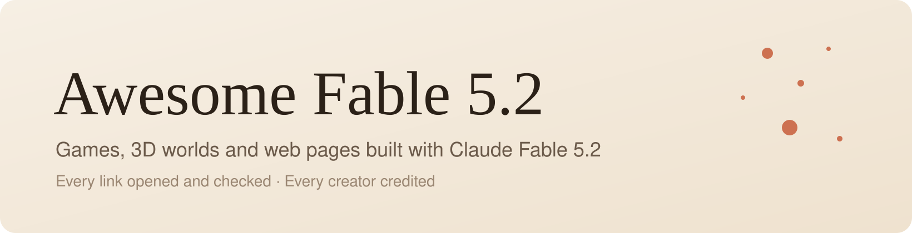

<h3>Was Leute mit Claude Fable 5.2 gebaut haben – zum Öffnen und Spielen</h3>

[English](README.md) · [简体中文](README.zh-CN.md) · [繁體中文](README.zh-TW.md) · [日本語](README.ja.md) · [한국어](README.ko.md) · [Español](README.es.md) · [Português](README.pt-BR.md) · [Français](README.fr.md) · **Deutsch** · [Русский](README.ru.md)

**🌐 Im Web: [fablelist.000ooo.ooo](https://fablelist.000ooo.ooo/de/)** (durchsuchbar, eine Seite pro Werk)

184 Live-Werke und 130 Video-Demos, gebaut mit Claude Fable 5.2, alle Links am 2026-11-17 geprüft. Täglich aktualisiert; ein ⭐ hilft.

## 📑 Inhalt

[⭐ Am beliebtesten](#-am-beliebtesten) · [🎮 Spiele](#-spiele) 88 · [🌍 3D-Welten & Szenen](#-3d-welten--szenen) 42 · [🧰 Webseiten & Tools](#-webseiten--tools) 40 · [🎬 Animation & Film](#-animation--film) 14 · [📺 Video-Demos](#-video-demos) 130 · [🤝 Mitmachen](#-mitmachen)

## ⭐ Am beliebtesten

<table>
<tr>
<td width="33%" valign="top">
 
<b><a href="https://starrynightrider.com">Starry Nightrider</a></b> 
<a href="https://x.com/ebbyamir">@ebbyamir</a> · ♥ 17.9k · <a href="https://x.com/ebbyamir/status/2120284261089673376">▶ Video</a> 
Van Gogh reitet durch seine Sternennacht, als Spiel. 
<a href="https://fablelist.000ooo.ooo/de/prompts/?w=starry-nightrider&ref=gh"><b>✨ Prompt holen</b></a>
</td>
<td width="33%" valign="top">
 
<b><a href="https://claude.ai/artifact/BGY1SztrAYcJQHSsnHHGmp">Saltline – Ego-Shooter</a></b> 
<a href="https://x.com/felixrieseberg">@felixrieseberg</a> · ♥ 14.9k · <a href="https://x.com/felixrieseberg/status/2119925633564463609">▶ Video</a> 
Von einem Anthropic-Entwickler. One-Shot-Prompts, kein menschliches Feedback, 8 Stunden, ca. 550 $. Modelle, Sounds und Texturen komplett per Code erzeugt. 
<a href="https://fablelist.000ooo.ooo/de/prompts/?w=saltline-first-person-shooter&ref=gh"><b>✨ Prompt holen</b></a>
</td>
<td width="33%" valign="top">
 
<b><a href="https://patch.gg/blendi/oil-paint">Oil Paint – handgemaltes Spiel</a></b> 
<a href="https://x.com/BlendiByl">@BlendiByl</a> · ♥ 8.0k · <a href="https://x.com/BlendiByl/status/2120341251178594532">▶ Video</a> 
In unter einer Stunde gemacht. Jedes Frame besteht aus rund 1,5 Millionen Pinselstrichen und läuft mit 200 fps in einem Browser-Tab. Open Source. 
<a href="https://fablelist.000ooo.ooo/de/prompts/?w=oil-paint-hand-painted-game&ref=gh"><b>✨ Prompt holen</b></a>
</td>
</tr>
<tr>
<td width="33%" valign="top">
 
<b><a href="https://nyc.somethingbig.ai/">CROSSTOWN – Open-World-New-York (frühe Vorschau)</a></b> 
<a href="https://x.com/mattshumer_">@mattshumer_</a> · ♥ 7.5k · <a href="https://x.com/mattshumer_/status/2120282133503820150">▶ Video</a> 
„Rockstar took 8 years. Fable 5.2 is gonna do it in 7 days.“ Bisher ist nur ein Teil der Stadt drin; drücke B, um Feedback zu senden. 
<a href="https://fablelist.000ooo.ooo/de/prompts/?w=crosstown-open-world-new-york-early-preview&ref=gh"><b>✨ Prompt holen</b></a>
</td>
<td width="33%" valign="top">
 
<b><a href="https://claude.ai/artifact/QGWUAjRrzRzZWGcQzSMLfa">Claude App auf einem Blender-Laptop</a></b> 
<a href="https://x.com/rileybrown">@rileybrown</a> · ♥ 7.1k · <a href="https://x.com/rileybrown/status/2119902109709537708">▶ Video</a> 
Ein Prompt hat den ganzen Raum in Blender gebaut und in 4K gerendert. Das ist die Webseite auf dem Laptop-Bildschirm. 
<a href="https://x.com/rileybrown/status/2119902109709537708">📝 Prompt des Creators (kostenlos)</a>
</td>
<td width="33%" valign="top">
 
<b><a href="https://claudia.gallery">Claudia Gallery</a></b> 
<a href="https://x.com/anabology">@anabology</a> · ♥ 5.4k · <a href="https://x.com/anabology/status/2120010995309457643">▶ Video</a> 
„Make the video of your dreams“ – zwei Einstellungen, 9 Stunden. 
<a href="https://fablelist.000ooo.ooo/de/prompts/?w=claudia-gallery&ref=gh"><b>✨ Prompt holen</b></a>
</td>
</tr>
</table>

## 🎮 Spiele

<table>
<tr>
<td width="33%" valign="top">
 
<b><a href="https://starrynightrider.com">Starry Nightrider</a></b> 
<a href="https://x.com/ebbyamir">@ebbyamir</a> · ♥ 17.9k · <a href="https://x.com/ebbyamir/status/2120284261089673376">▶ Video</a> 
Van Gogh reitet durch seine Sternennacht, als Spiel. 
<a href="https://fablelist.000ooo.ooo/de/prompts/?w=starry-nightrider&ref=gh"><b>✨ Prompt holen</b></a>
</td>
<td width="33%" valign="top">
 
<b><a href="https://claude.ai/artifact/BGY1SztrAYcJQHSsnHHGmp">Saltline – Ego-Shooter</a></b> 
<a href="https://x.com/felixrieseberg">@felixrieseberg</a> · ♥ 14.9k · <a href="https://x.com/felixrieseberg/status/2119925633564463609">▶ Video</a> 
Von einem Anthropic-Entwickler. One-Shot-Prompts, kein menschliches Feedback, 8 Stunden, ca. 550 $. Modelle, Sounds und Texturen komplett per Code erzeugt. 
<a href="https://fablelist.000ooo.ooo/de/prompts/?w=saltline-first-person-shooter&ref=gh"><b>✨ Prompt holen</b></a>
</td>
<td width="33%" valign="top">
 
<b><a href="https://patch.gg/blendi/oil-paint">Oil Paint – handgemaltes Spiel</a></b> 
<a href="https://x.com/BlendiByl">@BlendiByl</a> · ♥ 8.0k · <a href="https://x.com/BlendiByl/status/2120341251178594532">▶ Video</a> 
In unter einer Stunde gemacht. Jedes Frame besteht aus rund 1,5 Millionen Pinselstrichen und läuft mit 200 fps in einem Browser-Tab. Open Source. 
<a href="https://fablelist.000ooo.ooo/de/prompts/?w=oil-paint-hand-painted-game&ref=gh"><b>✨ Prompt holen</b></a>
</td>
</tr>
<tr>
<td width="33%" valign="top">
 
<b><a href="https://nyc.somethingbig.ai/">CROSSTOWN – Open-World-New-York (frühe Vorschau)</a></b> 
<a href="https://x.com/mattshumer_">@mattshumer_</a> · ♥ 7.5k · <a href="https://x.com/mattshumer_/status/2120282133503820150">▶ Video</a> 
„Rockstar took 8 years. Fable 5.2 is gonna do it in 7 days.“ Bisher ist nur ein Teil der Stadt drin; drücke B, um Feedback zu senden. 
<a href="https://fablelist.000ooo.ooo/de/prompts/?w=crosstown-open-world-new-york-early-preview&ref=gh"><b>✨ Prompt holen</b></a>
</td>
<td width="33%" valign="top">
<a href="https://omw-game.kimaki.dev">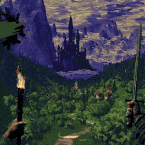</a> 
<b><a href="https://omw-game.kimaki.dev">omw: ein Burgtal in Ölpinselstrichen</a></b> 
🆕 · <a href="https://x.com/__morse">@__morse</a> · ♥ 4.3k · <a href="https://x.com/__morse/status/2122013410309153042">▶ Video</a> 
Die „omw“-Pixel-Art von @de5imulate als spielbares three.js-Spiel im Browser nachgebaut, gerendert wie ein Ölgemälde. 
<a href="https://github.com/remorses/castle-valley">Quellcode</a>
</td>
<td width="33%" valign="top">
 
<b><a href="https://what-the-water-keeps.vercel.app/">What the Water Keeps</a></b> 
<a href="https://x.com/kevin_t_ngo">@kevin_t_ngo</a> · ♥ 4.3k · <a href="https://x.com/kevin_t_ngo/status/2119868968307695818">▶ Video</a> 
Eine Bootsfahrt durch 8 traumhafte Welten, im Browser spielbar. 
<a href="https://fablelist.000ooo.ooo/de/prompts/?w=what-the-water-keeps&ref=gh"><b>✨ Prompt holen</b></a>
</td>
</tr>
<tr>
<td width="33%" valign="top">
 
<b><a href="https://tennis.sixfingerpunch.com/">Tennis</a></b> 
<a href="https://x.com/photonstorm">@photonstorm</a> · ♥ 3.1k · <a href="https://x.com/photonstorm/status/2120330010112434313">Post</a> 
Auf die Aufgabe „go wild“ bei einem Spiel lieferte es etwas, das wie ein Pong-Klon aussieht – bis du es spielst. 
<a href="https://fablelist.000ooo.ooo/de/prompts/?w=tennis&ref=gh"><b>✨ Prompt holen</b></a>
</td>
<td width="33%" valign="top">
 
<b><a href="https://patch.gg/play/blendi/small-magic">Small Magic — Zauberer-Sandbox</a></b> 
<a href="https://x.com/BlendiByl">@BlendiByl</a> · ♥ 2.5k · <a href="https://x.com/BlendiByl/status/2121594536153718972">▶ Video</a> 
An einem Tag gebaut: 7 Zauber, rund 1.800 zerstörbare Physikteile, keine Modelle oder Texturen, Open Source.
</td>
<td width="33%" valign="top">
 
<b><a href="https://www.spawn.co/@mattshumer/earth?room=local">Mirror Earth</a></b> 
<a href="https://x.com/mattshumer_">@mattshumer_</a> · ♥ 2.4k · <a href="https://x.com/mattshumer_/status/2119877065701036047">▶ Video</a> 
Der ganze Planet als zerstörbare Spielwelt, mit Wetter, das in Echtzeit der echten Erde entspricht. 
<a href="https://fablelist.000ooo.ooo/de/prompts/?w=mirror-earth&ref=gh"><b>✨ Prompt holen</b></a>
</td>
</tr>
<tr>
<td width="33%" valign="top">
 
<b><a href="https://portals-endless-worlds.netlify.app/">Portals: Endless Worlds</a></b> 
<a href="https://x.com/emollick">@emollick</a> · ♥ 1.9k · <a href="https://x.com/emollick/status/2119918307457577163">▶ Video</a> 
25.000 Agents haben über 450 reine Code-3D-Welten gebaut, inspiriert von Büchern, Kunst und Orten, verbunden durch Portale, durch die man hindurchtreibt. 
<a href="https://github.com/emollick/ai-portals">Quellcode</a> · <a href="https://www.oneusefulthing.org/p/fable-52-and-jagged-agi">Artikel</a> 
<a href="https://fablelist.000ooo.ooo/de/prompts/?w=portals-endless-worlds&ref=gh"><b>✨ Prompt holen</b></a>
</td>
<td width="33%" valign="top">
 
<b><a href="https://evensong-phi.vercel.app/">Evensong</a></b> 
<a href="https://x.com/kevin_t_ngo">@kevin_t_ngo</a> · ♥ 1.8k · <a href="https://x.com/kevin_t_ngo/status/2120238844754923874">▶ Video</a> 
Ein düsterer Fantasy-Bosskampf im Souls-like-Stil, im Browser spielbar. 
<a href="https://fablelist.000ooo.ooo/de/prompts/?w=evensong&ref=gh"><b>✨ Prompt holen</b></a>
</td>
<td width="33%" valign="top">
 
<b><a href="https://loktar00.github.io/lanternfall/">LANTERNFALL</a></b> 
<a href="https://x.com/loktar00">@loktar00</a> · ♥ 1.4k · <a href="https://x.com/loktar00/status/2120192761542615271">▶ Video</a> 
Das ganze Spiel – Animationen, Modelle, alles – wurde von Fable erzeugt. Achte auf den Effekt, wenn Gegner sterben. 
<a href="https://fablelist.000ooo.ooo/de/prompts/?w=lanternfall&ref=gh"><b>✨ Prompt holen</b></a>
</td>
</tr>
<tr>
<td width="33%" valign="top">
 
<b><a href="https://app.usecrayon.ai/play/76dbd04f-0684-4486-8cc4-eae0585295e8">Goku: Four-Star Road</a></b> 
🆕 · <a href="https://x.com/aniketjart">@aniketjart</a> · ♥ 1.3k · <a href="https://x.com/aniketjart/status/2121793239175119279">▶ Video</a> 
Ein Fan-Actionspiel nach der Red-Ribbon-Saga aus Dragon Ball, gebaut mit three.js. Noch in Arbeit; die ersten zwei Karten sind spielbar.
</td>
<td width="33%" valign="top">
 
<b><a href="https://op7418.github.io/guizang-game-skill/">Mist-Locked Mountain Gate – 3D-Actionspiel</a></b> 
<a href="https://x.com/op7418">@op7418</a> · ♥ 1.2k · <a href="https://x.com/op7418/status/2120694045299327187">▶ Video</a> 
Ein Nachmittag, 4,5 Milliarden Tokens. Modelle, Szenen und Moves komplett von Fable, verpackt in einer einzigen 30-MB-HTML-Datei. 
<a href="https://fablelist.000ooo.ooo/de/prompts/?w=mist-locked-mountain-gate-3d-action-game&ref=gh"><b>✨ Prompt holen</b></a>
</td>
<td width="33%" valign="top">
<a href="https://wavedash.com/games/rooftop-rally">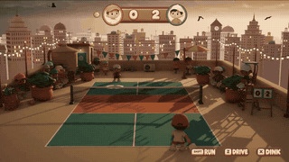</a> 
<b><a href="https://wavedash.com/games/rooftop-rally">Rooftop Rally – Pickleball in Unreal 5.9</a></b> 
<a href="https://x.com/chongdashu">@chongdashu</a> · ♥ 1.1k · <a href="https://x.com/chongdashu/status/2120154573356793883">▶ Video</a> 
Fable 5.2 mit der Unreal Engine 5.9 Preview. Charaktere von Tripo; die anderen 3D-Assets und der Rest von Fable. 
<a href="https://x.com/chongdashu/status/2120310120509014219">So entstand es</a> 
<a href="https://fablelist.000ooo.ooo/de/prompts/?w=rooftop-rally-pickleball-in-unreal-5-9&ref=gh"><b>✨ Prompt holen</b></a>
</td>
</tr>
<tr>
<td width="33%" valign="top">
 
<b><a href="https://claude.ai/artifact/MXxb36zKgN261ckbGhmNin">Three Games (Saltline · The Clockmaker's Heart · Tidewright)</a></b> 
<a href="https://x.com/felixrieseberg">@felixrieseberg</a> · ♥ 809 · <a href="https://x.com/vineerpasam/status/2119955306096857145">▶ Video</a> 
Signiert von Felix Rieseberg: „Alle Spiele wurden mit Claude Fable 5.2 gemacht. Erste Entwürfe, kein menschliches Feedback.“ Der am häufigsten geteilte Link am Launch-Tag. 
<a href="https://claude.ai/artifact/6MjtQjf4ee1ZZjEpafaEpa">The Clockmaker's Heart</a> · <a href="https://claude.ai/artifact/JTgyEMn7sn1q2riWrMb7D4">Tidewright</a> 
<a href="https://fablelist.000ooo.ooo/de/prompts/?w=three-games-saltline-the-clockmaker-s-heart-tidewright&ref=gh"><b>✨ Prompt holen</b></a>
</td>
<td width="33%" valign="top">
 
<b><a href="https://patch.gg/blendi/coloured-pencil">Coloured Pencil</a></b> 
<a href="https://x.com/BlendiByl">@BlendiByl</a> · ♥ 763 · <a href="https://x.com/BlendiByl/status/2121130385723789637">▶ Video</a> 
Ein Spielausschnitt im Buntstift-Stil; die Schattierung jeder Oberfläche und die ganze Stadt sind Code. Open Source. 
<a href="https://fablelist.000ooo.ooo/de/prompts/?w=coloured-pencil&ref=gh"><b>✨ Prompt holen</b></a>
</td>
<td width="33%" valign="top">
 
<b><a href="https://heat.pplx.app">VICE '86: Open-World-Fahren durch ein Neon-Miami von 1986</a></b> 
🆕 · <a href="https://x.com/AravSrinivas">@AravSrinivas</a> · ♥ 761 · <a href="https://x.com/AravSrinivas/status/2122338465648103676">▶ Video</a> 
Ein Open-World-Fahrspiel, das im Browser läuft. Keine Game-Engine und kein three.js: Es hat einen eigenen WebGL2-Renderer, und Stadt, Autos, Regen und Motorengeräusche werden komplett per Code erzeugt, rund 63,000 Zeilen JavaScript.
</td>
</tr>
<tr>
<td width="33%" valign="top">
 
<b><a href="https://www.spawn.co/@mattshumer/voxel-engine">Voxel Engine</a></b> 
<a href="https://x.com/mattshumer_">@mattshumer_</a> · ♥ 743 · <a href="https://x.com/mattshumer_/status/2119870965106483384">▶ Video</a> 
Aus einem einzigen Prompt entstanden. Ton an. 
<a href="https://fablelist.000ooo.ooo/de/prompts/?w=voxel-engine&ref=gh"><b>✨ Prompt holen</b></a>
</td>
<td width="33%" valign="top">
 
<b><a href="https://patch.gg/blendi/patchwork-quilt">Patchwork Quilt</a></b> 
<a href="https://x.com/BlendiByl">@BlendiByl</a> · ♥ 673 · <a href="https://x.com/BlendiByl/status/2120746541636047347">▶ Video</a> 
Ein Spielausschnitt im Patchwork- und Stop-Motion-Stil. Die ganze Map ist Code. Open Source. 
<a href="https://fablelist.000ooo.ooo/de/prompts/?w=patchwork-quilt&ref=gh"><b>✨ Prompt holen</b></a>
</td>
<td width="33%" valign="top">
 
<b><a href="https://bannerfall.itch.io/siege-wing">Siege Wing — ein Hubschrauber im mittelalterlichen Krieg</a></b> 
<a href="https://x.com/builderjaydub">@builderjaydub</a> · ♥ 570 · <a href="https://x.com/builderjaydub/status/2120223731520040966">▶ Video</a> 
Flieg einen Helikopter mit Kanone, Raketen und Lenkflugkörpern, weich römischen Ballisten aus und bring die Burg zu Fall.
</td>
</tr>
<tr>
<td width="33%" valign="top">
 
<b><a href="https://i-would-have-gotten-away-with-it.netlify.app/">I Would Have Gotten Away With It</a></b> 
<a href="https://x.com/emollick">@emollick</a> · ♥ 513 · <a href="https://x.com/emollick/status/2119876449494540554">▶ Video</a> 
Ein umgekehrtes Scooby-Doo: Du bist der Bösewicht und vertreibst neugierige Kinder. Fable hat auch Trailer, Musik und Sound gemacht. 
<a href="https://fablelist.000ooo.ooo/de/prompts/?w=i-would-have-gotten-away-with-it&ref=gh"><b>✨ Prompt holen</b></a>
</td>
<td width="33%" valign="top">
 
<b><a href="https://valsera-game.vercel.app/">Valsera — Sidescroller-RPG</a></b> 
🆕 · <a href="https://x.com/kevin_t_ngo">@kevin_t_ngo</a> · ♥ 503 · <a href="https://x.com/kevin_t_ngo/status/2121701020598415465">▶ Video</a> 
Ein im Browser spielbares Sidescroller-RPG; alle Grafiken sind mit Code gezeichnet, ohne Bildmodell oder fertige Assets.
</td>
<td width="33%" valign="top">
 
<b><a href="https://noclipepe.pages.dev/rug/">Childhood Rug Racer</a></b> 
<a href="https://x.com/noclipepe">@noclipepe</a> · ♥ 426 · <a href="https://x.com/noclipepe/status/2119728047754547326">▶ Video</a> 
Ein Rennspiel auf dem Spielteppich aus der Kindheit, derselbe Prompt wie bei GPT-6.2 Sol. Der Autor nennt das Modell „Fable 5.5 (routing)“. 
<a href="https://fablelist.000ooo.ooo/de/prompts/?w=childhood-rug-racer&ref=gh"><b>✨ Prompt holen</b></a>
</td>
</tr>
<tr>
<td width="33%" valign="top">
<a href="https://gilt-and-gutter.vercel.app/">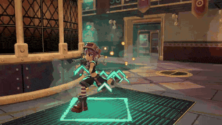</a> 
<b><a href="https://gilt-and-gutter.vercel.app/">Gilt & Gutter</a></b> 
<a href="https://x.com/kevin_t_ngo">@kevin_t_ngo</a> · ♥ 330 · <a href="https://x.com/kevin_t_ngo/status/2119900487688622171">▶ Video</a> 
Ein 1v1-Ego-Shooter mit zwei spielbaren Charakteren. 
<a href="https://fablelist.000ooo.ooo/de/prompts/?w=gilt-gutter&ref=gh"><b>✨ Prompt holen</b></a>
</td>
<td width="33%" valign="top">
 
<b><a href="https://finderchangchang.github.io/cloud-stunt-3d/">Cloud Stunt 3D</a></b> 
<a href="https://x.com/jev_chat">@jev_chat</a> · ♥ 329 · <a href="https://x.com/jev_chat/status/2120015641151426838">▶ Video</a> 
In 30 Minuten erzeugt; eine optimierte „goldene“ Version ist ebenfalls verlinkt. 
<a href="https://finderchangchang.github.io/cloud-stunt-3d/golden/">Optimized</a> 
<a href="https://x.com/jev_chat/status/2120015641151426838">📝 Prompt des Creators (kostenlos)</a>
</td>
<td width="33%" valign="top">
 
<b><a href="https://valle-morta.vercel.app/">Valle Morta</a></b> 
🆕 · <a href="https://x.com/LexnLin">@LexnLin</a> · ♥ 318 · <a href="https://x.com/LexnLin/status/2121934071429468543">▶ Video</a> 
Ein Ego-Zombie-Survival-Shooter in einem kriegszerstörten Alpental, in zwei Tagen gebaut. Keine fertigen 3D-Assets; alle Grafik wird per Code erzeugt. 
<a href="https://github.com/Leonxlnx/valle-morta">Quellcode</a>
</td>
</tr>
<tr>
<td width="33%" valign="top">
 
<b><a href="https://www.spawn.co/@mattshumer/hogwarts-royale">Hogwarts Royale</a></b> 
<a href="https://x.com/mattshumer_">@mattshumer_</a> · ♥ 312 · <a href="https://x.com/mattshumer_/status/2119872098306810226">▶ Video</a> 
„Create a mashup of Harry Potter and Fortnite“ – ein spielbares Battle Royale. 
<a href="https://x.com/mattshumer_/status/2119872098306810226">📝 Prompt des Creators (kostenlos)</a>
</td>
<td width="33%" valign="top">
 
<b><a href="https://dread-and-district.netlify.app">Dread & District</a></b> 
<a href="https://x.com/emollick">@emollick</a> · ♥ 304 · <a href="https://x.com/emollick/status/2120248525254742318">▶ Video</a> 
Eine Fantasy-Transportsimulation „mit Herz“: ein vager Absatz, dann streiten ein paar Agents über Kunst, Lore und Witze. Gute Logistik besiegt das Böse. 
<a href="https://fablelist.000ooo.ooo/de/prompts/?w=dread-district&ref=gh"><b>✨ Prompt holen</b></a>
</td>
<td width="33%" valign="top">
<a href="https://unsung-vale.vercel.app/">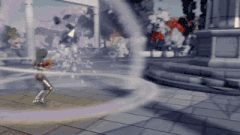</a> 
<b><a href="https://unsung-vale.vercel.app/">Unsung Vale – Open-World-RPG</a></b> 
<a href="https://x.com/LexnLin">@LexnLin</a> · ♥ 303 · <a href="https://x.com/LexnLin/status/2121253191748669705">▶ Video</a> 
Eine Third-Person-Open-World-RPG-Demo. Keine Assets: Alles auf dem Bildschirm ist mit Code gemacht. 
<a href="https://github.com/Leonxlnx/unsung-vale">Quellcode</a>
</td>
</tr>
<tr>
<td width="33%" valign="top">
<a href="https://lauramionel.github.io/cayley-flight-simulator/">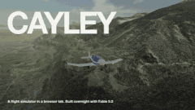</a> 
<b><a href="https://lauramionel.github.io/cayley-flight-simulator/">Cayley-Flugsimulator</a></b> 
<a href="https://x.com/lionel_mora">@lionel_mora</a> · ♥ 296 · <a href="https://x.com/lionel_mora/status/2120554787812860294">▶ Video</a> 
Über Nacht in einem Versuch: echte Flügelphysik, die Auftrieb und Widerstand für jeden Teil des Flügels berechnet. 
<a href="https://fablelist.000ooo.ooo/de/prompts/?w=cayley-flight-simulator&ref=gh"><b>✨ Prompt holen</b></a>
</td>
<td width="33%" valign="top">
 
<b><a href="https://github.com/amirmushichge/worm-rider">Worm Rider</a></b> 
<a href="https://x.com/AmirMushich">@AmirMushich</a> · ♥ 252 · <a href="https://x.com/AmirMushich/status/2119937977426338283">▶ Video</a> 
Open Source. 220 KB, 3.400 Zeilen, 10 Prompts, jedes Modell von Grund auf in Claude Code gebaut. 
<a href="https://fablelist.000ooo.ooo/de/prompts/?w=worm-rider&ref=gh"><b>✨ Prompt holen</b></a>
</td>
<td width="33%" valign="top">
 
<b><a href="https://maad-maxxing.vercel.app/">MAAD MAXXING</a></b> 
<a href="https://x.com/Andrew_Blumson">@Andrew_Blumson</a> · ♥ 249 · <a href="https://x.com/Andrew_Blumson/status/2120599812512833557">▶ Video</a> 
100 % Code, keine Assets. Die ersten 3 Stages sind spielbar; Audio von ElevenLabs. 
<a href="https://fablelist.000ooo.ooo/de/prompts/?w=maad-maxxing&ref=gh"><b>✨ Prompt holen</b></a>
</td>
</tr>
<tr>
<td width="33%" valign="top">
<a href="https://sanwan.ai/games/xingyun-moba/">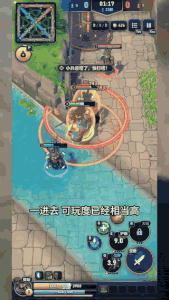</a> 
<b><a href="https://sanwan.ai/games/xingyun-moba/">Starfall – ein Browser-MOBA</a></b> 
<a href="https://x.com/FuSheng_0306">@FuSheng_0306</a> · ♥ 242 · <a href="https://x.com/FuSheng_0306/status/2121237878097207583">▶ Video</a> 
Ein Prompt, etwa 20 Stunden Fable 5.2: fünf Helden, ein menschlicher Spieler und NPCs. 
<a href="https://fablelist.000ooo.ooo/de/prompts/?w=starfall-a-browser-moba&ref=gh"><b>✨ Prompt holen</b></a>
</td>
<td width="33%" valign="top">
 
<b><a href="https://frontier.every.to/experiments/first-crush">First Crush</a></b> 
<a href="https://x.com/kieranklaassen">@kieranklaassen</a> · ♥ 229 · <a href="https://x.com/kieranklaassen/status/2119871673294037280">▶ Video</a> 
Ein Weinbau-Spiel: das Fass schrubben, 250 kg Früchte pressen, das Aräometer ablesen, eine Hefe wählen – und es erklärt, warum. Klicke auf der Seite auf „Try it“. 
<a href="https://fablelist.000ooo.ooo/de/prompts/?w=first-crush&ref=gh"><b>✨ Prompt holen</b></a>
</td>
<td width="33%" valign="top">
 
<b><a href="https://noclipepe.pages.dev/dino">Rambo Dino</a></b> 
<a href="https://x.com/noclipepe">@noclipepe</a> · ♥ 182 · <a href="https://x.com/noclipepe/status/2119927838321328577">▶ Video</a> 
Das Chrome-T-Rex-Spiel, neu gebaut. Verglichen mit Opus 5.5, Gemini 4 Carbon und GPT-6 Astra. 
<a href="https://fablelist.000ooo.ooo/de/prompts/?w=rambo-dino&ref=gh"><b>✨ Prompt holen</b></a>
</td>
</tr>
</table>

<b><a href="all/games.de.md">Alle 88 ansehen →</a></b>

<a href="#-inhalt">↑ Zurück zum Inhalt</a>

## 🌍 3D-Welten & Szenen

<table>
<tr>
<td width="33%" valign="top">
 
<b><a href="https://claude.ai/artifact/QGWUAjRrzRzZWGcQzSMLfa">Claude App auf einem Blender-Laptop</a></b> 
<a href="https://x.com/rileybrown">@rileybrown</a> · ♥ 7.1k · <a href="https://x.com/rileybrown/status/2119902109709537708">▶ Video</a> 
Ein Prompt hat den ganzen Raum in Blender gebaut und in 4K gerendert. Das ist die Webseite auf dem Laptop-Bildschirm. 
<a href="https://x.com/rileybrown/status/2119902109709537708">📝 Prompt des Creators (kostenlos)</a>
</td>
<td width="33%" valign="top">
 
<b><a href="https://patch.gg/blendi/painted-valley">Painted Valley</a></b> 
<a href="https://x.com/BlendiByl">@BlendiByl</a> · ♥ 1.8k · <a href="https://x.com/BlendiByl/status/2120694003230560585">▶ Video</a> 
Ein von Ghibli inspiriertes, handgemaltes Tal zum Durchwandern. Open Source. 
<a href="https://fablelist.000ooo.ooo/de/prompts/?w=painted-valley&ref=gh"><b>✨ Prompt holen</b></a>
</td>
<td width="33%" valign="top">
 
<b><a href="https://claude.ai/artifact/CTjrZXVdUgKJ6qJXrvvr28">Ancient Babylon, 600 BC</a></b> 
<a href="https://x.com/literallydenis">@literallydenis</a> · ♥ 1.2k · <a href="https://x.com/literallydenis/status/2120866958790848953">▶ Video</a> 
Babylon, nachgebaut aus historischen Dokumenten und Plänen, die es selbst gefunden hat, in einem 8-stündigen Lauf. Lauf frei umher. 
<a href="https://fablelist.000ooo.ooo/de/prompts/?w=ancient-babylon-600-bc&ref=gh"><b>✨ Prompt holen</b></a>
</td>
</tr>
<tr>
<td width="33%" valign="top">
 
<b><a href="https://indiranagar-live.vercel.app">1 km² Indiranagar</a></b> 
<a href="https://x.com/anshu4321">@anshu4321</a> · ♥ 1.2k · <a href="https://x.com/anshu4321/status/2119938067758772403">▶ Video</a> 
Ein lebendiger 3D-Ausschnitt von Bengaluru aus Kartendaten und einem Prompt. 
<a href="https://fablelist.000ooo.ooo/de/prompts/?w=1-km2-of-indiranagar&ref=gh"><b>✨ Prompt holen</b></a>
</td>
<td width="33%" valign="top">
 
<b><a href="https://fable-rome.surge.sh/">Rome, AD 320</a></b> 
<a href="https://x.com/petergostev">@petergostev</a> · ♥ 970 · <a href="https://x.com/petergostev/status/2120167560700383572">▶ Video</a> 
Ein Prompt, Fable 5.2 (Max) lief über Nacht, 2.618 $. 
<a href="https://x.com/petergostev/status/2120167560700383572">📝 Prompt des Creators (kostenlos)</a>
</td>
<td width="33%" valign="top">
 
<b><a href="https://github.com/Leonxlnx/room-at-dawn">Room at Dawn</a></b> 
<a href="https://x.com/LexnLin">@LexnLin</a> · ♥ 862 · <a href="https://x.com/LexnLin/status/2120910879361548565">▶ Video</a> 
Ein fotorealistisches Schlafzimmer in three.js ohne vorgefertigte Modelle oder Texturen; alles ist Code. 
<a href="https://fablelist.000ooo.ooo/de/prompts/?w=room-at-dawn&ref=gh"><b>✨ Prompt holen</b></a>
</td>
</tr>
<tr>
<td width="33%" valign="top">
 
<b><a href="https://fable-rover.vercel.app">ER-6 Terrain Explorer — ein selbstfahrender Mars-Rover</a></b> 
🆕 · <a href="https://x.com/DilumSanjaya">@DilumSanjaya</a> · ♥ 787 · <a href="https://x.com/DilumSanjaya/status/2120561077385867663">▶ Video</a> 
Fable 5.2 entwarf eine Rocker-Bogie-Aufhängung wie bei den Mars-Rovern der NASA und simulierte die Fahrt über außerirdisches Gelände.
</td>
<td width="33%" valign="top">
 
<b><a href="https://ship-42-catch.netlify.app/">Ship 42 Catch</a></b> 
🆕 · <a href="https://x.com/emollick">@emollick</a> · ♥ 728 · <a href="https://x.com/emollick/status/2122036763468214711">▶ Video</a> 
Fable und Opus haben das Video vom Starship-Fang am Turm gefunden und die letzten 40 Sekunden detailliert in three.js-3D nachgebaut. Die Kameraperspektive lässt sich wechseln.
</td>
<td width="33%" valign="top">
 
<b><a href="https://supernatural-ft.vercel.app/fire-in-ice">Fire in Ice</a></b> 
<a href="https://x.com/tkm_hmng8">@tkm_hmng8</a> · ♥ 551 · <a href="https://x.com/tkm_hmng8/status/2120813043101946324">▶ Video</a> 
Realistisches Feuer, das in Eis brennt, in reinem WebGPU ohne three.js geschrieben. 
<a href="https://fablelist.000ooo.ooo/de/prompts/?w=fire-in-ice&ref=gh"><b>✨ Prompt holen</b></a>
</td>
</tr>
<tr>
<td width="33%" valign="top">
 
<b><a href="https://bay.theojaffee.net">Bay Area Through Time</a></b> 
<a href="https://x.com/theojaffee">@theojaffee</a> · ♥ 387 · <a href="https://x.com/theojaffee/status/2120312766544437738">▶ Video</a> 
Zoome zu jeder Stadt oder jedem Viertel, wähle ein beliebiges Jahr bis 1769 zurück und sieh, wie es damals aussah. 
<a href="https://nyc.theojaffee.net">New York City</a> 
<a href="https://fablelist.000ooo.ooo/de/prompts/?w=bay-area-through-time&ref=gh"><b>✨ Prompt holen</b></a>
</td>
<td width="33%" valign="top">
 
<b><a href="http://procedural-arm-rig.vercel.app">Procedural Arm Rig</a></b> 
<a href="https://x.com/apekshik">@apekshik</a> · ♥ 326 · <a href="https://x.com/apekshik/status/2120224530367119758">▶ Video</a> 
Statt ein AAA-Spiel in einem Versuch zu bauen: ein einzelner Arm mit Skelett-Armature, gewichtetem Mesh, IK und Muskeln, die anschwellen, wenn sich die Faust ballt. 
<a href="https://fablelist.000ooo.ooo/de/prompts/?w=procedural-arm-rig&ref=gh"><b>✨ Prompt holen</b></a>
</td>
<td width="33%" valign="top">
 
<b><a href="https://samg-coder.github.io/solstice-garden/">The Garden</a></b> 
<a href="https://x.com/SamGCoder">@SamGCoder</a> · ♥ 298 · <a href="https://x.com/SamGCoder/status/2120943068321054975">▶ Video</a> 
Eine Gartenszene, in Rust geschrieben, zu WASM kompiliert und mit WebGPU gerendert. 
<a href="https://fablelist.000ooo.ooo/de/prompts/?w=the-garden&ref=gh"><b>✨ Prompt holen</b></a>
</td>
</tr>
<tr>
<td width="33%" valign="top">
 
<b><a href="https://github.com/Leonxlnx/walking-block">Walking Block: ein laufender sowjetischer Wohnblock</a></b> 
🆕 · <a href="https://x.com/LexnLin">@LexnLin</a> · ♥ 282 · <a href="https://x.com/LexnLin/status/2122359035751989341">▶ Video</a> 
Ein riesiger sowjetischer Plattenbau auf acht mechanischen Beinen überquert im Dämmerungsnebel ein nasses Feld. Geometrie, Texturen und Shader sind komplett three.js-Code, und aus derselben Szene wird ein 45-Sekunden-Film gerendert.
</td>
<td width="33%" valign="top">
 
<b><a href="http://taoistvibe.com">Chill Taoist Vibe: ein Hügel mit taoistischem Tempel</a></b> 
🆕 · <a href="https://x.com/qiqileyuan">@qiqileyuan</a> · ♥ 250 · <a href="https://x.com/qiqileyuan/status/2122006851298693277">▶ Video</a> 
Ein taoistischer Tempel im Ghibli-Stil auf einem kleinen Berg. Folge dem alten Priester bergauf, zünde Räucherstäbchen an, zieh ein Orakelstäbchen, meditiere oder setz dich einfach in den Schaukelstuhl und sieh den Jahreszeiten zu. Statuen und Hauptfigur stammen von Tripo3D, alles andere ist generierter Code.
</td>
<td width="33%" valign="top">
 
<b><a href="https://claude.ai/artifact/R6YBDkAm2GjAC5A65D9djx">Eine Claude-Demo, in die man hineinlaufen kann</a></b> 
<a href="https://x.com/dfeinition">@dfeinition</a> · ♥ 213 · <a href="https://x.com/dfeinition/status/2120330644261589051">▶ Video</a> 
Inspiriert von @rileybrown: Geh hinein und setz dich an einen beliebigen Computer. 
<a href="https://fablelist.000ooo.ooo/de/prompts/?w=a-claude-demo-you-can-walk-into&ref=gh"><b>✨ Prompt holen</b></a>
</td>
</tr>
<tr>
<td width="33%" valign="top">
<a href="https://claude.ai/artifact/2PBXuQAnWDS2NpiPXHNLfL">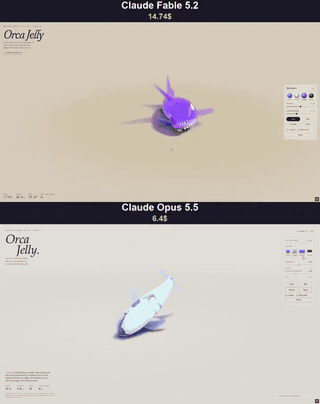</a> 
<b><a href="https://claude.ai/artifact/2PBXuQAnWDS2NpiPXHNLfL">Orca Jelly</a></b> 
<a href="https://x.com/vib3coded">@vib3coded</a> · ♥ 203 · <a href="https://x.com/vib3coded/status/2119951060752375827">▶ Video</a> 
Eine Materialstudie eines weichen Gummi-Orcas. Die Version von Opus 5.5 ist zum Vergleich verlinkt. 
<a href="https://claude.ai/artifact/75KLotWzZQ5RR23BGLePb8">Opus 5.5 version</a> 
<a href="https://x.com/vib3coded/status/2119951060752375827">📝 Prompt des Creators (kostenlos)</a>
</td>
<td width="33%" valign="top">
 
<b><a href="https://planet.tokyoaivisuals.club/">Code Planet</a></b> 
<a href="https://x.com/KanaWorks_AI">@KanaWorks_AI</a> · ♥ 198 · <a href="https://x.com/KanaWorks_AI/status/2121413647213932688">▶ Video</a> 
Ein ganzer Planet in unter 320 KB Code. Flieg vom Meer und von Wiesen durch Kirschblüten hinauf ins All, direkt im Browser.
</td>
<td width="33%" valign="top">
 
<b><a href="https://butterfly.kyzo.io">Hidden Layers: ein Glasflügelfalter im Gewächshaus</a></b> 
🆕 · <a href="https://x.com/ky__zo">@ky__zo</a> · ♥ 182 · <a href="https://x.com/ky__zo/status/2122274109795054036">▶ Video</a> 
Scrolle, um mit einem Glasflügelfalter, der nicht aus einem Gewächshaus herauskommt, durch sechs Welten zu fliegen. Reines three.js ohne Modelldateien oder Texturen; es kostete 1.32 Milliarden Tokens und $905 an API-Kosten.
</td>
</tr>
<tr>
<td width="33%" valign="top">
 
<b><a href="https://claude.ai/artifact/9EgZpErM17kH2a9Q3WXW6f">Voxel World in a Bottle</a></b> 
<a href="https://x.com/vib3coded">@vib3coded</a> · ♥ 162 · <a href="https://x.com/vib3coded/status/2120104517282775514">▶ Video</a> 
30 Minuten, 12,81 $. 
<a href="https://x.com/vib3coded/status/2120104517282775514">📝 Prompt des Creators (kostenlos)</a>
</td>
<td width="33%" valign="top">
 
<b><a href="https://github.com/Leonxlnx/beautiful-wonderland">Beautiful Wonderland</a></b> 
🆕 · <a href="https://x.com/LexnLin">@LexnLin</a> · ♥ 143 · <a href="https://x.com/LexnLin/status/2122056542778535977">▶ Video</a> 
Eine kleine gemalte Welt in three.js, dazu ein 40-sekündiger 4K-Film, der daraus gerendert wurde.
</td>
<td width="33%" valign="top">
 
<b><a href="https://patch.gg/blendi/impossible-spaces">Impossible Spaces</a></b> 
<a href="https://x.com/BlendiByl">@BlendiByl</a> · ♥ 137 · <a href="https://x.com/BlendiByl/status/2120314459793355262">▶ Video</a> 
Ein psychedelisches Erlebnis mit „unmöglichen Räumen“. Open Source. 
<a href="https://fablelist.000ooo.ooo/de/prompts/?w=impossible-spaces&ref=gh"><b>✨ Prompt holen</b></a>
</td>
</tr>
<tr>
<td width="33%" valign="top">
 
<b><a href="https://claude.ai/artifact/7ge282etTXSS4edGFTFa85">3D Sailing Ship</a></b> 
<a href="https://x.com/marcthecreatorr">@marcthecreatorr</a> · ♥ 112 · <a href="https://x.com/marcthecreatorr/status/2119890973560054072">▶ Video</a> 
Reines Three.js, kein Blender, keine externen Assets. Ca. 38 Minuten, ca. 17 $. 
<a href="https://fablelist.000ooo.ooo/de/prompts/?w=3d-sailing-ship&ref=gh"><b>✨ Prompt holen</b></a>
</td>
<td width="33%" valign="top">
 
<b><a href="https://tests.jazii.dev/">Pirate Ship</a></b> 
<a href="https://x.com/notjazii">@notjazii</a> · ♥ 110 · <a href="https://x.com/notjazii/status/2119905661505122575">▶ Video</a> 
Ein Versuch, ca. 1,5 Stunden, ca. 35 Mio. Tokens (ca. 34 $). 
<a href="https://fablelist.000ooo.ooo/de/prompts/?w=pirate-ship&ref=gh"><b>✨ Prompt holen</b></a>
</td>
</tr>
</table>

<b><a href="all/3d-worlds.de.md">Alle 42 ansehen →</a></b>

<a href="#-inhalt">↑ Zurück zum Inhalt</a>

## 🧰 Webseiten & Tools

<table>
<tr>
<td width="33%" valign="top">
 
<b><a href="https://claudia.gallery">Claudia Gallery</a></b> 
<a href="https://x.com/anabology">@anabology</a> · ♥ 5.4k · <a href="https://x.com/anabology/status/2120010995309457643">▶ Video</a> 
„Make the video of your dreams“ – zwei Einstellungen, 9 Stunden. 
<a href="https://fablelist.000ooo.ooo/de/prompts/?w=claudia-gallery&ref=gh"><b>✨ Prompt holen</b></a>
</td>
<td width="33%" valign="top">
 
<b><a href="http://robotics-lab-app.vercel.app">Robotics Lab</a></b> 
<a href="https://x.com/0xMovez">@0xMovez</a> · ♥ 4.7k · <a href="https://x.com/0xMovez/status/2120239217880268919">▶ Video</a> 
Acht echte Boards (Arduino Uno, Raspberry Pi 4 …) in 3D: Chips platzieren, einlöten, echte Schaltungen verdrahten. 
<a href="http://robolabs-app.vercel.app">Humanoid edition</a> 
<a href="https://fablelist.000ooo.ooo/de/prompts/?w=robotics-lab&ref=gh"><b>✨ Prompt holen</b></a>
</td>
<td width="33%" valign="top">
<a href="https://claude.ai/artifact/N6bSgS4ZH5ifFQfg8sm4dv">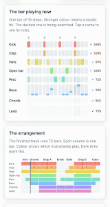</a> 
<b><a href="https://claude.ai/artifact/N6bSgS4ZH5ifFQfg8sm4dv">House-Banger-Generator</a></b> 
<a href="https://x.com/deedydas">@deedydas</a> · ♥ 4.1k · <a href="https://x.com/deedydas/status/2120905625852936318">▶ Video</a> 
Es hat Musiktheorie gelernt, probiert pro Instrument Tausende Muster aus und arrangiert die besten zu einem House-Track mit 72 Takten. Ton an. 
<a href="https://fablelist.000ooo.ooo/de/prompts/?w=house-bangers-generator&ref=gh"><b>✨ Prompt holen</b></a>
</td>
</tr>
<tr>
<td width="33%" valign="top">
 
<b><a href="https://miaai-lab.github.io/Claude-Fable-5.2-HTML-Files/">76 HTML-Einzeldateien</a></b> 
<a href="https://x.com/MiaAI_lab">@MiaAI_lab</a> · ♥ 2.6k · <a href="https://x.com/MiaAI_lab/status/2119930229661503893">Post</a> 
Generative Kunst, Physik, Typografie und UI, jeweils mit dem ursprünglichen Prompt. 
<a href="https://fablelist.000ooo.ooo/de/prompts/?w=76-single-file-html-pieces&ref=gh"><b>✨ Prompt holen</b></a>
</td>
<td width="33%" valign="top">
 
<b><a href="https://pixel-worlds.vercel.app/keep/">Keep – Passwortstärke-Anzeige</a></b> 
<a href="https://x.com/crtvTeknologist">@crtvTeknologist</a> · ♥ 1.6k · <a href="https://x.com/crtvTeknologist/status/2119894073024606617">▶ Video</a> 
Eine Passwortstärke-Anzeige, dargestellt als lebendige Pixelwelt. 
<a href="https://github.com/finktheartist/pixel-worlds">Quellcode</a> 
<a href="https://fablelist.000ooo.ooo/de/prompts/?w=keep-password-strength-meter&ref=gh"><b>✨ Prompt holen</b></a>
</td>
<td width="33%" valign="top">
 
<b><a href="https://masterofvfx2070.github.io/xray-mirror/">X-Ray Mirror</a></b> 
<a href="https://x.com/HashemGhaili">@HashemGhaili</a> · ♥ 1.4k · <a href="https://x.com/HashemGhaili/status/2120202746121085321">▶ Video</a> 
Richte eine Webcam auf dein Gesicht und sieh Schädel, Gehirn und Muskeln, live verfolgt. Öffne den Mund und der Kiefer öffnet sich; das Video verlässt nie deinen Computer. 
<a href="https://github.com/MasterOfVFX2070/xray-mirror">Quellcode</a> 
<a href="https://fablelist.000ooo.ooo/de/prompts/?w=x-ray-mirror&ref=gh"><b>✨ Prompt holen</b></a>
</td>
</tr>
<tr>
<td width="33%" valign="top">
 
<b><a href="https://sakuga-vfx.vercel.app">Sakuga Set</a></b> 
🆕 · <a href="https://x.com/crtvTeknologist">@crtvTeknologist</a> · ♥ 1.4k · <a href="https://x.com/crtvTeknologist/status/2122088829565698218">▶ Video</a> 
Zwölf UI-Elemente, die wie im Anime reagieren: Buttons quetschen sich und landen mit einem DON!, Schalter verwischen und spritzen, Slider wirbeln Wolken auf. Alle Effekte sind im Code gezeichnet, je eine Datei, ohne Abhängigkeiten. 
<a href="https://github.com/finktheartist/sakuga-vfx">Quellcode</a>
</td>
<td width="33%" valign="top">
 
<b><a href="https://xianxie6.github.io/animals-planner-2027/">Animals at Work – 3D-Planer</a></b> 
<a href="https://x.com/Xian0063">@Xian0063</a> · ♥ 1.2k · <a href="https://x.com/Xian0063/status/2120417834694250522">▶ Video</a> 
Ein Papierplaner in 3D nachgebaut: zum Umblättern ziehen, auf ein Datum tippen zum Schreiben, 90 Sticker zum Ablösen und Aufkleben. Opus 5.5 baute das Gerüst; Fable 5.2 verfeinerte die Materialien anhand echter Aufnahmen. 
<a href="https://fablelist.000ooo.ooo/de/prompts/?w=animals-at-work-3d-planner&ref=gh"><b>✨ Prompt holen</b></a>
</td>
<td width="33%" valign="top">
 
<b><a href="https://uberdesigner.ai/t/spine-menu">Spine Menu</a></b> 
<a href="https://x.com/seanaiux">@seanaiux</a> · ♥ 1.2k · <a href="https://x.com/seanaiux/status/2120222459110789574">▶ Video</a> 
„Have you ever seen a menu that looks better?“ Die Seite enthält den Prompt. 
<a href="https://uberdesigner.ai/t/aquarium-toggle">Aquarium toggle</a> · <a href="https://uberdesigner.ai/t/glow-widgets">Glow widgets</a>
</td>
</tr>
<tr>
<td width="33%" valign="top">
 
<b><a href="https://roverkit.vercel.app">RoverKit — Roboterauto bauen und simulieren</a></b> 
🆕 · <a href="https://x.com/DilumSanjaya">@DilumSanjaya</a> · ♥ 1.1k · <a href="https://x.com/DilumSanjaya/status/2121286147393651085">▶ Video</a> 
Eine Schritt-für-Schritt-Anleitung zum Bau eines Roboterautos, mit Simulator, anpassbarer Arena und visueller Code-Erklärung. Unterstützt Arduino und ESP32.
</td>
<td width="33%" valign="top">
 
<b><a href="https://github.com/AlexAtFF/pulp-daw-public">PULP – eine KI-native DAW</a></b> 
<a href="https://x.com/The_Alex">@The_Alex</a> · ♥ 942 · <a href="https://x.com/The_Alex/status/2119917226769985785">▶ Video</a> 
Eine native Windows-Digital-Audio-Workstation. Bitte Claude um Musik, und es öffnet die DAW und macht den Song. 
<a href="https://fablelist.000ooo.ooo/de/prompts/?w=pulp-an-ai-native-daw&ref=gh"><b>✨ Prompt holen</b></a>
</td>
<td width="33%" valign="top">
 
<b><a href="https://frontier.every.to/experiments/ambient-town">Ambient Town</a></b> 
<a href="https://x.com/kieranklaassen">@kieranklaassen</a> · ♥ 895 · <a href="https://x.com/kieranklaassen/status/2119868196773929160">▶ Video</a> 
Eine Ambient-DAW, in einer Woche voller Nächte von einem ehemaligen Filmkomponisten gebaut: Ableton-Push-Unterstützung, Mikrofone, Effekte, ein Synthesizer und ein Agent, der mit dir komponiert. Klicke auf der Seite auf „Try it“. 
<a href="https://fablelist.000ooo.ooo/de/prompts/?w=ambient-town&ref=gh"><b>✨ Prompt holen</b></a>
</td>
</tr>
<tr>
<td width="33%" valign="top">
 
<b><a href="https://itspsneha.com/supplements">Which Vitamins to Buy in India</a></b> 
<a href="https://x.com/itspsneha">@itspsneha</a> · ♥ 738 · <a href="https://x.com/itspsneha/status/2120048494761451974">Post</a> 
Entstanden nach dem Lesen von Laborberichten zu 109 getesteten Chargen. 
<a href="https://fablelist.000ooo.ooo/de/prompts/?w=which-vitamins-to-buy-in-india&ref=gh"><b>✨ Prompt holen</b></a>
</td>
<td width="33%" valign="top">
 
<b><a href="https://v2.video/riley/the-history-of-writing/v1">The History of Writing</a></b> 
<a href="https://x.com/rileybrown">@rileybrown</a> · ♥ 667 · <a href="https://x.com/rileybrown/status/2119946022767980985">▶ Video</a> 
Ein interaktiver Film aus einem Prompt; Prompt und Dateien sind geteilt. 
<a href="https://x.com/rileybrown/status/2119946022767980985">📝 Prompt des Creators (kostenlos)</a>
</td>
<td width="33%" valign="top">
 
<b><a href="https://auden-english-135.netlify.app/">Audens verlorener Lyrikkurs von 1941, rekonstruiert</a></b> 
🆕 · <a href="https://x.com/emollick">@emollick</a> · ♥ 594 · <a href="https://x.com/emollick/status/2121641417483169934">Post</a> 
Fable 5.2 rekonstruierte W. H. Audens Kurs, den „schwersten in den Geisteswissenschaften“, aus einem obskuren Buch im Internet Archive und verstreuten Notizen.
</td>
</tr>
<tr>
<td width="33%" valign="top">
 
<b><a href="https://where-is-everybody-fermi.netlify.app/">Where Is Everybody?</a></b> 
<a href="https://x.com/emollick">@emollick</a> · ♥ 456 · <a href="https://x.com/emollick/status/2120359214157603139">Post</a> 
Auf die Aufgabe „solve the Fermi Paradox“ sammelt es Daten, testet Hypothesen und prüft sie gegen Kritiker. 
<a href="https://resolving-the-great-silence.netlify.app/">Gemini Carbon version</a> 
<a href="https://x.com/emollick/status/2120359214157603139">📝 Prompt des Creators (kostenlos)</a>
</td>
<td width="33%" valign="top">
 
<b><a href="https://gsplan.org">Galatasaray-Sitzplatzansicht</a></b> 
<a href="https://x.com/molenbeek84">@molenbeek84</a> · ♥ 429 · <a href="https://x.com/molenbeek84/status/2120847639411331097">Post</a> 
Sieh die Aussicht aufs Spielfeld von jedem Block im RAMS Park, bevor du ein Ticket kaufst. 
<a href="https://fablelist.000ooo.ooo/de/prompts/?w=galatasaray-seat-view&ref=gh"><b>✨ Prompt holen</b></a>
</td>
<td width="33%" valign="top">
 
<b><a href="https://www.bubbbly.com/christmas-cards">Christmas Cards: interaktive Weihnachtskarten</a></b> 
🆕 · <a href="https://x.com/ann_nnng">@ann_nnng</a> · ♥ 259 · <a href="https://x.com/ann_nnng/status/2122283549000712249">▶ Video</a> 
Eine Reihe interaktiver Weihnachtskarten, etwa eine Katze mit rotem Schal auf der Fensterbank, die dem Schneefall zusieht.
</td>
</tr>
<tr>
<td width="33%" valign="top">
 
<b><a href="https://origamihelper.com">Origami Helper</a></b> 
<a href="https://x.com/ryoma_nakajima">@ryoma_nakajima</a> · ♥ 219 · <a href="https://x.com/ryoma_nakajima/status/2120472383241011323">▶ Video</a> 
Lerne Origami-Faltungen in 3D aus jedem Winkel, mit AR. Kostenlos, ohne Anmeldung, an einem Tag gebaut. 
<a href="https://fablelist.000ooo.ooo/de/prompts/?w=origami-helper&ref=gh"><b>✨ Prompt holen</b></a>
</td>
<td width="33%" valign="top">
 
<b><a href="https://typed.page/">Typed</a></b> 
<a href="https://x.com/clairevo">@clairevo</a> · ♥ 205 · <a href="https://x.com/clairevo/status/2119905651359142132">▶ Video</a> 
Eine voll funktionsfähige Schreibmaschine: Tasten tippen oder anklicken, Schreib-Timer, Korrekturlack, Autokorrektur. 
<a href="https://fablelist.000ooo.ooo/de/prompts/?w=typed&ref=gh"><b>✨ Prompt holen</b></a>
</td>
<td width="33%" valign="top">
 
<b><a href="https://clockendbader.github.io/fable-builds/heartbeat/">One Heartbeat</a></b> 
<a href="https://x.com/clockendbader">@clockendbader</a> · ♥ 153 · <a href="https://x.com/clockendbader/status/2121246903207961069">Post</a> 
Ein schlagendes 3D-Herz mit Live-EKG- und Druckkurven sowie Herztönen; vergleiche normal, Vorhofflimmern, Herzblock und Aortenstenose. Es hat auch seine eigenen Tests geschrieben. 
<a href="https://fablelist.000ooo.ooo/de/prompts/?w=one-heartbeat&ref=gh"><b>✨ Prompt holen</b></a>
</td>
</tr>
<tr>
<td width="33%" valign="top">
 
<b><a href="https://patch.gg/patch/anymove">anymove</a></b> 
<a href="https://x.com/rehan_shei">@rehan_shei</a> · ♥ 141 · <a href="https://x.com/rehan_shei/status/2120409150870159414">▶ Video</a> 
Überträgt die Bewegungen eines KI-Videoclips auf ein echtes 3D-Rig – ohne Mocap-Anzug, ohne Keyframes. Open Source. 
<a href="https://fablelist.000ooo.ooo/de/prompts/?w=anymove&ref=gh"><b>✨ Prompt holen</b></a>
</td>
<td width="33%" valign="top">
 
<b><a href="https://motionsites.ai/?prompt=vante-ribbon-hero">Ribbon Hero</a></b> 
<a href="https://x.com/viktoroddy">@viktoroddy</a> · ♥ 139 · <a href="https://x.com/viktoroddy/status/2119985044542705916">▶ Video</a> 
Ein Hero-Bereich, gemacht mit Fable 5.2 + GPT Image 2.6.
</td>
<td width="33%" valign="top">
 
<b><a href="https://nikechan.com/">nikechan.com Redesign</a></b> 
<a href="https://x.com/tegnike">@tegnike</a> · ♥ 130 · <a href="https://x.com/tegnike/status/2120110145841578173">Post</a> 
Eine persönliche Website, komplett neu gestaltet. 
<a href="https://fablelist.000ooo.ooo/de/prompts/?w=nikechan-com-redesign&ref=gh"><b>✨ Prompt holen</b></a>
</td>
</tr>
</table>

<b><a href="all/web-and-tools.de.md">Alle 40 ansehen →</a></b>

<a href="#-inhalt">↑ Zurück zum Inhalt</a>

## 🎬 Animation & Film

<table>
<tr>
<td width="33%" valign="top">
 
<b><a href="https://github.com/ChetasLua/crimson-loong">Crimson Loong</a></b> 
<a href="https://x.com/chetaslua">@chetaslua</a> · ♥ 3.7k · <a href="https://x.com/chetaslua/status/2121176151234330707">▶ Video</a> 
Ein 90-sekündiger Drachenfilm in three.js, reiner Code ohne externe Assets. 
<a href="https://fablelist.000ooo.ooo/de/prompts/?w=crimson-loong&ref=gh"><b>✨ Prompt holen</b></a>
</td>
<td width="33%" valign="top">
 
<b><a href="https://github.com/BubbleBrainBB/awesome-fable-5.2/tree/main/cat-garden">Cat Garden: ein botanischer Garten durch die Augen einer Katze</a></b> 
🆕 · <a href="https://x.com/BubbleBrain">@BubbleBrain</a> · ♥ 879 · <a href="https://x.com/BubbleBrain/status/2122313967473434639">▶ Video</a> 
Ein 110-Sekunden-Film in einer Einstellung: Eine Katze läuft, schnuppert und springt durch einen botanischen Garten. Das Bild stammt aus einem eigens geschriebenen Path Tracer, der Ton wird mit numpy synthetisiert, ganz ohne Assets.
</td>
<td width="33%" valign="top">
 
<b><a href="https://github.com/amirmushichge/shred-kit">Shred Kit Papier-Schredder-Vorlage</a></b> 
<a href="https://x.com/AmirMushich">@AmirMushich</a> · ♥ 430 · <a href="https://x.com/AmirMushich/status/2121339167800213934">▶ Video</a> 
Ein 8-sekündiges Papier-Schredder-Reel, gemacht mit Fable 5.2 und Blender, als kostenlose Vorlage geteilt.
</td>
</tr>
<tr>
<td width="33%" valign="top">
 
<b><a href="https://github.com/ChetasLua/pelican-riding-a-bicycle">The Pelican, Tired of the Road</a></b> 
<a href="https://x.com/chetaslua">@chetaslua</a> · ♥ 357 · <a href="https://x.com/chetaslua/status/2120438091647218025">▶ Video</a> 
Ein 60-sekündiger Film im handgemalten Look über den Pelikan aus dem SVG-Test. Eine HTML-Datei; jedes Pixel und jeder Sound ist Code. 
<a href="https://github.com/ChetasLua/mona-lisa-js">Mona Lisa in JS</a> 
<a href="https://fablelist.000ooo.ooo/de/prompts/?w=the-pelican-tired-of-the-road&ref=gh"><b>✨ Prompt holen</b></a>
</td>
<td width="33%" valign="top">
 
<b><a href="https://github.com/Leonxlnx/castle-cinematic">Castle Cinematic</a></b> 
🆕 · <a href="https://x.com/LexnLin">@LexnLin</a> · ♥ 314 · <a href="https://x.com/LexnLin/status/2122112228522623459">▶ Video</a> 
Ein 45-sekündiger 4K-Film einer gotischen Burg auf einer Klippe im Sonnenuntergang. Jedes Bild stammt aus rund 9.000 Zeilen Python in Blender, ohne 3D-Assets oder Texturen.
</td>
<td width="33%" valign="top">
 
<b><a href="https://github.com/anstapnever/one-sweep">One Sweep</a></b> 
<a href="https://x.com/anstapnever">@anstapnever</a> · ♥ 252 · <a href="https://x.com/anstapnever/status/2119772039037014524">▶ Video</a> 
Ein 78-sekündiger Anime-Kampf in reinem Three.js, sechs Agent-Teams parallel. Der Autor sagt „Fable 5.5“. 
<a href="https://x.com/anstapnever/status/2119772039037014524">📝 Prompt des Creators (kostenlos)</a>
</td>
</tr>
<tr>
<td width="33%" valign="top">
 
<b><a href="https://github.com/crossps/ballpoint">Ballpoint</a></b> 
<a href="https://x.com/camperaigg">@camperaigg</a> · ♥ 242 · <a href="https://x.com/camperaigg/status/2119777467074580741">▶ Video</a> 
Makro-ASMR eines Kugelschreibers, als Open Source veröffentlicht, um zu belegen, dass es Code ist und kein Videomodell. 
<a href="https://fablelist.000ooo.ooo/de/prompts/?w=ballpoint&ref=gh"><b>✨ Prompt holen</b></a>
</td>
<td width="33%" valign="top">
<a href="https://github.com/ChetasLua/godzilla-nights">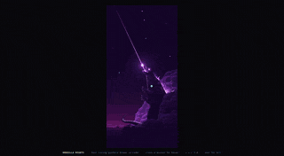</a> 
<b><a href="https://github.com/ChetasLua/godzilla-nights">Godzilla Nights</a></b> 
<a href="https://x.com/chetaslua">@chetaslua</a> · ♥ 229 · <a href="https://x.com/chetaslua/status/2119981510199808368">▶ Video</a> 
Bilder in reinem Code gezeichnet, leicht animiert. 
<a href="https://fablelist.000ooo.ooo/de/prompts/?w=godzilla-nights&ref=gh"><b>✨ Prompt holen</b></a>
</td>
<td width="33%" valign="top">
 
<b><a href="https://github.com/0xCodez/thousand-peaks">Dragon of a Thousand Peaks — Drache der tausend Gipfel</a></b> 
🆕 · <a href="https://x.com/0xMovez">@0xMovez</a> · ♥ 129 · <a href="https://x.com/0xMovez/status/2121721290687983906">▶ Video</a> 
Ein 90-sekündiger Kampffilm in reinem three.js ohne Assets oder Videomodelle; Fable 5.2 führte als Regisseur 8 parallele Agenten, Musik und Sounds sind im Code synthetisiert.
</td>
</tr>
<tr>
<td width="33%" valign="top">
 
<b><a href="https://github.com/anstapnever/blackout">Blackout</a></b> 
<a href="https://x.com/anstapnever">@anstapnever</a> · ♥ 119 · <a href="https://x.com/anstapnever/status/2119915123070644263">▶ Video</a> 
Ein 79-sekündiger Anime-Kurzfilm, alles Code. 
<a href="https://x.com/anstapnever/status/2119915123070644263">📝 Prompt des Creators (kostenlos)</a>
</td>
</tr>
</table>

<b><a href="all/animation.de.md">Alle 14 ansehen →</a></b>

<a href="#-inhalt">↑ Zurück zum Inhalt</a>

## 📺 Video-Demos

Die Creator haben ein Video, aber keinen Link geteilt. Klick auf die Vorschau für den Originalpost.

<table>
<tr>
<td width="33%" valign="top">
 
<b><a href="https://x.com/claudeai/status/2119899459761131615">Anthropic: Projekte vor dem Release</a></b> 
<a href="https://x.com/claudeai">@claudeai</a> · ♥ 43.1k · <a href="https://x.com/claudeai/status/2119899459761131615">▶ Video</a> 
Was Fable 5.2 und Mythos 5.2 in der Testphase in verschiedenen Bereichen gebaut haben. 
<a href="https://fablelist.000ooo.ooo/de/prompts/?w=anthropic-pre-release-projects&ref=gh"><b>✨ Prompt holen</b></a>
</td>
<td width="33%" valign="top">
 
<b><a href="https://x.com/anxuanng/status/2120088745139638375">Ein 3D-Film, der das Zenon-Paradoxon erklärt</a></b> 
<a href="https://x.com/anxuanng">@anxuanng</a> · ♥ 10.0k · <a href="https://x.com/anxuanng/status/2120088745139638375">▶ Video</a> 
 
<a href="https://fablelist.000ooo.ooo/de/prompts/?w=a-3d-film-explaining-zeno-s-paradox&ref=gh"><b>✨ Prompt holen</b></a>
</td>
<td width="33%" valign="top">
 
<b><a href="https://x.com/imjustnewatai/status/2120383964686729410">Eine Sinfonie in Form eines Trainingslaufs</a></b> 
<a href="https://x.com/imjustnewatai">@imjustnewatai</a> · ♥ 9.7k · <a href="https://x.com/imjustnewatai/status/2120383964686729410">▶ Video</a> 
 
<a href="https://fablelist.000ooo.ooo/de/prompts/?w=a-symphony-shaped-like-a-training-run&ref=gh"><b>✨ Prompt holen</b></a>
</td>
</tr>
<tr>
<td width="33%" valign="top">
 
<b><a href="https://x.com/everestchris6/status/2120175941616128277">2D-Grundrisse, in 3D-Rundgänge verwandelt</a></b> 
<a href="https://x.com/everestchris6">@everestchris6</a> · ♥ 7.3k · <a href="https://x.com/everestchris6/status/2120175941616128277">▶ Video</a> 
 
<a href="https://x.com/everestchris6/status/2120175941616128277">📝 Prompt des Creators (kostenlos)</a>
</td>
<td width="33%" valign="top">
 
<b><a href="https://x.com/dominikmartn/status/2120154832694858224">Es kann tatsächlich designen</a></b> 
<a href="https://x.com/dominikmartn">@dominikmartn</a> · ♥ 7.3k · <a href="https://x.com/dominikmartn/status/2120154832694858224">▶ Video</a> 
 
<a href="https://fablelist.000ooo.ooo/de/prompts/?w=it-can-actually-design&ref=gh"><b>✨ Prompt holen</b></a>
</td>
<td width="33%" valign="top">
 
<b><a href="https://x.com/suna_gaku/status/2119952985933697063">„Show me your best video“</a></b> 
<a href="https://x.com/suna_gaku">@suna_gaku</a> · ♥ 6.8k · <a href="https://x.com/suna_gaku/status/2119952985933697063">▶ Video</a> 
 
<a href="https://x.com/suna_gaku/status/2119952985933697063">📝 Prompt des Creators (kostenlos)</a>
</td>
</tr>
<tr>
<td width="33%" valign="top">
 
<b><a href="https://x.com/yohakutoink/status/2120824797215310208">Ein Gemälde im Code kopiert – „das Original hat hier einen Fleck, meins nicht“</a></b> 
<a href="https://x.com/yohakutoink">@yohakutoink</a> · ♥ 6.4k · <a href="https://x.com/yohakutoink/status/2120824797215310208">▶ Video</a> 
 
<a href="https://fablelist.000ooo.ooo/de/prompts/?w=painting-a-copy-in-code-the-original-has&ref=gh"><b>✨ Prompt holen</b></a>
</td>
<td width="33%" valign="top">
 
<b><a href="https://x.com/matabee_GTO/status/2120995946372985144">Ein Prompt: Mach das unangenehmste Video, das du kannst</a></b> 
<a href="https://x.com/matabee_GTO">@matabee_GTO</a> · ♥ 4.8k · <a href="https://x.com/matabee_GTO/status/2120995946372985144">▶ Video</a> 
 
<a href="https://x.com/matabee_GTO/status/2120995946372985144">📝 Prompt des Creators (kostenlos)</a>
</td>
<td width="33%" valign="top">
 
<b><a href="https://x.com/JungleSilicon/status/2121782359901212987">Gaussian Splats im Pixel-Art-Stil</a></b> 
🆕 · <a href="https://x.com/JungleSilicon">@JungleSilicon</a> · ♥ 4.7k · <a href="https://x.com/JungleSilicon/status/2121782359901212987">▶ Video</a> 

</td>
</tr>
<tr>
<td width="33%" valign="top">
 
<b><a href="https://x.com/MrTacticalX/status/2121082861902070130">Drei Fable-5.2-Agents bauen in 7 h 41 min einen Computer</a></b> 
<a href="https://x.com/MrTacticalX">@MrTacticalX</a> · ♥ 4.6k · <a href="https://x.com/MrTacticalX/status/2121082861902070130">▶ Video</a> 
 
<a href="https://fablelist.000ooo.ooo/de/prompts/?w=three-fable-5-2-agents-build-a-computer&ref=gh"><b>✨ Prompt holen</b></a>
</td>
<td width="33%" valign="top">
 
<b><a href="https://x.com/XRarchitect/status/2120947265007440052">Atlas + Fable 5.2 + three.js</a></b> 
<a href="https://x.com/XRarchitect">@XRarchitect</a> · ♥ 4.4k · <a href="https://x.com/XRarchitect/status/2120947265007440052">▶ Video</a> 
 
<a href="https://fablelist.000ooo.ooo/de/prompts/?w=atlas-fable-5-2-three-js&ref=gh"><b>✨ Prompt holen</b></a>
</td>
<td width="33%" valign="top">
 
<b><a href="https://x.com/aollivier82/status/2120260208245043663">Die Geschichte der Computergrafik, animiert</a></b> 
<a href="https://x.com/aollivier82">@aollivier82</a> · ♥ 3.2k · <a href="https://x.com/aollivier82/status/2120260208245043663">▶ Video</a> 
 
<a href="https://fablelist.000ooo.ooo/de/prompts/?w=the-history-of-computer-graphics-animated&ref=gh"><b>✨ Prompt holen</b></a>
</td>
</tr>
<tr>
<td width="33%" valign="top">
 
<b><a href="https://x.com/timhwang/status/2122011842549600506">Ein Chatbot mit 6 Mio. Parametern auf einem Game-Boy-Modul</a></b> 
🆕 · <a href="https://x.com/timhwang">@timhwang</a> · ♥ 3.2k · <a href="https://x.com/timhwang/status/2122011842549600506">▶ Video</a> 

</td>
<td width="33%" valign="top">
 
<b><a href="https://x.com/M__Houser/status/2120253236309569696">Age of Dragon, eine Open World von einem Nicht-Programmierer</a></b> 
<a href="https://x.com/M__Houser">@M__Houser</a> · ♥ 2.6k · <a href="https://x.com/M__Houser/status/2120253236309569696">▶ Video</a> 
 
<a href="https://fablelist.000ooo.ooo/de/prompts/?w=age-of-dragon-an-open-world-by-a&ref=gh"><b>✨ Prompt holen</b></a>
</td>
<td width="33%" valign="top">
<a href="https://x.com/aecyydesign/status/2120239401821487149">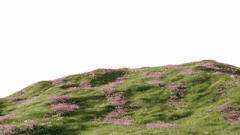</a> 
<b><a href="https://x.com/aecyydesign/status/2120239401821487149">Eine mit Blender gemachte Animation</a></b> 
<a href="https://x.com/aecyydesign">@aecyydesign</a> · ♥ 2.5k · <a href="https://x.com/aecyydesign/status/2120239401821487149">▶ Video</a> 
 
<a href="https://fablelist.000ooo.ooo/de/prompts/?w=an-animation-made-with-blender&ref=gh"><b>✨ Prompt holen</b></a>
</td>
</tr>
<tr>
<td width="33%" valign="top">
 
<b><a href="https://x.com/alexalbert__/status/2119916954337349737">Da Vincis Notizbücher, interaktiv</a></b> 
<a href="https://x.com/alexalbert__">@alexalbert__</a> · ♥ 2.5k · <a href="https://x.com/alexalbert__/status/2119916954337349737">▶ Video</a> 
Ein 500 Jahre altes Notizbuch-PDF, verwandelt in Erfindungen zum Ausprobieren. 
<a href="https://fablelist.000ooo.ooo/de/prompts/?w=da-vinci-s-notebooks-interactive&ref=gh"><b>✨ Prompt holen</b></a>
</td>
<td width="33%" valign="top">
<a href="https://x.com/ChrisGPT/status/2119998815856218494">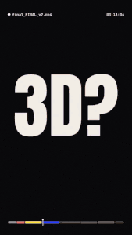</a> 
<b><a href="https://x.com/ChrisGPT/status/2119998815856218494">Eine Nachricht an Videoeditoren</a></b> 
<a href="https://x.com/ChrisGPT">@ChrisGPT</a> · ♥ 2.5k · <a href="https://x.com/ChrisGPT/status/2119998815856218494">▶ Video</a> 
 
<a href="https://fablelist.000ooo.ooo/de/prompts/?w=a-message-to-video-editors&ref=gh"><b>✨ Prompt holen</b></a>
</td>
<td width="33%" valign="top">
 
<b><a href="https://x.com/hayashimon1/status/2121943011525624151">Ein Gang über einen alten Bahnsteig, per Blender MCP</a></b> 
🆕 · <a href="https://x.com/hayashimon1">@hayashimon1</a> · ♥ 2.4k · <a href="https://x.com/hayashimon1/status/2121943011525624151">▶ Video</a> 

</td>
</tr>
<tr>
<td width="33%" valign="top">
<a href="https://x.com/theo/status/2119926277801144695">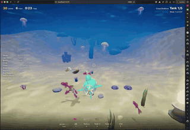</a> 
<b><a href="https://x.com/theo/status/2119926277801144695">Fishslop-Lauf</a></b> 
<a href="https://x.com/theo">@theo</a> · ♥ 2.3k · <a href="https://x.com/theo/status/2119926277801144695">▶ Video</a> 
76 Minuten, ca. 42 $. 
<a href="https://fablelist.000ooo.ooo/de/prompts/?w=fishslop-run&ref=gh"><b>✨ Prompt holen</b></a>
</td>
<td width="33%" valign="top">
 
<b><a href="https://x.com/GPTabby/status/2119909996645298519">Ein Rennspiel in Unreal Engine 5 aus einem Prompt</a></b> 
<a href="https://x.com/GPTabby">@GPTabby</a> · ♥ 2.2k · <a href="https://x.com/GPTabby/status/2119909996645298519">▶ Video</a> 
 
<a href="https://fablelist.000ooo.ooo/de/prompts/?w=a-racing-game-in-unreal-engine-5-from&ref=gh"><b>✨ Prompt holen</b></a>
</td>
<td width="33%" valign="top">
 
<b><a href="https://x.com/ryoma_nakajima/status/2120052388434473233">Es kann endlich Origami falten</a></b> 
<a href="https://x.com/ryoma_nakajima">@ryoma_nakajima</a> · ♥ 2.0k · <a href="https://x.com/ryoma_nakajima/status/2120052388434473233">▶ Video</a> 
 
<a href="https://x.com/ryoma_nakajima/status/2120052388434473233">📝 Prompt des Creators (kostenlos)</a>
</td>
</tr>
<tr>
<td width="33%" valign="top">
 
<b><a href="https://x.com/_sholtodouglas/status/2119935331499925557">Arena-FPS mit Portalen</a></b> 
<a href="https://x.com/_sholtodouglas">@_sholtodouglas</a> · ♥ 2.0k · <a href="https://x.com/_sholtodouglas/status/2119935331499925557">▶ Video</a> 
Im Büro Probe gespielt. 
<a href="https://fablelist.000ooo.ooo/de/prompts/?w=arena-fps-with-portals&ref=gh"><b>✨ Prompt holen</b></a>
</td>
<td width="33%" valign="top">
 
<b><a href="https://x.com/alexmichael/status/2119876626179870838">Ein ganzes Video, entstanden durch Python für Blender</a></b> 
<a href="https://x.com/alexmichael">@alexmichael</a> · ♥ 1.9k · <a href="https://x.com/alexmichael/status/2119876626179870838">▶ Video</a> 
 
<a href="https://fablelist.000ooo.ooo/de/prompts/?w=a-whole-video-made-by-writing-python-for&ref=gh"><b>✨ Prompt holen</b></a>
</td>
<td width="33%" valign="top">
 
<b><a href="https://x.com/Kashiko_AIart/status/2120640633346097400">„Show me your work“</a></b> 
<a href="https://x.com/Kashiko_AIart">@Kashiko_AIart</a> · ♥ 1.8k · <a href="https://x.com/Kashiko_AIart/status/2120640633346097400">▶ Video</a> 
 
<a href="https://fablelist.000ooo.ooo/de/prompts/?w=show-me-your-work&ref=gh"><b>✨ Prompt holen</b></a>
</td>
</tr>
<tr>
<td width="33%" valign="top">
 
<b><a href="https://x.com/chrisjdimarco/status/2120752985949057215">Ein Schwarm aus 1.048.576 Nanobots, der sich in eine Hand, einen Wal, eine Rakete oder eine DNA-Doppelhelix verwandelt</a></b> 
<a href="https://x.com/chrisjdimarco">@chrisjdimarco</a> · ♥ 1.7k · <a href="https://x.com/chrisjdimarco/status/2120752985949057215">▶ Video</a> 

</td>
<td width="33%" valign="top">
 
<b><a href="https://x.com/_MaxBlade/status/2120109725740159390">4 Stunden in Unreal Engine 5.9 per MCP</a></b> 
<a href="https://x.com/_MaxBlade">@_MaxBlade</a> · ♥ 1.7k · <a href="https://x.com/_MaxBlade/status/2120109725740159390">▶ Video</a> 
 
<a href="https://fablelist.000ooo.ooo/de/prompts/?w=4-hours-in-unreal-engine-5-9-via&ref=gh"><b>✨ Prompt holen</b></a>
</td>
<td width="33%" valign="top">
 
<b><a href="https://x.com/LexnLin/status/2119880654858977333">3D-Szene mit schneller Kamera</a></b> 
<a href="https://x.com/LexnLin">@LexnLin</a> · ♥ 1.7k · <a href="https://x.com/LexnLin/status/2119880654858977333">▶ Video</a> 
30 Minuten mit ein paar Opus-5.5-Subagents. 
<a href="https://fablelist.000ooo.ooo/de/prompts/?w=fast-camera-3d-scene&ref=gh"><b>✨ Prompt holen</b></a>
</td>
</tr>
<tr>
<td width="33%" valign="top">
 
<b><a href="https://x.com/JungleSilicon/status/2120452158961397975">Pixel-Art-Gaussian-Splats</a></b> 
<a href="https://x.com/JungleSilicon">@JungleSilicon</a> · ♥ 1.6k · <a href="https://x.com/JungleSilicon/status/2120452158961397975">▶ Video</a> 
 
<a href="https://fablelist.000ooo.ooo/de/prompts/?w=pixel-art-gaussian-splats&ref=gh"><b>✨ Prompt holen</b></a>
</td>
<td width="33%" valign="top">
 
<b><a href="https://x.com/MrTacticalX/status/2119955647542542439">Glass Pool (Fable vs Opus)</a></b> 
<a href="https://x.com/MrTacticalX">@MrTacticalX</a> · ♥ 1.5k · <a href="https://x.com/MrTacticalX/status/2119955647542542439">▶ Video</a> 
 
<a href="https://fablelist.000ooo.ooo/de/prompts/?w=glass-pool-fable-vs-opus&ref=gh"><b>✨ Prompt holen</b></a>
</td>
<td width="33%" valign="top">
 
<b><a href="https://x.com/ryanvogel/status/2122000027543617844">Ein in Blender gerenderter Portal-2-Film</a></b> 
🆕 · <a href="https://x.com/ryanvogel">@ryanvogel</a> · ♥ 1.5k · <a href="https://x.com/ryanvogel/status/2122000027543617844">▶ Video</a> 

</td>
</tr>
<tr>
<td width="33%" valign="top">
 
<b><a href="https://x.com/akakuma0219/status/2120030634248929556">Previz-Laufzyklen aus drei Wörtern</a></b> 
<a href="https://x.com/akakuma0219">@akakuma0219</a> · ♥ 1.4k · <a href="https://x.com/akakuma0219/status/2120030634248929556">▶ Video</a> 
 
<a href="https://fablelist.000ooo.ooo/de/prompts/?w=previz-run-cycles-from-three-words&ref=gh"><b>✨ Prompt holen</b></a>
</td>
<td width="33%" valign="top">
 
<b><a href="https://x.com/DeryaTR_/status/2120382619082727604">Das Leben einer T-Zelle, ein 8-Minuten-Film</a></b> 
<a href="https://x.com/DeryaTR_">@DeryaTR_</a> · ♥ 1.4k · <a href="https://x.com/DeryaTR_/status/2120382619082727604">▶ Video</a> 
 
<a href="https://fablelist.000ooo.ooo/de/prompts/?w=the-life-of-a-t-cell-an-8&ref=gh"><b>✨ Prompt holen</b></a>
</td>
<td width="33%" valign="top">
 
<b><a href="https://x.com/RezAIT00/status/2120498246426706176">Damit aufgewacht: Spielumgebung in Blender + Unreal</a></b> 
<a href="https://x.com/RezAIT00">@RezAIT00</a> · ♥ 1.3k · <a href="https://x.com/RezAIT00/status/2120498246426706176">▶ Video</a> 
 
<a href="https://fablelist.000ooo.ooo/de/prompts/?w=woke-up-to-this-game-environment-in-blender&ref=gh"><b>✨ Prompt holen</b></a>
</td>
</tr>
<tr>
<td width="33%" valign="top">
 
<b><a href="https://x.com/xikhar/status/2119966147328299284">Bugatti Tourbillon in Blender modelliert und gerendert</a></b> 
<a href="https://x.com/xikhar">@xikhar</a> · ♥ 1.3k · <a href="https://x.com/xikhar/status/2119966147328299284">▶ Video</a> 
 
<a href="https://x.com/xikhar/status/2119966147328299284">📝 Prompt des Creators (kostenlos)</a>
</td>
<td width="33%" valign="top">
<a href="https://x.com/KHvostikk/status/2119939061049889130">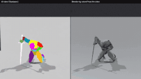</a> 
<b><a href="https://x.com/KHvostikk/status/2119939061049889130">Video zu 3D-Animation</a></b> 
<a href="https://x.com/KHvostikk">@KHvostikk</a> · ♥ 1.2k · <a href="https://x.com/KHvostikk/status/2119939061049889130">▶ Video</a> 
 
<a href="https://fablelist.000ooo.ooo/de/prompts/?w=video-to-3d-animation&ref=gh"><b>✨ Prompt holen</b></a>
</td>
<td width="33%" valign="top">
 
<b><a href="https://x.com/chetaslua/status/2119870650722763052">Ein Betriebssystem aus einem leeren Ordner</a></b> 
<a href="https://x.com/chetaslua">@chetaslua</a> · ♥ 1.2k · <a href="https://x.com/chetaslua/status/2119870650722763052">▶ Video</a> 
Anthropics Demo mit über 1.000 koordinierten Agents.
</td>
</tr>
</table>

<b><a href="all/video-demos.de.md">Alle 130 ansehen →</a></b>

## 🤝 Mitmachen

Etwas vergessen? Öffne ein [Issue](../../issues/new/choose) mit dem Link zum Werk und dem Originalpost. Der Link muss direkt aufgehen, und das Werk muss mit Fable 5.2 gebaut sein.

## Haftungsausschluss

Alle Werke gehören ihren Creators. Dieses Repository indexiert sie nur, mit kurzen GIF-Vorschauen in niedriger Auflösung, ohne vollständige Werke oder Videos zu hosten; das ganze Video steht im Originalpost. Creator können per Issue die Entfernung einer Vorschau oder eines Eintrags verlangen. Nicht mit Anthropic verbunden.

## Star History

## License

[CC0 1.0](LICENSE) – die Liste selbst ist gemeinfrei.

## 📰 Neuigkeiten

- **2026-11-17**: +8 Live-Werke und +2 Video-Demos.
- **2026-11-16**: +10 Live-Werke und +6 Video-Demos.
- **2026-11-15**: +10 Live-Werke und +10 Video-Demos.
- **2026-11-14**: +13 Live-Werke und +2 Video-Demos.
- **2026-11-10**: Erste Version – 57 Live-Werke + 61 Video-Demos, jeweils mit GIF-Vorschau.
