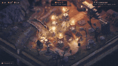
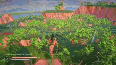
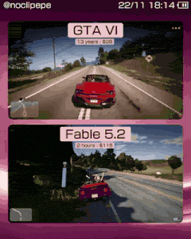
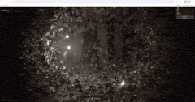
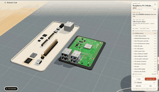
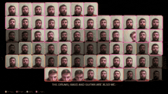

<h3>Lo que la gente creó con Claude Fable 5.2 y que puedes abrir y jugar</h3>

[English](README.md) · [简体中文](README.zh-CN.md) · [繁體中文](README.zh-TW.md) · [日本語](README.ja.md) · [한국어](README.ko.md) · **Español** · [Português](README.pt-BR.md) · [Français](README.fr.md) · [Deutsch](README.de.md) · [Русский](README.ru.md)

**🌐 Versión web: [fablelist.000ooo.ooo](https://fablelist.000ooo.ooo/es/)** (con buscador y una página por obra)

251 obras en línea y 156 demos en video hechas con Claude Fable 5.2, enlaces revisados el 2026-11-27. Se actualiza a diario; una ⭐ ayuda.

## 📑 Contenido

[⭐ Los más queridos](#-los-más-queridos) · [🆕 Recientes](#-recientes) · [🎮 Juegos](#-juegos) 119 · [🌍 Mundos y escenas 3D](#-mundos-y-escenas-3d) 55 · [🧰 Páginas web y herramientas](#-páginas-web-y-herramientas) 58 · [🎬 Animación y cine](#-animación-y-cine) 19 · [📺 Demos en video](#-demos-en-video) 156 · [🤝 Contribuir](#-contribuir)

## ⭐ Los más queridos

<table>
<tr>
<td width="33%" valign="top">
 
<b><a href="https://starrynightrider.com">Starry Nightrider</a></b> 
<a href="https://x.com/ebbyamir">@ebbyamir</a> · ♥ 17.9k · <a href="https://x.com/ebbyamir/status/2120284261089673376">▶ Video</a> 
Van Gogh cabalgando por su Noche estrellada, como un juego. 
<a href="https://fablelist.000ooo.ooo/es/prompts/?w=starry-nightrider&ref=gh"><b>✨ Consigue el prompt</b></a>
</td>
<td width="33%" valign="top">
 
<b><a href="https://claude.ai/artifact/BGY1SztrAYcJQHSsnHHGmp">Saltline — juego de disparos en primera persona</a></b> 
<a href="https://x.com/felixrieseberg">@felixrieseberg</a> · ♥ 15.1k · <a href="https://x.com/felixrieseberg/status/2119925633564463609">▶ Video</a> 
De un ingeniero de Anthropic. Prompts de un solo intento, sin feedback humano, 8 horas, ~$550. Modelos, sonidos y texturas generados en código. 
<a href="https://fablelist.000ooo.ooo/es/prompts/?w=saltline-first-person-shooter&ref=gh"><b>✨ Consigue el prompt</b></a>
</td>
<td width="33%" valign="top">
 
<b><a href="https://viktorkav.com.br/apoio/uno-com-escada/fable/">Uno com Escada: un Fiat Uno con escalera en un circuito</a></b> 
<a href="https://x.com/ViktorKav">@ViktorKav</a> · ♥ 9.2k · <a href="https://x.com/ViktorKav/status/2122647483281015155">▶ Video</a> 
Conduce un Uno Mille de 1996 con una escalera en el techo por un circuito. Un solo archivo HTML de 603 KB sin motor, biblioteca 3D ni texturas; el coche, el bosque, el cielo y el sonido del motor salen del código. 
<a href="https://github.com/viktorkav/uno-com-escada">Código fuente</a>
</td>
</tr>
<tr>
<td width="33%" valign="top">
 
<b><a href="https://patch.gg/blendi/oil-paint">Oil Paint — juego pintado a mano</a></b> 
<a href="https://x.com/BlendiByl">@BlendiByl</a> · ♥ 8.0k · <a href="https://x.com/BlendiByl/status/2120341251178594532">▶ Video</a> 
Hecho en menos de una hora. Cada fotograma son unas 1.5 millones de pinceladas, a 200 fps en una pestaña del navegador. Código abierto. 
<a href="https://fablelist.000ooo.ooo/es/prompts/?w=oil-paint-hand-painted-game&ref=gh"><b>✨ Consigue el prompt</b></a>
</td>
<td width="33%" valign="top">
 
<b><a href="https://nyc.somethingbig.ai/">CROSSTOWN — Nueva York de mundo abierto (vista previa temprana)</a></b> 
<a href="https://x.com/mattshumer_">@mattshumer_</a> · ♥ 7.5k · <a href="https://x.com/mattshumer_/status/2120282133503820150">▶ Video</a> 
"Rockstar tardó 8 años. Fable 5.2 lo hará en 7 días." Por ahora solo hay una parte de la ciudad; pulsa B para enviar comentarios. 
<a href="https://fablelist.000ooo.ooo/es/prompts/?w=crosstown-open-world-new-york-early-preview&ref=gh"><b>✨ Consigue el prompt</b></a>
</td>
<td width="33%" valign="top">
 
<b><a href="https://claude.ai/artifact/QGWUAjRrzRzZWGcQzSMLfa">Claude App en una laptop de Blender</a></b> 
<a href="https://x.com/rileybrown">@rileybrown</a> · ♥ 7.1k · <a href="https://x.com/rileybrown/status/2119902109709537708">▶ Video</a> 
Un solo prompt construyó toda la habitación en Blender y la renderizó en 4K. Esta es la página web que se ve en la pantalla de la laptop. 
<a href="https://x.com/rileybrown/status/2119902109709537708">📝 Prompt del creador (gratis)</a>
</td>
</tr>
</table>

## 🆕 Recientes

Publicados en los últimos 3 días, por número de me gusta.

<table>
<tr>
<td width="33%" valign="top">
 
<b><a href="https://kevintngo.github.io/procedural-rpg/">Brushwild — un RPG procedural de mundo abierto</a></b> 
🆕 · <a href="https://x.com/kevin_t_ngo">@kevin_t_ngo</a> · ♥ 2.7k · <a href="https://x.com/kevin_t_ngo/status/2125321244686029289">▶ Video</a> 
Un RPG de acción procedural de mundo abierto en un solo archivo HTML de unos 300kB. Cada píxel lo dibujan shaders con estilo de pluma y lápices de colores. Tres clases, árboles de habilidades, botín, pueblos y mazmorras; se juega en ordenador o en móvil. 
<a href="https://github.com/kevintngo/procedural-rpg">Código fuente</a>
</td>
<td width="33%" valign="top">
 
<b><a href="https://kevintngo.github.io/cinderwatch/">Cinderwatch: un tower defense en un solo archivo HTML</a></b> 
<a href="https://x.com/kevin_t_ngo">@kevin_t_ngo</a> · ♥ 2.3k · <a href="https://x.com/kevin_t_ngo/status/2125119969109418333">▶ Video</a> 
Un tower defense isométrico en 3D que cabe en un solo archivo HTML. Un comandante de IA integrado puede encargarse de la defensa por ti. De código abierto y jugable en el navegador. 
<a href="https://github.com/kevintngo/cinderwatch">Código fuente</a>
</td>
<td width="33%" valign="top">
 
<b><a href="https://littlecity.io">Little City — un constructor de ciudades dibujado a mano</a></b> 
🆕 · <a href="https://x.com/sprezzyyy">@sprezzyyy</a> · ♥ 1.0k · <a href="https://x.com/sprezzyyy/status/2125321545665192054">▶ Video</a> 
Un constructor de ciudades sandbox inspirado en Townscaper. Coloca unos cuantos bloques, mira cómo se convierten en un pueblo dibujado a mano y luego cómo cobra vida. Se juega en el navegador. 
<a href="https://github.com/yaoderek/littlecity.io">Código fuente</a>
</td>
</tr>
</table>

## 🎮 Juegos

<table>
<tr>
<td width="33%" valign="top">
 
<b><a href="https://starrynightrider.com">Starry Nightrider</a></b> 
<a href="https://x.com/ebbyamir">@ebbyamir</a> · ♥ 17.9k · <a href="https://x.com/ebbyamir/status/2120284261089673376">▶ Video</a> 
Van Gogh cabalgando por su Noche estrellada, como un juego. 
<a href="https://fablelist.000ooo.ooo/es/prompts/?w=starry-nightrider&ref=gh"><b>✨ Consigue el prompt</b></a>
</td>
<td width="33%" valign="top">
 
<b><a href="https://claude.ai/artifact/BGY1SztrAYcJQHSsnHHGmp">Saltline — juego de disparos en primera persona</a></b> 
<a href="https://x.com/felixrieseberg">@felixrieseberg</a> · ♥ 15.1k · <a href="https://x.com/felixrieseberg/status/2119925633564463609">▶ Video</a> 
De un ingeniero de Anthropic. Prompts de un solo intento, sin feedback humano, 8 horas, ~$550. Modelos, sonidos y texturas generados en código. 
<a href="https://fablelist.000ooo.ooo/es/prompts/?w=saltline-first-person-shooter&ref=gh"><b>✨ Consigue el prompt</b></a>
</td>
<td width="33%" valign="top">
 
<b><a href="https://viktorkav.com.br/apoio/uno-com-escada/fable/">Uno com Escada: un Fiat Uno con escalera en un circuito</a></b> 
<a href="https://x.com/ViktorKav">@ViktorKav</a> · ♥ 9.2k · <a href="https://x.com/ViktorKav/status/2122647483281015155">▶ Video</a> 
Conduce un Uno Mille de 1996 con una escalera en el techo por un circuito. Un solo archivo HTML de 603 KB sin motor, biblioteca 3D ni texturas; el coche, el bosque, el cielo y el sonido del motor salen del código. 
<a href="https://github.com/viktorkav/uno-com-escada">Código fuente</a>
</td>
</tr>
<tr>
<td width="33%" valign="top">
 
<b><a href="https://patch.gg/blendi/oil-paint">Oil Paint — juego pintado a mano</a></b> 
<a href="https://x.com/BlendiByl">@BlendiByl</a> · ♥ 8.0k · <a href="https://x.com/BlendiByl/status/2120341251178594532">▶ Video</a> 
Hecho en menos de una hora. Cada fotograma son unas 1.5 millones de pinceladas, a 200 fps en una pestaña del navegador. Código abierto. 
<a href="https://fablelist.000ooo.ooo/es/prompts/?w=oil-paint-hand-painted-game&ref=gh"><b>✨ Consigue el prompt</b></a>
</td>
<td width="33%" valign="top">
 
<b><a href="https://nyc.somethingbig.ai/">CROSSTOWN — Nueva York de mundo abierto (vista previa temprana)</a></b> 
<a href="https://x.com/mattshumer_">@mattshumer_</a> · ♥ 7.5k · <a href="https://x.com/mattshumer_/status/2120282133503820150">▶ Video</a> 
"Rockstar tardó 8 años. Fable 5.2 lo hará en 7 días." Por ahora solo hay una parte de la ciudad; pulsa B para enviar comentarios. 
<a href="https://fablelist.000ooo.ooo/es/prompts/?w=crosstown-open-world-new-york-early-preview&ref=gh"><b>✨ Consigue el prompt</b></a>
</td>
<td width="33%" valign="top">
 
<b><a href="https://omw-game.kimaki.dev">omw: un valle con castillo en pinceladas al óleo</a></b> 
<a href="https://x.com/__morse">@__morse</a> · ♥ 4.5k · <a href="https://x.com/__morse/status/2122013410309153042">▶ Video</a> 
El pixel art "omw" de @de5imulate reconstruido como un juego de three.js que se juega en el navegador, renderizado como una pintura al óleo. 
<a href="https://github.com/remorses/castle-valley">Código fuente</a>
</td>
</tr>
<tr>
<td width="33%" valign="top">
 
<b><a href="https://what-the-water-keeps.vercel.app/">What the Water Keeps</a></b> 
<a href="https://x.com/kevin_t_ngo">@kevin_t_ngo</a> · ♥ 4.3k · <a href="https://x.com/kevin_t_ngo/status/2119868968307695818">▶ Video</a> 
Un paseo en bote por 8 mundos de ensueño, jugable en el navegador. 
<a href="https://fablelist.000ooo.ooo/es/prompts/?w=what-the-water-keeps&ref=gh"><b>✨ Consigue el prompt</b></a>
</td>
<td width="33%" valign="top">
 
<b><a href="https://tennis.sixfingerpunch.com/">Tennis</a></b> 
<a href="https://x.com/photonstorm">@photonstorm</a> · ♥ 3.1k · <a href="https://x.com/photonstorm/status/2120330010112434313">Publicación</a> 
Al pedirle que "se volviera loco" haciendo un juego, devolvió algo que parece un clon de Pong, hasta que lo juegas. 
<a href="https://fablelist.000ooo.ooo/es/prompts/?w=tennis&ref=gh"><b>✨ Consigue el prompt</b></a>
</td>
<td width="33%" valign="top">
 
<b><a href="https://kevintngo.github.io/procedural-rpg/">Brushwild — un RPG procedural de mundo abierto</a></b> 
🆕 · <a href="https://x.com/kevin_t_ngo">@kevin_t_ngo</a> · ♥ 2.7k · <a href="https://x.com/kevin_t_ngo/status/2125321244686029289">▶ Video</a> 
Un RPG de acción procedural de mundo abierto en un solo archivo HTML de unos 300kB. Cada píxel lo dibujan shaders con estilo de pluma y lápices de colores. Tres clases, árboles de habilidades, botín, pueblos y mazmorras; se juega en ordenador o en móvil. 
<a href="https://github.com/kevintngo/procedural-rpg">Código fuente</a>
</td>
</tr>
<tr>
<td width="33%" valign="top">
 
<b><a href="https://patch.gg/play/blendi/small-magic">Small Magic — sandbox de mago</a></b> 
<a href="https://x.com/BlendiByl">@BlendiByl</a> · ♥ 2.6k · <a href="https://x.com/BlendiByl/status/2121594536153718972">▶ Video</a> 
Hecho en un día: 7 hechizos, unas 1.800 piezas físicas destructibles, sin modelos ni texturas, de código abierto.
</td>
<td width="33%" valign="top">
 
<b><a href="https://www.spawn.co/@mattshumer/earth?room=local">Mirror Earth</a></b> 
<a href="https://x.com/mattshumer_">@mattshumer_</a> · ♥ 2.4k · <a href="https://x.com/mattshumer_/status/2119877065701036047">▶ Video</a> 
El planeta entero como mundo de juego destructible, con un clima que coincide con el de la Tierra real en tiempo real. 
<a href="https://fablelist.000ooo.ooo/es/prompts/?w=mirror-earth&ref=gh"><b>✨ Consigue el prompt</b></a>
</td>
<td width="33%" valign="top">
 
<b><a href="https://kevintngo.github.io/cinderwatch/">Cinderwatch: un tower defense en un solo archivo HTML</a></b> 
<a href="https://x.com/kevin_t_ngo">@kevin_t_ngo</a> · ♥ 2.3k · <a href="https://x.com/kevin_t_ngo/status/2125119969109418333">▶ Video</a> 
Un tower defense isométrico en 3D que cabe en un solo archivo HTML. Un comandante de IA integrado puede encargarse de la defensa por ti. De código abierto y jugable en el navegador. 
<a href="https://github.com/kevintngo/cinderwatch">Código fuente</a>
</td>
</tr>
<tr>
<td width="33%" valign="top">
 
<b><a href="https://portals-endless-worlds.netlify.app/">Portals: Endless Worlds</a></b> 
<a href="https://x.com/emollick">@emollick</a> · ♥ 1.9k · <a href="https://x.com/emollick/status/2119918307457577163">▶ Video</a> 
25,000 agentes construyeron más de 450 mundos 3D solo con código, inspirados en libros, arte y lugares, conectados por portales por los que te deslizas. 
<a href="https://github.com/emollick/ai-portals">Código fuente</a> · <a href="https://www.oneusefulthing.org/p/fable-52-and-jagged-agi">Artículo</a> 
<a href="https://fablelist.000ooo.ooo/es/prompts/?w=portals-endless-worlds&ref=gh"><b>✨ Consigue el prompt</b></a>
</td>
<td width="33%" valign="top">
 
<b><a href="https://evensong-phi.vercel.app/">Evensong</a></b> 
<a href="https://x.com/kevin_t_ngo">@kevin_t_ngo</a> · ♥ 1.8k · <a href="https://x.com/kevin_t_ngo/status/2120238844754923874">▶ Video</a> 
Una pelea contra un jefe de fantasía oscura estilo souls-like, jugable en el navegador. 
<a href="https://fablelist.000ooo.ooo/es/prompts/?w=evensong&ref=gh"><b>✨ Consigue el prompt</b></a>
</td>
<td width="33%" valign="top">
 
<b><a href="https://loktar00.github.io/lanternfall/">LANTERNFALL</a></b> 
<a href="https://x.com/loktar00">@loktar00</a> · ♥ 1.4k · <a href="https://x.com/loktar00/status/2120192761542615271">▶ Video</a> 
El juego completo —animaciones, modelos, todo— generado por Fable. Mira el efecto cuando mueren los enemigos. 
<a href="https://fablelist.000ooo.ooo/es/prompts/?w=lanternfall&ref=gh"><b>✨ Consigue el prompt</b></a>
</td>
</tr>
<tr>
<td width="33%" valign="top">
 
<b><a href="https://app.usecrayon.ai/play/76dbd04f-0684-4486-8cc4-eae0585295e8">Goku: Four-Star Road</a></b> 
<a href="https://x.com/aniketjart">@aniketjart</a> · ♥ 1.4k · <a href="https://x.com/aniketjart/status/2121793239175119279">▶ Video</a> 
Un juego de acción fan basado en la saga del Ejército Red Ribbon de Dragon Ball, hecho con three.js. Está en desarrollo; se pueden jugar los dos primeros mapas.
</td>
<td width="33%" valign="top">
 
<b><a href="https://heat.pplx.app">VICE '86: conducción en mundo abierto por un Miami de neón de 1986</a></b> 
<a href="https://x.com/AravSrinivas">@AravSrinivas</a> · ♥ 1.3k · <a href="https://x.com/AravSrinivas/status/2122338465648103676">▶ Video</a> 
Un juego de conducción en mundo abierto que corre en el navegador. Sin motor de juego ni three.js: tiene su propio renderizador WebGL2, y la ciudad, los coches, la lluvia y el sonido de los motores se generan por código, unas 63,000 líneas de JavaScript.
</td>
<td width="33%" valign="top">
 
<b><a href="https://op7418.github.io/guizang-game-skill/">Mist-Locked Mountain Gate — juego de acción 3D</a></b> 
<a href="https://x.com/op7418">@op7418</a> · ♥ 1.2k · <a href="https://x.com/op7418/status/2120694045299327187">▶ Video</a> 
Una tarde, 4,500 millones de tokens. Modelos, escenas y movimientos, todo por Fable, empaquetado en un único archivo HTML de 30 MB. 
<a href="https://fablelist.000ooo.ooo/es/prompts/?w=mist-locked-mountain-gate-3d-action-game&ref=gh"><b>✨ Consigue el prompt</b></a>
</td>
</tr>
<tr>
<td width="33%" valign="top">
 
<b><a href="https://wavedash.com/games/rooftop-rally">Rooftop Rally — pickleball en Unreal 5.9</a></b> 
<a href="https://x.com/chongdashu">@chongdashu</a> · ♥ 1.1k · <a href="https://x.com/chongdashu/status/2120154573356793883">▶ Video</a> 
Fable 5.2 con la vista previa de Unreal Engine 5.9. Personajes de Tripo; los demás recursos 3D y el resto, de Fable. 
<a href="https://x.com/chongdashu/status/2120310120509014219">Cómo se hizo</a> 
<a href="https://fablelist.000ooo.ooo/es/prompts/?w=rooftop-rally-pickleball-in-unreal-5-9&ref=gh"><b>✨ Consigue el prompt</b></a>
</td>
<td width="33%" valign="top">
 
<b><a href="https://littlecity.io">Little City — un constructor de ciudades dibujado a mano</a></b> 
🆕 · <a href="https://x.com/sprezzyyy">@sprezzyyy</a> · ♥ 1.0k · <a href="https://x.com/sprezzyyy/status/2125321545665192054">▶ Video</a> 
Un constructor de ciudades sandbox inspirado en Townscaper. Coloca unos cuantos bloques, mira cómo se convierten en un pueblo dibujado a mano y luego cómo cobra vida. Se juega en el navegador. 
<a href="https://github.com/yaoderek/littlecity.io">Código fuente</a>
</td>
<td width="33%" valign="top">
 
<b><a href="https://gtashenzhen.com">GTA Shenzhen</a></b> 
<a href="https://x.com/KinGao476942">@KinGao476942</a> · ♥ 1.0k · <a href="https://x.com/KinGao476942/status/2123967104601014521">▶ Video</a> 
Toda la ciudad de Shenzhen construida con datos de OpenStreetMap: 83.182 edificios y 62.088 carreteras. Sobrevuélala, aterriza y conduce un coche, busca cualquier lugar y lanza de noche un espectáculo de luces por toda la ciudad. Hecho con Fable 5.2 y Tripo en tres días.
</td>
</tr>
<tr>
<td width="33%" valign="top">
 
<b><a href="https://thaxnay.com/ramayana/">Ramayana: The Sacred Fires</a></b> 
<a href="https://x.com/Thaxnay">@Thaxnay</a> · ♥ 983 · <a href="https://x.com/Thaxnay/status/2124574054296219939">▶ Video</a> 
Aventura de acción en tercera persona en la que juegas como Rama: cruzas un valle abierto, proteges a los sabios y descubres secretos. Funciona en el navegador, en ordenador y en móvil.
</td>
<td width="33%" valign="top">
 
<b><a href="https://noclipepe.pages.dev/chase">Red Clay Chase — una persecución policial por caminos de tierra roja</a></b> 
🆕 · <a href="https://x.com/noclipepe">@noclipepe</a> · ♥ 808 · <a href="https://x.com/noclipepe/status/2124805085393813586">▶ Video</a> 
Una persecución policial al estilo GTA que se juega en el navegador. Sin motor de juego y sin ningún recurso externo. El autor dice que Fable 5.2 le dedicó 2,5 horas y 115 dólares. 
<a href="https://github.com/noclipepe/red-clay-chase">Código fuente</a>
</td>
<td width="33%" valign="top">
 
<b><a href="https://claude.ai/artifact/MXxb36zKgN261ckbGhmNin">Three Games (Saltline · The Clockmaker's Heart · Tidewright)</a></b> 
<a href="https://x.com/felixrieseberg">@felixrieseberg</a> · ♥ 803 · <a href="https://x.com/vineerpasam/status/2119955306096857145">▶ Video</a> 
Firmado por Felix Rieseberg: "Todos los juegos hechos con Claude Fable 5.2. Primeros borradores, sin feedback humano." El enlace más compartido del día del lanzamiento. 
<a href="https://claude.ai/artifact/6MjtQjf4ee1ZZjEpafaEpa">The Clockmaker's Heart</a> · <a href="https://claude.ai/artifact/JTgyEMn7sn1q2riWrMb7D4">Tidewright</a> 
<a href="https://fablelist.000ooo.ooo/es/prompts/?w=three-games-saltline-the-clockmaker-s-heart-tidewright&ref=gh"><b>✨ Consigue el prompt</b></a>
</td>
</tr>
</table>

<b><a href="all/games.es.md">Ver los 119 →</a></b>

<a href="#-contenido">↑ Volver al contenido</a>

## 🌍 Mundos y escenas 3D

<table>
<tr>
<td width="33%" valign="top">
 
<b><a href="https://claude.ai/artifact/QGWUAjRrzRzZWGcQzSMLfa">Claude App en una laptop de Blender</a></b> 
<a href="https://x.com/rileybrown">@rileybrown</a> · ♥ 7.1k · <a href="https://x.com/rileybrown/status/2119902109709537708">▶ Video</a> 
Un solo prompt construyó toda la habitación en Blender y la renderizó en 4K. Esta es la página web que se ve en la pantalla de la laptop. 
<a href="https://x.com/rileybrown/status/2119902109709537708">📝 Prompt del creador (gratis)</a>
</td>
<td width="33%" valign="top">
 
<b><a href="https://xikhar.github.io/papertrails/">Papertrails: un mundo de papel desplegable sin fin</a></b> 
<a href="https://x.com/xikhar">@xikhar</a> · ♥ 2.4k · <a href="https://x.com/xikhar/status/2122682962647122403">▶ Video</a> 
Una figura de papel avanza mientras árboles, casas y colinas se levantan del suelo como en un libro pop-up, entre desierto, nieve, bosque, día y noche. Hecho con Fable 5.2, Opus 5.5 y three.js. 
<a href="https://github.com/xikhar/papertrails">Código fuente</a>
</td>
<td width="33%" valign="top">
 
<b><a href="https://patch.gg/blendi/painted-valley">Painted Valley</a></b> 
<a href="https://x.com/BlendiByl">@BlendiByl</a> · ♥ 1.8k · <a href="https://x.com/BlendiByl/status/2120694003230560585">▶ Video</a> 
Un valle pintado a mano inspirado en Ghibli por el que puedes caminar. Código abierto. 
<a href="https://fablelist.000ooo.ooo/es/prompts/?w=painted-valley&ref=gh"><b>✨ Consigue el prompt</b></a>
</td>
</tr>
<tr>
<td width="33%" valign="top">
 
<b><a href="https://april-zhu.com/pocketcity">Pocket City</a></b> 
<a href="https://x.com/Aprilzz423">@Aprilzz423</a> · ♥ 1.3k · <a href="https://x.com/Aprilzz423/status/2123788440714260673">▶ Video</a> 
Convierte cualquier esquina en una pequeña ciudad dibujada a mano que puedes girar y explorar, medida con OpenStreetMap y con el clima y las estaciones del lugar. Hecho con Fable 5.2 y GPT-6.2 Astra.
</td>
<td width="33%" valign="top">
 
<b><a href="https://claude.ai/artifact/CTjrZXVdUgKJ6qJXrvvr28">Ancient Babylon, 600 BC</a></b> 
<a href="https://x.com/literallydenis">@literallydenis</a> · ♥ 1.2k · <a href="https://x.com/literallydenis/status/2120866958790848953">▶ Video</a> 
Babilonia reconstruida a partir de documentos históricos y planos que encontró por su cuenta, en una ejecución de 8 horas. Recórrela libremente. 
<a href="https://fablelist.000ooo.ooo/es/prompts/?w=ancient-babylon-600-bc&ref=gh"><b>✨ Consigue el prompt</b></a>
</td>
<td width="33%" valign="top">
 
<b><a href="https://indiranagar-live.vercel.app">1 km² de Indiranagar</a></b> 
<a href="https://x.com/anshu4321">@anshu4321</a> · ♥ 1.2k · <a href="https://x.com/anshu4321/status/2119938067758772403">▶ Video</a> 
Un fragmento 3D en vivo de Bengaluru a partir de datos de mapas y un solo prompt. 
<a href="https://fablelist.000ooo.ooo/es/prompts/?w=1-km2-of-indiranagar&ref=gh"><b>✨ Consigue el prompt</b></a>
</td>
</tr>
<tr>
<td width="33%" valign="top">
 
<b><a href="https://fable-rome.surge.sh/">Rome, AD 320</a></b> 
<a href="https://x.com/petergostev">@petergostev</a> · ♥ 978 · <a href="https://x.com/petergostev/status/2120167560700383572">▶ Video</a> 
Un prompt, Fable 5.2 (Max) corriendo toda la noche, $2,618. 
<a href="https://x.com/petergostev/status/2120167560700383572">📝 Prompt del creador (gratis)</a>
</td>
<td width="33%" valign="top">
 
<b><a href="https://github.com/Leonxlnx/room-at-dawn">Room at Dawn</a></b> 
<a href="https://x.com/LexnLin">@LexnLin</a> · ♥ 857 · <a href="https://x.com/LexnLin/status/2120910879361548565">▶ Video</a> 
Un dormitorio fotorrealista en three.js sin modelos ni texturas prefabricados; todo es código. 
<a href="https://fablelist.000ooo.ooo/es/prompts/?w=room-at-dawn&ref=gh"><b>✨ Consigue el prompt</b></a>
</td>
<td width="33%" valign="top">
 
<b><a href="https://fable-rover.vercel.app">ER-6 Terrain Explorer — un rover marciano autónomo</a></b> 
<a href="https://x.com/DilumSanjaya">@DilumSanjaya</a> · ♥ 836 · <a href="https://x.com/DilumSanjaya/status/2120561077385867663">▶ Video</a> 
Fable 5.2 diseñó una suspensión rocker-bogie como la de los rovers de la NASA y simuló su conducción por terreno alienígena.
</td>
</tr>
<tr>
<td width="33%" valign="top">
 
<b><a href="https://ship-42-catch.netlify.app/">Ship 42 Catch</a></b> 
<a href="https://x.com/emollick">@emollick</a> · ♥ 739 · <a href="https://x.com/emollick/status/2122036763468214711">▶ Video</a> 
Fable y Opus buscaron el video de la captura de Starship con la torre y recrearon los últimos 40 segundos en 3D detallado con three.js. Puedes cambiar la cámara.
</td>
<td width="33%" valign="top">
 
<b><a href="https://patch.gg/play/blendi/the-blue-hour">The Blue Hour — una ciudad art déco de noche</a></b> 
<a href="https://x.com/BlendiByl">@BlendiByl</a> · ♥ 642 · <a href="https://x.com/BlendiByl/status/2124439671006748853">▶ Video</a> 
Una escena 3D al estilo art déco de la serie animada de Batman, dibujada por completo con código. Código abierto.
</td>
<td width="33%" valign="top">
 
<b><a href="https://supernatural-ft.vercel.app/fire-in-ice">Fire in Ice</a></b> 
<a href="https://x.com/tkm_hmng8">@tkm_hmng8</a> · ♥ 549 · <a href="https://x.com/tkm_hmng8/status/2120813043101946324">▶ Video</a> 
Fuego realista ardiendo dentro del hielo, escrito en WebGPU puro sin three.js. 
<a href="https://fablelist.000ooo.ooo/es/prompts/?w=fire-in-ice&ref=gh"><b>✨ Consigue el prompt</b></a>
</td>
</tr>
<tr>
<td width="33%" valign="top">
 
<b><a href="https://github.com/Leonxlnx/walking-block">Walking Block: un bloque de pisos soviético que camina</a></b> 
<a href="https://x.com/LexnLin">@LexnLin</a> · ♥ 416 · <a href="https://x.com/LexnLin/status/2122359035751989341">▶ Video</a> 
Un enorme bloque soviético de paneles sobre ocho patas mecánicas cruza un campo mojado entre la niebla del atardecer. La geometría, las texturas y los shaders son código three.js, y de la misma escena se renderiza un corto de 45 segundos.
</td>
<td width="33%" valign="top">
 
<b><a href="https://bay.theojaffee.net">Bay Area Through Time</a></b> 
<a href="https://x.com/theojaffee">@theojaffee</a> · ♥ 388 · <a href="https://x.com/theojaffee/status/2120312766544437738">▶ Video</a> 
Acércate a cualquier ciudad o barrio, elige cualquier año hasta 1769 y mira cómo era. 
<a href="https://nyc.theojaffee.net">New York City</a> 
<a href="https://fablelist.000ooo.ooo/es/prompts/?w=bay-area-through-time&ref=gh"><b>✨ Consigue el prompt</b></a>
</td>
<td width="33%" valign="top">
 
<b><a href="http://procedural-arm-rig.vercel.app">Procedural Arm Rig</a></b> 
<a href="https://x.com/apekshik">@apekshik</a> · ♥ 327 · <a href="https://x.com/apekshik/status/2120224530367119758">▶ Video</a> 
En lugar de generar un juego AAA de un tiro: un solo brazo con esqueleto de huesos, malla con pesos pintados, IK y músculos que se hinchan al apretar el puño. 
<a href="https://fablelist.000ooo.ooo/es/prompts/?w=procedural-arm-rig&ref=gh"><b>✨ Consigue el prompt</b></a>
</td>
</tr>
<tr>
<td width="33%" valign="top">
 
<b><a href="https://samg-coder.github.io/solstice-garden/">The Garden</a></b> 
<a href="https://x.com/SamGCoder">@SamGCoder</a> · ♥ 297 · <a href="https://x.com/SamGCoder/status/2120943068321054975">▶ Video</a> 
Una escena de jardín escrita en Rust, compilada a WASM y renderizada con WebGPU. 
<a href="https://fablelist.000ooo.ooo/es/prompts/?w=the-garden&ref=gh"><b>✨ Consigue el prompt</b></a>
</td>
<td width="33%" valign="top">
 
<b><a href="http://taoistvibe.com">Chill Taoist Vibe: una colina con un templo taoísta</a></b> 
<a href="https://x.com/qiqileyuan">@qiqileyuan</a> · ♥ 252 · <a href="https://x.com/qiqileyuan/status/2122006851298693277">▶ Video</a> 
Un templo taoísta de estilo Ghibli en una pequeña montaña. Sigue al viejo sacerdote cuesta arriba, quema incienso, saca un palillo de la fortuna, medita o simplemente siéntate en la mecedora a ver pasar las estaciones. Las estatuas y el personaje principal vienen de Tripo3D; todo lo demás es código generado.
</td>
<td width="33%" valign="top">
 
<b><a href="https://butterfly.kyzo.io">Hidden Layers: una mariposa de cristal en un invernadero</a></b> 
<a href="https://x.com/ky__zo">@ky__zo</a> · ♥ 230 · <a href="https://x.com/ky__zo/status/2122274109795054036">▶ Video</a> 
Desplázate para volar con una mariposa de cristal que no puede salir de un invernadero a través de seis mundos. three.js puro, sin archivos de modelos ni texturas; costó 1.32 mil millones de tokens y $905 de API.
</td>
</tr>
<tr>
<td width="33%" valign="top">
 
<b><a href="https://claude.ai/artifact/R6YBDkAm2GjAC5A65D9djx">Una demo de Claude a la que puedes entrar caminando</a></b> 
<a href="https://x.com/dfeinition">@dfeinition</a> · ♥ 215 · <a href="https://x.com/dfeinition/status/2120330644261589051">▶ Video</a> 
Inspirada en @rileybrown: entra y siéntate frente a cualquier computadora. 
<a href="https://fablelist.000ooo.ooo/es/prompts/?w=a-claude-demo-you-can-walk-into&ref=gh"><b>✨ Consigue el prompt</b></a>
</td>
<td width="33%" valign="top">
 
<b><a href="https://claude.ai/artifact/2PBXuQAnWDS2NpiPXHNLfL">Orca Jelly</a></b> 
<a href="https://x.com/vib3coded">@vib3coded</a> · ♥ 204 · <a href="https://x.com/vib3coded/status/2119951060752375827">▶ Video</a> 
Un estudio de material de orca de gomita con cuerpo blando. Se enlaza la versión de Opus 5.5 para comparar. 
<a href="https://claude.ai/artifact/75KLotWzZQ5RR23BGLePb8">Opus 5.5 version</a> 
<a href="https://x.com/vib3coded/status/2119951060752375827">📝 Prompt del creador (gratis)</a>
</td>
<td width="33%" valign="top">
 
<b><a href="https://planet.tokyoaivisuals.club/">Code Planet</a></b> 
<a href="https://x.com/KanaWorks_AI">@KanaWorks_AI</a> · ♥ 198 · <a href="https://x.com/KanaWorks_AI/status/2121413647213932688">▶ Video</a> 
Un planeta entero en menos de 320 KB de código. Vuela desde el mar y las praderas, pasando por cerezos en flor, hasta el espacio, directo en el navegador.
</td>
</tr>
<tr>
<td width="33%" valign="top">
 
<b><a href="https://nkondo-ft.github.io/light-and-debris/">Light & Debris — aparta más de 100.000 fragmentos con la luz</a></b> 
🆕 · <a href="https://x.com/Nkondo_funtech">@Nkondo_funtech</a> · ♥ 192 · <a href="https://x.com/Nkondo_funtech/status/2125811742001541535">▶ Video</a> 
Mueve una luz entre más de 100.000 fragmentos y mira cómo se dispersan. La posición, la velocidad y la rotación de cada fragmento se calculan en la GPU con shaders de cómputo de WebGPU, así que la física es lo bastante ligera para una página web. 
<a href="https://github.com/nkondo-ft/light-and-debris">Código fuente</a>
</td>
<td width="33%" valign="top">
 
<b><a href="https://zalo.github.io/LanternTown/town/">LanternTown — una plaza de pueblo iluminada por faroles</a></b> 
🆕 · <a href="https://x.com/makeshifted">@makeshifted</a> · ♥ 185 · <a href="https://x.com/makeshifted/status/2125331267512377844">Publicación</a> 
Una plaza de pueblo experimental en three.js. Todos los assets están definidos de forma paramétrica y la iluminación va horneada en los colores de vértice, así que corre ligera. 
<a href="https://github.com/zalo/LanternTown">Código fuente</a>
</td>
<td width="33%" valign="top">
 
<b><a href="https://claude.ai/artifact/9EgZpErM17kH2a9Q3WXW6f">Voxel World in a Bottle</a></b> 
<a href="https://x.com/vib3coded">@vib3coded</a> · ♥ 163 · <a href="https://x.com/vib3coded/status/2120104517282775514">▶ Video</a> 
30 minutos, $12.81. 
<a href="https://x.com/vib3coded/status/2120104517282775514">📝 Prompt del creador (gratis)</a>
</td>
</tr>
</table>

<b><a href="all/3d-worlds.es.md">Ver los 55 →</a></b>

<a href="#-contenido">↑ Volver al contenido</a>

## 🧰 Páginas web y herramientas

<table>
<tr>
<td width="33%" valign="top">
 
<b><a href="https://claudia.gallery">Claudia Gallery</a></b> 
<a href="https://x.com/anabology">@anabology</a> · ♥ 5.6k · <a href="https://x.com/anabology/status/2120010995309457643">▶ Video</a> 
"Haz el video de tus sueños" — dos tomas, 9 horas. 
<a href="https://fablelist.000ooo.ooo/es/prompts/?w=claudia-gallery&ref=gh"><b>✨ Consigue el prompt</b></a>
</td>
<td width="33%" valign="top">
 
<b><a href="http://robotics-lab-app.vercel.app">Robotics Lab</a></b> 
<a href="https://x.com/0xMovez">@0xMovez</a> · ♥ 4.7k · <a href="https://x.com/0xMovez/status/2120239217880268919">▶ Video</a> 
Ocho placas reales (Arduino Uno, Raspberry Pi 4…) en 3D: coloca chips, suéldalos y cablea circuitos reales. 
<a href="http://robolabs-app.vercel.app">Humanoid edition</a> 
<a href="https://fablelist.000ooo.ooo/es/prompts/?w=robotics-lab&ref=gh"><b>✨ Consigue el prompt</b></a>
</td>
<td width="33%" valign="top">
 
<b><a href="https://claude.ai/artifact/N6bSgS4ZH5ifFQfg8sm4dv">House Bangers generator</a></b> 
<a href="https://x.com/deedydas">@deedydas</a> · ♥ 4.1k · <a href="https://x.com/deedydas/status/2120905625852936318">▶ Video</a> 
Aprendió teoría musical, prueba miles de patrones por instrumento y organiza los mejores en un tema house de 72 compases. Con sonido. 
<a href="https://fablelist.000ooo.ooo/es/prompts/?w=house-bangers-generator&ref=gh"><b>✨ Consigue el prompt</b></a>
</td>
</tr>
<tr>
<td width="33%" valign="top">
 
<b><a href="https://miaai-lab.github.io/Claude-Fable-5.2-HTML-Files/">76 piezas HTML de un solo archivo</a></b> 
<a href="https://x.com/MiaAI_lab">@MiaAI_lab</a> · ♥ 2.6k · <a href="https://x.com/MiaAI_lab/status/2119930229661503893">Publicación</a> 
Arte generativo, física, tipografía e interfaces, cada una con su prompt original. 
<a href="https://fablelist.000ooo.ooo/es/prompts/?w=76-single-file-html-pieces&ref=gh"><b>✨ Consigue el prompt</b></a>
</td>
<td width="33%" valign="top">
 
<b><a href="https://pixel-worlds.vercel.app/keep/">Keep — medidor de seguridad de contraseñas</a></b> 
<a href="https://x.com/crtvTeknologist">@crtvTeknologist</a> · ♥ 1.6k · <a href="https://x.com/crtvTeknologist/status/2119894073024606617">▶ Video</a> 
Un indicador de seguridad de contraseñas representado como un mundo de píxeles vivo. 
<a href="https://github.com/finktheartist/pixel-worlds">Código fuente</a> 
<a href="https://fablelist.000ooo.ooo/es/prompts/?w=keep-password-strength-meter&ref=gh"><b>✨ Consigue el prompt</b></a>
</td>
<td width="33%" valign="top">
 
<b><a href="https://sakuga-vfx.vercel.app">Sakuga Set</a></b> 
<a href="https://x.com/crtvTeknologist">@crtvTeknologist</a> · ♥ 1.4k · <a href="https://x.com/crtvTeknologist/status/2122088829565698218">▶ Video</a> 
Doce controles de interfaz que reaccionan como en el anime: los botones se aplastan y aterrizan con un ¡DON!, los interruptores dejan estela y salpican, los deslizadores levantan nubes. Todos los efectos están dibujados con código, un archivo cada uno, sin dependencias. 
<a href="https://github.com/finktheartist/sakuga-vfx">Código fuente</a>
</td>
</tr>
<tr>
<td width="33%" valign="top">
 
<b><a href="https://hashem-al-ghaili.github.io/xray-mirror/">X-Ray Mirror</a></b> 
<a href="https://x.com/HashemGhaili">@HashemGhaili</a> · ♥ 1.4k · <a href="https://x.com/HashemGhaili/status/2120202746121085321">▶ Video</a> 
Apunta una webcam a tu cara y ve el cráneo, el cerebro y los músculos, rastreados en vivo. Abre la boca y la mandíbula se abre; el video nunca sale de tu computadora. 
<a href="https://github.com/Hashem-Al-Ghaili/xray-mirror">Código fuente</a> 
<a href="https://fablelist.000ooo.ooo/es/prompts/?w=x-ray-mirror&ref=gh"><b>✨ Consigue el prompt</b></a>
</td>
<td width="33%" valign="top">
 
<b><a href="https://xianxie6.github.io/animals-planner-2027/">Animals at Work — agenda 3D</a></b> 
<a href="https://x.com/Xian0063">@Xian0063</a> · ♥ 1.2k · <a href="https://x.com/Xian0063/status/2120417834694250522">▶ Video</a> 
Una agenda de papel reconstruida en 3D: arrastra para pasar páginas, toca una fecha para escribir y despega y pega 90 stickers. Opus 5.5 construyó el esqueleto; Fable 5.2 refinó los materiales a partir de material real. 
<a href="https://fablelist.000ooo.ooo/es/prompts/?w=animals-at-work-3d-planner&ref=gh"><b>✨ Consigue el prompt</b></a>
</td>
<td width="33%" valign="top">
 
<b><a href="https://uberdesigner.ai/t/spine-menu">Spine Menu</a></b> 
<a href="https://x.com/seanaiux">@seanaiux</a> · ♥ 1.2k · <a href="https://x.com/seanaiux/status/2120222459110789574">▶ Video</a> 
"¿Has visto alguna vez un menú que se vea mejor?" La página incluye el prompt. 
<a href="https://uberdesigner.ai/t/aquarium-toggle">Aquarium toggle</a> · <a href="https://uberdesigner.ai/t/glow-widgets">Glow widgets</a>
</td>
</tr>
<tr>
<td width="33%" valign="top">
 
<b><a href="https://roverkit.vercel.app">RoverKit — construye y simula un coche robot</a></b> 
<a href="https://x.com/DilumSanjaya">@DilumSanjaya</a> · ♥ 1.2k · <a href="https://x.com/DilumSanjaya/status/2121286147393651085">▶ Video</a> 
Una guía paso a paso para construir un coche robot, con simulador, arena personalizable y explicación visual del código. Compatible con Arduino y ESP32.
</td>
<td width="33%" valign="top">
 
<b><a href="https://github.com/AlexAtFF/pulp-daw-public">PULP — un DAW nativo de IA</a></b> 
<a href="https://x.com/The_Alex">@The_Alex</a> · ♥ 948 · <a href="https://x.com/The_Alex/status/2119917226769985785">▶ Video</a> 
Una estación de trabajo de audio digital nativa para Windows. Pídele música a Claude y abrirá el DAW y hará la canción. 
<a href="https://fablelist.000ooo.ooo/es/prompts/?w=pulp-an-ai-native-daw&ref=gh"><b>✨ Consigue el prompt</b></a>
</td>
<td width="33%" valign="top">
 
<b><a href="https://frontier.every.to/experiments/ambient-town">Ambient Town</a></b> 
<a href="https://x.com/kieranklaassen">@kieranklaassen</a> · ♥ 896 · <a href="https://x.com/kieranklaassen/status/2119868196773929160">▶ Video</a> 
Un DAW ambient construido en una semana de noches por un excompositor de cine: soporte para Ableton Push, micrófonos, efectos, un sintetizador y un agente que compone contigo. Haz clic en "Try it" en la página. 
<a href="https://fablelist.000ooo.ooo/es/prompts/?w=ambient-town&ref=gh"><b>✨ Consigue el prompt</b></a>
</td>
</tr>
<tr>
<td width="33%" valign="top">
 
<b><a href="https://hexagonal.earth">Hexagonal Earth</a></b> 
<a href="https://x.com/avsa">@avsa</a> · ♥ 757 · <a href="https://x.com/avsa/status/2123123638551392755">Publicación</a> 
Un diorama del mundo entero hecho de hexágonos, construido con datos reales de elevación, profundidad oceánica, humedad, viento y ríos. Fable 5.2 generó cientos de pequeños objetos 3D de splats de píxeles y los colocó en la escena por su cuenta.
</td>
<td width="33%" valign="top">
 
<b><a href="https://itspsneha.com/supplements">Qué vitaminas comprar en India</a></b> 
<a href="https://x.com/itspsneha">@itspsneha</a> · ♥ 737 · <a href="https://x.com/itspsneha/status/2120048494761451974">Publicación</a> 
Hecho tras leer los informes de laboratorio de 109 lotes analizados. 
<a href="https://fablelist.000ooo.ooo/es/prompts/?w=which-vitamins-to-buy-in-india&ref=gh"><b>✨ Consigue el prompt</b></a>
</td>
<td width="33%" valign="top">
 
<b><a href="https://v2.video/riley/the-history-of-writing/v1">The History of Writing</a></b> 
<a href="https://x.com/rileybrown">@rileybrown</a> · ♥ 667 · <a href="https://x.com/rileybrown/status/2119946022767980985">▶ Video</a> 
Una película interactiva a partir de un solo prompt; prompt y archivos compartidos. 
<a href="https://x.com/rileybrown/status/2119946022767980985">📝 Prompt del creador (gratis)</a>
</td>
</tr>
<tr>
<td width="33%" valign="top">
 
<b><a href="https://auden-english-135.netlify.app/">La clase de poesía perdida de Auden de 1941, reconstruida</a></b> 
<a href="https://x.com/emollick">@emollick</a> · ♥ 594 · <a href="https://x.com/emollick/status/2121641417483169934">Publicación</a> 
Fable 5.2 reconstruyó la clase de W. H. Auden, "la más difícil de las humanidades", a partir de un libro poco conocido del Internet Archive y notas dispersas.
</td>
<td width="33%" valign="top">
 
<b><a href="https://omage1.xyz">omage-1: el sinte OP-1 Field en el navegador</a></b> 
<a href="https://x.com/jamesmbickerton">@jamesmbickerton</a> · ♥ 572 · <a href="https://x.com/jamesmbickerton/status/2122688041219133815">▶ Video</a> 
Un homenaje no oficial que reconstruye el OP-1 Field de Teenage Engineering como una app de navegador que puedes tocar al instante.
</td>
<td width="33%" valign="top">
 
<b><a href="https://claude.ai/artifact/4P1urBdptp6gWiJo3R6Vpv">Sampler de vídeo breakcore</a></b> 
<a href="https://x.com/parhelion318">@parhelion318</a> · ♥ 544 · <a href="https://x.com/parhelion318/status/2122723067533398064">▶ Video</a> 
Un sampler para el navegador que trocea clips de vídeo y los reordena en ritmos breakcore.
</td>
</tr>
<tr>
<td width="33%" valign="top">
 
<b><a href="https://www.bubbbly.com/christmas-cards">Christmas Cards: tarjetas de Navidad interactivas</a></b> 
<a href="https://x.com/ann_nnng">@ann_nnng</a> · ♥ 483 · <a href="https://x.com/ann_nnng/status/2122283549000712249">▶ Video</a> 
Un conjunto de tarjetas de Navidad interactivas, como un gato con bufanda roja en un alféizar viendo caer la nieve.
</td>
<td width="33%" valign="top">
 
<b><a href="https://claude.ai/artifact/8yKUbL5KQgvfqcWH6UgZrq">Kastle Sim</a></b> 
<a href="https://x.com/parhelion318">@parhelion318</a> · ♥ 466 · <a href="https://x.com/parhelion318/status/2123344270732202421">▶ Video</a> 
Una simulación en el navegador del mini sintetizador modular Bastl Kastle: conecta los cables, gira los potenciómetros y suena.
</td>
<td width="33%" valign="top">
 
<b><a href="https://where-is-everybody-fermi.netlify.app/">Where Is Everybody?</a></b> 
<a href="https://x.com/emollick">@emollick</a> · ♥ 457 · <a href="https://x.com/emollick/status/2120359214157603139">Publicación</a> 
Al pedirle "resolver la paradoja de Fermi", reúne datos, pone a prueba hipótesis y las somete a la crítica de sus detractores. 
<a href="https://resolving-the-great-silence.netlify.app/">Gemini Carbon version</a> 
<a href="https://x.com/emollick/status/2120359214157603139">📝 Prompt del creador (gratis)</a>
</td>
</tr>
<tr>
<td width="33%" valign="top">
 
<b><a href="https://gsplan.org">Vista de asientos de Galatasaray</a></b> 
<a href="https://x.com/molenbeek84">@molenbeek84</a> · ♥ 429 · <a href="https://x.com/molenbeek84/status/2120847639411331097">Publicación</a> 
Mira la vista de la cancha desde cada sector del RAMS Park antes de comprar un boleto. 
<a href="https://fablelist.000ooo.ooo/es/prompts/?w=galatasaray-seat-view&ref=gh"><b>✨ Consigue el prompt</b></a>
</td>
<td width="33%" valign="top">
 
<b><a href="https://rubber-hose-ui.vercel.app">Rubber Hose UI: controles como dibujos animados de los años 30</a></b> 
<a href="https://x.com/crtvTeknologist">@crtvTeknologist</a> · ♥ 357 · <a href="https://x.com/crtvTeknologist/status/2122433522166124616">▶ Video</a> 
Once controles web dibujados al estilo rubber hose: el deslizador es un trombón, el toast es una tostadora y al botón le sale un ojo morado con cada pulsación. JS puro y canvas, sin dependencias, de código abierto. 
<a href="https://github.com/finktheartist/rubber-hose-ui">Código fuente</a>
</td>
<td width="33%" valign="top">
 
<b><a href="https://bigfatfish.cc">Big Fat Fish's Tank</a></b> 
<a href="https://x.com/dafeifish">@dafeifish</a> · ♥ 264 · <a href="https://x.com/dafeifish/status/2123395143873019950">Publicación</a> 
Un sitio personal rediseñado como un álbum de recortes: papelitos, cinta, notas adhesivas y Polaroids pegados sobre un cielo nocturno azul profundo.
</td>
</tr>
</table>

<b><a href="all/web-and-tools.es.md">Ver los 58 →</a></b>

<a href="#-contenido">↑ Volver al contenido</a>

## 🎬 Animación y cine

<table>
<tr>
<td width="33%" valign="top">
 
<b><a href="https://github.com/ChetasLua/crimson-loong">Crimson Loong</a></b> 
<a href="https://x.com/chetaslua">@chetaslua</a> · ♥ 3.8k · <a href="https://x.com/chetaslua/status/2121176151234330707">▶ Video</a> 
Una película de dragón de 90 segundos en three.js, código puro sin recursos externos. 
<a href="https://fablelist.000ooo.ooo/es/prompts/?w=crimson-loong&ref=gh"><b>✨ Consigue el prompt</b></a>
</td>
<td width="33%" valign="top">
 
<b><a href="https://github.com/BubbleBrainBB/awesome-fable-5.2/tree/main/cat-garden">Cat Garden: un jardín botánico a través de los ojos de un gato</a></b> 
<a href="https://x.com/BubbleBrain">@BubbleBrain</a> · ♥ 1.4k · <a href="https://x.com/BubbleBrain/status/2122313967473434639">▶ Video</a> 
Un corto de 110 segundos en plano secuencia de un gato que camina, olfatea y salta por un jardín botánico. La imagen sale de un path tracer escrito para ello y el sonido se sintetiza con numpy, sin ningún recurso externo.
</td>
<td width="33%" valign="top">
 
<b><a href="https://github.com/moritzkremb/robovac-pov">Robovac POV: un corto realista desde la vista de un robot aspirador</a></b> 
<a href="https://x.com/moritzkremb">@moritzkremb</a> · ♥ 462 · <a href="https://x.com/moritzkremb/status/2122702891819377117">▶ Video</a> 
Un corto de 53 segundos hecho solo con código: un mundo escrito en C++, un path tracer propio en GPU, una cámara simulada con enfoque, desenfoque de movimiento y grano, una alfombra de unas 900,000 fibras y sonido sintetizado en Python.
</td>
</tr>
<tr>
<td width="33%" valign="top">
 
<b><a href="https://github.com/amirmushichge/shred-kit">Plantilla de trituración de papel Shred Kit</a></b> 
<a href="https://x.com/AmirMushich">@AmirMushich</a> · ♥ 437 · <a href="https://x.com/AmirMushich/status/2121339167800213934">▶ Video</a> 
Un reel de 8 segundos de papel triturado hecho con Fable 5.2 y Blender, compartido como plantilla gratuita.
</td>
<td width="33%" valign="top">
 
<b><a href="https://github.com/ChetasLua/pelican-riding-a-bicycle">The Pelican, Tired of the Road</a></b> 
<a href="https://x.com/chetaslua">@chetaslua</a> · ♥ 359 · <a href="https://x.com/chetaslua/status/2120438091647218025">▶ Video</a> 
Una película de 60 segundos con aspecto de pintura a mano sobre el pelícano de la prueba SVG. Un archivo HTML; cada píxel y cada sonido es código. 
<a href="https://github.com/ChetasLua/mona-lisa-js">Mona Lisa in JS</a> 
<a href="https://fablelist.000ooo.ooo/es/prompts/?w=the-pelican-tired-of-the-road&ref=gh"><b>✨ Consigue el prompt</b></a>
</td>
<td width="33%" valign="top">
 
<b><a href="https://github.com/Leonxlnx/mechanical-moon">Mechanical Moon</a></b> 
<a href="https://x.com/LexnLin">@LexnLin</a> · ♥ 355 · <a href="https://x.com/LexnLin/status/2122823164635881853">▶ Video</a> 
Un corto procedural de Blender de 45 segundos: una luna partida con una megaestructura dorada de relojería dentro, construida solo con scripts de Python y renderizada en EEVEE.
</td>
</tr>
<tr>
<td width="33%" valign="top">
 
<b><a href="https://github.com/Leonxlnx/castle-cinematic">Castle Cinematic</a></b> 
<a href="https://x.com/LexnLin">@LexnLin</a> · ♥ 327 · <a href="https://x.com/LexnLin/status/2122112228522623459">▶ Video</a> 
Un corto de 45 segundos en 4K de un castillo gótico sobre un acantilado al atardecer. Cada fotograma sale de unas 9.000 líneas de Python en Blender, sin assets 3D ni texturas.
</td>
<td width="33%" valign="top">
 
<b><a href="https://github.com/anstapnever/one-sweep">One Sweep</a></b> 
<a href="https://x.com/anstapnever">@anstapnever</a> · ♥ 251 · <a href="https://x.com/anstapnever/status/2119772039037014524">▶ Video</a> 
Una pelea anime de 78 segundos en Three.js puro, con seis equipos de agentes en paralelo. El autor dice "Fable 5.5". 
<a href="https://x.com/anstapnever/status/2119772039037014524">📝 Prompt del creador (gratis)</a>
</td>
<td width="33%" valign="top">
 
<b><a href="https://github.com/crossps/ballpoint">Ballpoint</a></b> 
<a href="https://x.com/camperaigg">@camperaigg</a> · ♥ 244 · <a href="https://x.com/camperaigg/status/2119777467074580741">▶ Video</a> 
ASMR macro de un bolígrafo, de código abierto para demostrar que es código y no un modelo de video. 
<a href="https://fablelist.000ooo.ooo/es/prompts/?w=ballpoint&ref=gh"><b>✨ Consigue el prompt</b></a>
</td>
</tr>
<tr>
<td width="33%" valign="top">
 
<b><a href="https://github.com/ChetasLua/godzilla-nights">Godzilla Nights</a></b> 
<a href="https://x.com/chetaslua">@chetaslua</a> · ♥ 230 · <a href="https://x.com/chetaslua/status/2119981510199808368">▶ Video</a> 
Imágenes dibujadas en código puro, con animación ligera. 
<a href="https://fablelist.000ooo.ooo/es/prompts/?w=godzilla-nights&ref=gh"><b>✨ Consigue el prompt</b></a>
</td>
<td width="33%" valign="top">
 
<b><a href="https://github.com/Leonxlnx/ink-dragon">Ink Dragon: una gota de tinta se convierte en dragón</a></b> 
<a href="https://x.com/LexnLin">@LexnLin</a> · ♥ 213 · <a href="https://x.com/LexnLin/status/2122698775831671258">▶ Video</a> 
Un corto de Blender de 45 segundos en el que una gota de tinta negra cae al agua y se vuelve un dragón. La simulación de tinta, los volúmenes y el render se generan con scripts de Python.
</td>
<td width="33%" valign="top">
 
<b><a href="https://github.com/ChetasLua/the-last-good-pelican-fable-5.2">The Last Good Pelican</a></b> 
<a href="https://x.com/chetaslua">@chetaslua</a> · ♥ 144 · <a href="https://x.com/chetaslua/status/2123100140189958401">▶ Video</a> 
Un corto de 60 segundos con aspecto de dibujo a mano en un solo archivo HTML sin conexión: un día en la vida del único pelícano de benchmark que salió bien. Canvas 2D para cada dibujo, Web Audio para cada sonido.
</td>
</tr>
<tr>
<td width="33%" valign="top">
 
<b><a href="https://github.com/0xCodez/thousand-peaks">Dragon of a Thousand Peaks — el dragón de las mil cumbres</a></b> 
<a href="https://x.com/0xMovez">@0xMovez</a> · ♥ 137 · <a href="https://x.com/0xMovez/status/2121721290687983906">▶ Video</a> 
Una pelea de 90 segundos en three.js puro, sin assets ni modelos de vídeo; Fable 5.2 dirigió 8 agentes en paralelo y la música y el sonido se sintetizan con código.
</td>
<td width="33%" valign="top">
 
<b><a href="https://github.com/Leonxlnx/koi-pond-keycap">Koi Pond Keycap</a></b> 
<a href="https://x.com/LexnLin">@LexnLin</a> · ♥ 134 · <a href="https://x.com/LexnLin/status/2123174205306908806">▶ Video</a> 
Un corto de 45 segundos en Blender de una tecla de resina transparente con un estanque de kois dentro: un dedo pulsa la tecla, las ondas recorren el agua y los kois salen disparados. Python totalmente procedural, sin modelos ni texturas externos.
</td>
<td width="33%" valign="top">
 
<b><a href="https://github.com/anstapnever/blackout">Blackout</a></b> 
<a href="https://x.com/anstapnever">@anstapnever</a> · ♥ 119 · <a href="https://x.com/anstapnever/status/2119915123070644263">▶ Video</a> 
Un corto anime de 79 segundos, todo en código. 
<a href="https://x.com/anstapnever/status/2119915123070644263">📝 Prompt del creador (gratis)</a>
</td>
</tr>
</table>

<b><a href="all/animation.es.md">Ver los 19 →</a></b>

<a href="#-contenido">↑ Volver al contenido</a>

## 📺 Demos en video

Los creadores publicaron un video pero no un enlace. Haz clic en la vista previa para ver la publicación original.

<table>
<tr>
<td width="33%" valign="top">
 
<b><a href="https://x.com/claudeai/status/2119899459761131615">Anthropic: proyectos previos al lanzamiento</a></b> 
<a href="https://x.com/claudeai">@claudeai</a> · ♥ 43.1k · <a href="https://x.com/claudeai/status/2119899459761131615">▶ Video</a> 
Lo que Fable 5.2 y Mythos 5.2 construyeron en distintos campos durante las pruebas. 
<a href="https://fablelist.000ooo.ooo/es/prompts/?w=anthropic-pre-release-projects&ref=gh"><b>✨ Consigue el prompt</b></a>
</td>
<td width="33%" valign="top">
 
<b><a href="https://x.com/anxuanng/status/2120088745139638375">Una película 3D que explica la paradoja de Zenón</a></b> 
<a href="https://x.com/anxuanng">@anxuanng</a> · ♥ 9.9k · <a href="https://x.com/anxuanng/status/2120088745139638375">▶ Video</a> 
 
<a href="https://fablelist.000ooo.ooo/es/prompts/?w=a-3d-film-explaining-zeno-s-paradox&ref=gh"><b>✨ Consigue el prompt</b></a>
</td>
<td width="33%" valign="top">
 
<b><a href="https://x.com/imjustnewatai/status/2120383964686729410">Una sinfonía con forma de entrenamiento de modelo</a></b> 
<a href="https://x.com/imjustnewatai">@imjustnewatai</a> · ♥ 9.7k · <a href="https://x.com/imjustnewatai/status/2120383964686729410">▶ Video</a> 
 
<a href="https://fablelist.000ooo.ooo/es/prompts/?w=a-symphony-shaped-like-a-training-run&ref=gh"><b>✨ Consigue el prompt</b></a>
</td>
</tr>
<tr>
<td width="33%" valign="top">
 
<b><a href="https://x.com/everestchris6/status/2120175941616128277">Planos 2D convertidos en recorridos 3D</a></b> 
<a href="https://x.com/everestchris6">@everestchris6</a> · ♥ 7.3k · <a href="https://x.com/everestchris6/status/2120175941616128277">▶ Video</a> 
 
<a href="https://x.com/everestchris6/status/2120175941616128277">📝 Prompt del creador (gratis)</a>
</td>
<td width="33%" valign="top">
 
<b><a href="https://x.com/dominikmartn/status/2120154832694858224">De verdad sabe diseñar</a></b> 
<a href="https://x.com/dominikmartn">@dominikmartn</a> · ♥ 7.2k · <a href="https://x.com/dominikmartn/status/2120154832694858224">▶ Video</a> 
 
<a href="https://fablelist.000ooo.ooo/es/prompts/?w=it-can-actually-design&ref=gh"><b>✨ Consigue el prompt</b></a>
</td>
<td width="33%" valign="top">
 
<b><a href="https://x.com/suna_gaku/status/2119952985933697063">"Muéstrame tu mejor video"</a></b> 
<a href="https://x.com/suna_gaku">@suna_gaku</a> · ♥ 6.8k · <a href="https://x.com/suna_gaku/status/2119952985933697063">▶ Video</a> 
 
<a href="https://x.com/suna_gaku/status/2119952985933697063">📝 Prompt del creador (gratis)</a>
</td>
</tr>
<tr>
<td width="33%" valign="top">
 
<b><a href="https://x.com/yohakutoink/status/2120824797215310208">Pintando una copia en código — "el original tiene una mancha aquí, la mía no"</a></b> 
<a href="https://x.com/yohakutoink">@yohakutoink</a> · ♥ 6.5k · <a href="https://x.com/yohakutoink/status/2120824797215310208">▶ Video</a> 
 
<a href="https://fablelist.000ooo.ooo/es/prompts/?w=painting-a-copy-in-code-the-original-has&ref=gh"><b>✨ Consigue el prompt</b></a>
</td>
<td width="33%" valign="top">
 
<b><a href="https://x.com/Dstudio_ai/status/2122569461547098595">Pantalla de lobby estilo juego móvil con un modelo 3D de Tripo</a></b> 
<a href="https://x.com/Dstudio_ai">@Dstudio_ai</a> · ♥ 5.4k · <a href="https://x.com/Dstudio_ai/status/2122569461547098595">▶ Video</a> 

</td>
<td width="33%" valign="top">
 
<b><a href="https://x.com/aj_dev_smith/status/2122538394710687871">Tocar cualquier canción con 64 notas grabadas de una sola voz</a></b> 
<a href="https://x.com/aj_dev_smith">@aj_dev_smith</a> · ♥ 5.3k · <a href="https://x.com/aj_dev_smith/status/2122538394710687871">▶ Video</a> 

</td>
</tr>
<tr>
<td width="33%" valign="top">
 
<b><a href="https://x.com/matabee_GTO/status/2120995946372985144">Un prompt: haz el video más incómodo que puedas</a></b> 
<a href="https://x.com/matabee_GTO">@matabee_GTO</a> · ♥ 5.0k · <a href="https://x.com/matabee_GTO/status/2120995946372985144">▶ Video</a> 
 
<a href="https://x.com/matabee_GTO/status/2120995946372985144">📝 Prompt del creador (gratis)</a>
</td>
<td width="33%" valign="top">
 
<b><a href="https://x.com/JungleSilicon/status/2121782359901212987">Gaussian splats en pixel art</a></b> 
<a href="https://x.com/JungleSilicon">@JungleSilicon</a> · ♥ 4.9k · <a href="https://x.com/JungleSilicon/status/2121782359901212987">▶ Video</a> 

</td>
<td width="33%" valign="top">
 
<b><a href="https://x.com/MrTacticalX/status/2121082861902070130">Tres agentes Fable 5.2 construyen una computadora en 7 h 41 min</a></b> 
<a href="https://x.com/MrTacticalX">@MrTacticalX</a> · ♥ 4.6k · <a href="https://x.com/MrTacticalX/status/2121082861902070130">▶ Video</a> 
 
<a href="https://fablelist.000ooo.ooo/es/prompts/?w=three-fable-5-2-agents-build-a-computer&ref=gh"><b>✨ Consigue el prompt</b></a>
</td>
</tr>
<tr>
<td width="33%" valign="top">
 
<b><a href="https://x.com/XRarchitect/status/2120947265007440052">Atlas + Fable 5.2 + three.js</a></b> 
<a href="https://x.com/XRarchitect">@XRarchitect</a> · ♥ 4.4k · <a href="https://x.com/XRarchitect/status/2120947265007440052">▶ Video</a> 
 
<a href="https://fablelist.000ooo.ooo/es/prompts/?w=atlas-fable-5-2-three-js&ref=gh"><b>✨ Consigue el prompt</b></a>
</td>
<td width="33%" valign="top">
 
<b><a href="https://x.com/kevin_t_ngo/status/2123980980994318416">Fable 5.2 crea su propia voz en Python</a></b> 
<a href="https://x.com/kevin_t_ngo">@kevin_t_ngo</a> · ♥ 4.4k · <a href="https://x.com/kevin_t_ngo/status/2123980980994318416">▶ Video</a> 

</td>
<td width="33%" valign="top">
 
<b><a href="https://x.com/Stefan_3D_AI/status/2125143321098264592">Una semana y 6.528 dólares en tokens de Fable 5.2: un juego creado desde cero en Unreal Engine 5.9</a></b> 
<a href="https://x.com/Stefan_3D_AI">@Stefan_3D_AI</a> · ♥ 3.9k · <a href="https://x.com/Stefan_3D_AI/status/2125143321098264592">▶ Video</a> 

</td>
</tr>
<tr>
<td width="33%" valign="top">
 
<b><a href="https://x.com/shiromamono/status/2122473903100731694">Un vídeo hecho para hacerte sonreír</a></b> 
<a href="https://x.com/shiromamono">@shiromamono</a> · ♥ 3.9k · <a href="https://x.com/shiromamono/status/2122473903100731694">▶ Video</a> 

</td>
<td width="33%" valign="top">
 
<b><a href="https://x.com/iamdavidhill/status/2124986830236106897">Un motor de personajes: cambia personaje, estilo, pose y actitud al instante</a></b> 
<a href="https://x.com/iamdavidhill">@iamdavidhill</a> · ♥ 3.7k · <a href="https://x.com/iamdavidhill/status/2124986830236106897">▶ Video</a> 

</td>
<td width="33%" valign="top">
 
<b><a href="https://x.com/timhwang/status/2122011842549600506">Un chatbot de 6M de parámetros en un cartucho de Game Boy</a></b> 
<a href="https://x.com/timhwang">@timhwang</a> · ♥ 3.4k · <a href="https://x.com/timhwang/status/2122011842549600506">▶ Video</a> 

</td>
</tr>
<tr>
<td width="33%" valign="top">
 
<b><a href="https://x.com/aollivier82/status/2120260208245043663">La historia de los gráficos por computadora, animada</a></b> 
<a href="https://x.com/aollivier82">@aollivier82</a> · ♥ 3.2k · <a href="https://x.com/aollivier82/status/2120260208245043663">▶ Video</a> 
 
<a href="https://fablelist.000ooo.ooo/es/prompts/?w=the-history-of-computer-graphics-animated&ref=gh"><b>✨ Consigue el prompt</b></a>
</td>
<td width="33%" valign="top">
 
<b><a href="https://x.com/M__Houser/status/2120253236309569696">Age of Dragon, un mundo abierto hecho por alguien que no programa</a></b> 
<a href="https://x.com/M__Houser">@M__Houser</a> · ♥ 2.7k · <a href="https://x.com/M__Houser/status/2120253236309569696">▶ Video</a> 
 
<a href="https://fablelist.000ooo.ooo/es/prompts/?w=age-of-dragon-an-open-world-by-a&ref=gh"><b>✨ Consigue el prompt</b></a>
</td>
<td width="33%" valign="top">
 
<b><a href="https://x.com/hayashimon1/status/2121943011525624151">Un paseo por el andén de una vieja estación, con Blender MCP</a></b> 
<a href="https://x.com/hayashimon1">@hayashimon1</a> · ♥ 2.6k · <a href="https://x.com/hayashimon1/status/2121943011525624151">▶ Video</a> 

</td>
</tr>
<tr>
<td width="33%" valign="top">
 
<b><a href="https://x.com/aecyydesign/status/2120239401821487149">Una animación hecha con Blender</a></b> 
<a href="https://x.com/aecyydesign">@aecyydesign</a> · ♥ 2.5k · <a href="https://x.com/aecyydesign/status/2120239401821487149">▶ Video</a> 
 
<a href="https://fablelist.000ooo.ooo/es/prompts/?w=an-animation-made-with-blender&ref=gh"><b>✨ Consigue el prompt</b></a>
</td>
<td width="33%" valign="top">
 
<b><a href="https://x.com/alexalbert__/status/2119916954337349737">Los cuadernos de Da Vinci, interactivos</a></b> 
<a href="https://x.com/alexalbert__">@alexalbert__</a> · ♥ 2.5k · <a href="https://x.com/alexalbert__/status/2119916954337349737">▶ Video</a> 
Un PDF de cuaderno de hace 500 años convertido en inventos con los que puedes jugar. 
<a href="https://fablelist.000ooo.ooo/es/prompts/?w=da-vinci-s-notebooks-interactive&ref=gh"><b>✨ Consigue el prompt</b></a>
</td>
<td width="33%" valign="top">
 
<b><a href="https://x.com/ChrisGPT/status/2119998815856218494">Un mensaje para los editores de video</a></b> 
<a href="https://x.com/ChrisGPT">@ChrisGPT</a> · ♥ 2.5k · <a href="https://x.com/ChrisGPT/status/2119998815856218494">▶ Video</a> 
 
<a href="https://fablelist.000ooo.ooo/es/prompts/?w=a-message-to-video-editors&ref=gh"><b>✨ Consigue el prompt</b></a>
</td>
</tr>
</table>

<b><a href="all/video-demos.es.md">Ver los 156 →</a></b>

## 🤝 Contribuir

¿Encontraste una que falta? Abre un [issue](../../issues/new/choose) con el enlace de la obra y la publicación original. El enlace debe abrir directamente y la obra debe estar hecha con Fable 5.2.

## Aviso

Todas las obras pertenecen a sus creadores. Este repositorio solo las indexa, con vistas previas GIF cortas y de baja resolución, sin alojar obras ni videos completos; el video completo está en la publicación original. Los creadores pueden pedir que se retire una vista previa o entrada mediante un issue. Sin relación con Anthropic.

## Star History

## License

[CC0 1.0](LICENSE): la lista en sí es de dominio público.

## 📰 Novedades

- **2026-11-27**: +3 obras y +0 demos en video.
- **2026-11-26**: +2 obras y +0 demos en video.
- **2026-11-25**: +6 obras y +4 demos en video.
- **2026-11-24**: +4 obras y +3 demos en video.
- **2026-11-10**: Primera versión: 57 obras + 61 demos en video, cada una con vista previa en GIF.
