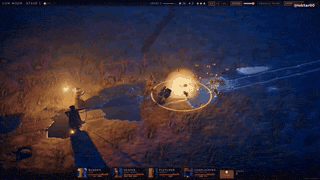
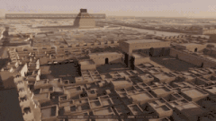
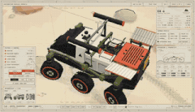
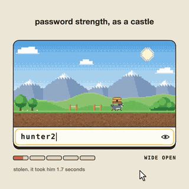
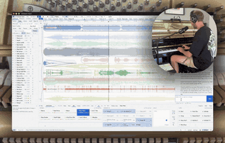

<h3>Ce que les gens ont créé avec Claude Fable 5.2, à ouvrir et à jouer</h3>

[English](README.md) · [简体中文](README.zh-CN.md) · [繁體中文](README.zh-TW.md) · [日本語](README.ja.md) · [한국어](README.ko.md) · [Español](README.es.md) · [Português](README.pt-BR.md) · **Français** · [Deutsch](README.de.md) · [Русский](README.ru.md)

**🌐 Version web : [fablelist.000ooo.ooo](https://fablelist.000ooo.ooo/fr/)** (recherche, une page par œuvre)

184 œuvres en ligne et 130 démos vidéo créées avec Claude Fable 5.2, liens vérifiés le 2026-11-17. Mis à jour chaque jour ; une ⭐ aide à continuer.

## 📑 Sommaire

[⭐ Les plus aimés](#-les-plus-aimés) · [🎮 Jeux](#-jeux) 88 · [🌍 Mondes et scènes 3D](#-mondes-et-scènes-3d) 42 · [🧰 Pages web et outils](#-pages-web-et-outils) 40 · [🎬 Animation et films](#-animation-et-films) 14 · [📺 Démos vidéo](#-démos-vidéo) 130 · [🤝 Contribuer](#-contribuer)

## ⭐ Les plus aimés

<table>
<tr>
<td width="33%" valign="top">
 
<b><a href="https://starrynightrider.com">Starry Nightrider</a></b> 
<a href="https://x.com/ebbyamir">@ebbyamir</a> · ♥ 17.9k · <a href="https://x.com/ebbyamir/status/2120284261089673376">▶ Vidéo</a> 
Van Gogh chevauchant sa Nuit étoilée, en jeu. 
<a href="https://fablelist.000ooo.ooo/fr/prompts/?w=starry-nightrider&ref=gh"><b>✨ Obtenir le prompt</b></a>
</td>
<td width="33%" valign="top">
 
<b><a href="https://claude.ai/artifact/BGY1SztrAYcJQHSsnHHGmp">Saltline — jeu de tir à la première personne</a></b> 
<a href="https://x.com/felixrieseberg">@felixrieseberg</a> · ♥ 14.9k · <a href="https://x.com/felixrieseberg/status/2119925633564463609">▶ Vidéo</a> 
Par un ingénieur d'Anthropic. Prompts en un seul essai, sans retour humain, 8 heures, ~550 $. Modèles, sons et textures tous générés en code. 
<a href="https://fablelist.000ooo.ooo/fr/prompts/?w=saltline-first-person-shooter&ref=gh"><b>✨ Obtenir le prompt</b></a>
</td>
<td width="33%" valign="top">
 
<b><a href="https://patch.gg/blendi/oil-paint">Oil Paint — jeu peint à la main</a></b> 
<a href="https://x.com/BlendiByl">@BlendiByl</a> · ♥ 8.0k · <a href="https://x.com/BlendiByl/status/2120341251178594532">▶ Vidéo</a> 
Fait en moins d'une heure. Chaque image compte environ 1,5 million de coups de pinceau, à 200 ips dans un onglet de navigateur. Open source. 
<a href="https://fablelist.000ooo.ooo/fr/prompts/?w=oil-paint-hand-painted-game&ref=gh"><b>✨ Obtenir le prompt</b></a>
</td>
</tr>
<tr>
<td width="33%" valign="top">
 
<b><a href="https://nyc.somethingbig.ai/">CROSSTOWN — New York en monde ouvert (aperçu précoce)</a></b> 
<a href="https://x.com/mattshumer_">@mattshumer_</a> · ♥ 7.5k · <a href="https://x.com/mattshumer_/status/2120282133503820150">▶ Vidéo</a> 
« Rockstar a mis 8 ans. Fable 5.2 va le faire en 7 jours. » Seule une partie de la ville est faite pour l'instant ; appuyez sur B pour envoyer un retour. 
<a href="https://fablelist.000ooo.ooo/fr/prompts/?w=crosstown-open-world-new-york-early-preview&ref=gh"><b>✨ Obtenir le prompt</b></a>
</td>
<td width="33%" valign="top">
 
<b><a href="https://claude.ai/artifact/QGWUAjRrzRzZWGcQzSMLfa">Claude App sur un laptop Blender</a></b> 
<a href="https://x.com/rileybrown">@rileybrown</a> · ♥ 7.1k · <a href="https://x.com/rileybrown/status/2119902109709537708">▶ Vidéo</a> 
Un seul prompt a construit toute la pièce dans Blender et l'a rendue en 4K. Voici la page web affichée sur l'écran du laptop. 
<a href="https://x.com/rileybrown/status/2119902109709537708">📝 Prompt du créateur (gratuit)</a>
</td>
<td width="33%" valign="top">
 
<b><a href="https://claudia.gallery">Claudia Gallery</a></b> 
<a href="https://x.com/anabology">@anabology</a> · ♥ 5.4k · <a href="https://x.com/anabology/status/2120010995309457643">▶ Vidéo</a> 
« Fais la vidéo de tes rêves » — deux plans, 9 heures. 
<a href="https://fablelist.000ooo.ooo/fr/prompts/?w=claudia-gallery&ref=gh"><b>✨ Obtenir le prompt</b></a>
</td>
</tr>
</table>

## 🎮 Jeux

<table>
<tr>
<td width="33%" valign="top">
 
<b><a href="https://starrynightrider.com">Starry Nightrider</a></b> 
<a href="https://x.com/ebbyamir">@ebbyamir</a> · ♥ 17.9k · <a href="https://x.com/ebbyamir/status/2120284261089673376">▶ Vidéo</a> 
Van Gogh chevauchant sa Nuit étoilée, en jeu. 
<a href="https://fablelist.000ooo.ooo/fr/prompts/?w=starry-nightrider&ref=gh"><b>✨ Obtenir le prompt</b></a>
</td>
<td width="33%" valign="top">
 
<b><a href="https://claude.ai/artifact/BGY1SztrAYcJQHSsnHHGmp">Saltline — jeu de tir à la première personne</a></b> 
<a href="https://x.com/felixrieseberg">@felixrieseberg</a> · ♥ 14.9k · <a href="https://x.com/felixrieseberg/status/2119925633564463609">▶ Vidéo</a> 
Par un ingénieur d'Anthropic. Prompts en un seul essai, sans retour humain, 8 heures, ~550 $. Modèles, sons et textures tous générés en code. 
<a href="https://fablelist.000ooo.ooo/fr/prompts/?w=saltline-first-person-shooter&ref=gh"><b>✨ Obtenir le prompt</b></a>
</td>
<td width="33%" valign="top">
 
<b><a href="https://patch.gg/blendi/oil-paint">Oil Paint — jeu peint à la main</a></b> 
<a href="https://x.com/BlendiByl">@BlendiByl</a> · ♥ 8.0k · <a href="https://x.com/BlendiByl/status/2120341251178594532">▶ Vidéo</a> 
Fait en moins d'une heure. Chaque image compte environ 1,5 million de coups de pinceau, à 200 ips dans un onglet de navigateur. Open source. 
<a href="https://fablelist.000ooo.ooo/fr/prompts/?w=oil-paint-hand-painted-game&ref=gh"><b>✨ Obtenir le prompt</b></a>
</td>
</tr>
<tr>
<td width="33%" valign="top">
 
<b><a href="https://nyc.somethingbig.ai/">CROSSTOWN — New York en monde ouvert (aperçu précoce)</a></b> 
<a href="https://x.com/mattshumer_">@mattshumer_</a> · ♥ 7.5k · <a href="https://x.com/mattshumer_/status/2120282133503820150">▶ Vidéo</a> 
« Rockstar a mis 8 ans. Fable 5.2 va le faire en 7 jours. » Seule une partie de la ville est faite pour l'instant ; appuyez sur B pour envoyer un retour. 
<a href="https://fablelist.000ooo.ooo/fr/prompts/?w=crosstown-open-world-new-york-early-preview&ref=gh"><b>✨ Obtenir le prompt</b></a>
</td>
<td width="33%" valign="top">
 
<b><a href="https://omw-game.kimaki.dev">omw : une vallée et son château en touches de peinture à l'huile</a></b> 
🆕 · <a href="https://x.com/__morse">@__morse</a> · ♥ 4.3k · <a href="https://x.com/__morse/status/2122013410309153042">▶ Vidéo</a> 
Le pixel art « omw » de @de5imulate recréé en jeu three.js jouable dans le navigateur, rendu comme une peinture à l'huile. 
<a href="https://github.com/remorses/castle-valley">Code source</a>
</td>
<td width="33%" valign="top">
 
<b><a href="https://what-the-water-keeps.vercel.app/">What the Water Keeps</a></b> 
<a href="https://x.com/kevin_t_ngo">@kevin_t_ngo</a> · ♥ 4.3k · <a href="https://x.com/kevin_t_ngo/status/2119868968307695818">▶ Vidéo</a> 
Une balade en bateau à travers 8 mondes oniriques, jouable dans le navigateur. 
<a href="https://fablelist.000ooo.ooo/fr/prompts/?w=what-the-water-keeps&ref=gh"><b>✨ Obtenir le prompt</b></a>
</td>
</tr>
<tr>
<td width="33%" valign="top">
 
<b><a href="https://tennis.sixfingerpunch.com/">Tennis</a></b> 
<a href="https://x.com/photonstorm">@photonstorm</a> · ♥ 3.1k · <a href="https://x.com/photonstorm/status/2120330010112434313">Publication</a> 
On lui a demandé de « se lâcher » pour faire un jeu, et il a rendu ce qui ressemble à un clone de Pong — jusqu'à ce qu'on y joue. 
<a href="https://fablelist.000ooo.ooo/fr/prompts/?w=tennis&ref=gh"><b>✨ Obtenir le prompt</b></a>
</td>
<td width="33%" valign="top">
 
<b><a href="https://patch.gg/play/blendi/small-magic">Small Magic — bac à sable de sorcier</a></b> 
<a href="https://x.com/BlendiByl">@BlendiByl</a> · ♥ 2.5k · <a href="https://x.com/BlendiByl/status/2121594536153718972">▶ Vidéo</a> 
Fait en une journée : 7 sorts, environ 1 800 éléments physiques destructibles, ni modèles ni textures, open source.
</td>
<td width="33%" valign="top">
 
<b><a href="https://www.spawn.co/@mattshumer/earth?room=local">Mirror Earth</a></b> 
<a href="https://x.com/mattshumer_">@mattshumer_</a> · ♥ 2.4k · <a href="https://x.com/mattshumer_/status/2119877065701036047">▶ Vidéo</a> 
Toute la planète en monde de jeu destructible, avec une météo qui suit la vraie Terre en temps réel. 
<a href="https://fablelist.000ooo.ooo/fr/prompts/?w=mirror-earth&ref=gh"><b>✨ Obtenir le prompt</b></a>
</td>
</tr>
<tr>
<td width="33%" valign="top">
 
<b><a href="https://portals-endless-worlds.netlify.app/">Portals: Endless Worlds</a></b> 
<a href="https://x.com/emollick">@emollick</a> · ♥ 1.9k · <a href="https://x.com/emollick/status/2119918307457577163">▶ Vidéo</a> 
25 000 agents ont construit plus de 450 mondes 3D en pur code, inspirés de livres, d'art et de lieux, reliés par des portails que l'on traverse en flottant. 
<a href="https://github.com/emollick/ai-portals">Code source</a> · <a href="https://www.oneusefulthing.org/p/fable-52-and-jagged-agi">Article</a> 
<a href="https://fablelist.000ooo.ooo/fr/prompts/?w=portals-endless-worlds&ref=gh"><b>✨ Obtenir le prompt</b></a>
</td>
<td width="33%" valign="top">
 
<b><a href="https://evensong-phi.vercel.app/">Evensong</a></b> 
<a href="https://x.com/kevin_t_ngo">@kevin_t_ngo</a> · ♥ 1.8k · <a href="https://x.com/kevin_t_ngo/status/2120238844754923874">▶ Vidéo</a> 
Un combat de boss de dark fantasy façon souls-like, jouable dans le navigateur. 
<a href="https://fablelist.000ooo.ooo/fr/prompts/?w=evensong&ref=gh"><b>✨ Obtenir le prompt</b></a>
</td>
<td width="33%" valign="top">
 
<b><a href="https://loktar00.github.io/lanternfall/">LANTERNFALL</a></b> 
<a href="https://x.com/loktar00">@loktar00</a> · ♥ 1.4k · <a href="https://x.com/loktar00/status/2120192761542615271">▶ Vidéo</a> 
Tout le jeu — animations, modèles, tout — généré par Fable. Regardez l'effet quand les ennemis meurent. 
<a href="https://fablelist.000ooo.ooo/fr/prompts/?w=lanternfall&ref=gh"><b>✨ Obtenir le prompt</b></a>
</td>
</tr>
</table>

<b><a href="all/games.fr.md">Voir les 88 →</a></b>

<a href="#-sommaire">↑ Retour au sommaire</a>

## 🌍 Mondes et scènes 3D

<table>
<tr>
<td width="33%" valign="top">
 
<b><a href="https://claude.ai/artifact/QGWUAjRrzRzZWGcQzSMLfa">Claude App sur un laptop Blender</a></b> 
<a href="https://x.com/rileybrown">@rileybrown</a> · ♥ 7.1k · <a href="https://x.com/rileybrown/status/2119902109709537708">▶ Vidéo</a> 
Un seul prompt a construit toute la pièce dans Blender et l'a rendue en 4K. Voici la page web affichée sur l'écran du laptop. 
<a href="https://x.com/rileybrown/status/2119902109709537708">📝 Prompt du créateur (gratuit)</a>
</td>
<td width="33%" valign="top">
 
<b><a href="https://patch.gg/blendi/painted-valley">Painted Valley</a></b> 
<a href="https://x.com/BlendiByl">@BlendiByl</a> · ♥ 1.8k · <a href="https://x.com/BlendiByl/status/2120694003230560585">▶ Vidéo</a> 
Une vallée peinte à la main inspirée de Ghibli, où l'on peut se promener. Open source. 
<a href="https://fablelist.000ooo.ooo/fr/prompts/?w=painted-valley&ref=gh"><b>✨ Obtenir le prompt</b></a>
</td>
<td width="33%" valign="top">
 
<b><a href="https://claude.ai/artifact/CTjrZXVdUgKJ6qJXrvvr28">Ancient Babylon, 600 BC</a></b> 
<a href="https://x.com/literallydenis">@literallydenis</a> · ♥ 1.2k · <a href="https://x.com/literallydenis/status/2120866958790848953">▶ Vidéo</a> 
Babylone reconstruite à partir de documents historiques et de plans qu'il a trouvés lui-même, en 8 heures d'exécution. Promenez-vous librement. 
<a href="https://fablelist.000ooo.ooo/fr/prompts/?w=ancient-babylon-600-bc&ref=gh"><b>✨ Obtenir le prompt</b></a>
</td>
</tr>
<tr>
<td width="33%" valign="top">
 
<b><a href="https://indiranagar-live.vercel.app">1 km² d'Indiranagar</a></b> 
<a href="https://x.com/anshu4321">@anshu4321</a> · ♥ 1.2k · <a href="https://x.com/anshu4321/status/2119938067758772403">▶ Vidéo</a> 
Une tranche 3D vivante de Bangalore à partir de données cartographiques et d'un prompt. 
<a href="https://fablelist.000ooo.ooo/fr/prompts/?w=1-km2-of-indiranagar&ref=gh"><b>✨ Obtenir le prompt</b></a>
</td>
<td width="33%" valign="top">
 
<b><a href="https://fable-rome.surge.sh/">Rome, AD 320</a></b> 
<a href="https://x.com/petergostev">@petergostev</a> · ♥ 970 · <a href="https://x.com/petergostev/status/2120167560700383572">▶ Vidéo</a> 
Un prompt, Fable 5.2 (Max) tournant toute la nuit, 2 618 $. 
<a href="https://x.com/petergostev/status/2120167560700383572">📝 Prompt du créateur (gratuit)</a>
</td>
<td width="33%" valign="top">
 
<b><a href="https://github.com/Leonxlnx/room-at-dawn">Room at Dawn</a></b> 
<a href="https://x.com/LexnLin">@LexnLin</a> · ♥ 862 · <a href="https://x.com/LexnLin/status/2120910879361548565">▶ Vidéo</a> 
Une chambre photoréaliste en three.js sans modèles ni textures préfabriqués ; tout est du code. 
<a href="https://fablelist.000ooo.ooo/fr/prompts/?w=room-at-dawn&ref=gh"><b>✨ Obtenir le prompt</b></a>
</td>
</tr>
<tr>
<td width="33%" valign="top">
 
<b><a href="https://fable-rover.vercel.app">ER-6 Terrain Explorer — un rover martien autonome</a></b> 
🆕 · <a href="https://x.com/DilumSanjaya">@DilumSanjaya</a> · ♥ 787 · <a href="https://x.com/DilumSanjaya/status/2120561077385867663">▶ Vidéo</a> 
Fable 5.2 a conçu une suspension rocker-bogie comme celle des rovers martiens de la NASA, puis l'a simulée sur un terrain extraterrestre.
</td>
<td width="33%" valign="top">
 
<b><a href="https://ship-42-catch.netlify.app/">Ship 42 Catch</a></b> 
🆕 · <a href="https://x.com/emollick">@emollick</a> · ♥ 728 · <a href="https://x.com/emollick/status/2122036763468214711">▶ Vidéo</a> 
Fable et Opus ont retrouvé la vidéo de la capture de Starship par la tour et recréé les 40 dernières secondes en 3D détaillée avec three.js. On peut changer de caméra.
</td>
<td width="33%" valign="top">
 
<b><a href="https://supernatural-ft.vercel.app/fire-in-ice">Fire in Ice</a></b> 
<a href="https://x.com/tkm_hmng8">@tkm_hmng8</a> · ♥ 551 · <a href="https://x.com/tkm_hmng8/status/2120813043101946324">▶ Vidéo</a> 
Un feu réaliste brûlant à l'intérieur de la glace, écrit en WebGPU brut sans three.js. 
<a href="https://fablelist.000ooo.ooo/fr/prompts/?w=fire-in-ice&ref=gh"><b>✨ Obtenir le prompt</b></a>
</td>
</tr>
<tr>
<td width="33%" valign="top">
 
<b><a href="https://bay.theojaffee.net">Bay Area Through Time</a></b> 
<a href="https://x.com/theojaffee">@theojaffee</a> · ♥ 387 · <a href="https://x.com/theojaffee/status/2120312766544437738">▶ Vidéo</a> 
Zoomez sur n'importe quelle ville ou quartier, choisissez une année jusqu'en 1769 et voyez à quoi cela ressemblait. 
<a href="https://nyc.theojaffee.net">New York City</a> 
<a href="https://fablelist.000ooo.ooo/fr/prompts/?w=bay-area-through-time&ref=gh"><b>✨ Obtenir le prompt</b></a>
</td>
<td width="33%" valign="top">
 
<b><a href="http://procedural-arm-rig.vercel.app">Procedural Arm Rig</a></b> 
<a href="https://x.com/apekshik">@apekshik</a> · ♥ 326 · <a href="https://x.com/apekshik/status/2120224530367119758">▶ Vidéo</a> 
Plutôt que de réussir un jeu AAA en un essai : un seul bras avec armature d'os, maillage peint en poids, IK et muscles qui gonflent quand le poing se serre. 
<a href="https://fablelist.000ooo.ooo/fr/prompts/?w=procedural-arm-rig&ref=gh"><b>✨ Obtenir le prompt</b></a>
</td>
<td width="33%" valign="top">
 
<b><a href="https://samg-coder.github.io/solstice-garden/">The Garden</a></b> 
<a href="https://x.com/SamGCoder">@SamGCoder</a> · ♥ 298 · <a href="https://x.com/SamGCoder/status/2120943068321054975">▶ Vidéo</a> 
Une scène de jardin écrite en Rust, compilée en WASM et rendue avec WebGPU. 
<a href="https://fablelist.000ooo.ooo/fr/prompts/?w=the-garden&ref=gh"><b>✨ Obtenir le prompt</b></a>
</td>
</tr>
</table>

<b><a href="all/3d-worlds.fr.md">Voir les 42 →</a></b>

<a href="#-sommaire">↑ Retour au sommaire</a>

## 🧰 Pages web et outils

<table>
<tr>
<td width="33%" valign="top">
 
<b><a href="https://claudia.gallery">Claudia Gallery</a></b> 
<a href="https://x.com/anabology">@anabology</a> · ♥ 5.4k · <a href="https://x.com/anabology/status/2120010995309457643">▶ Vidéo</a> 
« Fais la vidéo de tes rêves » — deux plans, 9 heures. 
<a href="https://fablelist.000ooo.ooo/fr/prompts/?w=claudia-gallery&ref=gh"><b>✨ Obtenir le prompt</b></a>
</td>
<td width="33%" valign="top">
 
<b><a href="http://robotics-lab-app.vercel.app">Robotics Lab</a></b> 
<a href="https://x.com/0xMovez">@0xMovez</a> · ♥ 4.7k · <a href="https://x.com/0xMovez/status/2120239217880268919">▶ Vidéo</a> 
Huit vraies cartes (Arduino Uno, Raspberry Pi 4…) en 3D : placez des puces, soudez-les, câblez de vrais circuits. 
<a href="http://robolabs-app.vercel.app">Humanoid edition</a> 
<a href="https://fablelist.000ooo.ooo/fr/prompts/?w=robotics-lab&ref=gh"><b>✨ Obtenir le prompt</b></a>
</td>
<td width="33%" valign="top">
 
<b><a href="https://claude.ai/artifact/N6bSgS4ZH5ifFQfg8sm4dv">Générateur de House Bangers</a></b> 
<a href="https://x.com/deedydas">@deedydas</a> · ♥ 4.1k · <a href="https://x.com/deedydas/status/2120905625852936318">▶ Vidéo</a> 
Il a appris la théorie musicale, essaie des milliers de motifs par instrument et arrange les meilleurs en un morceau house de 72 mesures. Son activé. 
<a href="https://fablelist.000ooo.ooo/fr/prompts/?w=house-bangers-generator&ref=gh"><b>✨ Obtenir le prompt</b></a>
</td>
</tr>
<tr>
<td width="33%" valign="top">
 
<b><a href="https://miaai-lab.github.io/Claude-Fable-5.2-HTML-Files/">76 pièces HTML en un seul fichier</a></b> 
<a href="https://x.com/MiaAI_lab">@MiaAI_lab</a> · ♥ 2.6k · <a href="https://x.com/MiaAI_lab/status/2119930229661503893">Publication</a> 
Art génératif, physique, typo et UI, chacune avec son prompt d'origine. 
<a href="https://fablelist.000ooo.ooo/fr/prompts/?w=76-single-file-html-pieces&ref=gh"><b>✨ Obtenir le prompt</b></a>
</td>
<td width="33%" valign="top">
 
<b><a href="https://pixel-worlds.vercel.app/keep/">Keep — indicateur de robustesse de mot de passe</a></b> 
<a href="https://x.com/crtvTeknologist">@crtvTeknologist</a> · ♥ 1.6k · <a href="https://x.com/crtvTeknologist/status/2119894073024606617">▶ Vidéo</a> 
Un indicateur de robustesse de mot de passe rendu comme un monde de pixels vivant. 
<a href="https://github.com/finktheartist/pixel-worlds">Code source</a> 
<a href="https://fablelist.000ooo.ooo/fr/prompts/?w=keep-password-strength-meter&ref=gh"><b>✨ Obtenir le prompt</b></a>
</td>
<td width="33%" valign="top">
 
<b><a href="https://masterofvfx2070.github.io/xray-mirror/">X-Ray Mirror</a></b> 
<a href="https://x.com/HashemGhaili">@HashemGhaili</a> · ♥ 1.4k · <a href="https://x.com/HashemGhaili/status/2120202746121085321">▶ Vidéo</a> 
Pointez la webcam sur votre visage et voyez crâne, cerveau et muscles suivis en direct. Ouvrez la bouche et la mâchoire s'ouvre ; la vidéo ne quitte jamais votre ordinateur. 
<a href="https://github.com/MasterOfVFX2070/xray-mirror">Code source</a> 
<a href="https://fablelist.000ooo.ooo/fr/prompts/?w=x-ray-mirror&ref=gh"><b>✨ Obtenir le prompt</b></a>
</td>
</tr>
<tr>
<td width="33%" valign="top">
 
<b><a href="https://sakuga-vfx.vercel.app">Sakuga Set</a></b> 
🆕 · <a href="https://x.com/crtvTeknologist">@crtvTeknologist</a> · ♥ 1.4k · <a href="https://x.com/crtvTeknologist/status/2122088829565698218">▶ Vidéo</a> 
Douze contrôles d'interface qui réagissent comme dans un anime : les boutons s'écrasent et atterrissent avec un DON !, les interrupteurs laissent une traînée et éclaboussent, les curseurs soulèvent des nuages. Tous les effets sont dessinés en code, un fichier chacun, sans dépendance. 
<a href="https://github.com/finktheartist/sakuga-vfx">Code source</a>
</td>
<td width="33%" valign="top">
 
<b><a href="https://xianxie6.github.io/animals-planner-2027/">Animals at Work — agenda 3D</a></b> 
<a href="https://x.com/Xian0063">@Xian0063</a> · ♥ 1.2k · <a href="https://x.com/Xian0063/status/2120417834694250522">▶ Vidéo</a> 
Un agenda papier refait en 3D : glissez pour tourner les pages, touchez une date pour écrire, 90 stickers à décoller et à coller. Opus 5.5 a construit le squelette ; Fable 5.2 a affiné les matières d'après des images réelles. 
<a href="https://fablelist.000ooo.ooo/fr/prompts/?w=animals-at-work-3d-planner&ref=gh"><b>✨ Obtenir le prompt</b></a>
</td>
<td width="33%" valign="top">
 
<b><a href="https://uberdesigner.ai/t/spine-menu">Spine Menu</a></b> 
<a href="https://x.com/seanaiux">@seanaiux</a> · ♥ 1.2k · <a href="https://x.com/seanaiux/status/2120222459110789574">▶ Vidéo</a> 
« Avez-vous déjà vu un menu plus beau ? » La page inclut le prompt. 
<a href="https://uberdesigner.ai/t/aquarium-toggle">Aquarium toggle</a> · <a href="https://uberdesigner.ai/t/glow-widgets">Glow widgets</a>
</td>
</tr>
<tr>
<td width="33%" valign="top">
 
<b><a href="https://roverkit.vercel.app">RoverKit — construire et simuler une voiture robot</a></b> 
🆕 · <a href="https://x.com/DilumSanjaya">@DilumSanjaya</a> · ♥ 1.1k · <a href="https://x.com/DilumSanjaya/status/2121286147393651085">▶ Vidéo</a> 
Un guide pas à pas pour construire une voiture robot, avec simulateur, arène personnalisable et explication visuelle du code. Compatible Arduino et ESP32.
</td>
<td width="33%" valign="top">
 
<b><a href="https://github.com/AlexAtFF/pulp-daw-public">PULP — une DAW native IA</a></b> 
<a href="https://x.com/The_Alex">@The_Alex</a> · ♥ 942 · <a href="https://x.com/The_Alex/status/2119917226769985785">▶ Vidéo</a> 
Une station audio numérique native pour Windows. Demandez de la musique à Claude : il ouvre la DAW et compose le morceau. 
<a href="https://fablelist.000ooo.ooo/fr/prompts/?w=pulp-an-ai-native-daw&ref=gh"><b>✨ Obtenir le prompt</b></a>
</td>
<td width="33%" valign="top">
 
<b><a href="https://frontier.every.to/experiments/ambient-town">Ambient Town</a></b> 
<a href="https://x.com/kieranklaassen">@kieranklaassen</a> · ♥ 895 · <a href="https://x.com/kieranklaassen/status/2119868196773929160">▶ Vidéo</a> 
Une DAW ambient construite en une semaine de soirées par un ancien compositeur de cinéma : support d'Ableton Push, micros, effets, un synthé et un agent qui compose avec vous. Cliquez sur « Try it » sur la page. 
<a href="https://fablelist.000ooo.ooo/fr/prompts/?w=ambient-town&ref=gh"><b>✨ Obtenir le prompt</b></a>
</td>
</tr>
</table>

<b><a href="all/web-and-tools.fr.md">Voir les 40 →</a></b>

<a href="#-sommaire">↑ Retour au sommaire</a>

## 🎬 Animation et films

<table>
<tr>
<td width="33%" valign="top">
 
<b><a href="https://github.com/ChetasLua/crimson-loong">Crimson Loong</a></b> 
<a href="https://x.com/chetaslua">@chetaslua</a> · ♥ 3.7k · <a href="https://x.com/chetaslua/status/2121176151234330707">▶ Vidéo</a> 
Un film de dragon de 90 secondes en three.js, en pur code et sans assets externes. 
<a href="https://fablelist.000ooo.ooo/fr/prompts/?w=crimson-loong&ref=gh"><b>✨ Obtenir le prompt</b></a>
</td>
<td width="33%" valign="top">
 
<b><a href="https://github.com/BubbleBrainBB/awesome-fable-5.2/tree/main/cat-garden">Cat Garden : un jardin botanique à travers les yeux d'un chat</a></b> 
🆕 · <a href="https://x.com/BubbleBrain">@BubbleBrain</a> · ♥ 879 · <a href="https://x.com/BubbleBrain/status/2122313967473434639">▶ Vidéo</a> 
Un film de 110 secondes en plan-séquence où un chat marche, renifle et bondit dans un jardin botanique. L'image vient d'un path tracer écrit pour l'occasion et le son est synthétisé avec numpy, sans aucun asset.
</td>
<td width="33%" valign="top">
 
<b><a href="https://github.com/amirmushichge/shred-kit">Shred Kit — modèle de déchiquetage de papier</a></b> 
<a href="https://x.com/AmirMushich">@AmirMushich</a> · ♥ 430 · <a href="https://x.com/AmirMushich/status/2121339167800213934">▶ Vidéo</a> 
Un reel de 8 secondes de papier déchiqueté, fait avec Fable 5.2 et Blender, partagé comme modèle gratuit.
</td>
</tr>
<tr>
<td width="33%" valign="top">
 
<b><a href="https://github.com/ChetasLua/pelican-riding-a-bicycle">The Pelican, Tired of the Road</a></b> 
<a href="https://x.com/chetaslua">@chetaslua</a> · ♥ 357 · <a href="https://x.com/chetaslua/status/2120438091647218025">▶ Vidéo</a> 
Un film de 60 secondes à l'aspect peint à la main sur le pélican du test SVG. Un fichier HTML ; chaque pixel et chaque son est du code. 
<a href="https://github.com/ChetasLua/mona-lisa-js">Mona Lisa in JS</a> 
<a href="https://fablelist.000ooo.ooo/fr/prompts/?w=the-pelican-tired-of-the-road&ref=gh"><b>✨ Obtenir le prompt</b></a>
</td>
<td width="33%" valign="top">
 
<b><a href="https://github.com/Leonxlnx/castle-cinematic">Castle Cinematic</a></b> 
🆕 · <a href="https://x.com/LexnLin">@LexnLin</a> · ♥ 314 · <a href="https://x.com/LexnLin/status/2122112228522623459">▶ Vidéo</a> 
Un film 4K de 45 secondes d'un château gothique au sommet d'une falaise au coucher du soleil. Chaque image vient d'environ 9 000 lignes de Python dans Blender, sans asset 3D ni texture.
</td>
<td width="33%" valign="top">
 
<b><a href="https://github.com/anstapnever/one-sweep">One Sweep</a></b> 
<a href="https://x.com/anstapnever">@anstapnever</a> · ♥ 252 · <a href="https://x.com/anstapnever/status/2119772039037014524">▶ Vidéo</a> 
Un combat d'anime de 78 secondes en Three.js pur, six équipes d'agents en parallèle. L'auteur dit « Fable 5.5 ». 
<a href="https://x.com/anstapnever/status/2119772039037014524">📝 Prompt du créateur (gratuit)</a>
</td>
</tr>
<tr>
<td width="33%" valign="top">
 
<b><a href="https://github.com/crossps/ballpoint">Ballpoint</a></b> 
<a href="https://x.com/camperaigg">@camperaigg</a> · ♥ 242 · <a href="https://x.com/camperaigg/status/2119777467074580741">▶ Vidéo</a> 
ASMR macro d'un stylo à bille, open source pour prouver que c'est du code et non un modèle vidéo. 
<a href="https://fablelist.000ooo.ooo/fr/prompts/?w=ballpoint&ref=gh"><b>✨ Obtenir le prompt</b></a>
</td>
<td width="33%" valign="top">
 
<b><a href="https://github.com/ChetasLua/godzilla-nights">Godzilla Nights</a></b> 
<a href="https://x.com/chetaslua">@chetaslua</a> · ♥ 229 · <a href="https://x.com/chetaslua/status/2119981510199808368">▶ Vidéo</a> 
Images dessinées en pur code, légèrement animées. 
<a href="https://fablelist.000ooo.ooo/fr/prompts/?w=godzilla-nights&ref=gh"><b>✨ Obtenir le prompt</b></a>
</td>
<td width="33%" valign="top">
 
<b><a href="https://github.com/0xCodez/thousand-peaks">Dragon of a Thousand Peaks — le dragon aux mille sommets</a></b> 
🆕 · <a href="https://x.com/0xMovez">@0xMovez</a> · ♥ 129 · <a href="https://x.com/0xMovez/status/2121721290687983906">▶ Vidéo</a> 
Un film de combat de 90 secondes en three.js pur, sans assets ni modèle vidéo ; Fable 5.2 a dirigé 8 agents en parallèle, et musique et bruitages sont synthétisés en code.
</td>
</tr>
<tr>
<td width="33%" valign="top">
 
<b><a href="https://github.com/anstapnever/blackout">Blackout</a></b> 
<a href="https://x.com/anstapnever">@anstapnever</a> · ♥ 119 · <a href="https://x.com/anstapnever/status/2119915123070644263">▶ Vidéo</a> 
Un court métrage d'anime de 79 secondes, tout en code. 
<a href="https://x.com/anstapnever/status/2119915123070644263">📝 Prompt du créateur (gratuit)</a>
</td>
</tr>
</table>

<b><a href="all/animation.fr.md">Voir les 14 →</a></b>

<a href="#-sommaire">↑ Retour au sommaire</a>

## 📺 Démos vidéo

Les créateurs ont publié une vidéo mais pas de lien. Cliquez sur l'aperçu pour voir la publication d'origine.

<table>
<tr>
<td width="33%" valign="top">
 
<b><a href="https://x.com/claudeai/status/2119899459761131615">Anthropic : projets avant sortie</a></b> 
<a href="https://x.com/claudeai">@claudeai</a> · ♥ 43.1k · <a href="https://x.com/claudeai/status/2119899459761131615">▶ Vidéo</a> 
Ce que Fable 5.2 et Mythos 5.2 ont construit dans divers domaines pendant les tests. 
<a href="https://fablelist.000ooo.ooo/fr/prompts/?w=anthropic-pre-release-projects&ref=gh"><b>✨ Obtenir le prompt</b></a>
</td>
<td width="33%" valign="top">
 
<b><a href="https://x.com/anxuanng/status/2120088745139638375">Un film 3D expliquant le paradoxe de Zénon</a></b> 
<a href="https://x.com/anxuanng">@anxuanng</a> · ♥ 10.0k · <a href="https://x.com/anxuanng/status/2120088745139638375">▶ Vidéo</a> 
 
<a href="https://fablelist.000ooo.ooo/fr/prompts/?w=a-3d-film-explaining-zeno-s-paradox&ref=gh"><b>✨ Obtenir le prompt</b></a>
</td>
<td width="33%" valign="top">
 
<b><a href="https://x.com/imjustnewatai/status/2120383964686729410">Une symphonie en forme d'entraînement de modèle</a></b> 
<a href="https://x.com/imjustnewatai">@imjustnewatai</a> · ♥ 9.7k · <a href="https://x.com/imjustnewatai/status/2120383964686729410">▶ Vidéo</a> 
 
<a href="https://fablelist.000ooo.ooo/fr/prompts/?w=a-symphony-shaped-like-a-training-run&ref=gh"><b>✨ Obtenir le prompt</b></a>
</td>
</tr>
<tr>
<td width="33%" valign="top">
 
<b><a href="https://x.com/everestchris6/status/2120175941616128277">Des plans 2D transformés en visites 3D</a></b> 
<a href="https://x.com/everestchris6">@everestchris6</a> · ♥ 7.3k · <a href="https://x.com/everestchris6/status/2120175941616128277">▶ Vidéo</a> 
 
<a href="https://x.com/everestchris6/status/2120175941616128277">📝 Prompt du créateur (gratuit)</a>
</td>
<td width="33%" valign="top">
 
<b><a href="https://x.com/dominikmartn/status/2120154832694858224">Il sait vraiment concevoir</a></b> 
<a href="https://x.com/dominikmartn">@dominikmartn</a> · ♥ 7.3k · <a href="https://x.com/dominikmartn/status/2120154832694858224">▶ Vidéo</a> 
 
<a href="https://fablelist.000ooo.ooo/fr/prompts/?w=it-can-actually-design&ref=gh"><b>✨ Obtenir le prompt</b></a>
</td>
<td width="33%" valign="top">
 
<b><a href="https://x.com/suna_gaku/status/2119952985933697063">« Montre-moi ta meilleure vidéo »</a></b> 
<a href="https://x.com/suna_gaku">@suna_gaku</a> · ♥ 6.8k · <a href="https://x.com/suna_gaku/status/2119952985933697063">▶ Vidéo</a> 
 
<a href="https://x.com/suna_gaku/status/2119952985933697063">📝 Prompt du créateur (gratuit)</a>
</td>
</tr>
<tr>
<td width="33%" valign="top">
 
<b><a href="https://x.com/yohakutoink/status/2120824797215310208">Peindre une copie en code — « l'original a une tache ici, pas la mienne »</a></b> 
<a href="https://x.com/yohakutoink">@yohakutoink</a> · ♥ 6.4k · <a href="https://x.com/yohakutoink/status/2120824797215310208">▶ Vidéo</a> 
 
<a href="https://fablelist.000ooo.ooo/fr/prompts/?w=painting-a-copy-in-code-the-original-has&ref=gh"><b>✨ Obtenir le prompt</b></a>
</td>
<td width="33%" valign="top">
 
<b><a href="https://x.com/matabee_GTO/status/2120995946372985144">Un prompt : fais la vidéo la plus dérangeante possible</a></b> 
<a href="https://x.com/matabee_GTO">@matabee_GTO</a> · ♥ 4.8k · <a href="https://x.com/matabee_GTO/status/2120995946372985144">▶ Vidéo</a> 
 
<a href="https://x.com/matabee_GTO/status/2120995946372985144">📝 Prompt du créateur (gratuit)</a>
</td>
<td width="33%" valign="top">
 
<b><a href="https://x.com/JungleSilicon/status/2121782359901212987">Gaussian splats en pixel art</a></b> 
🆕 · <a href="https://x.com/JungleSilicon">@JungleSilicon</a> · ♥ 4.7k · <a href="https://x.com/JungleSilicon/status/2121782359901212987">▶ Vidéo</a> 

</td>
</tr>
<tr>
<td width="33%" valign="top">
 
<b><a href="https://x.com/MrTacticalX/status/2121082861902070130">Trois agents Fable 5.2 construisent un ordinateur en 7 h 41</a></b> 
<a href="https://x.com/MrTacticalX">@MrTacticalX</a> · ♥ 4.6k · <a href="https://x.com/MrTacticalX/status/2121082861902070130">▶ Vidéo</a> 
 
<a href="https://fablelist.000ooo.ooo/fr/prompts/?w=three-fable-5-2-agents-build-a-computer&ref=gh"><b>✨ Obtenir le prompt</b></a>
</td>
<td width="33%" valign="top">
 
<b><a href="https://x.com/XRarchitect/status/2120947265007440052">Atlas + Fable 5.2 + three.js</a></b> 
<a href="https://x.com/XRarchitect">@XRarchitect</a> · ♥ 4.4k · <a href="https://x.com/XRarchitect/status/2120947265007440052">▶ Vidéo</a> 
 
<a href="https://fablelist.000ooo.ooo/fr/prompts/?w=atlas-fable-5-2-three-js&ref=gh"><b>✨ Obtenir le prompt</b></a>
</td>
<td width="33%" valign="top">
 
<b><a href="https://x.com/aollivier82/status/2120260208245043663">L'histoire de l'infographie 3D, animée</a></b> 
<a href="https://x.com/aollivier82">@aollivier82</a> · ♥ 3.2k · <a href="https://x.com/aollivier82/status/2120260208245043663">▶ Vidéo</a> 
 
<a href="https://fablelist.000ooo.ooo/fr/prompts/?w=the-history-of-computer-graphics-animated&ref=gh"><b>✨ Obtenir le prompt</b></a>
</td>
</tr>
</table>

<b><a href="all/video-demos.fr.md">Voir les 130 →</a></b>

## 🤝 Contribuer

Vous en avez trouvé une qui manque ? Ouvrez une [issue](../../issues/new/choose) avec le lien de l'œuvre et la publication d'origine. Le lien doit s'ouvrir directement et l'œuvre doit être faite avec Fable 5.2.

## Avertissement

Toutes les œuvres appartiennent à leurs créateurs. Ce dépôt se contente de les indexer, avec de courts aperçus GIF en basse résolution, sans héberger d'œuvres ni de vidéos complètes ; la vidéo complète est sur la publication d'origine. Les créateurs peuvent demander le retrait d'un aperçu ou d'une entrée via une issue. Sans lien avec Anthropic.

## Star History

## License

[CC0 1.0](LICENSE) : la liste elle-même est dans le domaine public.

## 📰 Nouveautés

- **2026-11-17** : +8 œuvres et +2 démos vidéo.
- **2026-11-16** : +10 œuvres et +6 démos vidéo.
- **2026-11-15** : +10 œuvres et +10 démos vidéo.
- **2026-11-14** : +13 œuvres et +2 démos vidéo.
- **2026-11-10** : Première version : 57 œuvres + 61 démos vidéo, chacune avec un aperçu GIF.
