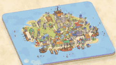
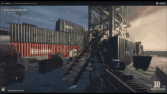
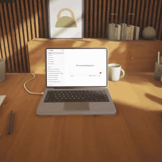
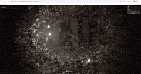
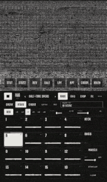

<h3>Ce que les gens ont créé avec Claude Fable 5.2, à ouvrir et à jouer</h3>

[English](README.md) · [简体中文](README.zh-CN.md) · [繁體中文](README.zh-TW.md) · [日本語](README.ja.md) · [한국어](README.ko.md) · [Español](README.es.md) · [Português](README.pt-BR.md) · **Français** · [Deutsch](README.de.md) · [Русский](README.ru.md)

**🌐 Version web : [fablelist.000ooo.ooo](https://fablelist.000ooo.ooo/fr/)** (recherche, une page par œuvre)

248 œuvres en ligne et 156 démos vidéo créées avec Claude Fable 5.2, liens vérifiés le 2026-11-26. Mis à jour chaque jour ; une ⭐ aide à continuer.

## 📑 Sommaire

[⭐ Les plus aimés](#-les-plus-aimés) · [🆕 Récents](#-récents) · [🎮 Jeux](#-jeux) 117 · [🌍 Mondes et scènes 3D](#-mondes-et-scènes-3d) 54 · [🧰 Pages web et outils](#-pages-web-et-outils) 58 · [🎬 Animation et films](#-animation-et-films) 19 · [📺 Démos vidéo](#-démos-vidéo) 156 · [🤝 Contribuer](#-contribuer)

## ⭐ Les plus aimés

<table>
<tr>
<td width="33%" valign="top">
 
<b><a href="https://starrynightrider.com">Starry Nightrider</a></b> 
<a href="https://x.com/ebbyamir">@ebbyamir</a> · ♥ 17.9k · <a href="https://x.com/ebbyamir/status/2120284261089673376">▶ Vidéo</a> 
Van Gogh chevauchant sa Nuit étoilée, en jeu. 
<a href="https://fablelist.000ooo.ooo/fr/prompts/?w=starry-nightrider&ref=gh"><b>✨ Obtenir le prompt</b></a>
</td>
<td width="33%" valign="top">
 
<b><a href="https://claude.ai/artifact/BGY1SztrAYcJQHSsnHHGmp">Saltline — jeu de tir à la première personne</a></b> 
<a href="https://x.com/felixrieseberg">@felixrieseberg</a> · ♥ 15.1k · <a href="https://x.com/felixrieseberg/status/2119925633564463609">▶ Vidéo</a> 
Par un ingénieur d'Anthropic. Prompts en un seul essai, sans retour humain, 8 heures, ~550 $. Modèles, sons et textures tous générés en code. 
<a href="https://fablelist.000ooo.ooo/fr/prompts/?w=saltline-first-person-shooter&ref=gh"><b>✨ Obtenir le prompt</b></a>
</td>
<td width="33%" valign="top">
 
<b><a href="https://viktorkav.com.br/apoio/uno-com-escada/fable/">Uno com Escada : une Fiat Uno avec une échelle sur un circuit</a></b> 
<a href="https://x.com/ViktorKav">@ViktorKav</a> · ♥ 9.2k · <a href="https://x.com/ViktorKav/status/2122647483281015155">▶ Vidéo</a> 
Pilotez une Uno Mille de 1996 avec une échelle sur le toit sur un circuit. Un seul fichier HTML de 603 KB, sans moteur, bibliothèque 3D ni texture ; la voiture, la forêt, le ciel et le bruit du moteur sortent du code. 
<a href="https://github.com/viktorkav/uno-com-escada">Code source</a>
</td>
</tr>
<tr>
<td width="33%" valign="top">
 
<b><a href="https://patch.gg/blendi/oil-paint">Oil Paint — jeu peint à la main</a></b> 
<a href="https://x.com/BlendiByl">@BlendiByl</a> · ♥ 8.0k · <a href="https://x.com/BlendiByl/status/2120341251178594532">▶ Vidéo</a> 
Fait en moins d'une heure. Chaque image compte environ 1,5 million de coups de pinceau, à 200 ips dans un onglet de navigateur. Open source. 
<a href="https://fablelist.000ooo.ooo/fr/prompts/?w=oil-paint-hand-painted-game&ref=gh"><b>✨ Obtenir le prompt</b></a>
</td>
<td width="33%" valign="top">
 
<b><a href="https://nyc.somethingbig.ai/">CROSSTOWN — New York en monde ouvert (aperçu précoce)</a></b> 
<a href="https://x.com/mattshumer_">@mattshumer_</a> · ♥ 7.5k · <a href="https://x.com/mattshumer_/status/2120282133503820150">▶ Vidéo</a> 
« Rockstar a mis 8 ans. Fable 5.2 va le faire en 7 jours. » Seule une partie de la ville est faite pour l'instant ; appuyez sur B pour envoyer un retour. 
<a href="https://fablelist.000ooo.ooo/fr/prompts/?w=crosstown-open-world-new-york-early-preview&ref=gh"><b>✨ Obtenir le prompt</b></a>
</td>
<td width="33%" valign="top">
 
<b><a href="https://claude.ai/artifact/QGWUAjRrzRzZWGcQzSMLfa">Claude App sur un laptop Blender</a></b> 
<a href="https://x.com/rileybrown">@rileybrown</a> · ♥ 7.1k · <a href="https://x.com/rileybrown/status/2119902109709537708">▶ Vidéo</a> 
Un seul prompt a construit toute la pièce dans Blender et l'a rendue en 4K. Voici la page web affichée sur l'écran du laptop. 
<a href="https://x.com/rileybrown/status/2119902109709537708">📝 Prompt du créateur (gratuit)</a>
</td>
</tr>
</table>

## 🆕 Récents

Publiés ces 3 derniers jours, triés par j'aime.

<table>
<tr>
<td width="33%" valign="top">
 
<b><a href="https://kevintngo.github.io/procedural-rpg/">Brushwild — un RPG procédural en monde ouvert</a></b> 
🆕 · <a href="https://x.com/kevin_t_ngo">@kevin_t_ngo</a> · ♥ 2.6k · <a href="https://x.com/kevin_t_ngo/status/2125321244686029289">▶ Vidéo</a> 
Un RPG d'action procédural en monde ouvert dans un seul fichier HTML d'environ 300kB. Chaque pixel est dessiné par des shaders, dans un style plume et crayons de couleur. Trois classes, arbres de compétences, butin, villes et donjons ; jouable sur ordinateur ou sur téléphone. 
<a href="https://github.com/kevintngo/procedural-rpg">Code source</a>
</td>
<td width="33%" valign="top">
 
<b><a href="https://kevintngo.github.io/cinderwatch/">Cinderwatch : un tower defense dans un seul fichier HTML</a></b> 
🆕 · <a href="https://x.com/kevin_t_ngo">@kevin_t_ngo</a> · ♥ 2.3k · <a href="https://x.com/kevin_t_ngo/status/2125119969109418333">▶ Vidéo</a> 
Un tower defense isométrique en 3D qui tient dans un seul fichier HTML. Un commandant IA intégré peut gérer la défense à votre place. Open source et jouable dans le navigateur. 
<a href="https://github.com/kevintngo/cinderwatch">Code source</a>
</td>
<td width="33%" valign="top">
 
<b><a href="https://littlecity.io">Little City — un city builder dessiné à la main</a></b> 
🆕 · <a href="https://x.com/sprezzyyy">@sprezzyyy</a> · ♥ 1.0k · <a href="https://x.com/sprezzyyy/status/2125321545665192054">▶ Vidéo</a> 
Un city builder bac à sable inspiré de Townscaper. Posez quelques blocs, regardez-les devenir une petite ville dessinée à la main, puis regardez-la prendre vie. Jouable dans le navigateur. 
<a href="https://github.com/yaoderek/littlecity.io">Code source</a>
</td>
</tr>
</table>

## 🎮 Jeux

<table>
<tr>
<td width="33%" valign="top">
 
<b><a href="https://starrynightrider.com">Starry Nightrider</a></b> 
<a href="https://x.com/ebbyamir">@ebbyamir</a> · ♥ 17.9k · <a href="https://x.com/ebbyamir/status/2120284261089673376">▶ Vidéo</a> 
Van Gogh chevauchant sa Nuit étoilée, en jeu. 
<a href="https://fablelist.000ooo.ooo/fr/prompts/?w=starry-nightrider&ref=gh"><b>✨ Obtenir le prompt</b></a>
</td>
<td width="33%" valign="top">
 
<b><a href="https://claude.ai/artifact/BGY1SztrAYcJQHSsnHHGmp">Saltline — jeu de tir à la première personne</a></b> 
<a href="https://x.com/felixrieseberg">@felixrieseberg</a> · ♥ 15.1k · <a href="https://x.com/felixrieseberg/status/2119925633564463609">▶ Vidéo</a> 
Par un ingénieur d'Anthropic. Prompts en un seul essai, sans retour humain, 8 heures, ~550 $. Modèles, sons et textures tous générés en code. 
<a href="https://fablelist.000ooo.ooo/fr/prompts/?w=saltline-first-person-shooter&ref=gh"><b>✨ Obtenir le prompt</b></a>
</td>
<td width="33%" valign="top">
 
<b><a href="https://viktorkav.com.br/apoio/uno-com-escada/fable/">Uno com Escada : une Fiat Uno avec une échelle sur un circuit</a></b> 
<a href="https://x.com/ViktorKav">@ViktorKav</a> · ♥ 9.2k · <a href="https://x.com/ViktorKav/status/2122647483281015155">▶ Vidéo</a> 
Pilotez une Uno Mille de 1996 avec une échelle sur le toit sur un circuit. Un seul fichier HTML de 603 KB, sans moteur, bibliothèque 3D ni texture ; la voiture, la forêt, le ciel et le bruit du moteur sortent du code. 
<a href="https://github.com/viktorkav/uno-com-escada">Code source</a>
</td>
</tr>
<tr>
<td width="33%" valign="top">
 
<b><a href="https://patch.gg/blendi/oil-paint">Oil Paint — jeu peint à la main</a></b> 
<a href="https://x.com/BlendiByl">@BlendiByl</a> · ♥ 8.0k · <a href="https://x.com/BlendiByl/status/2120341251178594532">▶ Vidéo</a> 
Fait en moins d'une heure. Chaque image compte environ 1,5 million de coups de pinceau, à 200 ips dans un onglet de navigateur. Open source. 
<a href="https://fablelist.000ooo.ooo/fr/prompts/?w=oil-paint-hand-painted-game&ref=gh"><b>✨ Obtenir le prompt</b></a>
</td>
<td width="33%" valign="top">
 
<b><a href="https://nyc.somethingbig.ai/">CROSSTOWN — New York en monde ouvert (aperçu précoce)</a></b> 
<a href="https://x.com/mattshumer_">@mattshumer_</a> · ♥ 7.5k · <a href="https://x.com/mattshumer_/status/2120282133503820150">▶ Vidéo</a> 
« Rockstar a mis 8 ans. Fable 5.2 va le faire en 7 jours. » Seule une partie de la ville est faite pour l'instant ; appuyez sur B pour envoyer un retour. 
<a href="https://fablelist.000ooo.ooo/fr/prompts/?w=crosstown-open-world-new-york-early-preview&ref=gh"><b>✨ Obtenir le prompt</b></a>
</td>
<td width="33%" valign="top">
 
<b><a href="https://omw-game.kimaki.dev">omw : une vallée et son château en touches de peinture à l'huile</a></b> 
<a href="https://x.com/__morse">@__morse</a> · ♥ 4.5k · <a href="https://x.com/__morse/status/2122013410309153042">▶ Vidéo</a> 
Le pixel art « omw » de @de5imulate recréé en jeu three.js jouable dans le navigateur, rendu comme une peinture à l'huile. 
<a href="https://github.com/remorses/castle-valley">Code source</a>
</td>
</tr>
<tr>
<td width="33%" valign="top">
 
<b><a href="https://what-the-water-keeps.vercel.app/">What the Water Keeps</a></b> 
<a href="https://x.com/kevin_t_ngo">@kevin_t_ngo</a> · ♥ 4.3k · <a href="https://x.com/kevin_t_ngo/status/2119868968307695818">▶ Vidéo</a> 
Une balade en bateau à travers 8 mondes oniriques, jouable dans le navigateur. 
<a href="https://fablelist.000ooo.ooo/fr/prompts/?w=what-the-water-keeps&ref=gh"><b>✨ Obtenir le prompt</b></a>
</td>
<td width="33%" valign="top">
 
<b><a href="https://tennis.sixfingerpunch.com/">Tennis</a></b> 
<a href="https://x.com/photonstorm">@photonstorm</a> · ♥ 3.1k · <a href="https://x.com/photonstorm/status/2120330010112434313">Publication</a> 
On lui a demandé de « se lâcher » pour faire un jeu, et il a rendu ce qui ressemble à un clone de Pong — jusqu'à ce qu'on y joue. 
<a href="https://fablelist.000ooo.ooo/fr/prompts/?w=tennis&ref=gh"><b>✨ Obtenir le prompt</b></a>
</td>
<td width="33%" valign="top">
 
<b><a href="https://kevintngo.github.io/procedural-rpg/">Brushwild — un RPG procédural en monde ouvert</a></b> 
🆕 · <a href="https://x.com/kevin_t_ngo">@kevin_t_ngo</a> · ♥ 2.6k · <a href="https://x.com/kevin_t_ngo/status/2125321244686029289">▶ Vidéo</a> 
Un RPG d'action procédural en monde ouvert dans un seul fichier HTML d'environ 300kB. Chaque pixel est dessiné par des shaders, dans un style plume et crayons de couleur. Trois classes, arbres de compétences, butin, villes et donjons ; jouable sur ordinateur ou sur téléphone. 
<a href="https://github.com/kevintngo/procedural-rpg">Code source</a>
</td>
</tr>
<tr>
<td width="33%" valign="top">
 
<b><a href="https://patch.gg/play/blendi/small-magic">Small Magic — bac à sable de sorcier</a></b> 
<a href="https://x.com/BlendiByl">@BlendiByl</a> · ♥ 2.6k · <a href="https://x.com/BlendiByl/status/2121594536153718972">▶ Vidéo</a> 
Fait en une journée : 7 sorts, environ 1 800 éléments physiques destructibles, ni modèles ni textures, open source.
</td>
<td width="33%" valign="top">
 
<b><a href="https://www.spawn.co/@mattshumer/earth?room=local">Mirror Earth</a></b> 
<a href="https://x.com/mattshumer_">@mattshumer_</a> · ♥ 2.4k · <a href="https://x.com/mattshumer_/status/2119877065701036047">▶ Vidéo</a> 
Toute la planète en monde de jeu destructible, avec une météo qui suit la vraie Terre en temps réel. 
<a href="https://fablelist.000ooo.ooo/fr/prompts/?w=mirror-earth&ref=gh"><b>✨ Obtenir le prompt</b></a>
</td>
<td width="33%" valign="top">
 
<b><a href="https://kevintngo.github.io/cinderwatch/">Cinderwatch : un tower defense dans un seul fichier HTML</a></b> 
🆕 · <a href="https://x.com/kevin_t_ngo">@kevin_t_ngo</a> · ♥ 2.3k · <a href="https://x.com/kevin_t_ngo/status/2125119969109418333">▶ Vidéo</a> 
Un tower defense isométrique en 3D qui tient dans un seul fichier HTML. Un commandant IA intégré peut gérer la défense à votre place. Open source et jouable dans le navigateur. 
<a href="https://github.com/kevintngo/cinderwatch">Code source</a>
</td>
</tr>
<tr>
<td width="33%" valign="top">
 
<b><a href="https://portals-endless-worlds.netlify.app/">Portals: Endless Worlds</a></b> 
<a href="https://x.com/emollick">@emollick</a> · ♥ 1.9k · <a href="https://x.com/emollick/status/2119918307457577163">▶ Vidéo</a> 
25 000 agents ont construit plus de 450 mondes 3D en pur code, inspirés de livres, d'art et de lieux, reliés par des portails que l'on traverse en flottant. 
<a href="https://github.com/emollick/ai-portals">Code source</a> · <a href="https://www.oneusefulthing.org/p/fable-52-and-jagged-agi">Article</a> 
<a href="https://fablelist.000ooo.ooo/fr/prompts/?w=portals-endless-worlds&ref=gh"><b>✨ Obtenir le prompt</b></a>
</td>
<td width="33%" valign="top">
 
<b><a href="https://evensong-phi.vercel.app/">Evensong</a></b> 
<a href="https://x.com/kevin_t_ngo">@kevin_t_ngo</a> · ♥ 1.8k · <a href="https://x.com/kevin_t_ngo/status/2120238844754923874">▶ Vidéo</a> 
Un combat de boss de dark fantasy façon souls-like, jouable dans le navigateur. 
<a href="https://fablelist.000ooo.ooo/fr/prompts/?w=evensong&ref=gh"><b>✨ Obtenir le prompt</b></a>
</td>
<td width="33%" valign="top">
 
<b><a href="https://loktar00.github.io/lanternfall/">LANTERNFALL</a></b> 
<a href="https://x.com/loktar00">@loktar00</a> · ♥ 1.4k · <a href="https://x.com/loktar00/status/2120192761542615271">▶ Vidéo</a> 
Tout le jeu — animations, modèles, tout — généré par Fable. Regardez l'effet quand les ennemis meurent. 
<a href="https://fablelist.000ooo.ooo/fr/prompts/?w=lanternfall&ref=gh"><b>✨ Obtenir le prompt</b></a>
</td>
</tr>
<tr>
<td width="33%" valign="top">
 
<b><a href="https://app.usecrayon.ai/play/76dbd04f-0684-4486-8cc4-eae0585295e8">Goku: Four-Star Road</a></b> 
<a href="https://x.com/aniketjart">@aniketjart</a> · ♥ 1.4k · <a href="https://x.com/aniketjart/status/2121793239175119279">▶ Vidéo</a> 
Un jeu d'action fan inspiré de l'arc de l'Armée du Ruban Rouge de Dragon Ball, fait avec three.js. En cours de développement ; les deux premières cartes sont jouables.
</td>
<td width="33%" valign="top">
 
<b><a href="https://heat.pplx.app">VICE '86 : conduite en monde ouvert dans un Miami néon de 1986</a></b> 
<a href="https://x.com/AravSrinivas">@AravSrinivas</a> · ♥ 1.3k · <a href="https://x.com/AravSrinivas/status/2122338465648103676">▶ Vidéo</a> 
Un jeu de conduite en monde ouvert qui tourne dans le navigateur. Ni moteur de jeu ni three.js : il a son propre moteur de rendu WebGL2, et la ville, les voitures, la pluie et le bruit des moteurs sont entièrement générés par du code, environ 63,000 lignes de JavaScript.
</td>
<td width="33%" valign="top">
 
<b><a href="https://op7418.github.io/guizang-game-skill/">Mist-Locked Mountain Gate — jeu d'action 3D</a></b> 
<a href="https://x.com/op7418">@op7418</a> · ♥ 1.2k · <a href="https://x.com/op7418/status/2120694045299327187">▶ Vidéo</a> 
Un après-midi, 4,5 milliards de tokens. Modèles, scènes et mouvements tous par Fable, réunis dans un seul fichier HTML de 30 Mo. 
<a href="https://fablelist.000ooo.ooo/fr/prompts/?w=mist-locked-mountain-gate-3d-action-game&ref=gh"><b>✨ Obtenir le prompt</b></a>
</td>
</tr>
<tr>
<td width="33%" valign="top">
 
<b><a href="https://wavedash.com/games/rooftop-rally">Rooftop Rally — pickleball sur Unreal 5.9</a></b> 
<a href="https://x.com/chongdashu">@chongdashu</a> · ♥ 1.1k · <a href="https://x.com/chongdashu/status/2120154573356793883">▶ Vidéo</a> 
Fable 5.2 avec la préversion d'Unreal Engine 5.9. Personnages de Tripo ; les autres assets 3D et le reste par Fable. 
<a href="https://x.com/chongdashu/status/2120310120509014219">Les coulisses</a> 
<a href="https://fablelist.000ooo.ooo/fr/prompts/?w=rooftop-rally-pickleball-in-unreal-5-9&ref=gh"><b>✨ Obtenir le prompt</b></a>
</td>
<td width="33%" valign="top">
 
<b><a href="https://littlecity.io">Little City — un city builder dessiné à la main</a></b> 
🆕 · <a href="https://x.com/sprezzyyy">@sprezzyyy</a> · ♥ 1.0k · <a href="https://x.com/sprezzyyy/status/2125321545665192054">▶ Vidéo</a> 
Un city builder bac à sable inspiré de Townscaper. Posez quelques blocs, regardez-les devenir une petite ville dessinée à la main, puis regardez-la prendre vie. Jouable dans le navigateur. 
<a href="https://github.com/yaoderek/littlecity.io">Code source</a>
</td>
<td width="33%" valign="top">
 
<b><a href="https://gtashenzhen.com">GTA Shenzhen</a></b> 
<a href="https://x.com/KinGao476942">@KinGao476942</a> · ♥ 1.0k · <a href="https://x.com/KinGao476942/status/2123967104601014521">▶ Vidéo</a> 
Toute la ville de Shenzhen reconstruite à partir des données d'OpenStreetMap : 83 182 bâtiments et 62 088 routes. Survolez-la, posez-vous et prenez le volant, cherchez n'importe quel lieu et lancez la nuit un spectacle de lumières à l'échelle de la ville. Réalisé avec Fable 5.2 et Tripo en trois jours.
</td>
</tr>
<tr>
<td width="33%" valign="top">
 
<b><a href="https://thaxnay.com/ramayana/">Ramayana: The Sacred Fires</a></b> 
<a href="https://x.com/Thaxnay">@Thaxnay</a> · ♥ 982 · <a href="https://x.com/Thaxnay/status/2124574054296219939">▶ Vidéo</a> 
Un jeu d'action-aventure à la troisième personne où vous incarnez Rama : traversez une vallée ouverte, protégez les sages et découvrez des secrets. Fonctionne dans le navigateur, sur ordinateur et sur mobile.
</td>
<td width="33%" valign="top">
 
<b><a href="https://claude.ai/artifact/MXxb36zKgN261ckbGhmNin">Three Games (Saltline · The Clockmaker's Heart · Tidewright)</a></b> 
<a href="https://x.com/felixrieseberg">@felixrieseberg</a> · ♥ 802 · <a href="https://x.com/vineerpasam/status/2119955306096857145">▶ Vidéo</a> 
Signé Felix Rieseberg : « Tous les jeux ont été faits avec Claude Fable 5.2. Premiers jets, sans retour humain. » Le lien le plus partagé du jour du lancement. 
<a href="https://claude.ai/artifact/6MjtQjf4ee1ZZjEpafaEpa">The Clockmaker's Heart</a> · <a href="https://claude.ai/artifact/JTgyEMn7sn1q2riWrMb7D4">Tidewright</a> 
<a href="https://fablelist.000ooo.ooo/fr/prompts/?w=three-games-saltline-the-clockmaker-s-heart-tidewright&ref=gh"><b>✨ Obtenir le prompt</b></a>
</td>
<td width="33%" valign="top">
 
<b><a href="https://patch.gg/play/blendi/solar">Solar : un minuscule système solaire à parcourir en vol</a></b> 
<a href="https://x.com/BlendiByl">@BlendiByl</a> · ♥ 800 · <a href="https://x.com/BlendiByl/status/2122673770607591855">▶ Vidéo</a> 
Inspiré d'Outer Wilds : orbites et gravité réelles, vols continus entre les planètes, et chaque monde dessiné en code. Open source.
</td>
</tr>
</table>

<b><a href="all/games.fr.md">Voir les 117 →</a></b>

<a href="#-sommaire">↑ Retour au sommaire</a>

## 🌍 Mondes et scènes 3D

<table>
<tr>
<td width="33%" valign="top">
 
<b><a href="https://claude.ai/artifact/QGWUAjRrzRzZWGcQzSMLfa">Claude App sur un laptop Blender</a></b> 
<a href="https://x.com/rileybrown">@rileybrown</a> · ♥ 7.1k · <a href="https://x.com/rileybrown/status/2119902109709537708">▶ Vidéo</a> 
Un seul prompt a construit toute la pièce dans Blender et l'a rendue en 4K. Voici la page web affichée sur l'écran du laptop. 
<a href="https://x.com/rileybrown/status/2119902109709537708">📝 Prompt du créateur (gratuit)</a>
</td>
<td width="33%" valign="top">
 
<b><a href="https://xikhar.github.io/papertrails/">Papertrails : un monde de papier pop-up sans fin</a></b> 
<a href="https://x.com/xikhar">@xikhar</a> · ♥ 2.4k · <a href="https://x.com/xikhar/status/2122682962647122403">▶ Vidéo</a> 
Un personnage en papier avance pendant que les arbres, les maisons et les collines se dressent du sol comme dans un livre pop-up, à travers désert, neige, forêt, jour et nuit. Réalisé avec Fable 5.2, Opus 5.5 et three.js. 
<a href="https://github.com/xikhar/papertrails">Code source</a>
</td>
<td width="33%" valign="top">
 
<b><a href="https://patch.gg/blendi/painted-valley">Painted Valley</a></b> 
<a href="https://x.com/BlendiByl">@BlendiByl</a> · ♥ 1.8k · <a href="https://x.com/BlendiByl/status/2120694003230560585">▶ Vidéo</a> 
Une vallée peinte à la main inspirée de Ghibli, où l'on peut se promener. Open source. 
<a href="https://fablelist.000ooo.ooo/fr/prompts/?w=painted-valley&ref=gh"><b>✨ Obtenir le prompt</b></a>
</td>
</tr>
<tr>
<td width="33%" valign="top">
 
<b><a href="https://april-zhu.com/pocketcity">Pocket City</a></b> 
<a href="https://x.com/Aprilzz423">@Aprilzz423</a> · ♥ 1.3k · <a href="https://x.com/Aprilzz423/status/2123788440714260673">▶ Vidéo</a> 
Transforme n'importe quel coin de rue en petite ville dessinée à la main qu'on peut faire tourner et explorer, mesurée d'après OpenStreetMap, avec la météo et les saisons du lieu. Réalisé avec Fable 5.2 et GPT-6.2 Astra.
</td>
<td width="33%" valign="top">
 
<b><a href="https://claude.ai/artifact/CTjrZXVdUgKJ6qJXrvvr28">Ancient Babylon, 600 BC</a></b> 
<a href="https://x.com/literallydenis">@literallydenis</a> · ♥ 1.2k · <a href="https://x.com/literallydenis/status/2120866958790848953">▶ Vidéo</a> 
Babylone reconstruite à partir de documents historiques et de plans qu'il a trouvés lui-même, en 8 heures d'exécution. Promenez-vous librement. 
<a href="https://fablelist.000ooo.ooo/fr/prompts/?w=ancient-babylon-600-bc&ref=gh"><b>✨ Obtenir le prompt</b></a>
</td>
<td width="33%" valign="top">
 
<b><a href="https://indiranagar-live.vercel.app">1 km² d'Indiranagar</a></b> 
<a href="https://x.com/anshu4321">@anshu4321</a> · ♥ 1.2k · <a href="https://x.com/anshu4321/status/2119938067758772403">▶ Vidéo</a> 
Une tranche 3D vivante de Bangalore à partir de données cartographiques et d'un prompt. 
<a href="https://fablelist.000ooo.ooo/fr/prompts/?w=1-km2-of-indiranagar&ref=gh"><b>✨ Obtenir le prompt</b></a>
</td>
</tr>
<tr>
<td width="33%" valign="top">
 
<b><a href="https://fable-rome.surge.sh/">Rome, AD 320</a></b> 
<a href="https://x.com/petergostev">@petergostev</a> · ♥ 976 · <a href="https://x.com/petergostev/status/2120167560700383572">▶ Vidéo</a> 
Un prompt, Fable 5.2 (Max) tournant toute la nuit, 2 618 $. 
<a href="https://x.com/petergostev/status/2120167560700383572">📝 Prompt du créateur (gratuit)</a>
</td>
<td width="33%" valign="top">
 
<b><a href="https://github.com/Leonxlnx/room-at-dawn">Room at Dawn</a></b> 
<a href="https://x.com/LexnLin">@LexnLin</a> · ♥ 856 · <a href="https://x.com/LexnLin/status/2120910879361548565">▶ Vidéo</a> 
Une chambre photoréaliste en three.js sans modèles ni textures préfabriqués ; tout est du code. 
<a href="https://fablelist.000ooo.ooo/fr/prompts/?w=room-at-dawn&ref=gh"><b>✨ Obtenir le prompt</b></a>
</td>
<td width="33%" valign="top">
 
<b><a href="https://fable-rover.vercel.app">ER-6 Terrain Explorer — un rover martien autonome</a></b> 
<a href="https://x.com/DilumSanjaya">@DilumSanjaya</a> · ♥ 833 · <a href="https://x.com/DilumSanjaya/status/2120561077385867663">▶ Vidéo</a> 
Fable 5.2 a conçu une suspension rocker-bogie comme celle des rovers martiens de la NASA, puis l'a simulée sur un terrain extraterrestre.
</td>
</tr>
<tr>
<td width="33%" valign="top">
 
<b><a href="https://ship-42-catch.netlify.app/">Ship 42 Catch</a></b> 
<a href="https://x.com/emollick">@emollick</a> · ♥ 739 · <a href="https://x.com/emollick/status/2122036763468214711">▶ Vidéo</a> 
Fable et Opus ont retrouvé la vidéo de la capture de Starship par la tour et recréé les 40 dernières secondes en 3D détaillée avec three.js. On peut changer de caméra.
</td>
<td width="33%" valign="top">
 
<b><a href="https://patch.gg/play/blendi/the-blue-hour">The Blue Hour — une ville Art déco la nuit</a></b> 
<a href="https://x.com/BlendiByl">@BlendiByl</a> · ♥ 640 · <a href="https://x.com/BlendiByl/status/2124439671006748853">▶ Vidéo</a> 
Une scène 3D dans le style Art déco de la série animée Batman, entièrement dessinée en code. Open source.
</td>
<td width="33%" valign="top">
 
<b><a href="https://supernatural-ft.vercel.app/fire-in-ice">Fire in Ice</a></b> 
<a href="https://x.com/tkm_hmng8">@tkm_hmng8</a> · ♥ 549 · <a href="https://x.com/tkm_hmng8/status/2120813043101946324">▶ Vidéo</a> 
Un feu réaliste brûlant à l'intérieur de la glace, écrit en WebGPU brut sans three.js. 
<a href="https://fablelist.000ooo.ooo/fr/prompts/?w=fire-in-ice&ref=gh"><b>✨ Obtenir le prompt</b></a>
</td>
</tr>
<tr>
<td width="33%" valign="top">
 
<b><a href="https://github.com/Leonxlnx/walking-block">Walking Block : une barre d'immeuble soviétique qui marche</a></b> 
<a href="https://x.com/LexnLin">@LexnLin</a> · ♥ 417 · <a href="https://x.com/LexnLin/status/2122359035751989341">▶ Vidéo</a> 
Un immense immeuble soviétique en panneaux, monté sur huit pattes mécaniques, traverse un champ détrempé dans la brume du crépuscule. Géométrie, textures et shaders sont du code three.js, et un film de 45 secondes est rendu à partir de la même scène.
</td>
<td width="33%" valign="top">
 
<b><a href="https://bay.theojaffee.net">Bay Area Through Time</a></b> 
<a href="https://x.com/theojaffee">@theojaffee</a> · ♥ 388 · <a href="https://x.com/theojaffee/status/2120312766544437738">▶ Vidéo</a> 
Zoomez sur n'importe quelle ville ou quartier, choisissez une année jusqu'en 1769 et voyez à quoi cela ressemblait. 
<a href="https://nyc.theojaffee.net">New York City</a> 
<a href="https://fablelist.000ooo.ooo/fr/prompts/?w=bay-area-through-time&ref=gh"><b>✨ Obtenir le prompt</b></a>
</td>
<td width="33%" valign="top">
 
<b><a href="http://procedural-arm-rig.vercel.app">Procedural Arm Rig</a></b> 
<a href="https://x.com/apekshik">@apekshik</a> · ♥ 326 · <a href="https://x.com/apekshik/status/2120224530367119758">▶ Vidéo</a> 
Plutôt que de réussir un jeu AAA en un essai : un seul bras avec armature d'os, maillage peint en poids, IK et muscles qui gonflent quand le poing se serre. 
<a href="https://fablelist.000ooo.ooo/fr/prompts/?w=procedural-arm-rig&ref=gh"><b>✨ Obtenir le prompt</b></a>
</td>
</tr>
<tr>
<td width="33%" valign="top">
 
<b><a href="https://samg-coder.github.io/solstice-garden/">The Garden</a></b> 
<a href="https://x.com/SamGCoder">@SamGCoder</a> · ♥ 297 · <a href="https://x.com/SamGCoder/status/2120943068321054975">▶ Vidéo</a> 
Une scène de jardin écrite en Rust, compilée en WASM et rendue avec WebGPU. 
<a href="https://fablelist.000ooo.ooo/fr/prompts/?w=the-garden&ref=gh"><b>✨ Obtenir le prompt</b></a>
</td>
<td width="33%" valign="top">
 
<b><a href="http://taoistvibe.com">Chill Taoist Vibe : une colline et son temple taoïste</a></b> 
<a href="https://x.com/qiqileyuan">@qiqileyuan</a> · ♥ 252 · <a href="https://x.com/qiqileyuan/status/2122006851298693277">▶ Vidéo</a> 
Un temple taoïste façon Ghibli sur une petite montagne. Suivez le vieux prêtre vers le sommet, brûlez de l'encens, tirez une baguette divinatoire, méditez, ou restez dans le fauteuil à bascule à regarder passer les saisons. Les statues et le personnage principal viennent de Tripo3D ; tout le reste est du code généré.
</td>
<td width="33%" valign="top">
 
<b><a href="https://butterfly.kyzo.io">Hidden Layers : un papillon de verre dans une serre</a></b> 
<a href="https://x.com/ky__zo">@ky__zo</a> · ♥ 229 · <a href="https://x.com/ky__zo/status/2122274109795054036">▶ Vidéo</a> 
Faites défiler pour voler avec un papillon de verre qui ne peut pas sortir d'une serre, à travers six mondes. Du three.js pur, sans fichiers de modèles ni textures ; il a fallu 1.32 milliard de tokens et $905 d'API.
</td>
</tr>
<tr>
<td width="33%" valign="top">
 
<b><a href="https://claude.ai/artifact/R6YBDkAm2GjAC5A65D9djx">Une démo de Claude dans laquelle on peut entrer</a></b> 
<a href="https://x.com/dfeinition">@dfeinition</a> · ♥ 215 · <a href="https://x.com/dfeinition/status/2120330644261589051">▶ Vidéo</a> 
Inspiré par @rileybrown : entrez et asseyez-vous devant n'importe quel ordinateur. 
<a href="https://fablelist.000ooo.ooo/fr/prompts/?w=a-claude-demo-you-can-walk-into&ref=gh"><b>✨ Obtenir le prompt</b></a>
</td>
<td width="33%" valign="top">
 
<b><a href="https://claude.ai/artifact/2PBXuQAnWDS2NpiPXHNLfL">Orca Jelly</a></b> 
<a href="https://x.com/vib3coded">@vib3coded</a> · ♥ 204 · <a href="https://x.com/vib3coded/status/2119951060752375827">▶ Vidéo</a> 
Étude de matière d'une orque en gélatine à corps mou. La version d'Opus 5.5 est liée pour comparaison. 
<a href="https://claude.ai/artifact/75KLotWzZQ5RR23BGLePb8">Opus 5.5 version</a> 
<a href="https://x.com/vib3coded/status/2119951060752375827">📝 Prompt du créateur (gratuit)</a>
</td>
<td width="33%" valign="top">
 
<b><a href="https://planet.tokyoaivisuals.club/">Code Planet</a></b> 
<a href="https://x.com/KanaWorks_AI">@KanaWorks_AI</a> · ♥ 198 · <a href="https://x.com/KanaWorks_AI/status/2121413647213932688">▶ Vidéo</a> 
Une planète entière en moins de 320 Ko de code. Volez de la mer et des prairies aux cerisiers en fleurs jusque dans l'espace, directement dans le navigateur.
</td>
</tr>
<tr>
<td width="33%" valign="top">
 
<b><a href="https://zalo.github.io/LanternTown/town/">LanternTown — une place de village éclairée aux lanternes</a></b> 
🆕 · <a href="https://x.com/makeshifted">@makeshifted</a> · ♥ 185 · <a href="https://x.com/makeshifted/status/2125331267512377844">Publication</a> 
Une place de village expérimentale en three.js. Tous les assets sont définis de façon paramétrique et l'éclairage est précalculé dans les couleurs de sommets, ce qui la rend légère. 
<a href="https://github.com/zalo/LanternTown">Code source</a>
</td>
<td width="33%" valign="top">
 
<b><a href="https://claude.ai/artifact/9EgZpErM17kH2a9Q3WXW6f">Voxel World in a Bottle</a></b> 
<a href="https://x.com/vib3coded">@vib3coded</a> · ♥ 163 · <a href="https://x.com/vib3coded/status/2120104517282775514">▶ Vidéo</a> 
30 minutes, 12,81 $. 
<a href="https://x.com/vib3coded/status/2120104517282775514">📝 Prompt du créateur (gratuit)</a>
</td>
<td width="33%" valign="top">
 
<b><a href="https://nkondo-ft.github.io/light-and-debris/">Light & Debris — écartez plus de 100 000 éclats avec la lumière</a></b> 
🆕 · <a href="https://x.com/Nkondo_funtech">@Nkondo_funtech</a> · ♥ 163 · <a href="https://x.com/Nkondo_funtech/status/2125811742001541535">▶ Vidéo</a> 
Déplacez une lumière parmi plus de 100 000 éclats et regardez-les se disperser. La position, la vitesse et la rotation de chaque éclat sont calculées sur le GPU par des compute shaders WebGPU, ce qui rend la physique assez légère pour une page web. 
<a href="https://github.com/nkondo-ft/light-and-debris">Code source</a>
</td>
</tr>
</table>

<b><a href="all/3d-worlds.fr.md">Voir les 54 →</a></b>

<a href="#-sommaire">↑ Retour au sommaire</a>

## 🧰 Pages web et outils

<table>
<tr>
<td width="33%" valign="top">
 
<b><a href="https://claudia.gallery">Claudia Gallery</a></b> 
<a href="https://x.com/anabology">@anabology</a> · ♥ 5.6k · <a href="https://x.com/anabology/status/2120010995309457643">▶ Vidéo</a> 
« Fais la vidéo de tes rêves » — deux plans, 9 heures. 
<a href="https://fablelist.000ooo.ooo/fr/prompts/?w=claudia-gallery&ref=gh"><b>✨ Obtenir le prompt</b></a>
</td>
<td width="33%" valign="top">
 
<b><a href="http://robotics-lab-app.vercel.app">Robotics Lab</a></b> 
<a href="https://x.com/0xMovez">@0xMovez</a> · ♥ 4.7k · <a href="https://x.com/0xMovez/status/2120239217880268919">▶ Vidéo</a> 
Huit vraies cartes (Arduino Uno, Raspberry Pi 4…) en 3D : placez des puces, soudez-les, câblez de vrais circuits. 
<a href="http://robolabs-app.vercel.app">Humanoid edition</a> 
<a href="https://fablelist.000ooo.ooo/fr/prompts/?w=robotics-lab&ref=gh"><b>✨ Obtenir le prompt</b></a>
</td>
<td width="33%" valign="top">
 
<b><a href="https://claude.ai/artifact/N6bSgS4ZH5ifFQfg8sm4dv">Générateur de House Bangers</a></b> 
<a href="https://x.com/deedydas">@deedydas</a> · ♥ 4.1k · <a href="https://x.com/deedydas/status/2120905625852936318">▶ Vidéo</a> 
Il a appris la théorie musicale, essaie des milliers de motifs par instrument et arrange les meilleurs en un morceau house de 72 mesures. Son activé. 
<a href="https://fablelist.000ooo.ooo/fr/prompts/?w=house-bangers-generator&ref=gh"><b>✨ Obtenir le prompt</b></a>
</td>
</tr>
<tr>
<td width="33%" valign="top">
 
<b><a href="https://miaai-lab.github.io/Claude-Fable-5.2-HTML-Files/">76 pièces HTML en un seul fichier</a></b> 
<a href="https://x.com/MiaAI_lab">@MiaAI_lab</a> · ♥ 2.6k · <a href="https://x.com/MiaAI_lab/status/2119930229661503893">Publication</a> 
Art génératif, physique, typo et UI, chacune avec son prompt d'origine. 
<a href="https://fablelist.000ooo.ooo/fr/prompts/?w=76-single-file-html-pieces&ref=gh"><b>✨ Obtenir le prompt</b></a>
</td>
<td width="33%" valign="top">
 
<b><a href="https://pixel-worlds.vercel.app/keep/">Keep — indicateur de robustesse de mot de passe</a></b> 
<a href="https://x.com/crtvTeknologist">@crtvTeknologist</a> · ♥ 1.6k · <a href="https://x.com/crtvTeknologist/status/2119894073024606617">▶ Vidéo</a> 
Un indicateur de robustesse de mot de passe rendu comme un monde de pixels vivant. 
<a href="https://github.com/finktheartist/pixel-worlds">Code source</a> 
<a href="https://fablelist.000ooo.ooo/fr/prompts/?w=keep-password-strength-meter&ref=gh"><b>✨ Obtenir le prompt</b></a>
</td>
<td width="33%" valign="top">
 
<b><a href="https://sakuga-vfx.vercel.app">Sakuga Set</a></b> 
<a href="https://x.com/crtvTeknologist">@crtvTeknologist</a> · ♥ 1.4k · <a href="https://x.com/crtvTeknologist/status/2122088829565698218">▶ Vidéo</a> 
Douze contrôles d'interface qui réagissent comme dans un anime : les boutons s'écrasent et atterrissent avec un DON !, les interrupteurs laissent une traînée et éclaboussent, les curseurs soulèvent des nuages. Tous les effets sont dessinés en code, un fichier chacun, sans dépendance. 
<a href="https://github.com/finktheartist/sakuga-vfx">Code source</a>
</td>
</tr>
<tr>
<td width="33%" valign="top">
 
<b><a href="https://hashem-al-ghaili.github.io/xray-mirror/">X-Ray Mirror</a></b> 
<a href="https://x.com/HashemGhaili">@HashemGhaili</a> · ♥ 1.4k · <a href="https://x.com/HashemGhaili/status/2120202746121085321">▶ Vidéo</a> 
Pointez la webcam sur votre visage et voyez crâne, cerveau et muscles suivis en direct. Ouvrez la bouche et la mâchoire s'ouvre ; la vidéo ne quitte jamais votre ordinateur. 
<a href="https://github.com/Hashem-Al-Ghaili/xray-mirror">Code source</a> 
<a href="https://fablelist.000ooo.ooo/fr/prompts/?w=x-ray-mirror&ref=gh"><b>✨ Obtenir le prompt</b></a>
</td>
<td width="33%" valign="top">
 
<b><a href="https://xianxie6.github.io/animals-planner-2027/">Animals at Work — agenda 3D</a></b> 
<a href="https://x.com/Xian0063">@Xian0063</a> · ♥ 1.2k · <a href="https://x.com/Xian0063/status/2120417834694250522">▶ Vidéo</a> 
Un agenda papier refait en 3D : glissez pour tourner les pages, touchez une date pour écrire, 90 stickers à décoller et à coller. Opus 5.5 a construit le squelette ; Fable 5.2 a affiné les matières d'après des images réelles. 
<a href="https://fablelist.000ooo.ooo/fr/prompts/?w=animals-at-work-3d-planner&ref=gh"><b>✨ Obtenir le prompt</b></a>
</td>
<td width="33%" valign="top">
 
<b><a href="https://uberdesigner.ai/t/spine-menu">Spine Menu</a></b> 
<a href="https://x.com/seanaiux">@seanaiux</a> · ♥ 1.2k · <a href="https://x.com/seanaiux/status/2120222459110789574">▶ Vidéo</a> 
« Avez-vous déjà vu un menu plus beau ? » La page inclut le prompt. 
<a href="https://uberdesigner.ai/t/aquarium-toggle">Aquarium toggle</a> · <a href="https://uberdesigner.ai/t/glow-widgets">Glow widgets</a>
</td>
</tr>
<tr>
<td width="33%" valign="top">
 
<b><a href="https://roverkit.vercel.app">RoverKit — construire et simuler une voiture robot</a></b> 
<a href="https://x.com/DilumSanjaya">@DilumSanjaya</a> · ♥ 1.2k · <a href="https://x.com/DilumSanjaya/status/2121286147393651085">▶ Vidéo</a> 
Un guide pas à pas pour construire une voiture robot, avec simulateur, arène personnalisable et explication visuelle du code. Compatible Arduino et ESP32.
</td>
<td width="33%" valign="top">
 
<b><a href="https://github.com/AlexAtFF/pulp-daw-public">PULP — une DAW native IA</a></b> 
<a href="https://x.com/The_Alex">@The_Alex</a> · ♥ 948 · <a href="https://x.com/The_Alex/status/2119917226769985785">▶ Vidéo</a> 
Une station audio numérique native pour Windows. Demandez de la musique à Claude : il ouvre la DAW et compose le morceau. 
<a href="https://fablelist.000ooo.ooo/fr/prompts/?w=pulp-an-ai-native-daw&ref=gh"><b>✨ Obtenir le prompt</b></a>
</td>
<td width="33%" valign="top">
 
<b><a href="https://frontier.every.to/experiments/ambient-town">Ambient Town</a></b> 
<a href="https://x.com/kieranklaassen">@kieranklaassen</a> · ♥ 896 · <a href="https://x.com/kieranklaassen/status/2119868196773929160">▶ Vidéo</a> 
Une DAW ambient construite en une semaine de soirées par un ancien compositeur de cinéma : support d'Ableton Push, micros, effets, un synthé et un agent qui compose avec vous. Cliquez sur « Try it » sur la page. 
<a href="https://fablelist.000ooo.ooo/fr/prompts/?w=ambient-town&ref=gh"><b>✨ Obtenir le prompt</b></a>
</td>
</tr>
<tr>
<td width="33%" valign="top">
 
<b><a href="https://hexagonal.earth">Hexagonal Earth</a></b> 
<a href="https://x.com/avsa">@avsa</a> · ♥ 757 · <a href="https://x.com/avsa/status/2123123638551392755">Publication</a> 
Un diorama du monde entier fait d'hexagones, construit à partir de données réelles d'altitude, de profondeur océanique, d'humidité, de vent et de rivières. Fable 5.2 a généré des centaines de petits objets 3D en splats de pixels et les a placés lui-même dans la scène.
</td>
<td width="33%" valign="top">
 
<b><a href="https://itspsneha.com/supplements">Which Vitamins to Buy in India</a></b> 
<a href="https://x.com/itspsneha">@itspsneha</a> · ♥ 737 · <a href="https://x.com/itspsneha/status/2120048494761451974">Publication</a> 
Fait après lecture des rapports de laboratoire de 109 lots testés. 
<a href="https://fablelist.000ooo.ooo/fr/prompts/?w=which-vitamins-to-buy-in-india&ref=gh"><b>✨ Obtenir le prompt</b></a>
</td>
<td width="33%" valign="top">
 
<b><a href="https://v2.video/riley/the-history-of-writing/v1">The History of Writing</a></b> 
<a href="https://x.com/rileybrown">@rileybrown</a> · ♥ 667 · <a href="https://x.com/rileybrown/status/2119946022767980985">▶ Vidéo</a> 
Un film interactif à partir d'un prompt ; prompt et fichiers partagés. 
<a href="https://x.com/rileybrown/status/2119946022767980985">📝 Prompt du créateur (gratuit)</a>
</td>
</tr>
<tr>
<td width="33%" valign="top">
 
<b><a href="https://auden-english-135.netlify.app/">Le cours de poésie perdu d'Auden de 1941, reconstitué</a></b> 
<a href="https://x.com/emollick">@emollick</a> · ♥ 594 · <a href="https://x.com/emollick/status/2121641417483169934">Publication</a> 
Fable 5.2 a reconstitué le cours de W. H. Auden, « le plus difficile des humanités », à partir d'un livre obscur de l'Internet Archive et de notes éparses.
</td>
<td width="33%" valign="top">
 
<b><a href="https://omage1.xyz">omage-1 : le synthé OP-1 Field dans le navigateur</a></b> 
<a href="https://x.com/jamesmbickerton">@jamesmbickerton</a> · ♥ 572 · <a href="https://x.com/jamesmbickerton/status/2122688041219133815">▶ Vidéo</a> 
Un hommage non officiel qui recrée l'OP-1 Field de Teenage Engineering en application web, jouable tout de suite.
</td>
<td width="33%" valign="top">
 
<b><a href="https://claude.ai/artifact/4P1urBdptp6gWiJo3R6Vpv">Sampler vidéo breakcore</a></b> 
<a href="https://x.com/parhelion318">@parhelion318</a> · ♥ 544 · <a href="https://x.com/parhelion318/status/2122723067533398064">▶ Vidéo</a> 
Un sampler dans le navigateur qui découpe des clips vidéo et les réarrange en rythmes breakcore.
</td>
</tr>
<tr>
<td width="33%" valign="top">
 
<b><a href="https://www.bubbbly.com/christmas-cards">Christmas Cards : cartes de Noël interactives</a></b> 
<a href="https://x.com/ann_nnng">@ann_nnng</a> · ♥ 482 · <a href="https://x.com/ann_nnng/status/2122283549000712249">▶ Vidéo</a> 
Une série de cartes de Noël interactives, comme un chat en écharpe rouge sur un rebord de fenêtre qui regarde tomber la neige.
</td>
<td width="33%" valign="top">
 
<b><a href="https://claude.ai/artifact/8yKUbL5KQgvfqcWH6UgZrq">Kastle Sim</a></b> 
<a href="https://x.com/parhelion318">@parhelion318</a> · ♥ 466 · <a href="https://x.com/parhelion318/status/2123344270732202421">▶ Vidéo</a> 
Une simulation dans le navigateur du mini synthé modulaire Bastl Kastle : branchez les câbles, tournez les potards et il sonne.
</td>
<td width="33%" valign="top">
 
<b><a href="https://where-is-everybody-fermi.netlify.app/">Where Is Everybody?</a></b> 
<a href="https://x.com/emollick">@emollick</a> · ♥ 457 · <a href="https://x.com/emollick/status/2120359214157603139">Publication</a> 
À qui on demande de « résoudre le paradoxe de Fermi » : il rassemble des données, teste des hypothèses et les soumet à l'épreuve des critiques. 
<a href="https://resolving-the-great-silence.netlify.app/">Gemini Carbon version</a> 
<a href="https://x.com/emollick/status/2120359214157603139">📝 Prompt du créateur (gratuit)</a>
</td>
</tr>
<tr>
<td width="33%" valign="top">
 
<b><a href="https://gsplan.org">Vue des places de Galatasaray</a></b> 
<a href="https://x.com/molenbeek84">@molenbeek84</a> · ♥ 429 · <a href="https://x.com/molenbeek84/status/2120847639411331097">Publication</a> 
Voyez la vue du terrain depuis chaque tribune du RAMS Park avant d'acheter un billet. 
<a href="https://fablelist.000ooo.ooo/fr/prompts/?w=galatasaray-seat-view&ref=gh"><b>✨ Obtenir le prompt</b></a>
</td>
<td width="33%" valign="top">
 
<b><a href="https://rubber-hose-ui.vercel.app">Rubber Hose UI : des contrôles en personnages de cartoon des années 1930</a></b> 
<a href="https://x.com/crtvTeknologist">@crtvTeknologist</a> · ♥ 357 · <a href="https://x.com/crtvTeknologist/status/2122433522166124616">▶ Vidéo</a> 
Onze contrôles web dessinés façon rubber hose : le curseur est un trombone, le toast est un grille-pain, et le bouton prend un œil au beurre noir à chaque clic. JS natif et canvas, sans dépendance, open source. 
<a href="https://github.com/finktheartist/rubber-hose-ui">Code source</a>
</td>
<td width="33%" valign="top">
 
<b><a href="https://bigfatfish.cc">Big Fat Fish's Tank</a></b> 
<a href="https://x.com/dafeifish">@dafeifish</a> · ♥ 264 · <a href="https://x.com/dafeifish/status/2123395143873019950">Publication</a> 
Un site personnel repensé comme un carnet de scrapbooking : bouts de papier, ruban adhésif, post-it et Polaroids épinglés sur un ciel nocturne bleu profond.
</td>
</tr>
</table>

<b><a href="all/web-and-tools.fr.md">Voir les 58 →</a></b>

<a href="#-sommaire">↑ Retour au sommaire</a>

## 🎬 Animation et films

<table>
<tr>
<td width="33%" valign="top">
 
<b><a href="https://github.com/ChetasLua/crimson-loong">Crimson Loong</a></b> 
<a href="https://x.com/chetaslua">@chetaslua</a> · ♥ 3.8k · <a href="https://x.com/chetaslua/status/2121176151234330707">▶ Vidéo</a> 
Un film de dragon de 90 secondes en three.js, en pur code et sans assets externes. 
<a href="https://fablelist.000ooo.ooo/fr/prompts/?w=crimson-loong&ref=gh"><b>✨ Obtenir le prompt</b></a>
</td>
<td width="33%" valign="top">
 
<b><a href="https://github.com/BubbleBrainBB/awesome-fable-5.2/tree/main/cat-garden">Cat Garden : un jardin botanique à travers les yeux d'un chat</a></b> 
<a href="https://x.com/BubbleBrain">@BubbleBrain</a> · ♥ 1.4k · <a href="https://x.com/BubbleBrain/status/2122313967473434639">▶ Vidéo</a> 
Un film de 110 secondes en plan-séquence où un chat marche, renifle et bondit dans un jardin botanique. L'image vient d'un path tracer écrit pour l'occasion et le son est synthétisé avec numpy, sans aucun asset.
</td>
<td width="33%" valign="top">
 
<b><a href="https://github.com/moritzkremb/robovac-pov">Robovac POV : un film réaliste vu par un robot aspirateur</a></b> 
<a href="https://x.com/moritzkremb">@moritzkremb</a> · ♥ 463 · <a href="https://x.com/moritzkremb/status/2122702891819377117">▶ Vidéo</a> 
Un film de 53 secondes fait uniquement avec du code : un monde écrit en C++, un path tracer GPU maison, une caméra simulée avec mise au point, flou de mouvement et grain, un tapis d'environ 900,000 fibres et un son synthétisé en Python.
</td>
</tr>
<tr>
<td width="33%" valign="top">
 
<b><a href="https://github.com/amirmushichge/shred-kit">Shred Kit — modèle de déchiquetage de papier</a></b> 
<a href="https://x.com/AmirMushich">@AmirMushich</a> · ♥ 436 · <a href="https://x.com/AmirMushich/status/2121339167800213934">▶ Vidéo</a> 
Un reel de 8 secondes de papier déchiqueté, fait avec Fable 5.2 et Blender, partagé comme modèle gratuit.
</td>
<td width="33%" valign="top">
 
<b><a href="https://github.com/ChetasLua/pelican-riding-a-bicycle">The Pelican, Tired of the Road</a></b> 
<a href="https://x.com/chetaslua">@chetaslua</a> · ♥ 359 · <a href="https://x.com/chetaslua/status/2120438091647218025">▶ Vidéo</a> 
Un film de 60 secondes à l'aspect peint à la main sur le pélican du test SVG. Un fichier HTML ; chaque pixel et chaque son est du code. 
<a href="https://github.com/ChetasLua/mona-lisa-js">Mona Lisa in JS</a> 
<a href="https://fablelist.000ooo.ooo/fr/prompts/?w=the-pelican-tired-of-the-road&ref=gh"><b>✨ Obtenir le prompt</b></a>
</td>
<td width="33%" valign="top">
 
<b><a href="https://github.com/Leonxlnx/mechanical-moon">Mechanical Moon</a></b> 
<a href="https://x.com/LexnLin">@LexnLin</a> · ♥ 355 · <a href="https://x.com/LexnLin/status/2122823164635881853">▶ Vidéo</a> 
Un film Blender procédural de 45 secondes : une lune fendue qui renferme une mégastructure dorée d'horlogerie, construite entièrement avec des scripts Python et rendue dans EEVEE.
</td>
</tr>
<tr>
<td width="33%" valign="top">
 
<b><a href="https://github.com/Leonxlnx/castle-cinematic">Castle Cinematic</a></b> 
<a href="https://x.com/LexnLin">@LexnLin</a> · ♥ 327 · <a href="https://x.com/LexnLin/status/2122112228522623459">▶ Vidéo</a> 
Un film 4K de 45 secondes d'un château gothique au sommet d'une falaise au coucher du soleil. Chaque image vient d'environ 9 000 lignes de Python dans Blender, sans asset 3D ni texture.
</td>
<td width="33%" valign="top">
 
<b><a href="https://github.com/anstapnever/one-sweep">One Sweep</a></b> 
<a href="https://x.com/anstapnever">@anstapnever</a> · ♥ 250 · <a href="https://x.com/anstapnever/status/2119772039037014524">▶ Vidéo</a> 
Un combat d'anime de 78 secondes en Three.js pur, six équipes d'agents en parallèle. L'auteur dit « Fable 5.5 ». 
<a href="https://x.com/anstapnever/status/2119772039037014524">📝 Prompt du créateur (gratuit)</a>
</td>
<td width="33%" valign="top">
 
<b><a href="https://github.com/crossps/ballpoint">Ballpoint</a></b> 
<a href="https://x.com/camperaigg">@camperaigg</a> · ♥ 244 · <a href="https://x.com/camperaigg/status/2119777467074580741">▶ Vidéo</a> 
ASMR macro d'un stylo à bille, open source pour prouver que c'est du code et non un modèle vidéo. 
<a href="https://fablelist.000ooo.ooo/fr/prompts/?w=ballpoint&ref=gh"><b>✨ Obtenir le prompt</b></a>
</td>
</tr>
<tr>
<td width="33%" valign="top">
 
<b><a href="https://github.com/ChetasLua/godzilla-nights">Godzilla Nights</a></b> 
<a href="https://x.com/chetaslua">@chetaslua</a> · ♥ 230 · <a href="https://x.com/chetaslua/status/2119981510199808368">▶ Vidéo</a> 
Images dessinées en pur code, légèrement animées. 
<a href="https://fablelist.000ooo.ooo/fr/prompts/?w=godzilla-nights&ref=gh"><b>✨ Obtenir le prompt</b></a>
</td>
<td width="33%" valign="top">
 
<b><a href="https://github.com/Leonxlnx/ink-dragon">Ink Dragon : une goutte d'encre devient un dragon</a></b> 
<a href="https://x.com/LexnLin">@LexnLin</a> · ♥ 213 · <a href="https://x.com/LexnLin/status/2122698775831671258">▶ Vidéo</a> 
Un film Blender de 45 secondes où une goutte d'encre noire tombe dans l'eau et se change en dragon. La simulation d'encre, les volumes et le rendu sont tous générés par des scripts Python.
</td>
<td width="33%" valign="top">
 
<b><a href="https://github.com/ChetasLua/the-last-good-pelican-fable-5.2">The Last Good Pelican</a></b> 
<a href="https://x.com/chetaslua">@chetaslua</a> · ♥ 144 · <a href="https://x.com/chetaslua/status/2123100140189958401">▶ Vidéo</a> 
Un court-métrage de 60 secondes au rendu dessiné à la main, dans un seul fichier HTML hors ligne : une journée dans la vie du seul pélican de benchmark réussi. Canvas 2D pour chaque dessin, Web Audio pour chaque son.
</td>
</tr>
<tr>
<td width="33%" valign="top">
 
<b><a href="https://github.com/0xCodez/thousand-peaks">Dragon of a Thousand Peaks — le dragon aux mille sommets</a></b> 
<a href="https://x.com/0xMovez">@0xMovez</a> · ♥ 137 · <a href="https://x.com/0xMovez/status/2121721290687983906">▶ Vidéo</a> 
Un film de combat de 90 secondes en three.js pur, sans assets ni modèle vidéo ; Fable 5.2 a dirigé 8 agents en parallèle, et musique et bruitages sont synthétisés en code.
</td>
<td width="33%" valign="top">
 
<b><a href="https://github.com/Leonxlnx/koi-pond-keycap">Koi Pond Keycap</a></b> 
<a href="https://x.com/LexnLin">@LexnLin</a> · ♥ 134 · <a href="https://x.com/LexnLin/status/2123174205306908806">▶ Vidéo</a> 
Un film Blender de 45 secondes : une touche en résine transparente renferme un bassin de carpes koï ; un doigt appuie, des ondes parcourent l'eau et les koïs filent. Python entièrement procédural, sans modèles ni textures externes.
</td>
<td width="33%" valign="top">
 
<b><a href="https://github.com/anstapnever/blackout">Blackout</a></b> 
<a href="https://x.com/anstapnever">@anstapnever</a> · ♥ 118 · <a href="https://x.com/anstapnever/status/2119915123070644263">▶ Vidéo</a> 
Un court métrage d'anime de 79 secondes, tout en code. 
<a href="https://x.com/anstapnever/status/2119915123070644263">📝 Prompt du créateur (gratuit)</a>
</td>
</tr>
</table>

<b><a href="all/animation.fr.md">Voir les 19 →</a></b>

<a href="#-sommaire">↑ Retour au sommaire</a>

## 📺 Démos vidéo

Les créateurs ont publié une vidéo mais pas de lien. Cliquez sur l'aperçu pour voir la publication d'origine.

<table>
<tr>
<td width="33%" valign="top">
 
<b><a href="https://x.com/claudeai/status/2119899459761131615">Anthropic : projets avant sortie</a></b> 
<a href="https://x.com/claudeai">@claudeai</a> · ♥ 43.0k · <a href="https://x.com/claudeai/status/2119899459761131615">▶ Vidéo</a> 
Ce que Fable 5.2 et Mythos 5.2 ont construit dans divers domaines pendant les tests. 
<a href="https://fablelist.000ooo.ooo/fr/prompts/?w=anthropic-pre-release-projects&ref=gh"><b>✨ Obtenir le prompt</b></a>
</td>
<td width="33%" valign="top">
 
<b><a href="https://x.com/anxuanng/status/2120088745139638375">Un film 3D expliquant le paradoxe de Zénon</a></b> 
<a href="https://x.com/anxuanng">@anxuanng</a> · ♥ 9.9k · <a href="https://x.com/anxuanng/status/2120088745139638375">▶ Vidéo</a> 
 
<a href="https://fablelist.000ooo.ooo/fr/prompts/?w=a-3d-film-explaining-zeno-s-paradox&ref=gh"><b>✨ Obtenir le prompt</b></a>
</td>
<td width="33%" valign="top">
 
<b><a href="https://x.com/imjustnewatai/status/2120383964686729410">Une symphonie en forme d'entraînement de modèle</a></b> 
<a href="https://x.com/imjustnewatai">@imjustnewatai</a> · ♥ 9.7k · <a href="https://x.com/imjustnewatai/status/2120383964686729410">▶ Vidéo</a> 
 
<a href="https://fablelist.000ooo.ooo/fr/prompts/?w=a-symphony-shaped-like-a-training-run&ref=gh"><b>✨ Obtenir le prompt</b></a>
</td>
</tr>
<tr>
<td width="33%" valign="top">
 
<b><a href="https://x.com/everestchris6/status/2120175941616128277">Des plans 2D transformés en visites 3D</a></b> 
<a href="https://x.com/everestchris6">@everestchris6</a> · ♥ 7.3k · <a href="https://x.com/everestchris6/status/2120175941616128277">▶ Vidéo</a> 
 
<a href="https://x.com/everestchris6/status/2120175941616128277">📝 Prompt du créateur (gratuit)</a>
</td>
<td width="33%" valign="top">
 
<b><a href="https://x.com/dominikmartn/status/2120154832694858224">Il sait vraiment concevoir</a></b> 
<a href="https://x.com/dominikmartn">@dominikmartn</a> · ♥ 7.2k · <a href="https://x.com/dominikmartn/status/2120154832694858224">▶ Vidéo</a> 
 
<a href="https://fablelist.000ooo.ooo/fr/prompts/?w=it-can-actually-design&ref=gh"><b>✨ Obtenir le prompt</b></a>
</td>
<td width="33%" valign="top">
 
<b><a href="https://x.com/suna_gaku/status/2119952985933697063">« Montre-moi ta meilleure vidéo »</a></b> 
<a href="https://x.com/suna_gaku">@suna_gaku</a> · ♥ 6.8k · <a href="https://x.com/suna_gaku/status/2119952985933697063">▶ Vidéo</a> 
 
<a href="https://x.com/suna_gaku/status/2119952985933697063">📝 Prompt du créateur (gratuit)</a>
</td>
</tr>
<tr>
<td width="33%" valign="top">
 
<b><a href="https://x.com/yohakutoink/status/2120824797215310208">Peindre une copie en code — « l'original a une tache ici, pas la mienne »</a></b> 
<a href="https://x.com/yohakutoink">@yohakutoink</a> · ♥ 6.5k · <a href="https://x.com/yohakutoink/status/2120824797215310208">▶ Vidéo</a> 
 
<a href="https://fablelist.000ooo.ooo/fr/prompts/?w=painting-a-copy-in-code-the-original-has&ref=gh"><b>✨ Obtenir le prompt</b></a>
</td>
<td width="33%" valign="top">
 
<b><a href="https://x.com/Dstudio_ai/status/2122569461547098595">Écran de lobby façon jeu mobile avec un modèle 3D Tripo</a></b> 
<a href="https://x.com/Dstudio_ai">@Dstudio_ai</a> · ♥ 5.4k · <a href="https://x.com/Dstudio_ai/status/2122569461547098595">▶ Vidéo</a> 

</td>
<td width="33%" valign="top">
 
<b><a href="https://x.com/aj_dev_smith/status/2122538394710687871">Jouer n'importe quelle chanson avec 64 notes enregistrées d'une seule voix</a></b> 
<a href="https://x.com/aj_dev_smith">@aj_dev_smith</a> · ♥ 5.3k · <a href="https://x.com/aj_dev_smith/status/2122538394710687871">▶ Vidéo</a> 

</td>
</tr>
<tr>
<td width="33%" valign="top">
 
<b><a href="https://x.com/matabee_GTO/status/2120995946372985144">Un prompt : fais la vidéo la plus dérangeante possible</a></b> 
<a href="https://x.com/matabee_GTO">@matabee_GTO</a> · ♥ 5.0k · <a href="https://x.com/matabee_GTO/status/2120995946372985144">▶ Vidéo</a> 
 
<a href="https://x.com/matabee_GTO/status/2120995946372985144">📝 Prompt du créateur (gratuit)</a>
</td>
<td width="33%" valign="top">
 
<b><a href="https://x.com/JungleSilicon/status/2121782359901212987">Gaussian splats en pixel art</a></b> 
<a href="https://x.com/JungleSilicon">@JungleSilicon</a> · ♥ 4.9k · <a href="https://x.com/JungleSilicon/status/2121782359901212987">▶ Vidéo</a> 

</td>
<td width="33%" valign="top">
 
<b><a href="https://x.com/MrTacticalX/status/2121082861902070130">Trois agents Fable 5.2 construisent un ordinateur en 7 h 41</a></b> 
<a href="https://x.com/MrTacticalX">@MrTacticalX</a> · ♥ 4.6k · <a href="https://x.com/MrTacticalX/status/2121082861902070130">▶ Vidéo</a> 
 
<a href="https://fablelist.000ooo.ooo/fr/prompts/?w=three-fable-5-2-agents-build-a-computer&ref=gh"><b>✨ Obtenir le prompt</b></a>
</td>
</tr>
<tr>
<td width="33%" valign="top">
 
<b><a href="https://x.com/XRarchitect/status/2120947265007440052">Atlas + Fable 5.2 + three.js</a></b> 
<a href="https://x.com/XRarchitect">@XRarchitect</a> · ♥ 4.4k · <a href="https://x.com/XRarchitect/status/2120947265007440052">▶ Vidéo</a> 
 
<a href="https://fablelist.000ooo.ooo/fr/prompts/?w=atlas-fable-5-2-three-js&ref=gh"><b>✨ Obtenir le prompt</b></a>
</td>
<td width="33%" valign="top">
 
<b><a href="https://x.com/kevin_t_ngo/status/2123980980994318416">Fable 5.2 crée sa propre voix en Python</a></b> 
<a href="https://x.com/kevin_t_ngo">@kevin_t_ngo</a> · ♥ 4.4k · <a href="https://x.com/kevin_t_ngo/status/2123980980994318416">▶ Vidéo</a> 

</td>
<td width="33%" valign="top">
 
<b><a href="https://x.com/Stefan_3D_AI/status/2125143321098264592">Une semaine et 6 528 $ de tokens Fable 5.2 : un jeu créé de zéro dans Unreal Engine 5.9</a></b> 
🆕 · <a href="https://x.com/Stefan_3D_AI">@Stefan_3D_AI</a> · ♥ 3.9k · <a href="https://x.com/Stefan_3D_AI/status/2125143321098264592">▶ Vidéo</a> 

</td>
</tr>
<tr>
<td width="33%" valign="top">
 
<b><a href="https://x.com/shiromamono/status/2122473903100731694">Une vidéo faite pour vous faire sourire</a></b> 
<a href="https://x.com/shiromamono">@shiromamono</a> · ♥ 3.9k · <a href="https://x.com/shiromamono/status/2122473903100731694">▶ Vidéo</a> 

</td>
<td width="33%" valign="top">
 
<b><a href="https://x.com/iamdavidhill/status/2124986830236106897">Un moteur de personnages : changez de personnage, de style, de pose et d'attitude en un instant</a></b> 
🆕 · <a href="https://x.com/iamdavidhill">@iamdavidhill</a> · ♥ 3.7k · <a href="https://x.com/iamdavidhill/status/2124986830236106897">▶ Vidéo</a> 

</td>
<td width="33%" valign="top">
 
<b><a href="https://x.com/timhwang/status/2122011842549600506">Un chatbot de 6M de paramètres sur une cartouche Game Boy</a></b> 
<a href="https://x.com/timhwang">@timhwang</a> · ♥ 3.4k · <a href="https://x.com/timhwang/status/2122011842549600506">▶ Vidéo</a> 

</td>
</tr>
<tr>
<td width="33%" valign="top">
 
<b><a href="https://x.com/aollivier82/status/2120260208245043663">L'histoire de l'infographie 3D, animée</a></b> 
<a href="https://x.com/aollivier82">@aollivier82</a> · ♥ 3.2k · <a href="https://x.com/aollivier82/status/2120260208245043663">▶ Vidéo</a> 
 
<a href="https://fablelist.000ooo.ooo/fr/prompts/?w=the-history-of-computer-graphics-animated&ref=gh"><b>✨ Obtenir le prompt</b></a>
</td>
<td width="33%" valign="top">
 
<b><a href="https://x.com/M__Houser/status/2120253236309569696">Age of Dragon, un monde ouvert par un non-codeur</a></b> 
<a href="https://x.com/M__Houser">@M__Houser</a> · ♥ 2.7k · <a href="https://x.com/M__Houser/status/2120253236309569696">▶ Vidéo</a> 
 
<a href="https://fablelist.000ooo.ooo/fr/prompts/?w=age-of-dragon-an-open-world-by-a&ref=gh"><b>✨ Obtenir le prompt</b></a>
</td>
<td width="33%" valign="top">
 
<b><a href="https://x.com/hayashimon1/status/2121943011525624151">Une marche sur le quai d'une vieille gare, via Blender MCP</a></b> 
<a href="https://x.com/hayashimon1">@hayashimon1</a> · ♥ 2.6k · <a href="https://x.com/hayashimon1/status/2121943011525624151">▶ Vidéo</a> 

</td>
</tr>
<tr>
<td width="33%" valign="top">
 
<b><a href="https://x.com/aecyydesign/status/2120239401821487149">Une animation faite avec Blender</a></b> 
<a href="https://x.com/aecyydesign">@aecyydesign</a> · ♥ 2.5k · <a href="https://x.com/aecyydesign/status/2120239401821487149">▶ Vidéo</a> 
 
<a href="https://fablelist.000ooo.ooo/fr/prompts/?w=an-animation-made-with-blender&ref=gh"><b>✨ Obtenir le prompt</b></a>
</td>
<td width="33%" valign="top">
 
<b><a href="https://x.com/alexalbert__/status/2119916954337349737">Les carnets de Léonard de Vinci, interactifs</a></b> 
<a href="https://x.com/alexalbert__">@alexalbert__</a> · ♥ 2.5k · <a href="https://x.com/alexalbert__/status/2119916954337349737">▶ Vidéo</a> 
Un PDF de carnet vieux de 500 ans transformé en inventions avec lesquelles on peut jouer. 
<a href="https://fablelist.000ooo.ooo/fr/prompts/?w=da-vinci-s-notebooks-interactive&ref=gh"><b>✨ Obtenir le prompt</b></a>
</td>
<td width="33%" valign="top">
 
<b><a href="https://x.com/ChrisGPT/status/2119998815856218494">Un message aux monteurs vidéo</a></b> 
<a href="https://x.com/ChrisGPT">@ChrisGPT</a> · ♥ 2.5k · <a href="https://x.com/ChrisGPT/status/2119998815856218494">▶ Vidéo</a> 
 
<a href="https://fablelist.000ooo.ooo/fr/prompts/?w=a-message-to-video-editors&ref=gh"><b>✨ Obtenir le prompt</b></a>
</td>
</tr>
</table>

<b><a href="all/video-demos.fr.md">Voir les 156 →</a></b>

## 🤝 Contribuer

Vous en avez trouvé une qui manque ? Ouvrez une [issue](../../issues/new/choose) avec le lien de l'œuvre et la publication d'origine. Le lien doit s'ouvrir directement et l'œuvre doit être faite avec Fable 5.2.

## Avertissement

Toutes les œuvres appartiennent à leurs créateurs. Ce dépôt se contente de les indexer, avec de courts aperçus GIF en basse résolution, sans héberger d'œuvres ni de vidéos complètes ; la vidéo complète est sur la publication d'origine. Les créateurs peuvent demander le retrait d'un aperçu ou d'une entrée via une issue. Sans lien avec Anthropic.

## Star History

## License

[CC0 1.0](LICENSE) : la liste elle-même est dans le domaine public.

## 📰 Nouveautés

- **2026-11-26** : +2 œuvres et +0 démos vidéo.
- **2026-11-25** : +6 œuvres et +4 démos vidéo.
- **2026-11-24** : +4 œuvres et +3 démos vidéo.
- **2026-11-23** : +4 œuvres et +1 démos vidéo.
- **2026-11-10** : Première version : 57 œuvres + 61 démos vidéo, chacune avec un aperçu GIF.
