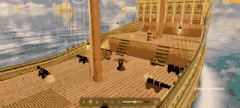
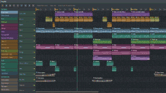
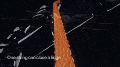
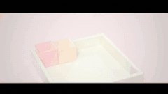
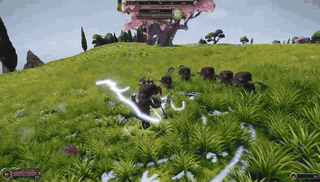
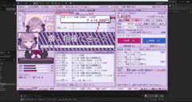

<h3>Claude Fable 5.2 で作られた、実際に開いて遊べる作品</h3>

[English](README.md) · [简体中文](README.zh-CN.md) · [繁體中文](README.zh-TW.md) · **日本語** · [한국어](README.ko.md) · [Español](README.es.md) · [Português](README.pt-BR.md) · [Français](README.fr.md) · [Deutsch](README.de.md) · [Русский](README.ru.md)

**🌐 Web 版：[fablelist.000ooo.ooo](https://fablelist.000ooo.ooo/ja/)**（検索可、作品ごとの詳細ページあり）

Claude Fable 5.2 で作られた公開作品 195 件と動画デモ 140 件。リンクは 2026-11-18 に確認済み。毎日更新、役立ったら ⭐ を。

## 📑 目次

[⭐ 人気の作品](#-人気の作品) · [🆕 新着](#-新着) · [🎮 ゲーム](#-ゲーム) 92 · [🌍 3D ワールドとシーン](#-3d-ワールドとシーン) 43 · [🧰 Web ページとツール](#-web-ページとツール) 43 · [🎬 アニメーションと映像](#-アニメーションと映像) 17 · [📺 動画デモ](#-動画デモ) 140 · [🤝 投稿・貢献](#-投稿貢献)

## ⭐ 人気の作品

<table>
<tr>
<td width="33%" valign="top">
 
<b><a href="https://starrynightrider.com">Starry Nightrider</a></b> 
<a href="https://x.com/ebbyamir">@ebbyamir</a> · ♥ 17.9k · <a href="https://x.com/ebbyamir/status/2120284261089673376">▶ 動画</a> 
ゴッホが『星月夜』の中を駆け抜けるゲーム。 
<a href="https://fablelist.000ooo.ooo/ja/prompts/?w=starry-nightrider&ref=gh"><b>✨ プロンプトを入手</b></a>
</td>
<td width="33%" valign="top">
 
<b><a href="https://claude.ai/artifact/BGY1SztrAYcJQHSsnHHGmp">Saltline — 一人称シューティング</a></b> 
<a href="https://x.com/felixrieseberg">@felixrieseberg</a> · ♥ 15.0k · <a href="https://x.com/felixrieseberg/status/2119925633564463609">▶ 動画</a> 
Anthropic のエンジニア作。ワンショットのプロンプト、人間のフィードバックなしで 8 時間、約 $550。モデル・サウンド・テクスチャはすべてコードで生成。 
<a href="https://fablelist.000ooo.ooo/ja/prompts/?w=saltline-first-person-shooter&ref=gh"><b>✨ プロンプトを入手</b></a>
</td>
<td width="33%" valign="top">
 
<b><a href="https://patch.gg/blendi/oil-paint">Oil Paint — 手描き風ゲーム</a></b> 
<a href="https://x.com/BlendiByl">@BlendiByl</a> · ♥ 8.0k · <a href="https://x.com/BlendiByl/status/2120341251178594532">▶ 動画</a> 
1 時間足らずで制作。1 フレームあたり約 150 万のブラシストロークを、ブラウザのタブで 200 fps で動かす。オープンソース。 
<a href="https://fablelist.000ooo.ooo/ja/prompts/?w=oil-paint-hand-painted-game&ref=gh"><b>✨ プロンプトを入手</b></a>
</td>
</tr>
<tr>
<td width="33%" valign="top">
 
<b><a href="https://viktorkav.com.br/apoio/uno-com-escada/fable/">Uno com Escada：はしごを載せた Fiat Uno でサーキットを走る</a></b> 
🆕 · <a href="https://x.com/ViktorKav">@ViktorKav</a> · ♥ 8.0k · <a href="https://x.com/ViktorKav/status/2122647483281015155">▶ 動画</a> 
屋根にはしごを積んだ 1996 年式 Uno Mille でサーキットを走る。603 KB の HTML ファイル 1 つで、エンジンも 3D ライブラリもテクスチャもなし。車、森、空、エンジン音まですべてコード製。 
<a href="https://github.com/viktorkav/uno-com-escada">ソースコード</a>
</td>
<td width="33%" valign="top">
 
<b><a href="https://nyc.somethingbig.ai/">CROSSTOWN — オープンワールドのニューヨーク（早期プレビュー）</a></b> 
<a href="https://x.com/mattshumer_">@mattshumer_</a> · ♥ 7.5k · <a href="https://x.com/mattshumer_/status/2120282133503820150">▶ 動画</a> 
「Rockstar は 8 年かけた。Fable 5.2 は 7 日でやる。」街の一部だけ実装済み。B キーでフィードバックを送れる。 
<a href="https://fablelist.000ooo.ooo/ja/prompts/?w=crosstown-open-world-new-york-early-preview&ref=gh"><b>✨ プロンプトを入手</b></a>
</td>
<td width="33%" valign="top">
 
<b><a href="https://claude.ai/artifact/QGWUAjRrzRzZWGcQzSMLfa">Blender のノート PC 上の Claude アプリ</a></b> 
<a href="https://x.com/rileybrown">@rileybrown</a> · ♥ 7.1k · <a href="https://x.com/rileybrown/status/2119902109709537708">▶ 動画</a> 
1 つのプロンプトで部屋ごと Blender で作り、4K でレンダリング。ノート PC の画面に映っているのがこのウェブページ。 
<a href="https://x.com/rileybrown/status/2119902109709537708">📝 作者公開のプロンプト（無料）</a>
</td>
</tr>
</table>

## 🆕 新着

過去 3 日以内に投稿された作品（いいね順）。

<table>
<tr>
<td width="33%" valign="top">
 
<b><a href="https://viktorkav.com.br/apoio/uno-com-escada/fable/">Uno com Escada：はしごを載せた Fiat Uno でサーキットを走る</a></b> 
🆕 · <a href="https://x.com/ViktorKav">@ViktorKav</a> · ♥ 8.0k · <a href="https://x.com/ViktorKav/status/2122647483281015155">▶ 動画</a> 
屋根にはしごを積んだ 1996 年式 Uno Mille でサーキットを走る。603 KB の HTML ファイル 1 つで、エンジンも 3D ライブラリもテクスチャもなし。車、森、空、エンジン音まですべてコード製。 
<a href="https://github.com/viktorkav/uno-com-escada">ソースコード</a>
</td>
<td width="33%" valign="top">
 
<b><a href="https://omw-game.kimaki.dev">omw：油絵タッチの城の谷</a></b> 
🆕 · <a href="https://x.com/__morse">@__morse</a> · ♥ 4.5k · <a href="https://x.com/__morse/status/2122013410309153042">▶ 動画</a> 
@de5imulate の「omw」ピクセルアートを、ブラウザで遊べる three.js ゲームとして再現。画面は油絵のような描画。 
<a href="https://github.com/remorses/castle-valley">ソースコード</a>
</td>
<td width="33%" valign="top">
 
<b><a href="https://xikhar.github.io/papertrails/">Papertrails：どこまでも続く飛び出す絵本の世界</a></b> 
🆕 · <a href="https://x.com/xikhar">@xikhar</a> · ♥ 1.5k · <a href="https://x.com/xikhar/status/2122682962647122403">▶ 動画</a> 
紙の人形が歩くと、木や家や丘が飛び出す絵本のように地面から立ち上がる。砂漠、雪原、森、昼と夜を抜けていく。Fable 5.2、Opus 5.5、three.js で制作。 
<a href="https://github.com/xikhar/papertrails">ソースコード</a>
</td>
</tr>
</table>

## 🎮 ゲーム

<table>
<tr>
<td width="33%" valign="top">
 
<b><a href="https://starrynightrider.com">Starry Nightrider</a></b> 
<a href="https://x.com/ebbyamir">@ebbyamir</a> · ♥ 17.9k · <a href="https://x.com/ebbyamir/status/2120284261089673376">▶ 動画</a> 
ゴッホが『星月夜』の中を駆け抜けるゲーム。 
<a href="https://fablelist.000ooo.ooo/ja/prompts/?w=starry-nightrider&ref=gh"><b>✨ プロンプトを入手</b></a>
</td>
<td width="33%" valign="top">
 
<b><a href="https://claude.ai/artifact/BGY1SztrAYcJQHSsnHHGmp">Saltline — 一人称シューティング</a></b> 
<a href="https://x.com/felixrieseberg">@felixrieseberg</a> · ♥ 15.0k · <a href="https://x.com/felixrieseberg/status/2119925633564463609">▶ 動画</a> 
Anthropic のエンジニア作。ワンショットのプロンプト、人間のフィードバックなしで 8 時間、約 $550。モデル・サウンド・テクスチャはすべてコードで生成。 
<a href="https://fablelist.000ooo.ooo/ja/prompts/?w=saltline-first-person-shooter&ref=gh"><b>✨ プロンプトを入手</b></a>
</td>
<td width="33%" valign="top">
 
<b><a href="https://patch.gg/blendi/oil-paint">Oil Paint — 手描き風ゲーム</a></b> 
<a href="https://x.com/BlendiByl">@BlendiByl</a> · ♥ 8.0k · <a href="https://x.com/BlendiByl/status/2120341251178594532">▶ 動画</a> 
1 時間足らずで制作。1 フレームあたり約 150 万のブラシストロークを、ブラウザのタブで 200 fps で動かす。オープンソース。 
<a href="https://fablelist.000ooo.ooo/ja/prompts/?w=oil-paint-hand-painted-game&ref=gh"><b>✨ プロンプトを入手</b></a>
</td>
</tr>
<tr>
<td width="33%" valign="top">
 
<b><a href="https://viktorkav.com.br/apoio/uno-com-escada/fable/">Uno com Escada：はしごを載せた Fiat Uno でサーキットを走る</a></b> 
🆕 · <a href="https://x.com/ViktorKav">@ViktorKav</a> · ♥ 8.0k · <a href="https://x.com/ViktorKav/status/2122647483281015155">▶ 動画</a> 
屋根にはしごを積んだ 1996 年式 Uno Mille でサーキットを走る。603 KB の HTML ファイル 1 つで、エンジンも 3D ライブラリもテクスチャもなし。車、森、空、エンジン音まですべてコード製。 
<a href="https://github.com/viktorkav/uno-com-escada">ソースコード</a>
</td>
<td width="33%" valign="top">
 
<b><a href="https://nyc.somethingbig.ai/">CROSSTOWN — オープンワールドのニューヨーク（早期プレビュー）</a></b> 
<a href="https://x.com/mattshumer_">@mattshumer_</a> · ♥ 7.5k · <a href="https://x.com/mattshumer_/status/2120282133503820150">▶ 動画</a> 
「Rockstar は 8 年かけた。Fable 5.2 は 7 日でやる。」街の一部だけ実装済み。B キーでフィードバックを送れる。 
<a href="https://fablelist.000ooo.ooo/ja/prompts/?w=crosstown-open-world-new-york-early-preview&ref=gh"><b>✨ プロンプトを入手</b></a>
</td>
<td width="33%" valign="top">
 
<b><a href="https://omw-game.kimaki.dev">omw：油絵タッチの城の谷</a></b> 
🆕 · <a href="https://x.com/__morse">@__morse</a> · ♥ 4.5k · <a href="https://x.com/__morse/status/2122013410309153042">▶ 動画</a> 
@de5imulate の「omw」ピクセルアートを、ブラウザで遊べる three.js ゲームとして再現。画面は油絵のような描画。 
<a href="https://github.com/remorses/castle-valley">ソースコード</a>
</td>
</tr>
<tr>
<td width="33%" valign="top">
 
<b><a href="https://what-the-water-keeps.vercel.app/">What the Water Keeps</a></b> 
<a href="https://x.com/kevin_t_ngo">@kevin_t_ngo</a> · ♥ 4.3k · <a href="https://x.com/kevin_t_ngo/status/2119868968307695818">▶ 動画</a> 
夢のような 8 つの世界を舟で巡る、ブラウザで遊べる作品。 
<a href="https://fablelist.000ooo.ooo/ja/prompts/?w=what-the-water-keeps&ref=gh"><b>✨ プロンプトを入手</b></a>
</td>
<td width="33%" valign="top">
 
<b><a href="https://tennis.sixfingerpunch.com/">Tennis</a></b> 
<a href="https://x.com/photonstorm">@photonstorm</a> · ♥ 3.1k · <a href="https://x.com/photonstorm/status/2120330010112434313">投稿</a> 
「思い切り作って」と頼まれたゲームは Pong のクローンに見えるが——遊んでみると違う。 
<a href="https://fablelist.000ooo.ooo/ja/prompts/?w=tennis&ref=gh"><b>✨ プロンプトを入手</b></a>
</td>
<td width="33%" valign="top">
 
<b><a href="https://patch.gg/play/blendi/small-magic">Small Magic — 魔法使いサンドボックス</a></b> 
<a href="https://x.com/BlendiByl">@BlendiByl</a> · ♥ 2.6k · <a href="https://x.com/BlendiByl/status/2121594536153718972">▶ 動画</a> 
1日で制作：呪文7種、壊せる物理パーツ約1,800個、モデルもテクスチャもなし、オープンソース。
</td>
</tr>
<tr>
<td width="33%" valign="top">
 
<b><a href="https://www.spawn.co/@mattshumer/earth?room=local">Mirror Earth</a></b> 
<a href="https://x.com/mattshumer_">@mattshumer_</a> · ♥ 2.4k · <a href="https://x.com/mattshumer_/status/2119877065701036047">▶ 動画</a> 
地球まるごとを壊せるゲーム世界にし、天候は実際の地球とリアルタイムで連動。 
<a href="https://fablelist.000ooo.ooo/ja/prompts/?w=mirror-earth&ref=gh"><b>✨ プロンプトを入手</b></a>
</td>
<td width="33%" valign="top">
 
<b><a href="https://portals-endless-worlds.netlify.app/">Portals: Endless Worlds</a></b> 
<a href="https://x.com/emollick">@emollick</a> · ♥ 1.9k · <a href="https://x.com/emollick/status/2119918307457577163">▶ 動画</a> 
25,000 の Agent が、本・アート・各地にインスパイアされたコードだけの 3D ワールドを 450 以上作成。ポータルでつながり、漂うように移動できる。 
<a href="https://github.com/emollick/ai-portals">ソースコード</a> · <a href="https://www.oneusefulthing.org/p/fable-52-and-jagged-agi">記事</a> 
<a href="https://fablelist.000ooo.ooo/ja/prompts/?w=portals-endless-worlds&ref=gh"><b>✨ プロンプトを入手</b></a>
</td>
<td width="33%" valign="top">
 
<b><a href="https://evensong-phi.vercel.app/">Evensong</a></b> 
<a href="https://x.com/kevin_t_ngo">@kevin_t_ngo</a> · ♥ 1.8k · <a href="https://x.com/kevin_t_ngo/status/2120238844754923874">▶ 動画</a> 
ダークファンタジーのソウルライク風ボス戦。ブラウザで遊べる。 
<a href="https://fablelist.000ooo.ooo/ja/prompts/?w=evensong&ref=gh"><b>✨ プロンプトを入手</b></a>
</td>
</tr>
<tr>
<td width="33%" valign="top">
 
<b><a href="https://loktar00.github.io/lanternfall/">LANTERNFALL</a></b> 
<a href="https://x.com/loktar00">@loktar00</a> · ♥ 1.4k · <a href="https://x.com/loktar00/status/2120192761542615271">▶ 動画</a> 
アニメーションもモデルも、ゲーム全体を Fable が生成。敵が倒れるときのエフェクトに注目。 
<a href="https://fablelist.000ooo.ooo/ja/prompts/?w=lanternfall&ref=gh"><b>✨ プロンプトを入手</b></a>
</td>
<td width="33%" valign="top">
 
<b><a href="https://app.usecrayon.ai/play/76dbd04f-0684-4486-8cc4-eae0585295e8">悟空：フォースターロード</a></b> 
<a href="https://x.com/aniketjart">@aniketjart</a> · ♥ 1.4k · <a href="https://x.com/aniketjart/status/2121793239175119279">▶ 動画</a> 
ドラゴンボールのレッドリボン軍編をもとにした three.js 製のファンアクションゲーム。制作途中で、最初の 2 マップを遊べます。
</td>
<td width="33%" valign="top">
 
<b><a href="https://heat.pplx.app">VICE '86：ネオン輝く1986年マイアミのオープンワールドドライブ</a></b> 
🆕 · <a href="https://x.com/AravSrinivas">@AravSrinivas</a> · ♥ 1.2k · <a href="https://x.com/AravSrinivas/status/2122338465648103676">▶ 動画</a> 
ブラウザで動くオープンワールドのドライブゲーム。ゲームエンジンも three.js も使わず、独自の WebGL2 レンダラーを搭載。街、車、雨、エンジン音まですべてコードで生成、JavaScript 約 63,000 行。
</td>
</tr>
<tr>
<td width="33%" valign="top">
 
<b><a href="https://op7418.github.io/guizang-game-skill/">Mist-Locked Mountain Gate — 3D アクションゲーム</a></b> 
<a href="https://x.com/op7418">@op7418</a> · ♥ 1.2k · <a href="https://x.com/op7418/status/2120694045299327187">▶ 動画</a> 
ある午後に 45 億トークン。モデル・シーン・アクションはすべて Fable 制作、30 MB の単一 HTML ファイルにまとめた。 
<a href="https://fablelist.000ooo.ooo/ja/prompts/?w=mist-locked-mountain-gate-3d-action-game&ref=gh"><b>✨ プロンプトを入手</b></a>
</td>
<td width="33%" valign="top">
 
<b><a href="https://wavedash.com/games/rooftop-rally">Rooftop Rally — Unreal 5.9 のピックルボール</a></b> 
<a href="https://x.com/chongdashu">@chongdashu</a> · ♥ 1.1k · <a href="https://x.com/chongdashu/status/2120154573356793883">▶ 動画</a> 
Fable 5.2 と Unreal Engine 5.9 プレビュー。キャラクターは Tripo、ほかの 3D アセットと残りは Fable 制作。 
<a href="https://x.com/chongdashu/status/2120310120509014219">制作過程</a> 
<a href="https://fablelist.000ooo.ooo/ja/prompts/?w=rooftop-rally-pickleball-in-unreal-5-9&ref=gh"><b>✨ プロンプトを入手</b></a>
</td>
<td width="33%" valign="top">
 
<b><a href="https://claude.ai/artifact/MXxb36zKgN261ckbGhmNin">Three Games（Saltline · The Clockmaker's Heart · Tidewright）</a></b> 
<a href="https://x.com/felixrieseberg">@felixrieseberg</a> · ♥ 808 · <a href="https://x.com/vineerpasam/status/2119955306096857145">▶ 動画</a> 
Felix Rieseberg 名義：「すべて Claude Fable 5.2 で作ったゲーム。初稿、人間のフィードバックなし。」公開初日に最も共有されたリンク。 
<a href="https://claude.ai/artifact/6MjtQjf4ee1ZZjEpafaEpa">The Clockmaker's Heart</a> · <a href="https://claude.ai/artifact/JTgyEMn7sn1q2riWrMb7D4">Tidewright</a> 
<a href="https://fablelist.000ooo.ooo/ja/prompts/?w=three-games-saltline-the-clockmaker-s-heart-tidewright&ref=gh"><b>✨ プロンプトを入手</b></a>
</td>
</tr>
<tr>
<td width="33%" valign="top">
 
<b><a href="https://patch.gg/blendi/coloured-pencil">Coloured Pencil</a></b> 
<a href="https://x.com/BlendiByl">@BlendiByl</a> · ♥ 760 · <a href="https://x.com/BlendiByl/status/2121130385723789637">▶ 動画</a> 
色鉛筆風ゲームの一場面。すべての面の陰影も町全体もコード。オープンソース。 
<a href="https://fablelist.000ooo.ooo/ja/prompts/?w=coloured-pencil&ref=gh"><b>✨ プロンプトを入手</b></a>
</td>
<td width="33%" valign="top">
 
<b><a href="https://www.spawn.co/@mattshumer/voxel-engine">Voxel Engine</a></b> 
<a href="https://x.com/mattshumer_">@mattshumer_</a> · ♥ 742 · <a href="https://x.com/mattshumer_/status/2119870965106483384">▶ 動画</a> 
たった 1 つのプロンプトで構築。音を出してどうぞ。 
<a href="https://fablelist.000ooo.ooo/ja/prompts/?w=voxel-engine&ref=gh"><b>✨ プロンプトを入手</b></a>
</td>
<td width="33%" valign="top">
 
<b><a href="https://patch.gg/blendi/patchwork-quilt">Patchwork Quilt</a></b> 
<a href="https://x.com/BlendiByl">@BlendiByl</a> · ♥ 670 · <a href="https://x.com/BlendiByl/status/2120746541636047347">▶ 動画</a> 
パッチワークでストップモーション風のゲームの一場面。マップ全体がコード。オープンソース。 
<a href="https://fablelist.000ooo.ooo/ja/prompts/?w=patchwork-quilt&ref=gh"><b>✨ プロンプトを入手</b></a>
</td>
</tr>
<tr>
<td width="33%" valign="top">
 
<b><a href="https://bannerfall.itch.io/siege-wing">Siege Wing — 中世の戦争にヘリで参戦</a></b> 
<a href="https://x.com/builderjaydub">@builderjaydub</a> · ♥ 576 · <a href="https://x.com/builderjaydub/status/2120223731520040966">▶ 動画</a> 
大砲・ロケット・ミサイルを積んだヘリで、ローマのバリスタをかわしつつ城を落とす。
</td>
<td width="33%" valign="top">
 
<b><a href="https://patch.gg/play/blendi/solar">Solar — 自由に飛び回れる小さな太陽系</a></b> 
🆕 · <a href="https://x.com/BlendiByl">@BlendiByl</a> · ♥ 536 · <a href="https://x.com/BlendiByl/status/2122673770607591855">▶ 動画</a> 
Outer Wilds にインスパイア：本物の軌道と重力、惑星間を途切れずに飛行でき、すべての世界がコードで描かれています。オープンソース。
</td>
<td width="33%" valign="top">
 
<b><a href="https://i-would-have-gotten-away-with-it.netlify.app/">I Would Have Gotten Away With It</a></b> 
<a href="https://x.com/emollick">@emollick</a> · ♥ 515 · <a href="https://x.com/emollick/status/2119876449494540554">▶ 動画</a> 
逆スクービー・ドゥー：あなたは悪役で、おせっかいな子供たちを追い払う。トレーラー、音楽、サウンドも Fable が制作。 
<a href="https://fablelist.000ooo.ooo/ja/prompts/?w=i-would-have-gotten-away-with-it&ref=gh"><b>✨ プロンプトを入手</b></a>
</td>
</tr>
</table>

<b><a href="all/games.ja.md">すべて見る（92）→</a></b>

<a href="#-目次">↑ 目次に戻る</a>

## 🌍 3D ワールドとシーン

<table>
<tr>
<td width="33%" valign="top">
 
<b><a href="https://claude.ai/artifact/QGWUAjRrzRzZWGcQzSMLfa">Blender のノート PC 上の Claude アプリ</a></b> 
<a href="https://x.com/rileybrown">@rileybrown</a> · ♥ 7.1k · <a href="https://x.com/rileybrown/status/2119902109709537708">▶ 動画</a> 
1 つのプロンプトで部屋ごと Blender で作り、4K でレンダリング。ノート PC の画面に映っているのがこのウェブページ。 
<a href="https://x.com/rileybrown/status/2119902109709537708">📝 作者公開のプロンプト（無料）</a>
</td>
<td width="33%" valign="top">
 
<b><a href="https://patch.gg/blendi/painted-valley">Painted Valley</a></b> 
<a href="https://x.com/BlendiByl">@BlendiByl</a> · ♥ 1.8k · <a href="https://x.com/BlendiByl/status/2120694003230560585">▶ 動画</a> 
ジブリにインスパイアされた、歩いて巡れる手描き風の谷。オープンソース。 
<a href="https://fablelist.000ooo.ooo/ja/prompts/?w=painted-valley&ref=gh"><b>✨ プロンプトを入手</b></a>
</td>
<td width="33%" valign="top">
 
<b><a href="https://xikhar.github.io/papertrails/">Papertrails：どこまでも続く飛び出す絵本の世界</a></b> 
🆕 · <a href="https://x.com/xikhar">@xikhar</a> · ♥ 1.5k · <a href="https://x.com/xikhar/status/2122682962647122403">▶ 動画</a> 
紙の人形が歩くと、木や家や丘が飛び出す絵本のように地面から立ち上がる。砂漠、雪原、森、昼と夜を抜けていく。Fable 5.2、Opus 5.5、three.js で制作。 
<a href="https://github.com/xikhar/papertrails">ソースコード</a>
</td>
</tr>
<tr>
<td width="33%" valign="top">
 
<b><a href="https://claude.ai/artifact/CTjrZXVdUgKJ6qJXrvvr28">Ancient Babylon, 600 BC</a></b> 
<a href="https://x.com/literallydenis">@literallydenis</a> · ♥ 1.2k · <a href="https://x.com/literallydenis/status/2120866958790848953">▶ 動画</a> 
8 時間の実行中に自分で見つけた歴史資料と図面から再現したバビロン。自由に歩き回れる。 
<a href="https://fablelist.000ooo.ooo/ja/prompts/?w=ancient-babylon-600-bc&ref=gh"><b>✨ プロンプトを入手</b></a>
</td>
<td width="33%" valign="top">
 
<b><a href="https://indiranagar-live.vercel.app">インディラナガル 1 km²</a></b> 
<a href="https://x.com/anshu4321">@anshu4321</a> · ♥ 1.2k · <a href="https://x.com/anshu4321/status/2119938067758772403">▶ 動画</a> 
地図データと 1 つのプロンプトから作った、ベンガルールのライブ 3D 断面。 
<a href="https://fablelist.000ooo.ooo/ja/prompts/?w=1-km2-of-indiranagar&ref=gh"><b>✨ プロンプトを入手</b></a>
</td>
<td width="33%" valign="top">
 
<b><a href="https://fable-rome.surge.sh/">Rome, AD 320</a></b> 
<a href="https://x.com/petergostev">@petergostev</a> · ♥ 968 · <a href="https://x.com/petergostev/status/2120167560700383572">▶ 動画</a> 
1 つのプロンプト、Fable 5.2（Max）が一晩中稼働、$2,618。 
<a href="https://x.com/petergostev/status/2120167560700383572">📝 作者公開のプロンプト（無料）</a>
</td>
</tr>
<tr>
<td width="33%" valign="top">
 
<b><a href="https://github.com/Leonxlnx/room-at-dawn">Room at Dawn</a></b> 
<a href="https://x.com/LexnLin">@LexnLin</a> · ♥ 854 · <a href="https://x.com/LexnLin/status/2120910879361548565">▶ 動画</a> 
既成のモデルやテクスチャなしで作った、three.js のフォトリアルな寝室。すべてコード。 
<a href="https://fablelist.000ooo.ooo/ja/prompts/?w=room-at-dawn&ref=gh"><b>✨ プロンプトを入手</b></a>
</td>
<td width="33%" valign="top">
 
<b><a href="https://fable-rover.vercel.app">ER-6 Terrain Explorer — 自動走行する火星ローバー</a></b> 
<a href="https://x.com/DilumSanjaya">@DilumSanjaya</a> · ♥ 792 · <a href="https://x.com/DilumSanjaya/status/2120561077385867663">▶ 動画</a> 
Fable 5.2 が NASA の火星ローバーと同じロッカー・ボギー式サスペンションを設計し、異星の地形を走らせるシミュレーションまで作った。
</td>
<td width="33%" valign="top">
 
<b><a href="https://ship-42-catch.netlify.app/">Ship 42 Catch</a></b> 
🆕 · <a href="https://x.com/emollick">@emollick</a> · ♥ 737 · <a href="https://x.com/emollick/status/2122036763468214711">▶ 動画</a> 
Fable と Opus がスターシップのタワーキャッチ映像を探し、最後の 40 秒を three.js で精密な 3D に再現。カメラ視点を切り替えられる。
</td>
</tr>
<tr>
<td width="33%" valign="top">
 
<b><a href="https://supernatural-ft.vercel.app/fire-in-ice">Fire in Ice</a></b> 
<a href="https://x.com/tkm_hmng8">@tkm_hmng8</a> · ♥ 549 · <a href="https://x.com/tkm_hmng8/status/2120813043101946324">▶ 動画</a> 
three.js を使わず素の WebGPU で書いた、氷の中で燃えるリアルな炎。 
<a href="https://fablelist.000ooo.ooo/ja/prompts/?w=fire-in-ice&ref=gh"><b>✨ プロンプトを入手</b></a>
</td>
<td width="33%" valign="top">
 
<b><a href="https://github.com/Leonxlnx/walking-block">Walking Block：歩くソ連の団地</a></b> 
🆕 · <a href="https://x.com/LexnLin">@LexnLin</a> · ♥ 413 · <a href="https://x.com/LexnLin/status/2122359035751989341">▶ 動画</a> 
8 本の機械の脚を持つ巨大なソ連のパネル団地が、夕暮れの霧の中、濡れた野原を横切る。ジオメトリ、テクスチャ、シェーダーはすべて three.js のコードで、同じシーンから 45 秒の映像もレンダリングされている。
</td>
<td width="33%" valign="top">
 
<b><a href="https://bay.theojaffee.net">Bay Area Through Time</a></b> 
<a href="https://x.com/theojaffee">@theojaffee</a> · ♥ 387 · <a href="https://x.com/theojaffee/status/2120312766544437738">▶ 動画</a> 
好きな都市や地区にズームし、1769 年までさかのぼる好きな年を選んで当時の姿を見られる。 
<a href="https://nyc.theojaffee.net">New York City</a> 
<a href="https://fablelist.000ooo.ooo/ja/prompts/?w=bay-area-through-time&ref=gh"><b>✨ プロンプトを入手</b></a>
</td>
</tr>
<tr>
<td width="33%" valign="top">
 
<b><a href="http://procedural-arm-rig.vercel.app">Procedural Arm Rig</a></b> 
<a href="https://x.com/apekshik">@apekshik</a> · ♥ 326 · <a href="https://x.com/apekshik/status/2120224530367119758">▶ 動画</a> 
AAA ゲームをワンショットで作る代わりに、腕 1 本を：ボーンのアーマチュア、ウェイトペイントしたメッシュ、IK、拳を握ると膨らむ筋肉。 
<a href="https://fablelist.000ooo.ooo/ja/prompts/?w=procedural-arm-rig&ref=gh"><b>✨ プロンプトを入手</b></a>
</td>
<td width="33%" valign="top">
 
<b><a href="https://samg-coder.github.io/solstice-garden/">The Garden</a></b> 
<a href="https://x.com/SamGCoder">@SamGCoder</a> · ♥ 297 · <a href="https://x.com/SamGCoder/status/2120943068321054975">▶ 動画</a> 
Rust で書き、WASM にコンパイルし、WebGPU でレンダリングした庭のシーン。 
<a href="https://fablelist.000ooo.ooo/ja/prompts/?w=the-garden&ref=gh"><b>✨ プロンプトを入手</b></a>
</td>
<td width="33%" valign="top">
 
<b><a href="http://taoistvibe.com">Chill Taoist Vibe：道教寺院のある小さな山</a></b> 
🆕 · <a href="https://x.com/qiqileyuan">@qiqileyuan</a> · ♥ 253 · <a href="https://x.com/qiqileyuan/status/2122006851298693277">▶ 動画</a> 
ジブリ風の、小さな山に建つ道教寺院。老道士について山を登り、線香をあげ、おみくじを引き、瞑想する。揺り椅子に座って四季の移ろいを眺めるだけでもいい。神像と主人公のモデルは Tripo3D、それ以外はすべて生成されたコード。
</td>
</tr>
<tr>
<td width="33%" valign="top">
 
<b><a href="https://butterfly.kyzo.io">Hidden Layers：温室の中のスカシマダラ</a></b> 
🆕 · <a href="https://x.com/ky__zo">@ky__zo</a> · ♥ 229 · <a href="https://x.com/ky__zo/status/2122274109795054036">▶ 動画</a> 
スクロールして、温室から出られないスカシマダラと 6 つの世界を飛ぶ。モデルファイルもテクスチャもない純粋な three.js。13.2 億トークン、API コストは $905。
</td>
<td width="33%" valign="top">
 
<b><a href="https://claude.ai/artifact/R6YBDkAm2GjAC5A65D9djx">歩いて入れる Claude デモ</a></b> 
<a href="https://x.com/dfeinition">@dfeinition</a> · ♥ 214 · <a href="https://x.com/dfeinition/status/2120330644261589051">▶ 動画</a> 
@rileybrown に触発：中に入って好きなコンピューターに座れる。 
<a href="https://fablelist.000ooo.ooo/ja/prompts/?w=a-claude-demo-you-can-walk-into&ref=gh"><b>✨ プロンプトを入手</b></a>
</td>
<td width="33%" valign="top">
 
<b><a href="https://claude.ai/artifact/2PBXuQAnWDS2NpiPXHNLfL">Orca Jelly</a></b> 
<a href="https://x.com/vib3coded">@vib3coded</a> · ♥ 204 · <a href="https://x.com/vib3coded/status/2119951060752375827">▶ 動画</a> 
ソフトボディのグミ風シャチのマテリアル習作。比較用に Opus 5.5 版のリンクも。 
<a href="https://claude.ai/artifact/75KLotWzZQ5RR23BGLePb8">Opus 5.5 version</a> 
<a href="https://x.com/vib3coded/status/2119951060752375827">📝 作者公開のプロンプト（無料）</a>
</td>
</tr>
<tr>
<td width="33%" valign="top">
 
<b><a href="https://planet.tokyoaivisuals.club/">Code Planet</a></b> 
<a href="https://x.com/KanaWorks_AI">@KanaWorks_AI</a> · ♥ 198 · <a href="https://x.com/KanaWorks_AI/status/2121413647213932688">▶ 動画</a> 
320KB 未満のコードで惑星まるごと。海や草原から桜の中を抜けて宇宙まで、ブラウザ上で飛べる。
</td>
<td width="33%" valign="top">
 
<b><a href="https://claude.ai/artifact/9EgZpErM17kH2a9Q3WXW6f">瓶の中のボクセル世界</a></b> 
<a href="https://x.com/vib3coded">@vib3coded</a> · ♥ 163 · <a href="https://x.com/vib3coded/status/2120104517282775514">▶ 動画</a> 
30 分、$12.81。 
<a href="https://x.com/vib3coded/status/2120104517282775514">📝 作者公開のプロンプト（無料）</a>
</td>
<td width="33%" valign="top">
 
<b><a href="https://github.com/Leonxlnx/beautiful-wonderland">Beautiful Wonderland</a></b> 
🆕 · <a href="https://x.com/LexnLin">@LexnLin</a> · ♥ 145 · <a href="https://x.com/LexnLin/status/2122056542778535977">▶ 動画</a> 
three.js で作った手描き風の小さな世界と、そこからレンダリングした 40 秒の 4K 映像。
</td>
</tr>
<tr>
<td width="33%" valign="top">
 
<b><a href="https://patch.gg/blendi/impossible-spaces">Impossible Spaces</a></b> 
<a href="https://x.com/BlendiByl">@BlendiByl</a> · ♥ 138 · <a href="https://x.com/BlendiByl/status/2120314459793355262">▶ 動画</a> 
サイケデリックな「あり得ない空間」体験。オープンソース。 
<a href="https://fablelist.000ooo.ooo/ja/prompts/?w=impossible-spaces&ref=gh"><b>✨ プロンプトを入手</b></a>
</td>
<td width="33%" valign="top">
 
<b><a href="https://claude.ai/artifact/7ge282etTXSS4edGFTFa85">3D Sailing Ship</a></b> 
<a href="https://x.com/marcthecreatorr">@marcthecreatorr</a> · ♥ 111 · <a href="https://x.com/marcthecreatorr/status/2119890973560054072">▶ 動画</a> 
純粋な Three.js、Blender や外部アセットなし。約 38 分、約 $17。 
<a href="https://fablelist.000ooo.ooo/ja/prompts/?w=3d-sailing-ship&ref=gh"><b>✨ プロンプトを入手</b></a>
</td>
<td width="33%" valign="top">
 
<b><a href="https://tests.jazii.dev/">Pirate Ship</a></b> 
<a href="https://x.com/notjazii">@notjazii</a> · ♥ 110 · <a href="https://x.com/notjazii/status/2119905661505122575">▶ 動画</a> 
ワンショット、約 1.5 時間、約 3,500 万トークン（約 $34）。 
<a href="https://fablelist.000ooo.ooo/ja/prompts/?w=pirate-ship&ref=gh"><b>✨ プロンプトを入手</b></a>
</td>
</tr>
</table>

<b><a href="all/3d-worlds.ja.md">すべて見る（43）→</a></b>

<a href="#-目次">↑ 目次に戻る</a>

## 🧰 Web ページとツール

<table>
<tr>
<td width="33%" valign="top">
 
<b><a href="https://claudia.gallery">Claudia Gallery</a></b> 
<a href="https://x.com/anabology">@anabology</a> · ♥ 5.4k · <a href="https://x.com/anabology/status/2120010995309457643">▶ 動画</a> 
「夢の映像を作って」——2 ショット、9 時間。 
<a href="https://fablelist.000ooo.ooo/ja/prompts/?w=claudia-gallery&ref=gh"><b>✨ プロンプトを入手</b></a>
</td>
<td width="33%" valign="top">
 
<b><a href="http://robotics-lab-app.vercel.app">Robotics Lab</a></b> 
<a href="https://x.com/0xMovez">@0xMovez</a> · ♥ 4.7k · <a href="https://x.com/0xMovez/status/2120239217880268919">▶ 動画</a> 
本物のボード 8 枚（Arduino Uno、Raspberry Pi 4…）を 3D で：チップを置き、はんだ付けし、実際の回路を配線する。 
<a href="http://robolabs-app.vercel.app">Humanoid edition</a> 
<a href="https://fablelist.000ooo.ooo/ja/prompts/?w=robotics-lab&ref=gh"><b>✨ プロンプトを入手</b></a>
</td>
<td width="33%" valign="top">
 
<b><a href="https://claude.ai/artifact/N6bSgS4ZH5ifFQfg8sm4dv">House Bangers ジェネレーター</a></b> 
<a href="https://x.com/deedydas">@deedydas</a> · ♥ 4.1k · <a href="https://x.com/deedydas/status/2120905625852936318">▶ 動画</a> 
音楽理論を学び、楽器ごとに何千ものパターンを試し、最良のものを 72 小節のハウストラックにまとめる。音を出してどうぞ。 
<a href="https://fablelist.000ooo.ooo/ja/prompts/?w=house-bangers-generator&ref=gh"><b>✨ プロンプトを入手</b></a>
</td>
</tr>
<tr>
<td width="33%" valign="top">
 
<b><a href="https://miaai-lab.github.io/Claude-Fable-5.2-HTML-Files/">単一ファイル HTML 作品 76 点</a></b> 
<a href="https://x.com/MiaAI_lab">@MiaAI_lab</a> · ♥ 2.6k · <a href="https://x.com/MiaAI_lab/status/2119930229661503893">投稿</a> 
ジェネラティブアート、物理、タイポグラフィ、UI。それぞれ元のプロンプト付き。 
<a href="https://fablelist.000ooo.ooo/ja/prompts/?w=76-single-file-html-pieces&ref=gh"><b>✨ プロンプトを入手</b></a>
</td>
<td width="33%" valign="top">
 
<b><a href="https://pixel-worlds.vercel.app/keep/">Keep — パスワード強度メーター</a></b> 
<a href="https://x.com/crtvTeknologist">@crtvTeknologist</a> · ♥ 1.6k · <a href="https://x.com/crtvTeknologist/status/2119894073024606617">▶ 動画</a> 
パスワード強度の表示を、生きたピクセルの世界として描画。 
<a href="https://github.com/finktheartist/pixel-worlds">ソースコード</a> 
<a href="https://fablelist.000ooo.ooo/ja/prompts/?w=keep-password-strength-meter&ref=gh"><b>✨ プロンプトを入手</b></a>
</td>
<td width="33%" valign="top">
 
<b><a href="https://sakuga-vfx.vercel.app">Sakuga Set</a></b> 
🆕 · <a href="https://x.com/crtvTeknologist">@crtvTeknologist</a> · ♥ 1.4k · <a href="https://x.com/crtvTeknologist/status/2122088829565698218">▶ 動画</a> 
アニメのように反応する 12 個の UI コントロール。ボタンはつぶれて「ドン!」と着地し、トグルはスミアで弾け、スライダーは雲を巻き上げる。エフェクトはすべてコード描画、1 ファイル完結で依存なし。 
<a href="https://github.com/finktheartist/sakuga-vfx">ソースコード</a>
</td>
</tr>
<tr>
<td width="33%" valign="top">
 
<b><a href="https://masterofvfx2070.github.io/xray-mirror/">X-Ray Mirror</a></b> 
<a href="https://x.com/HashemGhaili">@HashemGhaili</a> · ♥ 1.4k · <a href="https://x.com/HashemGhaili/status/2120202746121085321">▶ 動画</a> 
ウェブカメラを顔に向けると、頭蓋骨・脳・筋肉がリアルタイムで追跡表示される。口を開けると顎も開く。映像は PC の外に出ない。 
<a href="https://github.com/MasterOfVFX2070/xray-mirror">ソースコード</a> 
<a href="https://fablelist.000ooo.ooo/ja/prompts/?w=x-ray-mirror&ref=gh"><b>✨ プロンプトを入手</b></a>
</td>
<td width="33%" valign="top">
 
<b><a href="https://xianxie6.github.io/animals-planner-2027/">Animals at Work — 3D プランナー</a></b> 
<a href="https://x.com/Xian0063">@Xian0063</a> · ♥ 1.2k · <a href="https://x.com/Xian0063/status/2120417834694250522">▶ 動画</a> 
紙の手帳を 3D で再現：ドラッグでページをめくり、日付をタップして書き込み、90 枚のシールを剥がして貼れる。骨組みは Opus 5.5、素材感は Fable 5.2 が実映像に合わせて仕上げた。 
<a href="https://fablelist.000ooo.ooo/ja/prompts/?w=animals-at-work-3d-planner&ref=gh"><b>✨ プロンプトを入手</b></a>
</td>
<td width="33%" valign="top">
 
<b><a href="https://uberdesigner.ai/t/spine-menu">Spine Menu</a></b> 
<a href="https://x.com/seanaiux">@seanaiux</a> · ♥ 1.2k · <a href="https://x.com/seanaiux/status/2120222459110789574">▶ 動画</a> 
「これより見栄えの良いメニューを見たことある？」ページにプロンプトを掲載。 
<a href="https://uberdesigner.ai/t/aquarium-toggle">Aquarium toggle</a> · <a href="https://uberdesigner.ai/t/glow-widgets">Glow widgets</a>
</td>
</tr>
<tr>
<td width="33%" valign="top">
 
<b><a href="https://roverkit.vercel.app">RoverKit — ロボットカーを作ってシミュレーション</a></b> 
<a href="https://x.com/DilumSanjaya">@DilumSanjaya</a> · ♥ 1.1k · <a href="https://x.com/DilumSanjaya/status/2121286147393651085">▶ 動画</a> 
ロボットカーの作り方をステップごとに解説。シミュレーター、カスタマイズできるアリーナ、図解付きコード解説つき。Arduino と ESP32 に対応。
</td>
<td width="33%" valign="top">
 
<b><a href="https://github.com/AlexAtFF/pulp-daw-public">PULP — AI ネイティブ DAW</a></b> 
<a href="https://x.com/The_Alex">@The_Alex</a> · ♥ 942 · <a href="https://x.com/The_Alex/status/2119917226769985785">▶ 動画</a> 
ネイティブ Windows 用のデジタルオーディオワークステーション。Claude に音楽を頼むと DAW を開いて曲を作る。 
<a href="https://fablelist.000ooo.ooo/ja/prompts/?w=pulp-an-ai-native-daw&ref=gh"><b>✨ プロンプトを入手</b></a>
</td>
<td width="33%" valign="top">
 
<b><a href="https://frontier.every.to/experiments/ambient-town">Ambient Town</a></b> 
<a href="https://x.com/kieranklaassen">@kieranklaassen</a> · ♥ 897 · <a href="https://x.com/kieranklaassen/status/2119868196773929160">▶ 動画</a> 
元映画音楽家が夜を使って 1 週間で作ったアンビエント DAW：Ableton Push 対応、マイク、エフェクト、シンセ、一緒に作曲する Agent。ページの「Try it」をクリック。 
<a href="https://fablelist.000ooo.ooo/ja/prompts/?w=ambient-town&ref=gh"><b>✨ プロンプトを入手</b></a>
</td>
</tr>
<tr>
<td width="33%" valign="top">
 
<b><a href="https://itspsneha.com/supplements">インドで買うべきビタミン剤</a></b> 
<a href="https://x.com/itspsneha">@itspsneha</a> · ♥ 739 · <a href="https://x.com/itspsneha/status/2120048494761451974">投稿</a> 
109 のテスト済みロットの検査報告書を読んだうえで作成。 
<a href="https://fablelist.000ooo.ooo/ja/prompts/?w=which-vitamins-to-buy-in-india&ref=gh"><b>✨ プロンプトを入手</b></a>
</td>
<td width="33%" valign="top">
 
<b><a href="https://v2.video/riley/the-history-of-writing/v1">文字の歴史</a></b> 
<a href="https://x.com/rileybrown">@rileybrown</a> · ♥ 667 · <a href="https://x.com/rileybrown/status/2119946022767980985">▶ 動画</a> 
1 つのプロンプトから生まれたインタラクティブ映像。プロンプトとファイルを公開。 
<a href="https://x.com/rileybrown/status/2119946022767980985">📝 作者公開のプロンプト（無料）</a>
</td>
<td width="33%" valign="top">
 
<b><a href="https://auden-english-135.netlify.app/">失われた Auden の 1941 年の詩の授業を復元</a></b> 
<a href="https://x.com/emollick">@emollick</a> · ♥ 593 · <a href="https://x.com/emollick/status/2121641417483169934">投稿</a> 
Fable 5.2 が Internet Archive のマイナーな本と散らばったメモから、W. H. Auden の「人文学で最も難しい」授業を再構成した。
</td>
</tr>
<tr>
<td width="33%" valign="top">
 
<b><a href="https://www.bubbbly.com/christmas-cards">Christmas Cards：インタラクティブなクリスマスカード</a></b> 
🆕 · <a href="https://x.com/ann_nnng">@ann_nnng</a> · ♥ 464 · <a href="https://x.com/ann_nnng/status/2122283549000712249">▶ 動画</a> 
インタラクティブなクリスマスカードのセット。赤いマフラーの猫が窓辺で降る雪を眺めるカードなど。
</td>
<td width="33%" valign="top">
 
<b><a href="https://where-is-everybody-fermi.netlify.app/">Where Is Everybody?</a></b> 
<a href="https://x.com/emollick">@emollick</a> · ♥ 457 · <a href="https://x.com/emollick/status/2120359214157603139">投稿</a> 
「フェルミのパラドックスを解いて」と頼まれ、データを集め、仮説を検証し、批判者を想定して負荷テストまで行う。 
<a href="https://resolving-the-great-silence.netlify.app/">Gemini Carbon version</a> 
<a href="https://x.com/emollick/status/2120359214157603139">📝 作者公開のプロンプト（無料）</a>
</td>
<td width="33%" valign="top">
 
<b><a href="https://gsplan.org">ガラタサライの座席ビュー</a></b> 
<a href="https://x.com/molenbeek84">@molenbeek84</a> · ♥ 428 · <a href="https://x.com/molenbeek84/status/2120847639411331097">投稿</a> 
チケット購入前に、RAMS Park の各ブロックからのピッチの眺めを確認できる。 
<a href="https://fablelist.000ooo.ooo/ja/prompts/?w=galatasaray-seat-view&ref=gh"><b>✨ プロンプトを入手</b></a>
</td>
</tr>
<tr>
<td width="33%" valign="top">
 
<b><a href="https://rubber-hose-ui.vercel.app">Rubber Hose UI：1930 年代カートゥーン風の UI 部品</a></b> 
🆕 · <a href="https://x.com/crtvTeknologist">@crtvTeknologist</a> · ♥ 345 · <a href="https://x.com/crtvTeknologist/status/2122433522166124616">▶ 動画</a> 
11 個の Web コントロールをラバーホース調のキャラクターに。スライダーはトロンボーン、トーストはトースター、ボタンは押すたびに目にあざができる。素の JS と canvas、依存なし、オープンソース。 
<a href="https://github.com/finktheartist/rubber-hose-ui">ソースコード</a>
</td>
<td width="33%" valign="top">
 
<b><a href="https://claude.ai/artifact/4P1urBdptp6gWiJo3R6Vpv">Breakcore ビデオサンプラー</a></b> 
🆕 · <a href="https://x.com/parhelion318">@parhelion318</a> · ♥ 292 · <a href="https://x.com/parhelion318/status/2122723067533398064">▶ 動画</a> 
動画クリップを刻んで breakcore のリズムに並べ替える、ブラウザで動くサンプラー。
</td>
<td width="33%" valign="top">
 
<b><a href="https://origamihelper.com">Origami Helper</a></b> 
<a href="https://x.com/ryoma_nakajima">@ryoma_nakajima</a> · ♥ 220 · <a href="https://x.com/ryoma_nakajima/status/2120472383241011323">▶ 動画</a> 
AR で、どの角度からでも 3D で折り紙の折り方を学べる。無料、登録不要、1 日で制作。 
<a href="https://fablelist.000ooo.ooo/ja/prompts/?w=origami-helper&ref=gh"><b>✨ プロンプトを入手</b></a>
</td>
</tr>
<tr>
<td width="33%" valign="top">
 
<b><a href="https://typed.page/">Typed</a></b> 
<a href="https://x.com/clairevo">@clairevo</a> · ♥ 205 · <a href="https://x.com/clairevo/status/2119905651359142132">▶ 動画</a> 
完全に動くタイプライター：タイプでもクリックでも入力でき、執筆タイマー、修正液、オートコレクト付き。 
<a href="https://fablelist.000ooo.ooo/ja/prompts/?w=typed&ref=gh"><b>✨ プロンプトを入手</b></a>
</td>
<td width="33%" valign="top">
 
<b><a href="https://clockendbader.github.io/fable-builds/heartbeat/">One Heartbeat</a></b> 
<a href="https://x.com/clockendbader">@clockendbader</a> · ♥ 153 · <a href="https://x.com/clockendbader/status/2121246903207961069">投稿</a> 
ライブの心電図・圧波形・心音付きで拍動する 3D の心臓。正常、心房細動、房室ブロック、大動脈弁狭窄を比較できる。テストも自分で書いた。 
<a href="https://fablelist.000ooo.ooo/ja/prompts/?w=one-heartbeat&ref=gh"><b>✨ プロンプトを入手</b></a>
</td>
<td width="33%" valign="top">
 
<b><a href="https://stormy.ai/hands">Hands：ロボットの手の仕組み</a></b> 
🆕 · <a href="https://x.com/Karmedge">@Karmedge</a> · ♥ 150 · <a href="https://x.com/Karmedge/status/2122394153497842080">▶ 動画</a> 
ヒューマノイドロボットの手がどう動くか、なぜ作るのが難しいか、いくらかかるかを解説するインタラクティブなページ。10 億トークン以上を使って制作。
</td>
</tr>
</table>

<b><a href="all/web-and-tools.ja.md">すべて見る（43）→</a></b>

<a href="#-目次">↑ 目次に戻る</a>

## 🎬 アニメーションと映像

<table>
<tr>
<td width="33%" valign="top">
 
<b><a href="https://github.com/ChetasLua/crimson-loong">Crimson Loong</a></b> 
<a href="https://x.com/chetaslua">@chetaslua</a> · ♥ 3.7k · <a href="https://x.com/chetaslua/status/2121176151234330707">▶ 動画</a> 
three.js で作った 90 秒のドラゴン映像。純粋なコードで外部アセットなし。 
<a href="https://fablelist.000ooo.ooo/ja/prompts/?w=crimson-loong&ref=gh"><b>✨ プロンプトを入手</b></a>
</td>
<td width="33%" valign="top">
 
<b><a href="https://github.com/BubbleBrainBB/awesome-fable-5.2/tree/main/cat-garden">Cat Garden：猫の目で見る植物園</a></b> 
🆕 · <a href="https://x.com/BubbleBrain">@BubbleBrain</a> · ♥ 1.4k · <a href="https://x.com/BubbleBrain/status/2122313967473434639">▶ 動画</a> 
猫が植物園を歩き、匂いを嗅ぎ、飛びかかる 110 秒のワンカット映像。映像は専用に書かれたパストレーサー、音は numpy で合成、素材は一切なし。
</td>
<td width="33%" valign="top">
 
<b><a href="https://github.com/amirmushichge/shred-kit">Shred Kit ペーパーシュレッダーのテンプレート</a></b> 
<a href="https://x.com/AmirMushich">@AmirMushich</a> · ♥ 430 · <a href="https://x.com/AmirMushich/status/2121339167800213934">▶ 動画</a> 
Fable 5.2 と Blender で作った 8 秒のペーパーシュレッダーリール。無料テンプレートとして公開。
</td>
</tr>
<tr>
<td width="33%" valign="top">
 
<b><a href="https://github.com/ChetasLua/pelican-riding-a-bicycle">The Pelican, Tired of the Road</a></b> 
<a href="https://x.com/chetaslua">@chetaslua</a> · ♥ 358 · <a href="https://x.com/chetaslua/status/2120438091647218025">▶ 動画</a> 
SVG テストで有名なペリカンを描いた、手描き風の 60 秒の映像。HTML ファイル 1 つ、ピクセルも音もすべてコード。 
<a href="https://github.com/ChetasLua/mona-lisa-js">Mona Lisa in JS</a> 
<a href="https://fablelist.000ooo.ooo/ja/prompts/?w=the-pelican-tired-of-the-road&ref=gh"><b>✨ プロンプトを入手</b></a>
</td>
<td width="33%" valign="top">
 
<b><a href="https://github.com/Leonxlnx/castle-cinematic">Castle Cinematic</a></b> 
🆕 · <a href="https://x.com/LexnLin">@LexnLin</a> · ♥ 326 · <a href="https://x.com/LexnLin/status/2122112228522623459">▶ 動画</a> 
夕暮れの崖の上に建つゴシック城の 45 秒 4K 映像。全フレームが Blender 上の約 9,000 行の Python から生成され、3D 素材もテクスチャも不使用。
</td>
<td width="33%" valign="top">
 
<b><a href="https://github.com/anstapnever/one-sweep">One Sweep</a></b> 
<a href="https://x.com/anstapnever">@anstapnever</a> · ♥ 251 · <a href="https://x.com/anstapnever/status/2119772039037014524">▶ 動画</a> 
純粋な Three.js で作った 78 秒のアニメ戦闘。6 つの Agent チームが並列で作業。作者は「Fable 5.5」と言っている。 
<a href="https://x.com/anstapnever/status/2119772039037014524">📝 作者公開のプロンプト（無料）</a>
</td>
</tr>
<tr>
<td width="33%" valign="top">
 
<b><a href="https://github.com/crossps/ballpoint">Ballpoint</a></b> 
<a href="https://x.com/camperaigg">@camperaigg</a> · ♥ 242 · <a href="https://x.com/camperaigg/status/2119777467074580741">▶ 動画</a> 
ボールペンのマクロ ASMR。動画モデルではなくコードだと証明するためオープンソース化。 
<a href="https://fablelist.000ooo.ooo/ja/prompts/?w=ballpoint&ref=gh"><b>✨ プロンプトを入手</b></a>
</td>
<td width="33%" valign="top">
 
<b><a href="https://github.com/ChetasLua/godzilla-nights">Godzilla Nights</a></b> 
<a href="https://x.com/chetaslua">@chetaslua</a> · ♥ 229 · <a href="https://x.com/chetaslua/status/2119981510199808368">▶ 動画</a> 
純粋なコードで描いた画像に、軽いアニメーションを付けたもの。 
<a href="https://fablelist.000ooo.ooo/ja/prompts/?w=godzilla-nights&ref=gh"><b>✨ プロンプトを入手</b></a>
</td>
<td width="33%" valign="top">
 
<b><a href="https://github.com/moritzkremb/robovac-pov">Robovac POV：ロボット掃除機目線のリアルな映像</a></b> 
🆕 · <a href="https://x.com/moritzkremb">@moritzkremb</a> · ♥ 216 · <a href="https://x.com/moritzkremb/status/2122702891819377117">▶ 動画</a> 
コードだけで作った 53 秒の映像。C++ で書いた世界、自作の GPU パストレーサー、フォーカスやモーションブラー、粒状感まで再現したカメラ、約 900,000 本の繊維でできたラグ、音は Python で合成。
</td>
</tr>
<tr>
<td width="33%" valign="top">
 
<b><a href="https://github.com/Leonxlnx/ink-dragon">Ink Dragon：一滴の墨が龍になる</a></b> 
🆕 · <a href="https://x.com/LexnLin">@LexnLin</a> · ♥ 180 · <a href="https://x.com/LexnLin/status/2122698775831671258">▶ 動画</a> 
黒い墨が一滴水に落ちて龍になる 45 秒の Blender 映像。墨のシミュレーション、ボリューム、レンダリングはすべて Python スクリプトから生成。
</td>
<td width="33%" valign="top">
 
<b><a href="https://github.com/Leonxlnx/mechanical-moon">Mechanical Moon</a></b> 
🆕 · <a href="https://x.com/LexnLin">@LexnLin</a> · ♥ 155 · <a href="https://x.com/LexnLin/status/2122823164635881853">▶ 動画</a> 
割れた月の内部に金色のゼンマイ仕掛けの巨大構造物がある、45 秒のプロシージャル Blender 映像。すべて Python スクリプトで作り、EEVEE でレンダリング。
</td>
<td width="33%" valign="top">
 
<b><a href="https://github.com/0xCodez/thousand-peaks">Dragon of a Thousand Peaks — 千峰の龍</a></b> 
<a href="https://x.com/0xMovez">@0xMovez</a> · ♥ 133 · <a href="https://x.com/0xMovez/status/2121721290687983906">▶ 動画</a> 
素材も動画モデルも使わない、純 three.js の 90 秒バトル映像。Fable 5.2 が監督として 8 つのエージェント を並列で動かし、音楽と効果音もコードで合成。
</td>
</tr>
<tr>
<td width="33%" valign="top">
 
<b><a href="https://github.com/anstapnever/blackout">Blackout</a></b> 
<a href="https://x.com/anstapnever">@anstapnever</a> · ♥ 119 · <a href="https://x.com/anstapnever/status/2119915123070644263">▶ 動画</a> 
すべてコードで作った 79 秒のアニメ短編。 
<a href="https://x.com/anstapnever/status/2119915123070644263">📝 作者公開のプロンプト（無料）</a>
</td>
</tr>
</table>

<b><a href="all/animation.ja.md">すべて見る（17）→</a></b>

<a href="#-目次">↑ 目次に戻る</a>

## 📺 動画デモ

作者は動画のみを投稿し、公開リンクはありません。プレビューをクリックすると元の投稿を見られます。

<table>
<tr>
<td width="33%" valign="top">
 
<b><a href="https://x.com/claudeai/status/2119899459761131615">Anthropic：リリース前のプロジェクト</a></b> 
<a href="https://x.com/claudeai">@claudeai</a> · ♥ 43.1k · <a href="https://x.com/claudeai/status/2119899459761131615">▶ 動画</a> 
テスト期間中に Fable 5.2 と Mythos 5.2 がさまざまな分野で作ったもの。 
<a href="https://fablelist.000ooo.ooo/ja/prompts/?w=anthropic-pre-release-projects&ref=gh"><b>✨ プロンプトを入手</b></a>
</td>
<td width="33%" valign="top">
 
<b><a href="https://x.com/anxuanng/status/2120088745139638375">ゼノンのパラドックスを解説する 3D 映像</a></b> 
<a href="https://x.com/anxuanng">@anxuanng</a> · ♥ 10.0k · <a href="https://x.com/anxuanng/status/2120088745139638375">▶ 動画</a> 
 
<a href="https://fablelist.000ooo.ooo/ja/prompts/?w=a-3d-film-explaining-zeno-s-paradox&ref=gh"><b>✨ プロンプトを入手</b></a>
</td>
<td width="33%" valign="top">
 
<b><a href="https://x.com/imjustnewatai/status/2120383964686729410">学習の推移のような形の交響曲</a></b> 
<a href="https://x.com/imjustnewatai">@imjustnewatai</a> · ♥ 9.7k · <a href="https://x.com/imjustnewatai/status/2120383964686729410">▶ 動画</a> 
 
<a href="https://fablelist.000ooo.ooo/ja/prompts/?w=a-symphony-shaped-like-a-training-run&ref=gh"><b>✨ プロンプトを入手</b></a>
</td>
</tr>
<tr>
<td width="33%" valign="top">
 
<b><a href="https://x.com/everestchris6/status/2120175941616128277">2D の図面を 3D ウォークスルーに</a></b> 
<a href="https://x.com/everestchris6">@everestchris6</a> · ♥ 7.3k · <a href="https://x.com/everestchris6/status/2120175941616128277">▶ 動画</a> 
 
<a href="https://x.com/everestchris6/status/2120175941616128277">📝 作者公開のプロンプト（無料）</a>
</td>
<td width="33%" valign="top">
 
<b><a href="https://x.com/dominikmartn/status/2120154832694858224">本当にデザインできる</a></b> 
<a href="https://x.com/dominikmartn">@dominikmartn</a> · ♥ 7.3k · <a href="https://x.com/dominikmartn/status/2120154832694858224">▶ 動画</a> 
 
<a href="https://fablelist.000ooo.ooo/ja/prompts/?w=it-can-actually-design&ref=gh"><b>✨ プロンプトを入手</b></a>
</td>
<td width="33%" valign="top">
 
<b><a href="https://x.com/suna_gaku/status/2119952985933697063">「最高の動画を見せて」</a></b> 
<a href="https://x.com/suna_gaku">@suna_gaku</a> · ♥ 6.8k · <a href="https://x.com/suna_gaku/status/2119952985933697063">▶ 動画</a> 
 
<a href="https://x.com/suna_gaku/status/2119952985933697063">📝 作者公開のプロンプト（無料）</a>
</td>
</tr>
<tr>
<td width="33%" valign="top">
 
<b><a href="https://x.com/yohakutoink/status/2120824797215310208">コードで模写を描く——「原画にはここに染みがあるが、自分のにはない」</a></b> 
<a href="https://x.com/yohakutoink">@yohakutoink</a> · ♥ 6.5k · <a href="https://x.com/yohakutoink/status/2120824797215310208">▶ 動画</a> 
 
<a href="https://fablelist.000ooo.ooo/ja/prompts/?w=painting-a-copy-in-code-the-original-has&ref=gh"><b>✨ プロンプトを入手</b></a>
</td>
<td width="33%" valign="top">
 
<b><a href="https://x.com/matabee_GTO/status/2120995946372985144">1 プロンプト：作れる限り最も不快な動画を作って</a></b> 
<a href="https://x.com/matabee_GTO">@matabee_GTO</a> · ♥ 4.9k · <a href="https://x.com/matabee_GTO/status/2120995946372985144">▶ 動画</a> 
 
<a href="https://x.com/matabee_GTO/status/2120995946372985144">📝 作者公開のプロンプト（無料）</a>
</td>
<td width="33%" valign="top">
 
<b><a href="https://x.com/aj_dev_smith/status/2122538394710687871">1人の声で録った 64 音でどんな曲も演奏</a></b> 
🆕 · <a href="https://x.com/aj_dev_smith">@aj_dev_smith</a> · ♥ 4.8k · <a href="https://x.com/aj_dev_smith/status/2122538394710687871">▶ 動画</a> 

</td>
</tr>
<tr>
<td width="33%" valign="top">
 
<b><a href="https://x.com/JungleSilicon/status/2121782359901212987">ピクセルアートのガウシアンスプラット</a></b> 
<a href="https://x.com/JungleSilicon">@JungleSilicon</a> · ♥ 4.7k · <a href="https://x.com/JungleSilicon/status/2121782359901212987">▶ 動画</a> 

</td>
<td width="33%" valign="top">
 
<b><a href="https://x.com/Dstudio_ai/status/2122569461547098595">Tripo の 3D モデルで作ったソシャゲ風ロビー画面</a></b> 
🆕 · <a href="https://x.com/Dstudio_ai">@Dstudio_ai</a> · ♥ 4.6k · <a href="https://x.com/Dstudio_ai/status/2122569461547098595">▶ 動画</a> 

</td>
<td width="33%" valign="top">
 
<b><a href="https://x.com/MrTacticalX/status/2121082861902070130">3 つの Fable 5.2 Agent が 7 時間 41 分でコンピューターを構築</a></b> 
<a href="https://x.com/MrTacticalX">@MrTacticalX</a> · ♥ 4.6k · <a href="https://x.com/MrTacticalX/status/2121082861902070130">▶ 動画</a> 
 
<a href="https://fablelist.000ooo.ooo/ja/prompts/?w=three-fable-5-2-agents-build-a-computer&ref=gh"><b>✨ プロンプトを入手</b></a>
</td>
</tr>
<tr>
<td width="33%" valign="top">
 
<b><a href="https://x.com/XRarchitect/status/2120947265007440052">Atlas + Fable 5.2 + three.js</a></b> 
<a href="https://x.com/XRarchitect">@XRarchitect</a> · ♥ 4.4k · <a href="https://x.com/XRarchitect/status/2120947265007440052">▶ 動画</a> 
 
<a href="https://fablelist.000ooo.ooo/ja/prompts/?w=atlas-fable-5-2-three-js&ref=gh"><b>✨ プロンプトを入手</b></a>
</td>
<td width="33%" valign="top">
 
<b><a href="https://x.com/shiromamono/status/2122473903100731694">笑顔になるために作られた動画</a></b> 
🆕 · <a href="https://x.com/shiromamono">@shiromamono</a> · ♥ 3.5k · <a href="https://x.com/shiromamono/status/2122473903100731694">▶ 動画</a> 

</td>
<td width="33%" valign="top">
 
<b><a href="https://x.com/timhwang/status/2122011842549600506">Game Boy カートリッジで動く 600 万パラメータのチャットボット</a></b> 
🆕 · <a href="https://x.com/timhwang">@timhwang</a> · ♥ 3.4k · <a href="https://x.com/timhwang/status/2122011842549600506">▶ 動画</a> 

</td>
</tr>
<tr>
<td width="33%" valign="top">
 
<b><a href="https://x.com/aollivier82/status/2120260208245043663">コンピューターグラフィックスの歴史アニメ</a></b> 
<a href="https://x.com/aollivier82">@aollivier82</a> · ♥ 3.2k · <a href="https://x.com/aollivier82/status/2120260208245043663">▶ 動画</a> 
 
<a href="https://fablelist.000ooo.ooo/ja/prompts/?w=the-history-of-computer-graphics-animated&ref=gh"><b>✨ プロンプトを入手</b></a>
</td>
<td width="33%" valign="top">
 
<b><a href="https://x.com/M__Houser/status/2120253236309569696">Age of Dragon、非プログラマーが作ったオープンワールド</a></b> 
<a href="https://x.com/M__Houser">@M__Houser</a> · ♥ 2.6k · <a href="https://x.com/M__Houser/status/2120253236309569696">▶ 動画</a> 
 
<a href="https://fablelist.000ooo.ooo/ja/prompts/?w=age-of-dragon-an-open-world-by-a&ref=gh"><b>✨ プロンプトを入手</b></a>
</td>
<td width="33%" valign="top">
 
<b><a href="https://x.com/hayashimon1/status/2121943011525624151">Blender MCP で作った、古い駅のホームを歩く映像</a></b> 
🆕 · <a href="https://x.com/hayashimon1">@hayashimon1</a> · ♥ 2.5k · <a href="https://x.com/hayashimon1/status/2121943011525624151">▶ 動画</a> 

</td>
</tr>
<tr>
<td width="33%" valign="top">
 
<b><a href="https://x.com/aecyydesign/status/2120239401821487149">Blender で作ったアニメーション</a></b> 
<a href="https://x.com/aecyydesign">@aecyydesign</a> · ♥ 2.5k · <a href="https://x.com/aecyydesign/status/2120239401821487149">▶ 動画</a> 
 
<a href="https://fablelist.000ooo.ooo/ja/prompts/?w=an-animation-made-with-blender&ref=gh"><b>✨ プロンプトを入手</b></a>
</td>
<td width="33%" valign="top">
 
<b><a href="https://x.com/alexalbert__/status/2119916954337349737">ダ・ヴィンチの手稿、インタラクティブ版</a></b> 
<a href="https://x.com/alexalbert__">@alexalbert__</a> · ♥ 2.5k · <a href="https://x.com/alexalbert__/status/2119916954337349737">▶ 動画</a> 
500 年前の手稿 PDF を、触って遊べる発明品に。 
<a href="https://fablelist.000ooo.ooo/ja/prompts/?w=da-vinci-s-notebooks-interactive&ref=gh"><b>✨ プロンプトを入手</b></a>
</td>
<td width="33%" valign="top">
 
<b><a href="https://x.com/ChrisGPT/status/2119998815856218494">動画編集者へのメッセージ</a></b> 
<a href="https://x.com/ChrisGPT">@ChrisGPT</a> · ♥ 2.5k · <a href="https://x.com/ChrisGPT/status/2119998815856218494">▶ 動画</a> 
 
<a href="https://fablelist.000ooo.ooo/ja/prompts/?w=a-message-to-video-editors&ref=gh"><b>✨ プロンプトを入手</b></a>
</td>
</tr>
<tr>
<td width="33%" valign="top">
 
<b><a href="https://x.com/kotaniko98765/status/2122266561960665539">週末で作ったデイトレードゲーム</a></b> 
🆕 · <a href="https://x.com/kotaniko98765">@kotaniko98765</a> · ♥ 2.4k · <a href="https://x.com/kotaniko98765/status/2122266561960665539">▶ 動画</a> 

</td>
<td width="33%" valign="top">
 
<b><a href="https://x.com/theo/status/2119926277801144695">Fishslop run</a></b> 
<a href="https://x.com/theo">@theo</a> · ♥ 2.3k · <a href="https://x.com/theo/status/2119926277801144695">▶ 動画</a> 
76 分、約 $42。 
<a href="https://fablelist.000ooo.ooo/ja/prompts/?w=fishslop-run&ref=gh"><b>✨ プロンプトを入手</b></a>
</td>
<td width="33%" valign="top">
 
<b><a href="https://x.com/GPTabby/status/2119909996645298519">1 プロンプトで作る Unreal Engine 5 のレースゲーム</a></b> 
<a href="https://x.com/GPTabby">@GPTabby</a> · ♥ 2.2k · <a href="https://x.com/GPTabby/status/2119909996645298519">▶ 動画</a> 
 
<a href="https://fablelist.000ooo.ooo/ja/prompts/?w=a-racing-game-in-unreal-engine-5-from&ref=gh"><b>✨ プロンプトを入手</b></a>
</td>
</tr>
</table>

<b><a href="all/video-demos.ja.md">すべて見る（140）→</a></b>

## 🤝 投稿・貢献

掲載漏れを見つけたら、作品リンクと元の投稿を添えて [issue](../../issues/new/choose) を作成してください。リンクが直接開けること、Fable 5.2 で作られていることが条件です。

## 免責事項

すべての作品の権利は各作者に帰属します。このリポジトリは索引のみで、数秒の低解像度 GIF プレビューだけを置き、作品や動画本体は保存していません。動画全体は元の投稿でご覧ください。プレビューや掲載の削除をご希望の作者は issue でご連絡ください。Anthropic とは無関係です。

## Star History

## License

[CC0 1.0](LICENSE) — このリスト自体はパブリックドメインです。

## 📰 更新情報

- **2026-11-18**：公開作品 +10、動画デモ +5。
- **2026-11-17**：公開作品 +9、動画デモ +7。
- **2026-11-16**：公開作品 +10、動画デモ +6。
- **2026-11-15**：公開作品 +10、動画デモ +10。
- **2026-11-10**：初版 — 公開作品 57 件 + 動画デモ 61 件（すべて GIF プレビュー付き）。
