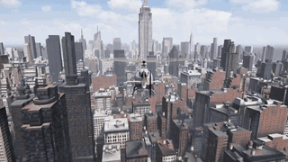
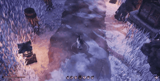
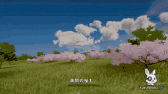
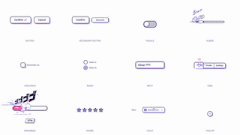
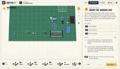
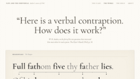
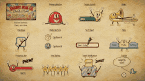
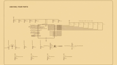
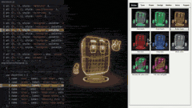
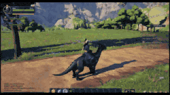

<h3>Claude Fable 5.2로 만든, 바로 열어 즐길 수 있는 작품들</h3>

[English](README.md) · [简体中文](README.zh-CN.md) · [繁體中文](README.zh-TW.md) · [日本語](README.ja.md) · **한국어** · [Español](README.es.md) · [Português](README.pt-BR.md) · [Français](README.fr.md) · [Deutsch](README.de.md) · [Русский](README.ru.md)

**🌐 웹 버전: [fablelist.000ooo.ooo](https://fablelist.000ooo.ooo/ko/)** (검색 가능, 작품별 상세 페이지)

Claude Fable 5.2로 만든 작품 244개와 영상 데모 153개, 링크는 2026-11-25에 모두 확인. 매일 업데이트되니 도움이 되면 ⭐ 눌러 주세요.

## 📑 목차

[⭐ 가장 사랑받은 작품](#-가장-사랑받은-작품) · [🆕 최신](#-최신) · [🎮 게임](#-게임) 116 · [🌍 3D 월드와 장면](#-3d-월드와-장면) 52 · [🧰 웹 페이지와 도구](#-웹-페이지와-도구) 57 · [🎬 애니메이션과 영상](#-애니메이션과-영상) 19 · [📺 영상 데모](#-영상-데모) 153 · [🤝 기여하기](#-기여하기)

## ⭐ 가장 사랑받은 작품

<table>
<tr>
<td width="33%" valign="top">
 
<b><a href="https://starrynightrider.com">Starry Nightrider</a></b> 
<a href="https://x.com/ebbyamir">@ebbyamir</a> · ♥ 17.9k · <a href="https://x.com/ebbyamir/status/2120284261089673376">▶ 영상</a> 
고흐가 자신의 별이 빛나는 밤 속을 달리는 게임. 
<a href="https://fablelist.000ooo.ooo/ko/prompts/?w=starry-nightrider&ref=gh"><b>✨ 프롬프트 받기</b></a>
</td>
<td width="33%" valign="top">
 
<b><a href="https://claude.ai/artifact/BGY1SztrAYcJQHSsnHHGmp">Saltline — 1인칭 슈팅 게임</a></b> 
<a href="https://x.com/felixrieseberg">@felixrieseberg</a> · ♥ 15.1k · <a href="https://x.com/felixrieseberg/status/2119925633564463609">▶ 영상</a> 
Anthropic 엔지니어 작품. 원샷 프롬프트, 사람의 피드백 없이 8시간, 약 $550. 모델, 사운드, 텍스처 모두 코드로 생성. 
<a href="https://fablelist.000ooo.ooo/ko/prompts/?w=saltline-first-person-shooter&ref=gh"><b>✨ 프롬프트 받기</b></a>
</td>
<td width="33%" valign="top">
 
<b><a href="https://viktorkav.com.br/apoio/uno-com-escada/fable/">Uno com Escada: 사다리를 실은 Fiat Uno로 달리는 서킷</a></b> 
<a href="https://x.com/ViktorKav">@ViktorKav</a> · ♥ 9.2k · <a href="https://x.com/ViktorKav/status/2122647483281015155">▶ 영상</a> 
지붕에 사다리를 실은 1996년식 Uno Mille로 서킷을 달린다. 603 KB짜리 HTML 파일 하나로, 엔진도 3D 라이브러리도 텍스처도 없다. 차, 숲, 하늘, 엔진 소리까지 모두 코드로 만들었다. 
<a href="https://github.com/viktorkav/uno-com-escada">소스 코드</a>
</td>
</tr>
<tr>
<td width="33%" valign="top">
 
<b><a href="https://patch.gg/blendi/oil-paint">Oil Paint — 손으로 그린 듯한 게임</a></b> 
<a href="https://x.com/BlendiByl">@BlendiByl</a> · ♥ 8.0k · <a href="https://x.com/BlendiByl/status/2120341251178594532">▶ 영상</a> 
1시간 이내에 제작. 모든 프레임이 약 150만 번의 붓질로 이루어져 브라우저 탭에서 200 fps로 실행. 오픈 소스. 
<a href="https://fablelist.000ooo.ooo/ko/prompts/?w=oil-paint-hand-painted-game&ref=gh"><b>✨ 프롬프트 받기</b></a>
</td>
<td width="33%" valign="top">
 
<b><a href="https://nyc.somethingbig.ai/">CROSSTOWN — 오픈 월드 뉴욕 (초기 프리뷰)</a></b> 
<a href="https://x.com/mattshumer_">@mattshumer_</a> · ♥ 7.5k · <a href="https://x.com/mattshumer_/status/2120282133503820150">▶ 영상</a> 
"Rockstar는 8년 걸렸다. Fable 5.2는 7일 만에 해낸다." 아직 도시 일부만 구현됨. B를 눌러 피드백을 보내세요. 
<a href="https://fablelist.000ooo.ooo/ko/prompts/?w=crosstown-open-world-new-york-early-preview&ref=gh"><b>✨ 프롬프트 받기</b></a>
</td>
<td width="33%" valign="top">
 
<b><a href="https://claude.ai/artifact/QGWUAjRrzRzZWGcQzSMLfa">Blender 노트북 속 Claude 앱</a></b> 
<a href="https://x.com/rileybrown">@rileybrown</a> · ♥ 7.1k · <a href="https://x.com/rileybrown/status/2119902109709537708">▶ 영상</a> 
프롬프트 하나로 Blender에서 방 전체를 만들고 4K로 렌더링. 노트북 화면에 보이는 웹 페이지입니다. 
<a href="https://x.com/rileybrown/status/2119902109709537708">📝 제작자 공개 프롬프트 (무료)</a>
</td>
</tr>
</table>

## 🆕 최신

지난 3일 안에 올라온 작품, 좋아요 순.

<table>
<tr>
<td width="33%" valign="top">
 
<b><a href="https://kevintngo.github.io/cinderwatch/">Cinderwatch — HTML 파일 하나로 된 타워 디펜스</a></b> 
🆕 · <a href="https://x.com/kevin_t_ngo">@kevin_t_ngo</a> · ♥ 1.8k · <a href="https://x.com/kevin_t_ngo/status/2125119969109418333">▶ 영상</a> 
HTML 파일 하나에 들어가는 3D 아이소메트릭 타워 디펜스. 내장된 AI 지휘관이 방어를 대신 맡아 줄 수도 있다. 오픈소스이며 브라우저에서 바로 플레이할 수 있다. 
<a href="https://github.com/kevintngo/cinderwatch">소스 코드</a>
</td>
<td width="33%" valign="top">
 
<b><a href="https://thaxnay.com/ramayana/">Ramayana: The Sacred Fires</a></b> 
🆕 · <a href="https://x.com/Thaxnay">@Thaxnay</a> · ♥ 977 · <a href="https://x.com/Thaxnay/status/2124574054296219939">▶ 영상</a> 
라마가 되어 탁 트인 계곡을 누비며 현자들을 지키고 숨겨진 비밀을 찾는 3인칭 액션 어드벤처. PC와 모바일 브라우저에서 바로 플레이할 수 있습니다.
</td>
<td width="33%" valign="top">
 
<b><a href="https://patch.gg/play/blendi/the-blue-hour">The Blue Hour — 아르데코풍 밤의 도시</a></b> 
<a href="https://x.com/BlendiByl">@BlendiByl</a> · ♥ 637 · <a href="https://x.com/BlendiByl/status/2124439671006748853">▶ 영상</a> 
애니메이션 '배트맨' 시리즈의 아르데코 스타일을 살린 3D 장면으로, 전부 코드로 그렸습니다. 오픈 소스.
</td>
</tr>
</table>

## 🎮 게임

<table>
<tr>
<td width="33%" valign="top">
 
<b><a href="https://starrynightrider.com">Starry Nightrider</a></b> 
<a href="https://x.com/ebbyamir">@ebbyamir</a> · ♥ 17.9k · <a href="https://x.com/ebbyamir/status/2120284261089673376">▶ 영상</a> 
고흐가 자신의 별이 빛나는 밤 속을 달리는 게임. 
<a href="https://fablelist.000ooo.ooo/ko/prompts/?w=starry-nightrider&ref=gh"><b>✨ 프롬프트 받기</b></a>
</td>
<td width="33%" valign="top">
 
<b><a href="https://claude.ai/artifact/BGY1SztrAYcJQHSsnHHGmp">Saltline — 1인칭 슈팅 게임</a></b> 
<a href="https://x.com/felixrieseberg">@felixrieseberg</a> · ♥ 15.1k · <a href="https://x.com/felixrieseberg/status/2119925633564463609">▶ 영상</a> 
Anthropic 엔지니어 작품. 원샷 프롬프트, 사람의 피드백 없이 8시간, 약 $550. 모델, 사운드, 텍스처 모두 코드로 생성. 
<a href="https://fablelist.000ooo.ooo/ko/prompts/?w=saltline-first-person-shooter&ref=gh"><b>✨ 프롬프트 받기</b></a>
</td>
<td width="33%" valign="top">
 
<b><a href="https://viktorkav.com.br/apoio/uno-com-escada/fable/">Uno com Escada: 사다리를 실은 Fiat Uno로 달리는 서킷</a></b> 
<a href="https://x.com/ViktorKav">@ViktorKav</a> · ♥ 9.2k · <a href="https://x.com/ViktorKav/status/2122647483281015155">▶ 영상</a> 
지붕에 사다리를 실은 1996년식 Uno Mille로 서킷을 달린다. 603 KB짜리 HTML 파일 하나로, 엔진도 3D 라이브러리도 텍스처도 없다. 차, 숲, 하늘, 엔진 소리까지 모두 코드로 만들었다. 
<a href="https://github.com/viktorkav/uno-com-escada">소스 코드</a>
</td>
</tr>
<tr>
<td width="33%" valign="top">
 
<b><a href="https://patch.gg/blendi/oil-paint">Oil Paint — 손으로 그린 듯한 게임</a></b> 
<a href="https://x.com/BlendiByl">@BlendiByl</a> · ♥ 8.0k · <a href="https://x.com/BlendiByl/status/2120341251178594532">▶ 영상</a> 
1시간 이내에 제작. 모든 프레임이 약 150만 번의 붓질로 이루어져 브라우저 탭에서 200 fps로 실행. 오픈 소스. 
<a href="https://fablelist.000ooo.ooo/ko/prompts/?w=oil-paint-hand-painted-game&ref=gh"><b>✨ 프롬프트 받기</b></a>
</td>
<td width="33%" valign="top">
 
<b><a href="https://nyc.somethingbig.ai/">CROSSTOWN — 오픈 월드 뉴욕 (초기 프리뷰)</a></b> 
<a href="https://x.com/mattshumer_">@mattshumer_</a> · ♥ 7.5k · <a href="https://x.com/mattshumer_/status/2120282133503820150">▶ 영상</a> 
"Rockstar는 8년 걸렸다. Fable 5.2는 7일 만에 해낸다." 아직 도시 일부만 구현됨. B를 눌러 피드백을 보내세요. 
<a href="https://fablelist.000ooo.ooo/ko/prompts/?w=crosstown-open-world-new-york-early-preview&ref=gh"><b>✨ 프롬프트 받기</b></a>
</td>
<td width="33%" valign="top">
 
<b><a href="https://omw-game.kimaki.dev">omw: 유화 붓터치의 성 계곡</a></b> 
<a href="https://x.com/__morse">@__morse</a> · ♥ 4.5k · <a href="https://x.com/__morse/status/2122013410309153042">▶ 영상</a> 
@de5imulate의 "omw" 픽셀 아트를 브라우저에서 플레이할 수 있는 three.js 게임으로 다시 만들었다. 화면이 유화처럼 렌더링된다. 
<a href="https://github.com/remorses/castle-valley">소스 코드</a>
</td>
</tr>
<tr>
<td width="33%" valign="top">
 
<b><a href="https://what-the-water-keeps.vercel.app/">What the Water Keeps</a></b> 
<a href="https://x.com/kevin_t_ngo">@kevin_t_ngo</a> · ♥ 4.3k · <a href="https://x.com/kevin_t_ngo/status/2119868968307695818">▶ 영상</a> 
꿈결 같은 8개의 세계를 지나는 보트 여행. 브라우저에서 플레이. 
<a href="https://fablelist.000ooo.ooo/ko/prompts/?w=what-the-water-keeps&ref=gh"><b>✨ 프롬프트 받기</b></a>
</td>
<td width="33%" valign="top">
 
<b><a href="https://tennis.sixfingerpunch.com/">Tennis</a></b> 
<a href="https://x.com/photonstorm">@photonstorm</a> · ♥ 3.1k · <a href="https://x.com/photonstorm/status/2120330010112434313">게시물</a> 
게임을 "마음껏 해봐"라고 요청했더니 퐁 복제처럼 보이는 게임이 나왔는데, 직접 해보면 달라요. 
<a href="https://fablelist.000ooo.ooo/ko/prompts/?w=tennis&ref=gh"><b>✨ 프롬프트 받기</b></a>
</td>
<td width="33%" valign="top">
 
<b><a href="https://patch.gg/play/blendi/small-magic">Small Magic — 마법사 샌드박스</a></b> 
<a href="https://x.com/BlendiByl">@BlendiByl</a> · ♥ 2.6k · <a href="https://x.com/BlendiByl/status/2121594536153718972">▶ 영상</a> 
하루 만에 제작: 주문 7개, 부술 수 있는 물리 조각 약 1,800개, 모델·텍스처 없음, 오픈 소스.
</td>
</tr>
<tr>
<td width="33%" valign="top">
 
<b><a href="https://www.spawn.co/@mattshumer/earth?room=local">Mirror Earth</a></b> 
<a href="https://x.com/mattshumer_">@mattshumer_</a> · ♥ 2.4k · <a href="https://x.com/mattshumer_/status/2119877065701036047">▶ 영상</a> 
행성 전체가 부술 수 있는 게임 월드. 날씨는 실제 지구와 실시간으로 일치. 
<a href="https://fablelist.000ooo.ooo/ko/prompts/?w=mirror-earth&ref=gh"><b>✨ 프롬프트 받기</b></a>
</td>
<td width="33%" valign="top">
 
<b><a href="https://portals-endless-worlds.netlify.app/">Portals: Endless Worlds</a></b> 
<a href="https://x.com/emollick">@emollick</a> · ♥ 1.9k · <a href="https://x.com/emollick/status/2119918307457577163">▶ 영상</a> 
에이전트 25,000개가 책, 예술, 장소에서 영감을 받은 코드만으로 만든 3D 월드 450개 이상을 제작. 포털을 타고 떠다니며 이동. 
<a href="https://github.com/emollick/ai-portals">소스 코드</a> · <a href="https://www.oneusefulthing.org/p/fable-52-and-jagged-agi">글</a> 
<a href="https://fablelist.000ooo.ooo/ko/prompts/?w=portals-endless-worlds&ref=gh"><b>✨ 프롬프트 받기</b></a>
</td>
<td width="33%" valign="top">
 
<b><a href="https://evensong-phi.vercel.app/">Evensong</a></b> 
<a href="https://x.com/kevin_t_ngo">@kevin_t_ngo</a> · ♥ 1.8k · <a href="https://x.com/kevin_t_ngo/status/2120238844754923874">▶ 영상</a> 
다크 판타지 소울라이크 보스전, 브라우저에서 플레이. 
<a href="https://fablelist.000ooo.ooo/ko/prompts/?w=evensong&ref=gh"><b>✨ 프롬프트 받기</b></a>
</td>
</tr>
<tr>
<td width="33%" valign="top">
 
<b><a href="https://kevintngo.github.io/cinderwatch/">Cinderwatch — HTML 파일 하나로 된 타워 디펜스</a></b> 
🆕 · <a href="https://x.com/kevin_t_ngo">@kevin_t_ngo</a> · ♥ 1.8k · <a href="https://x.com/kevin_t_ngo/status/2125119969109418333">▶ 영상</a> 
HTML 파일 하나에 들어가는 3D 아이소메트릭 타워 디펜스. 내장된 AI 지휘관이 방어를 대신 맡아 줄 수도 있다. 오픈소스이며 브라우저에서 바로 플레이할 수 있다. 
<a href="https://github.com/kevintngo/cinderwatch">소스 코드</a>
</td>
<td width="33%" valign="top">
 
<b><a href="https://loktar00.github.io/lanternfall/">LANTERNFALL</a></b> 
<a href="https://x.com/loktar00">@loktar00</a> · ♥ 1.4k · <a href="https://x.com/loktar00/status/2120192761542615271">▶ 영상</a> 
애니메이션, 모델 등 게임 전체를 Fable이 생성. 적이 죽을 때의 이펙트를 확인해 보세요. 
<a href="https://fablelist.000ooo.ooo/ko/prompts/?w=lanternfall&ref=gh"><b>✨ 프롬프트 받기</b></a>
</td>
<td width="33%" valign="top">
 
<b><a href="https://app.usecrayon.ai/play/76dbd04f-0684-4486-8cc4-eae0585295e8">오공: 포스타 로드</a></b> 
<a href="https://x.com/aniketjart">@aniketjart</a> · ♥ 1.4k · <a href="https://x.com/aniketjart/status/2121793239175119279">▶ 영상</a> 
드래곤볼 레드리본군 편을 바탕으로 three.js로 만든 팬 액션 게임. 제작 중이며 처음 두 맵을 플레이할 수 있습니다.
</td>
</tr>
<tr>
<td width="33%" valign="top">
 
<b><a href="https://heat.pplx.app">VICE '86: 네온빛 1986년 마이애미 오픈월드 드라이빙</a></b> 
<a href="https://x.com/AravSrinivas">@AravSrinivas</a> · ♥ 1.3k · <a href="https://x.com/AravSrinivas/status/2122338465648103676">▶ 영상</a> 
브라우저에서 돌아가는 오픈월드 드라이빙 게임. 게임 엔진도 three.js도 없이 자체 WebGL2 렌더러를 쓰고, 도시와 자동차, 비, 엔진 소리까지 모두 코드로 생성했다. JavaScript 약 63,000줄.
</td>
<td width="33%" valign="top">
 
<b><a href="https://op7418.github.io/guizang-game-skill/">Mist-Locked Mountain Gate — 3D 액션 게임</a></b> 
<a href="https://x.com/op7418">@op7418</a> · ♥ 1.2k · <a href="https://x.com/op7418/status/2120694045299327187">▶ 영상</a> 
어느 오후 하루, 토큰 45억 개. 모델, 장면, 동작 모두 Fable이 만들고 30 MB짜리 HTML 파일 하나에 담았습니다. 
<a href="https://fablelist.000ooo.ooo/ko/prompts/?w=mist-locked-mountain-gate-3d-action-game&ref=gh"><b>✨ 프롬프트 받기</b></a>
</td>
<td width="33%" valign="top">
 
<b><a href="https://wavedash.com/games/rooftop-rally">Rooftop Rally — Unreal 5.9 피클볼</a></b> 
<a href="https://x.com/chongdashu">@chongdashu</a> · ♥ 1.1k · <a href="https://x.com/chongdashu/status/2120154573356793883">▶ 영상</a> 
Fable 5.2와 Unreal Engine 5.9 프리뷰. 캐릭터는 Tripo, 나머지 3D 에셋과 모든 것은 Fable이 제작. 
<a href="https://x.com/chongdashu/status/2120310120509014219">제작 과정</a> 
<a href="https://fablelist.000ooo.ooo/ko/prompts/?w=rooftop-rally-pickleball-in-unreal-5-9&ref=gh"><b>✨ 프롬프트 받기</b></a>
</td>
</tr>
<tr>
<td width="33%" valign="top">
 
<b><a href="https://gtashenzhen.com">GTA Shenzhen</a></b> 
<a href="https://x.com/KinGao476942">@KinGao476942</a> · ♥ 1.0k · <a href="https://x.com/KinGao476942/status/2123967104601014521">▶ 영상</a> 
OpenStreetMap 데이터로 만든 선전 도시 전체. 건물 83,182채, 도로 62,088개. 하늘을 날고, 착지해서 차를 몰고, 원하는 장소를 검색하고, 밤에는 도시 전체 라이트 쇼도 켤 수 있습니다. Fable 5.2와 Tripo로 3일 만에 제작.
</td>
<td width="33%" valign="top">
 
<b><a href="https://thaxnay.com/ramayana/">Ramayana: The Sacred Fires</a></b> 
🆕 · <a href="https://x.com/Thaxnay">@Thaxnay</a> · ♥ 977 · <a href="https://x.com/Thaxnay/status/2124574054296219939">▶ 영상</a> 
라마가 되어 탁 트인 계곡을 누비며 현자들을 지키고 숨겨진 비밀을 찾는 3인칭 액션 어드벤처. PC와 모바일 브라우저에서 바로 플레이할 수 있습니다.
</td>
<td width="33%" valign="top">
 
<b><a href="https://claude.ai/artifact/MXxb36zKgN261ckbGhmNin">Three Games (Saltline · The Clockmaker's Heart · Tidewright)</a></b> 
<a href="https://x.com/felixrieseberg">@felixrieseberg</a> · ♥ 803 · <a href="https://x.com/vineerpasam/status/2119955306096857145">▶ 영상</a> 
Felix Rieseberg 서명: "모든 게임은 Claude Fable 5.2로 만들었습니다. 초안 그대로, 사람의 피드백 없음." 출시 당일 가장 많이 공유된 링크. 
<a href="https://claude.ai/artifact/6MjtQjf4ee1ZZjEpafaEpa">The Clockmaker's Heart</a> · <a href="https://claude.ai/artifact/JTgyEMn7sn1q2riWrMb7D4">Tidewright</a> 
<a href="https://fablelist.000ooo.ooo/ko/prompts/?w=three-games-saltline-the-clockmaker-s-heart-tidewright&ref=gh"><b>✨ 프롬프트 받기</b></a>
</td>
</tr>
<tr>
<td width="33%" valign="top">
 
<b><a href="https://patch.gg/play/blendi/solar">Solar — 날아다닐 수 있는 작은 태양계</a></b> 
<a href="https://x.com/BlendiByl">@BlendiByl</a> · ♥ 800 · <a href="https://x.com/BlendiByl/status/2122673770607591855">▶ 영상</a> 
Outer Wilds에서 영감을 받았습니다. 실제 궤도와 중력, 행성 사이를 끊김 없이 비행하며 모든 세계를 코드로 그렸습니다. 오픈 소스.
</td>
<td width="33%" valign="top">
 
<b><a href="https://patch.gg/blendi/coloured-pencil">Coloured Pencil</a></b> 
<a href="https://x.com/BlendiByl">@BlendiByl</a> · ♥ 765 · <a href="https://x.com/BlendiByl/status/2121130385723789637">▶ 영상</a> 
색연필 느낌의 게임 한 조각. 모든 표면의 셰이딩과 마을 전체가 코드. 오픈 소스. 
<a href="https://fablelist.000ooo.ooo/ko/prompts/?w=coloured-pencil&ref=gh"><b>✨ 프롬프트 받기</b></a>
</td>
<td width="33%" valign="top">
 
<b><a href="https://www.spawn.co/@mattshumer/voxel-engine">Voxel Engine</a></b> 
<a href="https://x.com/mattshumer_">@mattshumer_</a> · ♥ 744 · <a href="https://x.com/mattshumer_/status/2119870965106483384">▶ 영상</a> 
프롬프트 한 번으로 제작. 소리를 켜세요. 
<a href="https://fablelist.000ooo.ooo/ko/prompts/?w=voxel-engine&ref=gh"><b>✨ 프롬프트 받기</b></a>
</td>
</tr>
</table>

<b><a href="all/games.ko.md">전체 116개 보기 →</a></b>

<a href="#-목차">↑ 목차로</a>

## 🌍 3D 월드와 장면

<table>
<tr>
<td width="33%" valign="top">
 
<b><a href="https://claude.ai/artifact/QGWUAjRrzRzZWGcQzSMLfa">Blender 노트북 속 Claude 앱</a></b> 
<a href="https://x.com/rileybrown">@rileybrown</a> · ♥ 7.1k · <a href="https://x.com/rileybrown/status/2119902109709537708">▶ 영상</a> 
프롬프트 하나로 Blender에서 방 전체를 만들고 4K로 렌더링. 노트북 화면에 보이는 웹 페이지입니다. 
<a href="https://x.com/rileybrown/status/2119902109709537708">📝 제작자 공개 프롬프트 (무료)</a>
</td>
<td width="33%" valign="top">
 
<b><a href="https://xikhar.github.io/papertrails/">Papertrails: 끝없이 펼쳐지는 팝업북 종이 세계</a></b> 
<a href="https://x.com/xikhar">@xikhar</a> · ♥ 2.3k · <a href="https://x.com/xikhar/status/2122682962647122403">▶ 영상</a> 
종이 인형이 걸어가면 나무와 집, 언덕이 팝업북처럼 땅에서 솟아오른다. 사막, 눈밭, 숲, 낮과 밤을 지난다. Fable 5.2, Opus 5.5, three.js로 제작. 
<a href="https://github.com/xikhar/papertrails">소스 코드</a>
</td>
<td width="33%" valign="top">
 
<b><a href="https://patch.gg/blendi/painted-valley">Painted Valley</a></b> 
<a href="https://x.com/BlendiByl">@BlendiByl</a> · ♥ 1.8k · <a href="https://x.com/BlendiByl/status/2120694003230560585">▶ 영상</a> 
지브리에서 영감을 받은, 걸어 다닐 수 있는 손으로 그린 듯한 계곡. 오픈 소스. 
<a href="https://fablelist.000ooo.ooo/ko/prompts/?w=painted-valley&ref=gh"><b>✨ 프롬프트 받기</b></a>
</td>
</tr>
<tr>
<td width="33%" valign="top">
 
<b><a href="https://april-zhu.com/pocketcity">Pocket City</a></b> 
<a href="https://x.com/Aprilzz423">@Aprilzz423</a> · ♥ 1.2k · <a href="https://x.com/Aprilzz423/status/2123788440714260673">▶ 영상</a> 
어떤 길모퉁이든 빙빙 돌려 보며 둘러볼 수 있는 손그림 미니 도시로 바꿔 준다. OpenStreetMap 실측 데이터에 그 지역의 날씨와 계절까지 담았다. Fable 5.2와 GPT-6.2 Astra로 제작.
</td>
<td width="33%" valign="top">
 
<b><a href="https://claude.ai/artifact/CTjrZXVdUgKJ6qJXrvvr28">Ancient Babylon, 600 BC</a></b> 
<a href="https://x.com/literallydenis">@literallydenis</a> · ♥ 1.2k · <a href="https://x.com/literallydenis/status/2120866958790848953">▶ 영상</a> 
8시간 실행 동안 직접 찾은 역사 문서와 설계도로 복원한 바빌론. 자유롭게 돌아다녀 보세요. 
<a href="https://fablelist.000ooo.ooo/ko/prompts/?w=ancient-babylon-600-bc&ref=gh"><b>✨ 프롬프트 받기</b></a>
</td>
<td width="33%" valign="top">
 
<b><a href="https://indiranagar-live.vercel.app">인디라나가르 1 km²</a></b> 
<a href="https://x.com/anshu4321">@anshu4321</a> · ♥ 1.2k · <a href="https://x.com/anshu4321/status/2119938067758772403">▶ 영상</a> 
지도 데이터와 프롬프트 하나로 만든 벵갈루루의 실시간 3D 한 조각. 
<a href="https://fablelist.000ooo.ooo/ko/prompts/?w=1-km2-of-indiranagar&ref=gh"><b>✨ 프롬프트 받기</b></a>
</td>
</tr>
<tr>
<td width="33%" valign="top">
 
<b><a href="https://fable-rome.surge.sh/">Rome, AD 320</a></b> 
<a href="https://x.com/petergostev">@petergostev</a> · ♥ 977 · <a href="https://x.com/petergostev/status/2120167560700383572">▶ 영상</a> 
프롬프트 하나, Fable 5.2 (Max)가 밤새 실행, $2,618. 
<a href="https://x.com/petergostev/status/2120167560700383572">📝 제작자 공개 프롬프트 (무료)</a>
</td>
<td width="33%" valign="top">
 
<b><a href="https://github.com/Leonxlnx/room-at-dawn">Room at Dawn</a></b> 
<a href="https://x.com/LexnLin">@LexnLin</a> · ♥ 856 · <a href="https://x.com/LexnLin/status/2120910879361548565">▶ 영상</a> 
미리 만든 모델이나 텍스처 없이 three.js로 만든 사실적인 침실. 모든 것이 코드. 
<a href="https://fablelist.000ooo.ooo/ko/prompts/?w=room-at-dawn&ref=gh"><b>✨ 프롬프트 받기</b></a>
</td>
<td width="33%" valign="top">
 
<b><a href="https://fable-rover.vercel.app">ER-6 Terrain Explorer — 스스로 달리는 화성 탐사차</a></b> 
<a href="https://x.com/DilumSanjaya">@DilumSanjaya</a> · ♥ 809 · <a href="https://x.com/DilumSanjaya/status/2120561077385867663">▶ 영상</a> 
Fable 5.2가 NASA 화성 탐사차처럼 로커-보기 서스펜션을 설계하고, 외계 지형을 달리는 시뮬레이션까지 만들었습니다.
</td>
</tr>
<tr>
<td width="33%" valign="top">
 
<b><a href="https://ship-42-catch.netlify.app/">Ship 42 Catch</a></b> 
<a href="https://x.com/emollick">@emollick</a> · ♥ 739 · <a href="https://x.com/emollick/status/2122036763468214711">▶ 영상</a> 
Fable과 Opus가 스타십 타워 캐치 영상을 찾아 마지막 40초를 three.js로 정교한 3D로 재현했다. 카메라 시점을 바꿀 수 있다.
</td>
<td width="33%" valign="top">
 
<b><a href="https://patch.gg/play/blendi/the-blue-hour">The Blue Hour — 아르데코풍 밤의 도시</a></b> 
<a href="https://x.com/BlendiByl">@BlendiByl</a> · ♥ 637 · <a href="https://x.com/BlendiByl/status/2124439671006748853">▶ 영상</a> 
애니메이션 '배트맨' 시리즈의 아르데코 스타일을 살린 3D 장면으로, 전부 코드로 그렸습니다. 오픈 소스.
</td>
<td width="33%" valign="top">
 
<b><a href="https://supernatural-ft.vercel.app/fire-in-ice">Fire in Ice</a></b> 
<a href="https://x.com/tkm_hmng8">@tkm_hmng8</a> · ♥ 549 · <a href="https://x.com/tkm_hmng8/status/2120813043101946324">▶ 영상</a> 
three.js 없이 순수 WebGPU로 작성한, 얼음 속에서 타오르는 사실적인 불꽃. 
<a href="https://fablelist.000ooo.ooo/ko/prompts/?w=fire-in-ice&ref=gh"><b>✨ 프롬프트 받기</b></a>
</td>
</tr>
<tr>
<td width="33%" valign="top">
 
<b><a href="https://github.com/Leonxlnx/walking-block">Walking Block: 걸어 다니는 소련 아파트</a></b> 
<a href="https://x.com/LexnLin">@LexnLin</a> · ♥ 417 · <a href="https://x.com/LexnLin/status/2122359035751989341">▶ 영상</a> 
여덟 개의 기계 다리가 달린 거대한 소련식 패널 아파트가 해 질 녘 안개 속 젖은 들판을 건넌다. 지오메트리, 텍스처, 셰이더 모두 three.js 코드이며, 같은 장면에서 45초 영상도 렌더링했다.
</td>
<td width="33%" valign="top">
 
<b><a href="https://bay.theojaffee.net">Bay Area Through Time</a></b> 
<a href="https://x.com/theojaffee">@theojaffee</a> · ♥ 388 · <a href="https://x.com/theojaffee/status/2120312766544437738">▶ 영상</a> 
원하는 도시나 동네로 확대하고, 1769년까지 거슬러 올라가 연도를 골라 당시 모습을 확인. 
<a href="https://nyc.theojaffee.net">New York City</a> 
<a href="https://fablelist.000ooo.ooo/ko/prompts/?w=bay-area-through-time&ref=gh"><b>✨ 프롬프트 받기</b></a>
</td>
<td width="33%" valign="top">
 
<b><a href="http://procedural-arm-rig.vercel.app">Procedural Arm Rig</a></b> 
<a href="https://x.com/apekshik">@apekshik</a> · ♥ 326 · <a href="https://x.com/apekshik/status/2120224530367119758">▶ 영상</a> 
AAA 게임을 원샷으로 만드는 대신: 본 아마추어, 웨이트 페인팅된 메시, IK, 주먹을 쥘 때 부풀어 오르는 근육을 갖춘 팔 하나. 
<a href="https://fablelist.000ooo.ooo/ko/prompts/?w=procedural-arm-rig&ref=gh"><b>✨ 프롬프트 받기</b></a>
</td>
</tr>
<tr>
<td width="33%" valign="top">
 
<b><a href="https://samg-coder.github.io/solstice-garden/">The Garden</a></b> 
<a href="https://x.com/SamGCoder">@SamGCoder</a> · ♥ 297 · <a href="https://x.com/SamGCoder/status/2120943068321054975">▶ 영상</a> 
Rust로 작성해 WASM으로 컴파일하고 WebGPU로 렌더링한 정원 장면. 
<a href="https://fablelist.000ooo.ooo/ko/prompts/?w=the-garden&ref=gh"><b>✨ 프롬프트 받기</b></a>
</td>
<td width="33%" valign="top">
 
<b><a href="http://taoistvibe.com">Chill Taoist Vibe: 도교 사원이 있는 작은 산</a></b> 
<a href="https://x.com/qiqileyuan">@qiqileyuan</a> · ♥ 252 · <a href="https://x.com/qiqileyuan/status/2122006851298693277">▶ 영상</a> 
지브리풍으로 그린 작은 산 위의 도교 사원. 노도사를 따라 산을 오르고, 향을 피우고, 점괘를 뽑고, 명상할 수 있다. 흔들의자에 앉아 계절이 바뀌는 걸 지켜보기만 해도 된다. 신상과 주인공 모델은 Tripo3D로 만들었고 나머지는 전부 생성된 코드다.
</td>
<td width="33%" valign="top">
 
<b><a href="https://butterfly.kyzo.io">Hidden Layers: 유리 온실 속 유리날개나비</a></b> 
<a href="https://x.com/ky__zo">@ky__zo</a> · ♥ 229 · <a href="https://x.com/ky__zo/status/2122274109795054036">▶ 영상</a> 
스크롤하면 유리 온실을 빠져나가지 못하는 유리날개나비와 함께 여섯 개의 세계를 날아간다. 모델 파일도 텍스처도 없는 순수 three.js. 13.2억 토큰, API 비용 $905.
</td>
</tr>
<tr>
<td width="33%" valign="top">
 
<b><a href="https://claude.ai/artifact/R6YBDkAm2GjAC5A65D9djx">걸어 들어갈 수 있는 Claude 데모</a></b> 
<a href="https://x.com/dfeinition">@dfeinition</a> · ♥ 215 · <a href="https://x.com/dfeinition/status/2120330644261589051">▶ 영상</a> 
@rileybrown에게서 영감: 걸어 들어가 어느 컴퓨터에든 앉아 보세요. 
<a href="https://fablelist.000ooo.ooo/ko/prompts/?w=a-claude-demo-you-can-walk-into&ref=gh"><b>✨ 프롬프트 받기</b></a>
</td>
<td width="33%" valign="top">
 
<b><a href="https://claude.ai/artifact/2PBXuQAnWDS2NpiPXHNLfL">Orca Jelly</a></b> 
<a href="https://x.com/vib3coded">@vib3coded</a> · ♥ 204 · <a href="https://x.com/vib3coded/status/2119951060752375827">▶ 영상</a> 
말랑한 소프트바디 젤리 범고래 머티리얼 스터디. 비교용으로 Opus 5.5 버전 링크 포함. 
<a href="https://claude.ai/artifact/75KLotWzZQ5RR23BGLePb8">Opus 5.5 version</a> 
<a href="https://x.com/vib3coded/status/2119951060752375827">📝 제작자 공개 프롬프트 (무료)</a>
</td>
<td width="33%" valign="top">
 
<b><a href="https://planet.tokyoaivisuals.club/">Code Planet</a></b> 
<a href="https://x.com/KanaWorks_AI">@KanaWorks_AI</a> · ♥ 198 · <a href="https://x.com/KanaWorks_AI/status/2121413647213932688">▶ 영상</a> 
320KB도 안 되는 코드로 만든 행성 하나. 바다와 초원에서 벚꽃을 지나 우주까지, 브라우저에서 바로 날아가 보세요.
</td>
</tr>
<tr>
<td width="33%" valign="top">
 
<b><a href="https://claude.ai/artifact/9EgZpErM17kH2a9Q3WXW6f">Voxel World in a Bottle</a></b> 
<a href="https://x.com/vib3coded">@vib3coded</a> · ♥ 163 · <a href="https://x.com/vib3coded/status/2120104517282775514">▶ 영상</a> 
30분, $12.81. 
<a href="https://x.com/vib3coded/status/2120104517282775514">📝 제작자 공개 프롬프트 (무료)</a>
</td>
<td width="33%" valign="top">
 
<b><a href="https://github.com/Leonxlnx/beautiful-wonderland">Beautiful Wonderland</a></b> 
<a href="https://x.com/LexnLin">@LexnLin</a> · ♥ 148 · <a href="https://x.com/LexnLin/status/2122056542778535977">▶ 영상</a> 
three.js로 만든 손그림 느낌의 작은 세계와, 거기서 렌더링한 40초 4K 영상.
</td>
<td width="33%" valign="top">
 
<b><a href="https://patch.gg/blendi/impossible-spaces">Impossible Spaces</a></b> 
<a href="https://x.com/BlendiByl">@BlendiByl</a> · ♥ 139 · <a href="https://x.com/BlendiByl/status/2120314459793355262">▶ 영상</a> 
환각적인 "불가능한 공간" 체험. 오픈 소스. 
<a href="https://fablelist.000ooo.ooo/ko/prompts/?w=impossible-spaces&ref=gh"><b>✨ 프롬프트 받기</b></a>
</td>
</tr>
</table>

<b><a href="all/3d-worlds.ko.md">전체 52개 보기 →</a></b>

<a href="#-목차">↑ 목차로</a>

## 🧰 웹 페이지와 도구

<table>
<tr>
<td width="33%" valign="top">
 
<b><a href="https://claudia.gallery">Claudia Gallery</a></b> 
<a href="https://x.com/anabology">@anabology</a> · ♥ 5.5k · <a href="https://x.com/anabology/status/2120010995309457643">▶ 영상</a> 
"꿈꾸던 영상을 만들어줘" — 2샷, 9시간. 
<a href="https://fablelist.000ooo.ooo/ko/prompts/?w=claudia-gallery&ref=gh"><b>✨ 프롬프트 받기</b></a>
</td>
<td width="33%" valign="top">
 
<b><a href="http://robotics-lab-app.vercel.app">Robotics Lab</a></b> 
<a href="https://x.com/0xMovez">@0xMovez</a> · ♥ 4.7k · <a href="https://x.com/0xMovez/status/2120239217880268919">▶ 영상</a> 
실제 보드 8종(Arduino Uno, Raspberry Pi 4…)을 3D로: 칩을 배치하고, 납땜하고, 실제 회로를 배선. 
<a href="http://robolabs-app.vercel.app">Humanoid edition</a> 
<a href="https://fablelist.000ooo.ooo/ko/prompts/?w=robotics-lab&ref=gh"><b>✨ 프롬프트 받기</b></a>
</td>
<td width="33%" valign="top">
 
<b><a href="https://claude.ai/artifact/N6bSgS4ZH5ifFQfg8sm4dv">House Bangers generator</a></b> 
<a href="https://x.com/deedydas">@deedydas</a> · ♥ 4.1k · <a href="https://x.com/deedydas/status/2120905625852936318">▶ 영상</a> 
음악 이론을 익혀 악기별로 수천 가지 패턴을 시도하고, 가장 좋은 것들을 72마디 하우스 트랙으로 편곡합니다. 소리를 켜세요. 
<a href="https://fablelist.000ooo.ooo/ko/prompts/?w=house-bangers-generator&ref=gh"><b>✨ 프롬프트 받기</b></a>
</td>
</tr>
<tr>
<td width="33%" valign="top">
 
<b><a href="https://miaai-lab.github.io/Claude-Fable-5.2-HTML-Files/">단일 파일 HTML 작품 76개</a></b> 
<a href="https://x.com/MiaAI_lab">@MiaAI_lab</a> · ♥ 2.6k · <a href="https://x.com/MiaAI_lab/status/2119930229661503893">게시물</a> 
제너러티브 아트, 물리, 타이포그래피, UI. 각각 원래 프롬프트 포함. 
<a href="https://fablelist.000ooo.ooo/ko/prompts/?w=76-single-file-html-pieces&ref=gh"><b>✨ 프롬프트 받기</b></a>
</td>
<td width="33%" valign="top">
 
<b><a href="https://pixel-worlds.vercel.app/keep/">Keep — 비밀번호 강도 표시기</a></b> 
<a href="https://x.com/crtvTeknologist">@crtvTeknologist</a> · ♥ 1.6k · <a href="https://x.com/crtvTeknologist/status/2119894073024606617">▶ 영상</a> 
살아 있는 픽셀 월드로 표현한 비밀번호 강도 표시기. 
<a href="https://github.com/finktheartist/pixel-worlds">소스 코드</a> 
<a href="https://fablelist.000ooo.ooo/ko/prompts/?w=keep-password-strength-meter&ref=gh"><b>✨ 프롬프트 받기</b></a>
</td>
<td width="33%" valign="top">
 
<b><a href="https://sakuga-vfx.vercel.app">Sakuga Set</a></b> 
<a href="https://x.com/crtvTeknologist">@crtvTeknologist</a> · ♥ 1.4k · <a href="https://x.com/crtvTeknologist/status/2122088829565698218">▶ 영상</a> 
애니메이션처럼 반응하는 UI 컨트롤 12개: 버튼은 찌그러지며 「ドン!」 하고 착지하고, 토글은 잔상과 함께 튀고, 슬라이더는 구름을 일으킨다. 모든 효과를 코드로 그렸고 파일 하나씩, 의존성 없음. 
<a href="https://github.com/finktheartist/sakuga-vfx">소스 코드</a>
</td>
</tr>
<tr>
<td width="33%" valign="top">
 
<b><a href="https://hashem-al-ghaili.github.io/xray-mirror/">X-Ray Mirror</a></b> 
<a href="https://x.com/HashemGhaili">@HashemGhaili</a> · ♥ 1.4k · <a href="https://x.com/HashemGhaili/status/2120202746121085321">▶ 영상</a> 
웹캠을 얼굴에 향하면 두개골, 뇌, 근육이 실시간으로 추적되어 보입니다. 입을 벌리면 턱이 열리고, 영상은 컴퓨터 밖으로 나가지 않습니다. 
<a href="https://github.com/Hashem-Al-Ghaili/xray-mirror">소스 코드</a> 
<a href="https://fablelist.000ooo.ooo/ko/prompts/?w=x-ray-mirror&ref=gh"><b>✨ 프롬프트 받기</b></a>
</td>
<td width="33%" valign="top">
 
<b><a href="https://xianxie6.github.io/animals-planner-2027/">Animals at Work — 3D 플래너</a></b> 
<a href="https://x.com/Xian0063">@Xian0063</a> · ♥ 1.2k · <a href="https://x.com/Xian0063/status/2120417834694250522">▶ 영상</a> 
종이 플래너를 3D로 재현: 드래그로 페이지를 넘기고, 날짜를 탭해 쓰고, 뗐다 붙일 수 있는 스티커 90개. Opus 5.5가 뼈대를 만들고, Fable 5.2가 실제 영상을 기준으로 소재를 다듬었습니다. 
<a href="https://fablelist.000ooo.ooo/ko/prompts/?w=animals-at-work-3d-planner&ref=gh"><b>✨ 프롬프트 받기</b></a>
</td>
<td width="33%" valign="top">
 
<b><a href="https://uberdesigner.ai/t/spine-menu">Spine Menu</a></b> 
<a href="https://x.com/seanaiux">@seanaiux</a> · ♥ 1.2k · <a href="https://x.com/seanaiux/status/2120222459110789574">▶ 영상</a> 
"이보다 멋진 메뉴 본 적 있나요?" 페이지에 프롬프트 포함. 
<a href="https://uberdesigner.ai/t/aquarium-toggle">Aquarium toggle</a> · <a href="https://uberdesigner.ai/t/glow-widgets">Glow widgets</a>
</td>
</tr>
<tr>
<td width="33%" valign="top">
 
<b><a href="https://roverkit.vercel.app">RoverKit — 로봇 자동차 만들고 시뮬레이션하기</a></b> 
<a href="https://x.com/DilumSanjaya">@DilumSanjaya</a> · ♥ 1.1k · <a href="https://x.com/DilumSanjaya/status/2121286147393651085">▶ 영상</a> 
로봇 자동차 만드는 법을 단계별로 알려 줍니다. 시뮬레이터, 커스터마이즈 가능한 경기장, 시각적인 코드 설명 포함. Arduino와 ESP32 지원.
</td>
<td width="33%" valign="top">
 
<b><a href="https://github.com/AlexAtFF/pulp-daw-public">PULP — AI 네이티브 DAW</a></b> 
<a href="https://x.com/The_Alex">@The_Alex</a> · ♥ 948 · <a href="https://x.com/The_Alex/status/2119917226769985785">▶ 영상</a> 
네이티브 Windows 디지털 오디오 워크스테이션. Claude에게 음악을 요청하면 DAW를 열어 곡을 만들어 줍니다. 
<a href="https://fablelist.000ooo.ooo/ko/prompts/?w=pulp-an-ai-native-daw&ref=gh"><b>✨ 프롬프트 받기</b></a>
</td>
<td width="33%" valign="top">
 
<b><a href="https://frontier.every.to/experiments/ambient-town">Ambient Town</a></b> 
<a href="https://x.com/kieranklaassen">@kieranklaassen</a> · ♥ 896 · <a href="https://x.com/kieranklaassen/status/2119868196773929160">▶ 영상</a> 
전직 영화 작곡가가 일주일 밤 동안 만든 앰비언트 DAW: Ableton Push 지원, 마이크, 이펙트, 신디사이저, 함께 작곡하는 에이전트. 페이지의 "Try it"을 클릭하세요. 
<a href="https://fablelist.000ooo.ooo/ko/prompts/?w=ambient-town&ref=gh"><b>✨ 프롬프트 받기</b></a>
</td>
</tr>
<tr>
<td width="33%" valign="top">
 
<b><a href="https://hexagonal.earth">Hexagonal Earth</a></b> 
<a href="https://x.com/avsa">@avsa</a> · ♥ 755 · <a href="https://x.com/avsa/status/2123123638551392755">게시물</a> 
실제 고도, 해양 수심, 습도, 바람, 하천 데이터로 만든 육각형 기반의 세계 디오라마. Fable 5.2가 수백 개의 작은 3D 픽셀 스플랫 오브젝트를 생성하고 직접 장면에 배치했다.
</td>
<td width="33%" valign="top">
 
<b><a href="https://itspsneha.com/supplements">인도에서 어떤 비타민을 살까</a></b> 
<a href="https://x.com/itspsneha">@itspsneha</a> · ♥ 736 · <a href="https://x.com/itspsneha/status/2120048494761451974">게시물</a> 
검사된 109개 배치의 시험 성적서를 읽고 제작. 
<a href="https://fablelist.000ooo.ooo/ko/prompts/?w=which-vitamins-to-buy-in-india&ref=gh"><b>✨ 프롬프트 받기</b></a>
</td>
<td width="33%" valign="top">
 
<b><a href="https://v2.video/riley/the-history-of-writing/v1">The History of Writing</a></b> 
<a href="https://x.com/rileybrown">@rileybrown</a> · ♥ 667 · <a href="https://x.com/rileybrown/status/2119946022767980985">▶ 영상</a> 
프롬프트 하나로 만든 인터랙티브 필름. 프롬프트와 파일 공개. 
<a href="https://x.com/rileybrown/status/2119946022767980985">📝 제작자 공개 프롬프트 (무료)</a>
</td>
</tr>
<tr>
<td width="33%" valign="top">
 
<b><a href="https://auden-english-135.netlify.app/">사라진 Auden의 1941년 시 수업 복원</a></b> 
<a href="https://x.com/emollick">@emollick</a> · ♥ 594 · <a href="https://x.com/emollick/status/2121641417483169934">게시물</a> 
Fable 5.2가 Internet Archive의 잘 알려지지 않은 책과 흩어진 메모를 바탕으로 W. H. Auden의 '인문학에서 가장 어려운' 수업을 재구성했습니다.
</td>
<td width="33%" valign="top">
 
<b><a href="https://omage1.xyz">omage-1: 브라우저 속 OP-1 Field 신시사이저</a></b> 
<a href="https://x.com/jamesmbickerton">@jamesmbickerton</a> · ♥ 572 · <a href="https://x.com/jamesmbickerton/status/2122688041219133815">▶ 영상</a> 
Teenage Engineering의 OP-1 Field를 브라우저 앱으로 다시 만든 비공식 오마주. 열자마자 연주할 수 있다.
</td>
<td width="33%" valign="top">
 
<b><a href="https://claude.ai/artifact/4P1urBdptp6gWiJo3R6Vpv">Breakcore 비디오 샘플러</a></b> 
<a href="https://x.com/parhelion318">@parhelion318</a> · ♥ 543 · <a href="https://x.com/parhelion318/status/2122723067533398064">▶ 영상</a> 
영상 클립을 잘게 잘라 breakcore 리듬으로 재배열하는 브라우저 샘플러.
</td>
</tr>
<tr>
<td width="33%" valign="top">
 
<b><a href="https://www.bubbbly.com/christmas-cards">Christmas Cards: 인터랙티브 크리스마스 카드</a></b> 
<a href="https://x.com/ann_nnng">@ann_nnng</a> · ♥ 481 · <a href="https://x.com/ann_nnng/status/2122283549000712249">▶ 영상</a> 
인터랙티브 크리스마스 카드 모음. 빨간 목도리를 두른 고양이가 창가에서 내리는 눈을 바라보는 카드 등이 있다.
</td>
<td width="33%" valign="top">
 
<b><a href="https://claude.ai/artifact/8yKUbL5KQgvfqcWH6UgZrq">Kastle Sim</a></b> 
<a href="https://x.com/parhelion318">@parhelion318</a> · ♥ 467 · <a href="https://x.com/parhelion318/status/2123344270732202421">▶ 영상</a> 
미니 모듈러 신스 Bastl Kastle을 브라우저에서 시뮬레이션했다. 케이블을 연결하고 노브를 돌리면 소리가 난다.
</td>
<td width="33%" valign="top">
 
<b><a href="https://where-is-everybody-fermi.netlify.app/">Where Is Everybody?</a></b> 
<a href="https://x.com/emollick">@emollick</a> · ♥ 457 · <a href="https://x.com/emollick/status/2120359214157603139">게시물</a> 
"페르미 역설을 풀어줘"라는 요청에 데이터를 모으고, 가설을 검증하고, 비판자의 시각으로 압박 테스트. 
<a href="https://resolving-the-great-silence.netlify.app/">Gemini Carbon version</a> 
<a href="https://x.com/emollick/status/2120359214157603139">📝 제작자 공개 프롬프트 (무료)</a>
</td>
</tr>
<tr>
<td width="33%" valign="top">
 
<b><a href="https://gsplan.org">Galatasaray 좌석 시야</a></b> 
<a href="https://x.com/molenbeek84">@molenbeek84</a> · ♥ 429 · <a href="https://x.com/molenbeek84/status/2120847639411331097">게시물</a> 
티켓을 사기 전에 RAMS Park의 모든 블록에서 경기장이 어떻게 보이는지 확인하세요. 
<a href="https://fablelist.000ooo.ooo/ko/prompts/?w=galatasaray-seat-view&ref=gh"><b>✨ 프롬프트 받기</b></a>
</td>
<td width="33%" valign="top">
 
<b><a href="https://rubber-hose-ui.vercel.app">Rubber Hose UI: 1930년대 만화 캐릭터 컨트롤</a></b> 
<a href="https://x.com/crtvTeknologist">@crtvTeknologist</a> · ♥ 355 · <a href="https://x.com/crtvTeknologist/status/2122433522166124616">▶ 영상</a> 
웹 컨트롤 11개를 러버 호스 만화로 그렸다. 슬라이더는 트롬본, 토스트는 토스터, 버튼은 누를 때마다 눈에 멍이 든다. 순수 JS와 canvas, 의존성 없음, 오픈소스. 
<a href="https://github.com/finktheartist/rubber-hose-ui">소스 코드</a>
</td>
<td width="33%" valign="top">
 
<b><a href="https://bigfatfish.cc">Big Fat Fish's Tank</a></b> 
<a href="https://x.com/dafeifish">@dafeifish</a> · ♥ 264 · <a href="https://x.com/dafeifish/status/2123395143873019950">게시물</a> 
스크랩북처럼 다시 디자인한 개인 사이트. 짙푸른 밤하늘 위에 종이 조각, 테이프, 포스트잇, 폴라로이드가 붙어 있다.
</td>
</tr>
</table>

<b><a href="all/web-and-tools.ko.md">전체 57개 보기 →</a></b>

<a href="#-목차">↑ 목차로</a>

## 🎬 애니메이션과 영상

<table>
<tr>
<td width="33%" valign="top">
 
<b><a href="https://github.com/ChetasLua/crimson-loong">Crimson Loong</a></b> 
<a href="https://x.com/chetaslua">@chetaslua</a> · ♥ 3.7k · <a href="https://x.com/chetaslua/status/2121176151234330707">▶ 영상</a> 
three.js로 만든 90초짜리 드래곤 필름, 외부 에셋 없는 순수 코드. 
<a href="https://fablelist.000ooo.ooo/ko/prompts/?w=crimson-loong&ref=gh"><b>✨ 프롬프트 받기</b></a>
</td>
<td width="33%" valign="top">
 
<b><a href="https://github.com/BubbleBrainBB/awesome-fable-5.2/tree/main/cat-garden">Cat Garden: 고양이 눈으로 본 식물원</a></b> 
<a href="https://x.com/BubbleBrain">@BubbleBrain</a> · ♥ 1.4k · <a href="https://x.com/BubbleBrain/status/2122313967473434639">▶ 영상</a> 
고양이가 식물원을 걷고, 냄새 맡고, 덮치는 110초 원테이크 영상. 화면은 직접 작성한 패스 트레이서로, 소리는 numpy로 합성했으며 에셋은 전혀 쓰지 않았다.
</td>
<td width="33%" valign="top">
 
<b><a href="https://github.com/moritzkremb/robovac-pov">Robovac POV: 로봇청소기 시점의 실사 같은 영상</a></b> 
<a href="https://x.com/moritzkremb">@moritzkremb</a> · ♥ 463 · <a href="https://x.com/moritzkremb/status/2122702891819377117">▶ 영상</a> 
코드만으로 만든 53초 영상. C++로 짠 세계, 자체 GPU 패스 트레이서, 초점과 모션 블러, 그레인까지 흉내 낸 카메라, 약 900,000가닥의 섬유로 된 러그, 소리는 Python으로 합성.
</td>
</tr>
<tr>
<td width="33%" valign="top">
 
<b><a href="https://github.com/amirmushichge/shred-kit">Shred Kit 종이 파쇄 템플릿</a></b> 
<a href="https://x.com/AmirMushich">@AmirMushich</a> · ♥ 431 · <a href="https://x.com/AmirMushich/status/2121339167800213934">▶ 영상</a> 
Fable 5.2와 Blender로 만든 8초짜리 종이 파쇄 릴, 무료 템플릿으로 공유.
</td>
<td width="33%" valign="top">
 
<b><a href="https://github.com/ChetasLua/pelican-riding-a-bicycle">The Pelican, Tired of the Road</a></b> 
<a href="https://x.com/chetaslua">@chetaslua</a> · ♥ 359 · <a href="https://x.com/chetaslua/status/2120438091647218025">▶ 영상</a> 
SVG 테스트용 펠리컨을 다룬 60초짜리 손그림 느낌의 필름. HTML 파일 하나, 모든 픽셀과 소리가 코드. 
<a href="https://github.com/ChetasLua/mona-lisa-js">Mona Lisa in JS</a> 
<a href="https://fablelist.000ooo.ooo/ko/prompts/?w=the-pelican-tired-of-the-road&ref=gh"><b>✨ 프롬프트 받기</b></a>
</td>
<td width="33%" valign="top">
 
<b><a href="https://github.com/Leonxlnx/mechanical-moon">Mechanical Moon</a></b> 
<a href="https://x.com/LexnLin">@LexnLin</a> · ♥ 353 · <a href="https://x.com/LexnLin/status/2122823164635881853">▶ 영상</a> 
갈라진 달 안에 황금빛 태엽 거대 구조물이 들어 있는 45초 프로시저럴 Blender 영상. 전부 Python 스크립트로 만들고 EEVEE로 렌더링.
</td>
</tr>
<tr>
<td width="33%" valign="top">
 
<b><a href="https://github.com/Leonxlnx/castle-cinematic">Castle Cinematic</a></b> 
<a href="https://x.com/LexnLin">@LexnLin</a> · ♥ 328 · <a href="https://x.com/LexnLin/status/2122112228522623459">▶ 영상</a> 
노을 진 절벽 위 고딕 성을 담은 45초 4K 영상. 모든 프레임이 Blender 속 약 9,000줄의 Python으로 만들어졌고 3D 에셋이나 텍스처는 쓰지 않았다.
</td>
<td width="33%" valign="top">
 
<b><a href="https://github.com/anstapnever/one-sweep">One Sweep</a></b> 
<a href="https://x.com/anstapnever">@anstapnever</a> · ♥ 251 · <a href="https://x.com/anstapnever/status/2119772039037014524">▶ 영상</a> 
순수 Three.js로 만든 78초 애니메이션 전투, 에이전트 팀 6개 병렬 작업. 작성자는 "Fable 5.5"라고 부름. 
<a href="https://x.com/anstapnever/status/2119772039037014524">📝 제작자 공개 프롬프트 (무료)</a>
</td>
<td width="33%" valign="top">
 
<b><a href="https://github.com/crossps/ballpoint">Ballpoint</a></b> 
<a href="https://x.com/camperaigg">@camperaigg</a> · ♥ 243 · <a href="https://x.com/camperaigg/status/2119777467074580741">▶ 영상</a> 
볼펜의 매크로 ASMR. 영상 모델이 아니라 코드임을 증명하려고 오픈 소스로 공개. 
<a href="https://fablelist.000ooo.ooo/ko/prompts/?w=ballpoint&ref=gh"><b>✨ 프롬프트 받기</b></a>
</td>
</tr>
<tr>
<td width="33%" valign="top">
 
<b><a href="https://github.com/ChetasLua/godzilla-nights">Godzilla Nights</a></b> 
<a href="https://x.com/chetaslua">@chetaslua</a> · ♥ 230 · <a href="https://x.com/chetaslua/status/2119981510199808368">▶ 영상</a> 
순수 코드로 그린 이미지, 가벼운 애니메이션. 
<a href="https://fablelist.000ooo.ooo/ko/prompts/?w=godzilla-nights&ref=gh"><b>✨ 프롬프트 받기</b></a>
</td>
<td width="33%" valign="top">
 
<b><a href="https://github.com/Leonxlnx/ink-dragon">Ink Dragon: 먹물 한 방울이 용이 된다</a></b> 
<a href="https://x.com/LexnLin">@LexnLin</a> · ♥ 213 · <a href="https://x.com/LexnLin/status/2122698775831671258">▶ 영상</a> 
검은 먹물 한 방울이 물에 떨어져 용으로 변하는 45초 Blender 영상. 먹물 시뮬레이션, 볼륨, 렌더까지 모두 Python 스크립트로 생성.
</td>
<td width="33%" valign="top">
 
<b><a href="https://github.com/ChetasLua/the-last-good-pelican-fable-5.2">The Last Good Pelican</a></b> 
<a href="https://x.com/chetaslua">@chetaslua</a> · ♥ 144 · <a href="https://x.com/chetaslua/status/2123100140189958401">▶ 영상</a> 
오프라인 HTML 파일 하나에 담긴 60초짜리 손그림풍 단편. 벤치마크 펠리컨 중 유일하게 제대로 그려진 한 마리의 하루. 그림은 모두 Canvas 2D, 소리는 모두 Web Audio.
</td>
</tr>
<tr>
<td width="33%" valign="top">
 
<b><a href="https://github.com/0xCodez/thousand-peaks">Dragon of a Thousand Peaks — 천 봉우리의 용</a></b> 
<a href="https://x.com/0xMovez">@0xMovez</a> · ♥ 136 · <a href="https://x.com/0xMovez/status/2121721290687983906">▶ 영상</a> 
에셋도 영상 모델도 없이 순수 three.js로 만든 90초 전투 영상. Fable 5.2가 감독을 맡아 8개의 에이전트를 병렬로 지휘했고, 음악과 효과음도 코드로 합성했습니다.
</td>
<td width="33%" valign="top">
 
<b><a href="https://github.com/Leonxlnx/koi-pond-keycap">Koi Pond Keycap</a></b> 
<a href="https://x.com/LexnLin">@LexnLin</a> · ♥ 134 · <a href="https://x.com/LexnLin/status/2123174205306908806">▶ 영상</a> 
투명 레진 키캡 안에 잉어 연못이 담긴 45초짜리 Blender 영상. 손가락이 키를 누르면 물결이 수면을 가로지르고 잉어들이 흩어진다. 전부 Python 프로시저럴 방식이며 외부 모델이나 텍스처는 쓰지 않았다.
</td>
<td width="33%" valign="top">
 
<b><a href="https://github.com/anstapnever/blackout">Blackout</a></b> 
<a href="https://x.com/anstapnever">@anstapnever</a> · ♥ 119 · <a href="https://x.com/anstapnever/status/2119915123070644263">▶ 영상</a> 
79초 애니메이션 단편, 전부 코드. 
<a href="https://x.com/anstapnever/status/2119915123070644263">📝 제작자 공개 프롬프트 (무료)</a>
</td>
</tr>
</table>

<b><a href="all/animation.ko.md">전체 19개 보기 →</a></b>

<a href="#-목차">↑ 목차로</a>

## 📺 영상 데모

제작자가 영상만 올리고 공개 링크는 없습니다. 미리보기를 누르면 원본 게시물로 이동합니다.

<table>
<tr>
<td width="33%" valign="top">
 
<b><a href="https://x.com/claudeai/status/2119899459761131615">Anthropic: 출시 전 프로젝트</a></b> 
<a href="https://x.com/claudeai">@claudeai</a> · ♥ 43.1k · <a href="https://x.com/claudeai/status/2119899459761131615">▶ 영상</a> 
Fable 5.2와 Mythos 5.2가 테스트 중 여러 분야에서 만든 것들. 
<a href="https://fablelist.000ooo.ooo/ko/prompts/?w=anthropic-pre-release-projects&ref=gh"><b>✨ 프롬프트 받기</b></a>
</td>
<td width="33%" valign="top">
 
<b><a href="https://x.com/anxuanng/status/2120088745139638375">제논의 역설을 설명하는 3D 필름</a></b> 
<a href="https://x.com/anxuanng">@anxuanng</a> · ♥ 9.9k · <a href="https://x.com/anxuanng/status/2120088745139638375">▶ 영상</a> 
 
<a href="https://fablelist.000ooo.ooo/ko/prompts/?w=a-3d-film-explaining-zeno-s-paradox&ref=gh"><b>✨ 프롬프트 받기</b></a>
</td>
<td width="33%" valign="top">
 
<b><a href="https://x.com/imjustnewatai/status/2120383964686729410">훈련 과정 모양의 교향곡</a></b> 
<a href="https://x.com/imjustnewatai">@imjustnewatai</a> · ♥ 9.7k · <a href="https://x.com/imjustnewatai/status/2120383964686729410">▶ 영상</a> 
 
<a href="https://fablelist.000ooo.ooo/ko/prompts/?w=a-symphony-shaped-like-a-training-run&ref=gh"><b>✨ 프롬프트 받기</b></a>
</td>
</tr>
<tr>
<td width="33%" valign="top">
 
<b><a href="https://x.com/everestchris6/status/2120175941616128277">2D 도면을 3D 워크스루로</a></b> 
<a href="https://x.com/everestchris6">@everestchris6</a> · ♥ 7.3k · <a href="https://x.com/everestchris6/status/2120175941616128277">▶ 영상</a> 
 
<a href="https://x.com/everestchris6/status/2120175941616128277">📝 제작자 공개 프롬프트 (무료)</a>
</td>
<td width="33%" valign="top">
 
<b><a href="https://x.com/dominikmartn/status/2120154832694858224">정말로 디자인할 수 있다</a></b> 
<a href="https://x.com/dominikmartn">@dominikmartn</a> · ♥ 7.2k · <a href="https://x.com/dominikmartn/status/2120154832694858224">▶ 영상</a> 
 
<a href="https://fablelist.000ooo.ooo/ko/prompts/?w=it-can-actually-design&ref=gh"><b>✨ 프롬프트 받기</b></a>
</td>
<td width="33%" valign="top">
 
<b><a href="https://x.com/suna_gaku/status/2119952985933697063">"당신의 최고의 영상을 보여줘"</a></b> 
<a href="https://x.com/suna_gaku">@suna_gaku</a> · ♥ 6.8k · <a href="https://x.com/suna_gaku/status/2119952985933697063">▶ 영상</a> 
 
<a href="https://x.com/suna_gaku/status/2119952985933697063">📝 제작자 공개 프롬프트 (무료)</a>
</td>
</tr>
<tr>
<td width="33%" valign="top">
 
<b><a href="https://x.com/yohakutoink/status/2120824797215310208">코드로 그림 모작 — "원본에는 여기 얼룩이 있는데 내 건 없어"</a></b> 
<a href="https://x.com/yohakutoink">@yohakutoink</a> · ♥ 6.5k · <a href="https://x.com/yohakutoink/status/2120824797215310208">▶ 영상</a> 
 
<a href="https://fablelist.000ooo.ooo/ko/prompts/?w=painting-a-copy-in-code-the-original-has&ref=gh"><b>✨ 프롬프트 받기</b></a>
</td>
<td width="33%" valign="top">
 
<b><a href="https://x.com/Dstudio_ai/status/2122569461547098595">Tripo 3D 모델로 만든 모바일 게임풍 로비 화면</a></b> 
<a href="https://x.com/Dstudio_ai">@Dstudio_ai</a> · ♥ 5.4k · <a href="https://x.com/Dstudio_ai/status/2122569461547098595">▶ 영상</a> 

</td>
<td width="33%" valign="top">
 
<b><a href="https://x.com/aj_dev_smith/status/2122538394710687871">한 사람 목소리로 녹음한 64개 음으로 어떤 노래든 연주</a></b> 
<a href="https://x.com/aj_dev_smith">@aj_dev_smith</a> · ♥ 5.3k · <a href="https://x.com/aj_dev_smith/status/2122538394710687871">▶ 영상</a> 

</td>
</tr>
<tr>
<td width="33%" valign="top">
 
<b><a href="https://x.com/matabee_GTO/status/2120995946372985144">프롬프트 하나: 가장 불편한 영상을 만들어줘</a></b> 
<a href="https://x.com/matabee_GTO">@matabee_GTO</a> · ♥ 5.0k · <a href="https://x.com/matabee_GTO/status/2120995946372985144">▶ 영상</a> 
 
<a href="https://x.com/matabee_GTO/status/2120995946372985144">📝 제작자 공개 프롬프트 (무료)</a>
</td>
<td width="33%" valign="top">
 
<b><a href="https://x.com/JungleSilicon/status/2121782359901212987">픽셀 아트 가우시안 스플랫</a></b> 
<a href="https://x.com/JungleSilicon">@JungleSilicon</a> · ♥ 4.9k · <a href="https://x.com/JungleSilicon/status/2121782359901212987">▶ 영상</a> 

</td>
<td width="33%" valign="top">
 
<b><a href="https://x.com/MrTacticalX/status/2121082861902070130">Fable 5.2 에이전트 3개가 7시간 41분 만에 컴퓨터를 만들다</a></b> 
<a href="https://x.com/MrTacticalX">@MrTacticalX</a> · ♥ 4.6k · <a href="https://x.com/MrTacticalX/status/2121082861902070130">▶ 영상</a> 
 
<a href="https://fablelist.000ooo.ooo/ko/prompts/?w=three-fable-5-2-agents-build-a-computer&ref=gh"><b>✨ 프롬프트 받기</b></a>
</td>
</tr>
<tr>
<td width="33%" valign="top">
 
<b><a href="https://x.com/XRarchitect/status/2120947265007440052">Atlas + Fable 5.2 + three.js</a></b> 
<a href="https://x.com/XRarchitect">@XRarchitect</a> · ♥ 4.4k · <a href="https://x.com/XRarchitect/status/2120947265007440052">▶ 영상</a> 
 
<a href="https://fablelist.000ooo.ooo/ko/prompts/?w=atlas-fable-5-2-three-js&ref=gh"><b>✨ 프롬프트 받기</b></a>
</td>
<td width="33%" valign="top">
 
<b><a href="https://x.com/kevin_t_ngo/status/2123980980994318416">Fable 5.2가 Python으로 자기 목소리를 만들다</a></b> 
<a href="https://x.com/kevin_t_ngo">@kevin_t_ngo</a> · ♥ 4.4k · <a href="https://x.com/kevin_t_ngo/status/2123980980994318416">▶ 영상</a> 

</td>
<td width="33%" valign="top">
 
<b><a href="https://x.com/shiromamono/status/2122473903100731694">웃음 짓게 하려고 만든 영상</a></b> 
<a href="https://x.com/shiromamono">@shiromamono</a> · ♥ 3.9k · <a href="https://x.com/shiromamono/status/2122473903100731694">▶ 영상</a> 

</td>
</tr>
<tr>
<td width="33%" valign="top">
 
<b><a href="https://x.com/timhwang/status/2122011842549600506">게임보이 카트리지에 들어간 600만 파라미터 챗봇</a></b> 
<a href="https://x.com/timhwang">@timhwang</a> · ♥ 3.4k · <a href="https://x.com/timhwang/status/2122011842549600506">▶ 영상</a> 

</td>
<td width="33%" valign="top">
 
<b><a href="https://x.com/iamdavidhill/status/2124986830236106897">캐릭터 엔진: 캐릭터, 스타일, 포즈, 태도를 순식간에 전환</a></b> 
🆕 · <a href="https://x.com/iamdavidhill">@iamdavidhill</a> · ♥ 3.3k · <a href="https://x.com/iamdavidhill/status/2124986830236106897">▶ 영상</a> 

</td>
<td width="33%" valign="top">
 
<b><a href="https://x.com/aollivier82/status/2120260208245043663">애니메이션으로 보는 컴퓨터 그래픽스의 역사</a></b> 
<a href="https://x.com/aollivier82">@aollivier82</a> · ♥ 3.2k · <a href="https://x.com/aollivier82/status/2120260208245043663">▶ 영상</a> 
 
<a href="https://fablelist.000ooo.ooo/ko/prompts/?w=the-history-of-computer-graphics-animated&ref=gh"><b>✨ 프롬프트 받기</b></a>
</td>
</tr>
<tr>
<td width="33%" valign="top">
 
<b><a href="https://x.com/Stefan_3D_AI/status/2125143321098264592">일주일, 6,528달러어치 Fable 5.2 토큰: Unreal Engine 5.9에서 처음부터 만든 게임</a></b> 
🆕 · <a href="https://x.com/Stefan_3D_AI">@Stefan_3D_AI</a> · ♥ 2.8k · <a href="https://x.com/Stefan_3D_AI/status/2125143321098264592">▶ 영상</a> 

</td>
<td width="33%" valign="top">
 
<b><a href="https://x.com/M__Houser/status/2120253236309569696">Age of Dragon, 비개발자가 만든 오픈 월드</a></b> 
<a href="https://x.com/M__Houser">@M__Houser</a> · ♥ 2.7k · <a href="https://x.com/M__Houser/status/2120253236309569696">▶ 영상</a> 
 
<a href="https://fablelist.000ooo.ooo/ko/prompts/?w=age-of-dragon-an-open-world-by-a&ref=gh"><b>✨ 프롬프트 받기</b></a>
</td>
<td width="33%" valign="top">
 
<b><a href="https://x.com/hayashimon1/status/2121943011525624151">Blender MCP로 만든 낡은 역 승강장 산책</a></b> 
<a href="https://x.com/hayashimon1">@hayashimon1</a> · ♥ 2.6k · <a href="https://x.com/hayashimon1/status/2121943011525624151">▶ 영상</a> 

</td>
</tr>
<tr>
<td width="33%" valign="top">
 
<b><a href="https://x.com/aecyydesign/status/2120239401821487149">Blender로 만든 애니메이션</a></b> 
<a href="https://x.com/aecyydesign">@aecyydesign</a> · ♥ 2.5k · <a href="https://x.com/aecyydesign/status/2120239401821487149">▶ 영상</a> 
 
<a href="https://fablelist.000ooo.ooo/ko/prompts/?w=an-animation-made-with-blender&ref=gh"><b>✨ 프롬프트 받기</b></a>
</td>
<td width="33%" valign="top">
 
<b><a href="https://x.com/alexalbert__/status/2119916954337349737">인터랙티브 다 빈치 노트</a></b> 
<a href="https://x.com/alexalbert__">@alexalbert__</a> · ♥ 2.5k · <a href="https://x.com/alexalbert__/status/2119916954337349737">▶ 영상</a> 
500년 된 노트 PDF를 직접 만져볼 수 있는 발명품으로 변환. 
<a href="https://fablelist.000ooo.ooo/ko/prompts/?w=da-vinci-s-notebooks-interactive&ref=gh"><b>✨ 프롬프트 받기</b></a>
</td>
<td width="33%" valign="top">
 
<b><a href="https://x.com/ChrisGPT/status/2119998815856218494">영상 편집자에게 보내는 메시지</a></b> 
<a href="https://x.com/ChrisGPT">@ChrisGPT</a> · ♥ 2.5k · <a href="https://x.com/ChrisGPT/status/2119998815856218494">▶ 영상</a> 
 
<a href="https://fablelist.000ooo.ooo/ko/prompts/?w=a-message-to-video-editors&ref=gh"><b>✨ 프롬프트 받기</b></a>
</td>
</tr>
</table>

<b><a href="all/video-demos.ko.md">전체 153개 보기 →</a></b>

## 🤝 기여하기

빠진 작품을 찾았나요? 작품 링크와 원본 게시물을 담아 [issue](../../issues/new/choose)를 열어 주세요. 링크가 바로 열려야 하고 Fable 5.2로 만든 작품이어야 합니다.

## 면책 조항

모든 작품의 권리는 제작자에게 있습니다. 이 저장소는 색인만 하며, 몇 초짜리 저해상도 GIF 미리보기만 두고 작품이나 영상 원본은 보관하지 않습니다. 전체 영상은 원본 게시물에서 보세요. 미리보기나 항목 삭제를 원하는 제작자는 issue로 알려 주세요. Anthropic과는 관계가 없습니다.

## Star History

## License

[CC0 1.0](LICENSE) — 목록 자체는 퍼블릭 도메인입니다.

## 📰 소식

- **2026-11-25**: 작품 +4, 영상 데모 +1.
- **2026-11-24**: 작품 +4, 영상 데모 +3.
- **2026-11-23**: 작품 +4, 영상 데모 +1.
- **2026-11-22**: 작품 +10, 영상 데모 +2.
- **2026-11-10**: 첫 공개 — 작품 57개 + 영상 데모 61개, 모두 GIF 미리보기 포함.
