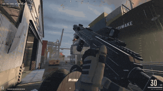
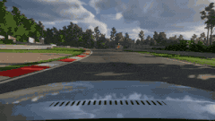
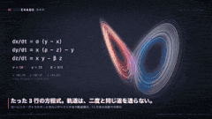
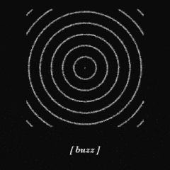

<h3>Things people built with Claude Fable 5.2 that you can actually open and play</h3>

**English** · [简体中文](README.zh-CN.md) · [繁體中文](README.zh-TW.md) · [日本語](README.ja.md) · [한국어](README.ko.md) · [Español](README.es.md) · [Português](README.pt-BR.md) · [Français](README.fr.md) · [Deutsch](README.de.md) · [Русский](README.ru.md)

**🌐 Browse on the web: [fablelist.000ooo.ooo](https://fablelist.000ooo.ooo/)** (searchable, a page for every work)

247 live works and 156 video demos built with Claude Fable 5.2, every link checked 2026-11-26. Updated daily; a ⭐ keeps it coming.

## 📑 Contents

[⭐ Most Loved](#-most-loved) · [🆕 Recent](#-recent) · [🎮 Games](#-games) 117 · [🌍 3D Worlds & Scenes](#-3d-worlds--scenes) 53 · [🧰 Web Pages & Tools](#-web-pages--tools) 58 · [🎬 Animation & Film (with source)](#-animation--film-with-source) 19 · [📺 Video-only Demos](#-video-only-demos) 156 · [🤝 Contributing](#-contributing)

## ⭐ Most Loved

<table>
<tr>
<td width="33%" valign="top">
 
<b><a href="https://starrynightrider.com">Starry Nightrider</a></b> 
<a href="https://x.com/ebbyamir">@ebbyamir</a> · ♥ 17.9k · <a href="https://x.com/ebbyamir/status/2120284261089673376">▶ Video</a> 
Van Gogh riding through his Starry Night, as a game. 
<a href="https://fablelist.000ooo.ooo/prompts/?w=starry-nightrider&ref=gh"><b>✨ Get the prompt</b></a>
</td>
<td width="33%" valign="top">
 
<b><a href="https://claude.ai/artifact/BGY1SztrAYcJQHSsnHHGmp">Saltline — first-person shooter</a></b> 
<a href="https://x.com/felixrieseberg">@felixrieseberg</a> · ♥ 15.1k · <a href="https://x.com/felixrieseberg/status/2119925633564463609">▶ Video</a> 
By an Anthropic engineer. One-shot prompts, no human feedback, 8 hours, ~$550. Models, sounds and textures all generated in code. 
<a href="https://fablelist.000ooo.ooo/prompts/?w=saltline-first-person-shooter&ref=gh"><b>✨ Get the prompt</b></a>
</td>
<td width="33%" valign="top">
 
<b><a href="https://viktorkav.com.br/apoio/uno-com-escada/fable/">Uno com Escada: a Fiat Uno with a ladder on a race circuit</a></b> 
<a href="https://x.com/ViktorKav">@ViktorKav</a> · ♥ 9.2k · <a href="https://x.com/ViktorKav/status/2122647483281015155">▶ Video</a> 
Drive a 1996 Uno Mille with a ladder on the roof around a circuit. One 603 KB HTML file with no engine, 3D library or textures; the car, forest, sky and engine sound all come from code. 
<a href="https://github.com/viktorkav/uno-com-escada">Source</a>
</td>
</tr>
<tr>
<td width="33%" valign="top">
 
<b><a href="https://patch.gg/blendi/oil-paint">Oil Paint — hand-painted game</a></b> 
<a href="https://x.com/BlendiByl">@BlendiByl</a> · ♥ 8.0k · <a href="https://x.com/BlendiByl/status/2120341251178594532">▶ Video</a> 
Made in under an hour. Every frame is about 1.5 million brush strokes, running at 200 fps in a browser tab. Open source. 
<a href="https://fablelist.000ooo.ooo/prompts/?w=oil-paint-hand-painted-game&ref=gh"><b>✨ Get the prompt</b></a>
</td>
<td width="33%" valign="top">
 
<b><a href="https://nyc.somethingbig.ai/">CROSSTOWN — open-world New York (early preview)</a></b> 
<a href="https://x.com/mattshumer_">@mattshumer_</a> · ♥ 7.5k · <a href="https://x.com/mattshumer_/status/2120282133503820150">▶ Video</a> 
"Rockstar took 8 years. Fable 5.2 is gonna do it in 7 days." Only part of the city is in so far; press B to send feedback. 
<a href="https://fablelist.000ooo.ooo/prompts/?w=crosstown-open-world-new-york-early-preview&ref=gh"><b>✨ Get the prompt</b></a>
</td>
<td width="33%" valign="top">
 
<b><a href="https://claude.ai/artifact/QGWUAjRrzRzZWGcQzSMLfa">Claude App on a Blender laptop</a></b> 
<a href="https://x.com/rileybrown">@rileybrown</a> · ♥ 7.1k · <a href="https://x.com/rileybrown/status/2119902109709537708">▶ Video</a> 
One prompt built the whole room in Blender and rendered it in 4K. This is the web page shown on the laptop screen. 
<a href="https://x.com/rileybrown/status/2119902109709537708">📝 Creator's prompt (free)</a>
</td>
</tr>
</table>

## 🆕 Recent

Posted in the last 3 days, sorted by likes.

<table>
<tr>
<td width="33%" valign="top">
 
<b><a href="https://kevintngo.github.io/procedural-rpg/">Brushwild: a procedural open-world RPG</a></b> 
🆕 · <a href="https://x.com/kevin_t_ngo">@kevin_t_ngo</a> · ♥ 2.5k · <a href="https://x.com/kevin_t_ngo/status/2125321244686029289">▶ Video</a> 
A procedural open-world action RPG in a single ~300kB HTML file. Every pixel is drawn by shaders in a pen and coloured-pencil style. Three classes, skill trees, loot, towns and dungeons, playable on desktop or phone. 
<a href="https://github.com/kevintngo/procedural-rpg">Source</a>
</td>
<td width="33%" valign="top">
 
<b><a href="https://kevintngo.github.io/cinderwatch/">Cinderwatch: a tower defense in a single HTML file</a></b> 
🆕 · <a href="https://x.com/kevin_t_ngo">@kevin_t_ngo</a> · ♥ 2.3k · <a href="https://x.com/kevin_t_ngo/status/2125119969109418333">▶ Video</a> 
A 3D isometric tower defense that fits in one HTML file. A built-in AI commander can run the defense for you. Open source and playable in the browser. 
<a href="https://github.com/kevintngo/cinderwatch">Source</a>
</td>
<td width="33%" valign="top">
 
<b><a href="https://littlecity.io">Little City: a hand-drawn city builder</a></b> 
🆕 · <a href="https://x.com/sprezzyyy">@sprezzyyy</a> · ♥ 983 · <a href="https://x.com/sprezzyyy/status/2125321545665192054">▶ Video</a> 
A sandbox city builder inspired by Townscaper. Place a few blocks, watch them turn into a hand-drawn town, then watch it come to life. Plays in the browser. 
<a href="https://github.com/yaoderek/littlecity.io">Source</a>
</td>
</tr>
</table>

## 🎮 Games

<table>
<tr>
<td width="33%" valign="top">
 
<b><a href="https://starrynightrider.com">Starry Nightrider</a></b> 
<a href="https://x.com/ebbyamir">@ebbyamir</a> · ♥ 17.9k · <a href="https://x.com/ebbyamir/status/2120284261089673376">▶ Video</a> 
Van Gogh riding through his Starry Night, as a game. 
<a href="https://fablelist.000ooo.ooo/prompts/?w=starry-nightrider&ref=gh"><b>✨ Get the prompt</b></a>
</td>
<td width="33%" valign="top">
 
<b><a href="https://claude.ai/artifact/BGY1SztrAYcJQHSsnHHGmp">Saltline — first-person shooter</a></b> 
<a href="https://x.com/felixrieseberg">@felixrieseberg</a> · ♥ 15.1k · <a href="https://x.com/felixrieseberg/status/2119925633564463609">▶ Video</a> 
By an Anthropic engineer. One-shot prompts, no human feedback, 8 hours, ~$550. Models, sounds and textures all generated in code. 
<a href="https://fablelist.000ooo.ooo/prompts/?w=saltline-first-person-shooter&ref=gh"><b>✨ Get the prompt</b></a>
</td>
<td width="33%" valign="top">
 
<b><a href="https://viktorkav.com.br/apoio/uno-com-escada/fable/">Uno com Escada: a Fiat Uno with a ladder on a race circuit</a></b> 
<a href="https://x.com/ViktorKav">@ViktorKav</a> · ♥ 9.2k · <a href="https://x.com/ViktorKav/status/2122647483281015155">▶ Video</a> 
Drive a 1996 Uno Mille with a ladder on the roof around a circuit. One 603 KB HTML file with no engine, 3D library or textures; the car, forest, sky and engine sound all come from code. 
<a href="https://github.com/viktorkav/uno-com-escada">Source</a>
</td>
</tr>
<tr>
<td width="33%" valign="top">
 
<b><a href="https://patch.gg/blendi/oil-paint">Oil Paint — hand-painted game</a></b> 
<a href="https://x.com/BlendiByl">@BlendiByl</a> · ♥ 8.0k · <a href="https://x.com/BlendiByl/status/2120341251178594532">▶ Video</a> 
Made in under an hour. Every frame is about 1.5 million brush strokes, running at 200 fps in a browser tab. Open source. 
<a href="https://fablelist.000ooo.ooo/prompts/?w=oil-paint-hand-painted-game&ref=gh"><b>✨ Get the prompt</b></a>
</td>
<td width="33%" valign="top">
 
<b><a href="https://nyc.somethingbig.ai/">CROSSTOWN — open-world New York (early preview)</a></b> 
<a href="https://x.com/mattshumer_">@mattshumer_</a> · ♥ 7.5k · <a href="https://x.com/mattshumer_/status/2120282133503820150">▶ Video</a> 
"Rockstar took 8 years. Fable 5.2 is gonna do it in 7 days." Only part of the city is in so far; press B to send feedback. 
<a href="https://fablelist.000ooo.ooo/prompts/?w=crosstown-open-world-new-york-early-preview&ref=gh"><b>✨ Get the prompt</b></a>
</td>
<td width="33%" valign="top">
 
<b><a href="https://omw-game.kimaki.dev">omw: a castle valley in oil brush strokes</a></b> 
<a href="https://x.com/__morse">@__morse</a> · ♥ 4.5k · <a href="https://x.com/__morse/status/2122013410309153042">▶ Video</a> 
The "omw" pixel-art post by @de5imulate rebuilt as a playable three.js game in the browser, rendered like an oil painting. 
<a href="https://github.com/remorses/castle-valley">Source</a>
</td>
</tr>
<tr>
<td width="33%" valign="top">
 
<b><a href="https://what-the-water-keeps.vercel.app/">What the Water Keeps</a></b> 
<a href="https://x.com/kevin_t_ngo">@kevin_t_ngo</a> · ♥ 4.3k · <a href="https://x.com/kevin_t_ngo/status/2119868968307695818">▶ Video</a> 
A boat ride through 8 dreamlike worlds, playable in the browser. 
<a href="https://fablelist.000ooo.ooo/prompts/?w=what-the-water-keeps&ref=gh"><b>✨ Get the prompt</b></a>
</td>
<td width="33%" valign="top">
 
<b><a href="https://tennis.sixfingerpunch.com/">Tennis</a></b> 
<a href="https://x.com/photonstorm">@photonstorm</a> · ♥ 3.1k · <a href="https://x.com/photonstorm/status/2120330010112434313">Post</a> 
Asked to "go wild" making a game, it returned what looks like a Pong clone — until you play it. 
<a href="https://fablelist.000ooo.ooo/prompts/?w=tennis&ref=gh"><b>✨ Get the prompt</b></a>
</td>
<td width="33%" valign="top">
 
<b><a href="https://patch.gg/play/blendi/small-magic">Small Magic — wizard sandbox</a></b> 
<a href="https://x.com/BlendiByl">@BlendiByl</a> · ♥ 2.6k · <a href="https://x.com/BlendiByl/status/2121594536153718972">▶ Video</a> 
Built in one day: 7 spells, about 1,800 destructible physics pieces, no models or textures, open source.
</td>
</tr>
<tr>
<td width="33%" valign="top">
 
<b><a href="https://kevintngo.github.io/procedural-rpg/">Brushwild: a procedural open-world RPG</a></b> 
🆕 · <a href="https://x.com/kevin_t_ngo">@kevin_t_ngo</a> · ♥ 2.5k · <a href="https://x.com/kevin_t_ngo/status/2125321244686029289">▶ Video</a> 
A procedural open-world action RPG in a single ~300kB HTML file. Every pixel is drawn by shaders in a pen and coloured-pencil style. Three classes, skill trees, loot, towns and dungeons, playable on desktop or phone. 
<a href="https://github.com/kevintngo/procedural-rpg">Source</a>
</td>
<td width="33%" valign="top">
 
<b><a href="https://www.spawn.co/@mattshumer/earth?room=local">Mirror Earth</a></b> 
<a href="https://x.com/mattshumer_">@mattshumer_</a> · ♥ 2.4k · <a href="https://x.com/mattshumer_/status/2119877065701036047">▶ Video</a> 
The whole planet as a destructible game world, with weather that matches the real Earth in real time. 
<a href="https://fablelist.000ooo.ooo/prompts/?w=mirror-earth&ref=gh"><b>✨ Get the prompt</b></a>
</td>
<td width="33%" valign="top">
 
<b><a href="https://kevintngo.github.io/cinderwatch/">Cinderwatch: a tower defense in a single HTML file</a></b> 
🆕 · <a href="https://x.com/kevin_t_ngo">@kevin_t_ngo</a> · ♥ 2.3k · <a href="https://x.com/kevin_t_ngo/status/2125119969109418333">▶ Video</a> 
A 3D isometric tower defense that fits in one HTML file. A built-in AI commander can run the defense for you. Open source and playable in the browser. 
<a href="https://github.com/kevintngo/cinderwatch">Source</a>
</td>
</tr>
<tr>
<td width="33%" valign="top">
 
<b><a href="https://portals-endless-worlds.netlify.app/">Portals: Endless Worlds</a></b> 
<a href="https://x.com/emollick">@emollick</a> · ♥ 1.9k · <a href="https://x.com/emollick/status/2119918307457577163">▶ Video</a> 
25,000 agents built 450+ code-only 3D worlds inspired by books, art and places, linked by portals you drift through. 
<a href="https://github.com/emollick/ai-portals">Source</a> · <a href="https://www.oneusefulthing.org/p/fable-52-and-jagged-agi">Essay</a> 
<a href="https://fablelist.000ooo.ooo/prompts/?w=portals-endless-worlds&ref=gh"><b>✨ Get the prompt</b></a>
</td>
<td width="33%" valign="top">
 
<b><a href="https://evensong-phi.vercel.app/">Evensong</a></b> 
<a href="https://x.com/kevin_t_ngo">@kevin_t_ngo</a> · ♥ 1.8k · <a href="https://x.com/kevin_t_ngo/status/2120238844754923874">▶ Video</a> 
A dark-fantasy souls-like boss fight, playable in the browser. 
<a href="https://fablelist.000ooo.ooo/prompts/?w=evensong&ref=gh"><b>✨ Get the prompt</b></a>
</td>
<td width="33%" valign="top">
 
<b><a href="https://loktar00.github.io/lanternfall/">LANTERNFALL</a></b> 
<a href="https://x.com/loktar00">@loktar00</a> · ♥ 1.4k · <a href="https://x.com/loktar00/status/2120192761542615271">▶ Video</a> 
The whole game — animations, models, everything — generated by Fable. Watch the effect when enemies die. 
<a href="https://fablelist.000ooo.ooo/prompts/?w=lanternfall&ref=gh"><b>✨ Get the prompt</b></a>
</td>
</tr>
<tr>
<td width="33%" valign="top">
 
<b><a href="https://app.usecrayon.ai/play/76dbd04f-0684-4486-8cc4-eae0585295e8">Goku: Four-Star Road</a></b> 
<a href="https://x.com/aniketjart">@aniketjart</a> · ♥ 1.4k · <a href="https://x.com/aniketjart/status/2121793239175119279">▶ Video</a> 
A fan action game based on Dragon Ball's Red Ribbon Army saga, built with three.js. A work in progress; the first two maps are playable.
</td>
<td width="33%" valign="top">
 
<b><a href="https://heat.pplx.app">VICE '86: open-world driving in a neon 1986 Miami</a></b> 
<a href="https://x.com/AravSrinivas">@AravSrinivas</a> · ♥ 1.3k · <a href="https://x.com/AravSrinivas/status/2122338465648103676">▶ Video</a> 
An open-world driving game that runs in the browser. No game engine and no three.js: it has its own WebGL2 renderer, and the city, cars, rain and engine sounds are all generated by code, about 63,000 lines of JavaScript.
</td>
<td width="33%" valign="top">
 
<b><a href="https://op7418.github.io/guizang-game-skill/">Mist-Locked Mountain Gate — 3D action game</a></b> 
<a href="https://x.com/op7418">@op7418</a> · ♥ 1.2k · <a href="https://x.com/op7418/status/2120694045299327187">▶ Video</a> 
One afternoon, 4.5 billion tokens. Models, scenes and moves all by Fable, packed into a single 30 MB HTML file. 
<a href="https://fablelist.000ooo.ooo/prompts/?w=mist-locked-mountain-gate-3d-action-game&ref=gh"><b>✨ Get the prompt</b></a>
</td>
</tr>
<tr>
<td width="33%" valign="top">
 
<b><a href="https://wavedash.com/games/rooftop-rally">Rooftop Rally — pickleball in Unreal 5.9</a></b> 
<a href="https://x.com/chongdashu">@chongdashu</a> · ♥ 1.1k · <a href="https://x.com/chongdashu/status/2120154573356793883">▶ Video</a> 
Fable 5.2 with the Unreal Engine 5.9 preview. Characters from Tripo; the other 3D assets and the rest by Fable. 
<a href="https://x.com/chongdashu/status/2120310120509014219">How it was built</a> 
<a href="https://fablelist.000ooo.ooo/prompts/?w=rooftop-rally-pickleball-in-unreal-5-9&ref=gh"><b>✨ Get the prompt</b></a>
</td>
<td width="33%" valign="top">
 
<b><a href="https://gtashenzhen.com">GTA Shenzhen</a></b> 
<a href="https://x.com/KinGao476942">@KinGao476942</a> · ♥ 1.0k · <a href="https://x.com/KinGao476942/status/2123967104601014521">▶ Video</a> 
The whole city of Shenzhen built from OpenStreetMap data: 83,182 buildings and 62,088 roads. Fly over it, land and drive a car, search for any place, and set off a city-wide light show at night. Made with Fable 5.2 and Tripo in three days.
</td>
<td width="33%" valign="top">
 
<b><a href="https://littlecity.io">Little City: a hand-drawn city builder</a></b> 
🆕 · <a href="https://x.com/sprezzyyy">@sprezzyyy</a> · ♥ 983 · <a href="https://x.com/sprezzyyy/status/2125321545665192054">▶ Video</a> 
A sandbox city builder inspired by Townscaper. Place a few blocks, watch them turn into a hand-drawn town, then watch it come to life. Plays in the browser. 
<a href="https://github.com/yaoderek/littlecity.io">Source</a>
</td>
</tr>
<tr>
<td width="33%" valign="top">
 
<b><a href="https://thaxnay.com/ramayana/">Ramayana: The Sacred Fires</a></b> 
<a href="https://x.com/Thaxnay">@Thaxnay</a> · ♥ 980 · <a href="https://x.com/Thaxnay/status/2124574054296219939">▶ Video</a> 
A third-person action-adventure where you play as Rama, cross an open valley, protect the sages and find secrets. Runs in the browser on desktop and mobile.
</td>
<td width="33%" valign="top">
 
<b><a href="https://claude.ai/artifact/MXxb36zKgN261ckbGhmNin">Three Games (Saltline · The Clockmaker's Heart · Tidewright)</a></b> 
<a href="https://x.com/felixrieseberg">@felixrieseberg</a> · ♥ 802 · <a href="https://x.com/vineerpasam/status/2119955306096857145">▶ Video</a> 
Signed by Felix Rieseberg: "All games made with Claude Fable 5.2. First drafts, no human feedback." The most-shared link of launch day. 
<a href="https://claude.ai/artifact/6MjtQjf4ee1ZZjEpafaEpa">The Clockmaker's Heart</a> · <a href="https://claude.ai/artifact/JTgyEMn7sn1q2riWrMb7D4">Tidewright</a> 
<a href="https://fablelist.000ooo.ooo/prompts/?w=three-games-saltline-the-clockmaker-s-heart-tidewright&ref=gh"><b>✨ Get the prompt</b></a>
</td>
<td width="33%" valign="top">
 
<b><a href="https://patch.gg/play/blendi/solar">Solar: a tiny solar system you can fly around</a></b> 
<a href="https://x.com/BlendiByl">@BlendiByl</a> · ♥ 800 · <a href="https://x.com/BlendiByl/status/2122673770607591855">▶ Video</a> 
Inspired by Outer Wilds: real orbits and gravity, unbroken flights between planets, and every world drawn by code. Open source.
</td>
</tr>
</table>

<b><a href="all/games.md">See all 117 →</a></b>

<a href="#-contents">↑ Back to contents</a>

## 🌍 3D Worlds & Scenes

<table>
<tr>
<td width="33%" valign="top">
 
<b><a href="https://claude.ai/artifact/QGWUAjRrzRzZWGcQzSMLfa">Claude App on a Blender laptop</a></b> 
<a href="https://x.com/rileybrown">@rileybrown</a> · ♥ 7.1k · <a href="https://x.com/rileybrown/status/2119902109709537708">▶ Video</a> 
One prompt built the whole room in Blender and rendered it in 4K. This is the web page shown on the laptop screen. 
<a href="https://x.com/rileybrown/status/2119902109709537708">📝 Creator's prompt (free)</a>
</td>
<td width="33%" valign="top">
 
<b><a href="https://xikhar.github.io/papertrails/">Papertrails: an endless pop-up paper world</a></b> 
<a href="https://x.com/xikhar">@xikhar</a> · ♥ 2.4k · <a href="https://x.com/xikhar/status/2122682962647122403">▶ Video</a> 
A paper figure walks on while trees, houses and hills fold up from the ground like a pop-up book, through desert, snow, forest and day and night. Built with Fable 5.2, Opus 5.5 and three.js. 
<a href="https://github.com/xikhar/papertrails">Source</a>
</td>
<td width="33%" valign="top">
 
<b><a href="https://patch.gg/blendi/painted-valley">Painted Valley</a></b> 
<a href="https://x.com/BlendiByl">@BlendiByl</a> · ♥ 1.8k · <a href="https://x.com/BlendiByl/status/2120694003230560585">▶ Video</a> 
A Ghibli-inspired hand-painted valley you can walk through. Open source. 
<a href="https://fablelist.000ooo.ooo/prompts/?w=painted-valley&ref=gh"><b>✨ Get the prompt</b></a>
</td>
</tr>
<tr>
<td width="33%" valign="top">
 
<b><a href="https://april-zhu.com/pocketcity">Pocket City</a></b> 
<a href="https://x.com/Aprilzz423">@Aprilzz423</a> · ♥ 1.3k · <a href="https://x.com/Aprilzz423/status/2123788440714260673">▶ Video</a> 
Turns any street corner into a tiny hand-drawn city you can spin around and explore, measured from OpenStreetMap with local weather and seasons. Built with Fable 5.2 and GPT-6.2 Astra.
</td>
<td width="33%" valign="top">
 
<b><a href="https://claude.ai/artifact/CTjrZXVdUgKJ6qJXrvvr28">Ancient Babylon, 600 BC</a></b> 
<a href="https://x.com/literallydenis">@literallydenis</a> · ♥ 1.2k · <a href="https://x.com/literallydenis/status/2120866958790848953">▶ Video</a> 
Babylon rebuilt from historical documents and plans it found itself, over an 8-hour run. Walk around freely. 
<a href="https://fablelist.000ooo.ooo/prompts/?w=ancient-babylon-600-bc&ref=gh"><b>✨ Get the prompt</b></a>
</td>
<td width="33%" valign="top">
 
<b><a href="https://indiranagar-live.vercel.app">1 km² of Indiranagar</a></b> 
<a href="https://x.com/anshu4321">@anshu4321</a> · ♥ 1.2k · <a href="https://x.com/anshu4321/status/2119938067758772403">▶ Video</a> 
A live 3D slice of Bengaluru from map data and one prompt. 
<a href="https://fablelist.000ooo.ooo/prompts/?w=1-km2-of-indiranagar&ref=gh"><b>✨ Get the prompt</b></a>
</td>
</tr>
<tr>
<td width="33%" valign="top">
 
<b><a href="https://fable-rome.surge.sh/">Rome, AD 320</a></b> 
<a href="https://x.com/petergostev">@petergostev</a> · ♥ 977 · <a href="https://x.com/petergostev/status/2120167560700383572">▶ Video</a> 
One prompt, Fable 5.2 (Max) running overnight, $2,618. 
<a href="https://x.com/petergostev/status/2120167560700383572">📝 Creator's prompt (free)</a>
</td>
<td width="33%" valign="top">
 
<b><a href="https://github.com/Leonxlnx/room-at-dawn">Room at Dawn</a></b> 
<a href="https://x.com/LexnLin">@LexnLin</a> · ♥ 856 · <a href="https://x.com/LexnLin/status/2120910879361548565">▶ Video</a> 
A photoreal bedroom in three.js with no pre-made models or textures; everything is code. 
<a href="https://fablelist.000ooo.ooo/prompts/?w=room-at-dawn&ref=gh"><b>✨ Get the prompt</b></a>
</td>
<td width="33%" valign="top">
 
<b><a href="https://fable-rover.vercel.app">ER-6 Terrain Explorer — a self-driving Mars rover</a></b> 
<a href="https://x.com/DilumSanjaya">@DilumSanjaya</a> · ♥ 829 · <a href="https://x.com/DilumSanjaya/status/2120561077385867663">▶ Video</a> 
Fable 5.2 designed a rocker-bogie suspension like NASA's Mars rovers, then simulated it driving over alien terrain.
</td>
</tr>
<tr>
<td width="33%" valign="top">
 
<b><a href="https://ship-42-catch.netlify.app/">Ship 42 Catch</a></b> 
<a href="https://x.com/emollick">@emollick</a> · ♥ 738 · <a href="https://x.com/emollick/status/2122036763468214711">▶ Video</a> 
Fable and Opus found footage of the Starship tower catch and rebuilt the last 40 seconds in detailed three.js 3D. You can switch camera views.
</td>
<td width="33%" valign="top">
 
<b><a href="https://patch.gg/play/blendi/the-blue-hour">The Blue Hour — an art deco city at night</a></b> 
<a href="https://x.com/BlendiByl">@BlendiByl</a> · ♥ 638 · <a href="https://x.com/BlendiByl/status/2124439671006748853">▶ Video</a> 
A 3D scene in the art deco style of the animated Batman series, all drawn in code. Open source.
</td>
<td width="33%" valign="top">
 
<b><a href="https://supernatural-ft.vercel.app/fire-in-ice">Fire in Ice</a></b> 
<a href="https://x.com/tkm_hmng8">@tkm_hmng8</a> · ♥ 549 · <a href="https://x.com/tkm_hmng8/status/2120813043101946324">▶ Video</a> 
Realistic fire burning inside ice, written in raw WebGPU without three.js. 
<a href="https://fablelist.000ooo.ooo/prompts/?w=fire-in-ice&ref=gh"><b>✨ Get the prompt</b></a>
</td>
</tr>
<tr>
<td width="33%" valign="top">
 
<b><a href="https://github.com/Leonxlnx/walking-block">Walking Block: a walking Soviet apartment block</a></b> 
<a href="https://x.com/LexnLin">@LexnLin</a> · ♥ 417 · <a href="https://x.com/LexnLin/status/2122359035751989341">▶ Video</a> 
A huge Soviet panel block on eight mechanical legs crossing a wet field in dusk fog. Geometry, textures and shaders are all three.js code, and a 45-second film is rendered from the same scene.
</td>
<td width="33%" valign="top">
 
<b><a href="https://bay.theojaffee.net">Bay Area Through Time</a></b> 
<a href="https://x.com/theojaffee">@theojaffee</a> · ♥ 388 · <a href="https://x.com/theojaffee/status/2120312766544437738">▶ Video</a> 
Zoom to any city or neighborhood, pick any year back to 1769 and see what it looked like. 
<a href="https://nyc.theojaffee.net">New York City</a> 
<a href="https://fablelist.000ooo.ooo/prompts/?w=bay-area-through-time&ref=gh"><b>✨ Get the prompt</b></a>
</td>
<td width="33%" valign="top">
 
<b><a href="http://procedural-arm-rig.vercel.app">Procedural Arm Rig</a></b> 
<a href="https://x.com/apekshik">@apekshik</a> · ♥ 326 · <a href="https://x.com/apekshik/status/2120224530367119758">▶ Video</a> 
Instead of one-shotting a AAA game: a single arm with bone armature, weight-painted mesh, IK, and muscles that swell as the fist tightens. 
<a href="https://fablelist.000ooo.ooo/prompts/?w=procedural-arm-rig&ref=gh"><b>✨ Get the prompt</b></a>
</td>
</tr>
<tr>
<td width="33%" valign="top">
 
<b><a href="https://samg-coder.github.io/solstice-garden/">The Garden</a></b> 
<a href="https://x.com/SamGCoder">@SamGCoder</a> · ♥ 297 · <a href="https://x.com/SamGCoder/status/2120943068321054975">▶ Video</a> 
A garden scene written in Rust, compiled to WASM and rendered with WebGPU. 
<a href="https://fablelist.000ooo.ooo/prompts/?w=the-garden&ref=gh"><b>✨ Get the prompt</b></a>
</td>
<td width="33%" valign="top">
 
<b><a href="http://taoistvibe.com">Chill Taoist Vibe: a Taoist temple hill</a></b> 
<a href="https://x.com/qiqileyuan">@qiqileyuan</a> · ♥ 252 · <a href="https://x.com/qiqileyuan/status/2122006851298693277">▶ Video</a> 
A Ghibli-style Taoist temple on a small mountain. Follow the old priest uphill, burn incense, draw a fortune stick, meditate, or just sit in the rocking chair and watch the seasons change. Statues and the main character come from Tripo3D; everything else is generated code.
</td>
<td width="33%" valign="top">
 
<b><a href="https://butterfly.kyzo.io">Hidden Layers: a glasswing butterfly in a glasshouse</a></b> 
<a href="https://x.com/ky__zo">@ky__zo</a> · ♥ 229 · <a href="https://x.com/ky__zo/status/2122274109795054036">▶ Video</a> 
Scroll to fly a glasswing butterfly that cannot get out of a glasshouse through six worlds. Pure three.js with no model files or textures; it took 1.32 billion tokens and $905 in API cost.
</td>
</tr>
<tr>
<td width="33%" valign="top">
 
<b><a href="https://claude.ai/artifact/R6YBDkAm2GjAC5A65D9djx">A Claude demo you can walk into</a></b> 
<a href="https://x.com/dfeinition">@dfeinition</a> · ♥ 215 · <a href="https://x.com/dfeinition/status/2120330644261589051">▶ Video</a> 
Inspired by @rileybrown: walk in and sit at any computer. 
<a href="https://fablelist.000ooo.ooo/prompts/?w=a-claude-demo-you-can-walk-into&ref=gh"><b>✨ Get the prompt</b></a>
</td>
<td width="33%" valign="top">
 
<b><a href="https://claude.ai/artifact/2PBXuQAnWDS2NpiPXHNLfL">Orca Jelly</a></b> 
<a href="https://x.com/vib3coded">@vib3coded</a> · ♥ 204 · <a href="https://x.com/vib3coded/status/2119951060752375827">▶ Video</a> 
A soft-body gummy orca material study. Opus 5.5's version is linked for comparison. 
<a href="https://claude.ai/artifact/75KLotWzZQ5RR23BGLePb8">Opus 5.5 version</a> 
<a href="https://x.com/vib3coded/status/2119951060752375827">📝 Creator's prompt (free)</a>
</td>
<td width="33%" valign="top">
 
<b><a href="https://planet.tokyoaivisuals.club/">Code Planet</a></b> 
<a href="https://x.com/KanaWorks_AI">@KanaWorks_AI</a> · ♥ 198 · <a href="https://x.com/KanaWorks_AI/status/2121413647213932688">▶ Video</a> 
A whole planet in under 320KB of code. Fly from the sea and meadows through cherry blossoms up into space, right in the browser.
</td>
</tr>
<tr>
<td width="33%" valign="top">
 
<b><a href="https://zalo.github.io/LanternTown/town/">LanternTown: a lantern-lit town square</a></b> 
🆕 · <a href="https://x.com/makeshifted">@makeshifted</a> · ♥ 183 · <a href="https://x.com/makeshifted/status/2125331267512377844">Post</a> 
An experimental three.js town square. Every asset is parametrically defined and the lighting is baked into vertex colors, so it runs light. 
<a href="https://github.com/zalo/LanternTown">Source</a>
</td>
<td width="33%" valign="top">
 
<b><a href="https://claude.ai/artifact/9EgZpErM17kH2a9Q3WXW6f">Voxel World in a Bottle</a></b> 
<a href="https://x.com/vib3coded">@vib3coded</a> · ♥ 163 · <a href="https://x.com/vib3coded/status/2120104517282775514">▶ Video</a> 
30 minutes, $12.81. 
<a href="https://x.com/vib3coded/status/2120104517282775514">📝 Creator's prompt (free)</a>
</td>
<td width="33%" valign="top">
 
<b><a href="https://github.com/Leonxlnx/beautiful-wonderland">Beautiful Wonderland</a></b> 
<a href="https://x.com/LexnLin">@LexnLin</a> · ♥ 147 · <a href="https://x.com/LexnLin/status/2122056542778535977">▶ Video</a> 
A small painted world in three.js, plus a 40-second 4K film rendered from it.
</td>
</tr>
</table>

<b><a href="all/3d-worlds.md">See all 53 →</a></b>

<a href="#-contents">↑ Back to contents</a>

## 🧰 Web Pages & Tools

<table>
<tr>
<td width="33%" valign="top">
 
<b><a href="https://claudia.gallery">Claudia Gallery</a></b> 
<a href="https://x.com/anabology">@anabology</a> · ♥ 5.6k · <a href="https://x.com/anabology/status/2120010995309457643">▶ Video</a> 
"Make the video of your dreams" — two shots, 9 hours. 
<a href="https://fablelist.000ooo.ooo/prompts/?w=claudia-gallery&ref=gh"><b>✨ Get the prompt</b></a>
</td>
<td width="33%" valign="top">
 
<b><a href="http://robotics-lab-app.vercel.app">Robotics Lab</a></b> 
<a href="https://x.com/0xMovez">@0xMovez</a> · ♥ 4.7k · <a href="https://x.com/0xMovez/status/2120239217880268919">▶ Video</a> 
Eight real boards (Arduino Uno, Raspberry Pi 4…) in 3D: place chips, solder them in, wire real circuits. 
<a href="http://robolabs-app.vercel.app">Humanoid edition</a> 
<a href="https://fablelist.000ooo.ooo/prompts/?w=robotics-lab&ref=gh"><b>✨ Get the prompt</b></a>
</td>
<td width="33%" valign="top">
 
<b><a href="https://claude.ai/artifact/N6bSgS4ZH5ifFQfg8sm4dv">House Bangers generator</a></b> 
<a href="https://x.com/deedydas">@deedydas</a> · ♥ 4.1k · <a href="https://x.com/deedydas/status/2120905625852936318">▶ Video</a> 
It learned music theory, tries thousands of patterns per instrument and arranges the best into a 72-bar house track. Sound on. 
<a href="https://fablelist.000ooo.ooo/prompts/?w=house-bangers-generator&ref=gh"><b>✨ Get the prompt</b></a>
</td>
</tr>
<tr>
<td width="33%" valign="top">
 
<b><a href="https://miaai-lab.github.io/Claude-Fable-5.2-HTML-Files/">76 single-file HTML pieces</a></b> 
<a href="https://x.com/MiaAI_lab">@MiaAI_lab</a> · ♥ 2.6k · <a href="https://x.com/MiaAI_lab/status/2119930229661503893">Post</a> 
Generative art, physics, type and UI, each with its original prompt. 
<a href="https://fablelist.000ooo.ooo/prompts/?w=76-single-file-html-pieces&ref=gh"><b>✨ Get the prompt</b></a>
</td>
<td width="33%" valign="top">
 
<b><a href="https://pixel-worlds.vercel.app/keep/">Keep — password strength meter</a></b> 
<a href="https://x.com/crtvTeknologist">@crtvTeknologist</a> · ♥ 1.6k · <a href="https://x.com/crtvTeknologist/status/2119894073024606617">▶ Video</a> 
A password strength indicator rendered as a living pixel world. 
<a href="https://github.com/finktheartist/pixel-worlds">Source</a> 
<a href="https://fablelist.000ooo.ooo/prompts/?w=keep-password-strength-meter&ref=gh"><b>✨ Get the prompt</b></a>
</td>
<td width="33%" valign="top">
 
<b><a href="https://sakuga-vfx.vercel.app">Sakuga Set</a></b> 
<a href="https://x.com/crtvTeknologist">@crtvTeknologist</a> · ♥ 1.4k · <a href="https://x.com/crtvTeknologist/status/2122088829565698218">▶ Video</a> 
Twelve UI controls that react like anime: buttons squash and land with a DON!, toggles smear and splash, sliders kick up clouds. Every effect is drawn in code, one file each, no dependencies. 
<a href="https://github.com/finktheartist/sakuga-vfx">Source</a>
</td>
</tr>
<tr>
<td width="33%" valign="top">
 
<b><a href="https://hashem-al-ghaili.github.io/xray-mirror/">X-Ray Mirror</a></b> 
<a href="https://x.com/HashemGhaili">@HashemGhaili</a> · ♥ 1.4k · <a href="https://x.com/HashemGhaili/status/2120202746121085321">▶ Video</a> 
Point a webcam at your face and see the skull, brain and muscles, tracked live. Open your mouth and the jaw opens; the video never leaves your computer. 
<a href="https://github.com/Hashem-Al-Ghaili/xray-mirror">Source</a> 
<a href="https://fablelist.000ooo.ooo/prompts/?w=x-ray-mirror&ref=gh"><b>✨ Get the prompt</b></a>
</td>
<td width="33%" valign="top">
 
<b><a href="https://xianxie6.github.io/animals-planner-2027/">Animals at Work — 3D planner</a></b> 
<a href="https://x.com/Xian0063">@Xian0063</a> · ♥ 1.2k · <a href="https://x.com/Xian0063/status/2120417834694250522">▶ Video</a> 
A paper planner rebuilt in 3D: drag to turn pages, tap a date to write, 90 stickers you can peel and stick. Opus 5.5 built the skeleton; Fable 5.2 refined materials against real footage. 
<a href="https://fablelist.000ooo.ooo/prompts/?w=animals-at-work-3d-planner&ref=gh"><b>✨ Get the prompt</b></a>
</td>
<td width="33%" valign="top">
 
<b><a href="https://uberdesigner.ai/t/spine-menu">Spine Menu</a></b> 
<a href="https://x.com/seanaiux">@seanaiux</a> · ♥ 1.2k · <a href="https://x.com/seanaiux/status/2120222459110789574">▶ Video</a> 
"Have you ever seen a menu that looks better?" The page includes the prompt. 
<a href="https://uberdesigner.ai/t/aquarium-toggle">Aquarium toggle</a> · <a href="https://uberdesigner.ai/t/glow-widgets">Glow widgets</a>
</td>
</tr>
<tr>
<td width="33%" valign="top">
 
<b><a href="https://roverkit.vercel.app">RoverKit — build and simulate a robot car</a></b> 
<a href="https://x.com/DilumSanjaya">@DilumSanjaya</a> · ♥ 1.2k · <a href="https://x.com/DilumSanjaya/status/2121286147393651085">▶ Video</a> 
A step-by-step guide to building a robot car, with a simulator, a customizable arena and a visual code walkthrough. Supports Arduino and ESP32.
</td>
<td width="33%" valign="top">
 
<b><a href="https://github.com/AlexAtFF/pulp-daw-public">PULP — an AI-native DAW</a></b> 
<a href="https://x.com/The_Alex">@The_Alex</a> · ♥ 948 · <a href="https://x.com/The_Alex/status/2119917226769985785">▶ Video</a> 
A native Windows digital audio workstation. Ask Claude for music and it opens the DAW and makes the song. 
<a href="https://fablelist.000ooo.ooo/prompts/?w=pulp-an-ai-native-daw&ref=gh"><b>✨ Get the prompt</b></a>
</td>
<td width="33%" valign="top">
 
<b><a href="https://frontier.every.to/experiments/ambient-town">Ambient Town</a></b> 
<a href="https://x.com/kieranklaassen">@kieranklaassen</a> · ♥ 896 · <a href="https://x.com/kieranklaassen/status/2119868196773929160">▶ Video</a> 
An ambient DAW built over a week of nights by a former film composer: Ableton Push support, mics, effects, a synth and an agent that composes with you. Click "Try it" on the page. 
<a href="https://fablelist.000ooo.ooo/prompts/?w=ambient-town&ref=gh"><b>✨ Get the prompt</b></a>
</td>
</tr>
<tr>
<td width="33%" valign="top">
 
<b><a href="https://hexagonal.earth">Hexagonal Earth</a></b> 
<a href="https://x.com/avsa">@avsa</a> · ♥ 757 · <a href="https://x.com/avsa/status/2123123638551392755">Post</a> 
A hexagon-based diorama of the whole world built from real elevation, ocean depth, humidity, wind and river data. Fable 5.2 generated hundreds of small 3D pixel-splat objects and placed them in the scene itself.
</td>
<td width="33%" valign="top">
 
<b><a href="https://itspsneha.com/supplements">Which Vitamins to Buy in India</a></b> 
<a href="https://x.com/itspsneha">@itspsneha</a> · ♥ 737 · <a href="https://x.com/itspsneha/status/2120048494761451974">Post</a> 
Built after reading lab reports for 109 tested batches. 
<a href="https://fablelist.000ooo.ooo/prompts/?w=which-vitamins-to-buy-in-india&ref=gh"><b>✨ Get the prompt</b></a>
</td>
<td width="33%" valign="top">
 
<b><a href="https://v2.video/riley/the-history-of-writing/v1">The History of Writing</a></b> 
<a href="https://x.com/rileybrown">@rileybrown</a> · ♥ 667 · <a href="https://x.com/rileybrown/status/2119946022767980985">▶ Video</a> 
An interactive film from one prompt; prompt and files shared. 
<a href="https://x.com/rileybrown/status/2119946022767980985">📝 Creator's prompt (free)</a>
</td>
</tr>
<tr>
<td width="33%" valign="top">
 
<b><a href="https://auden-english-135.netlify.app/">Auden's lost 1941 poetry class, reconstructed</a></b> 
<a href="https://x.com/emollick">@emollick</a> · ♥ 594 · <a href="https://x.com/emollick/status/2121641417483169934">Post</a> 
Fable 5.2 rebuilt W. H. Auden's "hardest in the humanities" class from an obscure Internet Archive book and scattered notes.
</td>
<td width="33%" valign="top">
 
<b><a href="https://omage1.xyz">omage-1: the OP-1 Field synth in a browser</a></b> 
<a href="https://x.com/jamesmbickerton">@jamesmbickerton</a> · ♥ 572 · <a href="https://x.com/jamesmbickerton/status/2122688041219133815">▶ Video</a> 
An unofficial homage that rebuilds Teenage Engineering's OP-1 Field as a browser app you can play right away.
</td>
<td width="33%" valign="top">
 
<b><a href="https://claude.ai/artifact/4P1urBdptp6gWiJo3R6Vpv">Breakcore video sampler</a></b> 
<a href="https://x.com/parhelion318">@parhelion318</a> · ♥ 544 · <a href="https://x.com/parhelion318/status/2122723067533398064">▶ Video</a> 
A browser sampler that chops video clips and rearranges them into breakcore rhythms.
</td>
</tr>
<tr>
<td width="33%" valign="top">
 
<b><a href="https://www.bubbbly.com/christmas-cards">Christmas Cards: interactive Christmas cards</a></b> 
<a href="https://x.com/ann_nnng">@ann_nnng</a> · ♥ 482 · <a href="https://x.com/ann_nnng/status/2122283549000712249">▶ Video</a> 
A set of interactive Christmas cards, such as a cat in a red scarf on a windowsill watching the snow fall.
</td>
<td width="33%" valign="top">
 
<b><a href="https://claude.ai/artifact/8yKUbL5KQgvfqcWH6UgZrq">Kastle Sim</a></b> 
<a href="https://x.com/parhelion318">@parhelion318</a> · ♥ 466 · <a href="https://x.com/parhelion318/status/2123344270732202421">▶ Video</a> 
A browser simulation of the Bastl Kastle mini modular synth: patch the cables, turn the knobs and it makes sound.
</td>
<td width="33%" valign="top">
 
<b><a href="https://where-is-everybody-fermi.netlify.app/">Where Is Everybody?</a></b> 
<a href="https://x.com/emollick">@emollick</a> · ♥ 457 · <a href="https://x.com/emollick/status/2120359214157603139">Post</a> 
Asked to "solve the Fermi Paradox": it marshals data, tests hypotheses and pressure-tests them against critics. 
<a href="https://resolving-the-great-silence.netlify.app/">Gemini Carbon version</a> 
<a href="https://x.com/emollick/status/2120359214157603139">📝 Creator's prompt (free)</a>
</td>
</tr>
<tr>
<td width="33%" valign="top">
 
<b><a href="https://gsplan.org">Galatasaray seat view</a></b> 
<a href="https://x.com/molenbeek84">@molenbeek84</a> · ♥ 429 · <a href="https://x.com/molenbeek84/status/2120847639411331097">Post</a> 
See the view of the pitch from every block at RAMS Park before you buy a ticket. 
<a href="https://fablelist.000ooo.ooo/prompts/?w=galatasaray-seat-view&ref=gh"><b>✨ Get the prompt</b></a>
</td>
<td width="33%" valign="top">
 
<b><a href="https://rubber-hose-ui.vercel.app">Rubber Hose UI: controls as 1930s cartoon characters</a></b> 
<a href="https://x.com/crtvTeknologist">@crtvTeknologist</a> · ♥ 357 · <a href="https://x.com/crtvTeknologist/status/2122433522166124616">▶ Video</a> 
Eleven web controls drawn as rubber-hose cartoons: the slider is a trombone, the toast is a toaster, and the button gets a black eye each press. Vanilla JS and canvas, no dependencies, open source. 
<a href="https://github.com/finktheartist/rubber-hose-ui">Source</a>
</td>
<td width="33%" valign="top">
 
<b><a href="https://bigfatfish.cc">Big Fat Fish's Tank</a></b> 
<a href="https://x.com/dafeifish">@dafeifish</a> · ♥ 264 · <a href="https://x.com/dafeifish/status/2123395143873019950">Post</a> 
A personal site redesigned as a scrapbook: paper scraps, tape, sticky notes and Polaroids pinned on a deep-blue night sky.
</td>
</tr>
</table>

<b><a href="all/web-and-tools.md">See all 58 →</a></b>

<a href="#-contents">↑ Back to contents</a>

## 🎬 Animation & Film (with source)

<table>
<tr>
<td width="33%" valign="top">
 
<b><a href="https://github.com/ChetasLua/crimson-loong">Crimson Loong</a></b> 
<a href="https://x.com/chetaslua">@chetaslua</a> · ♥ 3.8k · <a href="https://x.com/chetaslua/status/2121176151234330707">▶ Video</a> 
A 90-second dragon film in three.js, pure code with no external assets. 
<a href="https://fablelist.000ooo.ooo/prompts/?w=crimson-loong&ref=gh"><b>✨ Get the prompt</b></a>
</td>
<td width="33%" valign="top">
 
<b><a href="https://github.com/BubbleBrainBB/awesome-fable-5.2/tree/main/cat-garden">Cat Garden: a botanical garden through a cat's eyes</a></b> 
<a href="https://x.com/BubbleBrain">@BubbleBrain</a> · ♥ 1.4k · <a href="https://x.com/BubbleBrain/status/2122313967473434639">▶ Video</a> 
A 110-second one-shot film of a cat walking, sniffing and pouncing through a botanical garden. The picture comes from a path tracer written for it and the sound is synthesised with numpy, with no assets.
</td>
<td width="33%" valign="top">
 
<b><a href="https://github.com/moritzkremb/robovac-pov">Robovac POV: a lifelike film from a robot vacuum's view</a></b> 
<a href="https://x.com/moritzkremb">@moritzkremb</a> · ♥ 463 · <a href="https://x.com/moritzkremb/status/2122702891819377117">▶ Video</a> 
A 53-second film made only with code: a world written in C++, a custom GPU path tracer, a simulated camera with focus, motion blur and grain, a rug of about 900,000 fibres, and sound synthesized in Python.
</td>
</tr>
<tr>
<td width="33%" valign="top">
 
<b><a href="https://github.com/amirmushichge/shred-kit">Shred Kit paper-shred template</a></b> 
<a href="https://x.com/AmirMushich">@AmirMushich</a> · ♥ 436 · <a href="https://x.com/AmirMushich/status/2121339167800213934">▶ Video</a> 
An 8-second paper-shred reel made with Fable 5.2 and Blender, shared as a free template.
</td>
<td width="33%" valign="top">
 
<b><a href="https://github.com/ChetasLua/pelican-riding-a-bicycle">The Pelican, Tired of the Road</a></b> 
<a href="https://x.com/chetaslua">@chetaslua</a> · ♥ 359 · <a href="https://x.com/chetaslua/status/2120438091647218025">▶ Video</a> 
A 60-second hand-painted-look film about the SVG-test pelican. One HTML file; every pixel and every sound is code. 
<a href="https://github.com/ChetasLua/mona-lisa-js">Mona Lisa in JS</a> 
<a href="https://fablelist.000ooo.ooo/prompts/?w=the-pelican-tired-of-the-road&ref=gh"><b>✨ Get the prompt</b></a>
</td>
<td width="33%" valign="top">
 
<b><a href="https://github.com/Leonxlnx/mechanical-moon">Mechanical Moon</a></b> 
<a href="https://x.com/LexnLin">@LexnLin</a> · ♥ 355 · <a href="https://x.com/LexnLin/status/2122823164635881853">▶ Video</a> 
A 45-second procedural Blender film of a cracked-open moon with a golden clockwork megastructure inside, built entirely with Python scripts and rendered in EEVEE.
</td>
</tr>
<tr>
<td width="33%" valign="top">
 
<b><a href="https://github.com/Leonxlnx/castle-cinematic">Castle Cinematic</a></b> 
<a href="https://x.com/LexnLin">@LexnLin</a> · ♥ 327 · <a href="https://x.com/LexnLin/status/2122112228522623459">▶ Video</a> 
A 45-second 4K film of a gothic castle on a cliff at sunset. Every frame comes from about 9,000 lines of Python in Blender, with no 3D assets or textures.
</td>
<td width="33%" valign="top">
 
<b><a href="https://github.com/anstapnever/one-sweep">One Sweep</a></b> 
<a href="https://x.com/anstapnever">@anstapnever</a> · ♥ 250 · <a href="https://x.com/anstapnever/status/2119772039037014524">▶ Video</a> 
A 78-second anime fight in pure Three.js, six agent teams in parallel. Author says "Fable 5.5". 
<a href="https://x.com/anstapnever/status/2119772039037014524">📝 Creator's prompt (free)</a>
</td>
<td width="33%" valign="top">
 
<b><a href="https://github.com/crossps/ballpoint">Ballpoint</a></b> 
<a href="https://x.com/camperaigg">@camperaigg</a> · ♥ 243 · <a href="https://x.com/camperaigg/status/2119777467074580741">▶ Video</a> 
Macro ASMR of a ballpoint pen, open-sourced to prove it is code, not a video model. 
<a href="https://fablelist.000ooo.ooo/prompts/?w=ballpoint&ref=gh"><b>✨ Get the prompt</b></a>
</td>
</tr>
<tr>
<td width="33%" valign="top">
 
<b><a href="https://github.com/ChetasLua/godzilla-nights">Godzilla Nights</a></b> 
<a href="https://x.com/chetaslua">@chetaslua</a> · ♥ 230 · <a href="https://x.com/chetaslua/status/2119981510199808368">▶ Video</a> 
Images drawn in pure code, lightly animated. 
<a href="https://fablelist.000ooo.ooo/prompts/?w=godzilla-nights&ref=gh"><b>✨ Get the prompt</b></a>
</td>
<td width="33%" valign="top">
 
<b><a href="https://github.com/Leonxlnx/ink-dragon">Ink Dragon: a drop of ink becomes a dragon</a></b> 
<a href="https://x.com/LexnLin">@LexnLin</a> · ♥ 213 · <a href="https://x.com/LexnLin/status/2122698775831671258">▶ Video</a> 
A 45-second Blender film where a drop of black ink falls into water and turns into a dragon. The ink simulation, volumes and render are all generated from Python scripts.
</td>
<td width="33%" valign="top">
 
<b><a href="https://github.com/ChetasLua/the-last-good-pelican-fable-5.2">The Last Good Pelican</a></b> 
<a href="https://x.com/chetaslua">@chetaslua</a> · ♥ 144 · <a href="https://x.com/chetaslua/status/2123100140189958401">▶ Video</a> 
A 60-second hand-drawn-look short in one offline HTML file: one day in the life of the only benchmark pelican that came out right. Canvas 2D for every drawing, Web Audio for every sound.
</td>
</tr>
<tr>
<td width="33%" valign="top">
 
<b><a href="https://github.com/0xCodez/thousand-peaks">Dragon of a Thousand Peaks</a></b> 
<a href="https://x.com/0xMovez">@0xMovez</a> · ♥ 137 · <a href="https://x.com/0xMovez/status/2121721290687983906">▶ Video</a> 
A 90-second fight film in pure three.js with zero assets or video models; Fable 5.2 directed 8 parallel agents, and music and sound are synthesized in code.
</td>
<td width="33%" valign="top">
 
<b><a href="https://github.com/Leonxlnx/koi-pond-keycap">Koi Pond Keycap</a></b> 
<a href="https://x.com/LexnLin">@LexnLin</a> · ♥ 134 · <a href="https://x.com/LexnLin/status/2123174205306908806">▶ Video</a> 
A 45-second Blender film of a clear resin keycap with a koi pond inside: a finger presses the key, ripples race across the water and the koi dart. Fully procedural Python, no external models or textures.
</td>
<td width="33%" valign="top">
 
<b><a href="https://github.com/anstapnever/blackout">Blackout</a></b> 
<a href="https://x.com/anstapnever">@anstapnever</a> · ♥ 118 · <a href="https://x.com/anstapnever/status/2119915123070644263">▶ Video</a> 
A 79-second anime short, all code. 
<a href="https://x.com/anstapnever/status/2119915123070644263">📝 Creator's prompt (free)</a>
</td>
</tr>
</table>

<b><a href="all/animation.md">See all 19 →</a></b>

<a href="#-contents">↑ Back to contents</a>

## 📺 Video-only Demos

Creators posted a video but no public link. Click a preview to watch the original post.

<table>
<tr>
<td width="33%" valign="top">
 
<b><a href="https://x.com/claudeai/status/2119899459761131615">Anthropic: pre-release projects</a></b> 
<a href="https://x.com/claudeai">@claudeai</a> · ♥ 43.1k · <a href="https://x.com/claudeai/status/2119899459761131615">▶ Video</a> 
What Fable 5.2 and Mythos 5.2 built across fields during testing. 
<a href="https://fablelist.000ooo.ooo/prompts/?w=anthropic-pre-release-projects&ref=gh"><b>✨ Get the prompt</b></a>
</td>
<td width="33%" valign="top">
 
<b><a href="https://x.com/anxuanng/status/2120088745139638375">A 3D film explaining Zeno's paradox</a></b> 
<a href="https://x.com/anxuanng">@anxuanng</a> · ♥ 9.9k · <a href="https://x.com/anxuanng/status/2120088745139638375">▶ Video</a> 
 
<a href="https://fablelist.000ooo.ooo/prompts/?w=a-3d-film-explaining-zeno-s-paradox&ref=gh"><b>✨ Get the prompt</b></a>
</td>
<td width="33%" valign="top">
 
<b><a href="https://x.com/imjustnewatai/status/2120383964686729410">A symphony shaped like a training run</a></b> 
<a href="https://x.com/imjustnewatai">@imjustnewatai</a> · ♥ 9.7k · <a href="https://x.com/imjustnewatai/status/2120383964686729410">▶ Video</a> 
 
<a href="https://fablelist.000ooo.ooo/prompts/?w=a-symphony-shaped-like-a-training-run&ref=gh"><b>✨ Get the prompt</b></a>
</td>
</tr>
<tr>
<td width="33%" valign="top">
 
<b><a href="https://x.com/everestchris6/status/2120175941616128277">2D blueprints turned into 3D walkthroughs</a></b> 
<a href="https://x.com/everestchris6">@everestchris6</a> · ♥ 7.3k · <a href="https://x.com/everestchris6/status/2120175941616128277">▶ Video</a> 
 
<a href="https://x.com/everestchris6/status/2120175941616128277">📝 Creator's prompt (free)</a>
</td>
<td width="33%" valign="top">
 
<b><a href="https://x.com/dominikmartn/status/2120154832694858224">It can actually design</a></b> 
<a href="https://x.com/dominikmartn">@dominikmartn</a> · ♥ 7.2k · <a href="https://x.com/dominikmartn/status/2120154832694858224">▶ Video</a> 
 
<a href="https://fablelist.000ooo.ooo/prompts/?w=it-can-actually-design&ref=gh"><b>✨ Get the prompt</b></a>
</td>
<td width="33%" valign="top">
 
<b><a href="https://x.com/suna_gaku/status/2119952985933697063">"Show me your best video"</a></b> 
<a href="https://x.com/suna_gaku">@suna_gaku</a> · ♥ 6.8k · <a href="https://x.com/suna_gaku/status/2119952985933697063">▶ Video</a> 
 
<a href="https://x.com/suna_gaku/status/2119952985933697063">📝 Creator's prompt (free)</a>
</td>
</tr>
<tr>
<td width="33%" valign="top">
 
<b><a href="https://x.com/yohakutoink/status/2120824797215310208">Painting a copy in code — "the original has a blotch here, mine doesn't"</a></b> 
<a href="https://x.com/yohakutoink">@yohakutoink</a> · ♥ 6.5k · <a href="https://x.com/yohakutoink/status/2120824797215310208">▶ Video</a> 
 
<a href="https://fablelist.000ooo.ooo/prompts/?w=painting-a-copy-in-code-the-original-has&ref=gh"><b>✨ Get the prompt</b></a>
</td>
<td width="33%" valign="top">
 
<b><a href="https://x.com/Dstudio_ai/status/2122569461547098595">A mobile-game style lobby screen with a Tripo 3D model</a></b> 
<a href="https://x.com/Dstudio_ai">@Dstudio_ai</a> · ♥ 5.4k · <a href="https://x.com/Dstudio_ai/status/2122569461547098595">▶ Video</a> 

</td>
<td width="33%" valign="top">
 
<b><a href="https://x.com/aj_dev_smith/status/2122538394710687871">Playing any song with 64 recorded notes of one voice</a></b> 
<a href="https://x.com/aj_dev_smith">@aj_dev_smith</a> · ♥ 5.3k · <a href="https://x.com/aj_dev_smith/status/2122538394710687871">▶ Video</a> 

</td>
</tr>
<tr>
<td width="33%" valign="top">
 
<b><a href="https://x.com/matabee_GTO/status/2120995946372985144">One prompt: make the most uncomfortable video you can</a></b> 
<a href="https://x.com/matabee_GTO">@matabee_GTO</a> · ♥ 5.0k · <a href="https://x.com/matabee_GTO/status/2120995946372985144">▶ Video</a> 
 
<a href="https://x.com/matabee_GTO/status/2120995946372985144">📝 Creator's prompt (free)</a>
</td>
<td width="33%" valign="top">
 
<b><a href="https://x.com/JungleSilicon/status/2121782359901212987">Pixel-art Gaussian splats</a></b> 
<a href="https://x.com/JungleSilicon">@JungleSilicon</a> · ♥ 4.9k · <a href="https://x.com/JungleSilicon/status/2121782359901212987">▶ Video</a> 

</td>
<td width="33%" valign="top">
 
<b><a href="https://x.com/MrTacticalX/status/2121082861902070130">Three Fable 5.2 agents build a computer in 7h41m</a></b> 
<a href="https://x.com/MrTacticalX">@MrTacticalX</a> · ♥ 4.6k · <a href="https://x.com/MrTacticalX/status/2121082861902070130">▶ Video</a> 
 
<a href="https://fablelist.000ooo.ooo/prompts/?w=three-fable-5-2-agents-build-a-computer&ref=gh"><b>✨ Get the prompt</b></a>
</td>
</tr>
<tr>
<td width="33%" valign="top">
 
<b><a href="https://x.com/XRarchitect/status/2120947265007440052">Atlas + Fable 5.2 + three.js</a></b> 
<a href="https://x.com/XRarchitect">@XRarchitect</a> · ♥ 4.4k · <a href="https://x.com/XRarchitect/status/2120947265007440052">▶ Video</a> 
 
<a href="https://fablelist.000ooo.ooo/prompts/?w=atlas-fable-5-2-three-js&ref=gh"><b>✨ Get the prompt</b></a>
</td>
<td width="33%" valign="top">
 
<b><a href="https://x.com/kevin_t_ngo/status/2123980980994318416">Fable 5.2 creates its own voice in Python</a></b> 
<a href="https://x.com/kevin_t_ngo">@kevin_t_ngo</a> · ♥ 4.4k · <a href="https://x.com/kevin_t_ngo/status/2123980980994318416">▶ Video</a> 

</td>
<td width="33%" valign="top">
 
<b><a href="https://x.com/shiromamono/status/2122473903100731694">A video made to make you smile</a></b> 
<a href="https://x.com/shiromamono">@shiromamono</a> · ♥ 3.9k · <a href="https://x.com/shiromamono/status/2122473903100731694">▶ Video</a> 

</td>
</tr>
<tr>
<td width="33%" valign="top">
 
<b><a href="https://x.com/Stefan_3D_AI/status/2125143321098264592">One week and $6,528 of Fable 5.2 tokens: a game built from scratch in Unreal Engine 5.9</a></b> 
🆕 · <a href="https://x.com/Stefan_3D_AI">@Stefan_3D_AI</a> · ♥ 3.8k · <a href="https://x.com/Stefan_3D_AI/status/2125143321098264592">▶ Video</a> 

</td>
<td width="33%" valign="top">
 
<b><a href="https://x.com/iamdavidhill/status/2124986830236106897">A character engine: switch character, style, pose and attitude in an instant</a></b> 
🆕 · <a href="https://x.com/iamdavidhill">@iamdavidhill</a> · ♥ 3.7k · <a href="https://x.com/iamdavidhill/status/2124986830236106897">▶ Video</a> 

</td>
<td width="33%" valign="top">
 
<b><a href="https://x.com/timhwang/status/2122011842549600506">A 6M-parameter chatbot on a Game Boy cartridge</a></b> 
<a href="https://x.com/timhwang">@timhwang</a> · ♥ 3.4k · <a href="https://x.com/timhwang/status/2122011842549600506">▶ Video</a> 

</td>
</tr>
<tr>
<td width="33%" valign="top">
 
<b><a href="https://x.com/aollivier82/status/2120260208245043663">The history of computer graphics, animated</a></b> 
<a href="https://x.com/aollivier82">@aollivier82</a> · ♥ 3.2k · <a href="https://x.com/aollivier82/status/2120260208245043663">▶ Video</a> 
 
<a href="https://fablelist.000ooo.ooo/prompts/?w=the-history-of-computer-graphics-animated&ref=gh"><b>✨ Get the prompt</b></a>
</td>
<td width="33%" valign="top">
 
<b><a href="https://x.com/M__Houser/status/2120253236309569696">Age of Dragon, an open world by a non-coder</a></b> 
<a href="https://x.com/M__Houser">@M__Houser</a> · ♥ 2.7k · <a href="https://x.com/M__Houser/status/2120253236309569696">▶ Video</a> 
 
<a href="https://fablelist.000ooo.ooo/prompts/?w=age-of-dragon-an-open-world-by-a&ref=gh"><b>✨ Get the prompt</b></a>
</td>
<td width="33%" valign="top">
 
<b><a href="https://x.com/hayashimon1/status/2121943011525624151">A walk along an old station platform, via Blender MCP</a></b> 
<a href="https://x.com/hayashimon1">@hayashimon1</a> · ♥ 2.6k · <a href="https://x.com/hayashimon1/status/2121943011525624151">▶ Video</a> 

</td>
</tr>
<tr>
<td width="33%" valign="top">
 
<b><a href="https://x.com/aecyydesign/status/2120239401821487149">An animation made with Blender</a></b> 
<a href="https://x.com/aecyydesign">@aecyydesign</a> · ♥ 2.5k · <a href="https://x.com/aecyydesign/status/2120239401821487149">▶ Video</a> 
 
<a href="https://fablelist.000ooo.ooo/prompts/?w=an-animation-made-with-blender&ref=gh"><b>✨ Get the prompt</b></a>
</td>
<td width="33%" valign="top">
 
<b><a href="https://x.com/alexalbert__/status/2119916954337349737">Da Vinci's notebooks, interactive</a></b> 
<a href="https://x.com/alexalbert__">@alexalbert__</a> · ♥ 2.5k · <a href="https://x.com/alexalbert__/status/2119916954337349737">▶ Video</a> 
A 500-year-old notebook PDF turned into inventions you can play with. 
<a href="https://fablelist.000ooo.ooo/prompts/?w=da-vinci-s-notebooks-interactive&ref=gh"><b>✨ Get the prompt</b></a>
</td>
<td width="33%" valign="top">
 
<b><a href="https://x.com/ChrisGPT/status/2119998815856218494">A message to video editors</a></b> 
<a href="https://x.com/ChrisGPT">@ChrisGPT</a> · ♥ 2.5k · <a href="https://x.com/ChrisGPT/status/2119998815856218494">▶ Video</a> 
 
<a href="https://fablelist.000ooo.ooo/prompts/?w=a-message-to-video-editors&ref=gh"><b>✨ Get the prompt</b></a>
</td>
</tr>
</table>

<b><a href="all/video-demos.md">See all 156 →</a></b>

## 🤝 Contributing

Found one we missed? Open an [issue](../../issues/new) or a PR with the work link and the original post. The link must open directly and the work must be made with Fable 5.2. See [CONTRIBUTING.md](CONTRIBUTING.md).

## Disclaimer

All works belong to their creators. This repository only indexes them, keeping short low-res GIF previews and no full works or videos; watch the full video on the original post. Creators can ask for a preview or entry to be removed via an issue. Not affiliated with Anthropic.

## Star History

## License

[CC0 1.0](LICENSE) — the list itself is public domain.

## 📰 News

- **2026-11-26**: +1 live works and +0 video demos. 
- **2026-11-25**: +6 live works and +4 video demos. 
- **2026-11-24**: +4 live works and +3 video demos. 
- **2026-11-23**: +4 live works and +1 video demos. 
- **2026-11-10**: Every entry now has a GIF preview.
- **2026-11-10**: First release — 57 live works + 61 video demos.
