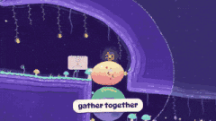
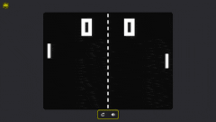
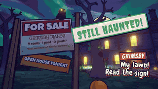
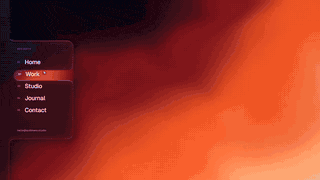
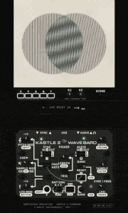
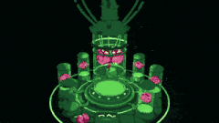

<h3>O que as pessoas criaram com o Claude Fable 5.2 e que dá para abrir e jogar</h3>

[English](README.md) · [简体中文](README.zh-CN.md) · [繁體中文](README.zh-TW.md) · [日本語](README.ja.md) · [한국어](README.ko.md) · [Español](README.es.md) · **Português** · [Français](README.fr.md) · [Deutsch](README.de.md) · [Русский](README.ru.md)

**🌐 Versão web: [fablelist.000ooo.ooo](https://fablelist.000ooo.ooo/pt/)** (com busca e uma página por obra)

222 obras no ar e 146 demos em vídeo feitas com o Claude Fable 5.2, links conferidos em 2026-11-21. Atualizado todo dia; uma ⭐ ajuda.

## 📑 Conteúdo

[⭐ Os mais curtidos](#-os-mais-curtidos) · [🆕 Recentes](#-recentes) · [🎮 Jogos](#-jogos) 103 · [🌍 Mundos e cenas 3D](#-mundos-e-cenas-3d) 47 · [🧰 Páginas e ferramentas](#-páginas-e-ferramentas) 53 · [🎬 Animação e filmes](#-animação-e-filmes) 19 · [📺 Demos em vídeo](#-demos-em-vídeo) 146 · [🤝 Contribuir](#-contribuir)

## ⭐ Os mais curtidos

<table>
<tr>
<td width="33%" valign="top">
 
<b><a href="https://starrynightrider.com">Starry Nightrider</a></b> 
<a href="https://x.com/ebbyamir">@ebbyamir</a> · ♥ 18.0k · <a href="https://x.com/ebbyamir/status/2120284261089673376">▶ Vídeo</a> 
Van Gogh cavalgando pela sua Noite Estrelada, como jogo. 
<a href="https://fablelist.000ooo.ooo/pt/prompts/?w=starry-nightrider&ref=gh"><b>✨ Pegue o prompt</b></a>
</td>
<td width="33%" valign="top">
 
<b><a href="https://claude.ai/artifact/BGY1SztrAYcJQHSsnHHGmp">Saltline — jogo de tiro em primeira pessoa</a></b> 
<a href="https://x.com/felixrieseberg">@felixrieseberg</a> · ♥ 15.0k · <a href="https://x.com/felixrieseberg/status/2119925633564463609">▶ Vídeo</a> 
De um engenheiro da Anthropic. Prompts de uma tentativa só, sem feedback humano, 8 horas, ~US$ 550. Modelos, sons e texturas todos gerados em código. 
<a href="https://fablelist.000ooo.ooo/pt/prompts/?w=saltline-first-person-shooter&ref=gh"><b>✨ Pegue o prompt</b></a>
</td>
<td width="33%" valign="top">
 
<b><a href="https://viktorkav.com.br/apoio/uno-com-escada/fable/">Uno com Escada: um Fiat Uno com escada num circuito de corrida</a></b> 
<a href="https://x.com/ViktorKav">@ViktorKav</a> · ♥ 9.2k · <a href="https://x.com/ViktorKav/status/2122647483281015155">▶ Vídeo</a> 
Dirija um Uno Mille 1996 com escada no teto por um circuito. Um único arquivo HTML de 603 KB, sem engine, biblioteca 3D ou textura; o carro, a mata, o céu e o ronco do motor saem do código. 
<a href="https://github.com/viktorkav/uno-com-escada">Código-fonte</a>
</td>
</tr>
<tr>
<td width="33%" valign="top">
 
<b><a href="https://patch.gg/blendi/oil-paint">Oil Paint — jogo pintado à mão</a></b> 
<a href="https://x.com/BlendiByl">@BlendiByl</a> · ♥ 8.0k · <a href="https://x.com/BlendiByl/status/2120341251178594532">▶ Vídeo</a> 
Feito em menos de uma hora. Cada quadro tem cerca de 1,5 milhão de pinceladas, rodando a 200 fps em uma aba do navegador. Código aberto. 
<a href="https://fablelist.000ooo.ooo/pt/prompts/?w=oil-paint-hand-painted-game&ref=gh"><b>✨ Pegue o prompt</b></a>
</td>
<td width="33%" valign="top">
 
<b><a href="https://nyc.somethingbig.ai/">CROSSTOWN — Nova York em mundo aberto (prévia inicial)</a></b> 
<a href="https://x.com/mattshumer_">@mattshumer_</a> · ♥ 7.5k · <a href="https://x.com/mattshumer_/status/2120282133503820150">▶ Vídeo</a> 
"A Rockstar levou 8 anos. O Fable 5.2 vai fazer em 7 dias." Por enquanto só parte da cidade está pronta; aperte B para enviar feedback. 
<a href="https://fablelist.000ooo.ooo/pt/prompts/?w=crosstown-open-world-new-york-early-preview&ref=gh"><b>✨ Pegue o prompt</b></a>
</td>
<td width="33%" valign="top">
 
<b><a href="https://claude.ai/artifact/QGWUAjRrzRzZWGcQzSMLfa">Claude App em um laptop no Blender</a></b> 
<a href="https://x.com/rileybrown">@rileybrown</a> · ♥ 7.1k · <a href="https://x.com/rileybrown/status/2119902109709537708">▶ Vídeo</a> 
Um prompt construiu o quarto inteiro no Blender e renderizou em 4K. Esta é a página web exibida na tela do laptop. 
<a href="https://x.com/rileybrown/status/2119902109709537708">📝 Prompt do criador (grátis)</a>
</td>
</tr>
</table>

## 🆕 Recentes

Publicados nos últimos 3 dias, por curtidas.

<table>
<tr>
<td width="33%" valign="top">
 
<b><a href="https://april-zhu.com/pocketcity">Pocket City</a></b> 
🆕 · <a href="https://x.com/Aprilzz423">@Aprilzz423</a> · ♥ 828 · <a href="https://x.com/Aprilzz423/status/2123788440714260673">▶ Vídeo</a> 
Transforma qualquer esquina em uma cidadezinha desenhada à mão que você pode girar e explorar, medida pelo OpenStreetMap, com o clima e as estações do lugar. Feito com Fable 5.2 e GPT-6.2 Astra.
</td>
<td width="33%" valign="top">
 
<b><a href="https://hexagonal.earth">Hexagonal Earth</a></b> 
🆕 · <a href="https://x.com/avsa">@avsa</a> · ♥ 752 · <a href="https://x.com/avsa/status/2123123638551392755">Post</a> 
Um diorama do mundo inteiro feito de hexágonos, construído com dados reais de elevação, profundidade do oceano, umidade, vento e rios. O Fable 5.2 gerou centenas de pequenos objetos 3D de splats de pixels e os posicionou na cena por conta própria.
</td>
<td width="33%" valign="top">
 
<b><a href="https://kengoworks.itch.io/dawnlings">Dawnlings — incline o vale e role as bolinhas</a></b> 
<a href="https://x.com/kevin_t_ngo">@kevin_t_ngo</a> · ♥ 478 · <a href="https://x.com/kevin_t_ngo/status/2122969346935017497">▶ Vídeo</a> 
Um jogo de navegador inspirado em LocoRoco: você inclina o terreno para que bolinhas sonolentas rolem, se dividam e se juntem, despertando o vale em cores. Os efeitos sonoros e a arte conceitual foram gerados na fal.
</td>
</tr>
</table>

## 🎮 Jogos

<table>
<tr>
<td width="33%" valign="top">
 
<b><a href="https://starrynightrider.com">Starry Nightrider</a></b> 
<a href="https://x.com/ebbyamir">@ebbyamir</a> · ♥ 18.0k · <a href="https://x.com/ebbyamir/status/2120284261089673376">▶ Vídeo</a> 
Van Gogh cavalgando pela sua Noite Estrelada, como jogo. 
<a href="https://fablelist.000ooo.ooo/pt/prompts/?w=starry-nightrider&ref=gh"><b>✨ Pegue o prompt</b></a>
</td>
<td width="33%" valign="top">
 
<b><a href="https://claude.ai/artifact/BGY1SztrAYcJQHSsnHHGmp">Saltline — jogo de tiro em primeira pessoa</a></b> 
<a href="https://x.com/felixrieseberg">@felixrieseberg</a> · ♥ 15.0k · <a href="https://x.com/felixrieseberg/status/2119925633564463609">▶ Vídeo</a> 
De um engenheiro da Anthropic. Prompts de uma tentativa só, sem feedback humano, 8 horas, ~US$ 550. Modelos, sons e texturas todos gerados em código. 
<a href="https://fablelist.000ooo.ooo/pt/prompts/?w=saltline-first-person-shooter&ref=gh"><b>✨ Pegue o prompt</b></a>
</td>
<td width="33%" valign="top">
 
<b><a href="https://viktorkav.com.br/apoio/uno-com-escada/fable/">Uno com Escada: um Fiat Uno com escada num circuito de corrida</a></b> 
<a href="https://x.com/ViktorKav">@ViktorKav</a> · ♥ 9.2k · <a href="https://x.com/ViktorKav/status/2122647483281015155">▶ Vídeo</a> 
Dirija um Uno Mille 1996 com escada no teto por um circuito. Um único arquivo HTML de 603 KB, sem engine, biblioteca 3D ou textura; o carro, a mata, o céu e o ronco do motor saem do código. 
<a href="https://github.com/viktorkav/uno-com-escada">Código-fonte</a>
</td>
</tr>
<tr>
<td width="33%" valign="top">
 
<b><a href="https://patch.gg/blendi/oil-paint">Oil Paint — jogo pintado à mão</a></b> 
<a href="https://x.com/BlendiByl">@BlendiByl</a> · ♥ 8.0k · <a href="https://x.com/BlendiByl/status/2120341251178594532">▶ Vídeo</a> 
Feito em menos de uma hora. Cada quadro tem cerca de 1,5 milhão de pinceladas, rodando a 200 fps em uma aba do navegador. Código aberto. 
<a href="https://fablelist.000ooo.ooo/pt/prompts/?w=oil-paint-hand-painted-game&ref=gh"><b>✨ Pegue o prompt</b></a>
</td>
<td width="33%" valign="top">
 
<b><a href="https://nyc.somethingbig.ai/">CROSSTOWN — Nova York em mundo aberto (prévia inicial)</a></b> 
<a href="https://x.com/mattshumer_">@mattshumer_</a> · ♥ 7.5k · <a href="https://x.com/mattshumer_/status/2120282133503820150">▶ Vídeo</a> 
"A Rockstar levou 8 anos. O Fable 5.2 vai fazer em 7 dias." Por enquanto só parte da cidade está pronta; aperte B para enviar feedback. 
<a href="https://fablelist.000ooo.ooo/pt/prompts/?w=crosstown-open-world-new-york-early-preview&ref=gh"><b>✨ Pegue o prompt</b></a>
</td>
<td width="33%" valign="top">
 
<b><a href="https://omw-game.kimaki.dev">omw: um vale com castelo em pinceladas a óleo</a></b> 
<a href="https://x.com/__morse">@__morse</a> · ♥ 4.5k · <a href="https://x.com/__morse/status/2122013410309153042">▶ Vídeo</a> 
A pixel art "omw" de @de5imulate refeita como um jogo em three.js que roda no navegador, renderizado como uma pintura a óleo. 
<a href="https://github.com/remorses/castle-valley">Código-fonte</a>
</td>
</tr>
<tr>
<td width="33%" valign="top">
 
<b><a href="https://what-the-water-keeps.vercel.app/">What the Water Keeps</a></b> 
<a href="https://x.com/kevin_t_ngo">@kevin_t_ngo</a> · ♥ 4.3k · <a href="https://x.com/kevin_t_ngo/status/2119868968307695818">▶ Vídeo</a> 
Um passeio de barco por 8 mundos oníricos, jogável no navegador. 
<a href="https://fablelist.000ooo.ooo/pt/prompts/?w=what-the-water-keeps&ref=gh"><b>✨ Pegue o prompt</b></a>
</td>
<td width="33%" valign="top">
 
<b><a href="https://tennis.sixfingerpunch.com/">Tennis</a></b> 
<a href="https://x.com/photonstorm">@photonstorm</a> · ♥ 3.1k · <a href="https://x.com/photonstorm/status/2120330010112434313">Post</a> 
Pediram para "enlouquecer" ao fazer um jogo, e ele devolveu o que parece um clone de Pong — até você jogar. 
<a href="https://fablelist.000ooo.ooo/pt/prompts/?w=tennis&ref=gh"><b>✨ Pegue o prompt</b></a>
</td>
<td width="33%" valign="top">
 
<b><a href="https://patch.gg/play/blendi/small-magic">Small Magic — sandbox de mago</a></b> 
<a href="https://x.com/BlendiByl">@BlendiByl</a> · ♥ 2.6k · <a href="https://x.com/BlendiByl/status/2121594536153718972">▶ Vídeo</a> 
Feito em um dia: 7 feitiços, cerca de 1.800 peças físicas destrutíveis, sem modelos nem texturas, código aberto.
</td>
</tr>
<tr>
<td width="33%" valign="top">
 
<b><a href="https://www.spawn.co/@mattshumer/earth?room=local">Mirror Earth</a></b> 
<a href="https://x.com/mattshumer_">@mattshumer_</a> · ♥ 2.4k · <a href="https://x.com/mattshumer_/status/2119877065701036047">▶ Vídeo</a> 
O planeta inteiro como um mundo de jogo destrutível, com clima que acompanha a Terra real em tempo real. 
<a href="https://fablelist.000ooo.ooo/pt/prompts/?w=mirror-earth&ref=gh"><b>✨ Pegue o prompt</b></a>
</td>
<td width="33%" valign="top">
 
<b><a href="https://portals-endless-worlds.netlify.app/">Portals: Endless Worlds</a></b> 
<a href="https://x.com/emollick">@emollick</a> · ♥ 1.9k · <a href="https://x.com/emollick/status/2119918307457577163">▶ Vídeo</a> 
25.000 agentes construíram mais de 450 mundos 3D só com código, inspirados em livros, arte e lugares, ligados por portais pelos quais você flutua. 
<a href="https://github.com/emollick/ai-portals">Código-fonte</a> · <a href="https://www.oneusefulthing.org/p/fable-52-and-jagged-agi">Artigo</a> 
<a href="https://fablelist.000ooo.ooo/pt/prompts/?w=portals-endless-worlds&ref=gh"><b>✨ Pegue o prompt</b></a>
</td>
<td width="33%" valign="top">
 
<b><a href="https://evensong-phi.vercel.app/">Evensong</a></b> 
<a href="https://x.com/kevin_t_ngo">@kevin_t_ngo</a> · ♥ 1.8k · <a href="https://x.com/kevin_t_ngo/status/2120238844754923874">▶ Vídeo</a> 
Uma luta de chefe estilo souls-like de fantasia sombria, jogável no navegador. 
<a href="https://fablelist.000ooo.ooo/pt/prompts/?w=evensong&ref=gh"><b>✨ Pegue o prompt</b></a>
</td>
</tr>
<tr>
<td width="33%" valign="top">
 
<b><a href="https://loktar00.github.io/lanternfall/">LANTERNFALL</a></b> 
<a href="https://x.com/loktar00">@loktar00</a> · ♥ 1.4k · <a href="https://x.com/loktar00/status/2120192761542615271">▶ Vídeo</a> 
O jogo inteiro — animações, modelos, tudo — gerado pelo Fable. Veja o efeito quando os inimigos morrem. 
<a href="https://fablelist.000ooo.ooo/pt/prompts/?w=lanternfall&ref=gh"><b>✨ Pegue o prompt</b></a>
</td>
<td width="33%" valign="top">
 
<b><a href="https://app.usecrayon.ai/play/76dbd04f-0684-4486-8cc4-eae0585295e8">Goku: Four-Star Road</a></b> 
<a href="https://x.com/aniketjart">@aniketjart</a> · ♥ 1.4k · <a href="https://x.com/aniketjart/status/2121793239175119279">▶ Vídeo</a> 
Um jogo de ação fã baseado na saga do Exército Red Ribbon de Dragon Ball, feito com three.js. Ainda em desenvolvimento; os dois primeiros mapas já dão para jogar.
</td>
<td width="33%" valign="top">
 
<b><a href="https://heat.pplx.app">VICE '86: direção em mundo aberto numa Miami neon de 1986</a></b> 
<a href="https://x.com/AravSrinivas">@AravSrinivas</a> · ♥ 1.3k · <a href="https://x.com/AravSrinivas/status/2122338465648103676">▶ Vídeo</a> 
Um jogo de direção em mundo aberto que roda no navegador. Sem game engine e sem three.js: tem seu próprio renderizador WebGL2, e a cidade, os carros, a chuva e o som dos motores são todos gerados por código, cerca de 63,000 linhas de JavaScript.
</td>
</tr>
<tr>
<td width="33%" valign="top">
 
<b><a href="https://op7418.github.io/guizang-game-skill/">Mist-Locked Mountain Gate — jogo de ação 3D</a></b> 
<a href="https://x.com/op7418">@op7418</a> · ♥ 1.2k · <a href="https://x.com/op7418/status/2120694045299327187">▶ Vídeo</a> 
Uma tarde, 4,5 bilhões de tokens. Modelos, cenas e movimentos todos do Fable, empacotados em um único arquivo HTML de 30 MB. 
<a href="https://fablelist.000ooo.ooo/pt/prompts/?w=mist-locked-mountain-gate-3d-action-game&ref=gh"><b>✨ Pegue o prompt</b></a>
</td>
<td width="33%" valign="top">
 
<b><a href="https://wavedash.com/games/rooftop-rally">Rooftop Rally — pickleball no Unreal 5.9</a></b> 
<a href="https://x.com/chongdashu">@chongdashu</a> · ♥ 1.1k · <a href="https://x.com/chongdashu/status/2120154573356793883">▶ Vídeo</a> 
Fable 5.2 com a prévia do Unreal Engine 5.9. Personagens do Tripo; os outros assets 3D e o resto pelo Fable. 
<a href="https://x.com/chongdashu/status/2120310120509014219">Como foi feito</a> 
<a href="https://fablelist.000ooo.ooo/pt/prompts/?w=rooftop-rally-pickleball-in-unreal-5-9&ref=gh"><b>✨ Pegue o prompt</b></a>
</td>
<td width="33%" valign="top">
 
<b><a href="https://claude.ai/artifact/MXxb36zKgN261ckbGhmNin">Three Games (Saltline · The Clockmaker's Heart · Tidewright)</a></b> 
<a href="https://x.com/felixrieseberg">@felixrieseberg</a> · ♥ 803 · <a href="https://x.com/vineerpasam/status/2119955306096857145">▶ Vídeo</a> 
Assinado por Felix Rieseberg: "Todos os jogos feitos com Claude Fable 5.2. Primeiros rascunhos, sem feedback humano." O link mais compartilhado do dia do lançamento. 
<a href="https://claude.ai/artifact/6MjtQjf4ee1ZZjEpafaEpa">The Clockmaker's Heart</a> · <a href="https://claude.ai/artifact/JTgyEMn7sn1q2riWrMb7D4">Tidewright</a> 
<a href="https://fablelist.000ooo.ooo/pt/prompts/?w=three-games-saltline-the-clockmaker-s-heart-tidewright&ref=gh"><b>✨ Pegue o prompt</b></a>
</td>
</tr>
<tr>
<td width="33%" valign="top">
 
<b><a href="https://patch.gg/play/blendi/solar">Solar: um sistema solar minúsculo para sair voando</a></b> 
<a href="https://x.com/BlendiByl">@BlendiByl</a> · ♥ 796 · <a href="https://x.com/BlendiByl/status/2122673770607591855">▶ Vídeo</a> 
Inspirado em Outer Wilds: órbitas e gravidade reais, voos contínuos entre planetas e cada mundo desenhado em código. Código aberto.
</td>
<td width="33%" valign="top">
 
<b><a href="https://patch.gg/blendi/coloured-pencil">Coloured Pencil</a></b> 
<a href="https://x.com/BlendiByl">@BlendiByl</a> · ♥ 763 · <a href="https://x.com/BlendiByl/status/2121130385723789637">▶ Vídeo</a> 
Um trecho de jogo em lápis de cor; o sombreamento de cada superfície e a cidade inteira são código. Código aberto. 
<a href="https://fablelist.000ooo.ooo/pt/prompts/?w=coloured-pencil&ref=gh"><b>✨ Pegue o prompt</b></a>
</td>
<td width="33%" valign="top">
 
<b><a href="https://www.spawn.co/@mattshumer/voxel-engine">Voxel Engine</a></b> 
<a href="https://x.com/mattshumer_">@mattshumer_</a> · ♥ 742 · <a href="https://x.com/mattshumer_/status/2119870965106483384">▶ Vídeo</a> 
Feito a partir de um único prompt. Com som. 
<a href="https://fablelist.000ooo.ooo/pt/prompts/?w=voxel-engine&ref=gh"><b>✨ Pegue o prompt</b></a>
</td>
</tr>
<tr>
<td width="33%" valign="top">
 
<b><a href="https://patch.gg/blendi/patchwork-quilt">Patchwork Quilt</a></b> 
<a href="https://x.com/BlendiByl">@BlendiByl</a> · ♥ 670 · <a href="https://x.com/BlendiByl/status/2120746541636047347">▶ Vídeo</a> 
Um trecho de jogo em estilo patchwork e stop-motion. O mapa inteiro é código. Código aberto. 
<a href="https://fablelist.000ooo.ooo/pt/prompts/?w=patchwork-quilt&ref=gh"><b>✨ Pegue o prompt</b></a>
</td>
<td width="33%" valign="top">
 
<b><a href="https://bannerfall.itch.io/siege-wing">Siege Wing — um helicóptero numa guerra medieval</a></b> 
<a href="https://x.com/builderjaydub">@builderjaydub</a> · ♥ 577 · <a href="https://x.com/builderjaydub/status/2120223731520040966">▶ Vídeo</a> 
Pilote um helicóptero com canhão, foguetes e mísseis, desvie das balistas romanas e derrube o castelo.
</td>
<td width="33%" valign="top">
 
<b><a href="https://i-would-have-gotten-away-with-it.netlify.app/">I Would Have Gotten Away With It</a></b> 
<a href="https://x.com/emollick">@emollick</a> · ♥ 518 · <a href="https://x.com/emollick/status/2119876449494540554">▶ Vídeo</a> 
Um Scooby-Doo ao contrário: você é o vilão assustando crianças intrometidas. O Fable também fez o trailer, a música e o som. 
<a href="https://fablelist.000ooo.ooo/pt/prompts/?w=i-would-have-gotten-away-with-it&ref=gh"><b>✨ Pegue o prompt</b></a>
</td>
</tr>
</table>

<b><a href="all/games.pt-BR.md">Ver todos os 103 →</a></b>

<a href="#-conteúdo">↑ Voltar ao conteúdo</a>

## 🌍 Mundos e cenas 3D

<table>
<tr>
<td width="33%" valign="top">
 
<b><a href="https://claude.ai/artifact/QGWUAjRrzRzZWGcQzSMLfa">Claude App em um laptop no Blender</a></b> 
<a href="https://x.com/rileybrown">@rileybrown</a> · ♥ 7.1k · <a href="https://x.com/rileybrown/status/2119902109709537708">▶ Vídeo</a> 
Um prompt construiu o quarto inteiro no Blender e renderizou em 4K. Esta é a página web exibida na tela do laptop. 
<a href="https://x.com/rileybrown/status/2119902109709537708">📝 Prompt do criador (grátis)</a>
</td>
<td width="33%" valign="top">
 
<b><a href="https://xikhar.github.io/papertrails/">Papertrails: um mundo de papel pop-up sem fim</a></b> 
<a href="https://x.com/xikhar">@xikhar</a> · ♥ 2.3k · <a href="https://x.com/xikhar/status/2122682962647122403">▶ Vídeo</a> 
Um bonequinho de papel caminha enquanto árvores, casas e morros se erguem do chão como num livro pop-up, passando por deserto, neve, floresta, dia e noite. Feito com Fable 5.2, Opus 5.5 e three.js. 
<a href="https://github.com/xikhar/papertrails">Código-fonte</a>
</td>
<td width="33%" valign="top">
 
<b><a href="https://patch.gg/blendi/painted-valley">Painted Valley</a></b> 
<a href="https://x.com/BlendiByl">@BlendiByl</a> · ♥ 1.8k · <a href="https://x.com/BlendiByl/status/2120694003230560585">▶ Vídeo</a> 
Um vale pintado à mão inspirado no Ghibli, onde você pode caminhar. Código aberto. 
<a href="https://fablelist.000ooo.ooo/pt/prompts/?w=painted-valley&ref=gh"><b>✨ Pegue o prompt</b></a>
</td>
</tr>
<tr>
<td width="33%" valign="top">
 
<b><a href="https://claude.ai/artifact/CTjrZXVdUgKJ6qJXrvvr28">Ancient Babylon, 600 BC</a></b> 
<a href="https://x.com/literallydenis">@literallydenis</a> · ♥ 1.2k · <a href="https://x.com/literallydenis/status/2120866958790848953">▶ Vídeo</a> 
Babilônia reconstruída a partir de documentos históricos e plantas que ele mesmo encontrou, em 8 horas de execução. Passeie livremente. 
<a href="https://fablelist.000ooo.ooo/pt/prompts/?w=ancient-babylon-600-bc&ref=gh"><b>✨ Pegue o prompt</b></a>
</td>
<td width="33%" valign="top">
 
<b><a href="https://indiranagar-live.vercel.app">1 km² de Indiranagar</a></b> 
<a href="https://x.com/anshu4321">@anshu4321</a> · ♥ 1.2k · <a href="https://x.com/anshu4321/status/2119938067758772403">▶ Vídeo</a> 
Uma fatia 3D ao vivo de Bengaluru, a partir de dados de mapa e um prompt. 
<a href="https://fablelist.000ooo.ooo/pt/prompts/?w=1-km2-of-indiranagar&ref=gh"><b>✨ Pegue o prompt</b></a>
</td>
<td width="33%" valign="top">
 
<b><a href="https://fable-rome.surge.sh/">Rome, AD 320</a></b> 
<a href="https://x.com/petergostev">@petergostev</a> · ♥ 976 · <a href="https://x.com/petergostev/status/2120167560700383572">▶ Vídeo</a> 
Um prompt, Fable 5.2 (Max) rodando a noite toda, US$ 2.618. 
<a href="https://x.com/petergostev/status/2120167560700383572">📝 Prompt do criador (grátis)</a>
</td>
</tr>
<tr>
<td width="33%" valign="top">
 
<b><a href="https://github.com/Leonxlnx/room-at-dawn">Room at Dawn</a></b> 
<a href="https://x.com/LexnLin">@LexnLin</a> · ♥ 854 · <a href="https://x.com/LexnLin/status/2120910879361548565">▶ Vídeo</a> 
Um quarto fotorrealista em three.js sem modelos nem texturas prontos; tudo é código. 
<a href="https://fablelist.000ooo.ooo/pt/prompts/?w=room-at-dawn&ref=gh"><b>✨ Pegue o prompt</b></a>
</td>
<td width="33%" valign="top">
 
<b><a href="https://april-zhu.com/pocketcity">Pocket City</a></b> 
🆕 · <a href="https://x.com/Aprilzz423">@Aprilzz423</a> · ♥ 828 · <a href="https://x.com/Aprilzz423/status/2123788440714260673">▶ Vídeo</a> 
Transforma qualquer esquina em uma cidadezinha desenhada à mão que você pode girar e explorar, medida pelo OpenStreetMap, com o clima e as estações do lugar. Feito com Fable 5.2 e GPT-6.2 Astra.
</td>
<td width="33%" valign="top">
 
<b><a href="https://fable-rover.vercel.app">ER-6 Terrain Explorer — um rover marciano autônomo</a></b> 
<a href="https://x.com/DilumSanjaya">@DilumSanjaya</a> · ♥ 798 · <a href="https://x.com/DilumSanjaya/status/2120561077385867663">▶ Vídeo</a> 
O Fable 5.2 projetou uma suspensão rocker-bogie como a dos rovers da NASA e simulou o veículo rodando em terreno alienígena.
</td>
</tr>
<tr>
<td width="33%" valign="top">
 
<b><a href="https://ship-42-catch.netlify.app/">Ship 42 Catch</a></b> 
<a href="https://x.com/emollick">@emollick</a> · ♥ 739 · <a href="https://x.com/emollick/status/2122036763468214711">▶ Vídeo</a> 
Fable e Opus encontraram o vídeo da captura da Starship pela torre e recriaram os últimos 40 segundos em 3D detalhado com three.js. Dá para trocar a câmera.
</td>
<td width="33%" valign="top">
 
<b><a href="https://supernatural-ft.vercel.app/fire-in-ice">Fire in Ice</a></b> 
<a href="https://x.com/tkm_hmng8">@tkm_hmng8</a> · ♥ 549 · <a href="https://x.com/tkm_hmng8/status/2120813043101946324">▶ Vídeo</a> 
Fogo realista queimando dentro do gelo, escrito em WebGPU puro, sem three.js. 
<a href="https://fablelist.000ooo.ooo/pt/prompts/?w=fire-in-ice&ref=gh"><b>✨ Pegue o prompt</b></a>
</td>
<td width="33%" valign="top">
 
<b><a href="https://github.com/Leonxlnx/walking-block">Walking Block: um prédio soviético que anda</a></b> 
<a href="https://x.com/LexnLin">@LexnLin</a> · ♥ 415 · <a href="https://x.com/LexnLin/status/2122359035751989341">▶ Vídeo</a> 
Um enorme bloco soviético de painéis sobre oito pernas mecânicas atravessa um campo molhado na névoa do entardecer. Geometria, texturas e shaders são código three.js, e um filme de 45 segundos é renderizado a partir da mesma cena.
</td>
</tr>
<tr>
<td width="33%" valign="top">
 
<b><a href="https://bay.theojaffee.net">Bay Area Through Time</a></b> 
<a href="https://x.com/theojaffee">@theojaffee</a> · ♥ 388 · <a href="https://x.com/theojaffee/status/2120312766544437738">▶ Vídeo</a> 
Dê zoom em qualquer cidade ou bairro, escolha qualquer ano até 1769 e veja como era. 
<a href="https://nyc.theojaffee.net">New York City</a> 
<a href="https://fablelist.000ooo.ooo/pt/prompts/?w=bay-area-through-time&ref=gh"><b>✨ Pegue o prompt</b></a>
</td>
<td width="33%" valign="top">
 
<b><a href="http://procedural-arm-rig.vercel.app">Procedural Arm Rig</a></b> 
<a href="https://x.com/apekshik">@apekshik</a> · ♥ 326 · <a href="https://x.com/apekshik/status/2120224530367119758">▶ Vídeo</a> 
Em vez de fazer um jogo AAA numa tentativa só: um único braço com armature de ossos, malha com weight paint, IK e músculos que incham conforme o punho fecha. 
<a href="https://fablelist.000ooo.ooo/pt/prompts/?w=procedural-arm-rig&ref=gh"><b>✨ Pegue o prompt</b></a>
</td>
<td width="33%" valign="top">
 
<b><a href="https://samg-coder.github.io/solstice-garden/">The Garden</a></b> 
<a href="https://x.com/SamGCoder">@SamGCoder</a> · ♥ 297 · <a href="https://x.com/SamGCoder/status/2120943068321054975">▶ Vídeo</a> 
Uma cena de jardim escrita em Rust, compilada para WASM e renderizada com WebGPU. 
<a href="https://fablelist.000ooo.ooo/pt/prompts/?w=the-garden&ref=gh"><b>✨ Pegue o prompt</b></a>
</td>
</tr>
<tr>
<td width="33%" valign="top">
 
<b><a href="http://taoistvibe.com">Chill Taoist Vibe: uma colina com um templo taoísta</a></b> 
<a href="https://x.com/qiqileyuan">@qiqileyuan</a> · ♥ 253 · <a href="https://x.com/qiqileyuan/status/2122006851298693277">▶ Vídeo</a> 
Um templo taoísta em estilo Ghibli numa pequena montanha. Siga o velho sacerdote morro acima, queime incenso, tire um palito da sorte, medite ou só fique na cadeira de balanço vendo as estações mudarem. As estátuas e o personagem principal vêm do Tripo3D; todo o resto é código gerado.
</td>
<td width="33%" valign="top">
 
<b><a href="https://butterfly.kyzo.io">Hidden Layers: uma borboleta-de-vidro numa estufa</a></b> 
<a href="https://x.com/ky__zo">@ky__zo</a> · ♥ 229 · <a href="https://x.com/ky__zo/status/2122274109795054036">▶ Vídeo</a> 
Role a página para voar com uma borboleta-de-vidro que não consegue sair de uma estufa por seis mundos. three.js puro, sem arquivos de modelo nem texturas; custou 1.32 bilhão de tokens e $905 de API.
</td>
<td width="33%" valign="top">
 
<b><a href="https://claude.ai/artifact/R6YBDkAm2GjAC5A65D9djx">Uma demo do Claude em que você pode entrar</a></b> 
<a href="https://x.com/dfeinition">@dfeinition</a> · ♥ 215 · <a href="https://x.com/dfeinition/status/2120330644261589051">▶ Vídeo</a> 
Inspirado por @rileybrown: entre e sente-se em qualquer computador. 
<a href="https://fablelist.000ooo.ooo/pt/prompts/?w=a-claude-demo-you-can-walk-into&ref=gh"><b>✨ Pegue o prompt</b></a>
</td>
</tr>
<tr>
<td width="33%" valign="top">
 
<b><a href="https://claude.ai/artifact/2PBXuQAnWDS2NpiPXHNLfL">Orca Jelly</a></b> 
<a href="https://x.com/vib3coded">@vib3coded</a> · ♥ 204 · <a href="https://x.com/vib3coded/status/2119951060752375827">▶ Vídeo</a> 
Estudo de material de uma orca de gelatina com corpo mole. A versão do Opus 5.5 está linkada para comparação. 
<a href="https://claude.ai/artifact/75KLotWzZQ5RR23BGLePb8">Opus 5.5 version</a> 
<a href="https://x.com/vib3coded/status/2119951060752375827">📝 Prompt do criador (grátis)</a>
</td>
<td width="33%" valign="top">
 
<b><a href="https://planet.tokyoaivisuals.club/">Code Planet</a></b> 
<a href="https://x.com/KanaWorks_AI">@KanaWorks_AI</a> · ♥ 198 · <a href="https://x.com/KanaWorks_AI/status/2121413647213932688">▶ Vídeo</a> 
Um planeta inteiro em menos de 320 KB de código. Voe do mar e dos prados por cerejeiras em flor até o espaço, direto no navegador.
</td>
<td width="33%" valign="top">
 
<b><a href="https://claude.ai/artifact/9EgZpErM17kH2a9Q3WXW6f">Voxel World in a Bottle</a></b> 
<a href="https://x.com/vib3coded">@vib3coded</a> · ♥ 164 · <a href="https://x.com/vib3coded/status/2120104517282775514">▶ Vídeo</a> 
30 minutos, US$ 12,81. 
<a href="https://x.com/vib3coded/status/2120104517282775514">📝 Prompt do criador (grátis)</a>
</td>
</tr>
<tr>
<td width="33%" valign="top">
 
<b><a href="https://github.com/Leonxlnx/beautiful-wonderland">Beautiful Wonderland</a></b> 
<a href="https://x.com/LexnLin">@LexnLin</a> · ♥ 146 · <a href="https://x.com/LexnLin/status/2122056542778535977">▶ Vídeo</a> 
Um pequeno mundo pintado em three.js, mais um filme de 40 segundos em 4K renderizado a partir dele.
</td>
<td width="33%" valign="top">
 
<b><a href="https://patch.gg/blendi/impossible-spaces">Impossible Spaces</a></b> 
<a href="https://x.com/BlendiByl">@BlendiByl</a> · ♥ 137 · <a href="https://x.com/BlendiByl/status/2120314459793355262">▶ Vídeo</a> 
Uma experiência psicodélica de "espaços impossíveis". Código aberto. 
<a href="https://fablelist.000ooo.ooo/pt/prompts/?w=impossible-spaces&ref=gh"><b>✨ Pegue o prompt</b></a>
</td>
<td width="33%" valign="top">
 
<b><a href="https://claude.ai/artifact/7ge282etTXSS4edGFTFa85">3D Sailing Ship</a></b> 
<a href="https://x.com/marcthecreatorr">@marcthecreatorr</a> · ♥ 111 · <a href="https://x.com/marcthecreatorr/status/2119890973560054072">▶ Vídeo</a> 
Three.js puro, sem Blender nem assets externos. ~38 minutos, ~US$ 17. 
<a href="https://fablelist.000ooo.ooo/pt/prompts/?w=3d-sailing-ship&ref=gh"><b>✨ Pegue o prompt</b></a>
</td>
</tr>
</table>

<b><a href="all/3d-worlds.pt-BR.md">Ver todos os 47 →</a></b>

<a href="#-conteúdo">↑ Voltar ao conteúdo</a>

## 🧰 Páginas e ferramentas

<table>
<tr>
<td width="33%" valign="top">
 
<b><a href="https://claudia.gallery">Claudia Gallery</a></b> 
<a href="https://x.com/anabology">@anabology</a> · ♥ 5.5k · <a href="https://x.com/anabology/status/2120010995309457643">▶ Vídeo</a> 
"Faça o vídeo dos seus sonhos" — duas cenas, 9 horas. 
<a href="https://fablelist.000ooo.ooo/pt/prompts/?w=claudia-gallery&ref=gh"><b>✨ Pegue o prompt</b></a>
</td>
<td width="33%" valign="top">
 
<b><a href="http://robotics-lab-app.vercel.app">Robotics Lab</a></b> 
<a href="https://x.com/0xMovez">@0xMovez</a> · ♥ 4.7k · <a href="https://x.com/0xMovez/status/2120239217880268919">▶ Vídeo</a> 
Oito placas reais (Arduino Uno, Raspberry Pi 4…) em 3D: posicione chips, solde-os, ligue circuitos de verdade. 
<a href="http://robolabs-app.vercel.app">Humanoid edition</a> 
<a href="https://fablelist.000ooo.ooo/pt/prompts/?w=robotics-lab&ref=gh"><b>✨ Pegue o prompt</b></a>
</td>
<td width="33%" valign="top">
 
<b><a href="https://claude.ai/artifact/N6bSgS4ZH5ifFQfg8sm4dv">Gerador de House Bangers</a></b> 
<a href="https://x.com/deedydas">@deedydas</a> · ♥ 4.1k · <a href="https://x.com/deedydas/status/2120905625852936318">▶ Vídeo</a> 
Aprendeu teoria musical, testa milhares de padrões por instrumento e organiza os melhores em uma faixa de house de 72 compassos. Com som. 
<a href="https://fablelist.000ooo.ooo/pt/prompts/?w=house-bangers-generator&ref=gh"><b>✨ Pegue o prompt</b></a>
</td>
</tr>
<tr>
<td width="33%" valign="top">
 
<b><a href="https://miaai-lab.github.io/Claude-Fable-5.2-HTML-Files/">76 peças em HTML de arquivo único</a></b> 
<a href="https://x.com/MiaAI_lab">@MiaAI_lab</a> · ♥ 2.6k · <a href="https://x.com/MiaAI_lab/status/2119930229661503893">Post</a> 
Arte generativa, física, tipografia e UI, cada uma com seu prompt original. 
<a href="https://fablelist.000ooo.ooo/pt/prompts/?w=76-single-file-html-pieces&ref=gh"><b>✨ Pegue o prompt</b></a>
</td>
<td width="33%" valign="top">
 
<b><a href="https://pixel-worlds.vercel.app/keep/">Keep — medidor de força de senha</a></b> 
<a href="https://x.com/crtvTeknologist">@crtvTeknologist</a> · ♥ 1.6k · <a href="https://x.com/crtvTeknologist/status/2119894073024606617">▶ Vídeo</a> 
Um indicador de força de senha renderizado como um mundo de pixels vivo. 
<a href="https://github.com/finktheartist/pixel-worlds">Código-fonte</a> 
<a href="https://fablelist.000ooo.ooo/pt/prompts/?w=keep-password-strength-meter&ref=gh"><b>✨ Pegue o prompt</b></a>
</td>
<td width="33%" valign="top">
 
<b><a href="https://sakuga-vfx.vercel.app">Sakuga Set</a></b> 
<a href="https://x.com/crtvTeknologist">@crtvTeknologist</a> · ♥ 1.4k · <a href="https://x.com/crtvTeknologist/status/2122088829565698218">▶ Vídeo</a> 
Doze controles de interface que reagem como anime: botões se achatam e aterrissam com um DON!, toggles deixam rastro e espirram, sliders levantam nuvens. Todos os efeitos são desenhados em código, um arquivo cada, sem dependências. 
<a href="https://github.com/finktheartist/sakuga-vfx">Código-fonte</a>
</td>
</tr>
<tr>
<td width="33%" valign="top">
 
<b><a href="https://masterofvfx2070.github.io/xray-mirror/">X-Ray Mirror</a></b> 
<a href="https://x.com/HashemGhaili">@HashemGhaili</a> · ♥ 1.4k · <a href="https://x.com/HashemGhaili/status/2120202746121085321">▶ Vídeo</a> 
Aponte a webcam para o rosto e veja crânio, cérebro e músculos rastreados ao vivo. Abra a boca e a mandíbula abre; o vídeo nunca sai do seu computador. 
<a href="https://github.com/MasterOfVFX2070/xray-mirror">Código-fonte</a> 
<a href="https://fablelist.000ooo.ooo/pt/prompts/?w=x-ray-mirror&ref=gh"><b>✨ Pegue o prompt</b></a>
</td>
<td width="33%" valign="top">
 
<b><a href="https://xianxie6.github.io/animals-planner-2027/">Animals at Work — agenda 3D</a></b> 
<a href="https://x.com/Xian0063">@Xian0063</a> · ♥ 1.2k · <a href="https://x.com/Xian0063/status/2120417834694250522">▶ Vídeo</a> 
Uma agenda de papel refeita em 3D: arraste para virar páginas, toque numa data para escrever, 90 adesivos para descolar e colar. O Opus 5.5 construiu o esqueleto; o Fable 5.2 refinou os materiais com base em filmagens reais. 
<a href="https://fablelist.000ooo.ooo/pt/prompts/?w=animals-at-work-3d-planner&ref=gh"><b>✨ Pegue o prompt</b></a>
</td>
<td width="33%" valign="top">
 
<b><a href="https://uberdesigner.ai/t/spine-menu">Spine Menu</a></b> 
<a href="https://x.com/seanaiux">@seanaiux</a> · ♥ 1.2k · <a href="https://x.com/seanaiux/status/2120222459110789574">▶ Vídeo</a> 
"Você já viu um menu mais bonito?" A página inclui o prompt. 
<a href="https://uberdesigner.ai/t/aquarium-toggle">Aquarium toggle</a> · <a href="https://uberdesigner.ai/t/glow-widgets">Glow widgets</a>
</td>
</tr>
<tr>
<td width="33%" valign="top">
 
<b><a href="https://roverkit.vercel.app">RoverKit — monte e simule um carrinho robô</a></b> 
<a href="https://x.com/DilumSanjaya">@DilumSanjaya</a> · ♥ 1.1k · <a href="https://x.com/DilumSanjaya/status/2121286147393651085">▶ Vídeo</a> 
Um guia passo a passo para montar um carrinho robô, com simulador, arena personalizável e explicação visual do código. Suporta Arduino e ESP32.
</td>
<td width="33%" valign="top">
 
<b><a href="https://github.com/AlexAtFF/pulp-daw-public">PULP — uma DAW nativa de IA</a></b> 
<a href="https://x.com/The_Alex">@The_Alex</a> · ♥ 944 · <a href="https://x.com/The_Alex/status/2119917226769985785">▶ Vídeo</a> 
Uma estação de áudio digital nativa para Windows. Peça música ao Claude e ele abre a DAW e cria a canção. 
<a href="https://fablelist.000ooo.ooo/pt/prompts/?w=pulp-an-ai-native-daw&ref=gh"><b>✨ Pegue o prompt</b></a>
</td>
<td width="33%" valign="top">
 
<b><a href="https://frontier.every.to/experiments/ambient-town">Ambient Town</a></b> 
<a href="https://x.com/kieranklaassen">@kieranklaassen</a> · ♥ 897 · <a href="https://x.com/kieranklaassen/status/2119868196773929160">▶ Vídeo</a> 
Uma DAW ambient construída em uma semana de noites por um ex-compositor de cinema: suporte ao Ableton Push, microfones, efeitos, um sintetizador e um agente que compõe com você. Clique em "Try it" na página. 
<a href="https://fablelist.000ooo.ooo/pt/prompts/?w=ambient-town&ref=gh"><b>✨ Pegue o prompt</b></a>
</td>
</tr>
<tr>
<td width="33%" valign="top">
 
<b><a href="https://hexagonal.earth">Hexagonal Earth</a></b> 
🆕 · <a href="https://x.com/avsa">@avsa</a> · ♥ 752 · <a href="https://x.com/avsa/status/2123123638551392755">Post</a> 
Um diorama do mundo inteiro feito de hexágonos, construído com dados reais de elevação, profundidade do oceano, umidade, vento e rios. O Fable 5.2 gerou centenas de pequenos objetos 3D de splats de pixels e os posicionou na cena por conta própria.
</td>
<td width="33%" valign="top">
 
<b><a href="https://itspsneha.com/supplements">Which Vitamins to Buy in India</a></b> 
<a href="https://x.com/itspsneha">@itspsneha</a> · ♥ 738 · <a href="https://x.com/itspsneha/status/2120048494761451974">Post</a> 
Feito após ler laudos de laboratório de 109 lotes testados. 
<a href="https://fablelist.000ooo.ooo/pt/prompts/?w=which-vitamins-to-buy-in-india&ref=gh"><b>✨ Pegue o prompt</b></a>
</td>
<td width="33%" valign="top">
 
<b><a href="https://v2.video/riley/the-history-of-writing/v1">The History of Writing</a></b> 
<a href="https://x.com/rileybrown">@rileybrown</a> · ♥ 667 · <a href="https://x.com/rileybrown/status/2119946022767980985">▶ Vídeo</a> 
Um filme interativo a partir de um prompt; prompt e arquivos compartilhados. 
<a href="https://x.com/rileybrown/status/2119946022767980985">📝 Prompt do criador (grátis)</a>
</td>
</tr>
<tr>
<td width="33%" valign="top">
 
<b><a href="https://auden-english-135.netlify.app/">A aula de poesia perdida de Auden de 1941, reconstruída</a></b> 
<a href="https://x.com/emollick">@emollick</a> · ♥ 594 · <a href="https://x.com/emollick/status/2121641417483169934">Post</a> 
O Fable 5.2 reconstruiu a aula de W. H. Auden, "a mais difícil das humanidades", a partir de um livro obscuro do Internet Archive e anotações dispersas.
</td>
<td width="33%" valign="top">
 
<b><a href="https://omage1.xyz">omage-1: o sintetizador OP-1 Field no navegador</a></b> 
<a href="https://x.com/jamesmbickerton">@jamesmbickerton</a> · ♥ 572 · <a href="https://x.com/jamesmbickerton/status/2122688041219133815">▶ Vídeo</a> 
Uma homenagem não oficial que recria o OP-1 Field da Teenage Engineering como um app de navegador para tocar na hora.
</td>
<td width="33%" valign="top">
 
<b><a href="https://claude.ai/artifact/4P1urBdptp6gWiJo3R6Vpv">Sampler de vídeo breakcore</a></b> 
<a href="https://x.com/parhelion318">@parhelion318</a> · ♥ 543 · <a href="https://x.com/parhelion318/status/2122723067533398064">▶ Vídeo</a> 
Um sampler no navegador que pica clipes de vídeo e os reorganiza em ritmos de breakcore.
</td>
</tr>
<tr>
<td width="33%" valign="top">
 
<b><a href="https://www.bubbbly.com/christmas-cards">Christmas Cards: cartões de Natal interativos</a></b> 
<a href="https://x.com/ann_nnng">@ann_nnng</a> · ♥ 475 · <a href="https://x.com/ann_nnng/status/2122283549000712249">▶ Vídeo</a> 
Um conjunto de cartões de Natal interativos, como um gato de cachecol vermelho no parapeito da janela vendo a neve cair.
</td>
<td width="33%" valign="top">
 
<b><a href="https://claude.ai/artifact/8yKUbL5KQgvfqcWH6UgZrq">Kastle Sim</a></b> 
🆕 · <a href="https://x.com/parhelion318">@parhelion318</a> · ♥ 463 · <a href="https://x.com/parhelion318/status/2123344270732202421">▶ Vídeo</a> 
Uma simulação no navegador do mini sintetizador modular Bastl Kastle: conecte os cabos, gire os botões e ele faz som.
</td>
<td width="33%" valign="top">
 
<b><a href="https://where-is-everybody-fermi.netlify.app/">Where Is Everybody?</a></b> 
<a href="https://x.com/emollick">@emollick</a> · ♥ 457 · <a href="https://x.com/emollick/status/2120359214157603139">Post</a> 
Pedindo para "resolver o Paradoxo de Fermi": ele reúne dados, testa hipóteses e as submete à crítica de céticos. 
<a href="https://resolving-the-great-silence.netlify.app/">Gemini Carbon version</a> 
<a href="https://x.com/emollick/status/2120359214157603139">📝 Prompt do criador (grátis)</a>
</td>
</tr>
<tr>
<td width="33%" valign="top">
 
<b><a href="https://gsplan.org">Vista dos assentos do Galatasaray</a></b> 
<a href="https://x.com/molenbeek84">@molenbeek84</a> · ♥ 427 · <a href="https://x.com/molenbeek84/status/2120847639411331097">Post</a> 
Veja a vista do campo de cada setor do RAMS Park antes de comprar o ingresso. 
<a href="https://fablelist.000ooo.ooo/pt/prompts/?w=galatasaray-seat-view&ref=gh"><b>✨ Pegue o prompt</b></a>
</td>
<td width="33%" valign="top">
 
<b><a href="https://rubber-hose-ui.vercel.app">Rubber Hose UI: controles como personagens de desenho dos anos 1930</a></b> 
<a href="https://x.com/crtvTeknologist">@crtvTeknologist</a> · ♥ 352 · <a href="https://x.com/crtvTeknologist/status/2122433522166124616">▶ Vídeo</a> 
Onze controles web desenhados no estilo rubber hose: o slider é um trombone, o toast é uma torradeira e o botão ganha um olho roxo a cada clique. JS puro e canvas, sem dependências, código aberto. 
<a href="https://github.com/finktheartist/rubber-hose-ui">Código-fonte</a>
</td>
<td width="33%" valign="top">
 
<b><a href="https://bigfatfish.cc">Big Fat Fish's Tank</a></b> 
🆕 · <a href="https://x.com/dafeifish">@dafeifish</a> · ♥ 259 · <a href="https://x.com/dafeifish/status/2123395143873019950">Post</a> 
Um site pessoal redesenhado como um scrapbook: pedaços de papel, fita, post-its e Polaroids colados sobre um céu noturno azul-escuro.
</td>
</tr>
</table>

<b><a href="all/web-and-tools.pt-BR.md">Ver todos os 53 →</a></b>

<a href="#-conteúdo">↑ Voltar ao conteúdo</a>

## 🎬 Animação e filmes

<table>
<tr>
<td width="33%" valign="top">
 
<b><a href="https://github.com/ChetasLua/crimson-loong">Crimson Loong</a></b> 
<a href="https://x.com/chetaslua">@chetaslua</a> · ♥ 3.7k · <a href="https://x.com/chetaslua/status/2121176151234330707">▶ Vídeo</a> 
Um filme de dragão de 90 segundos em three.js, código puro e sem assets externos. 
<a href="https://fablelist.000ooo.ooo/pt/prompts/?w=crimson-loong&ref=gh"><b>✨ Pegue o prompt</b></a>
</td>
<td width="33%" valign="top">
 
<b><a href="https://github.com/BubbleBrainBB/awesome-fable-5.2/tree/main/cat-garden">Cat Garden: um jardim botânico pelos olhos de um gato</a></b> 
<a href="https://x.com/BubbleBrain">@BubbleBrain</a> · ♥ 1.4k · <a href="https://x.com/BubbleBrain/status/2122313967473434639">▶ Vídeo</a> 
Um filme de 110 segundos em plano-sequência de um gato andando, farejando e dando botes por um jardim botânico. A imagem vem de um path tracer escrito para isso e o som é sintetizado com numpy, sem nenhum asset.
</td>
<td width="33%" valign="top">
 
<b><a href="https://github.com/moritzkremb/robovac-pov">Robovac POV: um filme realista do ponto de vista de um robô aspirador</a></b> 
<a href="https://x.com/moritzkremb">@moritzkremb</a> · ♥ 457 · <a href="https://x.com/moritzkremb/status/2122702891819377117">▶ Vídeo</a> 
Um filme de 53 segundos feito só com código: um mundo escrito em C++, um path tracer próprio em GPU, uma câmera simulada com foco, motion blur e grão, um tapete com cerca de 900,000 fibras e som sintetizado em Python.
</td>
</tr>
<tr>
<td width="33%" valign="top">
 
<b><a href="https://github.com/amirmushichge/shred-kit">Shred Kit — template de picotar papel</a></b> 
<a href="https://x.com/AmirMushich">@AmirMushich</a> · ♥ 431 · <a href="https://x.com/AmirMushich/status/2121339167800213934">▶ Vídeo</a> 
Um reel de 8 segundos de papel sendo picotado, feito com Fable 5.2 e Blender, compartilhado como template gratuito.
</td>
<td width="33%" valign="top">
 
<b><a href="https://github.com/ChetasLua/pelican-riding-a-bicycle">The Pelican, Tired of the Road</a></b> 
<a href="https://x.com/chetaslua">@chetaslua</a> · ♥ 357 · <a href="https://x.com/chetaslua/status/2120438091647218025">▶ Vídeo</a> 
Um filme de 60 segundos com visual pintado à mão sobre o pelicano do teste de SVG. Um arquivo HTML; cada pixel e cada som é código. 
<a href="https://github.com/ChetasLua/mona-lisa-js">Mona Lisa in JS</a> 
<a href="https://fablelist.000ooo.ooo/pt/prompts/?w=the-pelican-tired-of-the-road&ref=gh"><b>✨ Pegue o prompt</b></a>
</td>
<td width="33%" valign="top">
 
<b><a href="https://github.com/Leonxlnx/mechanical-moon">Mechanical Moon</a></b> 
<a href="https://x.com/LexnLin">@LexnLin</a> · ♥ 352 · <a href="https://x.com/LexnLin/status/2122823164635881853">▶ Vídeo</a> 
Um filme procedural de 45 segundos no Blender: uma lua rachada com uma megaestrutura dourada de relojoaria dentro, construída só com scripts Python e renderizada no EEVEE.
</td>
</tr>
<tr>
<td width="33%" valign="top">
 
<b><a href="https://github.com/Leonxlnx/castle-cinematic">Castle Cinematic</a></b> 
<a href="https://x.com/LexnLin">@LexnLin</a> · ♥ 325 · <a href="https://x.com/LexnLin/status/2122112228522623459">▶ Vídeo</a> 
Um filme de 45 segundos em 4K de um castelo gótico no alto de um penhasco ao pôr do sol. Cada quadro vem de cerca de 9.000 linhas de Python no Blender, sem assets 3D nem texturas.
</td>
<td width="33%" valign="top">
 
<b><a href="https://github.com/anstapnever/one-sweep">One Sweep</a></b> 
<a href="https://x.com/anstapnever">@anstapnever</a> · ♥ 251 · <a href="https://x.com/anstapnever/status/2119772039037014524">▶ Vídeo</a> 
Uma luta de anime de 78 segundos em Three.js puro, seis equipes de agentes em paralelo. O autor diz "Fable 5.5". 
<a href="https://x.com/anstapnever/status/2119772039037014524">📝 Prompt do criador (grátis)</a>
</td>
<td width="33%" valign="top">
 
<b><a href="https://github.com/crossps/ballpoint">Ballpoint</a></b> 
<a href="https://x.com/camperaigg">@camperaigg</a> · ♥ 242 · <a href="https://x.com/camperaigg/status/2119777467074580741">▶ Vídeo</a> 
ASMR macro de uma caneta esferográfica, em código aberto para provar que é código e não um modelo de vídeo. 
<a href="https://fablelist.000ooo.ooo/pt/prompts/?w=ballpoint&ref=gh"><b>✨ Pegue o prompt</b></a>
</td>
</tr>
<tr>
<td width="33%" valign="top">
 
<b><a href="https://github.com/ChetasLua/godzilla-nights">Godzilla Nights</a></b> 
<a href="https://x.com/chetaslua">@chetaslua</a> · ♥ 230 · <a href="https://x.com/chetaslua/status/2119981510199808368">▶ Vídeo</a> 
Imagens desenhadas em código puro, levemente animadas. 
<a href="https://fablelist.000ooo.ooo/pt/prompts/?w=godzilla-nights&ref=gh"><b>✨ Pegue o prompt</b></a>
</td>
<td width="33%" valign="top">
 
<b><a href="https://github.com/Leonxlnx/ink-dragon">Ink Dragon: uma gota de tinta vira dragão</a></b> 
<a href="https://x.com/LexnLin">@LexnLin</a> · ♥ 213 · <a href="https://x.com/LexnLin/status/2122698775831671258">▶ Vídeo</a> 
Um filme de 45 segundos no Blender em que uma gota de tinta preta cai na água e vira um dragão. A simulação da tinta, os volumes e o render são gerados por scripts Python.
</td>
<td width="33%" valign="top">
 
<b><a href="https://github.com/ChetasLua/the-last-good-pelican-fable-5.2">The Last Good Pelican</a></b> 
🆕 · <a href="https://x.com/chetaslua">@chetaslua</a> · ♥ 142 · <a href="https://x.com/chetaslua/status/2123100140189958401">▶ Vídeo</a> 
Um curta de 60 segundos com cara de desenho à mão em um único arquivo HTML offline: um dia na vida do único pelicano de benchmark que saiu certo. Canvas 2D para cada desenho, Web Audio para cada som.
</td>
</tr>
<tr>
<td width="33%" valign="top">
 
<b><a href="https://github.com/0xCodez/thousand-peaks">Dragon of a Thousand Peaks — o dragão dos mil picos</a></b> 
<a href="https://x.com/0xMovez">@0xMovez</a> · ♥ 136 · <a href="https://x.com/0xMovez/status/2121721290687983906">▶ Vídeo</a> 
Um filme de luta de 90 segundos em three.js puro, sem assets nem modelos de vídeo; o Fable 5.2 dirigiu 8 agentes em paralelo, e música e sons são sintetizados em código.
</td>
<td width="33%" valign="top">
 
<b><a href="https://github.com/Leonxlnx/koi-pond-keycap">Koi Pond Keycap</a></b> 
🆕 · <a href="https://x.com/LexnLin">@LexnLin</a> · ♥ 131 · <a href="https://x.com/LexnLin/status/2123174205306908806">▶ Vídeo</a> 
Um filme de 45 segundos no Blender de uma keycap de resina transparente com um lago de carpas dentro: um dedo pressiona a tecla, ondas correm pela água e as carpas disparam. Python totalmente procedural, sem modelos ou texturas externos.
</td>
<td width="33%" valign="top">
 
<b><a href="https://github.com/anstapnever/blackout">Blackout</a></b> 
<a href="https://x.com/anstapnever">@anstapnever</a> · ♥ 119 · <a href="https://x.com/anstapnever/status/2119915123070644263">▶ Vídeo</a> 
Um curta de anime de 79 segundos, tudo em código. 
<a href="https://x.com/anstapnever/status/2119915123070644263">📝 Prompt do criador (grátis)</a>
</td>
</tr>
</table>

<b><a href="all/animation.pt-BR.md">Ver todos os 19 →</a></b>

<a href="#-conteúdo">↑ Voltar ao conteúdo</a>

## 📺 Demos em vídeo

Os criadores postaram um vídeo, mas não um link. Clique na prévia para ver o post original.

<table>
<tr>
<td width="33%" valign="top">
 
<b><a href="https://x.com/claudeai/status/2119899459761131615">Anthropic: projetos pré-lançamento</a></b> 
<a href="https://x.com/claudeai">@claudeai</a> · ♥ 43.1k · <a href="https://x.com/claudeai/status/2119899459761131615">▶ Vídeo</a> 
O que o Fable 5.2 e o Mythos 5.2 construíram em várias áreas durante os testes. 
<a href="https://fablelist.000ooo.ooo/pt/prompts/?w=anthropic-pre-release-projects&ref=gh"><b>✨ Pegue o prompt</b></a>
</td>
<td width="33%" valign="top">
 
<b><a href="https://x.com/anxuanng/status/2120088745139638375">Um filme 3D explicando o paradoxo de Zenão</a></b> 
<a href="https://x.com/anxuanng">@anxuanng</a> · ♥ 10.0k · <a href="https://x.com/anxuanng/status/2120088745139638375">▶ Vídeo</a> 
 
<a href="https://fablelist.000ooo.ooo/pt/prompts/?w=a-3d-film-explaining-zeno-s-paradox&ref=gh"><b>✨ Pegue o prompt</b></a>
</td>
<td width="33%" valign="top">
 
<b><a href="https://x.com/imjustnewatai/status/2120383964686729410">Uma sinfonia em forma de treinamento de modelo</a></b> 
<a href="https://x.com/imjustnewatai">@imjustnewatai</a> · ♥ 9.7k · <a href="https://x.com/imjustnewatai/status/2120383964686729410">▶ Vídeo</a> 
 
<a href="https://fablelist.000ooo.ooo/pt/prompts/?w=a-symphony-shaped-like-a-training-run&ref=gh"><b>✨ Pegue o prompt</b></a>
</td>
</tr>
<tr>
<td width="33%" valign="top">
 
<b><a href="https://x.com/everestchris6/status/2120175941616128277">Plantas 2D transformadas em passeios 3D</a></b> 
<a href="https://x.com/everestchris6">@everestchris6</a> · ♥ 7.3k · <a href="https://x.com/everestchris6/status/2120175941616128277">▶ Vídeo</a> 
 
<a href="https://x.com/everestchris6/status/2120175941616128277">📝 Prompt do criador (grátis)</a>
</td>
<td width="33%" valign="top">
 
<b><a href="https://x.com/dominikmartn/status/2120154832694858224">Ele realmente sabe projetar</a></b> 
<a href="https://x.com/dominikmartn">@dominikmartn</a> · ♥ 7.2k · <a href="https://x.com/dominikmartn/status/2120154832694858224">▶ Vídeo</a> 
 
<a href="https://fablelist.000ooo.ooo/pt/prompts/?w=it-can-actually-design&ref=gh"><b>✨ Pegue o prompt</b></a>
</td>
<td width="33%" valign="top">
 
<b><a href="https://x.com/suna_gaku/status/2119952985933697063">"Mostre seu melhor vídeo"</a></b> 
<a href="https://x.com/suna_gaku">@suna_gaku</a> · ♥ 6.8k · <a href="https://x.com/suna_gaku/status/2119952985933697063">▶ Vídeo</a> 
 
<a href="https://x.com/suna_gaku/status/2119952985933697063">📝 Prompt do criador (grátis)</a>
</td>
</tr>
<tr>
<td width="33%" valign="top">
 
<b><a href="https://x.com/yohakutoink/status/2120824797215310208">Pintando uma cópia em código — "o original tem uma mancha aqui, a minha não"</a></b> 
<a href="https://x.com/yohakutoink">@yohakutoink</a> · ♥ 6.5k · <a href="https://x.com/yohakutoink/status/2120824797215310208">▶ Vídeo</a> 
 
<a href="https://fablelist.000ooo.ooo/pt/prompts/?w=painting-a-copy-in-code-the-original-has&ref=gh"><b>✨ Pegue o prompt</b></a>
</td>
<td width="33%" valign="top">
 
<b><a href="https://x.com/Dstudio_ai/status/2122569461547098595">Tela de lobby estilo jogo mobile com um modelo 3D do Tripo</a></b> 
<a href="https://x.com/Dstudio_ai">@Dstudio_ai</a> · ♥ 5.3k · <a href="https://x.com/Dstudio_ai/status/2122569461547098595">▶ Vídeo</a> 

</td>
<td width="33%" valign="top">
 
<b><a href="https://x.com/aj_dev_smith/status/2122538394710687871">Tocando qualquer música com 64 notas gravadas de uma só voz</a></b> 
<a href="https://x.com/aj_dev_smith">@aj_dev_smith</a> · ♥ 5.3k · <a href="https://x.com/aj_dev_smith/status/2122538394710687871">▶ Vídeo</a> 

</td>
</tr>
<tr>
<td width="33%" valign="top">
 
<b><a href="https://x.com/matabee_GTO/status/2120995946372985144">Um prompt: faça o vídeo mais desconfortável que puder</a></b> 
<a href="https://x.com/matabee_GTO">@matabee_GTO</a> · ♥ 5.0k · <a href="https://x.com/matabee_GTO/status/2120995946372985144">▶ Vídeo</a> 
 
<a href="https://x.com/matabee_GTO/status/2120995946372985144">📝 Prompt do criador (grátis)</a>
</td>
<td width="33%" valign="top">
 
<b><a href="https://x.com/JungleSilicon/status/2121782359901212987">Gaussian splats em pixel art</a></b> 
<a href="https://x.com/JungleSilicon">@JungleSilicon</a> · ♥ 4.8k · <a href="https://x.com/JungleSilicon/status/2121782359901212987">▶ Vídeo</a> 

</td>
<td width="33%" valign="top">
 
<b><a href="https://x.com/MrTacticalX/status/2121082861902070130">Três agentes Fable 5.2 constroem um computador em 7h41min</a></b> 
<a href="https://x.com/MrTacticalX">@MrTacticalX</a> · ♥ 4.6k · <a href="https://x.com/MrTacticalX/status/2121082861902070130">▶ Vídeo</a> 
 
<a href="https://fablelist.000ooo.ooo/pt/prompts/?w=three-fable-5-2-agents-build-a-computer&ref=gh"><b>✨ Pegue o prompt</b></a>
</td>
</tr>
<tr>
<td width="33%" valign="top">
 
<b><a href="https://x.com/XRarchitect/status/2120947265007440052">Atlas + Fable 5.2 + three.js</a></b> 
<a href="https://x.com/XRarchitect">@XRarchitect</a> · ♥ 4.4k · <a href="https://x.com/XRarchitect/status/2120947265007440052">▶ Vídeo</a> 
 
<a href="https://fablelist.000ooo.ooo/pt/prompts/?w=atlas-fable-5-2-three-js&ref=gh"><b>✨ Pegue o prompt</b></a>
</td>
<td width="33%" valign="top">
 
<b><a href="https://x.com/shiromamono/status/2122473903100731694">Um vídeo feito para fazer você sorrir</a></b> 
<a href="https://x.com/shiromamono">@shiromamono</a> · ♥ 3.8k · <a href="https://x.com/shiromamono/status/2122473903100731694">▶ Vídeo</a> 

</td>
<td width="33%" valign="top">
 
<b><a href="https://x.com/timhwang/status/2122011842549600506">Um chatbot de 6M de parâmetros num cartucho de Game Boy</a></b> 
<a href="https://x.com/timhwang">@timhwang</a> · ♥ 3.4k · <a href="https://x.com/timhwang/status/2122011842549600506">▶ Vídeo</a> 

</td>
</tr>
<tr>
<td width="33%" valign="top">
 
<b><a href="https://x.com/aollivier82/status/2120260208245043663">A história da computação gráfica, animada</a></b> 
<a href="https://x.com/aollivier82">@aollivier82</a> · ♥ 3.2k · <a href="https://x.com/aollivier82/status/2120260208245043663">▶ Vídeo</a> 
 
<a href="https://fablelist.000ooo.ooo/pt/prompts/?w=the-history-of-computer-graphics-animated&ref=gh"><b>✨ Pegue o prompt</b></a>
</td>
<td width="33%" valign="top">
 
<b><a href="https://x.com/M__Houser/status/2120253236309569696">Age of Dragon, um mundo aberto feito por quem não programa</a></b> 
<a href="https://x.com/M__Houser">@M__Houser</a> · ♥ 2.6k · <a href="https://x.com/M__Houser/status/2120253236309569696">▶ Vídeo</a> 
 
<a href="https://fablelist.000ooo.ooo/pt/prompts/?w=age-of-dragon-an-open-world-by-a&ref=gh"><b>✨ Pegue o prompt</b></a>
</td>
<td width="33%" valign="top">
 
<b><a href="https://x.com/hayashimon1/status/2121943011525624151">Uma caminhada pela plataforma de uma estação antiga, via Blender MCP</a></b> 
<a href="https://x.com/hayashimon1">@hayashimon1</a> · ♥ 2.6k · <a href="https://x.com/hayashimon1/status/2121943011525624151">▶ Vídeo</a> 

</td>
</tr>
<tr>
<td width="33%" valign="top">
 
<b><a href="https://x.com/aecyydesign/status/2120239401821487149">Uma animação feita com Blender</a></b> 
<a href="https://x.com/aecyydesign">@aecyydesign</a> · ♥ 2.5k · <a href="https://x.com/aecyydesign/status/2120239401821487149">▶ Vídeo</a> 
 
<a href="https://fablelist.000ooo.ooo/pt/prompts/?w=an-animation-made-with-blender&ref=gh"><b>✨ Pegue o prompt</b></a>
</td>
<td width="33%" valign="top">
 
<b><a href="https://x.com/alexalbert__/status/2119916954337349737">Os cadernos de Da Vinci, interativos</a></b> 
<a href="https://x.com/alexalbert__">@alexalbert__</a> · ♥ 2.5k · <a href="https://x.com/alexalbert__/status/2119916954337349737">▶ Vídeo</a> 
Um PDF de caderno de 500 anos transformado em invenções com as quais você pode brincar. 
<a href="https://fablelist.000ooo.ooo/pt/prompts/?w=da-vinci-s-notebooks-interactive&ref=gh"><b>✨ Pegue o prompt</b></a>
</td>
<td width="33%" valign="top">
 
<b><a href="https://x.com/ChrisGPT/status/2119998815856218494">Uma mensagem para editores de vídeo</a></b> 
<a href="https://x.com/ChrisGPT">@ChrisGPT</a> · ♥ 2.5k · <a href="https://x.com/ChrisGPT/status/2119998815856218494">▶ Vídeo</a> 
 
<a href="https://fablelist.000ooo.ooo/pt/prompts/?w=a-message-to-video-editors&ref=gh"><b>✨ Pegue o prompt</b></a>
</td>
</tr>
<tr>
<td width="33%" valign="top">
 
<b><a href="https://x.com/kotaniko98765/status/2122266561960665539">Um jogo de day trade feito num fim de semana</a></b> 
<a href="https://x.com/kotaniko98765">@kotaniko98765</a> · ♥ 2.5k · <a href="https://x.com/kotaniko98765/status/2122266561960665539">▶ Vídeo</a> 

</td>
<td width="33%" valign="top">
 
<b><a href="https://x.com/theo/status/2119926277801144695">Fishslop run</a></b> 
<a href="https://x.com/theo">@theo</a> · ♥ 2.3k · <a href="https://x.com/theo/status/2119926277801144695">▶ Vídeo</a> 
76 minutos, ~US$ 42. 
<a href="https://fablelist.000ooo.ooo/pt/prompts/?w=fishslop-run&ref=gh"><b>✨ Pegue o prompt</b></a>
</td>
<td width="33%" valign="top">
 
<b><a href="https://x.com/GPTabby/status/2119909996645298519">Um jogo de corrida no Unreal Engine 5 a partir de um prompt</a></b> 
<a href="https://x.com/GPTabby">@GPTabby</a> · ♥ 2.2k · <a href="https://x.com/GPTabby/status/2119909996645298519">▶ Vídeo</a> 
 
<a href="https://fablelist.000ooo.ooo/pt/prompts/?w=a-racing-game-in-unreal-engine-5-from&ref=gh"><b>✨ Pegue o prompt</b></a>
</td>
</tr>
</table>

<b><a href="all/video-demos.pt-BR.md">Ver todos os 146 →</a></b>

## 🤝 Contribuir

Achou uma que faltou? Abra uma [issue](../../issues/new/choose) com o link da obra e o post original. O link precisa abrir direto e a obra precisa ter sido feita com o Fable 5.2.

## Aviso

Todas as obras pertencem aos criadores. Este repositório só as indexa, com prévias GIF curtas e em baixa resolução, sem hospedar obras ou vídeos completos; o vídeo completo está no post original. Criadores podem pedir a remoção de uma prévia ou item por issue. Sem vínculo com a Anthropic.

## Star History

## License

[CC0 1.0](LICENSE): a lista em si é de domínio público.

## 📰 Novidades

- **2026-11-21**: +7 obras e +1 demos em vídeo.
- **2026-11-20**: +8 obras e +0 demos em vídeo.
- **2026-11-19**: +10 obras e +2 demos em vídeo.
- **2026-11-18**: +12 obras e +8 demos em vídeo.
- **2026-11-10**: Primeira versão: 57 obras + 61 demos em vídeo, cada uma com prévia em GIF.
