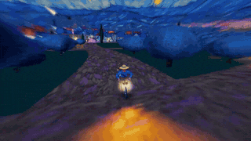
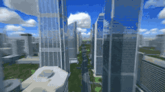
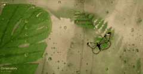
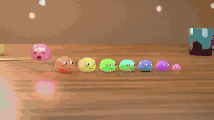
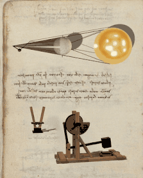

<h3>Что люди сделали с Claude Fable 5.2 — открывай и играй</h3>

[English](README.md) · [简体中文](README.zh-CN.md) · [繁體中文](README.zh-TW.md) · [日本語](README.ja.md) · [한국어](README.ko.md) · [Español](README.es.md) · [Português](README.pt-BR.md) · [Français](README.fr.md) · [Deutsch](README.de.md) · **Русский**

**🌐 Веб-версия: [fablelist.000ooo.ooo](https://fablelist.000ooo.ooo/ru/)** (поиск, отдельная страница для каждой работы)

247 работ онлайн и 156 видеодемо на Claude Fable 5.2, все ссылки проверены 2026-11-26. Обновляется каждый день; ⭐ помогает.

## 📑 Содержание

[⭐ Самые любимые](#-самые-любимые) · [🆕 Новое](#-новое) · [🎮 Игры](#-игры) 117 · [🌍 3D-миры и сцены](#-3d-миры-и-сцены) 53 · [🧰 Сайты и инструменты](#-сайты-и-инструменты) 58 · [🎬 Анимация и фильмы](#-анимация-и-фильмы) 19 · [📺 Видеодемо](#-видеодемо) 156 · [🤝 Как помочь](#-как-помочь)

## ⭐ Самые любимые

<table>
<tr>
<td width="33%" valign="top">
 
<b><a href="https://starrynightrider.com">Starry Nightrider</a></b> 
<a href="https://x.com/ebbyamir">@ebbyamir</a> · ♥ 17.9k · <a href="https://x.com/ebbyamir/status/2120284261089673376">▶ Видео</a> 
Ван Гог скачет по своей «Звёздной ночи», в виде игры. 
<a href="https://fablelist.000ooo.ooo/ru/prompts/?w=starry-nightrider&ref=gh"><b>✨ Получить промпт</b></a>
</td>
<td width="33%" valign="top">
 
<b><a href="https://claude.ai/artifact/BGY1SztrAYcJQHSsnHHGmp">Saltline — шутер от первого лица</a></b> 
<a href="https://x.com/felixrieseberg">@felixrieseberg</a> · ♥ 15.1k · <a href="https://x.com/felixrieseberg/status/2119925633564463609">▶ Видео</a> 
От инженера Anthropic. Одношаговые промпты, без обратной связи от человека, 8 часов, ~550 $. Модели, звуки и текстуры целиком сгенерированы кодом. 
<a href="https://fablelist.000ooo.ooo/ru/prompts/?w=saltline-first-person-shooter&ref=gh"><b>✨ Получить промпт</b></a>
</td>
<td width="33%" valign="top">
 
<b><a href="https://viktorkav.com.br/apoio/uno-com-escada/fable/">Uno com Escada: Fiat Uno с лестницей на гоночной трассе</a></b> 
<a href="https://x.com/ViktorKav">@ViktorKav</a> · ♥ 9.2k · <a href="https://x.com/ViktorKav/status/2122647483281015155">▶ Видео</a> 
Прокатитесь по трассе на Uno Mille 1996 года с лестницей на крыше. Один HTML-файл на 603 KB без движка, 3D-библиотек и текстур; машина, лес, небо и звук мотора целиком сделаны кодом. 
<a href="https://github.com/viktorkav/uno-com-escada">Исходный код</a>
</td>
</tr>
<tr>
<td width="33%" valign="top">
 
<b><a href="https://patch.gg/blendi/oil-paint">Oil Paint — игра, нарисованная вручную</a></b> 
<a href="https://x.com/BlendiByl">@BlendiByl</a> · ♥ 8.0k · <a href="https://x.com/BlendiByl/status/2120341251178594532">▶ Видео</a> 
Сделано меньше чем за час. Каждый кадр — около 1,5 миллиона мазков кисти, 200 fps во вкладке браузера. Открытый исходный код. 
<a href="https://fablelist.000ooo.ooo/ru/prompts/?w=oil-paint-hand-painted-game&ref=gh"><b>✨ Получить промпт</b></a>
</td>
<td width="33%" valign="top">
 
<b><a href="https://nyc.somethingbig.ai/">CROSSTOWN — Нью-Йорк с открытым миром (ранний превью)</a></b> 
<a href="https://x.com/mattshumer_">@mattshumer_</a> · ♥ 7.5k · <a href="https://x.com/mattshumer_/status/2120282133503820150">▶ Видео</a> 
«Rockstar took 8 years. Fable 5.2 is gonna do it in 7 days.» Пока готова только часть города; нажмите B, чтобы отправить отзыв. 
<a href="https://fablelist.000ooo.ooo/ru/prompts/?w=crosstown-open-world-new-york-early-preview&ref=gh"><b>✨ Получить промпт</b></a>
</td>
<td width="33%" valign="top">
 
<b><a href="https://claude.ai/artifact/QGWUAjRrzRzZWGcQzSMLfa">Claude App на ноутбуке в Blender</a></b> 
<a href="https://x.com/rileybrown">@rileybrown</a> · ♥ 7.1k · <a href="https://x.com/rileybrown/status/2119902109709537708">▶ Видео</a> 
Один промпт построил всю комнату в Blender и отрендерил её в 4K. Это веб-страница на экране ноутбука. 
<a href="https://x.com/rileybrown/status/2119902109709537708">📝 Промпт автора (бесплатно)</a>
</td>
</tr>
</table>

## 🆕 Новое

Опубликовано за последние 3 дня, по числу лайков.

<table>
<tr>
<td width="33%" valign="top">
 
<b><a href="https://kevintngo.github.io/procedural-rpg/">Brushwild — процедурная RPG с открытым миром</a></b> 
🆕 · <a href="https://x.com/kevin_t_ngo">@kevin_t_ngo</a> · ♥ 2.5k · <a href="https://x.com/kevin_t_ngo/status/2125321244686029289">▶ Видео</a> 
Процедурная экшен-RPG с открытым миром в одном HTML-файле размером около 300kB. Каждый пиксель рисуют шейдеры в стиле пера и цветных карандашей. Три класса, деревья навыков, лут, города и подземелья; играть можно на компьютере и на телефоне. 
<a href="https://github.com/kevintngo/procedural-rpg">Исходный код</a>
</td>
<td width="33%" valign="top">
 
<b><a href="https://kevintngo.github.io/cinderwatch/">Cinderwatch: tower defense в одном HTML-файле</a></b> 
🆕 · <a href="https://x.com/kevin_t_ngo">@kevin_t_ngo</a> · ♥ 2.3k · <a href="https://x.com/kevin_t_ngo/status/2125119969109418333">▶ Видео</a> 
Изометрическая 3D-игра в жанре tower defense, которая умещается в одном HTML-файле. Встроенный ИИ-командир может вести оборону за вас. Открытый исходный код, играть можно прямо в браузере. 
<a href="https://github.com/kevintngo/cinderwatch">Исходный код</a>
</td>
<td width="33%" valign="top">
 
<b><a href="https://littlecity.io">Little City — рисованный градостроительный симулятор</a></b> 
🆕 · <a href="https://x.com/sprezzyyy">@sprezzyyy</a> · ♥ 983 · <a href="https://x.com/sprezzyyy/status/2125321545665192054">▶ Видео</a> 
Градостроительная песочница, вдохновлённая Townscaper. Поставьте несколько блоков, посмотрите, как они превращаются в нарисованный от руки городок, а потом как он оживает. Работает в браузере. 
<a href="https://github.com/yaoderek/littlecity.io">Исходный код</a>
</td>
</tr>
</table>

## 🎮 Игры

<table>
<tr>
<td width="33%" valign="top">
 
<b><a href="https://starrynightrider.com">Starry Nightrider</a></b> 
<a href="https://x.com/ebbyamir">@ebbyamir</a> · ♥ 17.9k · <a href="https://x.com/ebbyamir/status/2120284261089673376">▶ Видео</a> 
Ван Гог скачет по своей «Звёздной ночи», в виде игры. 
<a href="https://fablelist.000ooo.ooo/ru/prompts/?w=starry-nightrider&ref=gh"><b>✨ Получить промпт</b></a>
</td>
<td width="33%" valign="top">
 
<b><a href="https://claude.ai/artifact/BGY1SztrAYcJQHSsnHHGmp">Saltline — шутер от первого лица</a></b> 
<a href="https://x.com/felixrieseberg">@felixrieseberg</a> · ♥ 15.1k · <a href="https://x.com/felixrieseberg/status/2119925633564463609">▶ Видео</a> 
От инженера Anthropic. Одношаговые промпты, без обратной связи от человека, 8 часов, ~550 $. Модели, звуки и текстуры целиком сгенерированы кодом. 
<a href="https://fablelist.000ooo.ooo/ru/prompts/?w=saltline-first-person-shooter&ref=gh"><b>✨ Получить промпт</b></a>
</td>
<td width="33%" valign="top">
 
<b><a href="https://viktorkav.com.br/apoio/uno-com-escada/fable/">Uno com Escada: Fiat Uno с лестницей на гоночной трассе</a></b> 
<a href="https://x.com/ViktorKav">@ViktorKav</a> · ♥ 9.2k · <a href="https://x.com/ViktorKav/status/2122647483281015155">▶ Видео</a> 
Прокатитесь по трассе на Uno Mille 1996 года с лестницей на крыше. Один HTML-файл на 603 KB без движка, 3D-библиотек и текстур; машина, лес, небо и звук мотора целиком сделаны кодом. 
<a href="https://github.com/viktorkav/uno-com-escada">Исходный код</a>
</td>
</tr>
<tr>
<td width="33%" valign="top">
 
<b><a href="https://patch.gg/blendi/oil-paint">Oil Paint — игра, нарисованная вручную</a></b> 
<a href="https://x.com/BlendiByl">@BlendiByl</a> · ♥ 8.0k · <a href="https://x.com/BlendiByl/status/2120341251178594532">▶ Видео</a> 
Сделано меньше чем за час. Каждый кадр — около 1,5 миллиона мазков кисти, 200 fps во вкладке браузера. Открытый исходный код. 
<a href="https://fablelist.000ooo.ooo/ru/prompts/?w=oil-paint-hand-painted-game&ref=gh"><b>✨ Получить промпт</b></a>
</td>
<td width="33%" valign="top">
 
<b><a href="https://nyc.somethingbig.ai/">CROSSTOWN — Нью-Йорк с открытым миром (ранний превью)</a></b> 
<a href="https://x.com/mattshumer_">@mattshumer_</a> · ♥ 7.5k · <a href="https://x.com/mattshumer_/status/2120282133503820150">▶ Видео</a> 
«Rockstar took 8 years. Fable 5.2 is gonna do it in 7 days.» Пока готова только часть города; нажмите B, чтобы отправить отзыв. 
<a href="https://fablelist.000ooo.ooo/ru/prompts/?w=crosstown-open-world-new-york-early-preview&ref=gh"><b>✨ Получить промпт</b></a>
</td>
<td width="33%" valign="top">
 
<b><a href="https://omw-game.kimaki.dev">omw: долина с замком в мазках масляной краски</a></b> 
<a href="https://x.com/__morse">@__morse</a> · ♥ 4.5k · <a href="https://x.com/__morse/status/2122013410309153042">▶ Видео</a> 
Пиксель-арт «omw» от @de5imulate, воссозданный как игра на three.js прямо в браузере; картинка выглядит как масляная живопись. 
<a href="https://github.com/remorses/castle-valley">Исходный код</a>
</td>
</tr>
<tr>
<td width="33%" valign="top">
 
<b><a href="https://what-the-water-keeps.vercel.app/">What the Water Keeps</a></b> 
<a href="https://x.com/kevin_t_ngo">@kevin_t_ngo</a> · ♥ 4.3k · <a href="https://x.com/kevin_t_ngo/status/2119868968307695818">▶ Видео</a> 
Поездка на лодке через 8 сновидческих миров, играть можно прямо в браузере. 
<a href="https://fablelist.000ooo.ooo/ru/prompts/?w=what-the-water-keeps&ref=gh"><b>✨ Получить промпт</b></a>
</td>
<td width="33%" valign="top">
 
<b><a href="https://tennis.sixfingerpunch.com/">Tennis</a></b> 
<a href="https://x.com/photonstorm">@photonstorm</a> · ♥ 3.1k · <a href="https://x.com/photonstorm/status/2120330010112434313">Пост</a> 
На просьбу «go wild» при создании игры выдал то, что выглядит как клон Pong — пока не начнёшь играть. 
<a href="https://fablelist.000ooo.ooo/ru/prompts/?w=tennis&ref=gh"><b>✨ Получить промпт</b></a>
</td>
<td width="33%" valign="top">
 
<b><a href="https://patch.gg/play/blendi/small-magic">Small Magic — песочница волшебника</a></b> 
<a href="https://x.com/BlendiByl">@BlendiByl</a> · ♥ 2.6k · <a href="https://x.com/BlendiByl/status/2121594536153718972">▶ Видео</a> 
Сделано за один день: 7 заклинаний, около 1 800 разрушаемых физических деталей, без моделей и текстур, открытый исходный код.
</td>
</tr>
<tr>
<td width="33%" valign="top">
 
<b><a href="https://kevintngo.github.io/procedural-rpg/">Brushwild — процедурная RPG с открытым миром</a></b> 
🆕 · <a href="https://x.com/kevin_t_ngo">@kevin_t_ngo</a> · ♥ 2.5k · <a href="https://x.com/kevin_t_ngo/status/2125321244686029289">▶ Видео</a> 
Процедурная экшен-RPG с открытым миром в одном HTML-файле размером около 300kB. Каждый пиксель рисуют шейдеры в стиле пера и цветных карандашей. Три класса, деревья навыков, лут, города и подземелья; играть можно на компьютере и на телефоне. 
<a href="https://github.com/kevintngo/procedural-rpg">Исходный код</a>
</td>
<td width="33%" valign="top">
 
<b><a href="https://www.spawn.co/@mattshumer/earth?room=local">Mirror Earth</a></b> 
<a href="https://x.com/mattshumer_">@mattshumer_</a> · ♥ 2.4k · <a href="https://x.com/mattshumer_/status/2119877065701036047">▶ Видео</a> 
Вся планета как разрушаемый игровой мир, с погодой, совпадающей с реальной Землёй в реальном времени. 
<a href="https://fablelist.000ooo.ooo/ru/prompts/?w=mirror-earth&ref=gh"><b>✨ Получить промпт</b></a>
</td>
<td width="33%" valign="top">
 
<b><a href="https://kevintngo.github.io/cinderwatch/">Cinderwatch: tower defense в одном HTML-файле</a></b> 
🆕 · <a href="https://x.com/kevin_t_ngo">@kevin_t_ngo</a> · ♥ 2.3k · <a href="https://x.com/kevin_t_ngo/status/2125119969109418333">▶ Видео</a> 
Изометрическая 3D-игра в жанре tower defense, которая умещается в одном HTML-файле. Встроенный ИИ-командир может вести оборону за вас. Открытый исходный код, играть можно прямо в браузере. 
<a href="https://github.com/kevintngo/cinderwatch">Исходный код</a>
</td>
</tr>
<tr>
<td width="33%" valign="top">
 
<b><a href="https://portals-endless-worlds.netlify.app/">Portals: Endless Worlds</a></b> 
<a href="https://x.com/emollick">@emollick</a> · ♥ 1.9k · <a href="https://x.com/emollick/status/2119918307457577163">▶ Видео</a> 
25 000 агентов построили 450+ 3D-миров только на коде, по мотивам книг, искусства и мест, связанных порталами, сквозь которые вы дрейфуете. 
<a href="https://github.com/emollick/ai-portals">Исходный код</a> · <a href="https://www.oneusefulthing.org/p/fable-52-and-jagged-agi">Статья</a> 
<a href="https://fablelist.000ooo.ooo/ru/prompts/?w=portals-endless-worlds&ref=gh"><b>✨ Получить промпт</b></a>
</td>
<td width="33%" valign="top">
 
<b><a href="https://evensong-phi.vercel.app/">Evensong</a></b> 
<a href="https://x.com/kevin_t_ngo">@kevin_t_ngo</a> · ♥ 1.8k · <a href="https://x.com/kevin_t_ngo/status/2120238844754923874">▶ Видео</a> 
Тёмный фэнтезийный бой с боссом в духе Souls, играть можно в браузере. 
<a href="https://fablelist.000ooo.ooo/ru/prompts/?w=evensong&ref=gh"><b>✨ Получить промпт</b></a>
</td>
<td width="33%" valign="top">
 
<b><a href="https://loktar00.github.io/lanternfall/">LANTERNFALL</a></b> 
<a href="https://x.com/loktar00">@loktar00</a> · ♥ 1.4k · <a href="https://x.com/loktar00/status/2120192761542615271">▶ Видео</a> 
Вся игра — анимации, модели, всё — сгенерирована Fable. Посмотрите на эффект, когда умирают враги. 
<a href="https://fablelist.000ooo.ooo/ru/prompts/?w=lanternfall&ref=gh"><b>✨ Получить промпт</b></a>
</td>
</tr>
<tr>
<td width="33%" valign="top">
 
<b><a href="https://app.usecrayon.ai/play/76dbd04f-0684-4486-8cc4-eae0585295e8">Гоку: Путь четырёх звёзд</a></b> 
<a href="https://x.com/aniketjart">@aniketjart</a> · ♥ 1.4k · <a href="https://x.com/aniketjart/status/2121793239175119279">▶ Видео</a> 
Фанатская экшен-игра по арке армии Красной ленты из Dragon Ball, сделанная на three.js. В разработке; первые две карты уже играбельны.
</td>
<td width="33%" valign="top">
 
<b><a href="https://heat.pplx.app">VICE '86: езда по открытому миру в неоновом Майами 1986 года</a></b> 
<a href="https://x.com/AravSrinivas">@AravSrinivas</a> · ♥ 1.3k · <a href="https://x.com/AravSrinivas/status/2122338465648103676">▶ Видео</a> 
Гоночная игра с открытым миром, которая работает в браузере. Без игрового движка и без three.js: у неё собственный рендерер на WebGL2, а город, машины, дождь и звук моторов полностью сгенерированы кодом, около 63,000 строк JavaScript.
</td>
<td width="33%" valign="top">
 
<b><a href="https://op7418.github.io/guizang-game-skill/">Mist-Locked Mountain Gate — 3D-экшен</a></b> 
<a href="https://x.com/op7418">@op7418</a> · ♥ 1.2k · <a href="https://x.com/op7418/status/2120694045299327187">▶ Видео</a> 
Один день, 4,5 миллиарда токенов. Модели, сцены и приёмы целиком от Fable, упакованы в один HTML-файл на 30 МБ. 
<a href="https://fablelist.000ooo.ooo/ru/prompts/?w=mist-locked-mountain-gate-3d-action-game&ref=gh"><b>✨ Получить промпт</b></a>
</td>
</tr>
<tr>
<td width="33%" valign="top">
 
<b><a href="https://wavedash.com/games/rooftop-rally">Rooftop Rally — пиклбол в Unreal 5.9</a></b> 
<a href="https://x.com/chongdashu">@chongdashu</a> · ♥ 1.1k · <a href="https://x.com/chongdashu/status/2120154573356793883">▶ Видео</a> 
Fable 5.2 с превью Unreal Engine 5.9. Персонажи из Tripo; остальные 3D-ассеты и всё прочее — от Fable. 
<a href="https://x.com/chongdashu/status/2120310120509014219">Как это сделано</a> 
<a href="https://fablelist.000ooo.ooo/ru/prompts/?w=rooftop-rally-pickleball-in-unreal-5-9&ref=gh"><b>✨ Получить промпт</b></a>
</td>
<td width="33%" valign="top">
 
<b><a href="https://gtashenzhen.com">GTA Shenzhen</a></b> 
<a href="https://x.com/KinGao476942">@KinGao476942</a> · ♥ 1.0k · <a href="https://x.com/KinGao476942/status/2123967104601014521">▶ Видео</a> 
Весь Шэньчжэнь, собранный по данным OpenStreetMap: 83 182 здания и 62 088 дорог. Летайте над городом, приземляйтесь и садитесь за руль, ищите любое место, а ночью запускайте световое шоу на весь город. Сделано с Fable 5.2 и Tripo за три дня.
</td>
<td width="33%" valign="top">
 
<b><a href="https://littlecity.io">Little City — рисованный градостроительный симулятор</a></b> 
🆕 · <a href="https://x.com/sprezzyyy">@sprezzyyy</a> · ♥ 983 · <a href="https://x.com/sprezzyyy/status/2125321545665192054">▶ Видео</a> 
Градостроительная песочница, вдохновлённая Townscaper. Поставьте несколько блоков, посмотрите, как они превращаются в нарисованный от руки городок, а потом как он оживает. Работает в браузере. 
<a href="https://github.com/yaoderek/littlecity.io">Исходный код</a>
</td>
</tr>
<tr>
<td width="33%" valign="top">
 
<b><a href="https://thaxnay.com/ramayana/">Ramayana: The Sacred Fires</a></b> 
<a href="https://x.com/Thaxnay">@Thaxnay</a> · ♥ 980 · <a href="https://x.com/Thaxnay/status/2124574054296219939">▶ Видео</a> 
Приключенческий экшен от третьего лица: вы играете за Раму, идёте через открытую долину, защищаете мудрецов и находите секреты. Работает в браузере на компьютере и телефоне.
</td>
<td width="33%" valign="top">
 
<b><a href="https://claude.ai/artifact/MXxb36zKgN261ckbGhmNin">Three Games (Saltline · The Clockmaker's Heart · Tidewright)</a></b> 
<a href="https://x.com/felixrieseberg">@felixrieseberg</a> · ♥ 802 · <a href="https://x.com/vineerpasam/status/2119955306096857145">▶ Видео</a> 
Подпись Felix Rieseberg: «Все игры сделаны с помощью Claude Fable 5.2. Первые черновики, без обратной связи от человека». Самая репостнутая ссылка в день запуска. 
<a href="https://claude.ai/artifact/6MjtQjf4ee1ZZjEpafaEpa">The Clockmaker's Heart</a> · <a href="https://claude.ai/artifact/JTgyEMn7sn1q2riWrMb7D4">Tidewright</a> 
<a href="https://fablelist.000ooo.ooo/ru/prompts/?w=three-games-saltline-the-clockmaker-s-heart-tidewright&ref=gh"><b>✨ Получить промпт</b></a>
</td>
<td width="33%" valign="top">
 
<b><a href="https://patch.gg/play/blendi/solar">Solar — крошечная Солнечная система, по которой можно летать</a></b> 
<a href="https://x.com/BlendiByl">@BlendiByl</a> · ♥ 800 · <a href="https://x.com/BlendiByl/status/2122673770607591855">▶ Видео</a> 
По мотивам Outer Wilds: настоящие орбиты и гравитация, непрерывные перелёты между планетами, и каждый мир нарисован кодом. Открытый исходный код.
</td>
</tr>
</table>

<b><a href="all/games.ru.md">Смотреть все 117 →</a></b>

<a href="#-содержание">↑ К содержанию</a>

## 🌍 3D-миры и сцены

<table>
<tr>
<td width="33%" valign="top">
 
<b><a href="https://claude.ai/artifact/QGWUAjRrzRzZWGcQzSMLfa">Claude App на ноутбуке в Blender</a></b> 
<a href="https://x.com/rileybrown">@rileybrown</a> · ♥ 7.1k · <a href="https://x.com/rileybrown/status/2119902109709537708">▶ Видео</a> 
Один промпт построил всю комнату в Blender и отрендерил её в 4K. Это веб-страница на экране ноутбука. 
<a href="https://x.com/rileybrown/status/2119902109709537708">📝 Промпт автора (бесплатно)</a>
</td>
<td width="33%" valign="top">
 
<b><a href="https://xikhar.github.io/papertrails/">Papertrails: бесконечный бумажный мир-раскладушка</a></b> 
<a href="https://x.com/xikhar">@xikhar</a> · ♥ 2.4k · <a href="https://x.com/xikhar/status/2122682962647122403">▶ Видео</a> 
Бумажный человечек идёт вперёд, а деревья, дома и холмы поднимаются из земли, как в книжке-раскладушке: пустыня, снег, лес, день и ночь. Сделано на Fable 5.2, Opus 5.5 и three.js. 
<a href="https://github.com/xikhar/papertrails">Исходный код</a>
</td>
<td width="33%" valign="top">
 
<b><a href="https://patch.gg/blendi/painted-valley">Painted Valley</a></b> 
<a href="https://x.com/BlendiByl">@BlendiByl</a> · ♥ 1.8k · <a href="https://x.com/BlendiByl/status/2120694003230560585">▶ Видео</a> 
Нарисованная вручную долина в духе Ghibli, по которой можно гулять. Открытый исходный код. 
<a href="https://fablelist.000ooo.ooo/ru/prompts/?w=painted-valley&ref=gh"><b>✨ Получить промпт</b></a>
</td>
</tr>
<tr>
<td width="33%" valign="top">
 
<b><a href="https://april-zhu.com/pocketcity">Pocket City</a></b> 
<a href="https://x.com/Aprilzz423">@Aprilzz423</a> · ♥ 1.3k · <a href="https://x.com/Aprilzz423/status/2123788440714260673">▶ Видео</a> 
Превращает любой перекрёсток в крошечный нарисованный от руки город, который можно крутить и разглядывать: размеры взяты из OpenStreetMap, погода и времена года — местные. Сделано на Fable 5.2 и GPT-6.2 Astra.
</td>
<td width="33%" valign="top">
 
<b><a href="https://claude.ai/artifact/CTjrZXVdUgKJ6qJXrvvr28">Ancient Babylon, 600 BC</a></b> 
<a href="https://x.com/literallydenis">@literallydenis</a> · ♥ 1.2k · <a href="https://x.com/literallydenis/status/2120866958790848953">▶ Видео</a> 
Вавилон, воссозданный по историческим документам и планам, которые он нашёл сам, за 8 часов работы. Гуляйте свободно. 
<a href="https://fablelist.000ooo.ooo/ru/prompts/?w=ancient-babylon-600-bc&ref=gh"><b>✨ Получить промпт</b></a>
</td>
<td width="33%" valign="top">
 
<b><a href="https://indiranagar-live.vercel.app">1 км² Индиранагара</a></b> 
<a href="https://x.com/anshu4321">@anshu4321</a> · ♥ 1.2k · <a href="https://x.com/anshu4321/status/2119938067758772403">▶ Видео</a> 
Живой 3D-срез Бангалора из картографических данных и одного промпта. 
<a href="https://fablelist.000ooo.ooo/ru/prompts/?w=1-km2-of-indiranagar&ref=gh"><b>✨ Получить промпт</b></a>
</td>
</tr>
<tr>
<td width="33%" valign="top">
 
<b><a href="https://fable-rome.surge.sh/">Rome, AD 320</a></b> 
<a href="https://x.com/petergostev">@petergostev</a> · ♥ 977 · <a href="https://x.com/petergostev/status/2120167560700383572">▶ Видео</a> 
Один промпт, Fable 5.2 (Max) работал всю ночь, 2 618 $. 
<a href="https://x.com/petergostev/status/2120167560700383572">📝 Промпт автора (бесплатно)</a>
</td>
<td width="33%" valign="top">
 
<b><a href="https://github.com/Leonxlnx/room-at-dawn">Room at Dawn</a></b> 
<a href="https://x.com/LexnLin">@LexnLin</a> · ♥ 856 · <a href="https://x.com/LexnLin/status/2120910879361548565">▶ Видео</a> 
Фотореалистичная спальня на three.js без готовых моделей и текстур; всё — код. 
<a href="https://fablelist.000ooo.ooo/ru/prompts/?w=room-at-dawn&ref=gh"><b>✨ Получить промпт</b></a>
</td>
<td width="33%" valign="top">
 
<b><a href="https://fable-rover.vercel.app">ER-6 Terrain Explorer — самоуправляемый марсоход</a></b> 
<a href="https://x.com/DilumSanjaya">@DilumSanjaya</a> · ♥ 829 · <a href="https://x.com/DilumSanjaya/status/2120561077385867663">▶ Видео</a> 
Fable 5.2 спроектировал подвеску rocker-bogie, как у марсоходов NASA, и смоделировал езду по инопланетному рельефу.
</td>
</tr>
<tr>
<td width="33%" valign="top">
 
<b><a href="https://ship-42-catch.netlify.app/">Ship 42 Catch</a></b> 
<a href="https://x.com/emollick">@emollick</a> · ♥ 738 · <a href="https://x.com/emollick/status/2122036763468214711">▶ Видео</a> 
Fable и Opus нашли видео, как башня ловит Starship, и детально воссоздали последние 40 секунд в 3D на three.js. Можно переключать ракурсы.
</td>
<td width="33%" valign="top">
 
<b><a href="https://patch.gg/play/blendi/the-blue-hour">The Blue Hour — ночной город в стиле ар-деко</a></b> 
<a href="https://x.com/BlendiByl">@BlendiByl</a> · ♥ 638 · <a href="https://x.com/BlendiByl/status/2124439671006748853">▶ Видео</a> 
3D-сцена в стиле ар-деко из мультсериала о Бэтмене, целиком нарисованная кодом. Открытый исходный код.
</td>
<td width="33%" valign="top">
 
<b><a href="https://supernatural-ft.vercel.app/fire-in-ice">Fire in Ice</a></b> 
<a href="https://x.com/tkm_hmng8">@tkm_hmng8</a> · ♥ 549 · <a href="https://x.com/tkm_hmng8/status/2120813043101946324">▶ Видео</a> 
Реалистичный огонь, горящий внутри льда, на чистом WebGPU без three.js. 
<a href="https://fablelist.000ooo.ooo/ru/prompts/?w=fire-in-ice&ref=gh"><b>✨ Получить промпт</b></a>
</td>
</tr>
<tr>
<td width="33%" valign="top">
 
<b><a href="https://github.com/Leonxlnx/walking-block">Walking Block: шагающая советская панелька</a></b> 
<a href="https://x.com/LexnLin">@LexnLin</a> · ♥ 417 · <a href="https://x.com/LexnLin/status/2122359035751989341">▶ Видео</a> 
Огромная советская панельная многоэтажка на восьми механических ногах идёт через мокрое поле в сумеречном тумане. Геометрия, текстуры и шейдеры целиком написаны на three.js, а из той же сцены отрендерен 45-секундный фильм.
</td>
<td width="33%" valign="top">
 
<b><a href="https://bay.theojaffee.net">Bay Area Through Time</a></b> 
<a href="https://x.com/theojaffee">@theojaffee</a> · ♥ 388 · <a href="https://x.com/theojaffee/status/2120312766544437738">▶ Видео</a> 
Приблизьте любой город или район, выберите любой год вплоть до 1769 и посмотрите, как всё выглядело. 
<a href="https://nyc.theojaffee.net">New York City</a> 
<a href="https://fablelist.000ooo.ooo/ru/prompts/?w=bay-area-through-time&ref=gh"><b>✨ Получить промпт</b></a>
</td>
<td width="33%" valign="top">
 
<b><a href="http://procedural-arm-rig.vercel.app">Procedural Arm Rig</a></b> 
<a href="https://x.com/apekshik">@apekshik</a> · ♥ 326 · <a href="https://x.com/apekshik/status/2120224530367119758">▶ Видео</a> 
Вместо того чтобы делать AAA-игру за один заход: одна рука со скелетом, мешем с покраской весов, IK и мышцами, которые набухают, когда кулак сжимается. 
<a href="https://fablelist.000ooo.ooo/ru/prompts/?w=procedural-arm-rig&ref=gh"><b>✨ Получить промпт</b></a>
</td>
</tr>
<tr>
<td width="33%" valign="top">
 
<b><a href="https://samg-coder.github.io/solstice-garden/">The Garden</a></b> 
<a href="https://x.com/SamGCoder">@SamGCoder</a> · ♥ 297 · <a href="https://x.com/SamGCoder/status/2120943068321054975">▶ Видео</a> 
Сцена сада, написанная на Rust, скомпилированная в WASM и отрендеренная через WebGPU. 
<a href="https://fablelist.000ooo.ooo/ru/prompts/?w=the-garden&ref=gh"><b>✨ Получить промпт</b></a>
</td>
<td width="33%" valign="top">
 
<b><a href="http://taoistvibe.com">Chill Taoist Vibe: холм с даосским храмом</a></b> 
<a href="https://x.com/qiqileyuan">@qiqileyuan</a> · ♥ 252 · <a href="https://x.com/qiqileyuan/status/2122006851298693277">▶ Видео</a> 
Даосский храм в стиле Ghibli на небольшой горе. Поднимитесь за старым монахом, зажгите благовония, вытяните палочку с предсказанием, помедитируйте или просто сидите в кресле-качалке и смотрите, как сменяются времена года. Статуи и главный герой сделаны в Tripo3D, всё остальное — сгенерированный код.
</td>
<td width="33%" valign="top">
 
<b><a href="https://butterfly.kyzo.io">Hidden Layers: стеклянная бабочка в оранжерее</a></b> 
<a href="https://x.com/ky__zo">@ky__zo</a> · ♥ 229 · <a href="https://x.com/ky__zo/status/2122274109795054036">▶ Видео</a> 
Прокручивайте страницу, чтобы лететь со стеклянной бабочкой, которая не может выбраться из оранжереи, через шесть миров. Чистый three.js без файлов моделей и текстур; ушло 1.32 миллиарда токенов и $905 на API.
</td>
</tr>
<tr>
<td width="33%" valign="top">
 
<b><a href="https://claude.ai/artifact/R6YBDkAm2GjAC5A65D9djx">Демо Claude, в которое можно войти</a></b> 
<a href="https://x.com/dfeinition">@dfeinition</a> · ♥ 215 · <a href="https://x.com/dfeinition/status/2120330644261589051">▶ Видео</a> 
Вдохновлено @rileybrown: заходите и садитесь за любой компьютер. 
<a href="https://fablelist.000ooo.ooo/ru/prompts/?w=a-claude-demo-you-can-walk-into&ref=gh"><b>✨ Получить промпт</b></a>
</td>
<td width="33%" valign="top">
 
<b><a href="https://claude.ai/artifact/2PBXuQAnWDS2NpiPXHNLfL">Orca Jelly</a></b> 
<a href="https://x.com/vib3coded">@vib3coded</a> · ♥ 204 · <a href="https://x.com/vib3coded/status/2119951060752375827">▶ Видео</a> 
Этюд материала: мягкая мармеладная косатка. Версия Opus 5.5 приложена для сравнения. 
<a href="https://claude.ai/artifact/75KLotWzZQ5RR23BGLePb8">Opus 5.5 version</a> 
<a href="https://x.com/vib3coded/status/2119951060752375827">📝 Промпт автора (бесплатно)</a>
</td>
<td width="33%" valign="top">
 
<b><a href="https://planet.tokyoaivisuals.club/">Code Planet</a></b> 
<a href="https://x.com/KanaWorks_AI">@KanaWorks_AI</a> · ♥ 198 · <a href="https://x.com/KanaWorks_AI/status/2121413647213932688">▶ Видео</a> 
Целая планета меньше чем в 320 КБ кода. Летите от моря и лугов сквозь цветение сакуры в космос, прямо в браузере.
</td>
</tr>
<tr>
<td width="33%" valign="top">
 
<b><a href="https://zalo.github.io/LanternTown/town/">LanternTown — городская площадь в свете фонарей</a></b> 
🆕 · <a href="https://x.com/makeshifted">@makeshifted</a> · ♥ 183 · <a href="https://x.com/makeshifted/status/2125331267512377844">Пост</a> 
Экспериментальная городская площадь на three.js. Все ассеты заданы параметрически, а освещение запечено в цвета вершин, поэтому работает легко. 
<a href="https://github.com/zalo/LanternTown">Исходный код</a>
</td>
<td width="33%" valign="top">
 
<b><a href="https://claude.ai/artifact/9EgZpErM17kH2a9Q3WXW6f">Voxel World in a Bottle</a></b> 
<a href="https://x.com/vib3coded">@vib3coded</a> · ♥ 163 · <a href="https://x.com/vib3coded/status/2120104517282775514">▶ Видео</a> 
30 минут, 12,81 $. 
<a href="https://x.com/vib3coded/status/2120104517282775514">📝 Промпт автора (бесплатно)</a>
</td>
<td width="33%" valign="top">
 
<b><a href="https://github.com/Leonxlnx/beautiful-wonderland">Beautiful Wonderland</a></b> 
<a href="https://x.com/LexnLin">@LexnLin</a> · ♥ 147 · <a href="https://x.com/LexnLin/status/2122056542778535977">▶ Видео</a> 
Маленький нарисованный мир на three.js и 40-секундный 4K-ролик, отрендеренный из него.
</td>
</tr>
</table>

<b><a href="all/3d-worlds.ru.md">Смотреть все 53 →</a></b>

<a href="#-содержание">↑ К содержанию</a>

## 🧰 Сайты и инструменты

<table>
<tr>
<td width="33%" valign="top">
 
<b><a href="https://claudia.gallery">Claudia Gallery</a></b> 
<a href="https://x.com/anabology">@anabology</a> · ♥ 5.6k · <a href="https://x.com/anabology/status/2120010995309457643">▶ Видео</a> 
«Make the video of your dreams» — два кадра, 9 часов. 
<a href="https://fablelist.000ooo.ooo/ru/prompts/?w=claudia-gallery&ref=gh"><b>✨ Получить промпт</b></a>
</td>
<td width="33%" valign="top">
 
<b><a href="http://robotics-lab-app.vercel.app">Robotics Lab</a></b> 
<a href="https://x.com/0xMovez">@0xMovez</a> · ♥ 4.7k · <a href="https://x.com/0xMovez/status/2120239217880268919">▶ Видео</a> 
Восемь настоящих плат (Arduino Uno, Raspberry Pi 4…) в 3D: ставьте чипы, паяйте, собирайте настоящие схемы. 
<a href="http://robolabs-app.vercel.app">Humanoid edition</a> 
<a href="https://fablelist.000ooo.ooo/ru/prompts/?w=robotics-lab&ref=gh"><b>✨ Получить промпт</b></a>
</td>
<td width="33%" valign="top">
 
<b><a href="https://claude.ai/artifact/N6bSgS4ZH5ifFQfg8sm4dv">Генератор хаус-бэнгеров</a></b> 
<a href="https://x.com/deedydas">@deedydas</a> · ♥ 4.1k · <a href="https://x.com/deedydas/status/2120905625852936318">▶ Видео</a> 
Выучил теорию музыки, перебирает тысячи паттернов для каждого инструмента и собирает лучшие в хаус-трек на 72 такта. Со звуком. 
<a href="https://fablelist.000ooo.ooo/ru/prompts/?w=house-bangers-generator&ref=gh"><b>✨ Получить промпт</b></a>
</td>
</tr>
<tr>
<td width="33%" valign="top">
 
<b><a href="https://miaai-lab.github.io/Claude-Fable-5.2-HTML-Files/">76 одиночных HTML-файлов</a></b> 
<a href="https://x.com/MiaAI_lab">@MiaAI_lab</a> · ♥ 2.6k · <a href="https://x.com/MiaAI_lab/status/2119930229661503893">Пост</a> 
Генеративное искусство, физика, типографика и UI, у каждого свой исходный промпт. 
<a href="https://fablelist.000ooo.ooo/ru/prompts/?w=76-single-file-html-pieces&ref=gh"><b>✨ Получить промпт</b></a>
</td>
<td width="33%" valign="top">
 
<b><a href="https://pixel-worlds.vercel.app/keep/">Keep — индикатор надёжности пароля</a></b> 
<a href="https://x.com/crtvTeknologist">@crtvTeknologist</a> · ♥ 1.6k · <a href="https://x.com/crtvTeknologist/status/2119894073024606617">▶ Видео</a> 
Индикатор надёжности пароля в виде живого пиксельного мира. 
<a href="https://github.com/finktheartist/pixel-worlds">Исходный код</a> 
<a href="https://fablelist.000ooo.ooo/ru/prompts/?w=keep-password-strength-meter&ref=gh"><b>✨ Получить промпт</b></a>
</td>
<td width="33%" valign="top">
 
<b><a href="https://sakuga-vfx.vercel.app">Sakuga Set</a></b> 
<a href="https://x.com/crtvTeknologist">@crtvTeknologist</a> · ♥ 1.4k · <a href="https://x.com/crtvTeknologist/status/2122088829565698218">▶ Видео</a> 
Двенадцать элементов интерфейса, которые реагируют как в аниме: кнопки сплющиваются и приземляются с «DON!», переключатели размазываются и разлетаются брызгами, слайдеры поднимают облака. Все эффекты нарисованы кодом, по одному файлу, без зависимостей. 
<a href="https://github.com/finktheartist/sakuga-vfx">Исходный код</a>
</td>
</tr>
<tr>
<td width="33%" valign="top">
 
<b><a href="https://hashem-al-ghaili.github.io/xray-mirror/">X-Ray Mirror</a></b> 
<a href="https://x.com/HashemGhaili">@HashemGhaili</a> · ♥ 1.4k · <a href="https://x.com/HashemGhaili/status/2120202746121085321">▶ Видео</a> 
Направьте веб-камеру на своё лицо и увидите череп, мозг и мышцы с отслеживанием в реальном времени. Откройте рот — и челюсть откроется; видео не покидает ваш компьютер. 
<a href="https://github.com/Hashem-Al-Ghaili/xray-mirror">Исходный код</a> 
<a href="https://fablelist.000ooo.ooo/ru/prompts/?w=x-ray-mirror&ref=gh"><b>✨ Получить промпт</b></a>
</td>
<td width="33%" valign="top">
 
<b><a href="https://xianxie6.github.io/animals-planner-2027/">Animals at Work — 3D-планер</a></b> 
<a href="https://x.com/Xian0063">@Xian0063</a> · ♥ 1.2k · <a href="https://x.com/Xian0063/status/2120417834694250522">▶ Видео</a> 
Бумажный планер, пересобранный в 3D: тяните, чтобы перелистывать страницы, нажмите на дату, чтобы написать, 90 стикеров, которые можно отклеивать и наклеивать. Opus 5.5 построил каркас; Fable 5.2 довёл материалы по реальным съёмкам. 
<a href="https://fablelist.000ooo.ooo/ru/prompts/?w=animals-at-work-3d-planner&ref=gh"><b>✨ Получить промпт</b></a>
</td>
<td width="33%" valign="top">
 
<b><a href="https://uberdesigner.ai/t/spine-menu">Spine Menu</a></b> 
<a href="https://x.com/seanaiux">@seanaiux</a> · ♥ 1.2k · <a href="https://x.com/seanaiux/status/2120222459110789574">▶ Видео</a> 
«Have you ever seen a menu that looks better?» На странице есть промпт. 
<a href="https://uberdesigner.ai/t/aquarium-toggle">Aquarium toggle</a> · <a href="https://uberdesigner.ai/t/glow-widgets">Glow widgets</a>
</td>
</tr>
<tr>
<td width="33%" valign="top">
 
<b><a href="https://roverkit.vercel.app">RoverKit — собери и смоделируй робота-машинку</a></b> 
<a href="https://x.com/DilumSanjaya">@DilumSanjaya</a> · ♥ 1.2k · <a href="https://x.com/DilumSanjaya/status/2121286147393651085">▶ Видео</a> 
Пошаговое руководство по сборке робота-машинки с симулятором, настраиваемой ареной и наглядным разбором кода. Поддерживает Arduino и ESP32.
</td>
<td width="33%" valign="top">
 
<b><a href="https://github.com/AlexAtFF/pulp-daw-public">PULP — AI-native DAW</a></b> 
<a href="https://x.com/The_Alex">@The_Alex</a> · ♥ 948 · <a href="https://x.com/The_Alex/status/2119917226769985785">▶ Видео</a> 
Нативная цифровая звуковая рабочая станция для Windows. Попросите Claude о музыке — он откроет DAW и сделает песню. 
<a href="https://fablelist.000ooo.ooo/ru/prompts/?w=pulp-an-ai-native-daw&ref=gh"><b>✨ Получить промпт</b></a>
</td>
<td width="33%" valign="top">
 
<b><a href="https://frontier.every.to/experiments/ambient-town">Ambient Town</a></b> 
<a href="https://x.com/kieranklaassen">@kieranklaassen</a> · ♥ 896 · <a href="https://x.com/kieranklaassen/status/2119868196773929160">▶ Видео</a> 
Эмбиент-DAW, которую бывший кинокомпозитор строил неделю по ночам: поддержка Ableton Push, микрофоны, эффекты, синтезатор и агент, который сочиняет вместе с вами. Нажмите «Try it» на странице. 
<a href="https://fablelist.000ooo.ooo/ru/prompts/?w=ambient-town&ref=gh"><b>✨ Получить промпт</b></a>
</td>
</tr>
<tr>
<td width="33%" valign="top">
 
<b><a href="https://hexagonal.earth">Hexagonal Earth</a></b> 
<a href="https://x.com/avsa">@avsa</a> · ♥ 757 · <a href="https://x.com/avsa/status/2123123638551392755">Пост</a> 
Диорама всего мира из шестиугольников, построенная на реальных данных о высотах, глубинах океана, влажности, ветрах и реках. Fable 5.2 сгенерировал сотни маленьких 3D-объектов из пиксельных сплатов и сам расставил их в сцене.
</td>
<td width="33%" valign="top">
 
<b><a href="https://itspsneha.com/supplements">Which Vitamins to Buy in India</a></b> 
<a href="https://x.com/itspsneha">@itspsneha</a> · ♥ 737 · <a href="https://x.com/itspsneha/status/2120048494761451974">Пост</a> 
Сделано после изучения лабораторных отчётов по 109 протестированным партиям. 
<a href="https://fablelist.000ooo.ooo/ru/prompts/?w=which-vitamins-to-buy-in-india&ref=gh"><b>✨ Получить промпт</b></a>
</td>
<td width="33%" valign="top">
 
<b><a href="https://v2.video/riley/the-history-of-writing/v1">The History of Writing</a></b> 
<a href="https://x.com/rileybrown">@rileybrown</a> · ♥ 667 · <a href="https://x.com/rileybrown/status/2119946022767980985">▶ Видео</a> 
Интерактивный фильм из одного промпта; промпт и файлы опубликованы. 
<a href="https://x.com/rileybrown/status/2119946022767980985">📝 Промпт автора (бесплатно)</a>
</td>
</tr>
<tr>
<td width="33%" valign="top">
 
<b><a href="https://auden-english-135.netlify.app/">Утраченный курс поэзии Одена 1941 года, восстановленный</a></b> 
<a href="https://x.com/emollick">@emollick</a> · ♥ 594 · <a href="https://x.com/emollick/status/2121641417483169934">Пост</a> 
Fable 5.2 восстановил курс У. Х. Одена, «самый сложный в гуманитарных науках», по малоизвестной книге из Internet Archive и разрозненным заметкам.
</td>
<td width="33%" valign="top">
 
<b><a href="https://omage1.xyz">omage-1: синтезатор OP-1 Field в браузере</a></b> 
<a href="https://x.com/jamesmbickerton">@jamesmbickerton</a> · ♥ 572 · <a href="https://x.com/jamesmbickerton/status/2122688041219133815">▶ Видео</a> 
Неофициальный оммаж: OP-1 Field от Teenage Engineering, воссозданный как браузерное приложение, на котором можно сразу играть.
</td>
<td width="33%" valign="top">
 
<b><a href="https://claude.ai/artifact/4P1urBdptp6gWiJo3R6Vpv">Breakcore-видеосэмплер</a></b> 
<a href="https://x.com/parhelion318">@parhelion318</a> · ♥ 544 · <a href="https://x.com/parhelion318/status/2122723067533398064">▶ Видео</a> 
Сэмплер в браузере, который нарезает видеоклипы и пересобирает их в ритмы breakcore.
</td>
</tr>
<tr>
<td width="33%" valign="top">
 
<b><a href="https://www.bubbbly.com/christmas-cards">Christmas Cards: интерактивные рождественские открытки</a></b> 
<a href="https://x.com/ann_nnng">@ann_nnng</a> · ♥ 482 · <a href="https://x.com/ann_nnng/status/2122283549000712249">▶ Видео</a> 
Набор интерактивных рождественских открыток, например кот в красном шарфе на подоконнике смотрит, как падает снег.
</td>
<td width="33%" valign="top">
 
<b><a href="https://claude.ai/artifact/8yKUbL5KQgvfqcWH6UgZrq">Kastle Sim</a></b> 
<a href="https://x.com/parhelion318">@parhelion318</a> · ♥ 466 · <a href="https://x.com/parhelion318/status/2123344270732202421">▶ Видео</a> 
Симуляция мини-модульного синтезатора Bastl Kastle в браузере: соединяйте гнёзда проводами, крутите ручки — и он звучит.
</td>
<td width="33%" valign="top">
 
<b><a href="https://where-is-everybody-fermi.netlify.app/">Where Is Everybody?</a></b> 
<a href="https://x.com/emollick">@emollick</a> · ♥ 457 · <a href="https://x.com/emollick/status/2120359214157603139">Пост</a> 
На задачу «solve the Fermi Paradox» собирает данные, проверяет гипотезы и испытывает их на прочность перед критиками. 
<a href="https://resolving-the-great-silence.netlify.app/">Gemini Carbon version</a> 
<a href="https://x.com/emollick/status/2120359214157603139">📝 Промпт автора (бесплатно)</a>
</td>
</tr>
<tr>
<td width="33%" valign="top">
 
<b><a href="https://gsplan.org">Вид с мест на Галатасарае</a></b> 
<a href="https://x.com/molenbeek84">@molenbeek84</a> · ♥ 429 · <a href="https://x.com/molenbeek84/status/2120847639411331097">Пост</a> 
Посмотрите на вид на поле с каждого сектора на RAMS Park, прежде чем покупать билет. 
<a href="https://fablelist.000ooo.ooo/ru/prompts/?w=galatasaray-seat-view&ref=gh"><b>✨ Получить промпт</b></a>
</td>
<td width="33%" valign="top">
 
<b><a href="https://rubber-hose-ui.vercel.app">Rubber Hose UI: элементы управления в виде мультяшек 1930-х</a></b> 
<a href="https://x.com/crtvTeknologist">@crtvTeknologist</a> · ♥ 357 · <a href="https://x.com/crtvTeknologist/status/2122433522166124616">▶ Видео</a> 
Одиннадцать веб-контролов в стиле rubber hose: слайдер стал тромбоном, тост стал тостером, а кнопка получает синяк под глазом при каждом нажатии. Чистый JS и canvas, без зависимостей, открытый код. 
<a href="https://github.com/finktheartist/rubber-hose-ui">Исходный код</a>
</td>
<td width="33%" valign="top">
 
<b><a href="https://bigfatfish.cc">Big Fat Fish's Tank</a></b> 
<a href="https://x.com/dafeifish">@dafeifish</a> · ♥ 264 · <a href="https://x.com/dafeifish/status/2123395143873019950">Пост</a> 
Личный сайт, переделанный в стиле скрапбука: бумажки, скотч, стикеры и полароиды на тёмно-синем ночном небе.
</td>
</tr>
</table>

<b><a href="all/web-and-tools.ru.md">Смотреть все 58 →</a></b>

<a href="#-содержание">↑ К содержанию</a>

## 🎬 Анимация и фильмы

<table>
<tr>
<td width="33%" valign="top">
 
<b><a href="https://github.com/ChetasLua/crimson-loong">Crimson Loong</a></b> 
<a href="https://x.com/chetaslua">@chetaslua</a> · ♥ 3.8k · <a href="https://x.com/chetaslua/status/2121176151234330707">▶ Видео</a> 
90-секундный фильм про дракона на three.js, чистый код без внешних ассетов. 
<a href="https://fablelist.000ooo.ooo/ru/prompts/?w=crimson-loong&ref=gh"><b>✨ Получить промпт</b></a>
</td>
<td width="33%" valign="top">
 
<b><a href="https://github.com/BubbleBrainBB/awesome-fable-5.2/tree/main/cat-garden">Cat Garden: ботанический сад глазами кошки</a></b> 
<a href="https://x.com/BubbleBrain">@BubbleBrain</a> · ♥ 1.4k · <a href="https://x.com/BubbleBrain/status/2122313967473434639">▶ Видео</a> 
110-секундный фильм одним кадром: кошка идёт по ботаническому саду, принюхивается и прыгает. Картинку считает специально написанный трассировщик путей, звук синтезирован в numpy, без каких-либо готовых ассетов.
</td>
<td width="33%" valign="top">
 
<b><a href="https://github.com/moritzkremb/robovac-pov">Robovac POV: реалистичный фильм глазами робота-пылесоса</a></b> 
<a href="https://x.com/moritzkremb">@moritzkremb</a> · ♥ 463 · <a href="https://x.com/moritzkremb/status/2122702891819377117">▶ Видео</a> 
53-секундный фильм, сделанный только кодом: мир на C++, собственный GPU-трассировщик путей, симуляция камеры с фокусом, размытием движения и зерном, ковёр примерно из 900,000 ворсинок и звук, синтезированный на Python.
</td>
</tr>
<tr>
<td width="33%" valign="top">
 
<b><a href="https://github.com/amirmushichge/shred-kit">Shred Kit — шаблон бумажного шредера</a></b> 
<a href="https://x.com/AmirMushich">@AmirMushich</a> · ♥ 436 · <a href="https://x.com/AmirMushich/status/2121339167800213934">▶ Видео</a> 
8-секундный рилс с измельчением бумаги, сделан с Fable 5.2 и Blender, опубликован как бесплатный шаблон.
</td>
<td width="33%" valign="top">
 
<b><a href="https://github.com/ChetasLua/pelican-riding-a-bicycle">The Pelican, Tired of the Road</a></b> 
<a href="https://x.com/chetaslua">@chetaslua</a> · ♥ 359 · <a href="https://x.com/chetaslua/status/2120438091647218025">▶ Видео</a> 
60-секундный фильм в стиле ручной росписи про пеликана из SVG-теста. Один HTML-файл; каждый пиксель и каждый звук — код. 
<a href="https://github.com/ChetasLua/mona-lisa-js">Mona Lisa in JS</a> 
<a href="https://fablelist.000ooo.ooo/ru/prompts/?w=the-pelican-tired-of-the-road&ref=gh"><b>✨ Получить промпт</b></a>
</td>
<td width="33%" valign="top">
 
<b><a href="https://github.com/Leonxlnx/mechanical-moon">Mechanical Moon</a></b> 
<a href="https://x.com/LexnLin">@LexnLin</a> · ♥ 355 · <a href="https://x.com/LexnLin/status/2122823164635881853">▶ Видео</a> 
45-секундный процедурный фильм в Blender: расколотая луна с золотой часовой мегаструктурой внутри, полностью собранная Python-скриптами и отрендеренная в EEVEE.
</td>
</tr>
<tr>
<td width="33%" valign="top">
 
<b><a href="https://github.com/Leonxlnx/castle-cinematic">Castle Cinematic</a></b> 
<a href="https://x.com/LexnLin">@LexnLin</a> · ♥ 327 · <a href="https://x.com/LexnLin/status/2122112228522623459">▶ Видео</a> 
45-секундный 4K-ролик о готическом замке на скале на закате. Каждый кадр создан примерно 9 000 строками Python в Blender, без 3D-ассетов и текстур.
</td>
<td width="33%" valign="top">
 
<b><a href="https://github.com/anstapnever/one-sweep">One Sweep</a></b> 
<a href="https://x.com/anstapnever">@anstapnever</a> · ♥ 250 · <a href="https://x.com/anstapnever/status/2119772039037014524">▶ Видео</a> 
78-секундная аниме-драка на чистом Three.js, шесть команд агентов параллельно. Автор говорит «Fable 5.5». 
<a href="https://x.com/anstapnever/status/2119772039037014524">📝 Промпт автора (бесплатно)</a>
</td>
<td width="33%" valign="top">
 
<b><a href="https://github.com/crossps/ballpoint">Ballpoint</a></b> 
<a href="https://x.com/camperaigg">@camperaigg</a> · ♥ 243 · <a href="https://x.com/camperaigg/status/2119777467074580741">▶ Видео</a> 
Макро-ASMR шариковой ручки, открытый исходный код — доказательство, что это код, а не видеомодель. 
<a href="https://fablelist.000ooo.ooo/ru/prompts/?w=ballpoint&ref=gh"><b>✨ Получить промпт</b></a>
</td>
</tr>
<tr>
<td width="33%" valign="top">
 
<b><a href="https://github.com/ChetasLua/godzilla-nights">Godzilla Nights</a></b> 
<a href="https://x.com/chetaslua">@chetaslua</a> · ♥ 230 · <a href="https://x.com/chetaslua/status/2119981510199808368">▶ Видео</a> 
Изображения, нарисованные чистым кодом, слегка анимированные. 
<a href="https://fablelist.000ooo.ooo/ru/prompts/?w=godzilla-nights&ref=gh"><b>✨ Получить промпт</b></a>
</td>
<td width="33%" valign="top">
 
<b><a href="https://github.com/Leonxlnx/ink-dragon">Ink Dragon: капля чернил превращается в дракона</a></b> 
<a href="https://x.com/LexnLin">@LexnLin</a> · ♥ 213 · <a href="https://x.com/LexnLin/status/2122698775831671258">▶ Видео</a> 
45-секундный фильм в Blender: капля чёрных чернил падает в воду и становится драконом. Симуляция чернил, объёмы и рендер полностью сгенерированы Python-скриптами.
</td>
<td width="33%" valign="top">
 
<b><a href="https://github.com/ChetasLua/the-last-good-pelican-fable-5.2">The Last Good Pelican</a></b> 
<a href="https://x.com/chetaslua">@chetaslua</a> · ♥ 144 · <a href="https://x.com/chetaslua/status/2123100140189958401">▶ Видео</a> 
60-секундная короткометражка в рисованном стиле в одном офлайн-файле HTML: один день из жизни единственного бенчмарк-пеликана, который получился правильно. Вся графика на Canvas 2D, весь звук на Web Audio.
</td>
</tr>
<tr>
<td width="33%" valign="top">
 
<b><a href="https://github.com/0xCodez/thousand-peaks">Dragon of a Thousand Peaks — дракон тысячи вершин</a></b> 
<a href="https://x.com/0xMovez">@0xMovez</a> · ♥ 137 · <a href="https://x.com/0xMovez/status/2121721290687983906">▶ Видео</a> 
90-секундный боевой фильм на чистом three.js без ассетов и видеомоделей; Fable 5.2 руководил 8 параллельными агентами, музыка и звуки синтезированы кодом.
</td>
<td width="33%" valign="top">
 
<b><a href="https://github.com/Leonxlnx/koi-pond-keycap">Koi Pond Keycap</a></b> 
<a href="https://x.com/LexnLin">@LexnLin</a> · ♥ 134 · <a href="https://x.com/LexnLin/status/2123174205306908806">▶ Видео</a> 
45-секундный ролик в Blender: прозрачный кейкап из смолы с прудом с карпами кои внутри. Палец нажимает клавишу, по воде бегут круги, карпы бросаются врассыпную. Полностью процедурный Python, без внешних моделей и текстур.
</td>
<td width="33%" valign="top">
 
<b><a href="https://github.com/anstapnever/blackout">Blackout</a></b> 
<a href="https://x.com/anstapnever">@anstapnever</a> · ♥ 118 · <a href="https://x.com/anstapnever/status/2119915123070644263">▶ Видео</a> 
79-секундная аниме-короткометражка, всё на коде. 
<a href="https://x.com/anstapnever/status/2119915123070644263">📝 Промпт автора (бесплатно)</a>
</td>
</tr>
</table>

<b><a href="all/animation.ru.md">Смотреть все 19 →</a></b>

<a href="#-содержание">↑ К содержанию</a>

## 📺 Видеодемо

Авторы выложили только видео, без ссылки. Нажмите на превью, чтобы открыть исходный пост.

<table>
<tr>
<td width="33%" valign="top">
 
<b><a href="https://x.com/claudeai/status/2119899459761131615">Anthropic: проекты до релиза</a></b> 
<a href="https://x.com/claudeai">@claudeai</a> · ♥ 43.1k · <a href="https://x.com/claudeai/status/2119899459761131615">▶ Видео</a> 
Что Fable 5.2 и Mythos 5.2 построили в разных областях во время тестирования. 
<a href="https://fablelist.000ooo.ooo/ru/prompts/?w=anthropic-pre-release-projects&ref=gh"><b>✨ Получить промпт</b></a>
</td>
<td width="33%" valign="top">
 
<b><a href="https://x.com/anxuanng/status/2120088745139638375">3D-фильм, объясняющий парадокс Зенона</a></b> 
<a href="https://x.com/anxuanng">@anxuanng</a> · ♥ 9.9k · <a href="https://x.com/anxuanng/status/2120088745139638375">▶ Видео</a> 
 
<a href="https://fablelist.000ooo.ooo/ru/prompts/?w=a-3d-film-explaining-zeno-s-paradox&ref=gh"><b>✨ Получить промпт</b></a>
</td>
<td width="33%" valign="top">
 
<b><a href="https://x.com/imjustnewatai/status/2120383964686729410">Симфония в форме обучающего прогона</a></b> 
<a href="https://x.com/imjustnewatai">@imjustnewatai</a> · ♥ 9.7k · <a href="https://x.com/imjustnewatai/status/2120383964686729410">▶ Видео</a> 
 
<a href="https://fablelist.000ooo.ooo/ru/prompts/?w=a-symphony-shaped-like-a-training-run&ref=gh"><b>✨ Получить промпт</b></a>
</td>
</tr>
<tr>
<td width="33%" valign="top">
 
<b><a href="https://x.com/everestchris6/status/2120175941616128277">2D-чертежи, превращённые в 3D-прогулки</a></b> 
<a href="https://x.com/everestchris6">@everestchris6</a> · ♥ 7.3k · <a href="https://x.com/everestchris6/status/2120175941616128277">▶ Видео</a> 
 
<a href="https://x.com/everestchris6/status/2120175941616128277">📝 Промпт автора (бесплатно)</a>
</td>
<td width="33%" valign="top">
 
<b><a href="https://x.com/dominikmartn/status/2120154832694858224">Он правда умеет делать дизайн</a></b> 
<a href="https://x.com/dominikmartn">@dominikmartn</a> · ♥ 7.2k · <a href="https://x.com/dominikmartn/status/2120154832694858224">▶ Видео</a> 
 
<a href="https://fablelist.000ooo.ooo/ru/prompts/?w=it-can-actually-design&ref=gh"><b>✨ Получить промпт</b></a>
</td>
<td width="33%" valign="top">
 
<b><a href="https://x.com/suna_gaku/status/2119952985933697063">«Show me your best video»</a></b> 
<a href="https://x.com/suna_gaku">@suna_gaku</a> · ♥ 6.8k · <a href="https://x.com/suna_gaku/status/2119952985933697063">▶ Видео</a> 
 
<a href="https://x.com/suna_gaku/status/2119952985933697063">📝 Промпт автора (бесплатно)</a>
</td>
</tr>
<tr>
<td width="33%" valign="top">
 
<b><a href="https://x.com/yohakutoink/status/2120824797215310208">Копия картины в коде — «у оригинала здесь пятно, а у моей нет»</a></b> 
<a href="https://x.com/yohakutoink">@yohakutoink</a> · ♥ 6.5k · <a href="https://x.com/yohakutoink/status/2120824797215310208">▶ Видео</a> 
 
<a href="https://fablelist.000ooo.ooo/ru/prompts/?w=painting-a-copy-in-code-the-original-has&ref=gh"><b>✨ Получить промпт</b></a>
</td>
<td width="33%" valign="top">
 
<b><a href="https://x.com/Dstudio_ai/status/2122569461547098595">Лобби в стиле мобильной игры с 3D-моделью из Tripo</a></b> 
<a href="https://x.com/Dstudio_ai">@Dstudio_ai</a> · ♥ 5.4k · <a href="https://x.com/Dstudio_ai/status/2122569461547098595">▶ Видео</a> 

</td>
<td width="33%" valign="top">
 
<b><a href="https://x.com/aj_dev_smith/status/2122538394710687871">Любая песня из 64 записанных нот одного голоса</a></b> 
<a href="https://x.com/aj_dev_smith">@aj_dev_smith</a> · ♥ 5.3k · <a href="https://x.com/aj_dev_smith/status/2122538394710687871">▶ Видео</a> 

</td>
</tr>
<tr>
<td width="33%" valign="top">
 
<b><a href="https://x.com/matabee_GTO/status/2120995946372985144">Один промпт: сделай самое неприятное видео, какое можешь</a></b> 
<a href="https://x.com/matabee_GTO">@matabee_GTO</a> · ♥ 5.0k · <a href="https://x.com/matabee_GTO/status/2120995946372985144">▶ Видео</a> 
 
<a href="https://x.com/matabee_GTO/status/2120995946372985144">📝 Промпт автора (бесплатно)</a>
</td>
<td width="33%" valign="top">
 
<b><a href="https://x.com/JungleSilicon/status/2121782359901212987">Гауссовы сплаты в стиле пиксель-арта</a></b> 
<a href="https://x.com/JungleSilicon">@JungleSilicon</a> · ♥ 4.9k · <a href="https://x.com/JungleSilicon/status/2121782359901212987">▶ Видео</a> 

</td>
<td width="33%" valign="top">
 
<b><a href="https://x.com/MrTacticalX/status/2121082861902070130">Три агента Fable 5.2 собрали компьютер за 7 ч 41 мин</a></b> 
<a href="https://x.com/MrTacticalX">@MrTacticalX</a> · ♥ 4.6k · <a href="https://x.com/MrTacticalX/status/2121082861902070130">▶ Видео</a> 
 
<a href="https://fablelist.000ooo.ooo/ru/prompts/?w=three-fable-5-2-agents-build-a-computer&ref=gh"><b>✨ Получить промпт</b></a>
</td>
</tr>
<tr>
<td width="33%" valign="top">
 
<b><a href="https://x.com/XRarchitect/status/2120947265007440052">Atlas + Fable 5.2 + three.js</a></b> 
<a href="https://x.com/XRarchitect">@XRarchitect</a> · ♥ 4.4k · <a href="https://x.com/XRarchitect/status/2120947265007440052">▶ Видео</a> 
 
<a href="https://fablelist.000ooo.ooo/ru/prompts/?w=atlas-fable-5-2-three-js&ref=gh"><b>✨ Получить промпт</b></a>
</td>
<td width="33%" valign="top">
 
<b><a href="https://x.com/kevin_t_ngo/status/2123980980994318416">Fable 5.2 создаёт себе голос на Python</a></b> 
<a href="https://x.com/kevin_t_ngo">@kevin_t_ngo</a> · ♥ 4.4k · <a href="https://x.com/kevin_t_ngo/status/2123980980994318416">▶ Видео</a> 

</td>
<td width="33%" valign="top">
 
<b><a href="https://x.com/shiromamono/status/2122473903100731694">Видео, сделанное, чтобы вы улыбнулись</a></b> 
<a href="https://x.com/shiromamono">@shiromamono</a> · ♥ 3.9k · <a href="https://x.com/shiromamono/status/2122473903100731694">▶ Видео</a> 

</td>
</tr>
<tr>
<td width="33%" valign="top">
 
<b><a href="https://x.com/Stefan_3D_AI/status/2125143321098264592">Неделя и токены Fable 5.2 на 6 528 долларов: игра, сделанная с нуля в Unreal Engine 5.9</a></b> 
🆕 · <a href="https://x.com/Stefan_3D_AI">@Stefan_3D_AI</a> · ♥ 3.8k · <a href="https://x.com/Stefan_3D_AI/status/2125143321098264592">▶ Видео</a> 

</td>
<td width="33%" valign="top">
 
<b><a href="https://x.com/iamdavidhill/status/2124986830236106897">Движок персонажей: мгновенная смена персонажа, стиля, позы и настроения</a></b> 
🆕 · <a href="https://x.com/iamdavidhill">@iamdavidhill</a> · ♥ 3.7k · <a href="https://x.com/iamdavidhill/status/2124986830236106897">▶ Видео</a> 

</td>
<td width="33%" valign="top">
 
<b><a href="https://x.com/timhwang/status/2122011842549600506">Чат-бот на 6 млн параметров на картридже Game Boy</a></b> 
<a href="https://x.com/timhwang">@timhwang</a> · ♥ 3.4k · <a href="https://x.com/timhwang/status/2122011842549600506">▶ Видео</a> 

</td>
</tr>
<tr>
<td width="33%" valign="top">
 
<b><a href="https://x.com/aollivier82/status/2120260208245043663">История компьютерной графики в анимации</a></b> 
<a href="https://x.com/aollivier82">@aollivier82</a> · ♥ 3.2k · <a href="https://x.com/aollivier82/status/2120260208245043663">▶ Видео</a> 
 
<a href="https://fablelist.000ooo.ooo/ru/prompts/?w=the-history-of-computer-graphics-animated&ref=gh"><b>✨ Получить промпт</b></a>
</td>
<td width="33%" valign="top">
 
<b><a href="https://x.com/M__Houser/status/2120253236309569696">Age of Dragon, открытый мир от непрограммиста</a></b> 
<a href="https://x.com/M__Houser">@M__Houser</a> · ♥ 2.7k · <a href="https://x.com/M__Houser/status/2120253236309569696">▶ Видео</a> 
 
<a href="https://fablelist.000ooo.ooo/ru/prompts/?w=age-of-dragon-an-open-world-by-a&ref=gh"><b>✨ Получить промпт</b></a>
</td>
<td width="33%" valign="top">
 
<b><a href="https://x.com/hayashimon1/status/2121943011525624151">Прогулка по платформе старой станции через Blender MCP</a></b> 
<a href="https://x.com/hayashimon1">@hayashimon1</a> · ♥ 2.6k · <a href="https://x.com/hayashimon1/status/2121943011525624151">▶ Видео</a> 

</td>
</tr>
<tr>
<td width="33%" valign="top">
 
<b><a href="https://x.com/aecyydesign/status/2120239401821487149">Анимация, сделанная в Blender</a></b> 
<a href="https://x.com/aecyydesign">@aecyydesign</a> · ♥ 2.5k · <a href="https://x.com/aecyydesign/status/2120239401821487149">▶ Видео</a> 
 
<a href="https://fablelist.000ooo.ooo/ru/prompts/?w=an-animation-made-with-blender&ref=gh"><b>✨ Получить промпт</b></a>
</td>
<td width="33%" valign="top">
 
<b><a href="https://x.com/alexalbert__/status/2119916954337349737">Блокноты да Винчи, интерактивно</a></b> 
<a href="https://x.com/alexalbert__">@alexalbert__</a> · ♥ 2.5k · <a href="https://x.com/alexalbert__/status/2119916954337349737">▶ Видео</a> 
PDF 500-летнего блокнота превращён в изобретения, с которыми можно поиграть. 
<a href="https://fablelist.000ooo.ooo/ru/prompts/?w=da-vinci-s-notebooks-interactive&ref=gh"><b>✨ Получить промпт</b></a>
</td>
<td width="33%" valign="top">
 
<b><a href="https://x.com/ChrisGPT/status/2119998815856218494">Сообщение видеомонтажёрам</a></b> 
<a href="https://x.com/ChrisGPT">@ChrisGPT</a> · ♥ 2.5k · <a href="https://x.com/ChrisGPT/status/2119998815856218494">▶ Видео</a> 
 
<a href="https://fablelist.000ooo.ooo/ru/prompts/?w=a-message-to-video-editors&ref=gh"><b>✨ Получить промпт</b></a>
</td>
</tr>
</table>

<b><a href="all/video-demos.ru.md">Смотреть все 156 →</a></b>

## 🤝 Как помочь

Нашли пропущенную работу? Откройте [issue](../../issues/new/choose) со ссылкой на работу и исходный пост. Ссылка должна открываться напрямую, а работа — быть сделана с Fable 5.2.

## Отказ от ответственности

Все работы принадлежат их авторам. Этот репозиторий только индексирует их: короткие GIF-превью в низком разрешении, без самих работ и полных видео; полное видео — в исходном посте. Авторы могут попросить убрать превью или запись через issue. Проект не связан с Anthropic.

## Star History

## License

[CC0 1.0](LICENSE) — сам список находится в общественном достоянии.

## 📰 Новости

- **2026-11-26**: +1 работ и +0 видеодемо.
- **2026-11-25**: +6 работ и +4 видеодемо.
- **2026-11-24**: +4 работ и +3 видеодемо.
- **2026-11-23**: +4 работ и +1 видеодемо.
- **2026-11-10**: Первая версия — 57 работ + 61 видеодемо, у каждой GIF-превью.
