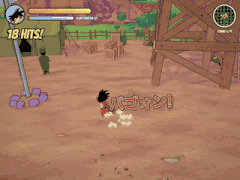
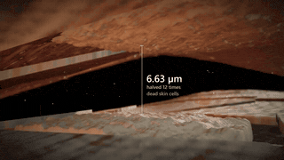

<h3>用 Claude Fable 5.2 做出来、能直接打开玩的东西</h3>

[English](README.md) · **简体中文** · [繁體中文](README.zh-TW.md) · [日本語](README.ja.md) · [한국어](README.ko.md) · [Español](README.es.md) · [Português](README.pt-BR.md) · [Français](README.fr.md) · [Deutsch](README.de.md) · [Русский](README.ru.md)

**🌐 网页版：[fablelist.000ooo.ooo/zh](https://fablelist.000ooo.ooo/zh/)**（可搜索，每个作品有详情页）

172 个能直接打开的作品 + 126 个视频演示，都是用 Claude Fable 5.2 做的，链接 2026-11-16 实测过。每天更新，觉得有用就点个 ⭐。

## 📑 目录

[⭐ 最受欢迎](#-最受欢迎) · [🎮 游戏](#-游戏) 85 · [🌍 3D 世界与场景](#-3d-世界与场景) 38 · [🧰 网页与工具](#-网页与工具) 36 · [🎬 动画与短片（附源码）](#-动画与短片附源码) 13 · [📺 只有视频](#-只有视频) 126 · [🤝 投稿](#-投稿)

## ⭐ 最受欢迎

<table>
<tr>
<td width="33%" valign="top">
 
<b><a href="https://starrynightrider.com">Starry Nightrider 星夜骑行</a></b> 
<a href="https://x.com/ebbyamir">@ebbyamir</a> · ♥ 17.9k · <a href="https://x.com/ebbyamir/status/2120284261089673376">▶ 视频</a> 
梵高骑车穿过他的《星夜》 
<a href="https://fablelist.000ooo.ooo/zh/prompts/?w=starry-nightrider&ref=gh"><b>✨ 获取提示词</b></a>
</td>
<td width="33%" valign="top">
 
<b><a href="https://claude.ai/artifact/BGY1SztrAYcJQHSsnHHGmp">Saltline 第一人称射击</a></b> 
<a href="https://x.com/felixrieseberg">@felixrieseberg</a> · ♥ 14.8k · <a href="https://x.com/felixrieseberg/status/2119925633564463609">▶ 视频</a> 
Anthropic 工程师；一次性提示、无人工反馈跑 8 小时，约 $550；模型、音效、贴图全部代码生成 
<a href="https://fablelist.000ooo.ooo/zh/prompts/?w=saltline-first-person-shooter&ref=gh"><b>✨ 获取提示词</b></a>
</td>
<td width="33%" valign="top">
 
<b><a href="https://patch.gg/blendi/oil-paint">Oil Paint 手绘油画风游戏</a></b> 
<a href="https://x.com/BlendiByl">@BlendiByl</a> · ♥ 8.0k · <a href="https://x.com/BlendiByl/status/2120341251178594532">▶ 视频</a> 
不到一小时做成；每帧约 150 万笔笔触，浏览器里跑 200 帧；开源 
<a href="https://fablelist.000ooo.ooo/zh/prompts/?w=oil-paint-hand-painted-game&ref=gh"><b>✨ 获取提示词</b></a>
</td>
</tr>
<tr>
<td width="33%" valign="top">
 
<b><a href="https://nyc.somethingbig.ai/">CROSSTOWN 纽约开放世界（早期试玩）</a></b> 
<a href="https://x.com/mattshumer_">@mattshumer_</a> · ♥ 7.5k · <a href="https://x.com/mattshumer_/status/2120282133503820150">▶ 视频</a> 
「Rockstar 花了 8 年，Fable 5.2 要 7 天做完」；目前只开放一部分城市，按 B 可以提反馈 
<a href="https://fablelist.000ooo.ooo/zh/prompts/?w=crosstown-open-world-new-york-early-preview&ref=gh"><b>✨ 获取提示词</b></a>
</td>
<td width="33%" valign="top">
 
<b><a href="https://claude.ai/artifact/QGWUAjRrzRzZWGcQzSMLfa">Blender 房间里的「Claude App」网页</a></b> 
<a href="https://x.com/rileybrown">@rileybrown</a> · ♥ 7.1k · <a href="https://x.com/rileybrown/status/2119902109709537708">▶ 视频</a> 
一条提示词建整个房间并渲 4K；链接是笔记本屏幕上那个仿 Claude App 的网页 
<a href="https://x.com/rileybrown/status/2119902109709537708">📝 作者公开的提示词（免费）</a>
</td>
<td width="33%" valign="top">
 
<b><a href="https://claudia.gallery">Claudia Gallery</a></b> 
<a href="https://x.com/anabology">@anabology</a> · ♥ 5.4k · <a href="https://x.com/anabology/status/2120010995309457643">▶ 视频</a> 
让它做「梦想中的视频」，9 小时两轮 
<a href="https://fablelist.000ooo.ooo/zh/prompts/?w=claudia-gallery&ref=gh"><b>✨ 获取提示词</b></a>
</td>
</tr>
</table>

## 🎮 游戏

<table>
<tr>
<td width="33%" valign="top">
 
<b><a href="https://starrynightrider.com">Starry Nightrider 星夜骑行</a></b> 
<a href="https://x.com/ebbyamir">@ebbyamir</a> · ♥ 17.9k · <a href="https://x.com/ebbyamir/status/2120284261089673376">▶ 视频</a> 
梵高骑车穿过他的《星夜》 
<a href="https://fablelist.000ooo.ooo/zh/prompts/?w=starry-nightrider&ref=gh"><b>✨ 获取提示词</b></a>
</td>
<td width="33%" valign="top">
 
<b><a href="https://claude.ai/artifact/BGY1SztrAYcJQHSsnHHGmp">Saltline 第一人称射击</a></b> 
<a href="https://x.com/felixrieseberg">@felixrieseberg</a> · ♥ 14.8k · <a href="https://x.com/felixrieseberg/status/2119925633564463609">▶ 视频</a> 
Anthropic 工程师；一次性提示、无人工反馈跑 8 小时，约 $550；模型、音效、贴图全部代码生成 
<a href="https://fablelist.000ooo.ooo/zh/prompts/?w=saltline-first-person-shooter&ref=gh"><b>✨ 获取提示词</b></a>
</td>
<td width="33%" valign="top">
 
<b><a href="https://patch.gg/blendi/oil-paint">Oil Paint 手绘油画风游戏</a></b> 
<a href="https://x.com/BlendiByl">@BlendiByl</a> · ♥ 8.0k · <a href="https://x.com/BlendiByl/status/2120341251178594532">▶ 视频</a> 
不到一小时做成；每帧约 150 万笔笔触，浏览器里跑 200 帧；开源 
<a href="https://fablelist.000ooo.ooo/zh/prompts/?w=oil-paint-hand-painted-game&ref=gh"><b>✨ 获取提示词</b></a>
</td>
</tr>
<tr>
<td width="33%" valign="top">
 
<b><a href="https://nyc.somethingbig.ai/">CROSSTOWN 纽约开放世界（早期试玩）</a></b> 
<a href="https://x.com/mattshumer_">@mattshumer_</a> · ♥ 7.5k · <a href="https://x.com/mattshumer_/status/2120282133503820150">▶ 视频</a> 
「Rockstar 花了 8 年，Fable 5.2 要 7 天做完」；目前只开放一部分城市，按 B 可以提反馈 
<a href="https://fablelist.000ooo.ooo/zh/prompts/?w=crosstown-open-world-new-york-early-preview&ref=gh"><b>✨ 获取提示词</b></a>
</td>
<td width="33%" valign="top">
 
<b><a href="https://what-the-water-keeps.vercel.app/">What the Water Keeps 梦境划船</a></b> 
<a href="https://x.com/kevin_t_ngo">@kevin_t_ngo</a> · ♥ 4.3k · <a href="https://x.com/kevin_t_ngo/status/2119868968307695818">▶ 视频</a> 
穿过 8 个梦境世界的划船游戏；原帖没放链接，链接来自转发者 @Bhavani_00007 / @meta_pavy 
<a href="https://fablelist.000ooo.ooo/zh/prompts/?w=what-the-water-keeps&ref=gh"><b>✨ 获取提示词</b></a>
</td>
<td width="33%" valign="top">
 
<b><a href="https://tennis.sixfingerpunch.com/">Tennis：让它放开做，结果是个 Pong</a></b> 
<a href="https://x.com/photonstorm">@photonstorm</a> · ♥ 3.1k · <a href="https://x.com/photonstorm/status/2120330010112434313">原帖</a> 
让它「放开做一个游戏」，看着只是个 Pong，玩起来才知道不止于此 
<a href="https://fablelist.000ooo.ooo/zh/prompts/?w=tennis&ref=gh"><b>✨ 获取提示词</b></a>
</td>
</tr>
<tr>
<td width="33%" valign="top">
 
<b><a href="https://patch.gg/play/blendi/small-magic">Small Magic 巫师沙盒</a></b> 
🆕 · <a href="https://x.com/BlendiByl">@BlendiByl</a> · ♥ 2.5k · <a href="https://x.com/BlendiByl/status/2121594536153718972">▶ 视频</a> 
一天做出的巫师沙盒：7 种法术、约 1800 块可破坏的物理碎片，零模型零贴图，开源
</td>
<td width="33%" valign="top">
 
<b><a href="https://www.spawn.co/@mattshumer/earth?room=local">Mirror Earth 镜像地球</a></b> 
<a href="https://x.com/mattshumer_">@mattshumer_</a> · ♥ 2.4k · <a href="https://x.com/mattshumer_/status/2119877065701036047">▶ 视频</a> 
整个地球可去可破坏，天气等与真实地球实时同步 
<a href="https://fablelist.000ooo.ooo/zh/prompts/?w=mirror-earth&ref=gh"><b>✨ 获取提示词</b></a>
</td>
<td width="33%" valign="top">
 
<b><a href="https://portals-endless-worlds.netlify.app/">Portals 无尽传送门世界</a></b> 
<a href="https://x.com/emollick">@emollick</a> · ♥ 1.9k · <a href="https://x.com/emollick/status/2119918307457577163">▶ 视频</a> 
2.5 万个 Agent 做出 450 多个代码 3D 世界，传送门相连自动漫游 
<a href="https://github.com/emollick/ai-portals">源码</a> · <a href="https://www.oneusefulthing.org/p/fable-52-and-jagged-agi">文章</a> 
<a href="https://fablelist.000ooo.ooo/zh/prompts/?w=portals-endless-worlds&ref=gh"><b>✨ 获取提示词</b></a>
</td>
</tr>
<tr>
<td width="33%" valign="top">
 
<b><a href="https://evensong-phi.vercel.app/">Evensong 魂系 Boss 战</a></b> 
<a href="https://x.com/kevin_t_ngo">@kevin_t_ngo</a> · ♥ 1.8k · <a href="https://x.com/kevin_t_ngo/status/2120238844754923874">▶ 视频</a> 
黑暗奇幻风的魂类 Boss 战试玩 
<a href="https://fablelist.000ooo.ooo/zh/prompts/?w=evensong&ref=gh"><b>✨ 获取提示词</b></a>
</td>
<td width="33%" valign="top">
 
<b><a href="https://loktar00.github.io/lanternfall/">LANTERNFALL</a></b> 
<a href="https://x.com/loktar00">@loktar00</a> · ♥ 1.4k · <a href="https://x.com/loktar00/status/2120192761542615271">▶ 视频</a> 
整个游戏连动画、模型都由它生成，敌人死亡的特效很细 
<a href="https://fablelist.000ooo.ooo/zh/prompts/?w=lanternfall&ref=gh"><b>✨ 获取提示词</b></a>
</td>
<td width="33%" valign="top">
 
<b><a href="https://app.usecrayon.ai/play/76dbd04f-0684-4486-8cc4-eae0585295e8">Goku: Four-Star Road 悟空：四星之路</a></b> 
🆕 · <a href="https://x.com/aniketjart">@aniketjart</a> · ♥ 1.3k · <a href="https://x.com/aniketjart/status/2121793239175119279">▶ 视频</a> 
照着龙珠红缎带军篇做的同人动作游戏，three.js 写的，目前能玩前两张地图
</td>
</tr>
</table>

<b><a href="all/games.zh-CN.md">查看全部 85 个 →</a></b>

<a href="#-目录">↑ 回到目录</a>

## 🌍 3D 世界与场景

<table>
<tr>
<td width="33%" valign="top">
 
<b><a href="https://claude.ai/artifact/QGWUAjRrzRzZWGcQzSMLfa">Blender 房间里的「Claude App」网页</a></b> 
<a href="https://x.com/rileybrown">@rileybrown</a> · ♥ 7.1k · <a href="https://x.com/rileybrown/status/2119902109709537708">▶ 视频</a> 
一条提示词建整个房间并渲 4K；链接是笔记本屏幕上那个仿 Claude App 的网页 
<a href="https://x.com/rileybrown/status/2119902109709537708">📝 作者公开的提示词（免费）</a>
</td>
<td width="33%" valign="top">
 
<b><a href="https://patch.gg/blendi/painted-valley">Painted Valley 吉卜力风山谷</a></b> 
<a href="https://x.com/BlendiByl">@BlendiByl</a> · ♥ 1.8k · <a href="https://x.com/BlendiByl/status/2120694003230560585">▶ 视频</a> 
可以走进去的手绘风场景；开源 
<a href="https://fablelist.000ooo.ooo/zh/prompts/?w=painted-valley&ref=gh"><b>✨ 获取提示词</b></a>
</td>
<td width="33%" valign="top">
 
<b><a href="https://claude.ai/artifact/CTjrZXVdUgKJ6qJXrvvr28">Ancient Babylon 古巴比伦城</a></b> 
<a href="https://x.com/literallydenis">@literallydenis</a> · ♥ 1.2k · <a href="https://x.com/literallydenis/status/2120866958790848953">▶ 视频</a> 
公元前 600 年的巴比伦，它自己查史料和建筑图纸，跑了 8 小时，能自由逛 
<a href="https://fablelist.000ooo.ooo/zh/prompts/?w=ancient-babylon-600-bc&ref=gh"><b>✨ 获取提示词</b></a>
</td>
</tr>
<tr>
<td width="33%" valign="top">
 
<b><a href="https://indiranagar-live.vercel.app">印度班加罗尔 Indiranagar 1 平方公里</a></b> 
<a href="https://x.com/anshu4321">@anshu4321</a> · ♥ 1.2k · <a href="https://x.com/anshu4321/status/2119938067758772403">▶ 视频</a> 
用他们的地图数据 + 一条提示词 
<a href="https://fablelist.000ooo.ooo/zh/prompts/?w=1-km2-of-indiranagar&ref=gh"><b>✨ 获取提示词</b></a>
</td>
<td width="33%" valign="top">
 
<b><a href="https://fable-rome.surge.sh/">Rome, AD 320 古罗马</a></b> 
<a href="https://x.com/petergostev">@petergostev</a> · ♥ 967 · <a href="https://x.com/petergostev/status/2120167560700383572">▶ 视频</a> 
一条提示词，Fable 5.2 Max 跑了一夜，花费 $2,618 
<a href="https://x.com/petergostev/status/2120167560700383572">📝 作者公开的提示词（免费）</a>
</td>
<td width="33%" valign="top">
 
<b><a href="https://github.com/Leonxlnx/room-at-dawn">Room at Dawn 黎明的卧室</a></b> 
<a href="https://x.com/LexnLin">@LexnLin</a> · ♥ 860 · <a href="https://x.com/LexnLin/status/2120910879361548565">▶ 视频</a> 
three.js 写的写实卧室，没用任何现成模型和贴图，全是代码生成 
<a href="https://fablelist.000ooo.ooo/zh/prompts/?w=room-at-dawn&ref=gh"><b>✨ 获取提示词</b></a>
</td>
</tr>
<tr>
<td width="33%" valign="top">
 
<b><a href="https://fable-rover.vercel.app">ER-6 火星车地形探索</a></b> 
🆕 · <a href="https://x.com/DilumSanjaya">@DilumSanjaya</a> · ♥ 786 · <a href="https://x.com/DilumSanjaya/status/2120561077385867663">▶ 视频</a> 
让它设计 NASA 火星车那种摇臂-转向架悬挂，再模拟它在外星地形上自动行驶
</td>
<td width="33%" valign="top">
 
<b><a href="https://supernatural-ft.vercel.app/fire-in-ice">Fire in Ice 冰中之火</a></b> 
<a href="https://x.com/tkm_hmng8">@tkm_hmng8</a> · ♥ 550 · <a href="https://x.com/tkm_hmng8/status/2120813043101946324">▶ 视频</a> 
冰块里燃烧的火焰，不用 three.js，纯 WebGPU 写的写实效果 
<a href="https://fablelist.000ooo.ooo/zh/prompts/?w=fire-in-ice&ref=gh"><b>✨ 获取提示词</b></a>
</td>
<td width="33%" valign="top">
 
<b><a href="https://ship-42-catch.netlify.app/">Ship 42 Catch 星舰筷子夹回收</a></b> 
🆕 · <a href="https://x.com/emollick">@emollick</a> · ♥ 467 · <a href="https://x.com/emollick/status/2122036763468214711">▶ 视频</a> 
让 Fable 和 Opus 找来星舰被发射塔「筷子」夹住的视频，把最后 40 秒用 three.js 高细节重现，能切换视角
</td>
</tr>
<tr>
<td width="33%" valign="top">
 
<b><a href="https://bay.theojaffee.net">湾区 250 年</a></b> 
<a href="https://x.com/theojaffee">@theojaffee</a> · ♥ 385 · <a href="https://x.com/theojaffee/status/2120312766544437738">▶ 视频</a> 
缩放到任意城市或街区，选 1769 年以来的任一年看当时的样子 
<a href="https://nyc.theojaffee.net">纽约版</a> 
<a href="https://fablelist.000ooo.ooo/zh/prompts/?w=bay-area-through-time&ref=gh"><b>✨ 获取提示词</b></a>
</td>
<td width="33%" valign="top">
 
<b><a href="http://procedural-arm-rig.vercel.app">程序化手臂绑定</a></b> 
<a href="https://x.com/apekshik">@apekshik</a> · ♥ 326 · <a href="https://x.com/apekshik/status/2120224530367119758">▶ 视频</a> 
不做 3A 大作，只把一条手臂做到极致：骨架、权重、IK，握拳时肌肉会鼓起 
<a href="https://fablelist.000ooo.ooo/zh/prompts/?w=procedural-arm-rig&ref=gh"><b>✨ 获取提示词</b></a>
</td>
<td width="33%" valign="top">
 
<b><a href="https://samg-coder.github.io/solstice-garden/">The Garden 夏至花园</a></b> 
<a href="https://x.com/SamGCoder">@SamGCoder</a> · ♥ 297 · <a href="https://x.com/SamGCoder/status/2120943068321054975">▶ 视频</a> 
Rust 编译成 WASM、用 WebGPU 渲染的花园 
<a href="https://fablelist.000ooo.ooo/zh/prompts/?w=the-garden&ref=gh"><b>✨ 获取提示词</b></a>
</td>
</tr>
</table>

<b><a href="all/3d-worlds.zh-CN.md">查看全部 38 个 →</a></b>

<a href="#-目录">↑ 回到目录</a>

## 🧰 网页与工具

<table>
<tr>
<td width="33%" valign="top">
 
<b><a href="https://claudia.gallery">Claudia Gallery</a></b> 
<a href="https://x.com/anabology">@anabology</a> · ♥ 5.4k · <a href="https://x.com/anabology/status/2120010995309457643">▶ 视频</a> 
让它做「梦想中的视频」，9 小时两轮 
<a href="https://fablelist.000ooo.ooo/zh/prompts/?w=claudia-gallery&ref=gh"><b>✨ 获取提示词</b></a>
</td>
<td width="33%" valign="top">
 
<b><a href="http://robotics-lab-app.vercel.app">Robotics Lab 机器人开发板实验室</a></b> 
<a href="https://x.com/0xMovez">@0xMovez</a> · ♥ 4.7k · <a href="https://x.com/0xMovez/status/2120239217880268919">▶ 视频</a> 
8 块真实开发板的 3D 模型，逐件装芯片、焊接、接电路 
<a href="http://robolabs-app.vercel.app">人形机器人版</a> 
<a href="https://fablelist.000ooo.ooo/zh/prompts/?w=robotics-lab&ref=gh"><b>✨ 获取提示词</b></a>
</td>
<td width="33%" valign="top">
 
<b><a href="https://claude.ai/artifact/N6bSgS4ZH5ifFQfg8sm4dv">House Bangers 浩室舞曲生成器</a></b> 
<a href="https://x.com/deedydas">@deedydas</a> · ♥ 4.0k · <a href="https://x.com/deedydas/status/2120905625852936318">▶ 视频</a> 
学完乐理后每种乐器试上千种节奏挑最好的，编成 72 小节的浩室舞曲，要开声音 
<a href="https://fablelist.000ooo.ooo/zh/prompts/?w=house-bangers-generator&ref=gh"><b>✨ 获取提示词</b></a>
</td>
</tr>
<tr>
<td width="33%" valign="top">
 
<b><a href="https://miaai-lab.github.io/Claude-Fable-5.2-HTML-Files/">76 个单文件 HTML 视觉作品集</a></b> 
<a href="https://x.com/MiaAI_lab">@MiaAI_lab</a> · ♥ 2.6k · <a href="https://x.com/MiaAI_lab/status/2119930229661503893">原帖</a> 
每个都附原始提示词 
<a href="https://fablelist.000ooo.ooo/zh/prompts/?w=76-single-file-html-pieces&ref=gh"><b>✨ 获取提示词</b></a>
</td>
<td width="33%" valign="top">
 
<b><a href="https://pixel-worlds.vercel.app/keep/">Keep 像素世界密码强度条</a></b> 
<a href="https://x.com/crtvTeknologist">@crtvTeknologist</a> · ♥ 1.6k · <a href="https://x.com/crtvTeknologist/status/2119894073024606617">▶ 视频</a> 
把密码强度条做成一个活的像素世界 
<a href="https://github.com/finktheartist/pixel-worlds">源码</a> 
<a href="https://fablelist.000ooo.ooo/zh/prompts/?w=keep-password-strength-meter&ref=gh"><b>✨ 获取提示词</b></a>
</td>
<td width="33%" valign="top">
 
<b><a href="https://masterofvfx2070.github.io/xray-mirror/">X-Ray Mirror X 光镜子</a></b> 
<a href="https://x.com/HashemGhaili">@HashemGhaili</a> · ♥ 1.4k · <a href="https://x.com/HashemGhaili/status/2120202746121085321">▶ 视频</a> 
摄像头对着脸，实时看到头骨、大脑和肌肉；张嘴下巴跟着动，举起手能看到手骨，画面不出本机 
<a href="https://github.com/MasterOfVFX2070/xray-mirror">源码</a> 
<a href="https://fablelist.000ooo.ooo/zh/prompts/?w=x-ray-mirror&ref=gh"><b>✨ 获取提示词</b></a>
</td>
</tr>
<tr>
<td width="33%" valign="top">
 
<b><a href="https://xianxie6.github.io/animals-planner-2027/">动物也上班 3D 电子手帐</a></b> 
<a href="https://x.com/Xian0063">@Xian0063</a> · ♥ 1.2k · <a href="https://x.com/Xian0063/status/2120417834694250522">▶ 视频</a> 
把实体手帐做成 3D：拖动翻页、点日期直接写、90 枚贴纸能撕能贴；Opus 5.5 搭骨架，Fable 5.2 对照实拍精修材质 
<a href="https://fablelist.000ooo.ooo/zh/prompts/?w=animals-at-work-3d-planner&ref=gh"><b>✨ 获取提示词</b></a>
</td>
<td width="33%" valign="top">
 
<b><a href="https://uberdesigner.ai/t/spine-menu">Spine Menu 菜单动效</a></b> 
<a href="https://x.com/seanaiux">@seanaiux</a> · ♥ 1.2k · <a href="https://x.com/seanaiux/status/2120222459110789574">▶ 视频</a> 
页面附提示词 
<a href="https://uberdesigner.ai/t/aquarium-toggle">水族箱开关</a> · <a href="https://uberdesigner.ai/t/glow-widgets">发光卡片</a>
</td>
<td width="33%" valign="top">
 
<b><a href="https://roverkit.vercel.app">RoverKit 机器人小车教学</a></b> 
🆕 · <a href="https://x.com/DilumSanjaya">@DilumSanjaya</a> · ♥ 1.0k · <a href="https://x.com/DilumSanjaya/status/2121286147393651085">▶ 视频</a> 
一步步教你造机器人小车：带模拟器、可自定义场地和图解代码，支持 Arduino 和 ESP32
</td>
</tr>
<tr>
<td width="33%" valign="top">
 
<b><a href="https://github.com/AlexAtFF/pulp-daw-public">PULP AI 原生音频工作站</a></b> 
<a href="https://x.com/The_Alex">@The_Alex</a> · ♥ 942 · <a href="https://x.com/The_Alex/status/2119917226769985785">▶ 视频</a> 
Windows 原生 DAW；让 Claude 做音乐时它会自己打开这个工作站编曲 
<a href="https://fablelist.000ooo.ooo/zh/prompts/?w=pulp-an-ai-native-daw&ref=gh"><b>✨ 获取提示词</b></a>
</td>
<td width="33%" valign="top">
 
<b><a href="https://frontier.every.to/experiments/ambient-town">Ambient Town 氛围音乐工作站</a></b> 
<a href="https://x.com/kieranklaassen">@kieranklaassen</a> · ♥ 891 · <a href="https://x.com/kieranklaassen/status/2119868196773929160">▶ 视频</a> 
前电影配乐师花一周晚上做的 DAW：支持 Ableton Push、多路麦克风、效果器，还有一起作曲的 Agent；页面里点 Try it 
<a href="https://fablelist.000ooo.ooo/zh/prompts/?w=ambient-town&ref=gh"><b>✨ 获取提示词</b></a>
</td>
<td width="33%" valign="top">
 
<b><a href="https://itspsneha.com/supplements">印度维生素该买哪些</a></b> 
<a href="https://x.com/itspsneha">@itspsneha</a> · ♥ 739 · <a href="https://x.com/itspsneha/status/2120048494761451974">原帖</a> 
读了 109 批检测报告做成的指南页 
<a href="https://fablelist.000ooo.ooo/zh/prompts/?w=which-vitamins-to-buy-in-india&ref=gh"><b>✨ 获取提示词</b></a>
</td>
</tr>
</table>

<b><a href="all/web-and-tools.zh-CN.md">查看全部 36 个 →</a></b>

<a href="#-目录">↑ 回到目录</a>

## 🎬 动画与短片（附源码）

<table>
<tr>
<td width="33%" valign="top">
 
<b><a href="https://github.com/ChetasLua/crimson-loong">Crimson Loong 赤龙：90 秒巨龙短片</a></b> 
<a href="https://x.com/chetaslua">@chetaslua</a> · ♥ 3.7k · <a href="https://x.com/chetaslua/status/2121176151234330707">▶ 视频</a> 
three.js 纯代码的 90 秒巨龙短片，没有任何外部素材 
<a href="https://fablelist.000ooo.ooo/zh/prompts/?w=crimson-loong&ref=gh"><b>✨ 获取提示词</b></a>
</td>
<td width="33%" valign="top">
 
<b><a href="https://github.com/amirmushichge/shred-kit">Shred Kit 碎纸动画模板</a></b> 
🆕 · <a href="https://x.com/AmirMushich">@AmirMushich</a> · ♥ 425 · <a href="https://x.com/AmirMushich/status/2121339167800213934">▶ 视频</a> 
Fable 5.2 + Blender 做的 8 秒碎纸短片，做成了免费模板
</td>
<td width="33%" valign="top">
 
<b><a href="https://github.com/ChetasLua/pelican-riding-a-bicycle">骑车的鹈鹕：60 秒手绘风短片</a></b> 
<a href="https://x.com/chetaslua">@chetaslua</a> · ♥ 356 · <a href="https://x.com/chetaslua/status/2120438091647218025">▶ 视频</a> 
一个 HTML 文件，画面和声音全是代码，没有图片、音频和库 
<a href="https://github.com/ChetasLua/mona-lisa-js">蒙娜丽莎</a> 
<a href="https://fablelist.000ooo.ooo/zh/prompts/?w=the-pelican-tired-of-the-road&ref=gh"><b>✨ 获取提示词</b></a>
</td>
</tr>
<tr>
<td width="33%" valign="top">
 
<b><a href="https://github.com/anstapnever/one-sweep">One Sweep 78 秒动漫打斗</a></b> 
<a href="https://x.com/anstapnever">@anstapnever</a> · ♥ 251 · <a href="https://x.com/anstapnever/status/2119772039037014524">▶ 视频</a> 
纯 Three.js 代码，6 组 Agent 并行；作者写的是「Fable 5.5」 
<a href="https://x.com/anstapnever/status/2119772039037014524">📝 作者公开的提示词（免费）</a>
</td>
<td width="33%" valign="top">
 
<b><a href="https://github.com/crossps/ballpoint">圆珠笔微距 ASMR</a></b> 
<a href="https://x.com/camperaigg">@camperaigg</a> · ♥ 241 · <a href="https://x.com/camperaigg/status/2119777467074580741">▶ 视频</a> 
开源证明不是视频模型生成 
<a href="https://fablelist.000ooo.ooo/zh/prompts/?w=ballpoint&ref=gh"><b>✨ 获取提示词</b></a>
</td>
<td width="33%" valign="top">
 
<b><a href="https://github.com/ChetasLua/godzilla-nights">哥斯拉之夜</a></b> 
<a href="https://x.com/chetaslua">@chetaslua</a> · ♥ 229 · <a href="https://x.com/chetaslua/status/2119981510199808368">▶ 视频</a> 
纯代码画图加动画 
<a href="https://fablelist.000ooo.ooo/zh/prompts/?w=godzilla-nights&ref=gh"><b>✨ 获取提示词</b></a>
</td>
</tr>
<tr>
<td width="33%" valign="top">
 
<b><a href="https://github.com/0xCodez/thousand-peaks">Dragon of a Thousand Peaks 千峰之龙</a></b> 
🆕 · <a href="https://x.com/0xMovez">@0xMovez</a> · ♥ 124 · <a href="https://x.com/0xMovez/status/2121721290687983906">▶ 视频</a> 
90 秒纯 three.js 打斗短片，无素材无视频模型；Fable 当导演带 8 个并行 Agent，音乐音效也是代码合成
</td>
<td width="33%" valign="top">
 
<b><a href="https://github.com/anstapnever/blackout">Blackout 79 秒动漫</a></b> 
<a href="https://x.com/anstapnever">@anstapnever</a> · ♥ 118 · <a href="https://x.com/anstapnever/status/2119915123070644263">▶ 视频</a> 
 
<a href="https://x.com/anstapnever/status/2119915123070644263">📝 作者公开的提示词（免费）</a>
</td>
</tr>
</table>

<b><a href="all/animation.zh-CN.md">查看全部 13 个 →</a></b>

<a href="#-目录">↑ 回到目录</a>

## 📺 只有视频

作者只发了视频、没公开作品链接。点封面看原帖视频。

<table>
<tr>
<td width="33%" valign="top">
 
<b><a href="https://x.com/claudeai/status/2119899459761131615">官方：预发布测试期间的各领域项目合集</a></b> 
<a href="https://x.com/claudeai">@claudeai</a> · ♥ 43.1k · <a href="https://x.com/claudeai/status/2119899459761131615">▶ 视频</a> 
 
<a href="https://fablelist.000ooo.ooo/zh/prompts/?w=anthropic-pre-release-projects&ref=gh"><b>✨ 获取提示词</b></a>
</td>
<td width="33%" valign="top">
 
<b><a href="https://x.com/anxuanng/status/2120088745139638375">用 3D 短片讲芝诺悖论：手指为什么永远碰不到</a></b> 
<a href="https://x.com/anxuanng">@anxuanng</a> · ♥ 10.0k · <a href="https://x.com/anxuanng/status/2120088745139638375">▶ 视频</a> 
 
<a href="https://fablelist.000ooo.ooo/zh/prompts/?w=a-3d-film-explaining-zeno-s-paradox&ref=gh"><b>✨ 获取提示词</b></a>
</td>
<td width="33%" valign="top">
 
<b><a href="https://x.com/imjustnewatai/status/2120383964686729410">发明新曲式：一首形状像训练过程的交响曲</a></b> 
<a href="https://x.com/imjustnewatai">@imjustnewatai</a> · ♥ 9.7k · <a href="https://x.com/imjustnewatai/status/2120383964686729410">▶ 视频</a> 
 
<a href="https://fablelist.000ooo.ooo/zh/prompts/?w=a-symphony-shaped-like-a-training-run&ref=gh"><b>✨ 获取提示词</b></a>
</td>
</tr>
<tr>
<td width="33%" valign="top">
 
<b><a href="https://x.com/everestchris6/status/2120175941616128277">把 2D 平面图变成能逛的 3D 漫游</a></b> 
<a href="https://x.com/everestchris6">@everestchris6</a> · ♥ 7.3k · <a href="https://x.com/everestchris6/status/2120175941616128277">▶ 视频</a> 
 
<a href="https://x.com/everestchris6/status/2120175941616128277">📝 作者公开的提示词（免费）</a>
</td>
<td width="33%" valign="top">
 
<b><a href="https://x.com/dominikmartn/status/2120154832694858224">它真的会做设计：一整套记账分账 App 的界面组件</a></b> 
<a href="https://x.com/dominikmartn">@dominikmartn</a> · ♥ 7.2k · <a href="https://x.com/dominikmartn/status/2120154832694858224">▶ 视频</a> 
 
<a href="https://fablelist.000ooo.ooo/zh/prompts/?w=it-can-actually-design&ref=gh"><b>✨ 获取提示词</b></a>
</td>
<td width="33%" valign="top">
 
<b><a href="https://x.com/suna_gaku/status/2119952985933697063">「拿出你现在最强的视频」</a></b> 
<a href="https://x.com/suna_gaku">@suna_gaku</a> · ♥ 6.7k · <a href="https://x.com/suna_gaku/status/2119952985933697063">▶ 视频</a> 
 
<a href="https://x.com/suna_gaku/status/2119952985933697063">📝 作者公开的提示词（免费）</a>
</td>
</tr>
<tr>
<td width="33%" valign="top">
 
<b><a href="https://x.com/yohakutoink/status/2120824797215310208">用代码临摹一幅画，问它是不是透了原图，它说原图这里有斑、它的没有</a></b> 
<a href="https://x.com/yohakutoink">@yohakutoink</a> · ♥ 6.4k · <a href="https://x.com/yohakutoink/status/2120824797215310208">▶ 视频</a> 
 
<a href="https://fablelist.000ooo.ooo/zh/prompts/?w=painting-a-copy-in-code-the-original-has&ref=gh"><b>✨ 获取提示词</b></a>
</td>
<td width="33%" valign="top">
 
<b><a href="https://x.com/matabee_GTO/status/2120995946372985144">一句话让它「用尽全力做一段让人不舒服的视频」</a></b> 
<a href="https://x.com/matabee_GTO">@matabee_GTO</a> · ♥ 4.8k · <a href="https://x.com/matabee_GTO/status/2120995946372985144">▶ 视频</a> 
 
<a href="https://x.com/matabee_GTO/status/2120995946372985144">📝 作者公开的提示词（免费）</a>
</td>
<td width="33%" valign="top">
 
<b><a href="https://x.com/MrTacticalX/status/2121082861902070130">三个 Fable 5.2 Agent 花 7 小时 41 分钟造一台电脑</a></b> 
<a href="https://x.com/MrTacticalX">@MrTacticalX</a> · ♥ 4.6k · <a href="https://x.com/MrTacticalX/status/2121082861902070130">▶ 视频</a> 
 
<a href="https://fablelist.000ooo.ooo/zh/prompts/?w=three-fable-5-2-agents-build-a-computer&ref=gh"><b>✨ 获取提示词</b></a>
</td>
</tr>
<tr>
<td width="33%" valign="top">
 
<b><a href="https://x.com/XRarchitect/status/2120947265007440052">Atlas + Fable 5.2 + three.js</a></b> 
<a href="https://x.com/XRarchitect">@XRarchitect</a> · ♥ 4.4k · <a href="https://x.com/XRarchitect/status/2120947265007440052">▶ 视频</a> 
 
<a href="https://fablelist.000ooo.ooo/zh/prompts/?w=atlas-fable-5-2-three-js&ref=gh"><b>✨ 获取提示词</b></a>
</td>
<td width="33%" valign="top">
 
<b><a href="https://x.com/JungleSilicon/status/2121782359901212987">像素风的高斯泼溅场景，用 Fable 5.2 做的</a></b> 
🆕 · <a href="https://x.com/JungleSilicon">@JungleSilicon</a> · ♥ 3.6k · <a href="https://x.com/JungleSilicon/status/2121782359901212987">▶ 视频</a> 

</td>
<td width="33%" valign="top">
 
<b><a href="https://x.com/aollivier82/status/2120260208245043663">计算机图形学发展史动画</a></b> 
<a href="https://x.com/aollivier82">@aollivier82</a> · ♥ 3.2k · <a href="https://x.com/aollivier82/status/2120260208245043663">▶ 视频</a> 
 
<a href="https://fablelist.000ooo.ooo/zh/prompts/?w=the-history-of-computer-graphics-animated&ref=gh"><b>✨ 获取提示词</b></a>
</td>
</tr>
</table>

<b><a href="all/video-demos.zh-CN.md">查看全部 126 个 →</a></b>

## 🤝 投稿

发现漏掉的作品？开一个 [Issue](../../issues/new) 或 PR，附上作品链接和原帖链接即可。要求：链接能直接打开，作品确实用 Fable 5.2 做出。详见 [CONTRIBUTING.md](CONTRIBUTING.md)。

## 免责声明

所有作品版权归原作者所有。本仓库只做索引，只放几秒的低清动图预览，不托管完整作品或视频，完整视频请看原帖。作者如希望撤下预览或条目，请开 Issue，会尽快处理。本项目与 Anthropic 无关。

## Star History

## License

[CC0 1.0](LICENSE)：清单本身放弃全部权利，随意使用。

## 📰 更新

- **2026-11-16**：新增 6 个可打开作品和 4 个视频演示。
- **2026-11-15**：新增 10 个可打开作品和 10 个视频演示。
- **2026-11-14**：新增 13 个可打开作品和 2 个视频演示。
- **2026-11-13**：新增 41 个可打开作品和 24 个视频演示。
- **2026-11-10**：每个作品都加上了动图预览。
- **2026-11-10**：首版，57 个可打开作品 + 61 个视频演示。
