

<h3>用 Claude Fable 5.2 做出来、能直接打开玩的东西</h3>

[English](README.md) · **简体中文**

Claude Fable 5.2 在 2026-11-09 发布。发布后几天里，X 上出现了大量用它做的游戏、3D 世界和网页。这份清单只收**能点开就用的作品**：92 个在线作品，每个链接都在 2026-11-12 实际打开验证过；另有 83 个只发了视频的高赞演示，单独放在后面。

每一项都配了几秒的动图预览，写明作者，并链接回原帖看完整视频。带 🆕 的是最近一次更新新加的。觉得有用就点个 ⭐，作品还在每天增加。

## 📰 更新

- **2026-11-12**：新增 35 个可打开作品和 22 个视频演示（带 🆕），现在共 92 + 83；全部链接重新实测；预览图总大小从 75MB 压到 10MB，页面加载快了很多。
- **2026-11-10**：每个作品都加上了动图预览。
- **2026-11-10**：首版，57 个可打开作品 + 61 个视频演示。

## 📑 目录

- [⭐ 最受欢迎](#-最受欢迎)
- [🎮 游戏](#-游戏) · 39
- [🌍 3D 世界与场景](#-3d-世界与场景) · 22
- [🧰 网页与工具](#-网页与工具) · 22
- [🎬 动画与短片（附源码）](#-动画与短片附源码) · 9
- [📺 只有视频](#-只有视频) · 83
- [🔗 相关清单](#-相关清单)
- [🧭 收录方法](#-收录方法)
- [🤝 投稿](#-投稿)

## ⭐ 最受欢迎

按原帖点赞数排序的前 6 个。

<table>
<tr>
<td width="33%" valign="top">
 
<b><a href="https://claude.ai/artifact/BGY1SztrAYcJQHSsnHHGmp">Saltline 第一人称射击</a></b> 
<a href="https://x.com/felixrieseberg">@felixrieseberg</a> · ♥ 7.5k · <a href="https://x.com/felixrieseberg/status/2119925633564463609">▶ 视频</a> 
Anthropic 工程师；一次性提示、无人工反馈跑 8 小时，约 $550；模型、音效、贴图全部代码生成
</td>
<td width="33%" valign="top">
 
<b><a href="https://nyc.somethingbig.ai/">CROSSTOWN 纽约开放世界（早期试玩）</a></b> 
🆕 · <a href="https://x.com/mattshumer_">@mattshumer_</a> · ♥ 6.5k · <a href="https://x.com/mattshumer_/status/2120282133503820150">▶ 视频</a> 
「Rockstar 花了 8 年，Fable 5.2 要 7 天做完」；目前只开放一部分城市，按 B 可以提反馈
</td>
<td width="33%" valign="top">
 
<b><a href="https://patch.gg/blendi/oil-paint">Oil Paint 手绘油画风游戏</a></b> 
🆕 · <a href="https://x.com/BlendiByl">@BlendiByl</a> · ♥ 6.4k · <a href="https://x.com/BlendiByl/status/2120341251178594532">▶ 视频</a> 
不到一小时做成；每帧约 150 万笔笔触，浏览器里跑 200 帧；开源
</td>
</tr>
<tr>
<td width="33%" valign="top">
 
<b><a href="https://starrynightrider.com">Starry Nightrider 星夜骑行</a></b> 
🆕 · <a href="https://x.com/ebbyamir">@ebbyamir</a> · ♥ 5.4k · <a href="https://x.com/ebbyamir/status/2120284261089673376">▶ 视频</a> 
梵高骑车穿过他的《星夜》
</td>
<td width="33%" valign="top">
 
<b><a href="https://claude.ai/artifact/QGWUAjRrzRzZWGcQzSMLfa">Blender 房间里的「Claude App」网页</a></b> 
<a href="https://x.com/rileybrown">@rileybrown</a> · ♥ 5.2k · <a href="https://x.com/rileybrown/status/2119902109709537708">▶ 视频</a> 
一条提示词建整个房间并渲 4K；链接是笔记本屏幕上那个仿 Claude App 的网页
</td>
<td width="33%" valign="top">
 
<b><a href="http://robotics-lab-app.vercel.app">Robotics Lab 机器人开发板实验室</a></b> 
🆕 · <a href="https://x.com/0xMovez">@0xMovez</a> · ♥ 4.5k · <a href="https://x.com/0xMovez/status/2120239217880268919">▶ 视频</a> 
8 块真实开发板的 3D 模型，逐件装芯片、焊接、接电路 
<a href="http://robolabs-app.vercel.app">人形机器人版</a>
</td>
</tr>
</table>

## 🎮 游戏

<table>
<tr>
<td width="33%" valign="top">
 
<b><a href="https://claude.ai/artifact/BGY1SztrAYcJQHSsnHHGmp">Saltline 第一人称射击</a></b> 
<a href="https://x.com/felixrieseberg">@felixrieseberg</a> · ♥ 7.5k · <a href="https://x.com/felixrieseberg/status/2119925633564463609">▶ 视频</a> 
Anthropic 工程师；一次性提示、无人工反馈跑 8 小时，约 $550；模型、音效、贴图全部代码生成
</td>
<td width="33%" valign="top">
 
<b><a href="https://nyc.somethingbig.ai/">CROSSTOWN 纽约开放世界（早期试玩）</a></b> 
🆕 · <a href="https://x.com/mattshumer_">@mattshumer_</a> · ♥ 6.5k · <a href="https://x.com/mattshumer_/status/2120282133503820150">▶ 视频</a> 
「Rockstar 花了 8 年，Fable 5.2 要 7 天做完」；目前只开放一部分城市，按 B 可以提反馈
</td>
<td width="33%" valign="top">
 
<b><a href="https://patch.gg/blendi/oil-paint">Oil Paint 手绘油画风游戏</a></b> 
🆕 · <a href="https://x.com/BlendiByl">@BlendiByl</a> · ♥ 6.4k · <a href="https://x.com/BlendiByl/status/2120341251178594532">▶ 视频</a> 
不到一小时做成；每帧约 150 万笔笔触，浏览器里跑 200 帧；开源
</td>
</tr>
<tr>
<td width="33%" valign="top">
 
<b><a href="https://starrynightrider.com">Starry Nightrider 星夜骑行</a></b> 
🆕 · <a href="https://x.com/ebbyamir">@ebbyamir</a> · ♥ 5.4k · <a href="https://x.com/ebbyamir/status/2120284261089673376">▶ 视频</a> 
梵高骑车穿过他的《星夜》
</td>
<td width="33%" valign="top">
 
<b><a href="https://what-the-water-keeps.vercel.app/">What the Water Keeps 梦境划船</a></b> 
<a href="https://x.com/kevin_t_ngo">@kevin_t_ngo</a> · ♥ 3.7k · <a href="https://x.com/kevin_t_ngo/status/2119868968307695818">▶ 视频</a> 
穿过 8 个梦境世界的划船游戏；原帖没放链接，链接来自转发者 @Bhavani_00007 / @meta_pavy
</td>
<td width="33%" valign="top">
 
<b><a href="https://www.spawn.co/@mattshumer/earth?room=local">Mirror Earth 镜像地球</a></b> 
<a href="https://x.com/mattshumer_">@mattshumer_</a> · ♥ 2.0k · <a href="https://x.com/mattshumer_/status/2119877065701036047">▶ 视频</a> 
整个地球可去可破坏，天气等与真实地球实时同步
</td>
</tr>
<tr>
<td width="33%" valign="top">
 
<b><a href="https://evensong-phi.vercel.app/">Evensong 魂系 Boss 战</a></b> 
🆕 · <a href="https://x.com/kevin_t_ngo">@kevin_t_ngo</a> · ♥ 1.7k · <a href="https://x.com/kevin_t_ngo/status/2120238844754923874">▶ 视频</a> 
黑暗奇幻风的魂类 Boss 战试玩
</td>
<td width="33%" valign="top">
 
<b><a href="https://portals-endless-worlds.netlify.app/">Portals 无尽传送门世界</a></b> 
<a href="https://x.com/emollick">@emollick</a> · ♥ 1.5k · <a href="https://x.com/emollick/status/2119918307457577163">▶ 视频</a> 
2.5 万个 Agent 做出 450 多个代码 3D 世界，传送门相连自动漫游 
<a href="https://github.com/emollick/ai-portals">源码</a> · <a href="https://www.oneusefulthing.org/p/fable-52-and-jagged-agi">文章</a>
</td>
<td width="33%" valign="top">
 
<b><a href="https://loktar00.github.io/lanternfall/">LANTERNFALL</a></b> 
🆕 · <a href="https://x.com/loktar00">@loktar00</a> · ♥ 1.4k · <a href="https://x.com/loktar00/status/2120192761542615271">▶ 视频</a> 
整个游戏连动画、模型都由它生成，敌人死亡的特效很细
</td>
</tr>
<tr>
<td width="33%" valign="top">
 
<b><a href="https://wavedash.com/games/rooftop-rally">Rooftop Rally 天台匹克球（Unreal 5.9）</a></b> 
🆕 · <a href="https://x.com/chongdashu">@chongdashu</a> · ♥ 1.1k · <a href="https://x.com/chongdashu/status/2120154573356793883">▶ 视频</a> 
Fable 5.2 + Unreal Engine 5.9 预览版；角色用 Tripo，其余资产和关卡都是它做的 
<a href="https://x.com/chongdashu/status/2120310120509014219">制作过程</a>
</td>
<td width="33%" valign="top">
 
<b><a href="https://claude.ai/artifact/MXxb36zKgN261ckbGhmNin">Three Games 合集页（Saltline / 钟表匠之心 / Tidewright）</a></b> 
<a href="https://x.com/felixrieseberg">@felixrieseberg</a> · ♥ 730 · <a href="https://x.com/vineerpasam/status/2119955306096857145">▶ 视频</a> 
页面署名 Felix Rieseberg，写明三款都是 Fable 5.2 无人工反馈的初稿；被转发最多的链接（视频来自转发者 @vineerpasam） 
<a href="https://claude.ai/artifact/6MjtQjf4ee1ZZjEpafaEpa">钟表匠之心</a> · <a href="https://claude.ai/artifact/JTgyEMn7sn1q2riWrMb7D4">Tidewright</a>
</td>
<td width="33%" valign="top">
 
<b><a href="https://www.spawn.co/@mattshumer/voxel-engine">体素引擎</a></b> 
<a href="https://x.com/mattshumer_">@mattshumer_</a> · ♥ 668 · <a href="https://x.com/mattshumer_/status/2119870965106483384">▶ 视频</a> 
一条提示词生成，要开声音
</td>
</tr>
<tr>
<td width="33%" valign="top">
 
<b><a href="https://i-would-have-gotten-away-with-it.netlify.app/">反向史酷比：吓跑多管闲事的孩子</a></b> 
<a href="https://x.com/emollick">@emollick</a> · ♥ 450 · <a href="https://x.com/emollick/status/2119876449494540554">▶ 视频</a> 
预告片的音乐音效也是它做的
</td>
<td width="33%" valign="top">
 
<b><a href="https://noclipepe.pages.dev/rug/">童年地毯赛车</a></b> 
<a href="https://x.com/noclipepe">@noclipepe</a> · ♥ 404 · <a href="https://x.com/noclipepe/status/2119728047754547326">▶ 视频</a> 
同题对比 GPT-6.2 Sol；作者写的是路由到的「Fable 5.5」
</td>
<td width="33%" valign="top">
 
<b><a href="https://op7418.github.io/guizang-game-skill/">雾锁山门 3D 动作游戏</a></b> 
🆕 · <a href="https://x.com/op7418">@op7418</a> · ♥ 323 · <a href="https://x.com/op7418/status/2120694045299327187">▶ 视频</a> 
一个下午、45 亿 token；模型、场景、动作都是它做的，全部装在一个 30MB 的 HTML 里
</td>
</tr>
<tr>
<td width="33%" valign="top">
 
<b><a href="https://gilt-and-gutter.vercel.app/">Gilt & Gutter 1v1 第一人称射击</a></b> 
🆕 · <a href="https://x.com/kevin_t_ngo">@kevin_t_ngo</a> · ♥ 320 · <a href="https://x.com/kevin_t_ngo/status/2119900487688622171">▶ 视频</a> 
两个可选角色的 1v1 对战
</td>
<td width="33%" valign="top">
 
<b><a href="https://dread-and-district.netlify.app">Dread & District 奇幻运输模拟</a></b> 
🆕 · <a href="https://x.com/emollick">@emollick</a> · ♥ 296 · <a href="https://x.com/emollick/status/2120248525254742318">▶ 视频</a> 
一段模糊的需求交给一群 Agent 去争论美术、设定和笑话，做出「靠物流打败邪恶」的游戏
</td>
<td width="33%" valign="top">
 
<b><a href="https://www.spawn.co/@mattshumer/hogwarts-royale">Hogwarts Royale（哈利·波特 × 堡垒之夜）</a></b> 
<a href="https://x.com/mattshumer_">@mattshumer_</a> · ♥ 281 · <a href="https://x.com/mattshumer_/status/2119872098306810226">▶ 视频</a> 
大逃杀玩法
</td>
</tr>
<tr>
<td width="33%" valign="top">
 
<b><a href="https://frontier.every.to/experiments/first-crush">First Crush 酿酒教学游戏</a></b> 
🆕 · <a href="https://x.com/kieranklaassen">@kieranklaassen</a> · ♥ 226 · <a href="https://x.com/kieranklaassen/status/2119871673294037280">▶ 视频</a> 
从刷桶、压 250 公斤葡萄到测糖度、选酵母，边玩边讲原理；页面里点 Try it
</td>
<td width="33%" valign="top">
<a href="https://yardclash.vercel.app/">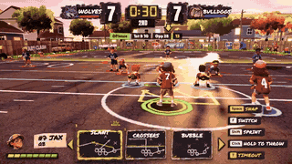</a> 
<b><a href="https://yardclash.vercel.app/">YARDCLASH 街区 7 人橄榄球</a></b> 
🆕 · <a href="https://x.com/AugustCastilIo">@AugustCastilIo</a> · ♥ 213 · <a href="https://x.com/AugustCastilIo/status/2120302122776342865">▶ 视频</a> 
多角色、街区联赛晋级，可以和朋友一起玩 
<a href="https://skyflare-game.vercel.app/">战斗机游戏</a>
</td>
<td width="33%" valign="top">
 
<b><a href="https://finderchangchang.github.io/cloud-stunt-3d/">云端特技 3D</a></b> 
<a href="https://x.com/jev_chat">@jev_chat</a> · ♥ 171 · <a href="https://x.com/jev_chat/status/2120015641151426838">▶ 视频</a> 
30 分钟生成 
<a href="https://finderchangchang.github.io/cloud-stunt-3d/golden/">优化版</a>
</td>
</tr>
<tr>
<td width="33%" valign="top">
 
<b><a href="https://github.com/amirmushichge/worm-rider">Worm Rider 沙虫骑士</a></b> 
<a href="https://x.com/AmirMushich">@AmirMushich</a> · ♥ 170 · <a href="https://x.com/AmirMushich/status/2119937977426338283">▶ 视频</a> 
开源；220KB、3400 行、10 条提示词，模型全部代码建
</td>
<td width="33%" valign="top">
 
<b><a href="https://wquguru.github.io/fable52-fps-repro/">Fable 5.2 FPS 复现（4 个单文件演示）</a></b> 
🆕 · <a href="https://x.com/wquguru">@wquguru</a> · ♥ 152 · <a href="https://x.com/wquguru/status/2120383332722905400">▶ 视频</a> 
模型、声音、贴图全是代码；方法和源码都开源 
<a href="https://github.com/wquguru/fable52-fps-repro">源码</a>
</td>
<td width="33%" valign="top">
 
<b><a href="https://turbo-tails.vercel.app">Turbo Tails 3D 卡丁车</a></b> 
<a href="https://x.com/petergyang">@petergyang</a> · ♥ 112 · <a href="https://x.com/petergyang/status/2119901658394358005">▶ 视频</a> 
6 名车手、漂移、道具，单人和多人 
<a href="https://youtu.be/SsSKJA0EHD4">对比视频</a>
</td>
</tr>
<tr>
<td width="33%" valign="top">
 
<b><a href="https://noclipepe.pages.dev/dino">Chrome 恐龙变兰博</a></b> 
<a href="https://x.com/noclipepe">@noclipepe</a> · ♥ 97 · <a href="https://x.com/noclipepe/status/2119927838321328577">▶ 视频</a> 
老 T-Rex 测试，对比 Opus / Gemini / GPT
</td>
<td width="33%" valign="top">
 
<b><a href="https://spawn.co/@robot/frontline-warfare-deathmatch">Frontline 类 COD 死斗</a></b> 
<a href="https://x.com/alightinastorm">@alightinastorm</a> · ♥ 86 · <a href="https://x.com/alightinastorm/status/2120020469487440210">▶ 视频</a> 
浏览器里的使命召唤式射击
</td>
<td width="33%" valign="top">
 
<b><a href="https://luminazombies.com/">Lumina Zombies 新地图</a></b> 
🆕 · <a href="https://x.com/LuminaBench">@LuminaBench</a> · ♥ 84 · <a href="https://x.com/LuminaBench/status/2120660076927099048">▶ 视频</a> 
几条提示词做出一张带彩蛋的新地图，并把另外两张图的硬件需求和延迟减半
</td>
</tr>
<tr>
<td width="33%" valign="top">
<a href="https://feed-backrooms.vercel.app">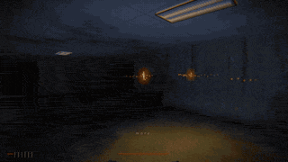</a> 
<b><a href="https://feed-backrooms.vercel.app">Feed the Backrooms：你当怪物</a></b> 
<a href="https://x.com/LexnLin">@LexnLin</a> · ♥ 80 · <a href="https://x.com/LexnLin/status/2119966127149429093">▶ 视频</a> 
后室反转玩法，你负责抓人
</td>
<td width="33%" valign="top">
<a href="https://rivergame-kappa.vercel.app">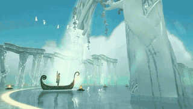</a> 
<b><a href="https://rivergame-kappa.vercel.app">The Waking River 奇幻航行</a></b> 
🆕 · <a href="https://x.com/flxrnc">@flxrnc</a> · ♥ 74 · <a href="https://x.com/flxrnc/status/2120494277528580110">▶ 视频</a> 
一条提示词加几次追问；五个随航行苏醒的世界，配乐也是代码生成
</td>
<td width="33%" valign="top">
<a href="https://app.usecrayon.ai/play/992c2130-43da-416b-a577-aed9514d3057">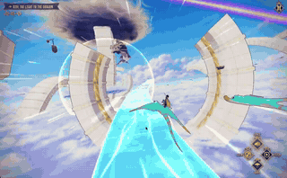</a> 
<b><a href="https://app.usecrayon.ai/play/992c2130-43da-416b-a577-aed9514d3057">SKYWAKE 飞行任务</a></b> 
🆕 · <a href="https://x.com/aniketjart">@aniketjart</a> · ♥ 74 · <a href="https://x.com/aniketjart/status/2120378493729222700">▶ 视频</a> 
Fable 5.2 + Opus 5.5 + Crayon + three.js
</td>
</tr>
<tr>
<td width="33%" valign="top">
<a href="https://patch.gg/games/rehan/ringfall">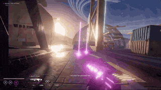</a> 
<b><a href="https://patch.gg/games/rehan/ringfall">Ringfall《命运》风格 FPS</a></b> 
🆕 · <a href="https://x.com/rehan_shei">@rehan_shei</a> · ♥ 61 · <a href="https://x.com/rehan_shei/status/2119994607291584962">▶ 视频</a> 
开源，可以拿去改
</td>
<td width="33%" valign="top">
<a href="https://fowllabs.com/fable-5-2/chairmageddon/">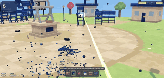</a> 
<b><a href="https://fowllabs.com/fable-5-2/chairmageddon/">Chairmageddon 椅子末日</a></b> 
🆕 · <a href="https://x.com/argofowl">@argofowl</a> · ♥ 42 · <a href="https://x.com/argofowl/status/2120568779537273263">▶ 视频</a> 
摧毁一个全是蓝椅子的和平小镇
</td>
<td width="33%" valign="top">
<a href="https://higgsfield.ai/@higgsfield.studio/blogs/fable-5-2-built-this-rpg-from-pure-code-here-s-every-step">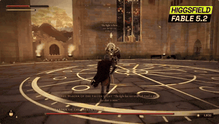</a> 
<b><a href="https://higgsfield.ai/@higgsfield.studio/blogs/fable-5-2-built-this-rpg-from-pure-code-here-s-every-step">VOWLORN 纯代码暗黑 RPG</a></b> 
<a href="https://x.com/higgsfield_ai">@higgsfield_ai</a> · ♥ 24 · <a href="https://x.com/higgsfield_ai/status/2119997122896601269">▶ 视频</a> 
配音也是代码生成，经 Higgsfield MCP 发布；链接是带试玩入口的博客页 
<a href="https://higgsfield.ai/@higgsfield.studio/blogs/claude-fable-5-2-built-a-dragon-riding-game-play-it-free">骑龙游戏</a> · <a href="https://higgsfield.ai/@higgsfield.studio/blogs/one-drawing-fable-5-2-turned-it-into-a-horror-game">手绘变恐怖游戏</a>
</td>
</tr>
<tr>
<td width="33%" valign="top">
 
<b><a href="https://blog.silencestar.com/posts/tilt-labyrinth/play/">木头滚珠迷宫</a></b> 
<a href="https://x.com/mylifcc">@mylifcc</a> · ♥ 15 · <a href="https://x.com/mylifcc/status/2120054646282870910">▶ 视频</a> 
three.js 2000 行，它自己把单帧从 55ms 优化到 9ms
</td>
<td width="33%" valign="top">
 
<b><a href="https://claude.ai/artifact/4nPXUKJjQWNsZEHVNmXXCt">流浪猫游戏</a></b> 
<a href="https://x.com/aimikoda">@aimikoda</a> · ♥ 13 · <a href="https://x.com/aimikoda/status/2120120133712593118">▶ 视频</a> 
救小猫、冲狗哈气、和老公猫对嚎，声音全部合成
</td>
<td width="33%" valign="top">
 
<b><a href="https://silicon-seduction.vercel.app/">Silicon Seduction</a></b> 
<a href="https://x.com/ZryMiller">@ZryMiller</a> · ♥ 12 · <a href="https://x.com/ZryMiller/status/2119918766691954691">▶ 视频</a> 
逃出去别被诱惑
</td>
</tr>
<tr>
<td width="33%" valign="top">
 
<b><a href="https://claude.ai/artifact/DLnFodkTwvawCNwurDmSZK?sk=5N6PtC07f1niB7h3I6clZQ">Roost 3D 越野摩托</a></b> 
<a href="https://x.com/tejas3732">@tejas3732</a> · ♥ 2 · <a href="https://x.com/tejas3732/status/2120091513657139549">▶ 视频</a> 
5 条提示词 15 分钟；3 条赛道、AI 对手、氮气
</td>
<td width="33%" valign="top">
<a href="https://claude.ai/artifact/1QGGhB68jMCjjjeeKtKNUo">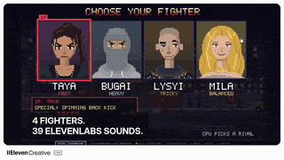</a> 
<b><a href="https://claude.ai/artifact/1QGGhB68jMCjjjeeKtKNUo">格斗游戏（ElevenLabs 配音）</a></b> 
<a href="https://x.com/promodenstudio">@promodenstudio</a> · ♥ 2 · <a href="https://x.com/promodenstudio/status/2120085977079107788">▶ 视频</a> 
Fable 5.2 + ElevenLabs MCP，桌面键盘玩
</td>
<td width="33%" valign="top">
<a href="https://vippi.vercel.app/">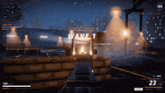</a> 
<b><a href="https://vippi.vercel.app/">Vippi 类 COD 射击</a></b> 
<a href="https://x.com/Shrit1401">@Shrit1401</a> · ♥ 1 · <a href="https://x.com/Shrit1401/status/2120060593763926314">▶ 视频</a> 
 
<a href="https://claude.ai/artifact/HSxhHE91J2jhLsB8WiTgUc">恐怖游戏测试</a>
</td>
</tr>
</table>

<a href="#-目录">↑ 回到目录</a>

## 🌍 3D 世界与场景

<table>
<tr>
<td width="33%" valign="top">
 
<b><a href="https://claude.ai/artifact/QGWUAjRrzRzZWGcQzSMLfa">Blender 房间里的「Claude App」网页</a></b> 
<a href="https://x.com/rileybrown">@rileybrown</a> · ♥ 5.2k · <a href="https://x.com/rileybrown/status/2119902109709537708">▶ 视频</a> 
一条提示词建整个房间并渲 4K；链接是笔记本屏幕上那个仿 Claude App 的网页
</td>
<td width="33%" valign="top">
 
<b><a href="https://fable-rome.surge.sh/">Rome, AD 320 古罗马</a></b> 
🆕 · <a href="https://x.com/petergostev">@petergostev</a> · ♥ 947 · <a href="https://x.com/petergostev/status/2120167560700383572">▶ 视频</a> 
一条提示词，Fable 5.2 Max 跑了一夜，花费 $2,618
</td>
<td width="33%" valign="top">
 
<b><a href="https://patch.gg/blendi/painted-valley">Painted Valley 吉卜力风山谷</a></b> 
🆕 · <a href="https://x.com/BlendiByl">@BlendiByl</a> · ♥ 444 · <a href="https://x.com/BlendiByl/status/2120694003230560585">▶ 视频</a> 
可以走进去的手绘风场景；开源
</td>
</tr>
<tr>
<td width="33%" valign="top">
 
<b><a href="https://indiranagar-live.vercel.app">印度班加罗尔 Indiranagar 1 平方公里</a></b> 
<a href="https://x.com/anshu4321">@anshu4321</a> · ♥ 405 · <a href="https://x.com/anshu4321/status/2119938067758772403">▶ 视频</a> 
用他们的地图数据 + 一条提示词
</td>
<td width="33%" valign="top">
 
<b><a href="https://bay.theojaffee.net">湾区 250 年</a></b> 
🆕 · <a href="https://x.com/theojaffee">@theojaffee</a> · ♥ 369 · <a href="https://x.com/theojaffee/status/2120312766544437738">▶ 视频</a> 
缩放到任意城市或街区，选 1769 年以来的任一年看当时的样子 
<a href="https://nyc.theojaffee.net">纽约版</a>
</td>
<td width="33%" valign="top">
 
<b><a href="http://procedural-arm-rig.vercel.app">程序化手臂绑定</a></b> 
🆕 · <a href="https://x.com/apekshik">@apekshik</a> · ♥ 322 · <a href="https://x.com/apekshik/status/2120224530367119758">▶ 视频</a> 
不做 3A 大作，只把一条手臂做到极致：骨架、权重、IK，握拳时肌肉会鼓起
</td>
</tr>
<tr>
<td width="33%" valign="top">
 
<b><a href="https://claude.ai/artifact/R6YBDkAm2GjAC5A65D9djx">能走进去的 Claude 演示间</a></b> 
🆕 · <a href="https://x.com/dfeinition">@dfeinition</a> · ♥ 208 · <a href="https://x.com/dfeinition/status/2120330644261589051">▶ 视频</a> 
受 @rileybrown 启发；走进房间，坐到任意一台电脑前
</td>
<td width="33%" valign="top">
 
<b><a href="https://patch.gg/blendi/impossible-spaces">Impossible Spaces 不可能空间</a></b> 
🆕 · <a href="https://x.com/BlendiByl">@BlendiByl</a> · ♥ 132 · <a href="https://x.com/BlendiByl/status/2120314459793355262">▶ 视频</a> 
迷幻的「不可能空间」体验；开源
</td>
<td width="33%" valign="top">
 
<b><a href="https://tests.jazii.dev/">海盗船航行</a></b> 
<a href="https://x.com/notjazii">@notjazii</a> · ♥ 107 · <a href="https://x.com/notjazii/status/2119905661505122575">▶ 视频</a> 
一次生成，1.5 小时、约 $34
</td>
</tr>
<tr>
<td width="33%" valign="top">
 
<b><a href="https://claude.ai/artifact/2PBXuQAnWDS2NpiPXHNLfL">果冻虎鲸材质研究</a></b> 
<a href="https://x.com/vib3coded">@vib3coded</a> · ♥ 102 · <a href="https://x.com/vib3coded/status/2119951060752375827">▶ 视频</a> 
软体果冻虎鲸，Fable 对 Opus 
<a href="5.5 版 https://claude.ai/artifact/75KLotWzZQ5RR23BGLePb8">Opus</a>
</td>
<td width="33%" valign="top">
 
<b><a href="https://claude.ai/artifact/7ge282etTXSS4edGFTFa85">3D 帆船</a></b> 
<a href="https://x.com/marcthecreatorr">@marcthecreatorr</a> · ♥ 100 · <a href="https://x.com/marcthecreatorr/status/2119890973560054072">▶ 视频</a> 
纯 Three.js，约 38 分钟 $17
</td>
<td width="33%" valign="top">
<a href="https://airsup.ai/lab/sr-71?mach=3.2">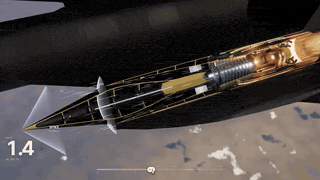</a> 
<b><a href="https://airsup.ai/lab/sr-71?mach=3.2">SR-71 发动机拆解</a></b> 
🆕 · <a href="https://x.com/konstantinsaifo">@konstantinsaifo</a> · ♥ 67 · <a href="https://x.com/konstantinsaifo/status/2120518933103182193">▶ 视频</a> 
8 万英尺高空的 SR-71，剖开一台发动机；拖动速度旋钮，看进气道怎么接管推力
</td>
</tr>
<tr>
<td width="33%" valign="top">
 
<b><a href="https://claude.ai/artifact/9EgZpErM17kH2a9Q3WXW6f">瓶中体素世界</a></b> 
<a href="https://x.com/vib3coded">@vib3coded</a> · ♥ 55 · <a href="https://x.com/vib3coded/status/2120104517282775514">▶ 视频</a> 
30 分钟 $12.81
</td>
<td width="33%" valign="top">
<a href="https://fable-jerusalem.vercel.app/">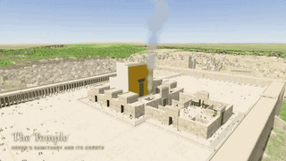</a> 
<b><a href="https://fable-jerusalem.vercel.app/">逾越节的耶路撒冷</a></b> 
🆕 · <a href="https://x.com/kplikethebird">@kplikethebird</a> · ♥ 41 · <a href="https://x.com/kplikethebird/status/2119900775727902732">▶ 视频</a> 
按史料用 Blender 建的沉浸式 3D 耶路撒冷，可以在街上走
</td>
<td width="33%" valign="top">
 
<b><a href="https://vancouver.webly.site">温哥华鸟瞰</a></b> 
<a href="https://x.com/tokifyi">@tokifyi</a> · ♥ 39 · <a href="https://x.com/tokifyi/status/2120020272153764172">原帖</a> 
Three.js 重建城市
</td>
</tr>
<tr>
<td width="33%" valign="top">
 
<b><a href="https://feelthematrix.com">Matrix Vibe 黑客帝国之城</a></b> 
🆕 · <a href="https://x.com/tornikegomareli">@tornikegomareli</a> · ♥ 28 · <a href="https://x.com/tornikegomareli/status/2120227696261120225">▶ 视频</a> 
雨、闪电、云层，飞进去感受氛围 
<a href="https://github.com/tornikegomareli/Matrix">源码</a>
</td>
<td width="33%" valign="top">
 
<b><a href="https://galaxy-dive.vercel.app">Galaxy Dive 飞进星系</a></b> 
🆕 · <a href="https://x.com/handsher_NGU">@handsher_NGU</a> · ♥ 24 · <a href="https://x.com/handsher_NGU/status/2119910478025789655">▶ 视频</a> 
20 分钟生成
</td>
<td width="33%" valign="top">
<a href="https://claude.ai/artifact/7nmzhxeamcunJbKVK32ptz">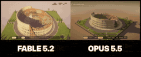</a> 
<b><a href="https://claude.ai/artifact/7nmzhxeamcunJbKVK32ptz">体素罗马斗兽场</a></b> 
<a href="https://x.com/aGim_asf">@aGim_asf</a> · ♥ 19 · <a href="https://x.com/aGim_asf/status/2119918363799376270">▶ 视频</a> 
可以走进废墟内环 
<a href="5.5 版 https://claude.ai/artifact/B7ZmVS7Yr3BUc99ZyGk2bX">Opus</a>
</td>
</tr>
<tr>
<td width="33%" valign="top">
 
<b><a href="https://zondark.com">单程太空旅行个人站</a></b> 
<a href="https://x.com/ZondarkAI">@ZondarkAI</a> · ♥ 4 · <a href="https://x.com/ZondarkAI/status/2120106341423571097">▶ 视频</a> 
从地球滑到黑洞
</td>
<td width="33%" valign="top">
 
<b><a href="https://claude.ai/artifact/FETrKoitcqxPQjbQvZd79C">小行星带压力测试</a></b> 
<a href="https://x.com/fadihares95">@fadihares95</a> · ♥ 4 · <a href="https://x.com/fadihares95/status/2119885634814857500">原帖</a> 
约 2 万颗小行星环绕，不断加岩石直到设备掉到 30 帧
</td>
<td width="33%" valign="top">
 
<b><a href="https://claude.ai/artifact/BCDCNHRTq3y9W4Px3xc4DN">骑巨蜗牛的村庄</a></b> 
<a href="https://x.com/L34342Lin">@L34342Lin</a> · ♥ 0 · <a href="https://x.com/L34342Lin/status/2120030246108066195">▶ 视频</a> 
手写 WebGL2，无库无素材，昼夜循环、约 5500 棵树
</td>
</tr>
<tr>
<td width="33%" valign="top">
 
<b><a href="https://claude.ai/artifact/UqU4w7jSr6pzF2McsbyQjJ">五层木塔变身斗笠女侠</a></b> 
<a href="https://x.com/acupofai">@acupofai</a> · ♥ 0 · <a href="https://x.com/acupofai/status/2120119243043995748">▶ 视频</a> 
3357 个构件，配乐代码现算，可拖拽、点击变身
</td>
</tr>
</table>

<a href="#-目录">↑ 回到目录</a>

## 🧰 网页与工具

<table>
<tr>
<td width="33%" valign="top">
 
<b><a href="http://robotics-lab-app.vercel.app">Robotics Lab 机器人开发板实验室</a></b> 
🆕 · <a href="https://x.com/0xMovez">@0xMovez</a> · ♥ 4.5k · <a href="https://x.com/0xMovez/status/2120239217880268919">▶ 视频</a> 
8 块真实开发板的 3D 模型，逐件装芯片、焊接、接电路 
<a href="http://robolabs-app.vercel.app">人形机器人版</a>
</td>
<td width="33%" valign="top">
 
<b><a href="https://miaai-lab.github.io/Claude-Fable-5.2-HTML-Files/">76 个单文件 HTML 视觉作品集</a></b> 
<a href="https://x.com/MiaAI_lab">@MiaAI_lab</a> · ♥ 2.0k · <a href="https://x.com/MiaAI_lab/status/2119930229661503893">原帖</a> 
每个都附原始提示词
</td>
<td width="33%" valign="top">
 
<b><a href="https://pixel-worlds.vercel.app/keep/">Keep 像素世界密码强度条</a></b> 
🆕 · <a href="https://x.com/crtvTeknologist">@crtvTeknologist</a> · ♥ 1.6k · <a href="https://x.com/crtvTeknologist/status/2119894073024606617">▶ 视频</a> 
把密码强度条做成一个活的像素世界 
<a href="https://github.com/finktheartist/pixel-worlds">源码</a>
</td>
</tr>
<tr>
<td width="33%" valign="top">
 
<b><a href="https://uberdesigner.ai/t/spine-menu">Spine Menu 菜单动效</a></b> 
🆕 · <a href="https://x.com/seanaiux">@seanaiux</a> · ♥ 1.2k · <a href="https://x.com/seanaiux/status/2120222459110789574">▶ 视频</a> 
页面附提示词 
<a href="https://uberdesigner.ai/t/aquarium-toggle">水族箱开关</a> · <a href="https://uberdesigner.ai/t/glow-widgets">发光卡片</a>
</td>
<td width="33%" valign="top">
 
<b><a href="https://claudia.gallery">Claudia Gallery</a></b> 
<a href="https://x.com/anabology">@anabology</a> · ♥ 1.1k · <a href="https://x.com/anabology/status/2120010995309457643">▶ 视频</a> 
让它做「梦想中的视频」，9 小时两轮
</td>
<td width="33%" valign="top">
 
<b><a href="https://frontier.every.to/experiments/ambient-town">Ambient Town 氛围音乐工作站</a></b> 
🆕 · <a href="https://x.com/kieranklaassen">@kieranklaassen</a> · ♥ 887 · <a href="https://x.com/kieranklaassen/status/2119868196773929160">▶ 视频</a> 
前电影配乐师花一周晚上做的 DAW：支持 Ableton Push、多路麦克风、效果器，还有一起作曲的 Agent；页面里点 Try it
</td>
</tr>
<tr>
<td width="33%" valign="top">
 
<b><a href="https://v2.video/riley/the-history-of-writing/v1">写作史（交互片）</a></b> 
<a href="https://x.com/rileybrown">@rileybrown</a> · ♥ 532 · <a href="https://x.com/rileybrown/status/2119946022767980985">▶ 视频</a> 
一条提示词
</td>
<td width="33%" valign="top">
 
<b><a href="https://where-is-everybody-fermi.netlify.app/">Where is everybody? 费米悖论调查</a></b> 
🆕 · <a href="https://x.com/emollick">@emollick</a> · ♥ 443 · <a href="https://x.com/emollick/status/2120359214157603139">原帖</a> 
让它「解决费米悖论」：整理数据、检验假说、接受批评后给出最可能的答案 
<a href="https://resolving-the-great-silence.netlify.app/">Gemini版</a>
</td>
<td width="33%" valign="top">
 
<b><a href="https://itspsneha.com/supplements">印度维生素该买哪些</a></b> 
<a href="https://x.com/itspsneha">@itspsneha</a> · ♥ 433 · <a href="https://x.com/itspsneha/status/2120048494761451974">原帖</a> 
读了 109 批检测报告做成的指南页
</td>
</tr>
<tr>
<td width="33%" valign="top">
 
<b><a href="https://typed.page/">Typed 打字机</a></b> 
<a href="https://x.com/clairevo">@clairevo</a> · ♥ 167 · <a href="https://x.com/clairevo/status/2119905651359142132">▶ 视频</a> 
能打字、计时、涂改液、自动更正的完整打字机
</td>
<td width="33%" valign="top">
 
<b><a href="https://patch.gg/patch/anymove">anymove 视频转动作</a></b> 
🆕 · <a href="https://x.com/rehan_shei">@rehan_shei</a> · ♥ 123 · <a href="https://x.com/rehan_shei/status/2120409150870159414">▶ 视频</a> 
把 AI 视频里的动作解算到 3D 武士骨架上，不用动捕服；开源
</td>
<td width="33%" valign="top">
 
<b><a href="https://motionsites.ai/?prompt=vante-ribbon-hero">Ribbon Hero 首屏</a></b> 
<a href="https://x.com/viktoroddy">@viktoroddy</a> · ♥ 65 · <a href="https://x.com/viktoroddy/status/2119985044542705916">▶ 视频</a> 
Fable 5.2 + GPT Image 2.6
</td>
</tr>
<tr>
<td width="33%" valign="top">
 
<b><a href="https://nikechan.com/">nikechan 个人站改版</a></b> 
<a href="https://x.com/tegnike">@tegnike</a> · ♥ 58 · <a href="https://x.com/tegnike/status/2120110145841578173">原帖</a> 
日本开发者让它重做整站设计
</td>
<td width="33%" valign="top">
 
<b><a href="https://tetriss22.github.io/pc-build-lab/">PC Build Lab 装机实验室</a></b> 
🆕 · <a href="https://x.com/Tetriss112">@Tetriss112</a> · ♥ 48 · <a href="https://x.com/Tetriss112/status/2120520587411935288">▶ 视频</a> 
在浏览器里把一台 $1,279 的主机一件件装起来，8 个步骤，可以故意装错
</td>
<td width="33%" valign="top">
 
<b><a href="https://jwt-designs-preview.noone-697.workers.dev/">JWT 落地页 20 种改版</a></b> 
<a href="https://x.com/Tmeister">@Tmeister</a> · ♥ 7 · <a href="https://x.com/Tmeister/status/2119983842841018482">原帖</a> 
一条简单提示词出 20 版
</td>
</tr>
<tr>
<td width="33%" valign="top">
 
<b><a href="https://www.asumacodes.xyz/arena/driftwood">Driftwood 落地页（Fable 对 Opus）</a></b> 
<a href="https://x.com/AsumaCodes">@AsumaCodes</a> · ♥ 7 · <a href="https://x.com/AsumaCodes/status/2120130668848177432">▶ 视频</a> 
同提示词一次生成，两版都在线 
<a href="https://www.asumacodes.xyz/arena/focus-room">番茄钟专注室</a> · <a href="Bug 对比 https://www.asumacodes.xyz/arena/bug-hunt">找</a> · <a href="https://www.asumacodes.xyz/arena">系列首页</a>
</td>
<td width="33%" valign="top">
 
<b><a href="https://claude.ai/artifact/9yQkezie4jY3oz2YDLFDiq">鼓组网站</a></b> 
<a href="https://x.com/BretKerr">@BretKerr</a> · ♥ 4 · <a href="https://x.com/BretKerr/status/2119995870854988177">▶ 视频</a> 
每次敲击海湾都有混响
</td>
<td width="33%" valign="top">
 
<b><a href="https://claude.ai/artifact/Pk6rHPyRwfShT37kiU1sT6">Dub Techno 曲子 + 可视化</a></b> 
<a href="https://x.com/bartdecrem">@bartdecrem</a> · ♥ 4 · <a href="https://x.com/bartdecrem/status/2119926997422133417">原帖</a> 
一次生成
</td>
</tr>
<tr>
<td width="33%" valign="top">
 
<b><a href="https://claude.ai/artifact/TiymxxFXzMo7xhWUaecbzk">独栋住宅设计提案书</a></b> 
<a href="https://x.com/pnumech">@pnumech</a> · ♥ 3 · <a href="https://x.com/pnumech/status/2120117665041940807">原帖</a> 
韩文，一天做完
</td>
<td width="33%" valign="top">
 
<b><a href="https://claude.ai/artifact/5ufHvxgvXTf5YgQeTR8TbG">《罗摩衍那》男主的宝莱坞家谱</a></b> 
<a href="https://x.com/chhavsz">@chhavsz</a> · ♥ 2 · <a href="https://x.com/chhavsz/status/2119942973958078785">原帖</a> 
血缘婚姻牵出 65 位明星
</td>
<td width="33%" valign="top">
 
<b><a href="https://claude.ai/artifact/4aEy6FtUi7jrm9U7uYgp8K">Demoscene 浏览器演示</a></b> 
<a href="https://x.com/ndril">@ndril</a> · ♥ 1 · <a href="https://x.com/ndril/status/2119899340642894235">原帖</a> 
按 demoscene 传统炫技
</td>
</tr>
<tr>
<td width="33%" valign="top">
 
<b><a href="https://claude.ai/artifact/H8E7AonW2KFrzdRimaLeXb">112 种冥想图解</a></b> 
<a href="https://x.com/RishabJ108">@RishabJ108</a> · ♥ 0 · <a href="https://x.com/RishabJ108/status/2120042407484084558">原帖</a> 
给技术人看的可视化
</td>
</tr>
</table>

<a href="#-目录">↑ 回到目录</a>

## 🎬 动画与短片（附源码）

<table>
<tr>
<td width="33%" valign="top">
 
<b><a href="https://github.com/ChetasLua/pelican-riding-a-bicycle">骑车的鹈鹕：60 秒手绘风短片</a></b> 
🆕 · <a href="https://x.com/chetaslua">@chetaslua</a> · ♥ 329 · <a href="https://x.com/chetaslua/status/2120438091647218025">▶ 视频</a> 
一个 HTML 文件，画面和声音全是代码，没有图片、音频和库 
<a href="https://github.com/ChetasLua/mona-lisa-js">蒙娜丽莎</a>
</td>
<td width="33%" valign="top">
 
<b><a href="https://github.com/crossps/ballpoint">圆珠笔微距 ASMR</a></b> 
<a href="https://x.com/camperaigg">@camperaigg</a> · ♥ 239 · <a href="https://x.com/camperaigg/status/2119777467074580741">▶ 视频</a> 
开源证明不是视频模型生成
</td>
<td width="33%" valign="top">
 
<b><a href="https://github.com/anstapnever/one-sweep">One Sweep 78 秒动漫打斗</a></b> 
<a href="https://x.com/anstapnever">@anstapnever</a> · ♥ 238 · <a href="https://x.com/anstapnever/status/2119772039037014524">▶ 视频</a> 
纯 Three.js 代码，6 组 Agent 并行；作者写的是「Fable 5.5」
</td>
</tr>
<tr>
<td width="33%" valign="top">
 
<b><a href="https://github.com/ChetasLua/godzilla-nights">哥斯拉之夜</a></b> 
<a href="https://x.com/chetaslua">@chetaslua</a> · ♥ 159 · <a href="https://x.com/chetaslua/status/2119981510199808368">▶ 视频</a> 
纯代码画图加动画
</td>
<td width="33%" valign="top">
 
<b><a href="https://github.com/anstapnever/blackout">Blackout 79 秒动漫</a></b> 
<a href="https://x.com/anstapnever">@anstapnever</a> · ♥ 96 · <a href="https://x.com/anstapnever/status/2119915123070644263">▶ 视频</a> 

</td>
<td width="33%" valign="top">
 
<b><a href="https://github.com/skild-ai/steel-webgpu/pull/7">机器手指走螺旋楼梯</a></b> 
<a href="https://x.com/Luckyballa">@Luckyballa</a> · ♥ 52 · <a href="https://x.com/Luckyballa/status/2119915557663506720">▶ 视频</a> 
Fable 5.2 + Steel 物理引擎
</td>
</tr>
<tr>
<td width="33%" valign="top">
 
<b><a href="https://github.com/Florencvv/kagami">Kagami 84 秒动漫</a></b> 
<a href="https://x.com/flxrnc">@flxrnc</a> · ♥ 36 · <a href="https://x.com/flxrnc/status/2119767052021903831">▶ 视频</a> 
每一帧都是代码；作者写的是「Fable 5.5」
</td>
<td width="33%" valign="top">
 
<b><a href="https://github.com/seeconever/ryu">Ryu 山化龙</a></b> 
<a href="https://x.com/seeconvm">@seeconvm</a> · ♥ 36 · <a href="https://x.com/seeconvm/status/2119777169542938662">▶ 视频</a> 
无生图无视频模型，5 组 Agent；作者写的是「Fable 5.5」
</td>
<td width="33%" valign="top">
 
<b><a href="https://usekumiko.app/">Kumiko 宣传片</a></b> 
<a href="https://x.com/sudoaptaj">@sudoaptaj</a> · ♥ 15 · <a href="https://x.com/sudoaptaj/status/2119937909373460990">▶ 视频</a> 
只给了音乐和网站，一次出片 
<a href="https://github.com/atuljha23/claude-motion-skill">插件</a>
</td>
</tr>
</table>

<a href="#-目录">↑ 回到目录</a>

## 📺 只有视频

作者只发了视频、没公开作品链接。点封面看原帖视频。

<table>
<tr>
<td width="33%" valign="top">
 
<b><a href="https://x.com/claudeai/status/2119899459761131615">官方：预发布测试期间的各领域项目合集</a></b> 
<a href="https://x.com/claudeai">@claudeai</a> · ♥ 30.8k · <a href="https://x.com/claudeai/status/2119899459761131615">▶ 视频</a> 

</td>
<td width="33%" valign="top">
 
<b><a href="https://x.com/anxuanng/status/2120088745139638375">用 3D 短片讲芝诺悖论：手指为什么永远碰不到</a></b> 
🆕 · <a href="https://x.com/anxuanng">@anxuanng</a> · ♥ 9.9k · <a href="https://x.com/anxuanng/status/2120088745139638375">▶ 视频</a> 

</td>
<td width="33%" valign="top">
 
<b><a href="https://x.com/imjustnewatai/status/2120383964686729410">发明新曲式：一首形状像训练过程的交响曲</a></b> 
🆕 · <a href="https://x.com/imjustnewatai">@imjustnewatai</a> · ♥ 6.1k · <a href="https://x.com/imjustnewatai/status/2120383964686729410">▶ 视频</a> 

</td>
</tr>
<tr>
<td width="33%" valign="top">
 
<b><a href="https://x.com/aollivier82/status/2120260208245043663">计算机图形学发展史动画</a></b> 
🆕 · <a href="https://x.com/aollivier82">@aollivier82</a> · ♥ 3.0k · <a href="https://x.com/aollivier82/status/2120260208245043663">▶ 视频</a> 

</td>
<td width="33%" valign="top">
 
<b><a href="https://x.com/M__Houser/status/2120253236309569696">不会写代码的人做的开放世界《Age of Dragon》</a></b> 
🆕 · <a href="https://x.com/M__Houser">@M__Houser</a> · ♥ 2.4k · <a href="https://x.com/M__Houser/status/2120253236309569696">▶ 视频</a> 

</td>
<td width="33%" valign="top">
 
<b><a href="https://x.com/theo/status/2119926277801144695">Fishslop 测试，76 分钟 $42</a></b> 
<a href="https://x.com/theo">@theo</a> · ♥ 2.0k · <a href="https://x.com/theo/status/2119926277801144695">▶ 视频</a> 

</td>
</tr>
<tr>
<td width="33%" valign="top">
 
<b><a href="https://x.com/alexalbert__/status/2119916954337349737">达·芬奇 500 年前笔记本里的发明做成可交互</a></b> 
<a href="https://x.com/alexalbert__">@alexalbert__</a> · ♥ 1.8k · <a href="https://x.com/alexalbert__/status/2119916954337349737">▶ 视频</a> 

</td>
<td width="33%" valign="top">
 
<b><a href="https://x.com/_sholtodouglas/status/2119935331499925557">带传送门的竞技场 FPS，办公室里对战</a></b> 
<a href="https://x.com/_sholtodouglas">@_sholtodouglas</a> · ♥ 1.6k · <a href="https://x.com/_sholtodouglas/status/2119935331499925557">▶ 视频</a> 

</td>
<td width="33%" valign="top">
 
<b><a href="https://x.com/LexnLin/status/2119880654858977333">高速运镜 3D 场景，30 分钟 + Opus 子 Agent</a></b> 
<a href="https://x.com/LexnLin">@LexnLin</a> · ♥ 1.5k · <a href="https://x.com/LexnLin/status/2119880654858977333">▶ 视频</a> 

</td>
</tr>
<tr>
<td width="33%" valign="top">
 
<b><a href="https://x.com/akakuma0219/status/2120030634248929556">三个词生成的跑步动作预演</a></b> 
🆕 · <a href="https://x.com/akakuma0219">@akakuma0219</a> · ♥ 1.4k · <a href="https://x.com/akakuma0219/status/2120030634248929556">▶ 视频</a> 

</td>
<td width="33%" valign="top">
 
<b><a href="https://x.com/ChrisGPT/status/2119998815856218494">给剪辑师的「抢饭碗」宣言视频</a></b> 
<a href="https://x.com/ChrisGPT">@ChrisGPT</a> · ♥ 1.4k · <a href="https://x.com/ChrisGPT/status/2119998815856218494">▶ 视频</a> 

</td>
<td width="33%" valign="top">
 
<b><a href="https://x.com/xikhar/status/2119966147328299284">Blender 里建布加迪 Tourbillon 并渲染成片</a></b> 
🆕 · <a href="https://x.com/xikhar">@xikhar</a> · ♥ 1.2k · <a href="https://x.com/xikhar/status/2119966147328299284">▶ 视频</a> 

</td>
</tr>
<tr>
<td width="33%" valign="top">
 
<b><a href="https://x.com/chetaslua/status/2119870650722763052">官方演示：从空文件夹造操作系统（转述）</a></b> 
<a href="https://x.com/chetaslua">@chetaslua</a> · ♥ 1.1k · <a href="https://x.com/chetaslua/status/2119870650722763052">▶ 视频</a> 

</td>
<td width="33%" valign="top">
 
<b><a href="https://x.com/vib3coded/status/2119876781700505627">上瘾的音量滑块，10 分钟 $8.43</a></b> 
<a href="https://x.com/vib3coded">@vib3coded</a> · ♥ 1.0k · <a href="https://x.com/vib3coded/status/2119876781700505627">▶ 视频</a> 

</td>
<td width="33%" valign="top">
 
<b><a href="https://x.com/MrTacticalX/status/2119955647542542439">玻璃泳池，Fable 对 Opus</a></b> 
<a href="https://x.com/MrTacticalX">@MrTacticalX</a> · ♥ 812 · <a href="https://x.com/MrTacticalX/status/2119955647542542439">▶ 视频</a> 

</td>
</tr>
<tr>
<td width="33%" valign="top">
 
<b><a href="https://x.com/kevin_t_ngo/status/2119972124211454139">90 年代玩具广告</a></b> 
🆕 · <a href="https://x.com/kevin_t_ngo">@kevin_t_ngo</a> · ♥ 753 · <a href="https://x.com/kevin_t_ngo/status/2119972124211454139">▶ 视频</a> 

</td>
<td width="33%" valign="top">
 
<b><a href="https://x.com/ericmaskfr/status/2119910195325481026">一条提示词的 GTA 6</a></b> 
<a href="https://x.com/ericmaskfr">@ericmaskfr</a> · ♥ 709 · <a href="https://x.com/ericmaskfr/status/2119910195325481026">▶ 视频</a> 

</td>
<td width="33%" valign="top">
 
<b><a href="https://x.com/adamdotnew/status/2120071630139621540">电子宠物硬件：PCB、外壳、渲染全流程</a></b> 
🆕 · <a href="https://x.com/adamdotnew">@adamdotnew</a> · ♥ 696 · <a href="https://x.com/adamdotnew/status/2120071630139621540">▶ 视频</a> 

</td>
</tr>
<tr>
<td width="33%" valign="top">
 
<b><a href="https://x.com/rute1203d/status/2120077147872391540">「拿出最高水平的视频」，后半段有反转</a></b> 
🆕 · <a href="https://x.com/rute1203d">@rute1203d</a> · ♥ 656 · <a href="https://x.com/rute1203d/status/2120077147872391540">▶ 视频</a> 

</td>
<td width="33%" valign="top">
 
<b><a href="https://x.com/kevin_t_ngo/status/2120308118127309173">90 年代麦片广告</a></b> 
🆕 · <a href="https://x.com/kevin_t_ngo">@kevin_t_ngo</a> · ♥ 633 · <a href="https://x.com/kevin_t_ngo/status/2120308118127309173">▶ 视频</a> 

</td>
<td width="33%" valign="top">
 
<b><a href="https://x.com/KanaWorks_AI/status/2120098607382880627">37 秒不剪辑，飞越无限生成的地形</a></b> 
🆕 · <a href="https://x.com/KanaWorks_AI">@KanaWorks_AI</a> · ♥ 631 · <a href="https://x.com/KanaWorks_AI/status/2120098607382880627">▶ 视频</a> 

</td>
</tr>
<tr>
<td width="33%" valign="top">
 
<b><a href="https://x.com/LexnLin/status/2120167637133238295">Claude 标志动画</a></b> 
🆕 · <a href="https://x.com/LexnLin">@LexnLin</a> · ♥ 617 · <a href="https://x.com/LexnLin/status/2120167637133238295">▶ 视频</a> 

</td>
<td width="33%" valign="top">
 
<b><a href="https://x.com/WesRoth/status/2119953913160093817">一次生成合集</a></b> 
<a href="https://x.com/WesRoth">@WesRoth</a> · ♥ 573 · <a href="https://x.com/WesRoth/status/2119953913160093817">▶ 视频</a> 

</td>
<td width="33%" valign="top">
 
<b><a href="https://x.com/MrTacticalX/status/2120342453807157720">Blender 机械键盘，从建模到打字</a></b> 
🆕 · <a href="https://x.com/MrTacticalX">@MrTacticalX</a> · ♥ 551 · <a href="https://x.com/MrTacticalX/status/2120342453807157720">▶ 视频</a> 

</td>
</tr>
<tr>
<td width="33%" valign="top">
 
<b><a href="https://x.com/thomaszhou_/status/2120389154970509666">一句话短片《美》</a></b> 
🆕 · <a href="https://x.com/thomaszhou_">@thomaszhou_</a> · ♥ 502 · <a href="https://x.com/thomaszhou_/status/2120389154970509666">▶ 视频</a> 

</td>
<td width="33%" valign="top">
 
<b><a href="https://x.com/oalanicolas/status/2120266468780585456">按图纸把还没盖的房子做成 3D 漫游</a></b> 
🆕 · <a href="https://x.com/oalanicolas">@oalanicolas</a> · ♥ 488 · <a href="https://x.com/oalanicolas/status/2120266468780585456">▶ 视频</a> 

</td>
<td width="33%" valign="top">
 
<b><a href="https://x.com/dom_scholz/status/2119933150025363661">Opus 对 Fable</a></b> 
<a href="https://x.com/dom_scholz">@dom_scholz</a> · ♥ 464 · <a href="https://x.com/dom_scholz/status/2119933150025363661">▶ 视频</a> 

</td>
</tr>
<tr>
<td width="33%" valign="top">
 
<b><a href="https://x.com/kevin_t_ngo/status/2120540964909711415">动画片头</a></b> 
🆕 · <a href="https://x.com/kevin_t_ngo">@kevin_t_ngo</a> · ♥ 425 · <a href="https://x.com/kevin_t_ngo/status/2120540964909711415">▶ 视频</a> 

</td>
<td width="33%" valign="top">
 
<b><a href="https://x.com/jsnnsa/status/2120161161803088061">设计一套字体，再拍一部关于它的纪录片</a></b> 
🆕 · <a href="https://x.com/jsnnsa">@jsnnsa</a> · ♥ 418 · <a href="https://x.com/jsnnsa/status/2120161161803088061">▶ 视频</a> 

</td>
<td width="33%" valign="top">
 
<b><a href="https://x.com/mattshumer_/status/2119900920347828670">纯代码整部电影，配音画面全包</a></b> 
<a href="https://x.com/mattshumer_">@mattshumer_</a> · ♥ 400 · <a href="https://x.com/mattshumer_/status/2119900920347828670">▶ 视频</a> 

</td>
</tr>
<tr>
<td width="33%" valign="top">
 
<b><a href="https://x.com/alightinastorm/status/2120010936584945922">AAA 级 three.js 篮球</a></b> 
<a href="https://x.com/alightinastorm">@alightinastorm</a> · ♥ 355 · <a href="https://x.com/alightinastorm/status/2120010936584945922">▶ 视频</a> 

</td>
<td width="33%" valign="top">
 
<b><a href="https://x.com/theo/status/2120104895646937409">数据管线写着写着做成的设计稿</a></b> 
<a href="https://x.com/theo">@theo</a> · ♥ 327 · <a href="https://x.com/theo/status/2120104895646937409">▶ 视频</a> 

</td>
<td width="33%" valign="top">
 
<b><a href="https://x.com/op7418/status/2120085300185833878">打字生成墨水字形，实时流体 + 音效</a></b> 
<a href="https://x.com/op7418">@op7418</a> · ♥ 298 · <a href="https://x.com/op7418/status/2120085300185833878">▶ 视频</a> 

</td>
</tr>
<tr>
<td width="33%" valign="top">
 
<b><a href="https://x.com/Bhavani_00007/status/2119902204320780676">火箭发射，Fable 对 Opus</a></b> 
<a href="https://x.com/Bhavani_00007">@Bhavani_00007</a> · ♥ 295 · <a href="https://x.com/Bhavani_00007/status/2119902204320780676">▶ 视频</a> 

</td>
<td width="33%" valign="top">
 
<b><a href="https://x.com/rileybrown/status/2119973951027724385">Fable 剪的关于 Fable 剪辑的视频</a></b> 
<a href="https://x.com/rileybrown">@rileybrown</a> · ♥ 294 · <a href="https://x.com/rileybrown/status/2119973951027724385">▶ 视频</a> 

</td>
<td width="33%" valign="top">
 
<b><a href="https://x.com/DeryaTR_/status/2119974354260013293">科学史 3D 电影之旅</a></b> 
🆕 · <a href="https://x.com/DeryaTR_">@DeryaTR_</a> · ♥ 277 · <a href="https://x.com/DeryaTR_/status/2119974354260013293">▶ 视频</a> 

</td>
</tr>
<tr>
<td width="33%" valign="top">
 
<b><a href="https://x.com/Izkimar/status/2119931740940640542">一天做出 MMO 世界</a></b> 
<a href="https://x.com/Izkimar">@Izkimar</a> · ♥ 275 · <a href="https://x.com/Izkimar/status/2119931740940640542">▶ 视频</a> 

</td>
<td width="33%" valign="top">
 
<b><a href="https://x.com/imantiai/status/2119979537320534135">热带岛屿写实 FPS，一条提示词</a></b> 
<a href="https://x.com/imantiai">@imantiai</a> · ♥ 273 · <a href="https://x.com/imantiai/status/2119979537320534135">▶ 视频</a> 

</td>
<td width="33%" valign="top">
 
<b><a href="https://x.com/RuslanKyrch/status/2119896220814762218">同提示词 5.1 对 5.2 的 App 改版</a></b> 
<a href="https://x.com/RuslanKyrch">@RuslanKyrch</a> · ♥ 242 · <a href="https://x.com/RuslanKyrch/status/2119896220814762218">▶ 视频</a> 

</td>
</tr>
<tr>
<td width="33%" valign="top">
 
<b><a href="https://x.com/pleometric/status/2119973274402668852">BRYCEBALL：把渲染器当游戏引擎</a></b> 
🆕 · <a href="https://x.com/pleometric">@pleometric</a> · ♥ 228 · <a href="https://x.com/pleometric/status/2119973274402668852">▶ 视频</a> 

</td>
<td width="33%" valign="top">
 
<b><a href="https://x.com/notjazii/status/2119886035421442097">Fable 对 Opus 同题</a></b> 
<a href="https://x.com/notjazii">@notjazii</a> · ♥ 200 · <a href="https://x.com/notjazii/status/2119886035421442097">▶ 视频</a> 

</td>
<td width="33%" valign="top">
 
<b><a href="https://x.com/dfeinition/status/2119881243990859818">粉笔画活过来</a></b> 
<a href="https://x.com/dfeinition">@dfeinition</a> · ♥ 199 · <a href="https://x.com/dfeinition/status/2119881243990859818">▶ 视频</a> 

</td>
</tr>
<tr>
<td width="33%" valign="top">
 
<b><a href="https://x.com/dfeinition/status/2119886262211625062">布料褶皱与光</a></b> 
<a href="https://x.com/dfeinition">@dfeinition</a> · ♥ 186 · <a href="https://x.com/dfeinition/status/2119886262211625062">▶ 视频</a> 

</td>
<td width="33%" valign="top">
 
<b><a href="https://x.com/AmirMushich/status/2119903338078564844">Blender + Reaper 声音设计</a></b> 
<a href="https://x.com/AmirMushich">@AmirMushich</a> · ♥ 182 · <a href="https://x.com/AmirMushich/status/2119903338078564844">▶ 视频</a> 

</td>
<td width="33%" valign="top">
 
<b><a href="https://x.com/_MaxBlade/status/2119992020076814436">割草模拟器</a></b> 
<a href="https://x.com/_MaxBlade">@_MaxBlade</a> · ♥ 178 · <a href="https://x.com/_MaxBlade/status/2119992020076814436">▶ 视频</a> 

</td>
</tr>
<tr>
<td width="33%" valign="top">
 
<b><a href="https://x.com/ElevenCreative/status/2120025947709837525">Fable + ElevenLabs MCP 做广告</a></b> 
<a href="https://x.com/ElevenCreative">@ElevenCreative</a> · ♥ 177 · <a href="https://x.com/ElevenCreative/status/2120025947709837525">▶ 视频</a> 

</td>
<td width="33%" valign="top">
 
<b><a href="https://x.com/Stefan_3D_AI/status/2120041169719894165">Blender 城堡，Fable 对 Opus</a></b> 
<a href="https://x.com/Stefan_3D_AI">@Stefan_3D_AI</a> · ♥ 174 · <a href="https://x.com/Stefan_3D_AI/status/2120041169719894165">▶ 视频</a> 

</td>
<td width="33%" valign="top">
 
<b><a href="https://x.com/chetaslua/status/2120548065044234504">超人飞越计算机图形学史，纯 JS</a></b> 
🆕 · <a href="https://x.com/chetaslua">@chetaslua</a> · ♥ 172 · <a href="https://x.com/chetaslua/status/2120548065044234504">▶ 视频</a> 

</td>
</tr>
<tr>
<td width="33%" valign="top">
 
<b><a href="https://x.com/themianoo/status/2120042064666882266">Blender 鹈鹕骑自行车，4800 行 Python</a></b> 
<a href="https://x.com/themianoo">@themianoo</a> · ♥ 171 · <a href="https://x.com/themianoo/status/2120042064666882266">▶ 视频</a> 

</td>
<td width="33%" valign="top">
 
<b><a href="https://x.com/EvanMilenko/status/2119969113762082931">剑斗游戏</a></b> 
<a href="https://x.com/EvanMilenko">@EvanMilenko</a> · ♥ 171 · <a href="https://x.com/EvanMilenko/status/2119969113762082931">▶ 视频</a> 

</td>
<td width="33%" valign="top">
 
<b><a href="https://x.com/WesRoth/status/2119911161386934330">音乐 MV</a></b> 
<a href="https://x.com/WesRoth">@WesRoth</a> · ♥ 162 · <a href="https://x.com/WesRoth/status/2119911161386934330">▶ 视频</a> 

</td>
</tr>
<tr>
<td width="33%" valign="top">
 
<b><a href="https://x.com/EvanMilenko/status/2120322640048959503">Three.js 骑龙游戏</a></b> 
🆕 · <a href="https://x.com/EvanMilenko">@EvanMilenko</a> · ♥ 157 · <a href="https://x.com/EvanMilenko/status/2120322640048959503">▶ 视频</a> 

</td>
<td width="33%" valign="top">
 
<b><a href="https://x.com/petergostev/status/2120125927086600681">钩针珊瑚礁</a></b> 
🆕 · <a href="https://x.com/petergostev">@petergostev</a> · ♥ 143 · <a href="https://x.com/petergostev/status/2120125927086600681">▶ 视频</a> 

</td>
<td width="33%" valign="top">
 
<b><a href="https://x.com/_MaxBlade/status/2120109725740159390">Unreal Engine 5.9 MCP 跑 4 小时</a></b> 
<a href="https://x.com/_MaxBlade">@_MaxBlade</a> · ♥ 142 · <a href="https://x.com/_MaxBlade/status/2120109725740159390">▶ 视频</a> 

</td>
</tr>
<tr>
<td width="33%" valign="top">
 
<b><a href="https://x.com/semichenkko/status/2119960596951236675">漂浮在空中的 1886 年纽约</a></b> 
<a href="https://x.com/semichenkko">@semichenkko</a> · ♥ 137 · <a href="https://x.com/semichenkko/status/2119960596951236675">▶ 视频</a> 

</td>
<td width="33%" valign="top">
 
<b><a href="https://x.com/chetaslua/status/2120111159726727321">three.js 莫妮卡的公寓</a></b> 
<a href="https://x.com/chetaslua">@chetaslua</a> · ♥ 135 · <a href="https://x.com/chetaslua/status/2120111159726727321">▶ 视频</a> 

</td>
<td width="33%" valign="top">
 
<b><a href="https://x.com/solotechdev/status/2120071690482794603">SwiftUI 换瞳色 App</a></b> 
<a href="https://x.com/solotechdev">@solotechdev</a> · ♥ 134 · <a href="https://x.com/solotechdev/status/2120071690482794603">▶ 视频</a> 

</td>
</tr>
<tr>
<td width="33%" valign="top">
 
<b><a href="https://x.com/RJasonHA/status/2120007540713099768">交响乐</a></b> 
<a href="https://x.com/RJasonHA">@RJasonHA</a> · ♥ 130 · <a href="https://x.com/RJasonHA/status/2120007540713099768">▶ 视频</a> 

</td>
<td width="33%" valign="top">
 
<b><a href="https://x.com/mattshumer_/status/2119889518564147409">能在公寓里真做出来的机器人</a></b> 
<a href="https://x.com/mattshumer_">@mattshumer_</a> · ♥ 128 · <a href="https://x.com/mattshumer_/status/2119889518564147409">▶ 视频</a> 

</td>
<td width="33%" valign="top">
 
<b><a href="https://x.com/abhinavflac/status/2119884257145581980">鹈鹕骑自行车经典测试</a></b> 
<a href="https://x.com/abhinavflac">@abhinavflac</a> · ♥ 122 · <a href="https://x.com/abhinavflac/status/2119884257145581980">▶ 视频</a> 

</td>
</tr>
<tr>
<td width="33%" valign="top">
 
<b><a href="https://x.com/dfeinition/status/2119892208937517201">黏土动画</a></b> 
<a href="https://x.com/dfeinition">@dfeinition</a> · ♥ 116 · <a href="https://x.com/dfeinition/status/2119892208937517201">▶ 视频</a> 

</td>
<td width="33%" valign="top">
 
<b><a href="https://x.com/techartist_/status/2119946891106394518">4 台游戏机械概念，VFX 物理</a></b> 
<a href="https://x.com/techartist_">@techartist_</a> · ♥ 114 · <a href="https://x.com/techartist_/status/2119946891106394518">▶ 视频</a> 

</td>
<td width="33%" valign="top">
 
<b><a href="https://x.com/lemomo_ai/status/2120118194409193682">深夜图书馆两万四千页飞舞</a></b> 
<a href="https://x.com/lemomo_ai">@lemomo_ai</a> · ♥ 105 · <a href="https://x.com/lemomo_ai/status/2120118194409193682">▶ 视频</a> 

</td>
</tr>
<tr>
<td width="33%" valign="top">
 
<b><a href="https://x.com/aug5thmusic/status/2119907891419480107">巴赫风格赋格（LilyPond）</a></b> 
<a href="https://x.com/aug5thmusic">@aug5thmusic</a> · ♥ 90 · <a href="https://x.com/aug5thmusic/status/2119907891419480107">▶ 视频</a> 

</td>
<td width="33%" valign="top">
 
<b><a href="https://x.com/dfeinition/status/2119870838606381391">动作融合讲解机器人</a></b> 
<a href="https://x.com/dfeinition">@dfeinition</a> · ♥ 86 · <a href="https://x.com/dfeinition/status/2119870838606381391">▶ 视频</a> 

</td>
<td width="33%" valign="top">
 
<b><a href="https://x.com/AlchainHust/status/2120065556003102731">用绘图工具复刻波拉波拉照片</a></b> 
<a href="https://x.com/AlchainHust">@AlchainHust</a> · ♥ 79 · <a href="https://x.com/AlchainHust/status/2120065556003102731">▶ 视频</a> 

</td>
</tr>
<tr>
<td width="33%" valign="top">
 
<b><a href="https://x.com/charliejhills/status/2120105823737397644">解魔方机器人，Fable 对 Opus</a></b> 
<a href="https://x.com/charliejhills">@charliejhills</a> · ♥ 78 · <a href="https://x.com/charliejhills/status/2120105823737397644">▶ 视频</a> 

</td>
<td width="33%" valign="top">
 
<b><a href="https://x.com/rpnickson/status/2119969928304357507">照 Riley 做自己的工作室</a></b> 
<a href="https://x.com/rpnickson">@rpnickson</a> · ♥ 68 · <a href="https://x.com/rpnickson/status/2119969928304357507">▶ 视频</a> 

</td>
<td width="33%" valign="top">
 
<b><a href="https://x.com/wangray/status/2120040640423850168">一句话给 BlewUp 做发布片</a></b> 
<a href="https://x.com/wangray">@wangray</a> · ♥ 68 · <a href="https://x.com/wangray/status/2120040640423850168">▶ 视频</a> 

</td>
</tr>
<tr>
<td width="33%" valign="top">
 
<b><a href="https://x.com/linxiaobei888/status/2119978892861829227">儿童英语启蒙动画</a></b> 
<a href="https://x.com/linxiaobei888">@linxiaobei888</a> · ♥ 63 · <a href="https://x.com/linxiaobei888/status/2119978892861829227">▶ 视频</a> 

</td>
<td width="33%" valign="top">
 
<b><a href="https://x.com/Stefan_3D_AI/status/2120039417981333599">Blender 海蛇缠船</a></b> 
<a href="https://x.com/Stefan_3D_AI">@Stefan_3D_AI</a> · ♥ 59 · <a href="https://x.com/Stefan_3D_AI/status/2120039417981333599">▶ 视频</a> 

</td>
<td width="33%" valign="top">
 
<b><a href="https://x.com/leppppp1/status/2119960122713899015">四模型同题文字特效</a></b> 
<a href="https://x.com/leppppp1">@leppppp1</a> · ♥ 55 · <a href="https://x.com/leppppp1/status/2119960122713899015">▶ 视频</a> 

</td>
</tr>
<tr>
<td width="33%" valign="top">
 
<b><a href="https://x.com/TekonBurns/status/2119871565311660260">420 个蛋白亚基组装病毒衣壳</a></b> 
<a href="https://x.com/TekonBurns">@TekonBurns</a> · ♥ 52 · <a href="https://x.com/TekonBurns/status/2119871565311660260">▶ 视频</a> 

</td>
<td width="33%" valign="top">
 
<b><a href="https://x.com/ElevenCreative/status/2119963230403776554">有无 ElevenLabs 音效的游戏对比</a></b> 
<a href="https://x.com/ElevenCreative">@ElevenCreative</a> · ♥ 47 · <a href="https://x.com/ElevenCreative/status/2119963230403776554">▶ 视频</a> 

</td>
<td width="33%" valign="top">
 
<b><a href="https://x.com/guanmo_ai/status/2119989925038985382">开声音看的效果</a></b> 
<a href="https://x.com/guanmo_ai">@guanmo_ai</a> · ♥ 42 · <a href="https://x.com/guanmo_ai/status/2119989925038985382">▶ 视频</a> 

</td>
</tr>
<tr>
<td width="33%" valign="top">
 
<b><a href="https://x.com/kinderlayer/status/2120112222227648957">狮子从地毯里爬出，Fable 对 Gemini</a></b> 
<a href="https://x.com/kinderlayer">@kinderlayer</a> · ♥ 42 · <a href="https://x.com/kinderlayer/status/2120112222227648957">▶ 视频</a> 

</td>
<td width="33%" valign="top">
 
<b><a href="https://x.com/Lummox_eth/status/2120093679243194793">$36 的权游级巨龙</a></b> 
<a href="https://x.com/Lummox_eth">@Lummox_eth</a> · ♥ 42 · <a href="https://x.com/Lummox_eth/status/2120093679243194793">▶ 视频</a> 

</td>
<td width="33%" valign="top">
 
<b><a href="https://x.com/ChrisGPT/status/2119989626568126509">手机上跑的 Artifact 游戏</a></b> 
<a href="https://x.com/ChrisGPT">@ChrisGPT</a> · ♥ 40 · <a href="https://x.com/ChrisGPT/status/2119989626568126509">▶ 视频</a> 

</td>
</tr>
<tr>
<td width="33%" valign="top">
 
<b><a href="https://x.com/flxrnc/status/2119961301791174720">发布当天做的片子（附提示词 PDF）</a></b> 
<a href="https://x.com/flxrnc">@flxrnc</a> · ♥ 40 · <a href="https://x.com/flxrnc/status/2119961301791174720">▶ 视频</a> 

</td>
<td width="33%" valign="top">
 
<b><a href="https://x.com/Stefan_3D_AI/status/2120101582444597446">Blender 复刻特斯拉 Roadster 翻板</a></b> 
<a href="https://x.com/Stefan_3D_AI">@Stefan_3D_AI</a> · ♥ 38 · <a href="https://x.com/Stefan_3D_AI/status/2120101582444597446">▶ 视频</a> 

</td>
<td width="33%" valign="top">
 
<b><a href="https://x.com/RJasonHA/status/2120075740222005569">代码搭的唐人街</a></b> 
<a href="https://x.com/RJasonHA">@RJasonHA</a> · ♥ 35 · <a href="https://x.com/RJasonHA/status/2120075740222005569">▶ 视频</a> 

</td>
</tr>
<tr>
<td width="33%" valign="top">
 
<b><a href="https://x.com/ItsmeAjayKV/status/2119896772713849174">浮岛上建造中的埃菲尔铁塔</a></b> 
<a href="https://x.com/ItsmeAjayKV">@ItsmeAjayKV</a> · ♥ 32 · <a href="https://x.com/ItsmeAjayKV/status/2119896772713849174">▶ 视频</a> 

</td>
<td width="33%" valign="top">
 
<b><a href="https://x.com/MrTacticalX/status/2119949557664735583">雪花球，Fable 对 Opus</a></b> 
<a href="https://x.com/MrTacticalX">@MrTacticalX</a> · ♥ 30 · <a href="https://x.com/MrTacticalX/status/2119949557664735583">▶ 视频</a> 

</td>
</tr>
</table>

## 🔗 相关清单

- [Matt Shumer 的 Fable 5.2 测评](https://somethingbig.ai/fable-5-2-review) — 长文测评，附他的全部演示
- [awesome-fable5-2-videos](https://github.com/yihui-dev/awesome-fable5-2-videos) — 只收视频的姊妹清单，附提示词

## 🧭 收录方法

- 在 X 上跑了 34 组搜索（热门 + 最新标签，中英日韩关键词），再逐个翻 331 位作者的近期帖子，把放在自回复里的链接也找回来。
- 2026-11-12 更新：重翻这些作者的新帖，核对了其他几份 Fable 5.2 清单里的约 600 条帖子，并在 X 上补搜了 11-10 之后的内容。
- 每个外链都在 2026-11-12 实际请求过，全部返回 200；claude.ai artifact 抽查过内容和署名。
- 剔除了新闻稿、模型接入广告、工具仓库和同一作品的重复转发；作品归属优先给原作者，转发者只在原帖没放链接时注明。
- 动图预览：有视频的作品从作者原帖视频里截 1.5 秒；没视频的作品用无头浏览器打开网站截一小段。每张约 50KB，整页预览图不到 10MB。
- 标了「Fable 5.5」的，是作者自己对发布前路由模型的叫法，原样保留。

## 🤝 投稿

发现漏掉的作品？开一个 [Issue](../../issues/new) 或 PR，附上作品链接和原帖链接即可。要求：链接能直接打开，作品确实用 Fable 5.2 做出。详见 [CONTRIBUTING.md](CONTRIBUTING.md)。

## 免责声明

所有作品版权归原作者所有。本仓库只做索引，只放几秒的低清动图预览，不托管完整作品或视频，完整视频请看原帖。作者如希望撤下预览或条目，请开 Issue，会尽快处理。本项目与 Anthropic 无关。

## Star History

## License

[CC0 1.0](LICENSE)：清单本身放弃全部权利，随意使用。
