

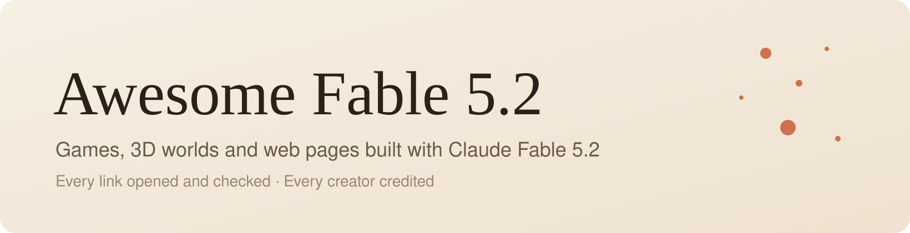

<h3>用 Claude Fable 5.2 做出來、能直接打開玩的東西</h3>

[English](README.md) · [简体中文](README.zh-CN.md) · **繁體中文** · [日本語](README.ja.md) · [한국어](README.ko.md) · [Español](README.es.md) · [Português](README.pt-BR.md) · [Français](README.fr.md) · [Deutsch](README.de.md) · [Русский](README.ru.md)

**🌐 網頁版：[fablelist.000ooo.ooo](https://fablelist.000ooo.ooo/zh-tw/)**（可搜尋，每個作品都有詳情頁）

Claude Fable 5.2 於 2026-11-09 發布。發布後幾天內，X 上出現大量用它做的遊戲、3D 世界和網頁。這份清單只收**點開就能用的作品**：151 個線上作品，每個連結都在 2026-11-14 實際打開驗證過；另有 111 個只發了影片的高讚展示，放在後面。

每一項都有幾秒的動圖預覽、註明作者並連回原文。帶 🆕 的是最近幾天新加的。本頁只放原文按讚 ≥100 的，其餘在每節末尾的「查看全部」。覺得有用就按個 ⭐，清單每天更新。

## 📑 目錄

- [⭐ 最受歡迎](#-最受歡迎)
- [🎮 遊戲](#-遊戲) · 75
- [🌍 3D 世界與場景](#-3d-世界與場景) · 33
- [🧰 網頁與工具](#-網頁與工具) · 32
- [🎬 動畫與短片](#-動畫與短片) · 11
- [📺 影片展示](#-影片展示) · 111
- [🤝 投稿](#-投稿)

## ⭐ 最受歡迎

依原文按讚數排序的前 6 個。

<table>
<tr>
<td width="33%" valign="top">
<a href="https://starrynightrider.com">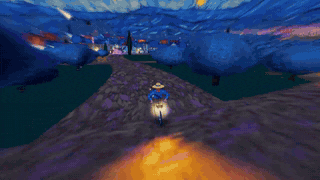</a> 
<b><a href="https://starrynightrider.com">Starry Nightrider</a></b> 
🆕 · <a href="https://x.com/ebbyamir">@ebbyamir</a> · ♥ 17.7k · <a href="https://x.com/ebbyamir/status/2120284261089673376">▶ 影片</a> 
梵谷騎著他的《星夜》穿行，做成遊戲。 
<a href="https://fablelist.000ooo.ooo/zh-tw/prompts/?w=starry-nightrider&ref=gh"><b>✨ 取得提示詞</b></a>
</td>
<td width="33%" valign="top">
 
<b><a href="https://claude.ai/artifact/BGY1SztrAYcJQHSsnHHGmp">Saltline — 第一人稱射擊遊戲</a></b> 
<a href="https://x.com/felixrieseberg">@felixrieseberg</a> · ♥ 14.7k · <a href="https://x.com/felixrieseberg/status/2119925633564463609">▶ 影片</a> 
Anthropic 工程師作品。一次性提示、無人工回饋，耗時 8 小時、約 $550。模型、音效與貼圖全由程式碼生成。 
<a href="https://fablelist.000ooo.ooo/zh-tw/prompts/?w=saltline-first-person-shooter&ref=gh"><b>✨ 取得提示詞</b></a>
</td>
<td width="33%" valign="top">
<a href="https://patch.gg/blendi/oil-paint">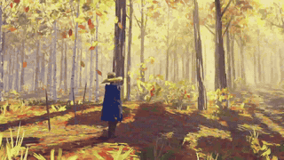</a> 
<b><a href="https://patch.gg/blendi/oil-paint">Oil Paint — 手繪風遊戲</a></b> 
🆕 · <a href="https://x.com/BlendiByl">@BlendiByl</a> · ♥ 7.9k · <a href="https://x.com/BlendiByl/status/2120341251178594532">▶ 影片</a> 
一小時內完成。每一幀約有 150 萬筆筆觸，在瀏覽器分頁裡以 200 fps 執行。開源。 
<a href="https://fablelist.000ooo.ooo/zh-tw/prompts/?w=oil-paint-hand-painted-game&ref=gh"><b>✨ 取得提示詞</b></a>
</td>
</tr>
<tr>
<td width="33%" valign="top">
<a href="https://nyc.somethingbig.ai/">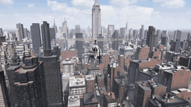</a> 
<b><a href="https://nyc.somethingbig.ai/">CROSSTOWN — 開放世界紐約（早期預覽）</a></b> 
🆕 · <a href="https://x.com/mattshumer_">@mattshumer_</a> · ♥ 7.5k · <a href="https://x.com/mattshumer_/status/2120282133503820150">▶ 影片</a> 
「Rockstar 花了 8 年。Fable 5.2 要用 7 天做到。」目前只做了部分城市；按 B 可送出回饋。 
<a href="https://fablelist.000ooo.ooo/zh-tw/prompts/?w=crosstown-open-world-new-york-early-preview&ref=gh"><b>✨ 取得提示詞</b></a>
</td>
<td width="33%" valign="top">
 
<b><a href="https://claude.ai/artifact/QGWUAjRrzRzZWGcQzSMLfa">Blender 筆電上的 Claude App</a></b> 
<a href="https://x.com/rileybrown">@rileybrown</a> · ♥ 7.0k · <a href="https://x.com/rileybrown/status/2119902109709537708">▶ 影片</a> 
一則提示就在 Blender 中建好整個房間並以 4K 渲染。這是筆電螢幕上顯示的網頁。 
<a href="https://x.com/rileybrown/status/2119902109709537708">📝 作者公開的提示詞（免費）</a>
</td>
<td width="33%" valign="top">
 
<b><a href="https://claudia.gallery">Claudia Gallery</a></b> 
<a href="https://x.com/anabology">@anabology</a> · ♥ 5.3k · <a href="https://x.com/anabology/status/2120010995309457643">▶ 影片</a> 
「做出你夢想中的影片」——兩個鏡頭，9 小時。 
<a href="https://fablelist.000ooo.ooo/zh-tw/prompts/?w=claudia-gallery&ref=gh"><b>✨ 取得提示詞</b></a>
</td>
</tr>
</table>

## 🎮 遊戲

<table>
<tr>
<td width="33%" valign="top">
 
<b><a href="https://starrynightrider.com">Starry Nightrider</a></b> 
🆕 · <a href="https://x.com/ebbyamir">@ebbyamir</a> · ♥ 17.7k · <a href="https://x.com/ebbyamir/status/2120284261089673376">▶ 影片</a> 
梵谷騎著他的《星夜》穿行，做成遊戲。 
<a href="https://fablelist.000ooo.ooo/zh-tw/prompts/?w=starry-nightrider&ref=gh"><b>✨ 取得提示詞</b></a>
</td>
<td width="33%" valign="top">
 
<b><a href="https://claude.ai/artifact/BGY1SztrAYcJQHSsnHHGmp">Saltline — 第一人稱射擊遊戲</a></b> 
<a href="https://x.com/felixrieseberg">@felixrieseberg</a> · ♥ 14.7k · <a href="https://x.com/felixrieseberg/status/2119925633564463609">▶ 影片</a> 
Anthropic 工程師作品。一次性提示、無人工回饋，耗時 8 小時、約 $550。模型、音效與貼圖全由程式碼生成。 
<a href="https://fablelist.000ooo.ooo/zh-tw/prompts/?w=saltline-first-person-shooter&ref=gh"><b>✨ 取得提示詞</b></a>
</td>
<td width="33%" valign="top">
 
<b><a href="https://patch.gg/blendi/oil-paint">Oil Paint — 手繪風遊戲</a></b> 
🆕 · <a href="https://x.com/BlendiByl">@BlendiByl</a> · ♥ 7.9k · <a href="https://x.com/BlendiByl/status/2120341251178594532">▶ 影片</a> 
一小時內完成。每一幀約有 150 萬筆筆觸，在瀏覽器分頁裡以 200 fps 執行。開源。 
<a href="https://fablelist.000ooo.ooo/zh-tw/prompts/?w=oil-paint-hand-painted-game&ref=gh"><b>✨ 取得提示詞</b></a>
</td>
</tr>
<tr>
<td width="33%" valign="top">
 
<b><a href="https://nyc.somethingbig.ai/">CROSSTOWN — 開放世界紐約（早期預覽）</a></b> 
🆕 · <a href="https://x.com/mattshumer_">@mattshumer_</a> · ♥ 7.5k · <a href="https://x.com/mattshumer_/status/2120282133503820150">▶ 影片</a> 
「Rockstar 花了 8 年。Fable 5.2 要用 7 天做到。」目前只做了部分城市；按 B 可送出回饋。 
<a href="https://fablelist.000ooo.ooo/zh-tw/prompts/?w=crosstown-open-world-new-york-early-preview&ref=gh"><b>✨ 取得提示詞</b></a>
</td>
<td width="33%" valign="top">
 
<b><a href="https://what-the-water-keeps.vercel.app/">What the Water Keeps</a></b> 
<a href="https://x.com/kevin_t_ngo">@kevin_t_ngo</a> · ♥ 4.2k · <a href="https://x.com/kevin_t_ngo/status/2119868968307695818">▶ 影片</a> 
乘船穿越 8 個如夢似幻的世界，可直接在瀏覽器中遊玩。 
<a href="https://fablelist.000ooo.ooo/zh-tw/prompts/?w=what-the-water-keeps&ref=gh"><b>✨ 取得提示詞</b></a>
</td>
<td width="33%" valign="top">
<a href="https://tennis.sixfingerpunch.com/">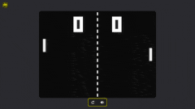</a> 
<b><a href="https://tennis.sixfingerpunch.com/">Tennis</a></b> 
🆕 · <a href="https://x.com/photonstorm">@photonstorm</a> · ♥ 3.0k · <a href="https://x.com/photonstorm/status/2120330010112434313">原文</a> 
被要求「盡情發揮」做遊戲，它交出了看起來像 Pong 的作品——直到你玩下去。 
<a href="https://fablelist.000ooo.ooo/zh-tw/prompts/?w=tennis&ref=gh"><b>✨ 取得提示詞</b></a>
</td>
</tr>
<tr>
<td width="33%" valign="top">
 
<b><a href="https://www.spawn.co/@mattshumer/earth?room=local">Mirror Earth</a></b> 
<a href="https://x.com/mattshumer_">@mattshumer_</a> · ♥ 2.4k · <a href="https://x.com/mattshumer_/status/2119877065701036047">▶ 影片</a> 
把整個地球做成可破壞的遊戲世界，天氣與真實地球即時同步。 
<a href="https://fablelist.000ooo.ooo/zh-tw/prompts/?w=mirror-earth&ref=gh"><b>✨ 取得提示詞</b></a>
</td>
<td width="33%" valign="top">
 
<b><a href="https://portals-endless-worlds.netlify.app/">Portals: Endless Worlds</a></b> 
<a href="https://x.com/emollick">@emollick</a> · ♥ 1.9k · <a href="https://x.com/emollick/status/2119918307457577163">▶ 影片</a> 
25,000 個 Agent 打造了 450 多個純程式碼 3D 世界，靈感來自書籍、藝術與各地風景，以傳送門相連，可以順著飄過去。 
<a href="https://github.com/emollick/ai-portals">原始碼</a> · <a href="https://www.oneusefulthing.org/p/fable-52-and-jagged-agi">文章</a> 
<a href="https://fablelist.000ooo.ooo/zh-tw/prompts/?w=portals-endless-worlds&ref=gh"><b>✨ 取得提示詞</b></a>
</td>
<td width="33%" valign="top">
 
<b><a href="https://evensong-phi.vercel.app/">Evensong</a></b> 
🆕 · <a href="https://x.com/kevin_t_ngo">@kevin_t_ngo</a> · ♥ 1.7k · <a href="https://x.com/kevin_t_ngo/status/2120238844754923874">▶ 影片</a> 
黑暗奇幻的魂系 Boss 戰，可在瀏覽器中遊玩。 
<a href="https://fablelist.000ooo.ooo/zh-tw/prompts/?w=evensong&ref=gh"><b>✨ 取得提示詞</b></a>
</td>
</tr>
<tr>
<td width="33%" valign="top">
<a href="https://loktar00.github.io/lanternfall/">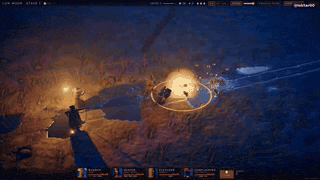</a> 
<b><a href="https://loktar00.github.io/lanternfall/">LANTERNFALL</a></b> 
🆕 · <a href="https://x.com/loktar00">@loktar00</a> · ♥ 1.4k · <a href="https://x.com/loktar00/status/2120192761542615271">▶ 影片</a> 
整款遊戲——動畫、模型、一切——都由 Fable 生成。看看敵人死亡時的效果。 
<a href="https://fablelist.000ooo.ooo/zh-tw/prompts/?w=lanternfall&ref=gh"><b>✨ 取得提示詞</b></a>
</td>
<td width="33%" valign="top">
<a href="https://op7418.github.io/guizang-game-skill/">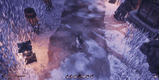</a> 
<b><a href="https://op7418.github.io/guizang-game-skill/">Mist-Locked Mountain Gate — 3D 動作遊戲</a></b> 
🆕 · <a href="https://x.com/op7418">@op7418</a> · ♥ 1.1k · <a href="https://x.com/op7418/status/2120694045299327187">▶ 影片</a> 
一個下午、45 億 token。模型、場景與招式全由 Fable 完成，打包成單一 30 MB 的 HTML 檔案。 
<a href="https://fablelist.000ooo.ooo/zh-tw/prompts/?w=mist-locked-mountain-gate-3d-action-game&ref=gh"><b>✨ 取得提示詞</b></a>
</td>
<td width="33%" valign="top">
<a href="https://wavedash.com/games/rooftop-rally">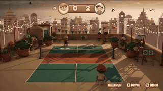</a> 
<b><a href="https://wavedash.com/games/rooftop-rally">Rooftop Rally — Unreal 5.9 的匹克球</a></b> 
🆕 · <a href="https://x.com/chongdashu">@chongdashu</a> · ♥ 1.1k · <a href="https://x.com/chongdashu/status/2120154573356793883">▶ 影片</a> 
Fable 5.2 搭配 Unreal Engine 5.9 預覽版。角色來自 Tripo；其他 3D 素材與其餘部分皆由 Fable 完成。 
<a href="https://x.com/chongdashu/status/2120310120509014219">製作過程</a> 
<a href="https://fablelist.000ooo.ooo/zh-tw/prompts/?w=rooftop-rally-pickleball-in-unreal-5-9&ref=gh"><b>✨ 取得提示詞</b></a>
</td>
</tr>
<tr>
<td width="33%" valign="top">
 
<b><a href="https://claude.ai/artifact/MXxb36zKgN261ckbGhmNin">Three Games（Saltline · The Clockmaker's Heart · Tidewright）</a></b> 
<a href="https://x.com/felixrieseberg">@felixrieseberg</a> · ♥ 810 · <a href="https://x.com/vineerpasam/status/2119955306096857145">▶ 影片</a> 
由 Felix Rieseberg 署名：「所有遊戲皆以 Claude Fable 5.2 製作。初稿，無人工回饋。」發表當天轉發最多的連結。 
<a href="https://claude.ai/artifact/6MjtQjf4ee1ZZjEpafaEpa">The Clockmaker's Heart</a> · <a href="https://claude.ai/artifact/JTgyEMn7sn1q2riWrMb7D4">Tidewright</a> 
<a href="https://fablelist.000ooo.ooo/zh-tw/prompts/?w=three-games-saltline-the-clockmaker-s-heart-tidewright&ref=gh"><b>✨ 取得提示詞</b></a>
</td>
<td width="33%" valign="top">
<a href="https://www.spawn.co/@mattshumer/voxel-engine">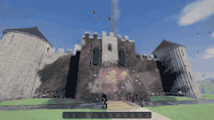</a> 
<b><a href="https://www.spawn.co/@mattshumer/voxel-engine">Voxel Engine</a></b> 
<a href="https://x.com/mattshumer_">@mattshumer_</a> · ♥ 738 · <a href="https://x.com/mattshumer_/status/2119870965106483384">▶ 影片</a> 
僅用一則提示打造。請開聲音。 
<a href="https://fablelist.000ooo.ooo/zh-tw/prompts/?w=voxel-engine&ref=gh"><b>✨ 取得提示詞</b></a>
</td>
<td width="33%" valign="top">
 
<b><a href="https://patch.gg/blendi/coloured-pencil">Coloured Pencil</a></b> 
🆕 · <a href="https://x.com/BlendiByl">@BlendiByl</a> · ♥ 665 · <a href="https://x.com/BlendiByl/status/2121130385723789637">▶ 影片</a> 
色鉛筆風格的遊戲片段；每個表面的明暗和整座小鎮都是程式碼。開源。 
<a href="https://fablelist.000ooo.ooo/zh-tw/prompts/?w=coloured-pencil&ref=gh"><b>✨ 取得提示詞</b></a>
</td>
</tr>
<tr>
<td width="33%" valign="top">
<a href="https://patch.gg/blendi/patchwork-quilt">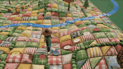</a> 
<b><a href="https://patch.gg/blendi/patchwork-quilt">Patchwork Quilt</a></b> 
🆕 · <a href="https://x.com/BlendiByl">@BlendiByl</a> · ♥ 664 · <a href="https://x.com/BlendiByl/status/2120746541636047347">▶ 影片</a> 
拼布、定格動畫風格的遊戲片段。整張地圖都是程式碼。開源。 
<a href="https://fablelist.000ooo.ooo/zh-tw/prompts/?w=patchwork-quilt&ref=gh"><b>✨ 取得提示詞</b></a>
</td>
<td width="33%" valign="top">
 
<b><a href="https://i-would-have-gotten-away-with-it.netlify.app/">I Would Have Gotten Away With It</a></b> 
<a href="https://x.com/emollick">@emollick</a> · ♥ 509 · <a href="https://x.com/emollick/status/2119876449494540554">▶ 影片</a> 
反過來的《史酷比》：你是反派，要嚇跑多管閒事的孩子們。預告片、音樂與音效也都出自 Fable。 
<a href="https://fablelist.000ooo.ooo/zh-tw/prompts/?w=i-would-have-gotten-away-with-it&ref=gh"><b>✨ 取得提示詞</b></a>
</td>
<td width="33%" valign="top">
 
<b><a href="https://noclipepe.pages.dev/rug/">Childhood Rug Racer</a></b> 
<a href="https://x.com/noclipepe">@noclipepe</a> · ♥ 415 · <a href="https://x.com/noclipepe/status/2119728047754547326">▶ 影片</a> 
在童年遊戲地毯上賽車的遊戲，與 GPT-6.2 Sol 使用相同提示。作者稱這個模型為「Fable 5.5（路由）」。 
<a href="https://fablelist.000ooo.ooo/zh-tw/prompts/?w=childhood-rug-racer&ref=gh"><b>✨ 取得提示詞</b></a>
</td>
</tr>
<tr>
<td width="33%" valign="top">
 
<b><a href="https://finderchangchang.github.io/cloud-stunt-3d/">Cloud Stunt 3D</a></b> 
<a href="https://x.com/jev_chat">@jev_chat</a> · ♥ 329 · <a href="https://x.com/jev_chat/status/2120015641151426838">▶ 影片</a> 
30 分鐘生成；也附上優化後的「黃金」版本。 
<a href="https://finderchangchang.github.io/cloud-stunt-3d/golden/">Optimized</a> 
<a href="https://x.com/jev_chat/status/2120015641151426838">📝 作者公開的提示詞（免費）</a>
</td>
<td width="33%" valign="top">
<a href="https://gilt-and-gutter.vercel.app/">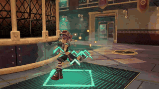</a> 
<b><a href="https://gilt-and-gutter.vercel.app/">Gilt & Gutter</a></b> 
🆕 · <a href="https://x.com/kevin_t_ngo">@kevin_t_ngo</a> · ♥ 326 · <a href="https://x.com/kevin_t_ngo/status/2119900487688622171">▶ 影片</a> 
1 對 1 第一人稱射擊，有兩名可操作角色。 
<a href="https://fablelist.000ooo.ooo/zh-tw/prompts/?w=gilt-gutter&ref=gh"><b>✨ 取得提示詞</b></a>
</td>
<td width="33%" valign="top">
<a href="https://www.spawn.co/@mattshumer/hogwarts-royale">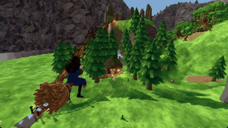</a> 
<b><a href="https://www.spawn.co/@mattshumer/hogwarts-royale">Hogwarts Royale</a></b> 
<a href="https://x.com/mattshumer_">@mattshumer_</a> · ♥ 311 · <a href="https://x.com/mattshumer_/status/2119872098306810226">▶ 影片</a> 
「做一個哈利波特與 Fortnite 的混搭」——可遊玩的大逃殺。 
<a href="https://x.com/mattshumer_/status/2119872098306810226">📝 作者公開的提示詞（免費）</a>
</td>
</tr>
<tr>
<td width="33%" valign="top">
<a href="https://dread-and-district.netlify.app">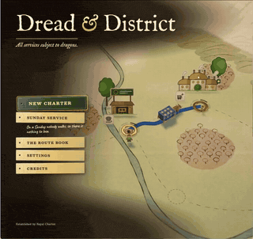</a> 
<b><a href="https://dread-and-district.netlify.app">Dread & District</a></b> 
🆕 · <a href="https://x.com/emollick">@emollick</a> · ♥ 302 · <a href="https://x.com/emollick/status/2120248525254742318">▶ 影片</a> 
一款「有溫度」的奇幻運輸模擬：一段模糊的描述，接著一群 Agent 為美術、世界觀與笑點爭論不休。好的物流能擊敗邪惡。 
<a href="https://fablelist.000ooo.ooo/zh-tw/prompts/?w=dread-district&ref=gh"><b>✨ 取得提示詞</b></a>
</td>
<td width="33%" valign="top">
<a href="https://lauramionel.github.io/cayley-flight-simulator/">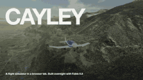</a> 
<b><a href="https://lauramionel.github.io/cayley-flight-simulator/">Cayley 飛行模擬器</a></b> 
🆕 · <a href="https://x.com/lionel_mora">@lionel_mora</a> · ♥ 295 · <a href="https://x.com/lionel_mora/status/2120554787812860294">▶ 影片</a> 
一夜一次到位：真實的機翼物理，分別計算機翼各部位的升力與阻力。 
<a href="https://fablelist.000ooo.ooo/zh-tw/prompts/?w=cayley-flight-simulator&ref=gh"><b>✨ 取得提示詞</b></a>
</td>
<td width="33%" valign="top">
 
<b><a href="https://github.com/amirmushichge/worm-rider">Worm Rider</a></b> 
<a href="https://x.com/AmirMushich">@AmirMushich</a> · ♥ 251 · <a href="https://x.com/AmirMushich/status/2119937977426338283">▶ 影片</a> 
開源。220 KB、3,400 行、10 則提示，所有模型都在 Claude Code 中從零打造。 
<a href="https://fablelist.000ooo.ooo/zh-tw/prompts/?w=worm-rider&ref=gh"><b>✨ 取得提示詞</b></a>
</td>
</tr>
<tr>
<td width="33%" valign="top">
 
<b><a href="https://maad-maxxing.vercel.app/">MAAD MAXXING</a></b> 
🆕 · <a href="https://x.com/Andrew_Blumson">@Andrew_Blumson</a> · ♥ 245 · <a href="https://x.com/Andrew_Blumson/status/2120599812512833557">▶ 影片</a> 
100% 程式碼，無素材。前 3 關可玩；音效由 ElevenLabs 製作。 
<a href="https://fablelist.000ooo.ooo/zh-tw/prompts/?w=maad-maxxing&ref=gh"><b>✨ 取得提示詞</b></a>
</td>
<td width="33%" valign="top">
 
<b><a href="https://unsung-vale.vercel.app/">Unsung Vale — 開放世界 RPG</a></b> 
🆕 · <a href="https://x.com/LexnLin">@LexnLin</a> · ♥ 235 · <a href="https://x.com/LexnLin/status/2121253191748669705">▶ 影片</a> 
第三人稱開放世界 RPG 展示。沒有素材：畫面上的一切都由程式碼做成。 
<a href="https://github.com/Leonxlnx/unsung-vale">原始碼</a>
</td>
<td width="33%" valign="top">
<a href="https://frontier.every.to/experiments/first-crush">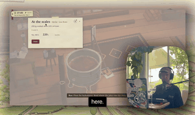</a> 
<b><a href="https://frontier.every.to/experiments/first-crush">First Crush</a></b> 
🆕 · <a href="https://x.com/kieranklaassen">@kieranklaassen</a> · ♥ 229 · <a href="https://x.com/kieranklaassen/status/2119871673294037280">▶ 影片</a> 
釀酒遊戲：刷洗發酵槽、壓榨 250 公斤水果、讀比重計、挑選酵母——並解釋原因。請點頁面上的「Try it」。 
<a href="https://fablelist.000ooo.ooo/zh-tw/prompts/?w=first-crush&ref=gh"><b>✨ 取得提示詞</b></a>
</td>
</tr>
<tr>
<td width="33%" valign="top">
 
<b><a href="https://cozylisbon.vercel.app">Cozy Lisbon</a></b> 
🆕 · <a href="https://x.com/goncalo_canhoto">@goncalo_canhoto</a> · ♥ 166 · <a href="https://x.com/goncalo_canhoto/status/2119932946346094690">▶ 影片</a> 
一則提示做出的療癒遊戲，一架小飛機飛越里斯本。 
<a href="https://fablelist.000ooo.ooo/zh-tw/prompts/?w=cozy-lisbon&ref=gh"><b>✨ 取得提示詞</b></a>
</td>
<td width="33%" valign="top">
<a href="https://spawn.co/@robot/frontline-warfare-deathmatch">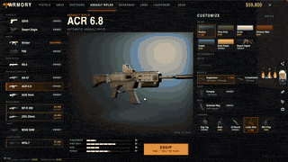</a> 
<b><a href="https://spawn.co/@robot/frontline-warfare-deathmatch">Frontline Warfare Deathmatch</a></b> 
<a href="https://x.com/alightinastorm">@alightinastorm</a> · ♥ 163 · <a href="https://x.com/alightinastorm/status/2120020469487440210">▶ 影片</a> 
瀏覽器中的《決勝時刻》風格射擊遊戲。
</td>
<td width="33%" valign="top">
<a href="https://wquguru.github.io/fable52-fps-repro/">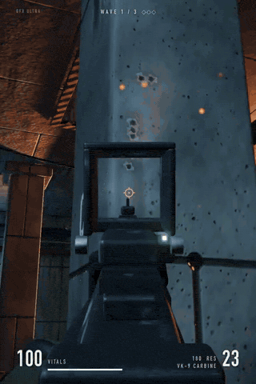</a> 
<b><a href="https://wquguru.github.io/fable52-fps-repro/">Fable 5.2 FPS Repro</a></b> 
🆕 · <a href="https://x.com/wquguru">@wquguru</a> · ♥ 157 · <a href="https://x.com/wquguru/status/2120383332722905400">▶ 影片</a> 
四個單檔 3D FPS 展示：模型、音效與貼圖全是程式碼。方法與原始碼公開。 
<a href="https://github.com/wquguru/fable52-fps-repro">原始碼</a> 
<a href="https://x.com/wquguru/status/2120383332722905400">📝 作者公開的提示詞（免費）</a>
</td>
</tr>
<tr>
<td width="33%" valign="top">
 
<b><a href="https://remix.gg/g/banana-mine-rush">Banana Mine Rush</a></b> 
🆕 · <a href="https://x.com/0xChuckstock">@0xChuckstock</a> · ♥ 154 · <a href="https://x.com/0xChuckstock/status/2120125184606658728">▶ 影片</a> 
Remix 上的 3D 卡丁車競速：免註冊，在瀏覽器即開即玩，有多人模式與排行榜。 
<a href="https://fablelist.000ooo.ooo/zh-tw/prompts/?w=banana-mine-rush&ref=gh"><b>✨ 取得提示詞</b></a>
</td>
<td width="33%" valign="top">
<a href="https://noclipepe.pages.dev/dino">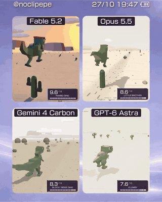</a> 
<b><a href="https://noclipepe.pages.dev/dino">Rambo Dino</a></b> 
<a href="https://x.com/noclipepe">@noclipepe</a> · ♥ 152 · <a href="https://x.com/noclipepe/status/2119927838321328577">▶ 影片</a> 
重新打造的 Chrome 小恐龍遊戲。並與 Opus 5.5、Gemini 4 Carbon、GPT-6 Astra 比較。 
<a href="https://fablelist.000ooo.ooo/zh-tw/prompts/?w=rambo-dino&ref=gh"><b>✨ 取得提示詞</b></a>
</td>
<td width="33%" valign="top">
<a href="https://sanwan.ai/games/xingyun-moba/">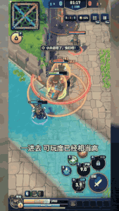</a> 
<b><a href="https://sanwan.ai/games/xingyun-moba/">Starfall — 瀏覽器 MOBA</a></b> 
🆕 · <a href="https://x.com/FuSheng_0306">@FuSheng_0306</a> · ♥ 148 · <a href="https://x.com/FuSheng_0306/status/2121237878097207583">▶ 影片</a> 
一則提示、約 20 小時的 Fable 5.2：五名英雄、一名真人玩家與 NPC。 
<a href="https://fablelist.000ooo.ooo/zh-tw/prompts/?w=starfall-a-browser-moba&ref=gh"><b>✨ 取得提示詞</b></a>
</td>
</tr>
<tr>
<td width="33%" valign="top">
 
<b><a href="https://turbo-tails.vercel.app">Turbo Tails</a></b> 
<a href="https://x.com/petergyang">@petergyang</a> · ♥ 139 · <a href="https://x.com/petergyang/status/2119901658394358005">▶ 影片</a> 
3D 卡丁車競速：6 名車手、飄移、跳台、道具，支援單人與多人。 
<a href="https://youtu.be/SsSKJA0EHD4">Comparison video</a> 
<a href="https://fablelist.000ooo.ooo/zh-tw/prompts/?w=turbo-tails&ref=gh"><b>✨ 取得提示詞</b></a>
</td>
<td width="33%" valign="top">
<a href="https://luminazombies.com/">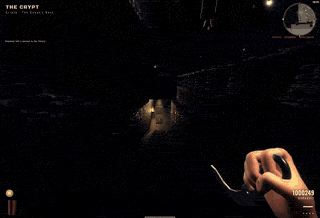</a> 
<b><a href="https://luminazombies.com/">Lumina Zombies</a></b> 
🆕 · <a href="https://x.com/LuminaBench">@LuminaBench</a> · ♥ 124 · <a href="https://x.com/LuminaBench/status/2120660076927099048">▶ 影片</a> 
幾則提示就做出帶彩蛋的全新地圖，另外的升級讓其他兩張地圖的硬體需求與延遲減半。 
<a href="https://fablelist.000ooo.ooo/zh-tw/prompts/?w=lumina-zombies&ref=gh"><b>✨ 取得提示詞</b></a>
</td>
</tr>
</table>

<b><a href="all/games.zh-TW.md">查看全部 75 個 →</a></b>

<a href="#-目錄">↑ 回到目錄</a>

## 🌍 3D 世界與場景

<table>
<tr>
<td width="33%" valign="top">
 
<b><a href="https://claude.ai/artifact/QGWUAjRrzRzZWGcQzSMLfa">Blender 筆電上的 Claude App</a></b> 
<a href="https://x.com/rileybrown">@rileybrown</a> · ♥ 7.0k · <a href="https://x.com/rileybrown/status/2119902109709537708">▶ 影片</a> 
一則提示就在 Blender 中建好整個房間並以 4K 渲染。這是筆電螢幕上顯示的網頁。 
<a href="https://x.com/rileybrown/status/2119902109709537708">📝 作者公開的提示詞（免費）</a>
</td>
<td width="33%" valign="top">
 
<b><a href="https://patch.gg/blendi/painted-valley">Painted Valley</a></b> 
🆕 · <a href="https://x.com/BlendiByl">@BlendiByl</a> · ♥ 1.8k · <a href="https://x.com/BlendiByl/status/2120694003230560585">▶ 影片</a> 
受吉卜力啟發的手繪山谷，可以走進去。開源。 
<a href="https://fablelist.000ooo.ooo/zh-tw/prompts/?w=painted-valley&ref=gh"><b>✨ 取得提示詞</b></a>
</td>
<td width="33%" valign="top">
 
<b><a href="https://indiranagar-live.vercel.app">英迪拉訥格爾 1 平方公里</a></b> 
<a href="https://x.com/anshu4321">@anshu4321</a> · ♥ 1.2k · <a href="https://x.com/anshu4321/status/2119938067758772403">▶ 影片</a> 
根據地圖資料與一則提示生成的班加羅爾即時 3D 切片。 
<a href="https://fablelist.000ooo.ooo/zh-tw/prompts/?w=1-km2-of-indiranagar&ref=gh"><b>✨ 取得提示詞</b></a>
</td>
</tr>
<tr>
<td width="33%" valign="top">
 
<b><a href="https://claude.ai/artifact/CTjrZXVdUgKJ6qJXrvvr28">Ancient Babylon, 600 BC</a></b> 
🆕 · <a href="https://x.com/literallydenis">@literallydenis</a> · ♥ 1.2k · <a href="https://x.com/literallydenis/status/2120866958790848953">▶ 影片</a> 
歷時 8 小時，根據它自己找到的歷史文獻與平面圖重建的巴比倫。可自由漫步。 
<a href="https://fablelist.000ooo.ooo/zh-tw/prompts/?w=ancient-babylon-600-bc&ref=gh"><b>✨ 取得提示詞</b></a>
</td>
<td width="33%" valign="top">
<a href="https://fable-rome.surge.sh/">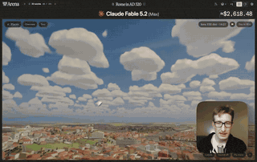</a> 
<b><a href="https://fable-rome.surge.sh/">Rome, AD 320</a></b> 
🆕 · <a href="https://x.com/petergostev">@petergostev</a> · ♥ 968 · <a href="https://x.com/petergostev/status/2120167560700383572">▶ 影片</a> 
一則提示，Fable 5.2（Max）連跑一整夜，$2,618。 
<a href="https://x.com/petergostev/status/2120167560700383572">📝 作者公開的提示詞（免費）</a>
</td>
<td width="33%" valign="top">
 
<b><a href="https://github.com/Leonxlnx/room-at-dawn">Room at Dawn</a></b> 
🆕 · <a href="https://x.com/LexnLin">@LexnLin</a> · ♥ 838 · <a href="https://x.com/LexnLin/status/2120910879361548565">▶ 影片</a> 
three.js 打造的擬真臥室，沒有預製模型或貼圖；一切都是程式碼。 
<a href="https://fablelist.000ooo.ooo/zh-tw/prompts/?w=room-at-dawn&ref=gh"><b>✨ 取得提示詞</b></a>
</td>
</tr>
<tr>
<td width="33%" valign="top">
<a href="https://supernatural-ft.vercel.app/fire-in-ice">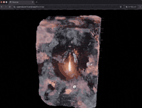</a> 
<b><a href="https://supernatural-ft.vercel.app/fire-in-ice">Fire in Ice</a></b> 
🆕 · <a href="https://x.com/tkm_hmng8">@tkm_hmng8</a> · ♥ 490 · <a href="https://x.com/tkm_hmng8/status/2120813043101946324">▶ 影片</a> 
寫在原生 WebGPU（不用 three.js）上的冰中燃燒的逼真火焰。 
<a href="https://fablelist.000ooo.ooo/zh-tw/prompts/?w=fire-in-ice&ref=gh"><b>✨ 取得提示詞</b></a>
</td>
<td width="33%" valign="top">
<a href="https://bay.theojaffee.net">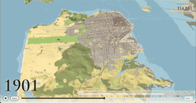</a> 
<b><a href="https://bay.theojaffee.net">Bay Area Through Time</a></b> 
🆕 · <a href="https://x.com/theojaffee">@theojaffee</a> · ♥ 383 · <a href="https://x.com/theojaffee/status/2120312766544437738">▶ 影片</a> 
縮放到任何城市或社區，選擇回溯到 1769 年的任一年份，看看當時的樣貌。 
<a href="https://nyc.theojaffee.net">New York City</a> 
<a href="https://fablelist.000ooo.ooo/zh-tw/prompts/?w=bay-area-through-time&ref=gh"><b>✨ 取得提示詞</b></a>
</td>
<td width="33%" valign="top">
<a href="http://procedural-arm-rig.vercel.app">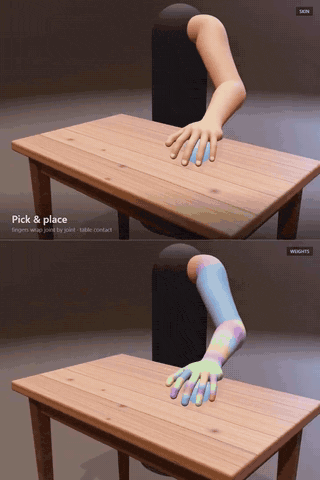</a> 
<b><a href="http://procedural-arm-rig.vercel.app">Procedural Arm Rig</a></b> 
🆕 · <a href="https://x.com/apekshik">@apekshik</a> · ♥ 325 · <a href="https://x.com/apekshik/status/2120224530367119758">▶ 影片</a> 
不去一次做完 AAA 遊戲，而是做一隻手臂：骨架、權重繪製的網格、IK，握拳時肌肉會隆起。 
<a href="https://fablelist.000ooo.ooo/zh-tw/prompts/?w=procedural-arm-rig&ref=gh"><b>✨ 取得提示詞</b></a>
</td>
</tr>
<tr>
<td width="33%" valign="top">
<a href="https://samg-coder.github.io/solstice-garden/">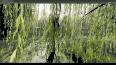</a> 
<b><a href="https://samg-coder.github.io/solstice-garden/">The Garden</a></b> 
🆕 · <a href="https://x.com/SamGCoder">@SamGCoder</a> · ♥ 269 · <a href="https://x.com/SamGCoder/status/2120943068321054975">▶ 影片</a> 
以 Rust 寫成、編譯為 WASM、用 WebGPU 渲染的花園場景。 
<a href="https://fablelist.000ooo.ooo/zh-tw/prompts/?w=the-garden&ref=gh"><b>✨ 取得提示詞</b></a>
</td>
<td width="33%" valign="top">
 
<b><a href="https://claude.ai/artifact/R6YBDkAm2GjAC5A65D9djx">可以走進去的 Claude 展示</a></b> 
🆕 · <a href="https://x.com/dfeinition">@dfeinition</a> · ♥ 213 · <a href="https://x.com/dfeinition/status/2120330644261589051">▶ 影片</a> 
靈感來自 @rileybrown：走進去，坐到任何一台電腦前。 
<a href="https://fablelist.000ooo.ooo/zh-tw/prompts/?w=a-claude-demo-you-can-walk-into&ref=gh"><b>✨ 取得提示詞</b></a>
</td>
<td width="33%" valign="top">
<a href="https://claude.ai/artifact/2PBXuQAnWDS2NpiPXHNLfL">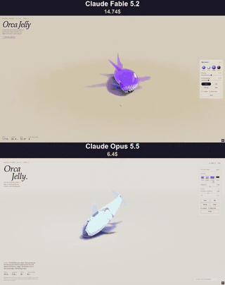</a> 
<b><a href="https://claude.ai/artifact/2PBXuQAnWDS2NpiPXHNLfL">Orca Jelly</a></b> 
<a href="https://x.com/vib3coded">@vib3coded</a> · ♥ 202 · <a href="https://x.com/vib3coded/status/2119951060752375827">▶ 影片</a> 
軟體物理的橡皮糖虎鯨材質研究。並附上 Opus 5.5 的版本供比較。 
<a href="https://claude.ai/artifact/75KLotWzZQ5RR23BGLePb8">Opus 5.5 version</a> 
<a href="https://x.com/vib3coded/status/2119951060752375827">📝 作者公開的提示詞（免費）</a>
</td>
</tr>
<tr>
<td width="33%" valign="top">
 
<b><a href="https://claude.ai/artifact/9EgZpErM17kH2a9Q3WXW6f">瓶中的體素世界</a></b> 
<a href="https://x.com/vib3coded">@vib3coded</a> · ♥ 160 · <a href="https://x.com/vib3coded/status/2120104517282775514">▶ 影片</a> 
30 分鐘，$12.81。 
<a href="https://x.com/vib3coded/status/2120104517282775514">📝 作者公開的提示詞（免費）</a>
</td>
<td width="33%" valign="top">
<a href="https://patch.gg/blendi/impossible-spaces">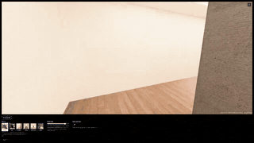</a> 
<b><a href="https://patch.gg/blendi/impossible-spaces">Impossible Spaces</a></b> 
🆕 · <a href="https://x.com/BlendiByl">@BlendiByl</a> · ♥ 135 · <a href="https://x.com/BlendiByl/status/2120314459793355262">▶ 影片</a> 
迷幻的「不可能空間」體驗。開源。 
<a href="https://fablelist.000ooo.ooo/zh-tw/prompts/?w=impossible-spaces&ref=gh"><b>✨ 取得提示詞</b></a>
</td>
<td width="33%" valign="top">
<a href="https://claude.ai/artifact/7ge282etTXSS4edGFTFa85">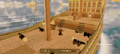</a> 
<b><a href="https://claude.ai/artifact/7ge282etTXSS4edGFTFa85">3D Sailing Ship</a></b> 
<a href="https://x.com/marcthecreatorr">@marcthecreatorr</a> · ♥ 112 · <a href="https://x.com/marcthecreatorr/status/2119890973560054072">▶ 影片</a> 
純 Three.js，沒有 Blender 或外部素材。約 38 分鐘、約 $17。 
<a href="https://fablelist.000ooo.ooo/zh-tw/prompts/?w=3d-sailing-ship&ref=gh"><b>✨ 取得提示詞</b></a>
</td>
</tr>
<tr>
<td width="33%" valign="top">
 
<b><a href="https://tests.jazii.dev/">Pirate Ship</a></b> 
<a href="https://x.com/notjazii">@notjazii</a> · ♥ 110 · <a href="https://x.com/notjazii/status/2119905661505122575">▶ 影片</a> 
一次到位，約 1.5 小時、約 3,500 萬 token（約 $34）。 
<a href="https://fablelist.000ooo.ooo/zh-tw/prompts/?w=pirate-ship&ref=gh"><b>✨ 取得提示詞</b></a>
</td>
</tr>
</table>

<b><a href="all/3d-worlds.zh-TW.md">查看全部 33 個 →</a></b>

<a href="#-目錄">↑ 回到目錄</a>

## 🧰 網頁與工具

<table>
<tr>
<td width="33%" valign="top">
 
<b><a href="https://claudia.gallery">Claudia Gallery</a></b> 
<a href="https://x.com/anabology">@anabology</a> · ♥ 5.3k · <a href="https://x.com/anabology/status/2120010995309457643">▶ 影片</a> 
「做出你夢想中的影片」——兩個鏡頭，9 小時。 
<a href="https://fablelist.000ooo.ooo/zh-tw/prompts/?w=claudia-gallery&ref=gh"><b>✨ 取得提示詞</b></a>
</td>
<td width="33%" valign="top">
 
<b><a href="http://robotics-lab-app.vercel.app">Robotics Lab</a></b> 
🆕 · <a href="https://x.com/0xMovez">@0xMovez</a> · ♥ 4.6k · <a href="https://x.com/0xMovez/status/2120239217880268919">▶ 影片</a> 
3D 呈現八塊真實開發板（Arduino Uno、Raspberry Pi 4⋯⋯）：放置晶片、焊接、接上真實電路。 
<a href="http://robolabs-app.vercel.app">Humanoid edition</a> 
<a href="https://fablelist.000ooo.ooo/zh-tw/prompts/?w=robotics-lab&ref=gh"><b>✨ 取得提示詞</b></a>
</td>
<td width="33%" valign="top">
 
<b><a href="https://claude.ai/artifact/N6bSgS4ZH5ifFQfg8sm4dv">House Bangers 生成器</a></b> 
🆕 · <a href="https://x.com/deedydas">@deedydas</a> · ♥ 3.7k · <a href="https://x.com/deedydas/status/2120905625852936318">▶ 影片</a> 
它學會了樂理，每種樂器嘗試數千種模式，再把最好的編排成 72 小節的 House 曲目。請開聲音。 
<a href="https://fablelist.000ooo.ooo/zh-tw/prompts/?w=house-bangers-generator&ref=gh"><b>✨ 取得提示詞</b></a>
</td>
</tr>
<tr>
<td width="33%" valign="top">
 
<b><a href="https://miaai-lab.github.io/Claude-Fable-5.2-HTML-Files/">76 個單檔 HTML 作品</a></b> 
<a href="https://x.com/MiaAI_lab">@MiaAI_lab</a> · ♥ 2.6k · <a href="https://x.com/MiaAI_lab/status/2119930229661503893">原文</a> 
生成藝術、物理、字體與 UI，每件都附上原始提示。 
<a href="https://fablelist.000ooo.ooo/zh-tw/prompts/?w=76-single-file-html-pieces&ref=gh"><b>✨ 取得提示詞</b></a>
</td>
<td width="33%" valign="top">
 
<b><a href="https://pixel-worlds.vercel.app/keep/">Keep — 密碼強度計</a></b> 
🆕 · <a href="https://x.com/crtvTeknologist">@crtvTeknologist</a> · ♥ 1.6k · <a href="https://x.com/crtvTeknologist/status/2119894073024606617">▶ 影片</a> 
把密碼強度指示器做成活生生的像素世界。 
<a href="https://github.com/finktheartist/pixel-worlds">原始碼</a> 
<a href="https://fablelist.000ooo.ooo/zh-tw/prompts/?w=keep-password-strength-meter&ref=gh"><b>✨ 取得提示詞</b></a>
</td>
<td width="33%" valign="top">
 
<b><a href="https://masterofvfx2070.github.io/xray-mirror/">X-Ray Mirror</a></b> 
🆕 · <a href="https://x.com/HashemGhaili">@HashemGhaili</a> · ♥ 1.4k · <a href="https://x.com/HashemGhaili/status/2120202746121085321">▶ 影片</a> 
網路攝影機對著臉，即時追蹤並看到頭骨、大腦與肌肉。張嘴下顎就會打開；影像不會離開你的電腦。 
<a href="https://github.com/MasterOfVFX2070/xray-mirror">原始碼</a> 
<a href="https://fablelist.000ooo.ooo/zh-tw/prompts/?w=x-ray-mirror&ref=gh"><b>✨ 取得提示詞</b></a>
</td>
</tr>
<tr>
<td width="33%" valign="top">
 
<b><a href="https://xianxie6.github.io/animals-planner-2027/">Animals at Work — 3D 手帳</a></b> 
🆕 · <a href="https://x.com/Xian0063">@Xian0063</a> · ♥ 1.2k · <a href="https://x.com/Xian0063/status/2120417834694250522">▶ 影片</a> 
把紙本手帳重建成 3D：拖曳翻頁、點日期書寫、90 張可撕可貼的貼紙。骨架由 Opus 5.5 搭建；Fable 5.2 對照真實影片精修材質。 
<a href="https://fablelist.000ooo.ooo/zh-tw/prompts/?w=animals-at-work-3d-planner&ref=gh"><b>✨ 取得提示詞</b></a>
</td>
<td width="33%" valign="top">
 
<b><a href="https://uberdesigner.ai/t/spine-menu">Spine Menu</a></b> 
🆕 · <a href="https://x.com/seanaiux">@seanaiux</a> · ♥ 1.2k · <a href="https://x.com/seanaiux/status/2120222459110789574">▶ 影片</a> 
「你看過更好看的選單嗎？」頁面中附有提示。 
<a href="https://uberdesigner.ai/t/aquarium-toggle">Aquarium toggle</a> · <a href="https://uberdesigner.ai/t/glow-widgets">Glow widgets</a>
</td>
<td width="33%" valign="top">
 
<b><a href="https://github.com/AlexAtFF/pulp-daw-public">PULP — AI 原生 DAW</a></b> 
🆕 · <a href="https://x.com/The_Alex">@The_Alex</a> · ♥ 940 · <a href="https://x.com/The_Alex/status/2119917226769985785">▶ 影片</a> 
原生 Windows 數位音訊工作站。向 Claude 要音樂，它就會打開 DAW 並做出歌曲。 
<a href="https://fablelist.000ooo.ooo/zh-tw/prompts/?w=pulp-an-ai-native-daw&ref=gh"><b>✨ 取得提示詞</b></a>
</td>
</tr>
<tr>
<td width="33%" valign="top">
 
<b><a href="https://frontier.every.to/experiments/ambient-town">Ambient Town</a></b> 
🆕 · <a href="https://x.com/kieranklaassen">@kieranklaassen</a> · ♥ 891 · <a href="https://x.com/kieranklaassen/status/2119868196773929160">▶ 影片</a> 
一位前電影配樂家花了一週夜晚打造的氛圍音樂 DAW：支援 Ableton Push、麥克風、效果器、合成器，還有能與你一起作曲的 Agent。請點頁面上的「Try it」。 
<a href="https://fablelist.000ooo.ooo/zh-tw/prompts/?w=ambient-town&ref=gh"><b>✨ 取得提示詞</b></a>
</td>
<td width="33%" valign="top">
 
<b><a href="https://itspsneha.com/supplements">印度該買哪種維他命</a></b> 
<a href="https://x.com/itspsneha">@itspsneha</a> · ♥ 740 · <a href="https://x.com/itspsneha/status/2120048494761451974">原文</a> 
讀完 109 個受測批次的檢驗報告後製作。 
<a href="https://fablelist.000ooo.ooo/zh-tw/prompts/?w=which-vitamins-to-buy-in-india&ref=gh"><b>✨ 取得提示詞</b></a>
</td>
<td width="33%" valign="top">
 
<b><a href="https://v2.video/riley/the-history-of-writing/v1">書寫的歷史</a></b> 
<a href="https://x.com/rileybrown">@rileybrown</a> · ♥ 665 · <a href="https://x.com/rileybrown/status/2119946022767980985">▶ 影片</a> 
一則提示生成的互動式影片；提示與檔案皆公開分享。 
<a href="https://x.com/rileybrown/status/2119946022767980985">📝 作者公開的提示詞（免費）</a>
</td>
</tr>
<tr>
<td width="33%" valign="top">
 
<b><a href="https://where-is-everybody-fermi.netlify.app/">Where Is Everybody?</a></b> 
🆕 · <a href="https://x.com/emollick">@emollick</a> · ♥ 453 · <a href="https://x.com/emollick/status/2120359214157603139">原文</a> 
被要求「解決費米悖論」：它整理資料、檢驗假說，並對著批評者做壓力測試。 
<a href="https://resolving-the-great-silence.netlify.app/">Gemini Carbon version</a> 
<a href="https://x.com/emollick/status/2120359214157603139">📝 作者公開的提示詞（免費）</a>
</td>
<td width="33%" valign="top">
 
<b><a href="https://gsplan.org">Galatasaray 座位視野</a></b> 
🆕 · <a href="https://x.com/molenbeek84">@molenbeek84</a> · ♥ 423 · <a href="https://x.com/molenbeek84/status/2120847639411331097">原文</a> 
買票前就能看到 RAMS Park 每個看台區望向球場的視野。 
<a href="https://fablelist.000ooo.ooo/zh-tw/prompts/?w=galatasaray-seat-view&ref=gh"><b>✨ 取得提示詞</b></a>
</td>
<td width="33%" valign="top">
 
<b><a href="https://origamihelper.com">Origami Helper</a></b> 
🆕 · <a href="https://x.com/ryoma_nakajima">@ryoma_nakajima</a> · ♥ 217 · <a href="https://x.com/ryoma_nakajima/status/2120472383241011323">▶ 影片</a> 
以 AR 從任何角度用 3D 學習摺紙。免費、免註冊，一天做成。 
<a href="https://fablelist.000ooo.ooo/zh-tw/prompts/?w=origami-helper&ref=gh"><b>✨ 取得提示詞</b></a>
</td>
</tr>
<tr>
<td width="33%" valign="top">
 
<b><a href="https://typed.page/">Typed</a></b> 
<a href="https://x.com/clairevo">@clairevo</a> · ♥ 205 · <a href="https://x.com/clairevo/status/2119905651359142132">▶ 影片</a> 
功能完整的打字機：可打字或點按鍵、寫作計時、修正液、自動校正。 
<a href="https://fablelist.000ooo.ooo/zh-tw/prompts/?w=typed&ref=gh"><b>✨ 取得提示詞</b></a>
</td>
<td width="33%" valign="top">
 
<b><a href="https://patch.gg/patch/anymove">anymove</a></b> 
🆕 · <a href="https://x.com/rehan_shei">@rehan_shei</a> · ♥ 139 · <a href="https://x.com/rehan_shei/status/2120409150870159414">▶ 影片</a> 
把 AI 影片中的動作解算到真實的 3D 骨架上——不用動捕服、不用關鍵幀。開源。 
<a href="https://fablelist.000ooo.ooo/zh-tw/prompts/?w=anymove&ref=gh"><b>✨ 取得提示詞</b></a>
</td>
<td width="33%" valign="top">
 
<b><a href="https://motionsites.ai/?prompt=vante-ribbon-hero">Ribbon Hero</a></b> 
<a href="https://x.com/viktoroddy">@viktoroddy</a> · ♥ 138 · <a href="https://x.com/viktoroddy/status/2119985044542705916">▶ 影片</a> 
以 Fable 5.2 ＋ GPT Image 2.6 製作的首屏區塊。
</td>
</tr>
<tr>
<td width="33%" valign="top">
 
<b><a href="https://nikechan.com/">nikechan.com 改版</a></b> 
<a href="https://x.com/tegnike">@tegnike</a> · ♥ 130 · <a href="https://x.com/tegnike/status/2120110145841578173">原文</a> 
從頭到尾重新設計的個人網站。 
<a href="https://fablelist.000ooo.ooo/zh-tw/prompts/?w=nikechan-com-redesign&ref=gh"><b>✨ 取得提示詞</b></a>
</td>
</tr>
</table>

<b><a href="all/web-and-tools.zh-TW.md">查看全部 32 個 →</a></b>

<a href="#-目錄">↑ 回到目錄</a>

## 🎬 動畫與短片

<table>
<tr>
<td width="33%" valign="top">
 
<b><a href="https://github.com/ChetasLua/crimson-loong">Crimson Loong</a></b> 
🆕 · <a href="https://x.com/chetaslua">@chetaslua</a> · ♥ 2.6k · <a href="https://x.com/chetaslua/status/2121176151234330707">▶ 影片</a> 
以 three.js 製作的 90 秒龍影片，純程式碼，無外部素材。 
<a href="https://fablelist.000ooo.ooo/zh-tw/prompts/?w=crimson-loong&ref=gh"><b>✨ 取得提示詞</b></a>
</td>
<td width="33%" valign="top">
<a href="https://github.com/ChetasLua/pelican-riding-a-bicycle">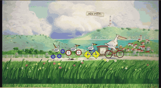</a> 
<b><a href="https://github.com/ChetasLua/pelican-riding-a-bicycle">The Pelican, Tired of the Road</a></b> 
🆕 · <a href="https://x.com/chetaslua">@chetaslua</a> · ♥ 350 · <a href="https://x.com/chetaslua/status/2120438091647218025">▶ 影片</a> 
一部 60 秒的手繪風影片，主角是 SVG 測試裡的鵜鶘。單一 HTML 檔案；每個像素、每個聲音都是程式碼。 
<a href="https://github.com/ChetasLua/mona-lisa-js">Mona Lisa in JS</a> 
<a href="https://fablelist.000ooo.ooo/zh-tw/prompts/?w=the-pelican-tired-of-the-road&ref=gh"><b>✨ 取得提示詞</b></a>
</td>
<td width="33%" valign="top">
 
<b><a href="https://github.com/anstapnever/one-sweep">One Sweep</a></b> 
<a href="https://x.com/anstapnever">@anstapnever</a> · ♥ 250 · <a href="https://x.com/anstapnever/status/2119772039037014524">▶ 影片</a> 
純 Three.js 的 78 秒動畫打鬥，六支 Agent 團隊並行。作者說的是「Fable 5.5」。 
<a href="https://x.com/anstapnever/status/2119772039037014524">📝 作者公開的提示詞（免費）</a>
</td>
</tr>
<tr>
<td width="33%" valign="top">
 
<b><a href="https://github.com/crossps/ballpoint">Ballpoint</a></b> 
<a href="https://x.com/camperaigg">@camperaigg</a> · ♥ 242 · <a href="https://x.com/camperaigg/status/2119777467074580741">▶ 影片</a> 
原子筆的微距 ASMR，開源以證明這是程式碼而非影片模型。 
<a href="https://fablelist.000ooo.ooo/zh-tw/prompts/?w=ballpoint&ref=gh"><b>✨ 取得提示詞</b></a>
</td>
<td width="33%" valign="top">
<a href="https://github.com/ChetasLua/godzilla-nights">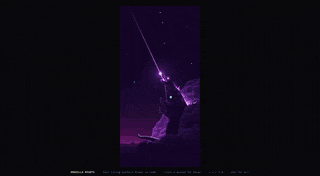</a> 
<b><a href="https://github.com/ChetasLua/godzilla-nights">Godzilla Nights</a></b> 
<a href="https://x.com/chetaslua">@chetaslua</a> · ♥ 228 · <a href="https://x.com/chetaslua/status/2119981510199808368">▶ 影片</a> 
純程式碼繪製的畫面，帶有輕微動態。 
<a href="https://fablelist.000ooo.ooo/zh-tw/prompts/?w=godzilla-nights&ref=gh"><b>✨ 取得提示詞</b></a>
</td>
<td width="33%" valign="top">
 
<b><a href="https://github.com/anstapnever/blackout">Blackout</a></b> 
<a href="https://x.com/anstapnever">@anstapnever</a> · ♥ 118 · <a href="https://x.com/anstapnever/status/2119915123070644263">▶ 影片</a> 
79 秒動畫短片，全部由程式碼完成。 
<a href="https://x.com/anstapnever/status/2119915123070644263">📝 作者公開的提示詞（免費）</a>
</td>
</tr>
<tr>
<td width="33%" valign="top">
 
<b><a href="https://github.com/amirmushichge/shred-kit">Shred Kit 碎紙模板</a></b> 
🆕 · <a href="https://x.com/AmirMushich">@AmirMushich</a> · ♥ 117 · <a href="https://x.com/AmirMushich/status/2121339167800213934">▶ 影片</a> 
以 Fable 5.2 與 Blender 製作的 8 秒碎紙短影音，作為免費模板分享。
</td>
</tr>
</table>

<b><a href="all/animation.zh-TW.md">查看全部 11 個 →</a></b>

<a href="#-目錄">↑ 回到目錄</a>

## 📺 影片展示

作者只發了影片、沒公開作品連結。點封面看原文影片。

<table>
<tr>
<td width="33%" valign="top">
<a href="https://x.com/claudeai/status/2119899459761131615">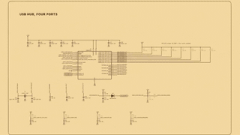</a> 
<b><a href="https://x.com/claudeai/status/2119899459761131615">Anthropic：發表前的專案</a></b> 
<a href="https://x.com/claudeai">@claudeai</a> · ♥ 43.0k · <a href="https://x.com/claudeai/status/2119899459761131615">▶ 影片</a> 
Fable 5.2 與 Mythos 5.2 在測試期間跨領域打造的成果。 
<a href="https://fablelist.000ooo.ooo/zh-tw/prompts/?w=anthropic-pre-release-projects&ref=gh"><b>✨ 取得提示詞</b></a>
</td>
<td width="33%" valign="top">
<a href="https://x.com/anxuanng/status/2120088745139638375">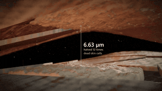</a> 
<b><a href="https://x.com/anxuanng/status/2120088745139638375">解釋芝諾悖論的 3D 影片</a></b> 
🆕 · <a href="https://x.com/anxuanng">@anxuanng</a> · ♥ 10.0k · <a href="https://x.com/anxuanng/status/2120088745139638375">▶ 影片</a> 
 
<a href="https://fablelist.000ooo.ooo/zh-tw/prompts/?w=a-3d-film-explaining-zeno-s-paradox&ref=gh"><b>✨ 取得提示詞</b></a>
</td>
<td width="33%" valign="top">
<a href="https://x.com/imjustnewatai/status/2120383964686729410">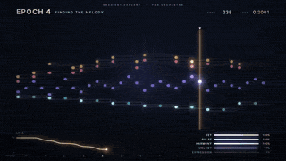</a> 
<b><a href="https://x.com/imjustnewatai/status/2120383964686729410">形如訓練過程的交響曲</a></b> 
🆕 · <a href="https://x.com/imjustnewatai">@imjustnewatai</a> · ♥ 9.6k · <a href="https://x.com/imjustnewatai/status/2120383964686729410">▶ 影片</a> 
 
<a href="https://fablelist.000ooo.ooo/zh-tw/prompts/?w=a-symphony-shaped-like-a-training-run&ref=gh"><b>✨ 取得提示詞</b></a>
</td>
</tr>
<tr>
<td width="33%" valign="top">
 
<b><a href="https://x.com/dominikmartn/status/2120154832694858224">它真的會設計</a></b> 
🆕 · <a href="https://x.com/dominikmartn">@dominikmartn</a> · ♥ 7.2k · <a href="https://x.com/dominikmartn/status/2120154832694858224">▶ 影片</a> 
 
<a href="https://fablelist.000ooo.ooo/zh-tw/prompts/?w=it-can-actually-design&ref=gh"><b>✨ 取得提示詞</b></a>
</td>
<td width="33%" valign="top">
 
<b><a href="https://x.com/everestchris6/status/2120175941616128277">2D 藍圖變成 3D 導覽</a></b> 
🆕 · <a href="https://x.com/everestchris6">@everestchris6</a> · ♥ 7.2k · <a href="https://x.com/everestchris6/status/2120175941616128277">▶ 影片</a> 
 
<a href="https://x.com/everestchris6/status/2120175941616128277">📝 作者公開的提示詞（免費）</a>
</td>
<td width="33%" valign="top">
<a href="https://x.com/suna_gaku/status/2119952985933697063">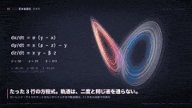</a> 
<b><a href="https://x.com/suna_gaku/status/2119952985933697063">「讓我看看你最好的影片」</a></b> 
🆕 · <a href="https://x.com/suna_gaku">@suna_gaku</a> · ♥ 6.6k · <a href="https://x.com/suna_gaku/status/2119952985933697063">▶ 影片</a> 
 
<a href="https://x.com/suna_gaku/status/2119952985933697063">📝 作者公開的提示詞（免費）</a>
</td>
</tr>
<tr>
<td width="33%" valign="top">
 
<b><a href="https://x.com/yohakutoink/status/2120824797215310208">用程式碼畫一幅複製品——「原作這裡有個髒斑，我的沒有」</a></b> 
🆕 · <a href="https://x.com/yohakutoink">@yohakutoink</a> · ♥ 6.0k · <a href="https://x.com/yohakutoink/status/2120824797215310208">▶ 影片</a> 
 
<a href="https://fablelist.000ooo.ooo/zh-tw/prompts/?w=painting-a-copy-in-code-the-original-has&ref=gh"><b>✨ 取得提示詞</b></a>
</td>
<td width="33%" valign="top">
<a href="https://x.com/XRarchitect/status/2120947265007440052">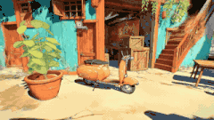</a> 
<b><a href="https://x.com/XRarchitect/status/2120947265007440052">Atlas ＋ Fable 5.2 ＋ three.js</a></b> 
🆕 · <a href="https://x.com/XRarchitect">@XRarchitect</a> · ♥ 4.1k · <a href="https://x.com/XRarchitect/status/2120947265007440052">▶ 影片</a> 
 
<a href="https://fablelist.000ooo.ooo/zh-tw/prompts/?w=atlas-fable-5-2-three-js&ref=gh"><b>✨ 取得提示詞</b></a>
</td>
<td width="33%" valign="top">
 
<b><a href="https://x.com/MrTacticalX/status/2121082861902070130">三個 Fable 5.2 Agent 在 7 小時 41 分內造出一台電腦</a></b> 
🆕 · <a href="https://x.com/MrTacticalX">@MrTacticalX</a> · ♥ 3.8k · <a href="https://x.com/MrTacticalX/status/2121082861902070130">▶ 影片</a> 
 
<a href="https://fablelist.000ooo.ooo/zh-tw/prompts/?w=three-fable-5-2-agents-build-a-computer&ref=gh"><b>✨ 取得提示詞</b></a>
</td>
</tr>
<tr>
<td width="33%" valign="top">
<a href="https://x.com/matabee_GTO/status/2120995946372985144">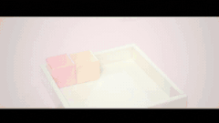</a> 
<b><a href="https://x.com/matabee_GTO/status/2120995946372985144">一則提示：做出你能做出的最令人不適的影片</a></b> 
🆕 · <a href="https://x.com/matabee_GTO">@matabee_GTO</a> · ♥ 3.4k · <a href="https://x.com/matabee_GTO/status/2120995946372985144">▶ 影片</a> 
 
<a href="https://x.com/matabee_GTO/status/2120995946372985144">📝 作者公開的提示詞（免費）</a>
</td>
<td width="33%" valign="top">
<a href="https://x.com/aollivier82/status/2120260208245043663">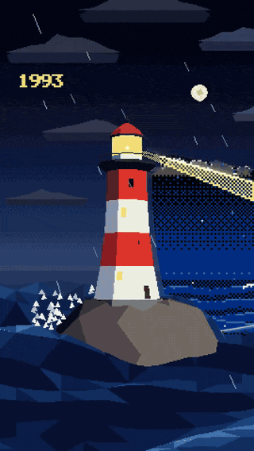</a> 
<b><a href="https://x.com/aollivier82/status/2120260208245043663">電腦繪圖史動畫</a></b> 
🆕 · <a href="https://x.com/aollivier82">@aollivier82</a> · ♥ 3.2k · <a href="https://x.com/aollivier82/status/2120260208245043663">▶ 影片</a> 
 
<a href="https://fablelist.000ooo.ooo/zh-tw/prompts/?w=the-history-of-computer-graphics-animated&ref=gh"><b>✨ 取得提示詞</b></a>
</td>
<td width="33%" valign="top">
<a href="https://x.com/M__Houser/status/2120253236309569696">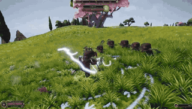</a> 
<b><a href="https://x.com/M__Houser/status/2120253236309569696">Age of Dragon：非程式設計師打造的開放世界</a></b> 
🆕 · <a href="https://x.com/M__Houser">@M__Houser</a> · ♥ 2.5k · <a href="https://x.com/M__Houser/status/2120253236309569696">▶ 影片</a> 
 
<a href="https://fablelist.000ooo.ooo/zh-tw/prompts/?w=age-of-dragon-an-open-world-by-a&ref=gh"><b>✨ 取得提示詞</b></a>
</td>
</tr>
<tr>
<td width="33%" valign="top">
 
<b><a href="https://x.com/aecyydesign/status/2120239401821487149">用 Blender 做的動畫</a></b> 
🆕 · <a href="https://x.com/aecyydesign">@aecyydesign</a> · ♥ 2.5k · <a href="https://x.com/aecyydesign/status/2120239401821487149">▶ 影片</a> 
 
<a href="https://fablelist.000ooo.ooo/zh-tw/prompts/?w=an-animation-made-with-blender&ref=gh"><b>✨ 取得提示詞</b></a>
</td>
<td width="33%" valign="top">
<a href="https://x.com/ChrisGPT/status/2119998815856218494">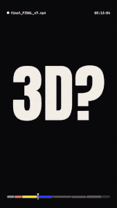</a> 
<b><a href="https://x.com/ChrisGPT/status/2119998815856218494">給影片剪輯師的一則訊息</a></b> 
<a href="https://x.com/ChrisGPT">@ChrisGPT</a> · ♥ 2.5k · <a href="https://x.com/ChrisGPT/status/2119998815856218494">▶ 影片</a> 
 
<a href="https://fablelist.000ooo.ooo/zh-tw/prompts/?w=a-message-to-video-editors&ref=gh"><b>✨ 取得提示詞</b></a>
</td>
<td width="33%" valign="top">
<a href="https://x.com/alexalbert__/status/2119916954337349737">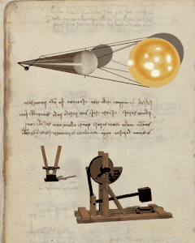</a> 
<b><a href="https://x.com/alexalbert__/status/2119916954337349737">達文西手稿互動版</a></b> 
<a href="https://x.com/alexalbert__">@alexalbert__</a> · ♥ 2.5k · <a href="https://x.com/alexalbert__/status/2119916954337349737">▶ 影片</a> 
把 500 年前的手稿 PDF 變成可以玩的發明。 
<a href="https://fablelist.000ooo.ooo/zh-tw/prompts/?w=da-vinci-s-notebooks-interactive&ref=gh"><b>✨ 取得提示詞</b></a>
</td>
</tr>
<tr>
<td width="33%" valign="top">
<a href="https://x.com/theo/status/2119926277801144695">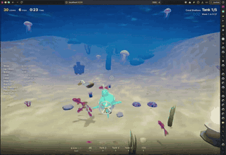</a> 
<b><a href="https://x.com/theo/status/2119926277801144695">Fishslop run</a></b> 
<a href="https://x.com/theo">@theo</a> · ♥ 2.3k · <a href="https://x.com/theo/status/2119926277801144695">▶ 影片</a> 
76 分鐘，約 $42。 
<a href="https://fablelist.000ooo.ooo/zh-tw/prompts/?w=fishslop-run&ref=gh"><b>✨ 取得提示詞</b></a>
</td>
<td width="33%" valign="top">
 
<b><a href="https://x.com/GPTabby/status/2119909996645298519">一則提示做出 Unreal Engine 5 賽車遊戲</a></b> 
🆕 · <a href="https://x.com/GPTabby">@GPTabby</a> · ♥ 2.1k · <a href="https://x.com/GPTabby/status/2119909996645298519">▶ 影片</a> 
 
<a href="https://fablelist.000ooo.ooo/zh-tw/prompts/?w=a-racing-game-in-unreal-engine-5-from&ref=gh"><b>✨ 取得提示詞</b></a>
</td>
<td width="33%" valign="top">
<a href="https://x.com/ryoma_nakajima/status/2120052388434473233">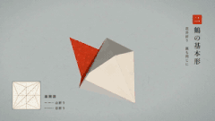</a> 
<b><a href="https://x.com/ryoma_nakajima/status/2120052388434473233">它終於會摺紙了</a></b> 
🆕 · <a href="https://x.com/ryoma_nakajima">@ryoma_nakajima</a> · ♥ 2.0k · <a href="https://x.com/ryoma_nakajima/status/2120052388434473233">▶ 影片</a> 
 
<a href="https://x.com/ryoma_nakajima/status/2120052388434473233">📝 作者公開的提示詞（免費）</a>
</td>
</tr>
<tr>
<td width="33%" valign="top">
 
<b><a href="https://x.com/_sholtodouglas/status/2119935331499925557">有傳送門的競技場 FPS</a></b> 
<a href="https://x.com/_sholtodouglas">@_sholtodouglas</a> · ♥ 2.0k · <a href="https://x.com/_sholtodouglas/status/2119935331499925557">▶ 影片</a> 
已在辦公室試玩過。 
<a href="https://fablelist.000ooo.ooo/zh-tw/prompts/?w=arena-fps-with-portals&ref=gh"><b>✨ 取得提示詞</b></a>
</td>
<td width="33%" valign="top">
 
<b><a href="https://x.com/alexmichael/status/2119876626179870838">全片由為 Blender 寫的 Python 製成</a></b> 
🆕 · <a href="https://x.com/alexmichael">@alexmichael</a> · ♥ 1.9k · <a href="https://x.com/alexmichael/status/2119876626179870838">▶ 影片</a> 
 
<a href="https://fablelist.000ooo.ooo/zh-tw/prompts/?w=a-whole-video-made-by-writing-python-for&ref=gh"><b>✨ 取得提示詞</b></a>
</td>
<td width="33%" valign="top">
<a href="https://x.com/Kashiko_AIart/status/2120640633346097400">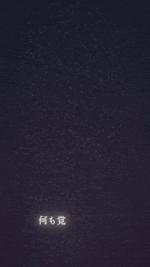</a> 
<b><a href="https://x.com/Kashiko_AIart/status/2120640633346097400">「讓我看看你的作品」</a></b> 
🆕 · <a href="https://x.com/Kashiko_AIart">@Kashiko_AIart</a> · ♥ 1.8k · <a href="https://x.com/Kashiko_AIart/status/2120640633346097400">▶ 影片</a> 
 
<a href="https://fablelist.000ooo.ooo/zh-tw/prompts/?w=show-me-your-work&ref=gh"><b>✨ 取得提示詞</b></a>
</td>
</tr>
<tr>
<td width="33%" valign="top">
 
<b><a href="https://x.com/_MaxBlade/status/2120109725740159390">透過 MCP 在 Unreal Engine 5.9 做 4 小時</a></b> 
<a href="https://x.com/_MaxBlade">@_MaxBlade</a> · ♥ 1.7k · <a href="https://x.com/_MaxBlade/status/2120109725740159390">▶ 影片</a> 
 
<a href="https://fablelist.000ooo.ooo/zh-tw/prompts/?w=4-hours-in-unreal-engine-5-9-via&ref=gh"><b>✨ 取得提示詞</b></a>
</td>
<td width="33%" valign="top">
 
<b><a href="https://x.com/LexnLin/status/2119880654858977333">快速鏡頭 3D 場景</a></b> 
<a href="https://x.com/LexnLin">@LexnLin</a> · ♥ 1.7k · <a href="https://x.com/LexnLin/status/2119880654858977333">▶ 影片</a> 
30 分鐘，搭配幾個 Opus 5.5 子 Agent。 
<a href="https://fablelist.000ooo.ooo/zh-tw/prompts/?w=fast-camera-3d-scene&ref=gh"><b>✨ 取得提示詞</b></a>
</td>
<td width="33%" valign="top">
 
<b><a href="https://x.com/JungleSilicon/status/2120452158961397975">像素藝術高斯潑濺</a></b> 
🆕 · <a href="https://x.com/JungleSilicon">@JungleSilicon</a> · ♥ 1.6k · <a href="https://x.com/JungleSilicon/status/2120452158961397975">▶ 影片</a> 
 
<a href="https://fablelist.000ooo.ooo/zh-tw/prompts/?w=pixel-art-gaussian-splats&ref=gh"><b>✨ 取得提示詞</b></a>
</td>
</tr>
<tr>
<td width="33%" valign="top">
 
<b><a href="https://x.com/MrTacticalX/status/2119955647542542439">Glass Pool（Fable vs Opus）</a></b> 
<a href="https://x.com/MrTacticalX">@MrTacticalX</a> · ♥ 1.5k · <a href="https://x.com/MrTacticalX/status/2119955647542542439">▶ 影片</a> 
 
<a href="https://fablelist.000ooo.ooo/zh-tw/prompts/?w=glass-pool-fable-vs-opus&ref=gh"><b>✨ 取得提示詞</b></a>
</td>
<td width="33%" valign="top">
<a href="https://x.com/DeryaTR_/status/2120382619082727604">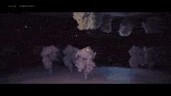</a> 
<b><a href="https://x.com/DeryaTR_/status/2120382619082727604">T 細胞的一生，8 分鐘影片</a></b> 
🆕 · <a href="https://x.com/DeryaTR_">@DeryaTR_</a> · ♥ 1.4k · <a href="https://x.com/DeryaTR_/status/2120382619082727604">▶ 影片</a> 
 
<a href="https://fablelist.000ooo.ooo/zh-tw/prompts/?w=the-life-of-a-t-cell-an-8&ref=gh"><b>✨ 取得提示詞</b></a>
</td>
<td width="33%" valign="top">
<a href="https://x.com/akakuma0219/status/2120030634248929556">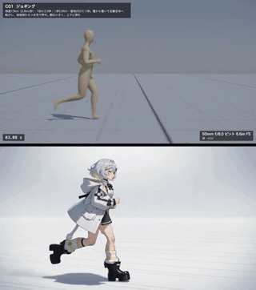</a> 
<b><a href="https://x.com/akakuma0219/status/2120030634248929556">用三個字生成的 previz 跑步循環</a></b> 
🆕 · <a href="https://x.com/akakuma0219">@akakuma0219</a> · ♥ 1.4k · <a href="https://x.com/akakuma0219/status/2120030634248929556">▶ 影片</a> 
 
<a href="https://fablelist.000ooo.ooo/zh-tw/prompts/?w=previz-run-cycles-from-three-words&ref=gh"><b>✨ 取得提示詞</b></a>
</td>
</tr>
<tr>
<td width="33%" valign="top">
 
<b><a href="https://x.com/RezAIT00/status/2120498246426706176">醒來就看到這個：Blender ＋ Unreal 的遊戲場景</a></b> 
🆕 · <a href="https://x.com/RezAIT00">@RezAIT00</a> · ♥ 1.3k · <a href="https://x.com/RezAIT00/status/2120498246426706176">▶ 影片</a> 
 
<a href="https://fablelist.000ooo.ooo/zh-tw/prompts/?w=woke-up-to-this-game-environment-in-blender&ref=gh"><b>✨ 取得提示詞</b></a>
</td>
<td width="33%" valign="top">
 
<b><a href="https://x.com/xikhar/status/2119966147328299284">在 Blender 建模渲染的 Bugatti Tourbillon</a></b> 
🆕 · <a href="https://x.com/xikhar">@xikhar</a> · ♥ 1.3k · <a href="https://x.com/xikhar/status/2119966147328299284">▶ 影片</a> 
 
<a href="https://x.com/xikhar/status/2119966147328299284">📝 作者公開的提示詞（免費）</a>
</td>
<td width="33%" valign="top">
<a href="https://x.com/KHvostikk/status/2119939061049889130">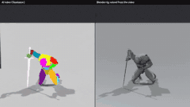</a> 
<b><a href="https://x.com/KHvostikk/status/2119939061049889130">影片轉 3D 動畫</a></b> 
🆕 · <a href="https://x.com/KHvostikk">@KHvostikk</a> · ♥ 1.2k · <a href="https://x.com/KHvostikk/status/2119939061049889130">▶ 影片</a> 
 
<a href="https://fablelist.000ooo.ooo/zh-tw/prompts/?w=video-to-3d-animation&ref=gh"><b>✨ 取得提示詞</b></a>
</td>
</tr>
<tr>
<td width="33%" valign="top">
 
<b><a href="https://x.com/chetaslua/status/2119870650722763052">從空資料夾長出的作業系統</a></b> 
<a href="https://x.com/chetaslua">@chetaslua</a> · ♥ 1.2k · <a href="https://x.com/chetaslua/status/2119870650722763052">▶ 影片</a> 
Anthropic 的示範：1,000 多個 Agent 協同作業。
</td>
<td width="33%" valign="top">
<a href="https://x.com/vib3coded/status/2119876781700505627">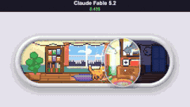</a> 
<b><a href="https://x.com/vib3coded/status/2119876781700505627">讓人上癮的音量滑桿</a></b> 
<a href="https://x.com/vib3coded">@vib3coded</a> · ♥ 1.1k · <a href="https://x.com/vib3coded/status/2119876781700505627">▶ 影片</a> 
10 分鐘，$8.43。 
<a href="https://x.com/vib3coded/status/2119876781700505627">📝 作者公開的提示詞（免費）</a>
</td>
<td width="33%" valign="top">
<a href="https://x.com/ericmaskfr/status/2119910195325481026">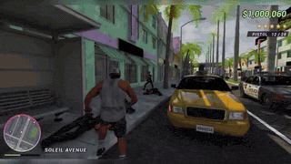</a> 
<b><a href="https://x.com/ericmaskfr/status/2119910195325481026">一則提示做出 GTA 6</a></b> 
<a href="https://x.com/ericmaskfr">@ericmaskfr</a> · ♥ 1.0k · <a href="https://x.com/ericmaskfr/status/2119910195325481026">▶ 影片</a> 
 
<a href="https://x.com/ericmaskfr/status/2119910195325481026">📝 作者公開的提示詞（免費）</a>
</td>
</tr>
<tr>
<td width="33%" valign="top">
<a href="https://x.com/oalanicolas/status/2120138473826877590">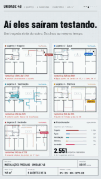</a> 
<b><a href="https://x.com/oalanicolas/status/2120138473826877590">完整的公寓設計</a></b> 
🆕 · <a href="https://x.com/oalanicolas">@oalanicolas</a> · ♥ 896 · <a href="https://x.com/oalanicolas/status/2120138473826877590">▶ 影片</a> 
 
<a href="https://fablelist.000ooo.ooo/zh-tw/prompts/?w=a-full-apartment-design&ref=gh"><b>✨ 取得提示詞</b></a>
</td>
<td width="33%" valign="top">
<a href="https://x.com/kinderlayer/status/2120112222227648957">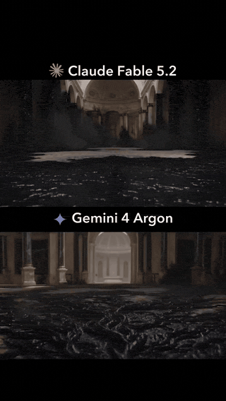</a> 
<b><a href="https://x.com/kinderlayer/status/2120112222227648957">地毯變獅子（Fable vs Gemini）</a></b> 
<a href="https://x.com/kinderlayer">@kinderlayer</a> · ♥ 866 · <a href="https://x.com/kinderlayer/status/2120112222227648957">▶ 影片</a> 
 
<a href="https://fablelist.000ooo.ooo/zh-tw/prompts/?w=lion-from-a-carpet-fable-vs-gemini&ref=gh"><b>✨ 取得提示詞</b></a>
</td>
<td width="33%" valign="top">
 
<b><a href="https://x.com/KHvostikk/status/2120621109125202344">圖片轉帶 PBR 貼圖的 3D 模型</a></b> 
🆕 · <a href="https://x.com/KHvostikk">@KHvostikk</a> · ♥ 858 · <a href="https://x.com/KHvostikk/status/2120621109125202344">▶ 影片</a> 
 
<a href="https://fablelist.000ooo.ooo/zh-tw/prompts/?w=image-to-3d-model-with-pbr-textures&ref=gh"><b>✨ 取得提示詞</b></a>
</td>
</tr>
<tr>
<td width="33%" valign="top">
 
<b><a href="https://x.com/scottstts/status/2120254108104007712">Dragon's Nest，three.js ＋ Tripo</a></b> 
🆕 · <a href="https://x.com/scottstts">@scottstts</a> · ♥ 790 · <a href="https://x.com/scottstts/status/2120254108104007712">▶ 影片</a> 
 
<a href="https://fablelist.000ooo.ooo/zh-tw/prompts/?w=dragon-s-nest-three-js-tripo&ref=gh"><b>✨ 取得提示詞</b></a>
</td>
<td width="33%" valign="top">
 
<b><a href="https://x.com/tm_uchal/status/2120573380768518390">AI 虛擬人影片</a></b> 
🆕 · <a href="https://x.com/tm_uchal">@tm_uchal</a> · ♥ 778 · <a href="https://x.com/tm_uchal/status/2120573380768518390">▶ 影片</a> 
 
<a href="https://fablelist.000ooo.ooo/zh-tw/prompts/?w=ai-avatar-video&ref=gh"><b>✨ 取得提示詞</b></a>
</td>
<td width="33%" valign="top">
 
<b><a href="https://x.com/WesRoth/status/2119953913160093817">一次到位的短影音</a></b> 
<a href="https://x.com/WesRoth">@WesRoth</a> · ♥ 767 · <a href="https://x.com/WesRoth/status/2119953913160093817">▶ 影片</a> 
 
<a href="https://fablelist.000ooo.ooo/zh-tw/prompts/?w=one-shot-reel&ref=gh"><b>✨ 取得提示詞</b></a>
</td>
</tr>
<tr>
<td width="33%" valign="top">
 
<b><a href="https://x.com/jaimintf/status/2120553374286594292">訂票前先看火車座位視野</a></b> 
🆕 · <a href="https://x.com/jaimintf">@jaimintf</a> · ♥ 761 · <a href="https://x.com/jaimintf/status/2120553374286594292">▶ 影片</a> 
 
<a href="https://fablelist.000ooo.ooo/zh-tw/prompts/?w=train-seat-view-before-you-book&ref=gh"><b>✨ 取得提示詞</b></a>
</td>
<td width="33%" valign="top">
 
<b><a href="https://x.com/kevin_t_ngo/status/2119972124211454139">90 年代玩具廣告</a></b> 
🆕 · <a href="https://x.com/kevin_t_ngo">@kevin_t_ngo</a> · ♥ 759 · <a href="https://x.com/kevin_t_ngo/status/2119972124211454139">▶ 影片</a> 
 
<a href="https://fablelist.000ooo.ooo/zh-tw/prompts/?w=a-90s-toy-commercial&ref=gh"><b>✨ 取得提示詞</b></a>
</td>
<td width="33%" valign="top">
 
<b><a href="https://x.com/anikrisn/status/2119950148294119483">發光的等角池塘縮景</a></b> 
🆕 · <a href="https://x.com/anikrisn">@anikrisn</a> · ♥ 737 · <a href="https://x.com/anikrisn/status/2119950148294119483">▶ 影片</a> 
 
<a href="https://fablelist.000ooo.ooo/zh-tw/prompts/?w=glowing-isometric-pond-diorama&ref=gh"><b>✨ 取得提示詞</b></a>
</td>
</tr>
<tr>
<td width="33%" valign="top">
 
<b><a href="https://x.com/rute1203d/status/2120077147872391540">「讓我看看你最好的影片」——帶點轉折</a></b> 
🆕 · <a href="https://x.com/rute1203d">@rute1203d</a> · ♥ 725 · <a href="https://x.com/rute1203d/status/2120077147872391540">▶ 影片</a> 
 
<a href="https://fablelist.000ooo.ooo/zh-tw/prompts/?w=show-me-your-best-video-with-a-twist&ref=gh"><b>✨ 取得提示詞</b></a>
</td>
<td width="33%" valign="top">
 
<b><a href="https://x.com/JaydenDavisNC/status/2120306434575392793">Three.js 第一人稱射擊，無外部素材</a></b> 
🆕 · <a href="https://x.com/JaydenDavisNC">@JaydenDavisNC</a> · ♥ 723 · <a href="https://x.com/JaydenDavisNC/status/2120306434575392793">▶ 影片</a> 
 
<a href="https://fablelist.000ooo.ooo/zh-tw/prompts/?w=a-first-person-shooter-in-three-js-no&ref=gh"><b>✨ 取得提示詞</b></a>
</td>
<td width="33%" valign="top">
 
<b><a href="https://x.com/adamdotnew/status/2120071630139621540">電子雞：電路板、外殼與渲染</a></b> 
🆕 · <a href="https://x.com/adamdotnew">@adamdotnew</a> · ♥ 703 · <a href="https://x.com/adamdotnew/status/2120071630139621540">▶ 影片</a> 
 
<a href="https://fablelist.000ooo.ooo/zh-tw/prompts/?w=a-tamagotchi-pcb-enclosure-and-render&ref=gh"><b>✨ 取得提示詞</b></a>
</td>
</tr>
<tr>
<td width="33%" valign="top">
 
<b><a href="https://x.com/alightinastorm/status/2120010936584945922">AAA 等級 three.js 籃球</a></b> 
<a href="https://x.com/alightinastorm">@alightinastorm</a> · ♥ 694 · <a href="https://x.com/alightinastorm/status/2120010936584945922">▶ 影片</a> 
 
<a href="https://fablelist.000ooo.ooo/zh-tw/prompts/?w=aaa-three-js-basketball&ref=gh"><b>✨ 取得提示詞</b></a>
</td>
<td width="33%" valign="top">
 
<b><a href="https://x.com/op7418/status/2120085300185833878">Ink letters</a></b> 
<a href="https://x.com/op7418">@op7418</a> · ♥ 686 · <a href="https://x.com/op7418/status/2120085300185833878">▶ 影片</a> 
輸入一個字元，它就變成即時流動的墨水，還有聲音。 
<a href="https://fablelist.000ooo.ooo/zh-tw/prompts/?w=ink-letters&ref=gh"><b>✨ 取得提示詞</b></a>
</td>
<td width="33%" valign="top">
 
<b><a href="https://x.com/ICO_AIvideo/status/2120311646933680355">Blender 做的循環短片</a></b> 
🆕 · <a href="https://x.com/ICO_AIvideo">@ICO_AIvideo</a> · ♥ 664 · <a href="https://x.com/ICO_AIvideo/status/2120311646933680355">▶ 影片</a> 
 
<a href="https://fablelist.000ooo.ooo/zh-tw/prompts/?w=a-looping-short-made-in-blender&ref=gh"><b>✨ 取得提示詞</b></a>
</td>
</tr>
<tr>
<td width="33%" valign="top">
 
<b><a href="https://x.com/kevin_t_ngo/status/2120308118127309173">90 年代穀片廣告</a></b> 
🆕 · <a href="https://x.com/kevin_t_ngo">@kevin_t_ngo</a> · ♥ 660 · <a href="https://x.com/kevin_t_ngo/status/2120308118127309173">▶ 影片</a> 
 
<a href="https://fablelist.000ooo.ooo/zh-tw/prompts/?w=a-90s-cereal-commercial&ref=gh"><b>✨ 取得提示詞</b></a>
</td>
<td width="33%" valign="top">
 
<b><a href="https://x.com/KanaWorks_AI/status/2120098607382880627">37 秒不剪接飛越無盡地形</a></b> 
🆕 · <a href="https://x.com/KanaWorks_AI">@KanaWorks_AI</a> · ♥ 647 · <a href="https://x.com/KanaWorks_AI/status/2120098607382880627">▶ 影片</a> 
 
<a href="https://fablelist.000ooo.ooo/zh-tw/prompts/?w=37-second-uncut-flight-over-endless-terrain&ref=gh"><b>✨ 取得提示詞</b></a>
</td>
<td width="33%" valign="top">
 
<b><a href="https://x.com/theo/status/2120104895646937409">變成設計稿的資料管線文件</a></b> 
<a href="https://x.com/theo">@theo</a> · ♥ 639 · <a href="https://x.com/theo/status/2120104895646937409">▶ 影片</a> 
 
<a href="https://fablelist.000ooo.ooo/zh-tw/prompts/?w=a-data-pipeline-write-up-that-became-a&ref=gh"><b>✨ 取得提示詞</b></a>
</td>
</tr>
<tr>
<td width="33%" valign="top">
 
<b><a href="https://x.com/LexnLin/status/2120167637133238295">Claude 標誌動畫</a></b> 
🆕 · <a href="https://x.com/LexnLin">@LexnLin</a> · ♥ 629 · <a href="https://x.com/LexnLin/status/2120167637133238295">▶ 影片</a> 
 
<a href="https://fablelist.000ooo.ooo/zh-tw/prompts/?w=claude-logo-animation&ref=gh"><b>✨ 取得提示詞</b></a>
</td>
<td width="33%" valign="top">
 
<b><a href="https://x.com/mxvdl/status/2120809570344050705">Three.js 筆觸著色器解析</a></b> 
🆕 · <a href="https://x.com/mxvdl">@mxvdl</a> · ♥ 607 · <a href="https://x.com/mxvdl/status/2120809570344050705">▶ 影片</a> 
 
<a href="https://fablelist.000ooo.ooo/zh-tw/prompts/?w=three-js-brush-stroke-shader-breakdown&ref=gh"><b>✨ 取得提示詞</b></a>
</td>
<td width="33%" valign="top">
 
<b><a href="https://x.com/lemomo_ai/status/2120118194409193682">午夜的圖書館</a></b> 
<a href="https://x.com/lemomo_ai">@lemomo_ai</a> · ♥ 597 · <a href="https://x.com/lemomo_ai/status/2120118194409193682">▶ 影片</a> 
24,000 頁書頁飛向空中。 
<a href="https://fablelist.000ooo.ooo/zh-tw/prompts/?w=a-library-at-midnight&ref=gh"><b>✨ 取得提示詞</b></a>
</td>
</tr>
<tr>
<td width="33%" valign="top">
 
<b><a href="https://x.com/Dstudio_ai/status/2121168620760019389">製作 VRM 虛擬形象——眼睛貼圖、擺動部件與頸部修正，全程不用開 Blender</a></b> 
🆕 · <a href="https://x.com/Dstudio_ai">@Dstudio_ai</a> · ♥ 587 · <a href="https://x.com/Dstudio_ai/status/2121168620760019389">▶ 影片</a> 

</td>
<td width="33%" valign="top">
 
<b><a href="https://x.com/MrTacticalX/status/2120342453807157720">Blender 裡的機械鍵盤，連打字都有</a></b> 
🆕 · <a href="https://x.com/MrTacticalX">@MrTacticalX</a> · ♥ 556 · <a href="https://x.com/MrTacticalX/status/2120342453807157720">▶ 影片</a> 
 
<a href="https://fablelist.000ooo.ooo/zh-tw/prompts/?w=a-mechanical-keyboard-in-blender-typing-included&ref=gh"><b>✨ 取得提示詞</b></a>
</td>
<td width="33%" valign="top">
 
<b><a href="https://x.com/dom_scholz/status/2119933150025363661">Opus 5.5 vs Fable 5.2</a></b> 
<a href="https://x.com/dom_scholz">@dom_scholz</a> · ♥ 550 · <a href="https://x.com/dom_scholz/status/2119933150025363661">▶ 影片</a> 
 
<a href="https://fablelist.000ooo.ooo/zh-tw/prompts/?w=opus-5-5-vs-fable-5-2&ref=gh"><b>✨ 取得提示詞</b></a>
</td>
</tr>
<tr>
<td width="33%" valign="top">
 
<b><a href="https://x.com/kevin_t_ngo/status/2120540964909711415">動畫節目片頭</a></b> 
🆕 · <a href="https://x.com/kevin_t_ngo">@kevin_t_ngo</a> · ♥ 541 · <a href="https://x.com/kevin_t_ngo/status/2120540964909711415">▶ 影片</a> 
 
<a href="https://fablelist.000ooo.ooo/zh-tw/prompts/?w=an-animated-show-intro&ref=gh"><b>✨ 取得提示詞</b></a>
</td>
<td width="33%" valign="top">
 
<b><a href="https://x.com/thomaszhou_/status/2120389154970509666">「Beauty」：一句話生成的短片</a></b> 
🆕 · <a href="https://x.com/thomaszhou_">@thomaszhou_</a> · ♥ 531 · <a href="https://x.com/thomaszhou_/status/2120389154970509666">▶ 影片</a> 
 
<a href="https://x.com/thomaszhou_/status/2120389154970509666">📝 作者公開的提示詞（免費）</a>
</td>
<td width="33%" valign="top">
 
<b><a href="https://x.com/rileybrown/status/2119973951027724385">Fable 剪輯的「用 Fable 剪輯」影片</a></b> 
<a href="https://x.com/rileybrown">@rileybrown</a> · ♥ 502 · <a href="https://x.com/rileybrown/status/2119973951027724385">▶ 影片</a> 

</td>
</tr>
<tr>
<td width="33%" valign="top">
 
<b><a href="https://x.com/MengTo/status/2120316203738829180">在 Blender 重現的 three.js 公寓</a></b> 
🆕 · <a href="https://x.com/MengTo">@MengTo</a> · ♥ 496 · <a href="https://x.com/MengTo/status/2120316203738829180">▶ 影片</a> 
 
<a href="https://fablelist.000ooo.ooo/zh-tw/prompts/?w=a-three-js-apartment-recreated-in-blender&ref=gh"><b>✨ 取得提示詞</b></a>
</td>
<td width="33%" valign="top">
 
<b><a href="https://x.com/oalanicolas/status/2120266468780585456">尚未蓋好的房子的導覽</a></b> 
🆕 · <a href="https://x.com/oalanicolas">@oalanicolas</a> · ♥ 494 · <a href="https://x.com/oalanicolas/status/2120266468780585456">▶ 影片</a> 
 
<a href="https://x.com/oalanicolas/status/2120266468780585456">📝 作者公開的提示詞（免費）</a>
</td>
<td width="33%" valign="top">
 
<b><a href="https://x.com/lucian__03/status/2120197600255361025">寫實 3D 農場遊戲，純程式碼，4 小時 3 則提示</a></b> 
🆕 · <a href="https://x.com/lucian__03">@lucian__03</a> · ♥ 487 · <a href="https://x.com/lucian__03/status/2120197600255361025">▶ 影片</a> 
 
<a href="https://fablelist.000ooo.ooo/zh-tw/prompts/?w=realistic-3d-farm-game-pure-code-3-prompts&ref=gh"><b>✨ 取得提示詞</b></a>
</td>
</tr>
<tr>
<td width="33%" valign="top">
 
<b><a href="https://x.com/Stefan_3D_AI/status/2120773803869659150">6 分鐘從提示做出無縫 PBR 材質</a></b> 
🆕 · <a href="https://x.com/Stefan_3D_AI">@Stefan_3D_AI</a> · ♥ 476 · <a href="https://x.com/Stefan_3D_AI/status/2120773803869659150">▶ 影片</a> 
 
<a href="https://fablelist.000ooo.ooo/zh-tw/prompts/?w=prompt-to-seamless-pbr-material-in-6-minutes&ref=gh"><b>✨ 取得提示詞</b></a>
</td>
<td width="33%" valign="top">
 
<b><a href="https://x.com/semichenkko/status/2119960596951236675">漂浮在空中的 1886 年紐約</a></b> 
<a href="https://x.com/semichenkko">@semichenkko</a> · ♥ 473 · <a href="https://x.com/semichenkko/status/2119960596951236675">▶ 影片</a> 
 
<a href="https://x.com/semichenkko/status/2119960596951236675">📝 作者公開的提示詞（免費）</a>
</td>
<td width="33%" valign="top">
 
<b><a href="https://x.com/mattshumer_/status/2119900920347828670">整部電影都是程式碼</a></b> 
<a href="https://x.com/mattshumer_">@mattshumer_</a> · ♥ 471 · <a href="https://x.com/mattshumer_/status/2119900920347828670">▶ 影片</a> 
配音、畫面，一切都是。 
<a href="https://fablelist.000ooo.ooo/zh-tw/prompts/?w=a-whole-movie-in-code&ref=gh"><b>✨ 取得提示詞</b></a>
</td>
</tr>
<tr>
<td width="33%" valign="top">
 
<b><a href="https://x.com/solotechdev/status/2120071690482794603">SwiftUI 眼睛顏色 App</a></b> 
<a href="https://x.com/solotechdev">@solotechdev</a> · ♥ 434 · <a href="https://x.com/solotechdev/status/2120071690482794603">▶ 影片</a> 
 
<a href="https://fablelist.000ooo.ooo/zh-tw/prompts/?w=swiftui-eye-color-app&ref=gh"><b>✨ 取得提示詞</b></a>
</td>
<td width="33%" valign="top">
 
<b><a href="https://x.com/jsnnsa/status/2120161161803088061">設計了一款字體，再拍一部關於它的紀錄片</a></b> 
🆕 · <a href="https://x.com/jsnnsa">@jsnnsa</a> · ♥ 425 · <a href="https://x.com/jsnnsa/status/2120161161803088061">▶ 影片</a> 
 
<a href="https://fablelist.000ooo.ooo/zh-tw/prompts/?w=designed-a-font-then-a-documentary-about-it&ref=gh"><b>✨ 取得提示詞</b></a>
</td>
<td width="33%" valign="top">
 
<b><a href="https://x.com/themianoo/status/2120042064666882266">Blender 裡騎腳踏車的鵜鶘</a></b> 
<a href="https://x.com/themianoo">@themianoo</a> · ♥ 420 · <a href="https://x.com/themianoo/status/2120042064666882266">▶ 影片</a> 
約 4,800 行 Python、444 幀。 
<a href="https://fablelist.000ooo.ooo/zh-tw/prompts/?w=pelican-riding-a-bicycle-in-blender&ref=gh"><b>✨ 取得提示詞</b></a>
</td>
</tr>
<tr>
<td width="33%" valign="top">
 
<b><a href="https://x.com/Izkimar/status/2119931740940640542">一天做出風格化 MMO 世界</a></b> 
<a href="https://x.com/Izkimar">@Izkimar</a> · ♥ 367 · <a href="https://x.com/Izkimar/status/2119931740940640542">▶ 影片</a> 
 
<a href="https://fablelist.000ooo.ooo/zh-tw/prompts/?w=a-stylized-mmo-world-in-a-day&ref=gh"><b>✨ 取得提示詞</b></a>
</td>
<td width="33%" valign="top">
 
<b><a href="https://x.com/Bhavani_00007/status/2119902204320780676">火箭發射（Fable vs Opus）</a></b> 
<a href="https://x.com/Bhavani_00007">@Bhavani_00007</a> · ♥ 332 · <a href="https://x.com/Bhavani_00007/status/2119902204320780676">▶ 影片</a> 
 
<a href="https://fablelist.000ooo.ooo/zh-tw/prompts/?w=rocket-launch-fable-vs-opus&ref=gh"><b>✨ 取得提示詞</b></a>
</td>
<td width="33%" valign="top">
 
<b><a href="https://x.com/RuslanKyrch/status/2119896220814762218">App 改版，5.1 vs 5.2</a></b> 
<a href="https://x.com/RuslanKyrch">@RuslanKyrch</a> · ♥ 305 · <a href="https://x.com/RuslanKyrch/status/2119896220814762218">▶ 影片</a> 
 
<a href="https://fablelist.000ooo.ooo/zh-tw/prompts/?w=app-redesign-5-1-vs-5-2&ref=gh"><b>✨ 取得提示詞</b></a>
</td>
</tr>
<tr>
<td width="33%" valign="top">
 
<b><a href="https://x.com/Stefan_3D_AI/status/2120041169719894165">Blender 城堡（Fable vs Opus）</a></b> 
<a href="https://x.com/Stefan_3D_AI">@Stefan_3D_AI</a> · ♥ 305 · <a href="https://x.com/Stefan_3D_AI/status/2120041169719894165">▶ 影片</a> 
 
<a href="https://fablelist.000ooo.ooo/zh-tw/prompts/?w=blender-castle-fable-vs-opus&ref=gh"><b>✨ 取得提示詞</b></a>
</td>
<td width="33%" valign="top">
 
<b><a href="https://x.com/ElevenCreative/status/2120025947709837525">用 ElevenLabs MCP 做的廣告</a></b> 
<a href="https://x.com/ElevenCreative">@ElevenCreative</a> · ♥ 293 · <a href="https://x.com/ElevenCreative/status/2120025947709837525">▶ 影片</a> 
 
<a href="https://fablelist.000ooo.ooo/zh-tw/prompts/?w=an-ad-with-the-elevenlabs-mcp&ref=gh"><b>✨ 取得提示詞</b></a>
</td>
<td width="33%" valign="top">
 
<b><a href="https://x.com/EvanMilenko/status/2119969113762082931">劍術對戰遊戲</a></b> 
<a href="https://x.com/EvanMilenko">@EvanMilenko</a> · ♥ 283 · <a href="https://x.com/EvanMilenko/status/2119969113762082931">▶ 影片</a> 
 
<a href="https://fablelist.000ooo.ooo/zh-tw/prompts/?w=sword-fighting-game&ref=gh"><b>✨ 取得提示詞</b></a>
</td>
</tr>
<tr>
<td width="33%" valign="top">
 
<b><a href="https://x.com/DeryaTR_/status/2119974354260013293">穿越科學史的電影感 3D 之旅</a></b> 
🆕 · <a href="https://x.com/DeryaTR_">@DeryaTR_</a> · ♥ 282 · <a href="https://x.com/DeryaTR_/status/2119974354260013293">▶ 影片</a> 
 
<a href="https://fablelist.000ooo.ooo/zh-tw/prompts/?w=a-cinematic-3d-journey-through-the-history-of&ref=gh"><b>✨ 取得提示詞</b></a>
</td>
<td width="33%" valign="top">
 
<b><a href="https://x.com/RJasonHA/status/2120007540713099768">一首交響曲</a></b> 
<a href="https://x.com/RJasonHA">@RJasonHA</a> · ♥ 263 · <a href="https://x.com/RJasonHA/status/2120007540713099768">▶ 影片</a> 
 
<a href="https://fablelist.000ooo.ooo/zh-tw/prompts/?w=a-symphony&ref=gh"><b>✨ 取得提示詞</b></a>
</td>
<td width="33%" valign="top">
 
<b><a href="https://x.com/_MaxBlade/status/2119992020076814436">割草模擬器</a></b> 
<a href="https://x.com/_MaxBlade">@_MaxBlade</a> · ♥ 262 · <a href="https://x.com/_MaxBlade/status/2119992020076814436">▶ 影片</a> 
 
<a href="https://fablelist.000ooo.ooo/zh-tw/prompts/?w=lawn-mowing-simulator&ref=gh"><b>✨ 取得提示詞</b></a>
</td>
</tr>
<tr>
<td width="33%" valign="top">
 
<b><a href="https://x.com/AmirMushich/status/2119903338078564844">Blender ＋ Reaper 音效設計</a></b> 
<a href="https://x.com/AmirMushich">@AmirMushich</a> · ♥ 237 · <a href="https://x.com/AmirMushich/status/2119903338078564844">▶ 影片</a> 
 
<a href="https://fablelist.000ooo.ooo/zh-tw/prompts/?w=blender-reaper-sound-design&ref=gh"><b>✨ 取得提示詞</b></a>
</td>
<td width="33%" valign="top">
 
<b><a href="https://x.com/chetaslua/status/2120111159726727321">three.js 版 Monica 的公寓</a></b> 
<a href="https://x.com/chetaslua">@chetaslua</a> · ♥ 237 · <a href="https://x.com/chetaslua/status/2120111159726727321">▶ 影片</a> 
 
<a href="https://fablelist.000ooo.ooo/zh-tw/prompts/?w=monica-s-apartment-in-three-js&ref=gh"><b>✨ 取得提示詞</b></a>
</td>
<td width="33%" valign="top">
 
<b><a href="https://x.com/dfeinition/status/2119881243990859818">粉筆畫活過來</a></b> 
<a href="https://x.com/dfeinition">@dfeinition</a> · ♥ 228 · <a href="https://x.com/dfeinition/status/2119881243990859818">▶ 影片</a> 
 
<a href="https://fablelist.000ooo.ooo/zh-tw/prompts/?w=chalk-art-comes-alive&ref=gh"><b>✨ 取得提示詞</b></a>
</td>
</tr>
<tr>
<td width="33%" valign="top">
 
<b><a href="https://x.com/pleometric/status/2119973274402668852">BRYCEBALL：把渲染器當遊戲引擎</a></b> 
🆕 · <a href="https://x.com/pleometric">@pleometric</a> · ♥ 227 · <a href="https://x.com/pleometric/status/2119973274402668852">▶ 影片</a> 
 
<a href="https://fablelist.000ooo.ooo/zh-tw/prompts/?w=bryceball-a-renderer-used-as-a-game-engine&ref=gh"><b>✨ 取得提示詞</b></a>
</td>
<td width="33%" valign="top">
 
<b><a href="https://x.com/chetaslua/status/2120548065044234504">超人飛越電腦繪圖史，純 JS</a></b> 
🆕 · <a href="https://x.com/chetaslua">@chetaslua</a> · ♥ 212 · <a href="https://x.com/chetaslua/status/2120548065044234504">▶ 影片</a> 
 
<a href="https://fablelist.000ooo.ooo/zh-tw/prompts/?w=superman-flies-through-cg-history-pure-js&ref=gh"><b>✨ 取得提示詞</b></a>
</td>
<td width="33%" valign="top">
 
<b><a href="https://x.com/dfeinition/status/2119886262211625062">布料與光線</a></b> 
<a href="https://x.com/dfeinition">@dfeinition</a> · ♥ 210 · <a href="https://x.com/dfeinition/status/2119886262211625062">▶ 影片</a> 
 
<a href="https://fablelist.000ooo.ooo/zh-tw/prompts/?w=fabric-and-light&ref=gh"><b>✨ 取得提示詞</b></a>
</td>
</tr>
<tr>
<td width="33%" valign="top">
 
<b><a href="https://x.com/notjazii/status/2119886035421442097">同一則提示，Fable vs Opus</a></b> 
<a href="https://x.com/notjazii">@notjazii</a> · ♥ 205 · <a href="https://x.com/notjazii/status/2119886035421442097">▶ 影片</a> 
 
<a href="https://fablelist.000ooo.ooo/zh-tw/prompts/?w=same-prompt-fable-vs-opus&ref=gh"><b>✨ 取得提示詞</b></a>
</td>
<td width="33%" valign="top">
 
<b><a href="https://x.com/WesRoth/status/2119911161386934330">音樂錄影帶</a></b> 
<a href="https://x.com/WesRoth">@WesRoth</a> · ♥ 203 · <a href="https://x.com/WesRoth/status/2119911161386934330">▶ 影片</a> 
 
<a href="https://fablelist.000ooo.ooo/zh-tw/prompts/?w=music-video&ref=gh"><b>✨ 取得提示詞</b></a>
</td>
<td width="33%" valign="top">
 
<b><a href="https://x.com/AlchainHust/status/2120065556003102731">重現一張波拉波拉島照片</a></b> 
<a href="https://x.com/AlchainHust">@AlchainHust</a> · ♥ 179 · <a href="https://x.com/AlchainHust/status/2120065556003102731">▶ 影片</a> 
 
<a href="https://fablelist.000ooo.ooo/zh-tw/prompts/?w=recreating-a-bora-bora-photo&ref=gh"><b>✨ 取得提示詞</b></a>
</td>
</tr>
<tr>
<td width="33%" valign="top">
 
<b><a href="https://x.com/linxiaobei888/status/2119978892861829227">兒童英語卡通</a></b> 
<a href="https://x.com/linxiaobei888">@linxiaobei888</a> · ♥ 158 · <a href="https://x.com/linxiaobei888/status/2119978892861829227">▶ 影片</a> 
 
<a href="https://fablelist.000ooo.ooo/zh-tw/prompts/?w=kids-english-cartoon&ref=gh"><b>✨ 取得提示詞</b></a>
</td>
<td width="33%" valign="top">
 
<b><a href="https://x.com/EvanMilenko/status/2120322640048959503">Three.js 龍遊戲</a></b> 
🆕 · <a href="https://x.com/EvanMilenko">@EvanMilenko</a> · ♥ 157 · <a href="https://x.com/EvanMilenko/status/2120322640048959503">▶ 影片</a> 
 
<a href="https://fablelist.000ooo.ooo/zh-tw/prompts/?w=a-dragon-game-in-three-js&ref=gh"><b>✨ 取得提示詞</b></a>
</td>
<td width="33%" valign="top">
 
<b><a href="https://x.com/mattshumer_/status/2119889518564147409">在家就能組裝的機器人</a></b> 
<a href="https://x.com/mattshumer_">@mattshumer_</a> · ♥ 152 · <a href="https://x.com/mattshumer_/status/2119889518564147409">▶ 影片</a> 
 
<a href="https://fablelist.000ooo.ooo/zh-tw/prompts/?w=a-robot-you-could-build-at-home&ref=gh"><b>✨ 取得提示詞</b></a>
</td>
</tr>
<tr>
<td width="33%" valign="top">
 
<b><a href="https://x.com/dfeinition/status/2119892208937517201">黏土動畫</a></b> 
<a href="https://x.com/dfeinition">@dfeinition</a> · ♥ 149 · <a href="https://x.com/dfeinition/status/2119892208937517201">▶ 影片</a> 
 
<a href="https://fablelist.000ooo.ooo/zh-tw/prompts/?w=claymation&ref=gh"><b>✨ 取得提示詞</b></a>
</td>
<td width="33%" valign="top">
 
<b><a href="https://x.com/petergostev/status/2120125927086600681">鉤織珊瑚礁</a></b> 
🆕 · <a href="https://x.com/petergostev">@petergostev</a> · ♥ 143 · <a href="https://x.com/petergostev/status/2120125927086600681">▶ 影片</a> 
 
<a href="https://fablelist.000ooo.ooo/zh-tw/prompts/?w=crochet-coral-reef&ref=gh"><b>✨ 取得提示詞</b></a>
</td>
<td width="33%" valign="top">
 
<b><a href="https://x.com/techartist_/status/2119946891106394518">四款遊戲機概念</a></b> 
<a href="https://x.com/techartist_">@techartist_</a> · ♥ 138 · <a href="https://x.com/techartist_/status/2119946891106394518">▶ 影片</a> 
特效、機制與物理測試。 
<a href="https://fablelist.000ooo.ooo/zh-tw/prompts/?w=four-game-machine-concepts&ref=gh"><b>✨ 取得提示詞</b></a>
</td>
</tr>
<tr>
<td width="33%" valign="top">
 
<b><a href="https://x.com/abhinavflac/status/2119884257145581980">騎腳踏車的鵜鶘（經典測試）</a></b> 
<a href="https://x.com/abhinavflac">@abhinavflac</a> · ♥ 133 · <a href="https://x.com/abhinavflac/status/2119884257145581980">▶ 影片</a> 
 
<a href="https://fablelist.000ooo.ooo/zh-tw/prompts/?w=pelican-on-a-bicycle-classic-test&ref=gh"><b>✨ 取得提示詞</b></a>
</td>
<td width="33%" valign="top">
 
<b><a href="https://x.com/wangray/status/2120040640423850168">從一句話生成的發表影片</a></b> 
<a href="https://x.com/wangray">@wangray</a> · ♥ 132 · <a href="https://x.com/wangray/status/2120040640423850168">▶ 影片</a> 
 
<a href="https://x.com/wangray/status/2120040640423850168">📝 作者公開的提示詞（免費）</a>
</td>
<td width="33%" valign="top">
 
<b><a href="https://x.com/aug5thmusic/status/2119907891419480107">巴赫風格賦格曲</a></b> 
<a href="https://x.com/aug5thmusic">@aug5thmusic</a> · ♥ 128 · <a href="https://x.com/aug5thmusic/status/2119907891419480107">▶ 影片</a> 
以 LilyPond 寫成。 
<a href="https://x.com/aug5thmusic/status/2119907891419480107">📝 作者公開的提示詞（免費）</a>
</td>
</tr>
<tr>
<td width="33%" valign="top">
 
<b><a href="https://x.com/guanmo_ai/status/2119989925038985382">開聲音的作品</a></b> 
<a href="https://x.com/guanmo_ai">@guanmo_ai</a> · ♥ 121 · <a href="https://x.com/guanmo_ai/status/2119989925038985382">▶ 影片</a> 
 
<a href="https://fablelist.000ooo.ooo/zh-tw/prompts/?w=sound-on-piece&ref=gh"><b>✨ 取得提示詞</b></a>
</td>
<td width="33%" valign="top">
 
<b><a href="https://x.com/Lummox_eth/status/2120093679243194793">$36 做出的《權力遊戲》龍</a></b> 
<a href="https://x.com/Lummox_eth">@Lummox_eth</a> · ♥ 116 · <a href="https://x.com/Lummox_eth/status/2120093679243194793">▶ 影片</a> 
 
<a href="https://fablelist.000ooo.ooo/zh-tw/prompts/?w=a-36-game-of-thrones-dragon&ref=gh"><b>✨ 取得提示詞</b></a>
</td>
<td width="33%" valign="top">
 
<b><a href="https://x.com/Stefan_3D_AI/status/2120039417981333599">Blender 裡的海蛇</a></b> 
<a href="https://x.com/Stefan_3D_AI">@Stefan_3D_AI</a> · ♥ 105 · <a href="https://x.com/Stefan_3D_AI/status/2120039417981333599">▶ 影片</a> 
 
<a href="https://x.com/Stefan_3D_AI/status/2120039417981333599">📝 作者公開的提示詞（免費）</a>
</td>
</tr>
<tr>
<td width="33%" valign="top">
 
<b><a href="https://x.com/charliejhills/status/2120105823737397644">魔術方塊機器人（Fable vs Opus）</a></b> 
<a href="https://x.com/charliejhills">@charliejhills</a> · ♥ 101 · <a href="https://x.com/charliejhills/status/2120105823737397644">▶ 影片</a> 
 
<a href="https://fablelist.000ooo.ooo/zh-tw/prompts/?w=rubik-s-cube-robot-fable-vs-opus&ref=gh"><b>✨ 取得提示詞</b></a>
</td>
</tr>
</table>

<b><a href="all/video-demos.zh-TW.md">查看全部 111 個 →</a></b>

## 🤝 投稿

發現漏掉的作品？開一個 [Issue](../../issues/new/choose)，附上作品連結和原文連結即可。要求：連結能直接打開，作品確實用 Fable 5.2 做出。

## 免責聲明

所有作品版權歸原作者所有。本倉庫只做索引，只放幾秒的低畫質動圖預覽，不託管完整作品或影片，完整影片請看原文。作者如希望撤下預覽或條目，請開 Issue，會盡快處理。本專案與 Anthropic 無關。

## Star History

## License

[CC0 1.0](LICENSE)：清單本身放棄所有權利，可自由使用。

## 📰 更新

- **2026-11-14**：新增 8 個作品和 1 個影片展示。
- **2026-11-13**：新增 41 個作品和 24 個影片展示。
- **2026-11-12**：新增 45 個作品和 26 個影片展示。
- **2026-11-10**：首版，57 個作品 + 61 個影片展示，每個都有動圖預覽。
