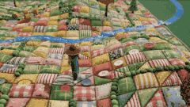
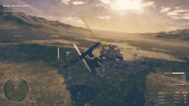
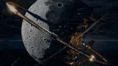
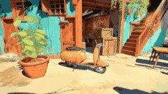

<h3>用 Claude Fable 5.2 做出來、能直接打開玩的東西</h3>

[English](README.md) · [简体中文](README.zh-CN.md) · **繁體中文** · [日本語](README.ja.md) · [한국어](README.ko.md) · [Español](README.es.md) · [Português](README.pt-BR.md) · [Français](README.fr.md) · [Deutsch](README.de.md) · [Русский](README.ru.md)

**🌐 網頁版：[fablelist.000ooo.ooo](https://fablelist.000ooo.ooo/zh-tw/)**（可搜尋，每個作品都有詳情頁）

195 個能直接打開的作品 + 140 個影片展示，都是用 Claude Fable 5.2 做的，連結 2026-11-18 實測過。每天更新，覺得有用就按個 ⭐。

## 📑 目錄

[⭐ 最受歡迎](#-最受歡迎) · [🆕 最新](#-最新) · [🎮 遊戲](#-遊戲) 92 · [🌍 3D 世界與場景](#-3d-世界與場景) 43 · [🧰 網頁與工具](#-網頁與工具) 43 · [🎬 動畫與短片](#-動畫與短片) 17 · [📺 影片展示](#-影片展示) 140 · [🤝 投稿](#-投稿)

## ⭐ 最受歡迎

<table>
<tr>
<td width="33%" valign="top">
 
<b><a href="https://starrynightrider.com">Starry Nightrider</a></b> 
<a href="https://x.com/ebbyamir">@ebbyamir</a> · ♥ 17.9k · <a href="https://x.com/ebbyamir/status/2120284261089673376">▶ 影片</a> 
梵谷騎著他的《星夜》穿行，做成遊戲。 
<a href="https://fablelist.000ooo.ooo/zh-tw/prompts/?w=starry-nightrider&ref=gh"><b>✨ 取得提示詞</b></a>
</td>
<td width="33%" valign="top">
 
<b><a href="https://claude.ai/artifact/BGY1SztrAYcJQHSsnHHGmp">Saltline — 第一人稱射擊遊戲</a></b> 
<a href="https://x.com/felixrieseberg">@felixrieseberg</a> · ♥ 15.0k · <a href="https://x.com/felixrieseberg/status/2119925633564463609">▶ 影片</a> 
Anthropic 工程師作品。一次性提示、無人工回饋，耗時 8 小時、約 $550。模型、音效與貼圖全由程式碼生成。 
<a href="https://fablelist.000ooo.ooo/zh-tw/prompts/?w=saltline-first-person-shooter&ref=gh"><b>✨ 取得提示詞</b></a>
</td>
<td width="33%" valign="top">
 
<b><a href="https://patch.gg/blendi/oil-paint">Oil Paint — 手繪風遊戲</a></b> 
<a href="https://x.com/BlendiByl">@BlendiByl</a> · ♥ 8.0k · <a href="https://x.com/BlendiByl/status/2120341251178594532">▶ 影片</a> 
一小時內完成。每一幀約有 150 萬筆筆觸，在瀏覽器分頁裡以 200 fps 執行。開源。 
<a href="https://fablelist.000ooo.ooo/zh-tw/prompts/?w=oil-paint-hand-painted-game&ref=gh"><b>✨ 取得提示詞</b></a>
</td>
</tr>
<tr>
<td width="33%" valign="top">
 
<b><a href="https://viktorkav.com.br/apoio/uno-com-escada/fable/">Uno com Escada：車頂綁梯子的 Fiat Uno 賽道</a></b> 
🆕 · <a href="https://x.com/ViktorKav">@ViktorKav</a> · ♥ 8.0k · <a href="https://x.com/ViktorKav/status/2122647483281015155">▶ 影片</a> 
開著車頂綁梯子的 1996 年 Uno Mille 跑賽道。單一個 603 KB 的 HTML 檔，沒有引擎、3D 函式庫或貼圖；車子、樹林、天空和引擎聲全由程式碼產生。 
<a href="https://github.com/viktorkav/uno-com-escada">原始碼</a>
</td>
<td width="33%" valign="top">
 
<b><a href="https://nyc.somethingbig.ai/">CROSSTOWN — 開放世界紐約（早期預覽）</a></b> 
<a href="https://x.com/mattshumer_">@mattshumer_</a> · ♥ 7.5k · <a href="https://x.com/mattshumer_/status/2120282133503820150">▶ 影片</a> 
「Rockstar 花了 8 年。Fable 5.2 要用 7 天做到。」目前只做了部分城市；按 B 可送出回饋。 
<a href="https://fablelist.000ooo.ooo/zh-tw/prompts/?w=crosstown-open-world-new-york-early-preview&ref=gh"><b>✨ 取得提示詞</b></a>
</td>
<td width="33%" valign="top">
 
<b><a href="https://claude.ai/artifact/QGWUAjRrzRzZWGcQzSMLfa">Blender 筆電上的 Claude App</a></b> 
<a href="https://x.com/rileybrown">@rileybrown</a> · ♥ 7.1k · <a href="https://x.com/rileybrown/status/2119902109709537708">▶ 影片</a> 
一則提示就在 Blender 中建好整個房間並以 4K 渲染。這是筆電螢幕上顯示的網頁。 
<a href="https://x.com/rileybrown/status/2119902109709537708">📝 作者公開的提示詞（免費）</a>
</td>
</tr>
</table>

## 🆕 最新

過去 3 天內新發出來的作品，按讚數排序。

<table>
<tr>
<td width="33%" valign="top">
 
<b><a href="https://viktorkav.com.br/apoio/uno-com-escada/fable/">Uno com Escada：車頂綁梯子的 Fiat Uno 賽道</a></b> 
🆕 · <a href="https://x.com/ViktorKav">@ViktorKav</a> · ♥ 8.0k · <a href="https://x.com/ViktorKav/status/2122647483281015155">▶ 影片</a> 
開著車頂綁梯子的 1996 年 Uno Mille 跑賽道。單一個 603 KB 的 HTML 檔，沒有引擎、3D 函式庫或貼圖；車子、樹林、天空和引擎聲全由程式碼產生。 
<a href="https://github.com/viktorkav/uno-com-escada">原始碼</a>
</td>
<td width="33%" valign="top">
 
<b><a href="https://omw-game.kimaki.dev">omw：油畫筆觸的城堡山谷</a></b> 
🆕 · <a href="https://x.com/__morse">@__morse</a> · ♥ 4.5k · <a href="https://x.com/__morse/status/2122013410309153042">▶ 影片</a> 
把 @de5imulate 那張「omw」像素畫重做成瀏覽器裡能玩的 three.js 遊戲，畫面像一幅油畫。 
<a href="https://github.com/remorses/castle-valley">原始碼</a>
</td>
<td width="33%" valign="top">
 
<b><a href="https://xikhar.github.io/papertrails/">Papertrails：無盡的立體書紙世界</a></b> 
🆕 · <a href="https://x.com/xikhar">@xikhar</a> · ♥ 1.5k · <a href="https://x.com/xikhar/status/2122682962647122403">▶ 影片</a> 
小紙人往前走，樹、房子和山丘像立體書一樣從地面立起來，穿過沙漠、雪地、森林與晝夜。以 Fable 5.2、Opus 5.5 和 three.js 製作。 
<a href="https://github.com/xikhar/papertrails">原始碼</a>
</td>
</tr>
</table>

## 🎮 遊戲

<table>
<tr>
<td width="33%" valign="top">
 
<b><a href="https://starrynightrider.com">Starry Nightrider</a></b> 
<a href="https://x.com/ebbyamir">@ebbyamir</a> · ♥ 17.9k · <a href="https://x.com/ebbyamir/status/2120284261089673376">▶ 影片</a> 
梵谷騎著他的《星夜》穿行，做成遊戲。 
<a href="https://fablelist.000ooo.ooo/zh-tw/prompts/?w=starry-nightrider&ref=gh"><b>✨ 取得提示詞</b></a>
</td>
<td width="33%" valign="top">
 
<b><a href="https://claude.ai/artifact/BGY1SztrAYcJQHSsnHHGmp">Saltline — 第一人稱射擊遊戲</a></b> 
<a href="https://x.com/felixrieseberg">@felixrieseberg</a> · ♥ 15.0k · <a href="https://x.com/felixrieseberg/status/2119925633564463609">▶ 影片</a> 
Anthropic 工程師作品。一次性提示、無人工回饋，耗時 8 小時、約 $550。模型、音效與貼圖全由程式碼生成。 
<a href="https://fablelist.000ooo.ooo/zh-tw/prompts/?w=saltline-first-person-shooter&ref=gh"><b>✨ 取得提示詞</b></a>
</td>
<td width="33%" valign="top">
 
<b><a href="https://patch.gg/blendi/oil-paint">Oil Paint — 手繪風遊戲</a></b> 
<a href="https://x.com/BlendiByl">@BlendiByl</a> · ♥ 8.0k · <a href="https://x.com/BlendiByl/status/2120341251178594532">▶ 影片</a> 
一小時內完成。每一幀約有 150 萬筆筆觸，在瀏覽器分頁裡以 200 fps 執行。開源。 
<a href="https://fablelist.000ooo.ooo/zh-tw/prompts/?w=oil-paint-hand-painted-game&ref=gh"><b>✨ 取得提示詞</b></a>
</td>
</tr>
<tr>
<td width="33%" valign="top">
 
<b><a href="https://viktorkav.com.br/apoio/uno-com-escada/fable/">Uno com Escada：車頂綁梯子的 Fiat Uno 賽道</a></b> 
🆕 · <a href="https://x.com/ViktorKav">@ViktorKav</a> · ♥ 8.0k · <a href="https://x.com/ViktorKav/status/2122647483281015155">▶ 影片</a> 
開著車頂綁梯子的 1996 年 Uno Mille 跑賽道。單一個 603 KB 的 HTML 檔，沒有引擎、3D 函式庫或貼圖；車子、樹林、天空和引擎聲全由程式碼產生。 
<a href="https://github.com/viktorkav/uno-com-escada">原始碼</a>
</td>
<td width="33%" valign="top">
 
<b><a href="https://nyc.somethingbig.ai/">CROSSTOWN — 開放世界紐約（早期預覽）</a></b> 
<a href="https://x.com/mattshumer_">@mattshumer_</a> · ♥ 7.5k · <a href="https://x.com/mattshumer_/status/2120282133503820150">▶ 影片</a> 
「Rockstar 花了 8 年。Fable 5.2 要用 7 天做到。」目前只做了部分城市；按 B 可送出回饋。 
<a href="https://fablelist.000ooo.ooo/zh-tw/prompts/?w=crosstown-open-world-new-york-early-preview&ref=gh"><b>✨ 取得提示詞</b></a>
</td>
<td width="33%" valign="top">
 
<b><a href="https://omw-game.kimaki.dev">omw：油畫筆觸的城堡山谷</a></b> 
🆕 · <a href="https://x.com/__morse">@__morse</a> · ♥ 4.5k · <a href="https://x.com/__morse/status/2122013410309153042">▶ 影片</a> 
把 @de5imulate 那張「omw」像素畫重做成瀏覽器裡能玩的 three.js 遊戲，畫面像一幅油畫。 
<a href="https://github.com/remorses/castle-valley">原始碼</a>
</td>
</tr>
<tr>
<td width="33%" valign="top">
 
<b><a href="https://what-the-water-keeps.vercel.app/">What the Water Keeps</a></b> 
<a href="https://x.com/kevin_t_ngo">@kevin_t_ngo</a> · ♥ 4.3k · <a href="https://x.com/kevin_t_ngo/status/2119868968307695818">▶ 影片</a> 
乘船穿越 8 個如夢似幻的世界，可直接在瀏覽器中遊玩。 
<a href="https://fablelist.000ooo.ooo/zh-tw/prompts/?w=what-the-water-keeps&ref=gh"><b>✨ 取得提示詞</b></a>
</td>
<td width="33%" valign="top">
 
<b><a href="https://tennis.sixfingerpunch.com/">Tennis</a></b> 
<a href="https://x.com/photonstorm">@photonstorm</a> · ♥ 3.1k · <a href="https://x.com/photonstorm/status/2120330010112434313">原文</a> 
被要求「盡情發揮」做遊戲，它交出了看起來像 Pong 的作品——直到你玩下去。 
<a href="https://fablelist.000ooo.ooo/zh-tw/prompts/?w=tennis&ref=gh"><b>✨ 取得提示詞</b></a>
</td>
<td width="33%" valign="top">
 
<b><a href="https://patch.gg/play/blendi/small-magic">Small Magic — 巫師沙盒</a></b> 
<a href="https://x.com/BlendiByl">@BlendiByl</a> · ♥ 2.6k · <a href="https://x.com/BlendiByl/status/2121594536153718972">▶ 影片</a> 
一天做完：7 種法術、約 1,800 塊可破壞的物理碎片，沒有模型也沒有貼圖，開源。
</td>
</tr>
<tr>
<td width="33%" valign="top">
 
<b><a href="https://www.spawn.co/@mattshumer/earth?room=local">Mirror Earth</a></b> 
<a href="https://x.com/mattshumer_">@mattshumer_</a> · ♥ 2.4k · <a href="https://x.com/mattshumer_/status/2119877065701036047">▶ 影片</a> 
把整個地球做成可破壞的遊戲世界，天氣與真實地球即時同步。 
<a href="https://fablelist.000ooo.ooo/zh-tw/prompts/?w=mirror-earth&ref=gh"><b>✨ 取得提示詞</b></a>
</td>
<td width="33%" valign="top">
 
<b><a href="https://portals-endless-worlds.netlify.app/">Portals: Endless Worlds</a></b> 
<a href="https://x.com/emollick">@emollick</a> · ♥ 1.9k · <a href="https://x.com/emollick/status/2119918307457577163">▶ 影片</a> 
25,000 個 Agent 打造了 450 多個純程式碼 3D 世界，靈感來自書籍、藝術與各地風景，以傳送門相連，可以順著飄過去。 
<a href="https://github.com/emollick/ai-portals">原始碼</a> · <a href="https://www.oneusefulthing.org/p/fable-52-and-jagged-agi">文章</a> 
<a href="https://fablelist.000ooo.ooo/zh-tw/prompts/?w=portals-endless-worlds&ref=gh"><b>✨ 取得提示詞</b></a>
</td>
<td width="33%" valign="top">
 
<b><a href="https://evensong-phi.vercel.app/">Evensong</a></b> 
<a href="https://x.com/kevin_t_ngo">@kevin_t_ngo</a> · ♥ 1.8k · <a href="https://x.com/kevin_t_ngo/status/2120238844754923874">▶ 影片</a> 
黑暗奇幻的魂系 Boss 戰，可在瀏覽器中遊玩。 
<a href="https://fablelist.000ooo.ooo/zh-tw/prompts/?w=evensong&ref=gh"><b>✨ 取得提示詞</b></a>
</td>
</tr>
<tr>
<td width="33%" valign="top">
 
<b><a href="https://loktar00.github.io/lanternfall/">LANTERNFALL</a></b> 
<a href="https://x.com/loktar00">@loktar00</a> · ♥ 1.4k · <a href="https://x.com/loktar00/status/2120192761542615271">▶ 影片</a> 
整款遊戲——動畫、模型、一切——都由 Fable 生成。看看敵人死亡時的效果。 
<a href="https://fablelist.000ooo.ooo/zh-tw/prompts/?w=lanternfall&ref=gh"><b>✨ 取得提示詞</b></a>
</td>
<td width="33%" valign="top">
 
<b><a href="https://app.usecrayon.ai/play/76dbd04f-0684-4486-8cc4-eae0585295e8">悟空：四星之路</a></b> 
<a href="https://x.com/aniketjart">@aniketjart</a> · ♥ 1.4k · <a href="https://x.com/aniketjart/status/2121793239175119279">▶ 影片</a> 
照著龍珠紅緞帶軍篇做的同人動作遊戲，用 three.js 寫成。還在製作中，目前能玩前兩張地圖。
</td>
<td width="33%" valign="top">
 
<b><a href="https://heat.pplx.app">VICE '86：霓虹 1986 邁阿密的開放世界駕駛</a></b> 
🆕 · <a href="https://x.com/AravSrinivas">@AravSrinivas</a> · ♥ 1.2k · <a href="https://x.com/AravSrinivas/status/2122338465648103676">▶ 影片</a> 
在瀏覽器裡跑的開放世界駕駛遊戲。沒用遊戲引擎，也沒用 three.js：它有自己的 WebGL2 渲染器，城市、車、雨和引擎聲全由程式碼生成，約 63,000 行 JavaScript。
</td>
</tr>
<tr>
<td width="33%" valign="top">
 
<b><a href="https://op7418.github.io/guizang-game-skill/">Mist-Locked Mountain Gate — 3D 動作遊戲</a></b> 
<a href="https://x.com/op7418">@op7418</a> · ♥ 1.2k · <a href="https://x.com/op7418/status/2120694045299327187">▶ 影片</a> 
一個下午、45 億 token。模型、場景與招式全由 Fable 完成，打包成單一 30 MB 的 HTML 檔案。 
<a href="https://fablelist.000ooo.ooo/zh-tw/prompts/?w=mist-locked-mountain-gate-3d-action-game&ref=gh"><b>✨ 取得提示詞</b></a>
</td>
<td width="33%" valign="top">
 
<b><a href="https://wavedash.com/games/rooftop-rally">Rooftop Rally — Unreal 5.9 的匹克球</a></b> 
<a href="https://x.com/chongdashu">@chongdashu</a> · ♥ 1.1k · <a href="https://x.com/chongdashu/status/2120154573356793883">▶ 影片</a> 
Fable 5.2 搭配 Unreal Engine 5.9 預覽版。角色來自 Tripo；其他 3D 素材與其餘部分皆由 Fable 完成。 
<a href="https://x.com/chongdashu/status/2120310120509014219">製作過程</a> 
<a href="https://fablelist.000ooo.ooo/zh-tw/prompts/?w=rooftop-rally-pickleball-in-unreal-5-9&ref=gh"><b>✨ 取得提示詞</b></a>
</td>
<td width="33%" valign="top">
 
<b><a href="https://claude.ai/artifact/MXxb36zKgN261ckbGhmNin">Three Games（Saltline · The Clockmaker's Heart · Tidewright）</a></b> 
<a href="https://x.com/felixrieseberg">@felixrieseberg</a> · ♥ 808 · <a href="https://x.com/vineerpasam/status/2119955306096857145">▶ 影片</a> 
由 Felix Rieseberg 署名：「所有遊戲皆以 Claude Fable 5.2 製作。初稿，無人工回饋。」發表當天轉發最多的連結。 
<a href="https://claude.ai/artifact/6MjtQjf4ee1ZZjEpafaEpa">The Clockmaker's Heart</a> · <a href="https://claude.ai/artifact/JTgyEMn7sn1q2riWrMb7D4">Tidewright</a> 
<a href="https://fablelist.000ooo.ooo/zh-tw/prompts/?w=three-games-saltline-the-clockmaker-s-heart-tidewright&ref=gh"><b>✨ 取得提示詞</b></a>
</td>
</tr>
<tr>
<td width="33%" valign="top">
 
<b><a href="https://patch.gg/blendi/coloured-pencil">Coloured Pencil</a></b> 
<a href="https://x.com/BlendiByl">@BlendiByl</a> · ♥ 760 · <a href="https://x.com/BlendiByl/status/2121130385723789637">▶ 影片</a> 
色鉛筆風格的遊戲片段；每個表面的明暗和整座小鎮都是程式碼。開源。 
<a href="https://fablelist.000ooo.ooo/zh-tw/prompts/?w=coloured-pencil&ref=gh"><b>✨ 取得提示詞</b></a>
</td>
<td width="33%" valign="top">
 
<b><a href="https://www.spawn.co/@mattshumer/voxel-engine">Voxel Engine</a></b> 
<a href="https://x.com/mattshumer_">@mattshumer_</a> · ♥ 742 · <a href="https://x.com/mattshumer_/status/2119870965106483384">▶ 影片</a> 
僅用一則提示打造。請開聲音。 
<a href="https://fablelist.000ooo.ooo/zh-tw/prompts/?w=voxel-engine&ref=gh"><b>✨ 取得提示詞</b></a>
</td>
<td width="33%" valign="top">
 
<b><a href="https://patch.gg/blendi/patchwork-quilt">Patchwork Quilt</a></b> 
<a href="https://x.com/BlendiByl">@BlendiByl</a> · ♥ 670 · <a href="https://x.com/BlendiByl/status/2120746541636047347">▶ 影片</a> 
拼布、定格動畫風格的遊戲片段。整張地圖都是程式碼。開源。 
<a href="https://fablelist.000ooo.ooo/zh-tw/prompts/?w=patchwork-quilt&ref=gh"><b>✨ 取得提示詞</b></a>
</td>
</tr>
<tr>
<td width="33%" valign="top">
 
<b><a href="https://bannerfall.itch.io/siege-wing">Siege Wing — 直升機闖進中世紀戰爭</a></b> 
<a href="https://x.com/builderjaydub">@builderjaydub</a> · ♥ 576 · <a href="https://x.com/builderjaydub/status/2120223731520040966">▶ 影片</a> 
駕駛直升機，用火砲、火箭和飛彈，閃過羅馬弩砲，攻下城堡。
</td>
<td width="33%" valign="top">
 
<b><a href="https://patch.gg/play/blendi/solar">Solar：可以飛來飛去的迷你太陽系</a></b> 
🆕 · <a href="https://x.com/BlendiByl">@BlendiByl</a> · ♥ 536 · <a href="https://x.com/BlendiByl/status/2122673770607591855">▶ 影片</a> 
靈感來自 Outer Wilds：真實的軌道與重力，行星之間一路不中斷地飛行，每顆星球都由程式碼畫出。開源。
</td>
<td width="33%" valign="top">
 
<b><a href="https://i-would-have-gotten-away-with-it.netlify.app/">I Would Have Gotten Away With It</a></b> 
<a href="https://x.com/emollick">@emollick</a> · ♥ 515 · <a href="https://x.com/emollick/status/2119876449494540554">▶ 影片</a> 
反過來的《史酷比》：你是反派，要嚇跑多管閒事的孩子們。預告片、音樂與音效也都出自 Fable。 
<a href="https://fablelist.000ooo.ooo/zh-tw/prompts/?w=i-would-have-gotten-away-with-it&ref=gh"><b>✨ 取得提示詞</b></a>
</td>
</tr>
</table>

<b><a href="all/games.zh-TW.md">查看全部 92 個 →</a></b>

<a href="#-目錄">↑ 回到目錄</a>

## 🌍 3D 世界與場景

<table>
<tr>
<td width="33%" valign="top">
 
<b><a href="https://claude.ai/artifact/QGWUAjRrzRzZWGcQzSMLfa">Blender 筆電上的 Claude App</a></b> 
<a href="https://x.com/rileybrown">@rileybrown</a> · ♥ 7.1k · <a href="https://x.com/rileybrown/status/2119902109709537708">▶ 影片</a> 
一則提示就在 Blender 中建好整個房間並以 4K 渲染。這是筆電螢幕上顯示的網頁。 
<a href="https://x.com/rileybrown/status/2119902109709537708">📝 作者公開的提示詞（免費）</a>
</td>
<td width="33%" valign="top">
 
<b><a href="https://patch.gg/blendi/painted-valley">Painted Valley</a></b> 
<a href="https://x.com/BlendiByl">@BlendiByl</a> · ♥ 1.8k · <a href="https://x.com/BlendiByl/status/2120694003230560585">▶ 影片</a> 
受吉卜力啟發的手繪山谷，可以走進去。開源。 
<a href="https://fablelist.000ooo.ooo/zh-tw/prompts/?w=painted-valley&ref=gh"><b>✨ 取得提示詞</b></a>
</td>
<td width="33%" valign="top">
 
<b><a href="https://xikhar.github.io/papertrails/">Papertrails：無盡的立體書紙世界</a></b> 
🆕 · <a href="https://x.com/xikhar">@xikhar</a> · ♥ 1.5k · <a href="https://x.com/xikhar/status/2122682962647122403">▶ 影片</a> 
小紙人往前走，樹、房子和山丘像立體書一樣從地面立起來，穿過沙漠、雪地、森林與晝夜。以 Fable 5.2、Opus 5.5 和 three.js 製作。 
<a href="https://github.com/xikhar/papertrails">原始碼</a>
</td>
</tr>
<tr>
<td width="33%" valign="top">
 
<b><a href="https://claude.ai/artifact/CTjrZXVdUgKJ6qJXrvvr28">Ancient Babylon, 600 BC</a></b> 
<a href="https://x.com/literallydenis">@literallydenis</a> · ♥ 1.2k · <a href="https://x.com/literallydenis/status/2120866958790848953">▶ 影片</a> 
歷時 8 小時，根據它自己找到的歷史文獻與平面圖重建的巴比倫。可自由漫步。 
<a href="https://fablelist.000ooo.ooo/zh-tw/prompts/?w=ancient-babylon-600-bc&ref=gh"><b>✨ 取得提示詞</b></a>
</td>
<td width="33%" valign="top">
 
<b><a href="https://indiranagar-live.vercel.app">英迪拉訥格爾 1 平方公里</a></b> 
<a href="https://x.com/anshu4321">@anshu4321</a> · ♥ 1.2k · <a href="https://x.com/anshu4321/status/2119938067758772403">▶ 影片</a> 
根據地圖資料與一則提示生成的班加羅爾即時 3D 切片。 
<a href="https://fablelist.000ooo.ooo/zh-tw/prompts/?w=1-km2-of-indiranagar&ref=gh"><b>✨ 取得提示詞</b></a>
</td>
<td width="33%" valign="top">
 
<b><a href="https://fable-rome.surge.sh/">Rome, AD 320</a></b> 
<a href="https://x.com/petergostev">@petergostev</a> · ♥ 968 · <a href="https://x.com/petergostev/status/2120167560700383572">▶ 影片</a> 
一則提示，Fable 5.2（Max）連跑一整夜，$2,618。 
<a href="https://x.com/petergostev/status/2120167560700383572">📝 作者公開的提示詞（免費）</a>
</td>
</tr>
<tr>
<td width="33%" valign="top">
 
<b><a href="https://github.com/Leonxlnx/room-at-dawn">Room at Dawn</a></b> 
<a href="https://x.com/LexnLin">@LexnLin</a> · ♥ 854 · <a href="https://x.com/LexnLin/status/2120910879361548565">▶ 影片</a> 
three.js 打造的擬真臥室，沒有預製模型或貼圖；一切都是程式碼。 
<a href="https://fablelist.000ooo.ooo/zh-tw/prompts/?w=room-at-dawn&ref=gh"><b>✨ 取得提示詞</b></a>
</td>
<td width="33%" valign="top">
 
<b><a href="https://fable-rover.vercel.app">ER-6 Terrain Explorer — 自動駕駛的火星車</a></b> 
<a href="https://x.com/DilumSanjaya">@DilumSanjaya</a> · ♥ 792 · <a href="https://x.com/DilumSanjaya/status/2120561077385867663">▶ 影片</a> 
Fable 5.2 設計了 NASA 火星車那種搖臂轉向架懸吊，再模擬它在外星地形上行駛。
</td>
<td width="33%" valign="top">
 
<b><a href="https://ship-42-catch.netlify.app/">Ship 42 Catch</a></b> 
🆕 · <a href="https://x.com/emollick">@emollick</a> · ♥ 737 · <a href="https://x.com/emollick/status/2122036763468214711">▶ 影片</a> 
Fable 和 Opus 找來星艦被發射塔「筷子」夾住的影片，用 three.js 高細節重現最後 40 秒，可以切換視角。
</td>
</tr>
<tr>
<td width="33%" valign="top">
 
<b><a href="https://supernatural-ft.vercel.app/fire-in-ice">Fire in Ice</a></b> 
<a href="https://x.com/tkm_hmng8">@tkm_hmng8</a> · ♥ 549 · <a href="https://x.com/tkm_hmng8/status/2120813043101946324">▶ 影片</a> 
寫在原生 WebGPU（不用 three.js）上的冰中燃燒的逼真火焰。 
<a href="https://fablelist.000ooo.ooo/zh-tw/prompts/?w=fire-in-ice&ref=gh"><b>✨ 取得提示詞</b></a>
</td>
<td width="33%" valign="top">
 
<b><a href="https://github.com/Leonxlnx/walking-block">Walking Block：會走路的蘇聯公寓樓</a></b> 
🆕 · <a href="https://x.com/LexnLin">@LexnLin</a> · ♥ 413 · <a href="https://x.com/LexnLin/status/2122359035751989341">▶ 影片</a> 
一棟巨大的蘇聯板樓靠八條機械腿，在暮色霧氣中穿過濕地。幾何、貼圖和著色器全是 three.js 程式碼，同一場景還渲染出一段 45 秒短片。
</td>
<td width="33%" valign="top">
 
<b><a href="https://bay.theojaffee.net">Bay Area Through Time</a></b> 
<a href="https://x.com/theojaffee">@theojaffee</a> · ♥ 387 · <a href="https://x.com/theojaffee/status/2120312766544437738">▶ 影片</a> 
縮放到任何城市或社區，選擇回溯到 1769 年的任一年份，看看當時的樣貌。 
<a href="https://nyc.theojaffee.net">New York City</a> 
<a href="https://fablelist.000ooo.ooo/zh-tw/prompts/?w=bay-area-through-time&ref=gh"><b>✨ 取得提示詞</b></a>
</td>
</tr>
<tr>
<td width="33%" valign="top">
 
<b><a href="http://procedural-arm-rig.vercel.app">Procedural Arm Rig</a></b> 
<a href="https://x.com/apekshik">@apekshik</a> · ♥ 326 · <a href="https://x.com/apekshik/status/2120224530367119758">▶ 影片</a> 
不去一次做完 AAA 遊戲，而是做一隻手臂：骨架、權重繪製的網格、IK，握拳時肌肉會隆起。 
<a href="https://fablelist.000ooo.ooo/zh-tw/prompts/?w=procedural-arm-rig&ref=gh"><b>✨ 取得提示詞</b></a>
</td>
<td width="33%" valign="top">
 
<b><a href="https://samg-coder.github.io/solstice-garden/">The Garden</a></b> 
<a href="https://x.com/SamGCoder">@SamGCoder</a> · ♥ 297 · <a href="https://x.com/SamGCoder/status/2120943068321054975">▶ 影片</a> 
以 Rust 寫成、編譯為 WASM、用 WebGPU 渲染的花園場景。 
<a href="https://fablelist.000ooo.ooo/zh-tw/prompts/?w=the-garden&ref=gh"><b>✨ 取得提示詞</b></a>
</td>
<td width="33%" valign="top">
 
<b><a href="http://taoistvibe.com">Chill Taoist Vibe：道教小山上的道觀</a></b> 
🆕 · <a href="https://x.com/qiqileyuan">@qiqileyuan</a> · ♥ 253 · <a href="https://x.com/qiqileyuan/status/2122006851298693277">▶ 影片</a> 
吉卜力畫風的道觀小山。跟著老道人上山，燒香、求籤、打坐，或者坐在搖椅上看四季變化。神像和主角模型來自 Tripo3D，其餘全是程式碼生成。
</td>
</tr>
<tr>
<td width="33%" valign="top">
 
<b><a href="https://butterfly.kyzo.io">Hidden Layers：玻璃溫室裡的透翅蝶</a></b> 
🆕 · <a href="https://x.com/ky__zo">@ky__zo</a> · ♥ 229 · <a href="https://x.com/ky__zo/status/2122274109795054036">▶ 影片</a> 
捲動頁面，帶著一隻飛不出玻璃溫室的透翅蝶穿越六個世界。純 three.js，沒有模型檔和貼圖；花了 13.2 億 token、905 美元 API 費用。
</td>
<td width="33%" valign="top">
 
<b><a href="https://claude.ai/artifact/R6YBDkAm2GjAC5A65D9djx">可以走進去的 Claude 展示</a></b> 
<a href="https://x.com/dfeinition">@dfeinition</a> · ♥ 214 · <a href="https://x.com/dfeinition/status/2120330644261589051">▶ 影片</a> 
靈感來自 @rileybrown：走進去，坐到任何一台電腦前。 
<a href="https://fablelist.000ooo.ooo/zh-tw/prompts/?w=a-claude-demo-you-can-walk-into&ref=gh"><b>✨ 取得提示詞</b></a>
</td>
<td width="33%" valign="top">
 
<b><a href="https://claude.ai/artifact/2PBXuQAnWDS2NpiPXHNLfL">Orca Jelly</a></b> 
<a href="https://x.com/vib3coded">@vib3coded</a> · ♥ 204 · <a href="https://x.com/vib3coded/status/2119951060752375827">▶ 影片</a> 
軟體物理的橡皮糖虎鯨材質研究。並附上 Opus 5.5 的版本供比較。 
<a href="https://claude.ai/artifact/75KLotWzZQ5RR23BGLePb8">Opus 5.5 version</a> 
<a href="https://x.com/vib3coded/status/2119951060752375827">📝 作者公開的提示詞（免費）</a>
</td>
</tr>
<tr>
<td width="33%" valign="top">
 
<b><a href="https://planet.tokyoaivisuals.club/">Code Planet</a></b> 
<a href="https://x.com/KanaWorks_AI">@KanaWorks_AI</a> · ♥ 198 · <a href="https://x.com/KanaWorks_AI/status/2121413647213932688">▶ 影片</a> 
不到 320KB 程式碼的整顆行星。從大海與草地飛越櫻花，一路飛上太空，直接在瀏覽器中。
</td>
<td width="33%" valign="top">
 
<b><a href="https://claude.ai/artifact/9EgZpErM17kH2a9Q3WXW6f">瓶中的體素世界</a></b> 
<a href="https://x.com/vib3coded">@vib3coded</a> · ♥ 163 · <a href="https://x.com/vib3coded/status/2120104517282775514">▶ 影片</a> 
30 分鐘，$12.81。 
<a href="https://x.com/vib3coded/status/2120104517282775514">📝 作者公開的提示詞（免費）</a>
</td>
<td width="33%" valign="top">
 
<b><a href="https://github.com/Leonxlnx/beautiful-wonderland">Beautiful Wonderland</a></b> 
🆕 · <a href="https://x.com/LexnLin">@LexnLin</a> · ♥ 145 · <a href="https://x.com/LexnLin/status/2122056542778535977">▶ 影片</a> 
用 three.js 寫的手繪質感小世界，還從中渲染出一段 40 秒 4K 短片。
</td>
</tr>
<tr>
<td width="33%" valign="top">
 
<b><a href="https://patch.gg/blendi/impossible-spaces">Impossible Spaces</a></b> 
<a href="https://x.com/BlendiByl">@BlendiByl</a> · ♥ 138 · <a href="https://x.com/BlendiByl/status/2120314459793355262">▶ 影片</a> 
迷幻的「不可能空間」體驗。開源。 
<a href="https://fablelist.000ooo.ooo/zh-tw/prompts/?w=impossible-spaces&ref=gh"><b>✨ 取得提示詞</b></a>
</td>
<td width="33%" valign="top">
 
<b><a href="https://claude.ai/artifact/7ge282etTXSS4edGFTFa85">3D Sailing Ship</a></b> 
<a href="https://x.com/marcthecreatorr">@marcthecreatorr</a> · ♥ 111 · <a href="https://x.com/marcthecreatorr/status/2119890973560054072">▶ 影片</a> 
純 Three.js，沒有 Blender 或外部素材。約 38 分鐘、約 $17。 
<a href="https://fablelist.000ooo.ooo/zh-tw/prompts/?w=3d-sailing-ship&ref=gh"><b>✨ 取得提示詞</b></a>
</td>
<td width="33%" valign="top">
 
<b><a href="https://tests.jazii.dev/">Pirate Ship</a></b> 
<a href="https://x.com/notjazii">@notjazii</a> · ♥ 110 · <a href="https://x.com/notjazii/status/2119905661505122575">▶ 影片</a> 
一次到位，約 1.5 小時、約 3,500 萬 token（約 $34）。 
<a href="https://fablelist.000ooo.ooo/zh-tw/prompts/?w=pirate-ship&ref=gh"><b>✨ 取得提示詞</b></a>
</td>
</tr>
</table>

<b><a href="all/3d-worlds.zh-TW.md">查看全部 43 個 →</a></b>

<a href="#-目錄">↑ 回到目錄</a>

## 🧰 網頁與工具

<table>
<tr>
<td width="33%" valign="top">
 
<b><a href="https://claudia.gallery">Claudia Gallery</a></b> 
<a href="https://x.com/anabology">@anabology</a> · ♥ 5.4k · <a href="https://x.com/anabology/status/2120010995309457643">▶ 影片</a> 
「做出你夢想中的影片」——兩個鏡頭，9 小時。 
<a href="https://fablelist.000ooo.ooo/zh-tw/prompts/?w=claudia-gallery&ref=gh"><b>✨ 取得提示詞</b></a>
</td>
<td width="33%" valign="top">
 
<b><a href="http://robotics-lab-app.vercel.app">Robotics Lab</a></b> 
<a href="https://x.com/0xMovez">@0xMovez</a> · ♥ 4.7k · <a href="https://x.com/0xMovez/status/2120239217880268919">▶ 影片</a> 
3D 呈現八塊真實開發板（Arduino Uno、Raspberry Pi 4⋯⋯）：放置晶片、焊接、接上真實電路。 
<a href="http://robolabs-app.vercel.app">Humanoid edition</a> 
<a href="https://fablelist.000ooo.ooo/zh-tw/prompts/?w=robotics-lab&ref=gh"><b>✨ 取得提示詞</b></a>
</td>
<td width="33%" valign="top">
 
<b><a href="https://claude.ai/artifact/N6bSgS4ZH5ifFQfg8sm4dv">House Bangers 生成器</a></b> 
<a href="https://x.com/deedydas">@deedydas</a> · ♥ 4.1k · <a href="https://x.com/deedydas/status/2120905625852936318">▶ 影片</a> 
它學會了樂理，每種樂器嘗試數千種模式，再把最好的編排成 72 小節的 House 曲目。請開聲音。 
<a href="https://fablelist.000ooo.ooo/zh-tw/prompts/?w=house-bangers-generator&ref=gh"><b>✨ 取得提示詞</b></a>
</td>
</tr>
<tr>
<td width="33%" valign="top">
 
<b><a href="https://miaai-lab.github.io/Claude-Fable-5.2-HTML-Files/">76 個單檔 HTML 作品</a></b> 
<a href="https://x.com/MiaAI_lab">@MiaAI_lab</a> · ♥ 2.6k · <a href="https://x.com/MiaAI_lab/status/2119930229661503893">原文</a> 
生成藝術、物理、字體與 UI，每件都附上原始提示。 
<a href="https://fablelist.000ooo.ooo/zh-tw/prompts/?w=76-single-file-html-pieces&ref=gh"><b>✨ 取得提示詞</b></a>
</td>
<td width="33%" valign="top">
 
<b><a href="https://pixel-worlds.vercel.app/keep/">Keep — 密碼強度計</a></b> 
<a href="https://x.com/crtvTeknologist">@crtvTeknologist</a> · ♥ 1.6k · <a href="https://x.com/crtvTeknologist/status/2119894073024606617">▶ 影片</a> 
把密碼強度指示器做成活生生的像素世界。 
<a href="https://github.com/finktheartist/pixel-worlds">原始碼</a> 
<a href="https://fablelist.000ooo.ooo/zh-tw/prompts/?w=keep-password-strength-meter&ref=gh"><b>✨ 取得提示詞</b></a>
</td>
<td width="33%" valign="top">
 
<b><a href="https://sakuga-vfx.vercel.app">Sakuga Set</a></b> 
🆕 · <a href="https://x.com/crtvTeknologist">@crtvTeknologist</a> · ♥ 1.4k · <a href="https://x.com/crtvTeknologist/status/2122088829565698218">▶ 影片</a> 
12 個像動畫一樣有反應的 UI 控制項：按鈕壓扁落地還帶「ドン!」，開關拖影濺開，滑桿捲起雲團。特效全用程式碼畫，每個一個檔案、零依賴。 
<a href="https://github.com/finktheartist/sakuga-vfx">原始碼</a>
</td>
</tr>
<tr>
<td width="33%" valign="top">
 
<b><a href="https://masterofvfx2070.github.io/xray-mirror/">X-Ray Mirror</a></b> 
<a href="https://x.com/HashemGhaili">@HashemGhaili</a> · ♥ 1.4k · <a href="https://x.com/HashemGhaili/status/2120202746121085321">▶ 影片</a> 
網路攝影機對著臉，即時追蹤並看到頭骨、大腦與肌肉。張嘴下顎就會打開；影像不會離開你的電腦。 
<a href="https://github.com/MasterOfVFX2070/xray-mirror">原始碼</a> 
<a href="https://fablelist.000ooo.ooo/zh-tw/prompts/?w=x-ray-mirror&ref=gh"><b>✨ 取得提示詞</b></a>
</td>
<td width="33%" valign="top">
 
<b><a href="https://xianxie6.github.io/animals-planner-2027/">Animals at Work — 3D 手帳</a></b> 
<a href="https://x.com/Xian0063">@Xian0063</a> · ♥ 1.2k · <a href="https://x.com/Xian0063/status/2120417834694250522">▶ 影片</a> 
把紙本手帳重建成 3D：拖曳翻頁、點日期書寫、90 張可撕可貼的貼紙。骨架由 Opus 5.5 搭建；Fable 5.2 對照真實影片精修材質。 
<a href="https://fablelist.000ooo.ooo/zh-tw/prompts/?w=animals-at-work-3d-planner&ref=gh"><b>✨ 取得提示詞</b></a>
</td>
<td width="33%" valign="top">
 
<b><a href="https://uberdesigner.ai/t/spine-menu">Spine Menu</a></b> 
<a href="https://x.com/seanaiux">@seanaiux</a> · ♥ 1.2k · <a href="https://x.com/seanaiux/status/2120222459110789574">▶ 影片</a> 
「你看過更好看的選單嗎？」頁面中附有提示。 
<a href="https://uberdesigner.ai/t/aquarium-toggle">Aquarium toggle</a> · <a href="https://uberdesigner.ai/t/glow-widgets">Glow widgets</a>
</td>
</tr>
<tr>
<td width="33%" valign="top">
 
<b><a href="https://roverkit.vercel.app">RoverKit — 打造並模擬機器人小車</a></b> 
<a href="https://x.com/DilumSanjaya">@DilumSanjaya</a> · ♥ 1.1k · <a href="https://x.com/DilumSanjaya/status/2121286147393651085">▶ 影片</a> 
一步步教你做機器人小車，附模擬器、可自訂場地和圖解程式碼。支援 Arduino 和 ESP32。
</td>
<td width="33%" valign="top">
 
<b><a href="https://github.com/AlexAtFF/pulp-daw-public">PULP — AI 原生 DAW</a></b> 
<a href="https://x.com/The_Alex">@The_Alex</a> · ♥ 942 · <a href="https://x.com/The_Alex/status/2119917226769985785">▶ 影片</a> 
原生 Windows 數位音訊工作站。向 Claude 要音樂，它就會打開 DAW 並做出歌曲。 
<a href="https://fablelist.000ooo.ooo/zh-tw/prompts/?w=pulp-an-ai-native-daw&ref=gh"><b>✨ 取得提示詞</b></a>
</td>
<td width="33%" valign="top">
 
<b><a href="https://frontier.every.to/experiments/ambient-town">Ambient Town</a></b> 
<a href="https://x.com/kieranklaassen">@kieranklaassen</a> · ♥ 897 · <a href="https://x.com/kieranklaassen/status/2119868196773929160">▶ 影片</a> 
一位前電影配樂家花了一週夜晚打造的氛圍音樂 DAW：支援 Ableton Push、麥克風、效果器、合成器，還有能與你一起作曲的 Agent。請點頁面上的「Try it」。 
<a href="https://fablelist.000ooo.ooo/zh-tw/prompts/?w=ambient-town&ref=gh"><b>✨ 取得提示詞</b></a>
</td>
</tr>
<tr>
<td width="33%" valign="top">
 
<b><a href="https://itspsneha.com/supplements">印度該買哪種維他命</a></b> 
<a href="https://x.com/itspsneha">@itspsneha</a> · ♥ 739 · <a href="https://x.com/itspsneha/status/2120048494761451974">原文</a> 
讀完 109 個受測批次的檢驗報告後製作。 
<a href="https://fablelist.000ooo.ooo/zh-tw/prompts/?w=which-vitamins-to-buy-in-india&ref=gh"><b>✨ 取得提示詞</b></a>
</td>
<td width="33%" valign="top">
 
<b><a href="https://v2.video/riley/the-history-of-writing/v1">書寫的歷史</a></b> 
<a href="https://x.com/rileybrown">@rileybrown</a> · ♥ 667 · <a href="https://x.com/rileybrown/status/2119946022767980985">▶ 影片</a> 
一則提示生成的互動式影片；提示與檔案皆公開分享。 
<a href="https://x.com/rileybrown/status/2119946022767980985">📝 作者公開的提示詞（免費）</a>
</td>
<td width="33%" valign="top">
 
<b><a href="https://auden-english-135.netlify.app/">重建 Auden 失傳的 1941 年詩歌課</a></b> 
<a href="https://x.com/emollick">@emollick</a> · ♥ 593 · <a href="https://x.com/emollick/status/2121641417483169934">原文</a> 
Fable 5.2 從網際網路檔案館一本冷門書和零散筆記中，重建了 W. H. Auden 那門「人文學科最難」的課。
</td>
</tr>
<tr>
<td width="33%" valign="top">
 
<b><a href="https://www.bubbbly.com/christmas-cards">Christmas Cards：互動聖誕賀卡</a></b> 
🆕 · <a href="https://x.com/ann_nnng">@ann_nnng</a> · ♥ 464 · <a href="https://x.com/ann_nnng/status/2122283549000712249">▶ 影片</a> 
一組可以互動的聖誕賀卡，例如圍著紅圍巾的貓在窗台上看雪落下。
</td>
<td width="33%" valign="top">
 
<b><a href="https://where-is-everybody-fermi.netlify.app/">Where Is Everybody?</a></b> 
<a href="https://x.com/emollick">@emollick</a> · ♥ 457 · <a href="https://x.com/emollick/status/2120359214157603139">原文</a> 
被要求「解決費米悖論」：它整理資料、檢驗假說，並對著批評者做壓力測試。 
<a href="https://resolving-the-great-silence.netlify.app/">Gemini Carbon version</a> 
<a href="https://x.com/emollick/status/2120359214157603139">📝 作者公開的提示詞（免費）</a>
</td>
<td width="33%" valign="top">
 
<b><a href="https://gsplan.org">Galatasaray 座位視野</a></b> 
<a href="https://x.com/molenbeek84">@molenbeek84</a> · ♥ 428 · <a href="https://x.com/molenbeek84/status/2120847639411331097">原文</a> 
買票前就能看到 RAMS Park 每個看台區望向球場的視野。 
<a href="https://fablelist.000ooo.ooo/zh-tw/prompts/?w=galatasaray-seat-view&ref=gh"><b>✨ 取得提示詞</b></a>
</td>
</tr>
<tr>
<td width="33%" valign="top">
 
<b><a href="https://rubber-hose-ui.vercel.app">Rubber Hose UI：1930 年代卡通角色控制項</a></b> 
🆕 · <a href="https://x.com/crtvTeknologist">@crtvTeknologist</a> · ♥ 345 · <a href="https://x.com/crtvTeknologist/status/2122433522166124616">▶ 影片</a> 
11 個網頁控制項畫成橡皮管卡通：滑桿是長號，提示框是烤麵包機，按鈕每按一次就多一個黑眼圈。原生 JS 加 canvas，零依賴，開源。 
<a href="https://github.com/finktheartist/rubber-hose-ui">原始碼</a>
</td>
<td width="33%" valign="top">
 
<b><a href="https://claude.ai/artifact/4P1urBdptp6gWiJo3R6Vpv">Breakcore 影片取樣器</a></b> 
🆕 · <a href="https://x.com/parhelion318">@parhelion318</a> · ♥ 292 · <a href="https://x.com/parhelion318/status/2122723067533398064">▶ 影片</a> 
在瀏覽器裡把影片片段切碎，重排成 breakcore 節奏的取樣器。
</td>
<td width="33%" valign="top">
 
<b><a href="https://origamihelper.com">Origami Helper</a></b> 
<a href="https://x.com/ryoma_nakajima">@ryoma_nakajima</a> · ♥ 220 · <a href="https://x.com/ryoma_nakajima/status/2120472383241011323">▶ 影片</a> 
以 AR 從任何角度用 3D 學習摺紙。免費、免註冊，一天做成。 
<a href="https://fablelist.000ooo.ooo/zh-tw/prompts/?w=origami-helper&ref=gh"><b>✨ 取得提示詞</b></a>
</td>
</tr>
<tr>
<td width="33%" valign="top">
 
<b><a href="https://typed.page/">Typed</a></b> 
<a href="https://x.com/clairevo">@clairevo</a> · ♥ 205 · <a href="https://x.com/clairevo/status/2119905651359142132">▶ 影片</a> 
功能完整的打字機：可打字或點按鍵、寫作計時、修正液、自動校正。 
<a href="https://fablelist.000ooo.ooo/zh-tw/prompts/?w=typed&ref=gh"><b>✨ 取得提示詞</b></a>
</td>
<td width="33%" valign="top">
 
<b><a href="https://clockendbader.github.io/fable-builds/heartbeat/">One Heartbeat</a></b> 
<a href="https://x.com/clockendbader">@clockendbader</a> · ♥ 153 · <a href="https://x.com/clockendbader/status/2121246903207961069">原文</a> 
跳動的 3D 心臟，有即時心電圖與壓力曲線及心音；可比較正常、心房顫動、心臟傳導阻滯與主動脈瓣狹窄。它還自己寫了測試。 
<a href="https://fablelist.000ooo.ooo/zh-tw/prompts/?w=one-heartbeat&ref=gh"><b>✨ 取得提示詞</b></a>
</td>
<td width="33%" valign="top">
 
<b><a href="https://stormy.ai/hands">Hands：機器人的手怎麼運作</a></b> 
🆕 · <a href="https://x.com/Karmedge">@Karmedge</a> · ♥ 150 · <a href="https://x.com/Karmedge/status/2122394153497842080">▶ 影片</a> 
互動講解頁：人形機器人的手怎麼運作、為什麼難做、成本多少。用了超過 10 億 token。
</td>
</tr>
</table>

<b><a href="all/web-and-tools.zh-TW.md">查看全部 43 個 →</a></b>

<a href="#-目錄">↑ 回到目錄</a>

## 🎬 動畫與短片

<table>
<tr>
<td width="33%" valign="top">
 
<b><a href="https://github.com/ChetasLua/crimson-loong">Crimson Loong</a></b> 
<a href="https://x.com/chetaslua">@chetaslua</a> · ♥ 3.7k · <a href="https://x.com/chetaslua/status/2121176151234330707">▶ 影片</a> 
以 three.js 製作的 90 秒龍影片，純程式碼，無外部素材。 
<a href="https://fablelist.000ooo.ooo/zh-tw/prompts/?w=crimson-loong&ref=gh"><b>✨ 取得提示詞</b></a>
</td>
<td width="33%" valign="top">
 
<b><a href="https://github.com/BubbleBrainBB/awesome-fable-5.2/tree/main/cat-garden">Cat Garden：貓眼裡的植物園</a></b> 
🆕 · <a href="https://x.com/BubbleBrain">@BubbleBrain</a> · ♥ 1.4k · <a href="https://x.com/BubbleBrain/status/2122313967473434639">▶ 影片</a> 
110 秒一鏡到底短片：一隻貓在植物園裡走、聞、撲。畫面來自專門寫的路徑追蹤器，聲音用 numpy 合成，沒用任何素材。
</td>
<td width="33%" valign="top">
 
<b><a href="https://github.com/amirmushichge/shred-kit">Shred Kit 碎紙模板</a></b> 
<a href="https://x.com/AmirMushich">@AmirMushich</a> · ♥ 430 · <a href="https://x.com/AmirMushich/status/2121339167800213934">▶ 影片</a> 
以 Fable 5.2 與 Blender 製作的 8 秒碎紙短影音，作為免費模板分享。
</td>
</tr>
<tr>
<td width="33%" valign="top">
 
<b><a href="https://github.com/ChetasLua/pelican-riding-a-bicycle">The Pelican, Tired of the Road</a></b> 
<a href="https://x.com/chetaslua">@chetaslua</a> · ♥ 358 · <a href="https://x.com/chetaslua/status/2120438091647218025">▶ 影片</a> 
一部 60 秒的手繪風影片，主角是 SVG 測試裡的鵜鶘。單一 HTML 檔案；每個像素、每個聲音都是程式碼。 
<a href="https://github.com/ChetasLua/mona-lisa-js">Mona Lisa in JS</a> 
<a href="https://fablelist.000ooo.ooo/zh-tw/prompts/?w=the-pelican-tired-of-the-road&ref=gh"><b>✨ 取得提示詞</b></a>
</td>
<td width="33%" valign="top">
 
<b><a href="https://github.com/Leonxlnx/castle-cinematic">Castle Cinematic</a></b> 
🆕 · <a href="https://x.com/LexnLin">@LexnLin</a> · ♥ 326 · <a href="https://x.com/LexnLin/status/2122112228522623459">▶ 影片</a> 
45 秒 4K 短片：夕陽下懸崖上的哥德式城堡。每一格都來自 Blender 裡約 9,000 行 Python，沒用 3D 素材和貼圖。
</td>
<td width="33%" valign="top">
 
<b><a href="https://github.com/anstapnever/one-sweep">One Sweep</a></b> 
<a href="https://x.com/anstapnever">@anstapnever</a> · ♥ 251 · <a href="https://x.com/anstapnever/status/2119772039037014524">▶ 影片</a> 
純 Three.js 的 78 秒動畫打鬥，六支 Agent 團隊並行。作者說的是「Fable 5.5」。 
<a href="https://x.com/anstapnever/status/2119772039037014524">📝 作者公開的提示詞（免費）</a>
</td>
</tr>
<tr>
<td width="33%" valign="top">
 
<b><a href="https://github.com/crossps/ballpoint">Ballpoint</a></b> 
<a href="https://x.com/camperaigg">@camperaigg</a> · ♥ 242 · <a href="https://x.com/camperaigg/status/2119777467074580741">▶ 影片</a> 
原子筆的微距 ASMR，開源以證明這是程式碼而非影片模型。 
<a href="https://fablelist.000ooo.ooo/zh-tw/prompts/?w=ballpoint&ref=gh"><b>✨ 取得提示詞</b></a>
</td>
<td width="33%" valign="top">
 
<b><a href="https://github.com/ChetasLua/godzilla-nights">Godzilla Nights</a></b> 
<a href="https://x.com/chetaslua">@chetaslua</a> · ♥ 229 · <a href="https://x.com/chetaslua/status/2119981510199808368">▶ 影片</a> 
純程式碼繪製的畫面，帶有輕微動態。 
<a href="https://fablelist.000ooo.ooo/zh-tw/prompts/?w=godzilla-nights&ref=gh"><b>✨ 取得提示詞</b></a>
</td>
<td width="33%" valign="top">
 
<b><a href="https://github.com/moritzkremb/robovac-pov">Robovac POV：掃地機器人視角的寫實短片</a></b> 
🆕 · <a href="https://x.com/moritzkremb">@moritzkremb</a> · ♥ 216 · <a href="https://x.com/moritzkremb/status/2122702891819377117">▶ 影片</a> 
一支只用程式碼做出的 53 秒短片：用 C++ 寫的世界、自製 GPU 路徑追蹤器、模擬對焦、動態模糊與顆粒的鏡頭、約 900,000 根纖維的地毯，聲音以 Python 合成。
</td>
</tr>
<tr>
<td width="33%" valign="top">
 
<b><a href="https://github.com/Leonxlnx/ink-dragon">Ink Dragon：一滴墨化成龍</a></b> 
🆕 · <a href="https://x.com/LexnLin">@LexnLin</a> · ♥ 180 · <a href="https://x.com/LexnLin/status/2122698775831671258">▶ 影片</a> 
45 秒的 Blender 短片，一滴黑墨落入水中化成一條龍。墨水模擬、體積和算圖全由 Python 腳本產生。
</td>
<td width="33%" valign="top">
 
<b><a href="https://github.com/Leonxlnx/mechanical-moon">Mechanical Moon</a></b> 
🆕 · <a href="https://x.com/LexnLin">@LexnLin</a> · ♥ 155 · <a href="https://x.com/LexnLin/status/2122823164635881853">▶ 影片</a> 
45 秒的 Blender 程序化短片：裂開的月亮裡藏著金色發條巨構，完全用 Python 腳本打造，以 EEVEE 算圖。
</td>
<td width="33%" valign="top">
 
<b><a href="https://github.com/0xCodez/thousand-peaks">Dragon of a Thousand Peaks — 千峰之龍</a></b> 
<a href="https://x.com/0xMovez">@0xMovez</a> · ♥ 133 · <a href="https://x.com/0xMovez/status/2121721290687983906">▶ 影片</a> 
90 秒純 three.js 打鬥短片，零素材、零影片模型；Fable 5.2 指揮 8 個並行 Agent，音樂音效也用程式碼合成。
</td>
</tr>
<tr>
<td width="33%" valign="top">
 
<b><a href="https://github.com/anstapnever/blackout">Blackout</a></b> 
<a href="https://x.com/anstapnever">@anstapnever</a> · ♥ 119 · <a href="https://x.com/anstapnever/status/2119915123070644263">▶ 影片</a> 
79 秒動畫短片，全部由程式碼完成。 
<a href="https://x.com/anstapnever/status/2119915123070644263">📝 作者公開的提示詞（免費）</a>
</td>
</tr>
</table>

<b><a href="all/animation.zh-TW.md">查看全部 17 個 →</a></b>

<a href="#-目錄">↑ 回到目錄</a>

## 📺 影片展示

作者只發了影片、沒公開作品連結。點封面看原文影片。

<table>
<tr>
<td width="33%" valign="top">
 
<b><a href="https://x.com/claudeai/status/2119899459761131615">Anthropic：發表前的專案</a></b> 
<a href="https://x.com/claudeai">@claudeai</a> · ♥ 43.1k · <a href="https://x.com/claudeai/status/2119899459761131615">▶ 影片</a> 
Fable 5.2 與 Mythos 5.2 在測試期間跨領域打造的成果。 
<a href="https://fablelist.000ooo.ooo/zh-tw/prompts/?w=anthropic-pre-release-projects&ref=gh"><b>✨ 取得提示詞</b></a>
</td>
<td width="33%" valign="top">
 
<b><a href="https://x.com/anxuanng/status/2120088745139638375">解釋芝諾悖論的 3D 影片</a></b> 
<a href="https://x.com/anxuanng">@anxuanng</a> · ♥ 10.0k · <a href="https://x.com/anxuanng/status/2120088745139638375">▶ 影片</a> 
 
<a href="https://fablelist.000ooo.ooo/zh-tw/prompts/?w=a-3d-film-explaining-zeno-s-paradox&ref=gh"><b>✨ 取得提示詞</b></a>
</td>
<td width="33%" valign="top">
 
<b><a href="https://x.com/imjustnewatai/status/2120383964686729410">形如訓練過程的交響曲</a></b> 
<a href="https://x.com/imjustnewatai">@imjustnewatai</a> · ♥ 9.7k · <a href="https://x.com/imjustnewatai/status/2120383964686729410">▶ 影片</a> 
 
<a href="https://fablelist.000ooo.ooo/zh-tw/prompts/?w=a-symphony-shaped-like-a-training-run&ref=gh"><b>✨ 取得提示詞</b></a>
</td>
</tr>
<tr>
<td width="33%" valign="top">
 
<b><a href="https://x.com/everestchris6/status/2120175941616128277">2D 藍圖變成 3D 導覽</a></b> 
<a href="https://x.com/everestchris6">@everestchris6</a> · ♥ 7.3k · <a href="https://x.com/everestchris6/status/2120175941616128277">▶ 影片</a> 
 
<a href="https://x.com/everestchris6/status/2120175941616128277">📝 作者公開的提示詞（免費）</a>
</td>
<td width="33%" valign="top">
 
<b><a href="https://x.com/dominikmartn/status/2120154832694858224">它真的會設計</a></b> 
<a href="https://x.com/dominikmartn">@dominikmartn</a> · ♥ 7.3k · <a href="https://x.com/dominikmartn/status/2120154832694858224">▶ 影片</a> 
 
<a href="https://fablelist.000ooo.ooo/zh-tw/prompts/?w=it-can-actually-design&ref=gh"><b>✨ 取得提示詞</b></a>
</td>
<td width="33%" valign="top">
 
<b><a href="https://x.com/suna_gaku/status/2119952985933697063">「讓我看看你最好的影片」</a></b> 
<a href="https://x.com/suna_gaku">@suna_gaku</a> · ♥ 6.8k · <a href="https://x.com/suna_gaku/status/2119952985933697063">▶ 影片</a> 
 
<a href="https://x.com/suna_gaku/status/2119952985933697063">📝 作者公開的提示詞（免費）</a>
</td>
</tr>
<tr>
<td width="33%" valign="top">
 
<b><a href="https://x.com/yohakutoink/status/2120824797215310208">用程式碼畫一幅複製品——「原作這裡有個髒斑，我的沒有」</a></b> 
<a href="https://x.com/yohakutoink">@yohakutoink</a> · ♥ 6.5k · <a href="https://x.com/yohakutoink/status/2120824797215310208">▶ 影片</a> 
 
<a href="https://fablelist.000ooo.ooo/zh-tw/prompts/?w=painting-a-copy-in-code-the-original-has&ref=gh"><b>✨ 取得提示詞</b></a>
</td>
<td width="33%" valign="top">
 
<b><a href="https://x.com/matabee_GTO/status/2120995946372985144">一則提示：做出你能做出的最令人不適的影片</a></b> 
<a href="https://x.com/matabee_GTO">@matabee_GTO</a> · ♥ 4.9k · <a href="https://x.com/matabee_GTO/status/2120995946372985144">▶ 影片</a> 
 
<a href="https://x.com/matabee_GTO/status/2120995946372985144">📝 作者公開的提示詞（免費）</a>
</td>
<td width="33%" valign="top">
 
<b><a href="https://x.com/aj_dev_smith/status/2122538394710687871">用同一個人聲錄下的 64 個音演奏任何歌曲</a></b> 
🆕 · <a href="https://x.com/aj_dev_smith">@aj_dev_smith</a> · ♥ 4.8k · <a href="https://x.com/aj_dev_smith/status/2122538394710687871">▶ 影片</a> 

</td>
</tr>
<tr>
<td width="33%" valign="top">
 
<b><a href="https://x.com/JungleSilicon/status/2121782359901212987">像素風高斯潑濺</a></b> 
<a href="https://x.com/JungleSilicon">@JungleSilicon</a> · ♥ 4.7k · <a href="https://x.com/JungleSilicon/status/2121782359901212987">▶ 影片</a> 

</td>
<td width="33%" valign="top">
 
<b><a href="https://x.com/Dstudio_ai/status/2122569461547098595">用 Tripo 3D 模型做的手遊風大廳畫面</a></b> 
🆕 · <a href="https://x.com/Dstudio_ai">@Dstudio_ai</a> · ♥ 4.6k · <a href="https://x.com/Dstudio_ai/status/2122569461547098595">▶ 影片</a> 

</td>
<td width="33%" valign="top">
 
<b><a href="https://x.com/MrTacticalX/status/2121082861902070130">三個 Fable 5.2 Agent 在 7 小時 41 分內造出一台電腦</a></b> 
<a href="https://x.com/MrTacticalX">@MrTacticalX</a> · ♥ 4.6k · <a href="https://x.com/MrTacticalX/status/2121082861902070130">▶ 影片</a> 
 
<a href="https://fablelist.000ooo.ooo/zh-tw/prompts/?w=three-fable-5-2-agents-build-a-computer&ref=gh"><b>✨ 取得提示詞</b></a>
</td>
</tr>
<tr>
<td width="33%" valign="top">
 
<b><a href="https://x.com/XRarchitect/status/2120947265007440052">Atlas ＋ Fable 5.2 ＋ three.js</a></b> 
<a href="https://x.com/XRarchitect">@XRarchitect</a> · ♥ 4.4k · <a href="https://x.com/XRarchitect/status/2120947265007440052">▶ 影片</a> 
 
<a href="https://fablelist.000ooo.ooo/zh-tw/prompts/?w=atlas-fable-5-2-three-js&ref=gh"><b>✨ 取得提示詞</b></a>
</td>
<td width="33%" valign="top">
 
<b><a href="https://x.com/shiromamono/status/2122473903100731694">一支為了讓你微笑而做的影片</a></b> 
🆕 · <a href="https://x.com/shiromamono">@shiromamono</a> · ♥ 3.5k · <a href="https://x.com/shiromamono/status/2122473903100731694">▶ 影片</a> 

</td>
<td width="33%" valign="top">
 
<b><a href="https://x.com/timhwang/status/2122011842549600506">把 600 萬參數聊天模型塞進 Game Boy 卡帶</a></b> 
🆕 · <a href="https://x.com/timhwang">@timhwang</a> · ♥ 3.4k · <a href="https://x.com/timhwang/status/2122011842549600506">▶ 影片</a> 

</td>
</tr>
<tr>
<td width="33%" valign="top">
 
<b><a href="https://x.com/aollivier82/status/2120260208245043663">電腦繪圖史動畫</a></b> 
<a href="https://x.com/aollivier82">@aollivier82</a> · ♥ 3.2k · <a href="https://x.com/aollivier82/status/2120260208245043663">▶ 影片</a> 
 
<a href="https://fablelist.000ooo.ooo/zh-tw/prompts/?w=the-history-of-computer-graphics-animated&ref=gh"><b>✨ 取得提示詞</b></a>
</td>
<td width="33%" valign="top">
 
<b><a href="https://x.com/M__Houser/status/2120253236309569696">Age of Dragon：非程式設計師打造的開放世界</a></b> 
<a href="https://x.com/M__Houser">@M__Houser</a> · ♥ 2.6k · <a href="https://x.com/M__Houser/status/2120253236309569696">▶ 影片</a> 
 
<a href="https://fablelist.000ooo.ooo/zh-tw/prompts/?w=age-of-dragon-an-open-world-by-a&ref=gh"><b>✨ 取得提示詞</b></a>
</td>
<td width="33%" valign="top">
 
<b><a href="https://x.com/hayashimon1/status/2121943011525624151">用 Blender MCP 走過一座老車站月台</a></b> 
🆕 · <a href="https://x.com/hayashimon1">@hayashimon1</a> · ♥ 2.5k · <a href="https://x.com/hayashimon1/status/2121943011525624151">▶ 影片</a> 

</td>
</tr>
<tr>
<td width="33%" valign="top">
 
<b><a href="https://x.com/aecyydesign/status/2120239401821487149">用 Blender 做的動畫</a></b> 
<a href="https://x.com/aecyydesign">@aecyydesign</a> · ♥ 2.5k · <a href="https://x.com/aecyydesign/status/2120239401821487149">▶ 影片</a> 
 
<a href="https://fablelist.000ooo.ooo/zh-tw/prompts/?w=an-animation-made-with-blender&ref=gh"><b>✨ 取得提示詞</b></a>
</td>
<td width="33%" valign="top">
 
<b><a href="https://x.com/alexalbert__/status/2119916954337349737">達文西手稿互動版</a></b> 
<a href="https://x.com/alexalbert__">@alexalbert__</a> · ♥ 2.5k · <a href="https://x.com/alexalbert__/status/2119916954337349737">▶ 影片</a> 
把 500 年前的手稿 PDF 變成可以玩的發明。 
<a href="https://fablelist.000ooo.ooo/zh-tw/prompts/?w=da-vinci-s-notebooks-interactive&ref=gh"><b>✨ 取得提示詞</b></a>
</td>
<td width="33%" valign="top">
 
<b><a href="https://x.com/ChrisGPT/status/2119998815856218494">給影片剪輯師的一則訊息</a></b> 
<a href="https://x.com/ChrisGPT">@ChrisGPT</a> · ♥ 2.5k · <a href="https://x.com/ChrisGPT/status/2119998815856218494">▶ 影片</a> 
 
<a href="https://fablelist.000ooo.ooo/zh-tw/prompts/?w=a-message-to-video-editors&ref=gh"><b>✨ 取得提示詞</b></a>
</td>
</tr>
<tr>
<td width="33%" valign="top">
 
<b><a href="https://x.com/kotaniko98765/status/2122266561960665539">一個週末做出來的當沖交易遊戲</a></b> 
🆕 · <a href="https://x.com/kotaniko98765">@kotaniko98765</a> · ♥ 2.4k · <a href="https://x.com/kotaniko98765/status/2122266561960665539">▶ 影片</a> 

</td>
<td width="33%" valign="top">
 
<b><a href="https://x.com/theo/status/2119926277801144695">Fishslop run</a></b> 
<a href="https://x.com/theo">@theo</a> · ♥ 2.3k · <a href="https://x.com/theo/status/2119926277801144695">▶ 影片</a> 
76 分鐘，約 $42。 
<a href="https://fablelist.000ooo.ooo/zh-tw/prompts/?w=fishslop-run&ref=gh"><b>✨ 取得提示詞</b></a>
</td>
<td width="33%" valign="top">
 
<b><a href="https://x.com/GPTabby/status/2119909996645298519">一則提示做出 Unreal Engine 5 賽車遊戲</a></b> 
<a href="https://x.com/GPTabby">@GPTabby</a> · ♥ 2.2k · <a href="https://x.com/GPTabby/status/2119909996645298519">▶ 影片</a> 
 
<a href="https://fablelist.000ooo.ooo/zh-tw/prompts/?w=a-racing-game-in-unreal-engine-5-from&ref=gh"><b>✨ 取得提示詞</b></a>
</td>
</tr>
</table>

<b><a href="all/video-demos.zh-TW.md">查看全部 140 個 →</a></b>

## 🤝 投稿

發現漏掉的作品？開一個 [Issue](../../issues/new/choose)，附上作品連結和原文連結即可。要求：連結能直接打開，作品確實用 Fable 5.2 做出。

## 免責聲明

所有作品版權歸原作者所有。本倉庫只做索引，只放幾秒的低畫質動圖預覽，不託管完整作品或影片，完整影片請看原文。作者如希望撤下預覽或條目，請開 Issue，會盡快處理。本專案與 Anthropic 無關。

## Star History

## License

[CC0 1.0](LICENSE)：清單本身放棄所有權利，可自由使用。

## 📰 更新

- **2026-11-18**：新增 10 個作品和 5 個影片展示。
- **2026-11-17**：新增 9 個作品和 7 個影片展示。
- **2026-11-16**：新增 10 個作品和 6 個影片展示。
- **2026-11-15**：新增 10 個作品和 10 個影片展示。
- **2026-11-10**：首版，57 個作品 + 61 個影片展示，每個都有動圖預覽。
