# 🌍 3D-Welten & Szenen · alle 52

[← Zurück zur Liste](../README.de.md) · [English](3d-worlds.md) · [简体中文](3d-worlds.zh-CN.md) · [繁體中文](3d-worlds.zh-TW.md) · [日本語](3d-worlds.ja.md) · [한국어](3d-worlds.ko.md) · [Español](3d-worlds.es.md) · [Português](3d-worlds.pt-BR.md) · [Français](3d-worlds.fr.md) · **Deutsch** · [Русский](3d-worlds.ru.md)

Die Hauptseite zeigt pro Bereich höchstens die 24 Einträge mit den meisten Likes (nur ab 100 Likes); hier stehen alle Einträge dieses Bereichs, nach Likes sortiert.

<table>
<tr>
<td width="33%" valign="top">
 
<b><a href="https://claude.ai/artifact/QGWUAjRrzRzZWGcQzSMLfa">Claude App auf einem Blender-Laptop</a></b> 
<a href="https://x.com/rileybrown">@rileybrown</a> · ♥ 7.1k · <a href="https://x.com/rileybrown/status/2119902109709537708">▶ Video</a> 
Ein Prompt hat den ganzen Raum in Blender gebaut und in 4K gerendert. Das ist die Webseite auf dem Laptop-Bildschirm. 
<a href="https://x.com/rileybrown/status/2119902109709537708">📝 Prompt des Creators (kostenlos)</a>
</td>
<td width="33%" valign="top">
 
<b><a href="https://xikhar.github.io/papertrails/">Papertrails: eine endlose Pop-up-Papierwelt</a></b> 
<a href="https://x.com/xikhar">@xikhar</a> · ♥ 2.4k · <a href="https://x.com/xikhar/status/2122682962647122403">▶ Video</a> 
Eine Papierfigur läuft los, während Bäume, Häuser und Hügel wie in einem Pop-up-Buch aus dem Boden klappen, durch Wüste, Schnee, Wald, Tag und Nacht. Gebaut mit Fable 5.2, Opus 5.5 und three.js. 
<a href="https://github.com/xikhar/papertrails">Quellcode</a>
</td>
<td width="33%" valign="top">
<a href="https://patch.gg/blendi/painted-valley">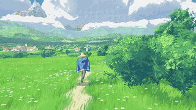</a> 
<b><a href="https://patch.gg/blendi/painted-valley">Painted Valley</a></b> 
<a href="https://x.com/BlendiByl">@BlendiByl</a> · ♥ 1.8k · <a href="https://x.com/BlendiByl/status/2120694003230560585">▶ Video</a> 
Ein von Ghibli inspiriertes, handgemaltes Tal zum Durchwandern. Open Source. 
<a href="https://fablelist.000ooo.ooo/de/prompts/?w=painted-valley&ref=gh"><b>✨ Prompt holen</b></a>
</td>
</tr>
<tr>
<td width="33%" valign="top">
<a href="https://april-zhu.com/pocketcity">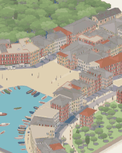</a> 
<b><a href="https://april-zhu.com/pocketcity">Pocket City</a></b> 
<a href="https://x.com/Aprilzz423">@Aprilzz423</a> · ♥ 1.2k · <a href="https://x.com/Aprilzz423/status/2123788440714260673">▶ Video</a> 
Macht aus jeder Straßenecke eine winzige handgezeichnete Stadt, die man drehen und erkunden kann – vermessen mit OpenStreetMap, mit dem Wetter und den Jahreszeiten des Ortes. Gebaut mit Fable 5.2 und GPT-6.2 Astra.
</td>
<td width="33%" valign="top">
 
<b><a href="https://claude.ai/artifact/CTjrZXVdUgKJ6qJXrvvr28">Ancient Babylon, 600 BC</a></b> 
<a href="https://x.com/literallydenis">@literallydenis</a> · ♥ 1.2k · <a href="https://x.com/literallydenis/status/2120866958790848953">▶ Video</a> 
Babylon, nachgebaut aus historischen Dokumenten und Plänen, die es selbst gefunden hat, in einem 8-stündigen Lauf. Lauf frei umher. 
<a href="https://fablelist.000ooo.ooo/de/prompts/?w=ancient-babylon-600-bc&ref=gh"><b>✨ Prompt holen</b></a>
</td>
<td width="33%" valign="top">
 
<b><a href="https://indiranagar-live.vercel.app">1 km² Indiranagar</a></b> 
<a href="https://x.com/anshu4321">@anshu4321</a> · ♥ 1.2k · <a href="https://x.com/anshu4321/status/2119938067758772403">▶ Video</a> 
Ein lebendiger 3D-Ausschnitt von Bengaluru aus Kartendaten und einem Prompt. 
<a href="https://fablelist.000ooo.ooo/de/prompts/?w=1-km2-of-indiranagar&ref=gh"><b>✨ Prompt holen</b></a>
</td>
</tr>
<tr>
<td width="33%" valign="top">
 
<b><a href="https://fable-rome.surge.sh/">Rome, AD 320</a></b> 
<a href="https://x.com/petergostev">@petergostev</a> · ♥ 977 · <a href="https://x.com/petergostev/status/2120167560700383572">▶ Video</a> 
Ein Prompt, Fable 5.2 (Max) lief über Nacht, 2.618 $. 
<a href="https://x.com/petergostev/status/2120167560700383572">📝 Prompt des Creators (kostenlos)</a>
</td>
<td width="33%" valign="top">
 
<b><a href="https://github.com/Leonxlnx/room-at-dawn">Room at Dawn</a></b> 
<a href="https://x.com/LexnLin">@LexnLin</a> · ♥ 856 · <a href="https://x.com/LexnLin/status/2120910879361548565">▶ Video</a> 
Ein fotorealistisches Schlafzimmer in three.js ohne vorgefertigte Modelle oder Texturen; alles ist Code. 
<a href="https://fablelist.000ooo.ooo/de/prompts/?w=room-at-dawn&ref=gh"><b>✨ Prompt holen</b></a>
</td>
<td width="33%" valign="top">
 
<b><a href="https://fable-rover.vercel.app">ER-6 Terrain Explorer — ein selbstfahrender Mars-Rover</a></b> 
<a href="https://x.com/DilumSanjaya">@DilumSanjaya</a> · ♥ 810 · <a href="https://x.com/DilumSanjaya/status/2120561077385867663">▶ Video</a> 
Fable 5.2 entwarf eine Rocker-Bogie-Aufhängung wie bei den Mars-Rovern der NASA und simulierte die Fahrt über außerirdisches Gelände.
</td>
</tr>
<tr>
<td width="33%" valign="top">
 
<b><a href="https://ship-42-catch.netlify.app/">Ship 42 Catch</a></b> 
<a href="https://x.com/emollick">@emollick</a> · ♥ 739 · <a href="https://x.com/emollick/status/2122036763468214711">▶ Video</a> 
Fable und Opus haben das Video vom Starship-Fang am Turm gefunden und die letzten 40 Sekunden detailliert in three.js-3D nachgebaut. Die Kameraperspektive lässt sich wechseln.
</td>
<td width="33%" valign="top">
 
<b><a href="https://patch.gg/play/blendi/the-blue-hour">The Blue Hour — eine Art-déco-Stadt bei Nacht</a></b> 
<a href="https://x.com/BlendiByl">@BlendiByl</a> · ♥ 635 · <a href="https://x.com/BlendiByl/status/2124439671006748853">▶ Video</a> 
Eine 3D-Szene im Art-déco-Stil der Batman-Zeichentrickserie, komplett in Code gezeichnet. Open Source.
</td>
<td width="33%" valign="top">
 
<b><a href="https://supernatural-ft.vercel.app/fire-in-ice">Fire in Ice</a></b> 
<a href="https://x.com/tkm_hmng8">@tkm_hmng8</a> · ♥ 549 · <a href="https://x.com/tkm_hmng8/status/2120813043101946324">▶ Video</a> 
Realistisches Feuer, das in Eis brennt, in reinem WebGPU ohne three.js geschrieben. 
<a href="https://fablelist.000ooo.ooo/de/prompts/?w=fire-in-ice&ref=gh"><b>✨ Prompt holen</b></a>
</td>
</tr>
<tr>
<td width="33%" valign="top">
 
<b><a href="https://github.com/Leonxlnx/walking-block">Walking Block: ein laufender sowjetischer Wohnblock</a></b> 
<a href="https://x.com/LexnLin">@LexnLin</a> · ♥ 417 · <a href="https://x.com/LexnLin/status/2122359035751989341">▶ Video</a> 
Ein riesiger sowjetischer Plattenbau auf acht mechanischen Beinen überquert im Dämmerungsnebel ein nasses Feld. Geometrie, Texturen und Shader sind komplett three.js-Code, und aus derselben Szene wird ein 45-Sekunden-Film gerendert.
</td>
<td width="33%" valign="top">
 
<b><a href="https://bay.theojaffee.net">Bay Area Through Time</a></b> 
<a href="https://x.com/theojaffee">@theojaffee</a> · ♥ 388 · <a href="https://x.com/theojaffee/status/2120312766544437738">▶ Video</a> 
Zoome zu jeder Stadt oder jedem Viertel, wähle ein beliebiges Jahr bis 1769 zurück und sieh, wie es damals aussah. 
<a href="https://nyc.theojaffee.net">New York City</a> 
<a href="https://fablelist.000ooo.ooo/de/prompts/?w=bay-area-through-time&ref=gh"><b>✨ Prompt holen</b></a>
</td>
<td width="33%" valign="top">
 
<b><a href="http://procedural-arm-rig.vercel.app">Procedural Arm Rig</a></b> 
<a href="https://x.com/apekshik">@apekshik</a> · ♥ 326 · <a href="https://x.com/apekshik/status/2120224530367119758">▶ Video</a> 
Statt ein AAA-Spiel in einem Versuch zu bauen: ein einzelner Arm mit Skelett-Armature, gewichtetem Mesh, IK und Muskeln, die anschwellen, wenn sich die Faust ballt. 
<a href="https://fablelist.000ooo.ooo/de/prompts/?w=procedural-arm-rig&ref=gh"><b>✨ Prompt holen</b></a>
</td>
</tr>
<tr>
<td width="33%" valign="top">
 
<b><a href="https://samg-coder.github.io/solstice-garden/">The Garden</a></b> 
<a href="https://x.com/SamGCoder">@SamGCoder</a> · ♥ 297 · <a href="https://x.com/SamGCoder/status/2120943068321054975">▶ Video</a> 
Eine Gartenszene, in Rust geschrieben, zu WASM kompiliert und mit WebGPU gerendert. 
<a href="https://fablelist.000ooo.ooo/de/prompts/?w=the-garden&ref=gh"><b>✨ Prompt holen</b></a>
</td>
<td width="33%" valign="top">
 
<b><a href="http://taoistvibe.com">Chill Taoist Vibe: ein Hügel mit taoistischem Tempel</a></b> 
<a href="https://x.com/qiqileyuan">@qiqileyuan</a> · ♥ 252 · <a href="https://x.com/qiqileyuan/status/2122006851298693277">▶ Video</a> 
Ein taoistischer Tempel im Ghibli-Stil auf einem kleinen Berg. Folge dem alten Priester bergauf, zünde Räucherstäbchen an, zieh ein Orakelstäbchen, meditiere oder setz dich einfach in den Schaukelstuhl und sieh den Jahreszeiten zu. Statuen und Hauptfigur stammen von Tripo3D, alles andere ist generierter Code.
</td>
<td width="33%" valign="top">
 
<b><a href="https://butterfly.kyzo.io">Hidden Layers: ein Glasflügelfalter im Gewächshaus</a></b> 
<a href="https://x.com/ky__zo">@ky__zo</a> · ♥ 229 · <a href="https://x.com/ky__zo/status/2122274109795054036">▶ Video</a> 
Scrolle, um mit einem Glasflügelfalter, der nicht aus einem Gewächshaus herauskommt, durch sechs Welten zu fliegen. Reines three.js ohne Modelldateien oder Texturen; es kostete 1.32 Milliarden Tokens und $905 an API-Kosten.
</td>
</tr>
<tr>
<td width="33%" valign="top">
 
<b><a href="https://claude.ai/artifact/R6YBDkAm2GjAC5A65D9djx">Eine Claude-Demo, in die man hineinlaufen kann</a></b> 
<a href="https://x.com/dfeinition">@dfeinition</a> · ♥ 215 · <a href="https://x.com/dfeinition/status/2120330644261589051">▶ Video</a> 
Inspiriert von @rileybrown: Geh hinein und setz dich an einen beliebigen Computer. 
<a href="https://fablelist.000ooo.ooo/de/prompts/?w=a-claude-demo-you-can-walk-into&ref=gh"><b>✨ Prompt holen</b></a>
</td>
<td width="33%" valign="top">
 
<b><a href="https://claude.ai/artifact/2PBXuQAnWDS2NpiPXHNLfL">Orca Jelly</a></b> 
<a href="https://x.com/vib3coded">@vib3coded</a> · ♥ 204 · <a href="https://x.com/vib3coded/status/2119951060752375827">▶ Video</a> 
Eine Materialstudie eines weichen Gummi-Orcas. Die Version von Opus 5.5 ist zum Vergleich verlinkt. 
<a href="https://claude.ai/artifact/75KLotWzZQ5RR23BGLePb8">Opus 5.5 version</a> 
<a href="https://x.com/vib3coded/status/2119951060752375827">📝 Prompt des Creators (kostenlos)</a>
</td>
<td width="33%" valign="top">
 
<b><a href="https://planet.tokyoaivisuals.club/">Code Planet</a></b> 
<a href="https://x.com/KanaWorks_AI">@KanaWorks_AI</a> · ♥ 198 · <a href="https://x.com/KanaWorks_AI/status/2121413647213932688">▶ Video</a> 
Ein ganzer Planet in unter 320 KB Code. Flieg vom Meer und von Wiesen durch Kirschblüten hinauf ins All, direkt im Browser.
</td>
</tr>
<tr>
<td width="33%" valign="top">
<a href="https://zalo.github.io/LanternTown/town/">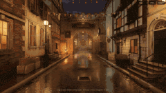</a> 
<b><a href="https://zalo.github.io/LanternTown/town/">LanternTown — ein Marktplatz im Laternenlicht</a></b> 
🆕 · <a href="https://x.com/makeshifted">@makeshifted</a> · ♥ 175 · <a href="https://x.com/makeshifted/status/2125331267512377844">Post</a> 
Ein experimenteller Stadtplatz in three.js. Jedes Asset ist parametrisch definiert und die Beleuchtung in die Vertexfarben gebacken, daher läuft er schlank. 
<a href="https://github.com/zalo/LanternTown">Quellcode</a>
</td>
<td width="33%" valign="top">
 
<b><a href="https://claude.ai/artifact/9EgZpErM17kH2a9Q3WXW6f">Voxel World in a Bottle</a></b> 
<a href="https://x.com/vib3coded">@vib3coded</a> · ♥ 163 · <a href="https://x.com/vib3coded/status/2120104517282775514">▶ Video</a> 
30 Minuten, 12,81 $. 
<a href="https://x.com/vib3coded/status/2120104517282775514">📝 Prompt des Creators (kostenlos)</a>
</td>
<td width="33%" valign="top">
 
<b><a href="https://github.com/Leonxlnx/beautiful-wonderland">Beautiful Wonderland</a></b> 
<a href="https://x.com/LexnLin">@LexnLin</a> · ♥ 147 · <a href="https://x.com/LexnLin/status/2122056542778535977">▶ Video</a> 
Eine kleine gemalte Welt in three.js, dazu ein 40-sekündiger 4K-Film, der daraus gerendert wurde.
</td>
</tr>
<tr>
<td width="33%" valign="top">
 
<b><a href="https://patch.gg/blendi/impossible-spaces">Impossible Spaces</a></b> 
<a href="https://x.com/BlendiByl">@BlendiByl</a> · ♥ 139 · <a href="https://x.com/BlendiByl/status/2120314459793355262">▶ Video</a> 
Ein psychedelisches Erlebnis mit „unmöglichen Räumen“. Open Source. 
<a href="https://fablelist.000ooo.ooo/de/prompts/?w=impossible-spaces&ref=gh"><b>✨ Prompt holen</b></a>
</td>
<td width="33%" valign="top">
<a href="https://claude.ai/artifact/HCzUsvWqERjQcgJjRuUUFo">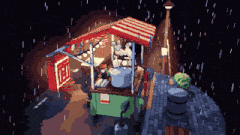</a> 
<b><a href="https://claude.ai/artifact/HCzUsvWqERjQcgJjRuUUFo">Rain-Soaked Noodle Stall — ein Pixel-Diorama</a></b> 
<a href="https://x.com/CapyCola">@CapyCola</a> · ♥ 136 · <a href="https://x.com/CapyCola/status/2124115057101664380">▶ Video</a> 
Ein Nudelstand im Regen, schaukelnde Laternen, ein Topf Suppe, auf den niemand aufpasst, und eine Katze, die noch nicht gegangen ist. Eine Pixelszene, die du ziehen und drehen kannst, um sie aus jedem Winkel zu sehen – gemacht mit Fable 5.2 und Ink Studio. 
<a href="https://github.com/cola5939/pixel-dioramas">Quellcode</a>
</td>
<td width="33%" valign="top">
 
<b><a href="https://claude.ai/artifact/7ge282etTXSS4edGFTFa85">3D Sailing Ship</a></b> 
<a href="https://x.com/marcthecreatorr">@marcthecreatorr</a> · ♥ 111 · <a href="https://x.com/marcthecreatorr/status/2119890973560054072">▶ Video</a> 
Reines Three.js, kein Blender, keine externen Assets. Ca. 38 Minuten, ca. 17 $. 
<a href="https://fablelist.000ooo.ooo/de/prompts/?w=3d-sailing-ship&ref=gh"><b>✨ Prompt holen</b></a>
</td>
</tr>
<tr>
<td width="33%" valign="top">
 
<b><a href="https://tests.jazii.dev/">Pirate Ship</a></b> 
<a href="https://x.com/notjazii">@notjazii</a> · ♥ 110 · <a href="https://x.com/notjazii/status/2119905661505122575">▶ Video</a> 
Ein Versuch, ca. 1,5 Stunden, ca. 35 Mio. Tokens (ca. 34 $). 
<a href="https://fablelist.000ooo.ooo/de/prompts/?w=pirate-ship&ref=gh"><b>✨ Prompt holen</b></a>
</td>
<td width="33%" valign="top">
<a href="https://coralback-ray.wasmer.app/">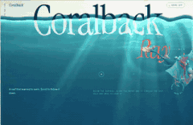</a> 
<b><a href="https://coralback-ray.wasmer.app/">Coralback Ray</a></b> 
<a href="https://x.com/thebuggeddev">@thebuggeddev</a> · ♥ 86 · <a href="https://x.com/thebuggeddev/status/2123021723188744248">▶ Video</a> 
Ein 3D-Rochen, der im Browser schwimmt, gebaut aus einem einzigen GLB-Modell. Keine Knochen: Das Rig läuft im Vertex-Shader, das Schwimmen wird aus Schub, Widerstand und Schwerkraft berechnet.
</td>
<td width="33%" valign="top">
<a href="https://patch.gg/blendi/pixel-village">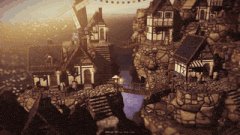</a> 
<b><a href="https://patch.gg/blendi/pixel-village">Pixel Village</a></b> 
<a href="https://x.com/BlendiByl">@BlendiByl</a> · ♥ 83 · <a href="https://x.com/BlendiByl/status/2123618324823388410">▶ Video</a> 
Ein verträumtes Pixeldorf auf Meeresklippen bei Sonnenuntergang: Pixel-Art in einer echten 3D-Welt, jeder Pixel per Code gezeichnet. Läuft im Browser, Open Source.
</td>
</tr>
<tr>
<td width="33%" valign="top">
<a href="https://airsup.ai/lab/sr-71?mach=3.2">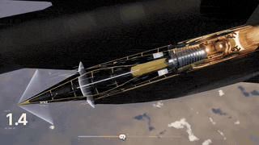</a> 
<b><a href="https://airsup.ai/lab/sr-71?mach=3.2">SR-71-Triebwerk im Schnitt</a></b> 
<a href="https://x.com/konstantinsaifo">@konstantinsaifo</a> · ♥ 76 · <a href="https://x.com/konstantinsaifo/status/2120518933103182193">▶ Video</a> 
Die SR-71 in 80.000 ft Höhe mit einem aufgeschnittenen Triebwerk. Ein Regler, die Geschwindigkeit: sieh zu, wie der Einlauf vom Triebwerk übernimmt. 
<a href="https://fablelist.000ooo.ooo/de/prompts/?w=sr-71-engine-teardown&ref=gh"><b>✨ Prompt holen</b></a>
</td>
<td width="33%" valign="top">
 
<b><a href="https://vancouver.webly.site">Vancouver From Above</a></b> 
<a href="https://x.com/tokifyi">@tokifyi</a> · ♥ 72 · <a href="https://x.com/tokifyi/status/2120020272153764172">Post</a> 
Die Stadt in three.js nachgebaut. 
<a href="https://fablelist.000ooo.ooo/de/prompts/?w=vancouver-from-above&ref=gh"><b>✨ Prompt holen</b></a>
</td>
<td width="33%" valign="top">
<a href="https://windblown.vercel.app">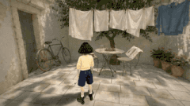</a> 
<b><a href="https://windblown.vercel.app">Windblown: Begleite ein Mädchen durch acht Welten</a></b> 
🆕 · <a href="https://x.com/nan_in_space">@nan_in_space</a> · ♥ 64 · <a href="https://x.com/nan_in_space/status/2120212714484330999">▶ Video</a> 
Ein interaktives Webstück. Spring mit einem Hechtsprung, einem Satz oder einem Rad durch ein Portal in jede neue Welt. Das Mädchen und die Szenen sind Gaussian Splats, jeweils aus einem einzigen Bild erzeugt.
</td>
</tr>
<tr>
<td width="33%" valign="top">
<a href="https://fable-jerusalem.vercel.app/">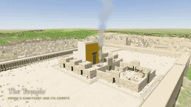</a> 
<b><a href="https://fable-jerusalem.vercel.app/">Jerusalem at Passover</a></b> 
<a href="https://x.com/kplikethebird">@kplikethebird</a> · ♥ 42 · <a href="https://x.com/kplikethebird/status/2119900775727902732">▶ Video</a> 
Ein immersives, historisch fundiertes 3D-Jerusalem, mit Blender gebaut. Streife durch die Straßen. 
<a href="https://x.com/kplikethebird/status/2119900775727902732">📝 Prompt des Creators (kostenlos)</a>
</td>
<td width="33%" valign="top">
<a href="https://starknightt.github.io/summer-festival/">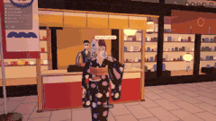</a> 
<b><a href="https://starknightt.github.io/summer-festival/">Summer Festival: eine Küstenstadt bei Nacht</a></b> 
<a href="https://x.com/prasenx">@prasenx</a> · ♥ 36 · <a href="https://x.com/prasenx/status/2121961933540917658">▶ Video</a> 
Eine Küstenstadt im Anime-Stil mit Sommerfest, durch die man spazieren kann. three.js auf WebGPU, gemacht mit Opus 5.5 und Fable 5.2. 
<a href="https://github.com/StarKnightt/summer-festival">Quellcode</a>
</td>
<td width="33%" valign="top">
<a href="https://claude.ai/artifact/QoBRCe2QuCU81MkNpVr4hd">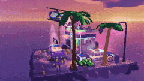</a> 
<b><a href="https://claude.ai/artifact/QoBRCe2QuCU81MkNpVr4hd">Vice Corner: ein Pixel-Diorama einer Straßenecke in Vice City</a></b> 
🆕 · <a href="https://x.com/CapyCola">@CapyCola</a> · ♥ 31 · <a href="https://x.com/CapyCola/status/2124797996458229877">▶ Video</a> 
Eine Straßenecke in Vice City, entstanden in den Tagen nach dem Start von GTA 6. Eine Pixelszene, die man ziehen, drehen und aus jedem Winkel betrachten kann, gebaut mit Fable 5.2 und Ink Studio. 
<a href="https://github.com/cola5939/pixel-dioramas">Quellcode</a>
</td>
</tr>
<tr>
<td width="33%" valign="top">
<a href="https://feelthematrix.com">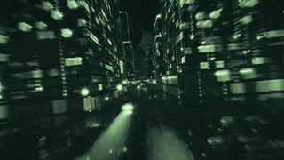</a> 
<b><a href="https://feelthematrix.com">Matrix Vibe</a></b> 
<a href="https://x.com/tornikegomareli">@tornikegomareli</a> · ♥ 30 · <a href="https://x.com/tornikegomareli/status/2120227696261120225">▶ Video</a> 
Eine Stadt in Matrix-Stimmung – Regen, Blitze, Wolken. Flieg hindurch. 
<a href="https://github.com/tornikegomareli/Matrix">Quellcode</a> 
<a href="https://fablelist.000ooo.ooo/de/prompts/?w=matrix-vibe&ref=gh"><b>✨ Prompt holen</b></a>
</td>
<td width="33%" valign="top">
<a href="https://loktar00.github.io/pine-hollow/">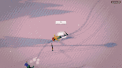</a> 
<b><a href="https://loktar00.github.io/pine-hollow/">Pine Hollow – ein lebendiger Skihang</a></b> 
<a href="https://x.com/loktar00">@loktar00</a> · ♥ 30 · <a href="https://x.com/loktar00/status/2120432591606067359">▶ Video</a> 
Ein 3D-Skihang auf Basis einer alten 2D-Version, mit der Aufgabe „give it some character“. 
<a href="https://loktar00.github.io/sled-free-exact/">Sled Free</a> · <a href="https://loktar00.github.io/sled-free/">Grumble Peak</a> 
<a href="https://fablelist.000ooo.ooo/de/prompts/?w=pine-hollow-a-living-ski-hill&ref=gh"><b>✨ Prompt holen</b></a>
</td>
<td width="33%" valign="top">
<a href="https://vancouver-claude.webly.site">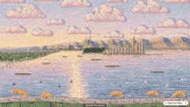</a> 
<b><a href="https://vancouver-claude.webly.site">Vancouver, goldene Stunde über der English Bay</a></b> 
<a href="https://x.com/tokifyi">@tokifyi</a> · ♥ 30 · <a href="https://x.com/tokifyi/status/2121644293270200354">Post</a> 
Ein Panorama von Vancouver bei Sonnenuntergang, komplett in JavaScript gezeichnet.
</td>
</tr>
<tr>
<td width="33%" valign="top">
<a href="https://claude.ai/artifact/HGk1WNqTgrGEE8ndBkEipB">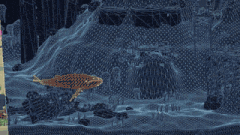</a> 
<b><a href="https://claude.ai/artifact/HGk1WNqTgrGEE8ndBkEipB">Pixel-Art zu 3D-Welt</a></b> 
<a href="https://x.com/dfeinition">@dfeinition</a> · ♥ 29 · <a href="https://x.com/dfeinition/status/2120933859999059970">▶ Video</a> 
Ein Stück Pixel-Art, verwandelt in eine interaktive 3D-Welt, mit einem Wal, der zeigt, wie sie entstanden ist. 
<a href="https://fablelist.000ooo.ooo/de/prompts/?w=pixel-art-to-3d-world&ref=gh"><b>✨ Prompt holen</b></a>
</td>
<td width="33%" valign="top">
<a href="https://galaxy-dive.vercel.app">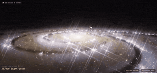</a> 
<b><a href="https://galaxy-dive.vercel.app">Galaxy Dive</a></b> 
<a href="https://x.com/handsher_NGU">@handsher_NGU</a> · ♥ 24 · <a href="https://x.com/handsher_NGU/status/2119910478025789655">▶ Video</a> 
„God took 6 days, Fable 5.2 took 20 min.“ Flieg in eine Galaxie. 
<a href="https://fablelist.000ooo.ooo/de/prompts/?w=galaxy-dive&ref=gh"><b>✨ Prompt holen</b></a>
</td>
<td width="33%" valign="top">
 
<b><a href="https://calibre-watch-snowy.vercel.app/">Calibre 5.2 Uhr</a></b> 
<a href="https://x.com/Andrew_Blumson">@Andrew_Blumson</a> · ♥ 22 · <a href="https://x.com/Andrew_Blumson/status/2120097749177606559">▶ Video</a> 
Kein Referenzbild: ein Text-Prompt, ein Versuch. three.js und WebGPU. 
<a href="https://fablelist.000ooo.ooo/de/prompts/?w=calibre-5-2-watch&ref=gh"><b>✨ Prompt holen</b></a>
</td>
</tr>
<tr>
<td width="33%" valign="top">
 
<b><a href="https://sf-js.webly.site">San Francisco zur goldenen Stunde</a></b> 
<a href="https://x.com/tokifyi">@tokifyi</a> · ♥ 22 · <a href="https://x.com/tokifyi/status/2121367097972531412">▶ Video</a> 
Ein Prompt, reines JavaScript-Canvas: Brücke, Skyline, Nebel, Spiegelungen und eine Cable Car, ohne Bilder oder Bibliotheken.
</td>
<td width="33%" valign="top">
<a href="https://claude.ai/artifact/7nmzhxeamcunJbKVK32ptz">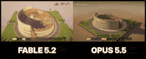</a> 
<b><a href="https://claude.ai/artifact/7nmzhxeamcunJbKVK32ptz">Voxel Colosseum</a></b> 
<a href="https://x.com/aGim_asf">@aGim_asf</a> · ♥ 20 · <a href="https://x.com/aGim_asf/status/2119918363799376270">▶ Video</a> 
Spaziere durch den zerfallenen inneren Ring. Die Diorama-Version von Opus 5.5 ist zum Vergleich verlinkt. 
<a href="https://claude.ai/artifact/B7ZmVS7Yr3BUc99ZyGk2bX">Opus 5.5 version</a> 
<a href="https://fablelist.000ooo.ooo/de/prompts/?w=voxel-colosseum&ref=gh"><b>✨ Prompt holen</b></a>
</td>
<td width="33%" valign="top">
<a href="https://glittery-stardust-885b97.netlify.app">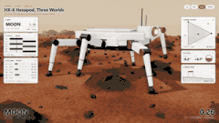</a> 
<b><a href="https://glittery-stardust-885b97.netlify.app">HX-6 Hexapod, Three Worlds</a></b> 
<a href="https://x.com/Acoramaa">@Acoramaa</a> · ♥ 11 · <a href="https://x.com/Acoramaa/status/2120839083895538093">▶ Video</a> 
Derselbe 14-kg-Hexapod auf dem Mars, dem Mond und Europa; jeder Fuß findet seinen eigenen Halt. Fahr ihn selbst. 
<a href="https://fablelist.000ooo.ooo/de/prompts/?w=hx-6-hexapod-three-worlds&ref=gh"><b>✨ Prompt holen</b></a>
</td>
</tr>
<tr>
<td width="33%" valign="top">
<a href="https://zondark.com">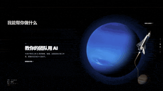</a> 
<b><a href="https://zondark.com">One-way Trip to a Black Hole</a></b> 
<a href="https://x.com/ZondarkAI">@ZondarkAI</a> · ♥ 9 · <a href="https://x.com/ZondarkAI/status/2120106341423571097">▶ Video</a> 
Eine persönliche Website, neu gebaut als Scroll-Reise von der Erde zu einem Schwarzen Loch. 
<a href="https://fablelist.000ooo.ooo/de/prompts/?w=one-way-trip-to-a-black-hole&ref=gh"><b>✨ Prompt holen</b></a>
</td>
<td width="33%" valign="top">
 
<b><a href="https://madebysourasith-sudo.github.io/red-wing-jet/">Red-Wing-Privatjet</a></b> 
<a href="https://x.com/titepommee">@titepommee</a> · ♥ 8 · <a href="https://x.com/titepommee/status/2121259736217911357">▶ Video</a> 
Geh um den Jet herum, klicke auf die Tür, die Treppe fährt aus und du steigst ein: Lounge, Schlafzimmer, sogar das Bad.
</td>
<td width="33%" valign="top">
<a href="https://davinci-mechanics.vercel.app/">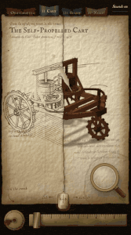</a> 
<b><a href="https://davinci-mechanics.vercel.app/">Da Vincis lebendiger Kodex</a></b> 
<a href="https://x.com/CoderRw11326">@CoderRw11326</a> · ♥ 6 · <a href="https://x.com/CoderRw11326/status/2121286814103421012">▶ Video</a> 
Schlag das Notizbuch auf: Eine Feder skizziert Leonardos Maschinen, die zu Holzmechanismen werden, die man drehen und zerlegen kann. Keine 3D-Modelle, Texturen oder Audiodateien – alles Code. 
<a href="https://github.com/coding-nanami/davinci-mechanics">Quellcode</a>
</td>
</tr>
<tr>
<td width="33%" valign="top">
<a href="https://claude.ai/artifact/FETrKoitcqxPQjbQvZd79C">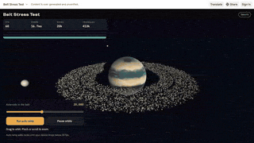</a> 
<b><a href="https://claude.ai/artifact/FETrKoitcqxPQjbQvZd79C">Belt Stress Test</a></b> 
<a href="https://x.com/fadihares95">@fadihares95</a> · ♥ 4 · <a href="https://x.com/fadihares95/status/2119885634814857500">Post</a> 
Ca. 20.000 kreisende Asteroiden; es kommen immer mehr Felsen dazu, bis dein Gerät unter 30 fps fällt. 
<a href="https://fablelist.000ooo.ooo/de/prompts/?w=belt-stress-test&ref=gh"><b>✨ Prompt holen</b></a>
</td>
<td width="33%" valign="top">
<a href="https://claude.ai/artifact/BCDCNHRTq3y9W4Px3xc4DN">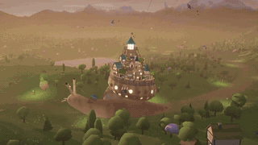</a> 
<b><a href="https://claude.ai/artifact/BCDCNHRTq3y9W4Px3xc4DN">A Hamlet on a Giant Snail</a></b> 
<a href="https://x.com/L34342Lin">@L34342Lin</a> · ♥ 0 · <a href="https://x.com/L34342Lin/status/2120030246108066195">▶ Video</a> 
„Bring a 3D castle to life in an HTML file.“ Handgeschriebenes WebGL2, keine Bibliotheken, ca. 5.500 Bäume, Tag-Nacht-Zyklus. 
<a href="https://x.com/L34342Lin/status/2120030246108066195">📝 Prompt des Creators (kostenlos)</a>
</td>
<td width="33%" valign="top">
 
<b><a href="https://claude.ai/artifact/UqU4w7jSr6pzF2McsbyQjJ">Wooden Pagoda Transformation</a></b> 
<a href="https://x.com/acupofai">@acupofai</a> · ♥ 0 · <a href="https://x.com/acupofai/status/2120119243043995748">▶ Video</a> 
3.357 Teile setzen eine fünfstöckige Pagode zusammen, die sich in eine Schwertkämpferin verwandelt. Die Musik wird im Code berechnet. 
<a href="https://fablelist.000ooo.ooo/de/prompts/?w=wooden-pagoda-transformation&ref=gh"><b>✨ Prompt holen</b></a>
</td>
</tr>
<tr>
<td width="33%" valign="top">
<a href="https://cyrilremacle-byte.github.io/francis-turbine-explorer/">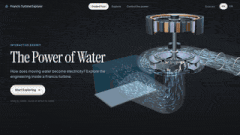</a> 
<b><a href="https://cyrilremacle-byte.github.io/francis-turbine-explorer/">Francis Turbine Explorer</a></b> 
<a href="https://x.com/cyril_remacle">@cyril_remacle</a> · ♥ 0 · <a href="https://x.com/cyril_remacle/status/2122048423528485116">Post</a> 
Eine interaktive 3D-Francis-Turbine zum Aufschneiden, Zerlegen und selbst Antreiben, mit geführter Tour, Explosionsansicht und Live-Rechner für Wasserkraftleistung. Auf Englisch und Französisch.
</td>
</tr>
</table>

Andere Abschnitte: [🎮 Spiele](games.de.md) · [🧰 Webseiten & Tools](web-and-tools.de.md) · [🎬 Animation & Film](animation.de.md) · [📺 Video-Demos](video-demos.de.md)

[← Zurück zur Liste](../README.de.md)
