# 🌍 Mundos y escenas 3D · los 47

[← Volver a la lista](../README.es.md) · [English](3d-worlds.md) · [简体中文](3d-worlds.zh-CN.md) · [繁體中文](3d-worlds.zh-TW.md) · [日本語](3d-worlds.ja.md) · [한국어](3d-worlds.ko.md) · **Español** · [Português](3d-worlds.pt-BR.md) · [Français](3d-worlds.fr.md) · [Deutsch](3d-worlds.de.md) · [Русский](3d-worlds.ru.md)

La página principal muestra como máximo las 24 entradas con más «me gusta» de cada sección (solo las de 100+); aquí están todas las de esta sección, ordenadas por «me gusta».

<table>
<tr>
<td width="33%" valign="top">
 
<b><a href="https://claude.ai/artifact/QGWUAjRrzRzZWGcQzSMLfa">Claude App en una laptop de Blender</a></b> 
<a href="https://x.com/rileybrown">@rileybrown</a> · ♥ 7.1k · <a href="https://x.com/rileybrown/status/2119902109709537708">▶ Video</a> 
Un solo prompt construyó toda la habitación en Blender y la renderizó en 4K. Esta es la página web que se ve en la pantalla de la laptop. 
<a href="https://x.com/rileybrown/status/2119902109709537708">📝 Prompt del creador (gratis)</a>
</td>
<td width="33%" valign="top">
 
<b><a href="https://xikhar.github.io/papertrails/">Papertrails: un mundo de papel desplegable sin fin</a></b> 
<a href="https://x.com/xikhar">@xikhar</a> · ♥ 2.3k · <a href="https://x.com/xikhar/status/2122682962647122403">▶ Video</a> 
Una figura de papel avanza mientras árboles, casas y colinas se levantan del suelo como en un libro pop-up, entre desierto, nieve, bosque, día y noche. Hecho con Fable 5.2, Opus 5.5 y three.js. 
<a href="https://github.com/xikhar/papertrails">Código fuente</a>
</td>
<td width="33%" valign="top">
 
<b><a href="https://patch.gg/blendi/painted-valley">Painted Valley</a></b> 
<a href="https://x.com/BlendiByl">@BlendiByl</a> · ♥ 1.8k · <a href="https://x.com/BlendiByl/status/2120694003230560585">▶ Video</a> 
Un valle pintado a mano inspirado en Ghibli por el que puedes caminar. Código abierto. 
<a href="https://fablelist.000ooo.ooo/es/prompts/?w=painted-valley&ref=gh"><b>✨ Consigue el prompt</b></a>
</td>
</tr>
<tr>
<td width="33%" valign="top">
 
<b><a href="https://april-zhu.com/pocketcity">Pocket City</a></b> 
🆕 · <a href="https://x.com/Aprilzz423">@Aprilzz423</a> · ♥ 1.2k · <a href="https://x.com/Aprilzz423/status/2123788440714260673">▶ Video</a> 
Convierte cualquier esquina en una pequeña ciudad dibujada a mano que puedes girar y explorar, medida con OpenStreetMap y con el clima y las estaciones del lugar. Hecho con Fable 5.2 y GPT-6.2 Astra.
</td>
<td width="33%" valign="top">
 
<b><a href="https://claude.ai/artifact/CTjrZXVdUgKJ6qJXrvvr28">Ancient Babylon, 600 BC</a></b> 
<a href="https://x.com/literallydenis">@literallydenis</a> · ♥ 1.2k · <a href="https://x.com/literallydenis/status/2120866958790848953">▶ Video</a> 
Babilonia reconstruida a partir de documentos históricos y planos que encontró por su cuenta, en una ejecución de 8 horas. Recórrela libremente. 
<a href="https://fablelist.000ooo.ooo/es/prompts/?w=ancient-babylon-600-bc&ref=gh"><b>✨ Consigue el prompt</b></a>
</td>
<td width="33%" valign="top">
 
<b><a href="https://indiranagar-live.vercel.app">1 km² de Indiranagar</a></b> 
<a href="https://x.com/anshu4321">@anshu4321</a> · ♥ 1.2k · <a href="https://x.com/anshu4321/status/2119938067758772403">▶ Video</a> 
Un fragmento 3D en vivo de Bengaluru a partir de datos de mapas y un solo prompt. 
<a href="https://fablelist.000ooo.ooo/es/prompts/?w=1-km2-of-indiranagar&ref=gh"><b>✨ Consigue el prompt</b></a>
</td>
</tr>
<tr>
<td width="33%" valign="top">
 
<b><a href="https://fable-rome.surge.sh/">Rome, AD 320</a></b> 
<a href="https://x.com/petergostev">@petergostev</a> · ♥ 976 · <a href="https://x.com/petergostev/status/2120167560700383572">▶ Video</a> 
Un prompt, Fable 5.2 (Max) corriendo toda la noche, $2,618. 
<a href="https://x.com/petergostev/status/2120167560700383572">📝 Prompt del creador (gratis)</a>
</td>
<td width="33%" valign="top">
 
<b><a href="https://github.com/Leonxlnx/room-at-dawn">Room at Dawn</a></b> 
<a href="https://x.com/LexnLin">@LexnLin</a> · ♥ 857 · <a href="https://x.com/LexnLin/status/2120910879361548565">▶ Video</a> 
Un dormitorio fotorrealista en three.js sin modelos ni texturas prefabricados; todo es código. 
<a href="https://fablelist.000ooo.ooo/es/prompts/?w=room-at-dawn&ref=gh"><b>✨ Consigue el prompt</b></a>
</td>
<td width="33%" valign="top">
 
<b><a href="https://fable-rover.vercel.app">ER-6 Terrain Explorer — un rover marciano autónomo</a></b> 
<a href="https://x.com/DilumSanjaya">@DilumSanjaya</a> · ♥ 799 · <a href="https://x.com/DilumSanjaya/status/2120561077385867663">▶ Video</a> 
Fable 5.2 diseñó una suspensión rocker-bogie como la de los rovers de la NASA y simuló su conducción por terreno alienígena.
</td>
</tr>
<tr>
<td width="33%" valign="top">
 
<b><a href="https://ship-42-catch.netlify.app/">Ship 42 Catch</a></b> 
<a href="https://x.com/emollick">@emollick</a> · ♥ 739 · <a href="https://x.com/emollick/status/2122036763468214711">▶ Video</a> 
Fable y Opus buscaron el video de la captura de Starship con la torre y recrearon los últimos 40 segundos en 3D detallado con three.js. Puedes cambiar la cámara.
</td>
<td width="33%" valign="top">
 
<b><a href="https://supernatural-ft.vercel.app/fire-in-ice">Fire in Ice</a></b> 
<a href="https://x.com/tkm_hmng8">@tkm_hmng8</a> · ♥ 549 · <a href="https://x.com/tkm_hmng8/status/2120813043101946324">▶ Video</a> 
Fuego realista ardiendo dentro del hielo, escrito en WebGPU puro sin three.js. 
<a href="https://fablelist.000ooo.ooo/es/prompts/?w=fire-in-ice&ref=gh"><b>✨ Consigue el prompt</b></a>
</td>
<td width="33%" valign="top">
 
<b><a href="https://github.com/Leonxlnx/walking-block">Walking Block: un bloque de pisos soviético que camina</a></b> 
<a href="https://x.com/LexnLin">@LexnLin</a> · ♥ 417 · <a href="https://x.com/LexnLin/status/2122359035751989341">▶ Video</a> 
Un enorme bloque soviético de paneles sobre ocho patas mecánicas cruza un campo mojado entre la niebla del atardecer. La geometría, las texturas y los shaders son código three.js, y de la misma escena se renderiza un corto de 45 segundos.
</td>
</tr>
<tr>
<td width="33%" valign="top">
 
<b><a href="https://bay.theojaffee.net">Bay Area Through Time</a></b> 
<a href="https://x.com/theojaffee">@theojaffee</a> · ♥ 388 · <a href="https://x.com/theojaffee/status/2120312766544437738">▶ Video</a> 
Acércate a cualquier ciudad o barrio, elige cualquier año hasta 1769 y mira cómo era. 
<a href="https://nyc.theojaffee.net">New York City</a> 
<a href="https://fablelist.000ooo.ooo/es/prompts/?w=bay-area-through-time&ref=gh"><b>✨ Consigue el prompt</b></a>
</td>
<td width="33%" valign="top">
 
<b><a href="http://procedural-arm-rig.vercel.app">Procedural Arm Rig</a></b> 
<a href="https://x.com/apekshik">@apekshik</a> · ♥ 326 · <a href="https://x.com/apekshik/status/2120224530367119758">▶ Video</a> 
En lugar de generar un juego AAA de un tiro: un solo brazo con esqueleto de huesos, malla con pesos pintados, IK y músculos que se hinchan al apretar el puño. 
<a href="https://fablelist.000ooo.ooo/es/prompts/?w=procedural-arm-rig&ref=gh"><b>✨ Consigue el prompt</b></a>
</td>
<td width="33%" valign="top">
 
<b><a href="https://samg-coder.github.io/solstice-garden/">The Garden</a></b> 
<a href="https://x.com/SamGCoder">@SamGCoder</a> · ♥ 297 · <a href="https://x.com/SamGCoder/status/2120943068321054975">▶ Video</a> 
Una escena de jardín escrita en Rust, compilada a WASM y renderizada con WebGPU. 
<a href="https://fablelist.000ooo.ooo/es/prompts/?w=the-garden&ref=gh"><b>✨ Consigue el prompt</b></a>
</td>
</tr>
<tr>
<td width="33%" valign="top">
 
<b><a href="http://taoistvibe.com">Chill Taoist Vibe: una colina con un templo taoísta</a></b> 
<a href="https://x.com/qiqileyuan">@qiqileyuan</a> · ♥ 253 · <a href="https://x.com/qiqileyuan/status/2122006851298693277">▶ Video</a> 
Un templo taoísta de estilo Ghibli en una pequeña montaña. Sigue al viejo sacerdote cuesta arriba, quema incienso, saca un palillo de la fortuna, medita o simplemente siéntate en la mecedora a ver pasar las estaciones. Las estatuas y el personaje principal vienen de Tripo3D; todo lo demás es código generado.
</td>
<td width="33%" valign="top">
 
<b><a href="https://butterfly.kyzo.io">Hidden Layers: una mariposa de cristal en un invernadero</a></b> 
<a href="https://x.com/ky__zo">@ky__zo</a> · ♥ 229 · <a href="https://x.com/ky__zo/status/2122274109795054036">▶ Video</a> 
Desplázate para volar con una mariposa de cristal que no puede salir de un invernadero a través de seis mundos. three.js puro, sin archivos de modelos ni texturas; costó 1.32 mil millones de tokens y $905 de API.
</td>
<td width="33%" valign="top">
 
<b><a href="https://claude.ai/artifact/R6YBDkAm2GjAC5A65D9djx">Una demo de Claude a la que puedes entrar caminando</a></b> 
<a href="https://x.com/dfeinition">@dfeinition</a> · ♥ 215 · <a href="https://x.com/dfeinition/status/2120330644261589051">▶ Video</a> 
Inspirada en @rileybrown: entra y siéntate frente a cualquier computadora. 
<a href="https://fablelist.000ooo.ooo/es/prompts/?w=a-claude-demo-you-can-walk-into&ref=gh"><b>✨ Consigue el prompt</b></a>
</td>
</tr>
<tr>
<td width="33%" valign="top">
 
<b><a href="https://claude.ai/artifact/2PBXuQAnWDS2NpiPXHNLfL">Orca Jelly</a></b> 
<a href="https://x.com/vib3coded">@vib3coded</a> · ♥ 203 · <a href="https://x.com/vib3coded/status/2119951060752375827">▶ Video</a> 
Un estudio de material de orca de gomita con cuerpo blando. Se enlaza la versión de Opus 5.5 para comparar. 
<a href="https://claude.ai/artifact/75KLotWzZQ5RR23BGLePb8">Opus 5.5 version</a> 
<a href="https://x.com/vib3coded/status/2119951060752375827">📝 Prompt del creador (gratis)</a>
</td>
<td width="33%" valign="top">
 
<b><a href="https://planet.tokyoaivisuals.club/">Code Planet</a></b> 
<a href="https://x.com/KanaWorks_AI">@KanaWorks_AI</a> · ♥ 198 · <a href="https://x.com/KanaWorks_AI/status/2121413647213932688">▶ Video</a> 
Un planeta entero en menos de 320 KB de código. Vuela desde el mar y las praderas, pasando por cerezos en flor, hasta el espacio, directo en el navegador.
</td>
<td width="33%" valign="top">
<a href="https://claude.ai/artifact/9EgZpErM17kH2a9Q3WXW6f">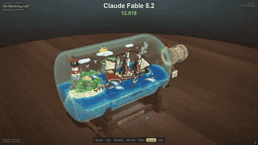</a> 
<b><a href="https://claude.ai/artifact/9EgZpErM17kH2a9Q3WXW6f">Voxel World in a Bottle</a></b> 
<a href="https://x.com/vib3coded">@vib3coded</a> · ♥ 164 · <a href="https://x.com/vib3coded/status/2120104517282775514">▶ Video</a> 
30 minutos, $12.81. 
<a href="https://x.com/vib3coded/status/2120104517282775514">📝 Prompt del creador (gratis)</a>
</td>
</tr>
<tr>
<td width="33%" valign="top">
 
<b><a href="https://github.com/Leonxlnx/beautiful-wonderland">Beautiful Wonderland</a></b> 
<a href="https://x.com/LexnLin">@LexnLin</a> · ♥ 147 · <a href="https://x.com/LexnLin/status/2122056542778535977">▶ Video</a> 
Un pequeño mundo pintado en three.js, más un corto de 40 segundos en 4K renderizado a partir de él.
</td>
<td width="33%" valign="top">
 
<b><a href="https://patch.gg/blendi/impossible-spaces">Impossible Spaces</a></b> 
<a href="https://x.com/BlendiByl">@BlendiByl</a> · ♥ 139 · <a href="https://x.com/BlendiByl/status/2120314459793355262">▶ Video</a> 
Una experiencia psicodélica de "espacios imposibles". Código abierto. 
<a href="https://fablelist.000ooo.ooo/es/prompts/?w=impossible-spaces&ref=gh"><b>✨ Consigue el prompt</b></a>
</td>
<td width="33%" valign="top">
 
<b><a href="https://claude.ai/artifact/7ge282etTXSS4edGFTFa85">3D Sailing Ship</a></b> 
<a href="https://x.com/marcthecreatorr">@marcthecreatorr</a> · ♥ 111 · <a href="https://x.com/marcthecreatorr/status/2119890973560054072">▶ Video</a> 
Three.js puro, sin Blender ni recursos externos. ~38 minutos, ~$17. 
<a href="https://fablelist.000ooo.ooo/es/prompts/?w=3d-sailing-ship&ref=gh"><b>✨ Consigue el prompt</b></a>
</td>
</tr>
<tr>
<td width="33%" valign="top">
 
<b><a href="https://tests.jazii.dev/">Pirate Ship</a></b> 
<a href="https://x.com/notjazii">@notjazii</a> · ♥ 110 · <a href="https://x.com/notjazii/status/2119905661505122575">▶ Video</a> 
Un intento, ~1.5 horas, ~35M de tokens (~$34). 
<a href="https://fablelist.000ooo.ooo/es/prompts/?w=pirate-ship&ref=gh"><b>✨ Consigue el prompt</b></a>
</td>
<td width="33%" valign="top">
<a href="https://coralback-ray.wasmer.app/">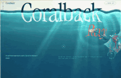</a> 
<b><a href="https://coralback-ray.wasmer.app/">Coralback Ray</a></b> 
<a href="https://x.com/thebuggeddev">@thebuggeddev</a> · ♥ 83 · <a href="https://x.com/thebuggeddev/status/2123021723188744248">▶ Video</a> 
Una raya en 3D que nada en tu navegador, hecha a partir de un solo modelo GLB. Sin huesos: el rig corre en el vertex shader y el nado se calcula con empuje, arrastre y gravedad.
</td>
<td width="33%" valign="top">
<a href="https://patch.gg/blendi/pixel-village">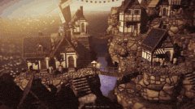</a> 
<b><a href="https://patch.gg/blendi/pixel-village">Pixel Village</a></b> 
🆕 · <a href="https://x.com/BlendiByl">@BlendiByl</a> · ♥ 78 · <a href="https://x.com/BlendiByl/status/2123618324823388410">▶ Video</a> 
Un pueblo de píxeles de ensueño sobre acantilados al atardecer: pixel art en un mundo 3D real, con cada píxel dibujado por código. Funciona en el navegador y es de código abierto.
</td>
</tr>
<tr>
<td width="33%" valign="top">
<a href="https://airsup.ai/lab/sr-71?mach=3.2">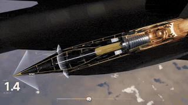</a> 
<b><a href="https://airsup.ai/lab/sr-71?mach=3.2">Despiece del motor del SR-71</a></b> 
<a href="https://x.com/konstantinsaifo">@konstantinsaifo</a> · ♥ 76 · <a href="https://x.com/konstantinsaifo/status/2120518933103182193">▶ Video</a> 
El SR-71 a 80,000 pies con un motor cortado por la mitad. Una sola perilla, la velocidad: mira cómo la toma de aire releva al motor. 
<a href="https://fablelist.000ooo.ooo/es/prompts/?w=sr-71-engine-teardown&ref=gh"><b>✨ Consigue el prompt</b></a>
</td>
<td width="33%" valign="top">
 
<b><a href="https://vancouver.webly.site">Vancouver From Above</a></b> 
<a href="https://x.com/tokifyi">@tokifyi</a> · ♥ 72 · <a href="https://x.com/tokifyi/status/2120020272153764172">Publicación</a> 
La ciudad reconstruida en three.js. 
<a href="https://fablelist.000ooo.ooo/es/prompts/?w=vancouver-from-above&ref=gh"><b>✨ Consigue el prompt</b></a>
</td>
<td width="33%" valign="top">
<a href="https://fable-jerusalem.vercel.app/">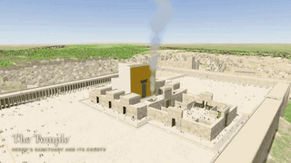</a> 
<b><a href="https://fable-jerusalem.vercel.app/">Jerusalén en la Pascua</a></b> 
<a href="https://x.com/kplikethebird">@kplikethebird</a> · ♥ 43 · <a href="https://x.com/kplikethebird/status/2119900775727902732">▶ Video</a> 
Una Jerusalén 3D inmersiva y con rigor histórico, hecha con Blender. Recorre sus calles. 
<a href="https://x.com/kplikethebird/status/2119900775727902732">📝 Prompt del creador (gratis)</a>
</td>
</tr>
<tr>
<td width="33%" valign="top">
<a href="https://starknightt.github.io/summer-festival/">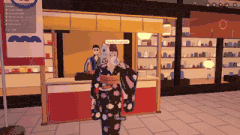</a> 
<b><a href="https://starknightt.github.io/summer-festival/">Summer Festival: un pueblo costero de noche</a></b> 
<a href="https://x.com/prasenx">@prasenx</a> · ♥ 36 · <a href="https://x.com/prasenx/status/2121961933540917658">▶ Video</a> 
Un pueblo costero de estilo anime en pleno festival de verano por el que puedes pasear. three.js sobre WebGPU, hecho con Opus 5.5 y Fable 5.2. 
<a href="https://github.com/StarKnightt/summer-festival">Código fuente</a>
</td>
<td width="33%" valign="top">
<a href="https://feelthematrix.com">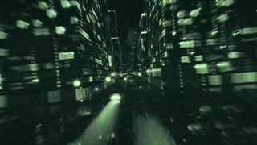</a> 
<b><a href="https://feelthematrix.com">Matrix Vibe</a></b> 
<a href="https://x.com/tornikegomareli">@tornikegomareli</a> · ♥ 30 · <a href="https://x.com/tornikegomareli/status/2120227696261120225">▶ Video</a> 
Una ciudad con el ambiente de Matrix: lluvia, relámpagos, nubes. Vuela por ella. 
<a href="https://github.com/tornikegomareli/Matrix">Código fuente</a> 
<a href="https://fablelist.000ooo.ooo/es/prompts/?w=matrix-vibe&ref=gh"><b>✨ Consigue el prompt</b></a>
</td>
<td width="33%" valign="top">
<a href="https://loktar00.github.io/pine-hollow/">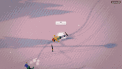</a> 
<b><a href="https://loktar00.github.io/pine-hollow/">Pine Hollow — una pista de esquí viva</a></b> 
<a href="https://x.com/loktar00">@loktar00</a> · ♥ 30 · <a href="https://x.com/loktar00/status/2120432591606067359">▶ Video</a> 
Una pista de esquí 3D basada en una vieja versión 2D, a la que se le pidió "darle algo de personalidad". 
<a href="https://loktar00.github.io/sled-free-exact/">Sled Free</a> · <a href="https://loktar00.github.io/sled-free/">Grumble Peak</a> 
<a href="https://fablelist.000ooo.ooo/es/prompts/?w=pine-hollow-a-living-ski-hill&ref=gh"><b>✨ Consigue el prompt</b></a>
</td>
</tr>
<tr>
<td width="33%" valign="top">
<a href="https://vancouver-claude.webly.site">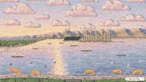</a> 
<b><a href="https://vancouver-claude.webly.site">Vancouver, hora dorada sobre English Bay</a></b> 
<a href="https://x.com/tokifyi">@tokifyi</a> · ♥ 30 · <a href="https://x.com/tokifyi/status/2121644293270200354">Publicación</a> 
Un panorama de Vancouver al atardecer dibujado íntegramente en JavaScript.
</td>
<td width="33%" valign="top">
<a href="https://claude.ai/artifact/HGk1WNqTgrGEE8ndBkEipB">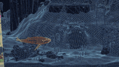</a> 
<b><a href="https://claude.ai/artifact/HGk1WNqTgrGEE8ndBkEipB">De pixel art a mundo 3D</a></b> 
<a href="https://x.com/dfeinition">@dfeinition</a> · ♥ 29 · <a href="https://x.com/dfeinition/status/2120933859999059970">▶ Video</a> 
Una pieza de pixel art convertida en un mundo 3D interactivo, con una ballena que muestra cómo se hizo. 
<a href="https://fablelist.000ooo.ooo/es/prompts/?w=pixel-art-to-3d-world&ref=gh"><b>✨ Consigue el prompt</b></a>
</td>
<td width="33%" valign="top">
<a href="https://galaxy-dive.vercel.app">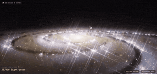</a> 
<b><a href="https://galaxy-dive.vercel.app">Galaxy Dive</a></b> 
<a href="https://x.com/handsher_NGU">@handsher_NGU</a> · ♥ 24 · <a href="https://x.com/handsher_NGU/status/2119910478025789655">▶ Video</a> 
"Dios tardó 6 días, Fable 5.2 tardó 20 min." Vuela hacia el interior de una galaxia. 
<a href="https://fablelist.000ooo.ooo/es/prompts/?w=galaxy-dive&ref=gh"><b>✨ Consigue el prompt</b></a>
</td>
</tr>
<tr>
<td width="33%" valign="top">
 
<b><a href="https://calibre-watch-snowy.vercel.app/">Reloj Calibre 5.2</a></b> 
<a href="https://x.com/Andrew_Blumson">@Andrew_Blumson</a> · ♥ 22 · <a href="https://x.com/Andrew_Blumson/status/2120097749177606559">▶ Video</a> 
Sin imagen de referencia: un prompt de texto, un intento. three.js y WebGPU. 
<a href="https://fablelist.000ooo.ooo/es/prompts/?w=calibre-5-2-watch&ref=gh"><b>✨ Consigue el prompt</b></a>
</td>
<td width="33%" valign="top">
 
<b><a href="https://sf-js.webly.site">San Francisco en la hora dorada</a></b> 
<a href="https://x.com/tokifyi">@tokifyi</a> · ♥ 22 · <a href="https://x.com/tokifyi/status/2121367097972531412">▶ Video</a> 
Un prompt, canvas de JavaScript puro: el puente, el horizonte, la niebla, los reflejos y un tranvía, sin imágenes ni librerías.
</td>
<td width="33%" valign="top">
<a href="https://claude.ai/artifact/7nmzhxeamcunJbKVK32ptz">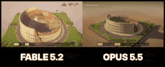</a> 
<b><a href="https://claude.ai/artifact/7nmzhxeamcunJbKVK32ptz">Voxel Colosseum</a></b> 
<a href="https://x.com/aGim_asf">@aGim_asf</a> · ♥ 20 · <a href="https://x.com/aGim_asf/status/2119918363799376270">▶ Video</a> 
Camina por el anillo interior en ruinas. Se enlaza la versión en diorama de Opus 5.5 para comparar. 
<a href="https://claude.ai/artifact/B7ZmVS7Yr3BUc99ZyGk2bX">Opus 5.5 version</a> 
<a href="https://fablelist.000ooo.ooo/es/prompts/?w=voxel-colosseum&ref=gh"><b>✨ Consigue el prompt</b></a>
</td>
</tr>
<tr>
<td width="33%" valign="top">
<a href="https://glittery-stardust-885b97.netlify.app">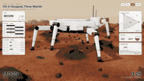</a> 
<b><a href="https://glittery-stardust-885b97.netlify.app">HX-6 Hexapod, Three Worlds</a></b> 
<a href="https://x.com/Acoramaa">@Acoramaa</a> · ♥ 11 · <a href="https://x.com/Acoramaa/status/2120839083895538093">▶ Video</a> 
El mismo hexápodo de 14 kg en Marte, la Luna y Europa; cada pata encuentra su propio terreno. Conduce tú mismo. 
<a href="https://fablelist.000ooo.ooo/es/prompts/?w=hx-6-hexapod-three-worlds&ref=gh"><b>✨ Consigue el prompt</b></a>
</td>
<td width="33%" valign="top">
<a href="https://zondark.com">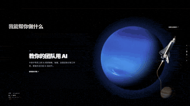</a> 
<b><a href="https://zondark.com">Viaje de ida a un agujero negro</a></b> 
<a href="https://x.com/ZondarkAI">@ZondarkAI</a> · ♥ 8 · <a href="https://x.com/ZondarkAI/status/2120106341423571097">▶ Video</a> 
Un sitio personal reconstruido como un recorrido con scroll desde la Tierra hasta un agujero negro. 
<a href="https://fablelist.000ooo.ooo/es/prompts/?w=one-way-trip-to-a-black-hole&ref=gh"><b>✨ Consigue el prompt</b></a>
</td>
<td width="33%" valign="top">
 
<b><a href="https://madebysourasith-sudo.github.io/red-wing-jet/">Jet privado Red Wing</a></b> 
<a href="https://x.com/titepommee">@titepommee</a> · ♥ 8 · <a href="https://x.com/titepommee/status/2121259736217911357">▶ Video</a> 
Camina alrededor del jet, haz clic en la puerta, baja la escalera y entra: salón, dormitorio, hasta el baño.
</td>
</tr>
<tr>
<td width="33%" valign="top">
<a href="https://davinci-mechanics.vercel.app/">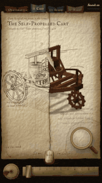</a> 
<b><a href="https://davinci-mechanics.vercel.app/">El códice vivo de Da Vinci</a></b> 
<a href="https://x.com/CoderRw11326">@CoderRw11326</a> · ♥ 6 · <a href="https://x.com/CoderRw11326/status/2121286814103421012">▶ Video</a> 
Abre el cuaderno y una pluma dibuja las máquinas de Leonardo, que se convierten en mecanismos de madera que puedes girar y desmontar. Sin modelos 3D, texturas ni archivos de audio: todo es código. 
<a href="https://github.com/coding-nanami/davinci-mechanics">Código fuente</a>
</td>
<td width="33%" valign="top">
<a href="https://claude.ai/artifact/FETrKoitcqxPQjbQvZd79C">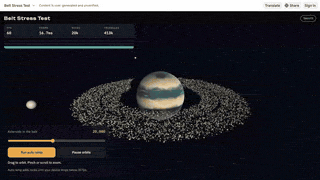</a> 
<b><a href="https://claude.ai/artifact/FETrKoitcqxPQjbQvZd79C">Belt Stress Test</a></b> 
<a href="https://x.com/fadihares95">@fadihares95</a> · ♥ 4 · <a href="https://x.com/fadihares95/status/2119885634814857500">Publicación</a> 
~20,000 asteroides en órbita; sigue añadiendo rocas hasta que tu dispositivo baja de 30 fps. 
<a href="https://fablelist.000ooo.ooo/es/prompts/?w=belt-stress-test&ref=gh"><b>✨ Consigue el prompt</b></a>
</td>
<td width="33%" valign="top">
<a href="https://claude.ai/artifact/BCDCNHRTq3y9W4Px3xc4DN">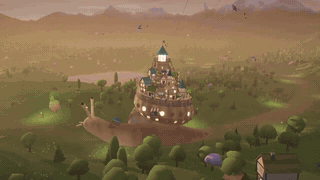</a> 
<b><a href="https://claude.ai/artifact/BCDCNHRTq3y9W4Px3xc4DN">Una aldea sobre un caracol gigante</a></b> 
<a href="https://x.com/L34342Lin">@L34342Lin</a> · ♥ 0 · <a href="https://x.com/L34342Lin/status/2120030246108066195">▶ Video</a> 
"Dale vida a un castillo 3D en un archivo HTML." WebGL2 escrito a mano, sin librerías, ~5,500 árboles, ciclo de día y noche. 
<a href="https://x.com/L34342Lin/status/2120030246108066195">📝 Prompt del creador (gratis)</a>
</td>
</tr>
<tr>
<td width="33%" valign="top">
 
<b><a href="https://claude.ai/artifact/UqU4w7jSr6pzF2McsbyQjJ">Transformación de una pagoda de madera</a></b> 
<a href="https://x.com/acupofai">@acupofai</a> · ♥ 0 · <a href="https://x.com/acupofai/status/2120119243043995748">▶ Video</a> 
3,357 piezas arman una pagoda de cinco pisos que se convierte en una espadachina. Música calculada en código. 
<a href="https://fablelist.000ooo.ooo/es/prompts/?w=wooden-pagoda-transformation&ref=gh"><b>✨ Consigue el prompt</b></a>
</td>
<td width="33%" valign="top">
<a href="https://cyrilremacle-byte.github.io/francis-turbine-explorer/">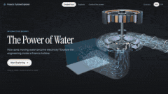</a> 
<b><a href="https://cyrilremacle-byte.github.io/francis-turbine-explorer/">Francis Turbine Explorer</a></b> 
<a href="https://x.com/cyril_remacle">@cyril_remacle</a> · ♥ 0 · <a href="https://x.com/cyril_remacle/status/2122048423528485116">Publicación</a> 
Una turbina Francis en 3D interactiva que puedes abrir, desmontar y poner en marcha tú mismo, con visita guiada, vista despiezada y calculadora de potencia hidráulica en vivo. En inglés y francés.
</td>
</tr>
</table>

Otras secciones: [🎮 Juegos](games.es.md) · [🧰 Páginas web y herramientas](web-and-tools.es.md) · [🎬 Animación y cine](animation.es.md) · [📺 Demos en video](video-demos.es.md)

[← Volver a la lista](../README.es.md)
