# 🌍 Mondes et scènes 3D · les 43

[← Retour à la liste](../README.fr.md) · [English](3d-worlds.md) · [简体中文](3d-worlds.zh-CN.md) · [繁體中文](3d-worlds.zh-TW.md) · [日本語](3d-worlds.ja.md) · [한국어](3d-worlds.ko.md) · [Español](3d-worlds.es.md) · [Português](3d-worlds.pt-BR.md) · **Français** · [Deutsch](3d-worlds.de.md) · [Русский](3d-worlds.ru.md)

La page principale affiche au plus les 24 entrées les plus aimées de chaque section (seulement celles à 100+ j'aime) ; cette page contient toutes celles de la section, triées par j'aime.

<table>
<tr>
<td width="33%" valign="top">
<a href="https://claude.ai/artifact/QGWUAjRrzRzZWGcQzSMLfa">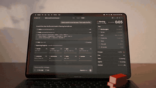</a> 
<b><a href="https://claude.ai/artifact/QGWUAjRrzRzZWGcQzSMLfa">Claude App sur un laptop Blender</a></b> 
<a href="https://x.com/rileybrown">@rileybrown</a> · ♥ 7.1k · <a href="https://x.com/rileybrown/status/2119902109709537708">▶ Vidéo</a> 
Un seul prompt a construit toute la pièce dans Blender et l'a rendue en 4K. Voici la page web affichée sur l'écran du laptop. 
<a href="https://x.com/rileybrown/status/2119902109709537708">📝 Prompt du créateur (gratuit)</a>
</td>
<td width="33%" valign="top">
 
<b><a href="https://xikhar.github.io/papertrails/">Papertrails : un monde de papier pop-up sans fin</a></b> 
🆕 · <a href="https://x.com/xikhar">@xikhar</a> · ♥ 2.2k · <a href="https://x.com/xikhar/status/2122682962647122403">▶ Vidéo</a> 
Un personnage en papier avance pendant que les arbres, les maisons et les collines se dressent du sol comme dans un livre pop-up, à travers désert, neige, forêt, jour et nuit. Réalisé avec Fable 5.2, Opus 5.5 et three.js. 
<a href="https://github.com/xikhar/papertrails">Code source</a>
</td>
<td width="33%" valign="top">
 
<b><a href="https://patch.gg/blendi/painted-valley">Painted Valley</a></b> 
<a href="https://x.com/BlendiByl">@BlendiByl</a> · ♥ 1.8k · <a href="https://x.com/BlendiByl/status/2120694003230560585">▶ Vidéo</a> 
Une vallée peinte à la main inspirée de Ghibli, où l'on peut se promener. Open source. 
<a href="https://fablelist.000ooo.ooo/fr/prompts/?w=painted-valley&ref=gh"><b>✨ Obtenir le prompt</b></a>
</td>
</tr>
<tr>
<td width="33%" valign="top">
 
<b><a href="https://claude.ai/artifact/CTjrZXVdUgKJ6qJXrvvr28">Ancient Babylon, 600 BC</a></b> 
<a href="https://x.com/literallydenis">@literallydenis</a> · ♥ 1.2k · <a href="https://x.com/literallydenis/status/2120866958790848953">▶ Vidéo</a> 
Babylone reconstruite à partir de documents historiques et de plans qu'il a trouvés lui-même, en 8 heures d'exécution. Promenez-vous librement. 
<a href="https://fablelist.000ooo.ooo/fr/prompts/?w=ancient-babylon-600-bc&ref=gh"><b>✨ Obtenir le prompt</b></a>
</td>
<td width="33%" valign="top">
 
<b><a href="https://indiranagar-live.vercel.app">1 km² d'Indiranagar</a></b> 
<a href="https://x.com/anshu4321">@anshu4321</a> · ♥ 1.2k · <a href="https://x.com/anshu4321/status/2119938067758772403">▶ Vidéo</a> 
Une tranche 3D vivante de Bangalore à partir de données cartographiques et d'un prompt. 
<a href="https://fablelist.000ooo.ooo/fr/prompts/?w=1-km2-of-indiranagar&ref=gh"><b>✨ Obtenir le prompt</b></a>
</td>
<td width="33%" valign="top">
 
<b><a href="https://fable-rome.surge.sh/">Rome, AD 320</a></b> 
<a href="https://x.com/petergostev">@petergostev</a> · ♥ 969 · <a href="https://x.com/petergostev/status/2120167560700383572">▶ Vidéo</a> 
Un prompt, Fable 5.2 (Max) tournant toute la nuit, 2 618 $. 
<a href="https://x.com/petergostev/status/2120167560700383572">📝 Prompt du créateur (gratuit)</a>
</td>
</tr>
<tr>
<td width="33%" valign="top">
 
<b><a href="https://github.com/Leonxlnx/room-at-dawn">Room at Dawn</a></b> 
<a href="https://x.com/LexnLin">@LexnLin</a> · ♥ 854 · <a href="https://x.com/LexnLin/status/2120910879361548565">▶ Vidéo</a> 
Une chambre photoréaliste en three.js sans modèles ni textures préfabriqués ; tout est du code. 
<a href="https://fablelist.000ooo.ooo/fr/prompts/?w=room-at-dawn&ref=gh"><b>✨ Obtenir le prompt</b></a>
</td>
<td width="33%" valign="top">
 
<b><a href="https://fable-rover.vercel.app">ER-6 Terrain Explorer — un rover martien autonome</a></b> 
<a href="https://x.com/DilumSanjaya">@DilumSanjaya</a> · ♥ 795 · <a href="https://x.com/DilumSanjaya/status/2120561077385867663">▶ Vidéo</a> 
Fable 5.2 a conçu une suspension rocker-bogie comme celle des rovers martiens de la NASA, puis l'a simulée sur un terrain extraterrestre.
</td>
<td width="33%" valign="top">
 
<b><a href="https://ship-42-catch.netlify.app/">Ship 42 Catch</a></b> 
<a href="https://x.com/emollick">@emollick</a> · ♥ 738 · <a href="https://x.com/emollick/status/2122036763468214711">▶ Vidéo</a> 
Fable et Opus ont retrouvé la vidéo de la capture de Starship par la tour et recréé les 40 dernières secondes en 3D détaillée avec three.js. On peut changer de caméra.
</td>
</tr>
<tr>
<td width="33%" valign="top">
 
<b><a href="https://supernatural-ft.vercel.app/fire-in-ice">Fire in Ice</a></b> 
<a href="https://x.com/tkm_hmng8">@tkm_hmng8</a> · ♥ 549 · <a href="https://x.com/tkm_hmng8/status/2120813043101946324">▶ Vidéo</a> 
Un feu réaliste brûlant à l'intérieur de la glace, écrit en WebGPU brut sans three.js. 
<a href="https://fablelist.000ooo.ooo/fr/prompts/?w=fire-in-ice&ref=gh"><b>✨ Obtenir le prompt</b></a>
</td>
<td width="33%" valign="top">
 
<b><a href="https://github.com/Leonxlnx/walking-block">Walking Block : une barre d'immeuble soviétique qui marche</a></b> 
🆕 · <a href="https://x.com/LexnLin">@LexnLin</a> · ♥ 415 · <a href="https://x.com/LexnLin/status/2122359035751989341">▶ Vidéo</a> 
Un immense immeuble soviétique en panneaux, monté sur huit pattes mécaniques, traverse un champ détrempé dans la brume du crépuscule. Géométrie, textures et shaders sont du code three.js, et un film de 45 secondes est rendu à partir de la même scène.
</td>
<td width="33%" valign="top">
<a href="https://bay.theojaffee.net">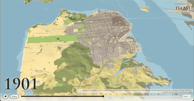</a> 
<b><a href="https://bay.theojaffee.net">Bay Area Through Time</a></b> 
<a href="https://x.com/theojaffee">@theojaffee</a> · ♥ 388 · <a href="https://x.com/theojaffee/status/2120312766544437738">▶ Vidéo</a> 
Zoomez sur n'importe quelle ville ou quartier, choisissez une année jusqu'en 1769 et voyez à quoi cela ressemblait. 
<a href="https://nyc.theojaffee.net">New York City</a> 
<a href="https://fablelist.000ooo.ooo/fr/prompts/?w=bay-area-through-time&ref=gh"><b>✨ Obtenir le prompt</b></a>
</td>
</tr>
<tr>
<td width="33%" valign="top">
 
<b><a href="http://procedural-arm-rig.vercel.app">Procedural Arm Rig</a></b> 
<a href="https://x.com/apekshik">@apekshik</a> · ♥ 326 · <a href="https://x.com/apekshik/status/2120224530367119758">▶ Vidéo</a> 
Plutôt que de réussir un jeu AAA en un essai : un seul bras avec armature d'os, maillage peint en poids, IK et muscles qui gonflent quand le poing se serre. 
<a href="https://fablelist.000ooo.ooo/fr/prompts/?w=procedural-arm-rig&ref=gh"><b>✨ Obtenir le prompt</b></a>
</td>
<td width="33%" valign="top">
 
<b><a href="https://samg-coder.github.io/solstice-garden/">The Garden</a></b> 
<a href="https://x.com/SamGCoder">@SamGCoder</a> · ♥ 297 · <a href="https://x.com/SamGCoder/status/2120943068321054975">▶ Vidéo</a> 
Une scène de jardin écrite en Rust, compilée en WASM et rendue avec WebGPU. 
<a href="https://fablelist.000ooo.ooo/fr/prompts/?w=the-garden&ref=gh"><b>✨ Obtenir le prompt</b></a>
</td>
<td width="33%" valign="top">
 
<b><a href="http://taoistvibe.com">Chill Taoist Vibe : une colline et son temple taoïste</a></b> 
<a href="https://x.com/qiqileyuan">@qiqileyuan</a> · ♥ 254 · <a href="https://x.com/qiqileyuan/status/2122006851298693277">▶ Vidéo</a> 
Un temple taoïste façon Ghibli sur une petite montagne. Suivez le vieux prêtre vers le sommet, brûlez de l'encens, tirez une baguette divinatoire, méditez, ou restez dans le fauteuil à bascule à regarder passer les saisons. Les statues et le personnage principal viennent de Tripo3D ; tout le reste est du code généré.
</td>
</tr>
<tr>
<td width="33%" valign="top">
 
<b><a href="https://butterfly.kyzo.io">Hidden Layers : un papillon de verre dans une serre</a></b> 
🆕 · <a href="https://x.com/ky__zo">@ky__zo</a> · ♥ 229 · <a href="https://x.com/ky__zo/status/2122274109795054036">▶ Vidéo</a> 
Faites défiler pour voler avec un papillon de verre qui ne peut pas sortir d'une serre, à travers six mondes. Du three.js pur, sans fichiers de modèles ni textures ; il a fallu 1.32 milliard de tokens et $905 d'API.
</td>
<td width="33%" valign="top">
 
<b><a href="https://claude.ai/artifact/R6YBDkAm2GjAC5A65D9djx">Une démo de Claude dans laquelle on peut entrer</a></b> 
<a href="https://x.com/dfeinition">@dfeinition</a> · ♥ 214 · <a href="https://x.com/dfeinition/status/2120330644261589051">▶ Vidéo</a> 
Inspiré par @rileybrown : entrez et asseyez-vous devant n'importe quel ordinateur. 
<a href="https://fablelist.000ooo.ooo/fr/prompts/?w=a-claude-demo-you-can-walk-into&ref=gh"><b>✨ Obtenir le prompt</b></a>
</td>
<td width="33%" valign="top">
 
<b><a href="https://claude.ai/artifact/2PBXuQAnWDS2NpiPXHNLfL">Orca Jelly</a></b> 
<a href="https://x.com/vib3coded">@vib3coded</a> · ♥ 204 · <a href="https://x.com/vib3coded/status/2119951060752375827">▶ Vidéo</a> 
Étude de matière d'une orque en gélatine à corps mou. La version d'Opus 5.5 est liée pour comparaison. 
<a href="https://claude.ai/artifact/75KLotWzZQ5RR23BGLePb8">Opus 5.5 version</a> 
<a href="https://x.com/vib3coded/status/2119951060752375827">📝 Prompt du créateur (gratuit)</a>
</td>
</tr>
<tr>
<td width="33%" valign="top">
 
<b><a href="https://planet.tokyoaivisuals.club/">Code Planet</a></b> 
<a href="https://x.com/KanaWorks_AI">@KanaWorks_AI</a> · ♥ 198 · <a href="https://x.com/KanaWorks_AI/status/2121413647213932688">▶ Vidéo</a> 
Une planète entière en moins de 320 Ko de code. Volez de la mer et des prairies aux cerisiers en fleurs jusque dans l'espace, directement dans le navigateur.
</td>
<td width="33%" valign="top">
 
<b><a href="https://claude.ai/artifact/9EgZpErM17kH2a9Q3WXW6f">Voxel World in a Bottle</a></b> 
<a href="https://x.com/vib3coded">@vib3coded</a> · ♥ 164 · <a href="https://x.com/vib3coded/status/2120104517282775514">▶ Vidéo</a> 
30 minutes, 12,81 $. 
<a href="https://x.com/vib3coded/status/2120104517282775514">📝 Prompt du créateur (gratuit)</a>
</td>
<td width="33%" valign="top">
 
<b><a href="https://github.com/Leonxlnx/beautiful-wonderland">Beautiful Wonderland</a></b> 
<a href="https://x.com/LexnLin">@LexnLin</a> · ♥ 145 · <a href="https://x.com/LexnLin/status/2122056542778535977">▶ Vidéo</a> 
Un petit monde peint en three.js, avec un film 4K de 40 secondes rendu à partir de lui.
</td>
</tr>
<tr>
<td width="33%" valign="top">
 
<b><a href="https://patch.gg/blendi/impossible-spaces">Impossible Spaces</a></b> 
<a href="https://x.com/BlendiByl">@BlendiByl</a> · ♥ 138 · <a href="https://x.com/BlendiByl/status/2120314459793355262">▶ Vidéo</a> 
Une expérience psychédélique d'« espaces impossibles ». Open source. 
<a href="https://fablelist.000ooo.ooo/fr/prompts/?w=impossible-spaces&ref=gh"><b>✨ Obtenir le prompt</b></a>
</td>
<td width="33%" valign="top">
 
<b><a href="https://claude.ai/artifact/7ge282etTXSS4edGFTFa85">3D Sailing Ship</a></b> 
<a href="https://x.com/marcthecreatorr">@marcthecreatorr</a> · ♥ 111 · <a href="https://x.com/marcthecreatorr/status/2119890973560054072">▶ Vidéo</a> 
Three.js pur, sans Blender ni assets externes. ~38 minutes, ~17 $. 
<a href="https://fablelist.000ooo.ooo/fr/prompts/?w=3d-sailing-ship&ref=gh"><b>✨ Obtenir le prompt</b></a>
</td>
<td width="33%" valign="top">
 
<b><a href="https://tests.jazii.dev/">Pirate Ship</a></b> 
<a href="https://x.com/notjazii">@notjazii</a> · ♥ 110 · <a href="https://x.com/notjazii/status/2119905661505122575">▶ Vidéo</a> 
Un seul essai, ~1,5 heure, ~35 M de tokens (~34 $). 
<a href="https://fablelist.000ooo.ooo/fr/prompts/?w=pirate-ship&ref=gh"><b>✨ Obtenir le prompt</b></a>
</td>
</tr>
<tr>
<td width="33%" valign="top">
<a href="https://airsup.ai/lab/sr-71?mach=3.2">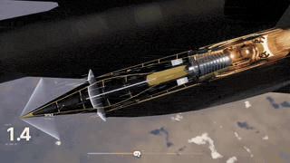</a> 
<b><a href="https://airsup.ai/lab/sr-71?mach=3.2">Démontage du moteur du SR-71</a></b> 
<a href="https://x.com/konstantinsaifo">@konstantinsaifo</a> · ♥ 76 · <a href="https://x.com/konstantinsaifo/status/2120518933103182193">▶ Vidéo</a> 
Le SR-71 à 80 000 pieds avec un moteur découpé. Un seul réglage, la vitesse : regardez l'entrée d'air prendre le relais du moteur. 
<a href="https://fablelist.000ooo.ooo/fr/prompts/?w=sr-71-engine-teardown&ref=gh"><b>✨ Obtenir le prompt</b></a>
</td>
<td width="33%" valign="top">
 
<b><a href="https://vancouver.webly.site">Vancouver From Above</a></b> 
<a href="https://x.com/tokifyi">@tokifyi</a> · ♥ 72 · <a href="https://x.com/tokifyi/status/2120020272153764172">Publication</a> 
La ville reconstruite en three.js. 
<a href="https://fablelist.000ooo.ooo/fr/prompts/?w=vancouver-from-above&ref=gh"><b>✨ Obtenir le prompt</b></a>
</td>
<td width="33%" valign="top">
<a href="https://fable-jerusalem.vercel.app/">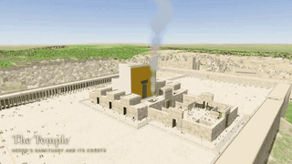</a> 
<b><a href="https://fable-jerusalem.vercel.app/">Jerusalem at Passover</a></b> 
<a href="https://x.com/kplikethebird">@kplikethebird</a> · ♥ 43 · <a href="https://x.com/kplikethebird/status/2119900775727902732">▶ Vidéo</a> 
Une Jérusalem 3D immersive et historiquement fondée, construite avec Blender. Promenez-vous dans les rues. 
<a href="https://x.com/kplikethebird/status/2119900775727902732">📝 Prompt du créateur (gratuit)</a>
</td>
</tr>
<tr>
<td width="33%" valign="top">
<a href="https://starknightt.github.io/summer-festival/">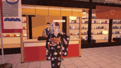</a> 
<b><a href="https://starknightt.github.io/summer-festival/">Summer Festival : une ville de bord de mer la nuit</a></b> 
<a href="https://x.com/prasenx">@prasenx</a> · ♥ 36 · <a href="https://x.com/prasenx/status/2121961933540917658">▶ Vidéo</a> 
Une ville de bord de mer façon anime, en pleine fête d'été, où l'on peut se promener. three.js sur WebGPU, réalisé avec Opus 5.5 et Fable 5.2. 
<a href="https://github.com/StarKnightt/summer-festival">Code source</a>
</td>
<td width="33%" valign="top">
<a href="https://feelthematrix.com">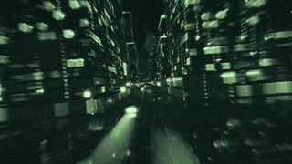</a> 
<b><a href="https://feelthematrix.com">Matrix Vibe</a></b> 
<a href="https://x.com/tornikegomareli">@tornikegomareli</a> · ♥ 30 · <a href="https://x.com/tornikegomareli/status/2120227696261120225">▶ Vidéo</a> 
Une ville dans l'ambiance de Matrix — pluie, éclairs, nuages. Survolez-la. 
<a href="https://github.com/tornikegomareli/Matrix">Code source</a> 
<a href="https://fablelist.000ooo.ooo/fr/prompts/?w=matrix-vibe&ref=gh"><b>✨ Obtenir le prompt</b></a>
</td>
<td width="33%" valign="top">
<a href="https://loktar00.github.io/pine-hollow/">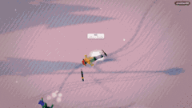</a> 
<b><a href="https://loktar00.github.io/pine-hollow/">Pine Hollow — une station de ski vivante</a></b> 
<a href="https://x.com/loktar00">@loktar00</a> · ♥ 30 · <a href="https://x.com/loktar00/status/2120432591606067359">▶ Vidéo</a> 
Une piste de ski 3D basée sur une ancienne version 2D, à qui l'on a demandé de « lui donner du caractère ». 
<a href="https://loktar00.github.io/sled-free-exact/">Sled Free</a> · <a href="https://loktar00.github.io/sled-free/">Grumble Peak</a> 
<a href="https://fablelist.000ooo.ooo/fr/prompts/?w=pine-hollow-a-living-ski-hill&ref=gh"><b>✨ Obtenir le prompt</b></a>
</td>
</tr>
<tr>
<td width="33%" valign="top">
<a href="https://vancouver-claude.webly.site">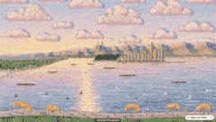</a> 
<b><a href="https://vancouver-claude.webly.site">Vancouver, heure dorée sur English Bay</a></b> 
<a href="https://x.com/tokifyi">@tokifyi</a> · ♥ 30 · <a href="https://x.com/tokifyi/status/2121644293270200354">Publication</a> 
Un panorama de Vancouver au coucher du soleil dessiné entièrement en JavaScript.
</td>
<td width="33%" valign="top">
<a href="https://claude.ai/artifact/HGk1WNqTgrGEE8ndBkEipB">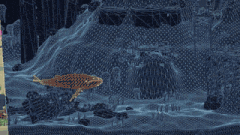</a> 
<b><a href="https://claude.ai/artifact/HGk1WNqTgrGEE8ndBkEipB">Du pixel art au monde 3D</a></b> 
<a href="https://x.com/dfeinition">@dfeinition</a> · ♥ 29 · <a href="https://x.com/dfeinition/status/2120933859999059970">▶ Vidéo</a> 
Une œuvre de pixel art transformée en monde 3D interactif, avec une baleine qui montre comment elle a été faite. 
<a href="https://fablelist.000ooo.ooo/fr/prompts/?w=pixel-art-to-3d-world&ref=gh"><b>✨ Obtenir le prompt</b></a>
</td>
<td width="33%" valign="top">
<a href="https://galaxy-dive.vercel.app">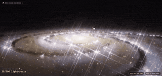</a> 
<b><a href="https://galaxy-dive.vercel.app">Galaxy Dive</a></b> 
<a href="https://x.com/handsher_NGU">@handsher_NGU</a> · ♥ 24 · <a href="https://x.com/handsher_NGU/status/2119910478025789655">▶ Vidéo</a> 
« Dieu a mis 6 jours, Fable 5.2 a mis 20 min. » Plongez dans une galaxie. 
<a href="https://fablelist.000ooo.ooo/fr/prompts/?w=galaxy-dive&ref=gh"><b>✨ Obtenir le prompt</b></a>
</td>
</tr>
<tr>
<td width="33%" valign="top">
 
<b><a href="https://calibre-watch-snowy.vercel.app/">Montre Calibre 5.2</a></b> 
<a href="https://x.com/Andrew_Blumson">@Andrew_Blumson</a> · ♥ 22 · <a href="https://x.com/Andrew_Blumson/status/2120097749177606559">▶ Vidéo</a> 
Aucune image de référence : un prompt texte, un seul essai. three.js et WebGPU. 
<a href="https://fablelist.000ooo.ooo/fr/prompts/?w=calibre-5-2-watch&ref=gh"><b>✨ Obtenir le prompt</b></a>
</td>
<td width="33%" valign="top">
 
<b><a href="https://sf-js.webly.site">San Francisco à l'heure dorée</a></b> 
<a href="https://x.com/tokifyi">@tokifyi</a> · ♥ 22 · <a href="https://x.com/tokifyi/status/2121367097972531412">▶ Vidéo</a> 
Un prompt, canvas JavaScript pur : le pont, la skyline, la brume, les reflets et un cable car, sans images ni bibliothèques.
</td>
<td width="33%" valign="top">
<a href="https://claude.ai/artifact/7nmzhxeamcunJbKVK32ptz">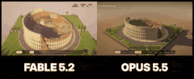</a> 
<b><a href="https://claude.ai/artifact/7nmzhxeamcunJbKVK32ptz">Voxel Colosseum</a></b> 
<a href="https://x.com/aGim_asf">@aGim_asf</a> · ♥ 20 · <a href="https://x.com/aGim_asf/status/2119918363799376270">▶ Vidéo</a> 
Promenez-vous dans l'anneau intérieur en ruines. La version en diorama d'Opus 5.5 est liée pour comparaison. 
<a href="https://claude.ai/artifact/B7ZmVS7Yr3BUc99ZyGk2bX">Opus 5.5 version</a> 
<a href="https://fablelist.000ooo.ooo/fr/prompts/?w=voxel-colosseum&ref=gh"><b>✨ Obtenir le prompt</b></a>
</td>
</tr>
<tr>
<td width="33%" valign="top">
<a href="https://glittery-stardust-885b97.netlify.app">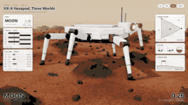</a> 
<b><a href="https://glittery-stardust-885b97.netlify.app">HX-6 Hexapod, Three Worlds</a></b> 
<a href="https://x.com/Acoramaa">@Acoramaa</a> · ♥ 11 · <a href="https://x.com/Acoramaa/status/2120839083895538093">▶ Vidéo</a> 
Le même hexapode de 14 kg sur Mars, la Lune et Europe ; chaque pied trouve son propre appui. Conduisez-le vous-même. 
<a href="https://fablelist.000ooo.ooo/fr/prompts/?w=hx-6-hexapod-three-worlds&ref=gh"><b>✨ Obtenir le prompt</b></a>
</td>
<td width="33%" valign="top">
<a href="https://zondark.com">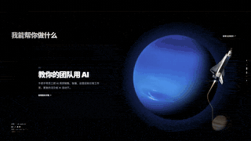</a> 
<b><a href="https://zondark.com">One-way Trip to a Black Hole</a></b> 
<a href="https://x.com/ZondarkAI">@ZondarkAI</a> · ♥ 8 · <a href="https://x.com/ZondarkAI/status/2120106341423571097">▶ Vidéo</a> 
Un site perso refait en voyage au scroll de la Terre à un trou noir. 
<a href="https://fablelist.000ooo.ooo/fr/prompts/?w=one-way-trip-to-a-black-hole&ref=gh"><b>✨ Obtenir le prompt</b></a>
</td>
<td width="33%" valign="top">
 
<b><a href="https://madebysourasith-sudo.github.io/red-wing-jet/">Jet privé Red Wing</a></b> 
<a href="https://x.com/titepommee">@titepommee</a> · ♥ 8 · <a href="https://x.com/titepommee/status/2121259736217911357">▶ Vidéo</a> 
Faites le tour du jet, cliquez sur la porte, l'escalier descend et vous montez : salon, chambre, même la salle de bain.
</td>
</tr>
<tr>
<td width="33%" valign="top">
<a href="https://davinci-mechanics.vercel.app/">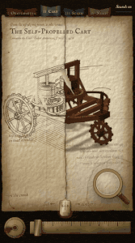</a> 
<b><a href="https://davinci-mechanics.vercel.app/">Le codex vivant de Léonard de Vinci</a></b> 
<a href="https://x.com/CoderRw11326">@CoderRw11326</a> · ♥ 6 · <a href="https://x.com/CoderRw11326/status/2121286814103421012">▶ Vidéo</a> 
Ouvrez le carnet : une plume esquisse les machines de Léonard, qui deviennent des mécanismes en bois à faire tourner et à démonter. Aucun modèle 3D, texture ni fichier audio : tout est en code. 
<a href="https://github.com/coding-nanami/davinci-mechanics">Code source</a>
</td>
<td width="33%" valign="top">
<a href="https://claude.ai/artifact/FETrKoitcqxPQjbQvZd79C">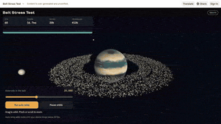</a> 
<b><a href="https://claude.ai/artifact/FETrKoitcqxPQjbQvZd79C">Belt Stress Test</a></b> 
<a href="https://x.com/fadihares95">@fadihares95</a> · ♥ 4 · <a href="https://x.com/fadihares95/status/2119885634814857500">Publication</a> 
~20 000 astéroïdes en orbite ; il ajoute des rochers jusqu'à ce que votre appareil passe sous 30 ips. 
<a href="https://fablelist.000ooo.ooo/fr/prompts/?w=belt-stress-test&ref=gh"><b>✨ Obtenir le prompt</b></a>
</td>
<td width="33%" valign="top">
<a href="https://claude.ai/artifact/BCDCNHRTq3y9W4Px3xc4DN">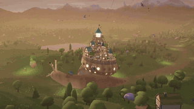</a> 
<b><a href="https://claude.ai/artifact/BCDCNHRTq3y9W4Px3xc4DN">A Hamlet on a Giant Snail</a></b> 
<a href="https://x.com/L34342Lin">@L34342Lin</a> · ♥ 0 · <a href="https://x.com/L34342Lin/status/2120030246108066195">▶ Vidéo</a> 
« Donne vie à un château 3D dans un fichier HTML. » WebGL2 écrit à la main, sans bibliothèque, ~5 500 arbres, cycle jour/nuit. 
<a href="https://x.com/L34342Lin/status/2120030246108066195">📝 Prompt du créateur (gratuit)</a>
</td>
</tr>
<tr>
<td width="33%" valign="top">
 
<b><a href="https://claude.ai/artifact/UqU4w7jSr6pzF2McsbyQjJ">Wooden Pagoda Transformation</a></b> 
<a href="https://x.com/acupofai">@acupofai</a> · ♥ 0 · <a href="https://x.com/acupofai/status/2120119243043995748">▶ Vidéo</a> 
3 357 pièces assemblent une pagode de cinq étages qui se transforme en une épéiste. Musique calculée en code. 
<a href="https://fablelist.000ooo.ooo/fr/prompts/?w=wooden-pagoda-transformation&ref=gh"><b>✨ Obtenir le prompt</b></a>
</td>
</tr>
</table>

Autres sections : [🎮 Jeux](games.fr.md) · [🧰 Pages web et outils](web-and-tools.fr.md) · [🎬 Animation et films](animation.fr.md) · [📺 Démos vidéo](video-demos.fr.md)

[← Retour à la liste](../README.fr.md)
