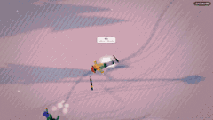
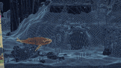
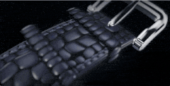
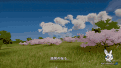
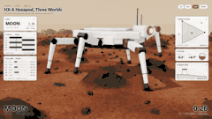

# 🌍 3D 월드와 장면 · 전체 33개

[← 메인 목록으로](../README.ko.md) · [English](3d-worlds.md) · [简体中文](3d-worlds.zh-CN.md) · [繁體中文](3d-worlds.zh-TW.md) · [日本語](3d-worlds.ja.md) · **한국어** · [Español](3d-worlds.es.md) · [Português](3d-worlds.pt-BR.md) · [Français](3d-worlds.fr.md) · [Deutsch](3d-worlds.de.md) · [Русский](3d-worlds.ru.md)

메인 페이지에는 좋아요 100개 이상만 표시됩니다. 이 페이지에는 이 섹션의 모든 항목이 좋아요 순으로 있습니다.

<table>
<tr>
<td width="33%" valign="top">
 
<b><a href="https://claude.ai/artifact/QGWUAjRrzRzZWGcQzSMLfa">Blender 노트북 속 Claude 앱</a></b> 
<a href="https://x.com/rileybrown">@rileybrown</a> · ♥ 7.0k · <a href="https://x.com/rileybrown/status/2119902109709537708">▶ 영상</a> 
프롬프트 하나로 Blender에서 방 전체를 만들고 4K로 렌더링. 노트북 화면에 보이는 웹 페이지입니다.
</td>
<td width="33%" valign="top">
 
<b><a href="https://patch.gg/blendi/painted-valley">Painted Valley</a></b> 
🆕 · <a href="https://x.com/BlendiByl">@BlendiByl</a> · ♥ 1.8k · <a href="https://x.com/BlendiByl/status/2120694003230560585">▶ 영상</a> 
지브리에서 영감을 받은, 걸어 다닐 수 있는 손으로 그린 듯한 계곡. 오픈 소스.
</td>
<td width="33%" valign="top">
 
<b><a href="https://indiranagar-live.vercel.app">인디라나가르 1 km²</a></b> 
<a href="https://x.com/anshu4321">@anshu4321</a> · ♥ 1.2k · <a href="https://x.com/anshu4321/status/2119938067758772403">▶ 영상</a> 
지도 데이터와 프롬프트 하나로 만든 벵갈루루의 실시간 3D 한 조각.
</td>
</tr>
<tr>
<td width="33%" valign="top">
 
<b><a href="https://claude.ai/artifact/CTjrZXVdUgKJ6qJXrvvr28">Ancient Babylon, 600 BC</a></b> 
🆕 · <a href="https://x.com/literallydenis">@literallydenis</a> · ♥ 1.2k · <a href="https://x.com/literallydenis/status/2120866958790848953">▶ 영상</a> 
8시간 실행 동안 직접 찾은 역사 문서와 설계도로 복원한 바빌론. 자유롭게 돌아다녀 보세요.
</td>
<td width="33%" valign="top">
 
<b><a href="https://fable-rome.surge.sh/">Rome, AD 320</a></b> 
🆕 · <a href="https://x.com/petergostev">@petergostev</a> · ♥ 968 · <a href="https://x.com/petergostev/status/2120167560700383572">▶ 영상</a> 
프롬프트 하나, Fable 5.2 (Max)가 밤새 실행, $2,618.
</td>
<td width="33%" valign="top">
 
<b><a href="https://github.com/Leonxlnx/room-at-dawn">Room at Dawn</a></b> 
🆕 · <a href="https://x.com/LexnLin">@LexnLin</a> · ♥ 838 · <a href="https://x.com/LexnLin/status/2120910879361548565">▶ 영상</a> 
미리 만든 모델이나 텍스처 없이 three.js로 만든 사실적인 침실. 모든 것이 코드.
</td>
</tr>
<tr>
<td width="33%" valign="top">
 
<b><a href="https://supernatural-ft.vercel.app/fire-in-ice">Fire in Ice</a></b> 
🆕 · <a href="https://x.com/tkm_hmng8">@tkm_hmng8</a> · ♥ 490 · <a href="https://x.com/tkm_hmng8/status/2120813043101946324">▶ 영상</a> 
three.js 없이 순수 WebGPU로 작성한, 얼음 속에서 타오르는 사실적인 불꽃.
</td>
<td width="33%" valign="top">
 
<b><a href="https://bay.theojaffee.net">Bay Area Through Time</a></b> 
🆕 · <a href="https://x.com/theojaffee">@theojaffee</a> · ♥ 383 · <a href="https://x.com/theojaffee/status/2120312766544437738">▶ 영상</a> 
원하는 도시나 동네로 확대하고, 1769년까지 거슬러 올라가 연도를 골라 당시 모습을 확인. 
<a href="https://nyc.theojaffee.net">New York City</a>
</td>
<td width="33%" valign="top">
 
<b><a href="http://procedural-arm-rig.vercel.app">Procedural Arm Rig</a></b> 
🆕 · <a href="https://x.com/apekshik">@apekshik</a> · ♥ 325 · <a href="https://x.com/apekshik/status/2120224530367119758">▶ 영상</a> 
AAA 게임을 원샷으로 만드는 대신: 본 아마추어, 웨이트 페인팅된 메시, IK, 주먹을 쥘 때 부풀어 오르는 근육을 갖춘 팔 하나.
</td>
</tr>
<tr>
<td width="33%" valign="top">
 
<b><a href="https://samg-coder.github.io/solstice-garden/">The Garden</a></b> 
🆕 · <a href="https://x.com/SamGCoder">@SamGCoder</a> · ♥ 269 · <a href="https://x.com/SamGCoder/status/2120943068321054975">▶ 영상</a> 
Rust로 작성해 WASM으로 컴파일하고 WebGPU로 렌더링한 정원 장면.
</td>
<td width="33%" valign="top">
 
<b><a href="https://claude.ai/artifact/R6YBDkAm2GjAC5A65D9djx">걸어 들어갈 수 있는 Claude 데모</a></b> 
🆕 · <a href="https://x.com/dfeinition">@dfeinition</a> · ♥ 213 · <a href="https://x.com/dfeinition/status/2120330644261589051">▶ 영상</a> 
@rileybrown에게서 영감: 걸어 들어가 어느 컴퓨터에든 앉아 보세요.
</td>
<td width="33%" valign="top">
 
<b><a href="https://claude.ai/artifact/2PBXuQAnWDS2NpiPXHNLfL">Orca Jelly</a></b> 
<a href="https://x.com/vib3coded">@vib3coded</a> · ♥ 202 · <a href="https://x.com/vib3coded/status/2119951060752375827">▶ 영상</a> 
말랑한 소프트바디 젤리 범고래 머티리얼 스터디. 비교용으로 Opus 5.5 버전 링크 포함. 
<a href="https://claude.ai/artifact/75KLotWzZQ5RR23BGLePb8">Opus 5.5 version</a>
</td>
</tr>
<tr>
<td width="33%" valign="top">
 
<b><a href="https://claude.ai/artifact/9EgZpErM17kH2a9Q3WXW6f">Voxel World in a Bottle</a></b> 
<a href="https://x.com/vib3coded">@vib3coded</a> · ♥ 160 · <a href="https://x.com/vib3coded/status/2120104517282775514">▶ 영상</a> 
30분, $12.81.
</td>
<td width="33%" valign="top">
 
<b><a href="https://patch.gg/blendi/impossible-spaces">Impossible Spaces</a></b> 
🆕 · <a href="https://x.com/BlendiByl">@BlendiByl</a> · ♥ 135 · <a href="https://x.com/BlendiByl/status/2120314459793355262">▶ 영상</a> 
환각적인 "불가능한 공간" 체험. 오픈 소스.
</td>
<td width="33%" valign="top">
 
<b><a href="https://claude.ai/artifact/7ge282etTXSS4edGFTFa85">3D Sailing Ship</a></b> 
<a href="https://x.com/marcthecreatorr">@marcthecreatorr</a> · ♥ 112 · <a href="https://x.com/marcthecreatorr/status/2119890973560054072">▶ 영상</a> 
순수 Three.js, Blender나 외부 에셋 없음. 약 38분, 약 $17.
</td>
</tr>
<tr>
<td width="33%" valign="top">
 
<b><a href="https://tests.jazii.dev/">Pirate Ship</a></b> 
<a href="https://x.com/notjazii">@notjazii</a> · ♥ 110 · <a href="https://x.com/notjazii/status/2119905661505122575">▶ 영상</a> 
원샷, 약 1.5시간, 약 3,500만 토큰(약 $34).
</td>
<td width="33%" valign="top">
 
<b><a href="https://airsup.ai/lab/sr-71?mach=3.2">SR-71 엔진 분해</a></b> 
🆕 · <a href="https://x.com/konstantinsaifo">@konstantinsaifo</a> · ♥ 76 · <a href="https://x.com/konstantinsaifo/status/2120518933103182193">▶ 영상</a> 
고도 80,000피트의 SR-71, 엔진 하나를 단면으로 절개. 노브는 속도 하나뿐: 흡입구가 엔진에서 역할을 넘겨받는 모습을 지켜보세요.
</td>
<td width="33%" valign="top">
 
<b><a href="https://vancouver.webly.site">Vancouver From Above</a></b> 
<a href="https://x.com/tokifyi">@tokifyi</a> · ♥ 72 · <a href="https://x.com/tokifyi/status/2120020272153764172">게시물</a> 
three.js로 재현한 도시.
</td>
</tr>
<tr>
<td width="33%" valign="top">
 
<b><a href="https://fable-jerusalem.vercel.app/">유월절의 예루살렘</a></b> 
🆕 · <a href="https://x.com/kplikethebird">@kplikethebird</a> · ♥ 43 · <a href="https://x.com/kplikethebird/status/2119900775727902732">▶ 영상</a> 
Blender로 만든, 고증에 충실한 몰입형 3D 예루살렘. 거리를 거닐어 보세요.
</td>
<td width="33%" valign="top">
 
<b><a href="https://feelthematrix.com">Matrix Vibe</a></b> 
🆕 · <a href="https://x.com/tornikegomareli">@tornikegomareli</a> · ♥ 30 · <a href="https://x.com/tornikegomareli/status/2120227696261120225">▶ 영상</a> 
비, 번개, 구름이 있는 매트릭스 분위기의 도시. 날아서 지나가 보세요. 
<a href="https://github.com/tornikegomareli/Matrix">소스 코드</a>
</td>
<td width="33%" valign="top">
 
<b><a href="https://loktar00.github.io/pine-hollow/">Pine Hollow — 살아 있는 스키장</a></b> 
🆕 · <a href="https://x.com/loktar00">@loktar00</a> · ♥ 30 · <a href="https://x.com/loktar00/status/2120432591606067359">▶ 영상</a> 
예전 2D 버전을 바탕으로 한 3D 스키장, "개성을 좀 더해줘"라는 요청으로 제작. 
<a href="https://loktar00.github.io/sled-free-exact/">Sled Free</a> · <a href="https://loktar00.github.io/sled-free/">Grumble Peak</a>
</td>
</tr>
<tr>
<td width="33%" valign="top">
 
<b><a href="https://claude.ai/artifact/HGk1WNqTgrGEE8ndBkEipB">픽셀 아트에서 3D 월드로</a></b> 
🆕 · <a href="https://x.com/dfeinition">@dfeinition</a> · ♥ 28 · <a href="https://x.com/dfeinition/status/2120933859999059970">▶ 영상</a> 
픽셀 아트 한 점을 인터랙티브 3D 월드로 바꾸고, 고래가 만드는 과정을 보여줍니다.
</td>
<td width="33%" valign="top">
 
<b><a href="https://galaxy-dive.vercel.app">Galaxy Dive</a></b> 
🆕 · <a href="https://x.com/handsher_NGU">@handsher_NGU</a> · ♥ 24 · <a href="https://x.com/handsher_NGU/status/2119910478025789655">▶ 영상</a> 
"신은 6일이 걸렸고, Fable 5.2는 20분이 걸렸다." 은하 속으로 날아 들어가세요.
</td>
<td width="33%" valign="top">
 
<b><a href="https://calibre-watch-snowy.vercel.app/">Calibre 5.2 시계</a></b> 
🆕 · <a href="https://x.com/Andrew_Blumson">@Andrew_Blumson</a> · ♥ 22 · <a href="https://x.com/Andrew_Blumson/status/2120097749177606559">▶ 영상</a> 
참고 이미지 없음: 텍스트 프롬프트 하나, 원샷. three.js와 WebGPU.
</td>
</tr>
<tr>
<td width="33%" valign="top">
 
<b><a href="https://claude.ai/artifact/7nmzhxeamcunJbKVK32ptz">Voxel Colosseum</a></b> 
<a href="https://x.com/aGim_asf">@aGim_asf</a> · ♥ 20 · <a href="https://x.com/aGim_asf/status/2119918363799376270">▶ 영상</a> 
폐허가 된 안쪽 링을 걸어 다녀 보세요. 비교용으로 Opus 5.5의 디오라마 버전 링크 포함. 
<a href="https://claude.ai/artifact/B7ZmVS7Yr3BUc99ZyGk2bX">Opus 5.5 version</a>
</td>
<td width="33%" valign="top">
 
<b><a href="https://sf-js.webly.site">골든 아워의 샌프란시스코</a></b> 
🆕 · <a href="https://x.com/tokifyi">@tokifyi</a> · ♥ 15 · <a href="https://x.com/tokifyi/status/2121367097972531412">▶ 영상</a> 
프롬프트 하나, 순수 JavaScript 캔버스: 다리, 스카이라인, 안개, 반사, 케이블카까지 이미지나 라이브러리 없이.
</td>
<td width="33%" valign="top">
 
<b><a href="https://planet.tokyoaivisuals.club/">Code Planet</a></b> 
🆕 · <a href="https://x.com/KanaWorks_AI">@KanaWorks_AI</a> · ♥ 12 · <a href="https://x.com/KanaWorks_AI/status/2121413647213932688">▶ 영상</a> 
320KB도 안 되는 코드로 만든 행성 하나. 바다와 초원에서 벚꽃을 지나 우주까지, 브라우저에서 바로 날아가 보세요.
</td>
</tr>
<tr>
<td width="33%" valign="top">
 
<b><a href="https://glittery-stardust-885b97.netlify.app">HX-6 Hexapod, Three Worlds</a></b> 
🆕 · <a href="https://x.com/Acoramaa">@Acoramaa</a> · ♥ 11 · <a href="https://x.com/Acoramaa/status/2120839083895538093">▶ 영상</a> 
같은 14 kg 헥사포드를 화성, 달, 유로파에서: 발마다 스스로 지면을 찾습니다. 직접 운전해 보세요.
</td>
<td width="33%" valign="top">
 
<b><a href="https://madebysourasith-sudo.github.io/red-wing-jet/">Red Wing 전용기</a></b> 
🆕 · <a href="https://x.com/titepommee">@titepommee</a> · ♥ 8 · <a href="https://x.com/titepommee/status/2121259736217911357">▶ 영상</a> 
전용기를 걸어 다니다 문을 클릭하면 계단이 내려오고 안으로 들어갑니다: 라운지, 침실, 욕실까지.
</td>
<td width="33%" valign="top">
 
<b><a href="https://zondark.com">블랙홀로 가는 편도 여행</a></b> 
<a href="https://x.com/ZondarkAI">@ZondarkAI</a> · ♥ 6 · <a href="https://x.com/ZondarkAI/status/2120106341423571097">▶ 영상</a> 
개인 사이트를 지구에서 블랙홀까지 스크롤로 떠나는 여정으로 다시 제작.
</td>
</tr>
<tr>
<td width="33%" valign="top">
 
<b><a href="https://claude.ai/artifact/FETrKoitcqxPQjbQvZd79C">Belt Stress Test</a></b> 
<a href="https://x.com/fadihares95">@fadihares95</a> · ♥ 4 · <a href="https://x.com/fadihares95/status/2119885634814857500">게시물</a> 
약 20,000개의 소행성이 공전하며, 기기가 30 fps 아래로 떨어질 때까지 바위를 계속 추가.
</td>
<td width="33%" valign="top">
 
<b><a href="https://claude.ai/artifact/BCDCNHRTq3y9W4Px3xc4DN">거대한 달팽이 위의 마을</a></b> 
<a href="https://x.com/L34342Lin">@L34342Lin</a> · ♥ 0 · <a href="https://x.com/L34342Lin/status/2120030246108066195">▶ 영상</a> 
"HTML 파일 하나로 3D 성에 생명을 불어넣어줘." 라이브러리 없이 손으로 쓴 WebGL2, 나무 약 5,500그루, 낮과 밤의 순환.
</td>
<td width="33%" valign="top">
 
<b><a href="https://claude.ai/artifact/UqU4w7jSr6pzF2McsbyQjJ">목조 불탑의 변신</a></b> 
<a href="https://x.com/acupofai">@acupofai</a> · ♥ 0 · <a href="https://x.com/acupofai/status/2120119243043995748">▶ 영상</a> 
부품 3,357개가 5층 탑으로 조립된 뒤 검을 든 여검사로 변신. 음악은 코드로 계산.
</td>
</tr>
</table>

다른 섹션: [🎮 게임](games.ko.md) · [🧰 웹 페이지와 도구](web-and-tools.ko.md) · [🎬 애니메이션과 영상](animation.ko.md) · [📺 영상 데모](video-demos.ko.md)

[← 메인 목록으로](../README.ko.md)
