# 🌍 3D 世界与场景 · 全部 51 个

[← 回到首页](../README.zh-CN.md) · [English](3d-worlds.md) · **简体中文** · [繁體中文](3d-worlds.zh-TW.md) · [日本語](3d-worlds.ja.md) · [한국어](3d-worlds.ko.md) · [Español](3d-worlds.es.md) · [Português](3d-worlds.pt-BR.md) · [Français](3d-worlds.fr.md) · [Deutsch](3d-worlds.de.md) · [Русский](3d-worlds.ru.md)

首页每类只放原帖点赞 ≥100 的前 24 个，这里是这一类的全部，按点赞数排序。

<table>
<tr>
<td width="33%" valign="top">
 
<b><a href="https://claude.ai/artifact/QGWUAjRrzRzZWGcQzSMLfa">Blender 房间里的「Claude App」网页</a></b> 
<a href="https://x.com/rileybrown">@rileybrown</a> · ♥ 7.1k · <a href="https://x.com/rileybrown/status/2119902109709537708">▶ 视频</a> 
一条提示词建整个房间并渲 4K；链接是笔记本屏幕上那个仿 Claude App 的网页 
<a href="https://x.com/rileybrown/status/2119902109709537708">📝 作者公开的提示词（免费）</a>
</td>
<td width="33%" valign="top">
 
<b><a href="https://xikhar.github.io/papertrails/">Papertrails 走到哪立到哪的立体书世界</a></b> 
<a href="https://x.com/xikhar">@xikhar</a> · ♥ 2.3k · <a href="https://x.com/xikhar/status/2122682962647122403">▶ 视频</a> 
小纸人往前走，树、房子、山丘像翻立体书一样从地面立起来，沙漠、雪地、森林和昼夜无限延伸；Fable 5.2 和 Opus 5.5 配 three.js 做的 
<a href="https://github.com/xikhar/papertrails">源码</a>
</td>
<td width="33%" valign="top">
 
<b><a href="https://patch.gg/blendi/painted-valley">Painted Valley 吉卜力风山谷</a></b> 
<a href="https://x.com/BlendiByl">@BlendiByl</a> · ♥ 1.8k · <a href="https://x.com/BlendiByl/status/2120694003230560585">▶ 视频</a> 
可以走进去的手绘风场景；开源 
<a href="https://fablelist.000ooo.ooo/zh/prompts/?w=painted-valley&ref=gh"><b>✨ 获取提示词</b></a>
</td>
</tr>
<tr>
<td width="33%" valign="top">
 
<b><a href="https://april-zhu.com/pocketcity">Pocket City 能转着看的手绘街角小城</a></b> 
<a href="https://x.com/Aprilzz423">@Aprilzz423</a> · ♥ 1.2k · <a href="https://x.com/Aprilzz423/status/2123788440714260673">▶ 视频</a> 
把任意一个街角变成能转着看的手绘小城：按 OpenStreetMap 实测，带当地的天气和四季，有阿姆斯特丹、上海、京都、新加坡等；Fable 5.2 和 GPT-6.2 Astra 一起做
</td>
<td width="33%" valign="top">
 
<b><a href="https://claude.ai/artifact/CTjrZXVdUgKJ6qJXrvvr28">Ancient Babylon 古巴比伦城</a></b> 
<a href="https://x.com/literallydenis">@literallydenis</a> · ♥ 1.2k · <a href="https://x.com/literallydenis/status/2120866958790848953">▶ 视频</a> 
公元前 600 年的巴比伦，它自己查史料和建筑图纸，跑了 8 小时，能自由逛 
<a href="https://fablelist.000ooo.ooo/zh/prompts/?w=ancient-babylon-600-bc&ref=gh"><b>✨ 获取提示词</b></a>
</td>
<td width="33%" valign="top">
 
<b><a href="https://indiranagar-live.vercel.app">印度班加罗尔 Indiranagar 1 平方公里</a></b> 
<a href="https://x.com/anshu4321">@anshu4321</a> · ♥ 1.2k · <a href="https://x.com/anshu4321/status/2119938067758772403">▶ 视频</a> 
用他们的地图数据 + 一条提示词 
<a href="https://fablelist.000ooo.ooo/zh/prompts/?w=1-km2-of-indiranagar&ref=gh"><b>✨ 获取提示词</b></a>
</td>
</tr>
<tr>
<td width="33%" valign="top">
<a href="https://fable-rome.surge.sh/">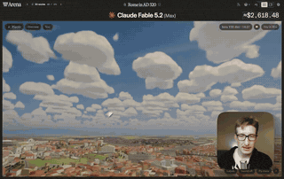</a> 
<b><a href="https://fable-rome.surge.sh/">Rome, AD 320 古罗马</a></b> 
<a href="https://x.com/petergostev">@petergostev</a> · ♥ 977 · <a href="https://x.com/petergostev/status/2120167560700383572">▶ 视频</a> 
一条提示词，Fable 5.2 Max 跑了一夜，花费 $2,618 
<a href="https://x.com/petergostev/status/2120167560700383572">📝 作者公开的提示词（免费）</a>
</td>
<td width="33%" valign="top">
 
<b><a href="https://github.com/Leonxlnx/room-at-dawn">Room at Dawn 黎明的卧室</a></b> 
<a href="https://x.com/LexnLin">@LexnLin</a> · ♥ 856 · <a href="https://x.com/LexnLin/status/2120910879361548565">▶ 视频</a> 
three.js 写的写实卧室，没用任何现成模型和贴图，全是代码生成 
<a href="https://fablelist.000ooo.ooo/zh/prompts/?w=room-at-dawn&ref=gh"><b>✨ 获取提示词</b></a>
</td>
<td width="33%" valign="top">
 
<b><a href="https://fable-rover.vercel.app">ER-6 火星车地形探索</a></b> 
<a href="https://x.com/DilumSanjaya">@DilumSanjaya</a> · ♥ 804 · <a href="https://x.com/DilumSanjaya/status/2120561077385867663">▶ 视频</a> 
让它设计 NASA 火星车那种摇臂-转向架悬挂，再模拟它在外星地形上自动行驶
</td>
</tr>
<tr>
<td width="33%" valign="top">
 
<b><a href="https://ship-42-catch.netlify.app/">Ship 42 Catch 星舰筷子夹回收</a></b> 
<a href="https://x.com/emollick">@emollick</a> · ♥ 739 · <a href="https://x.com/emollick/status/2122036763468214711">▶ 视频</a> 
让 Fable 和 Opus 找来星舰被发射塔「筷子」夹住的视频，把最后 40 秒用 three.js 高细节重现，能切换视角
</td>
<td width="33%" valign="top">
 
<b><a href="https://patch.gg/play/blendi/the-blue-hour">The Blue Hour 装饰艺术风的夜色城市</a></b> 
🆕 · <a href="https://x.com/BlendiByl">@BlendiByl</a> · ♥ 634 · <a href="https://x.com/BlendiByl/status/2124439671006748853">▶ 视频</a> 
照着《蝙蝠侠》动画版的装饰艺术风格做的 3D 场景，全部由代码画出；开源
</td>
<td width="33%" valign="top">
 
<b><a href="https://supernatural-ft.vercel.app/fire-in-ice">Fire in Ice 冰中之火</a></b> 
<a href="https://x.com/tkm_hmng8">@tkm_hmng8</a> · ♥ 549 · <a href="https://x.com/tkm_hmng8/status/2120813043101946324">▶ 视频</a> 
冰块里燃烧的火焰，不用 three.js，纯 WebGPU 写的写实效果 
<a href="https://fablelist.000ooo.ooo/zh/prompts/?w=fire-in-ice&ref=gh"><b>✨ 获取提示词</b></a>
</td>
</tr>
<tr>
<td width="33%" valign="top">
 
<b><a href="https://github.com/Leonxlnx/walking-block">Walking Block 会走路的苏联公寓楼</a></b> 
<a href="https://x.com/LexnLin">@LexnLin</a> · ♥ 417 · <a href="https://x.com/LexnLin/status/2122359035751989341">▶ 视频</a> 
长着八条机械腿的苏联板楼在暮色雾气里穿过湿地，几何、贴图、着色器全是 three.js 代码，还渲染了一段 45 秒短片
</td>
<td width="33%" valign="top">
 
<b><a href="https://bay.theojaffee.net">湾区 250 年</a></b> 
<a href="https://x.com/theojaffee">@theojaffee</a> · ♥ 388 · <a href="https://x.com/theojaffee/status/2120312766544437738">▶ 视频</a> 
缩放到任意城市或街区，选 1769 年以来的任一年看当时的样子 
<a href="https://nyc.theojaffee.net">纽约版</a> 
<a href="https://fablelist.000ooo.ooo/zh/prompts/?w=bay-area-through-time&ref=gh"><b>✨ 获取提示词</b></a>
</td>
<td width="33%" valign="top">
 
<b><a href="http://procedural-arm-rig.vercel.app">程序化手臂绑定</a></b> 
<a href="https://x.com/apekshik">@apekshik</a> · ♥ 326 · <a href="https://x.com/apekshik/status/2120224530367119758">▶ 视频</a> 
不做 3A 大作，只把一条手臂做到极致：骨架、权重、IK，握拳时肌肉会鼓起 
<a href="https://fablelist.000ooo.ooo/zh/prompts/?w=procedural-arm-rig&ref=gh"><b>✨ 获取提示词</b></a>
</td>
</tr>
<tr>
<td width="33%" valign="top">
<a href="https://samg-coder.github.io/solstice-garden/">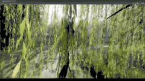</a> 
<b><a href="https://samg-coder.github.io/solstice-garden/">The Garden 夏至花园</a></b> 
<a href="https://x.com/SamGCoder">@SamGCoder</a> · ♥ 297 · <a href="https://x.com/SamGCoder/status/2120943068321054975">▶ 视频</a> 
Rust 编译成 WASM、用 WebGPU 渲染的花园 
<a href="https://fablelist.000ooo.ooo/zh/prompts/?w=the-garden&ref=gh"><b>✨ 获取提示词</b></a>
</td>
<td width="33%" valign="top">
<a href="http://taoistvibe.com">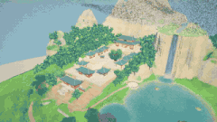</a> 
<b><a href="http://taoistvibe.com">紫曜宫 Chill Taoist Vibe 道教小山</a></b> 
<a href="https://x.com/qiqileyuan">@qiqileyuan</a> · ♥ 252 · <a href="https://x.com/qiqileyuan/status/2122006851298693277">▶ 视频</a> 
吉卜力画风的道观小山：跟着老道人上山，烧香、求签、打坐、站桩，或者坐在摇椅上看四季变化；神像和主角模型用 Tripo3D，其余全是代码生成
</td>
<td width="33%" valign="top">
 
<b><a href="https://butterfly.kyzo.io">Hidden Layers 玻璃温室里的透翅蝶</a></b> 
<a href="https://x.com/ky__zo">@ky__zo</a> · ♥ 229 · <a href="https://x.com/ky__zo/status/2122274109795054036">▶ 视频</a> 
滚动页面跟着一只飞不出玻璃温室的透翅蝶穿过六个世界，纯 three.js，没有模型文件和贴图；花了 13.2 亿 token、905 美元 API 费用
</td>
</tr>
<tr>
<td width="33%" valign="top">
 
<b><a href="https://claude.ai/artifact/R6YBDkAm2GjAC5A65D9djx">能走进去的 Claude 演示间</a></b> 
<a href="https://x.com/dfeinition">@dfeinition</a> · ♥ 215 · <a href="https://x.com/dfeinition/status/2120330644261589051">▶ 视频</a> 
受 @rileybrown 启发；走进房间，坐到任意一台电脑前 
<a href="https://fablelist.000ooo.ooo/zh/prompts/?w=a-claude-demo-you-can-walk-into&ref=gh"><b>✨ 获取提示词</b></a>
</td>
<td width="33%" valign="top">
 
<b><a href="https://claude.ai/artifact/2PBXuQAnWDS2NpiPXHNLfL">果冻虎鲸材质研究</a></b> 
<a href="https://x.com/vib3coded">@vib3coded</a> · ♥ 204 · <a href="https://x.com/vib3coded/status/2119951060752375827">▶ 视频</a> 
软体果冻虎鲸，Fable 对 Opus 
<a href="https://claude.ai/artifact/75KLotWzZQ5RR23BGLePb8">Opus 5.5 版</a> 
<a href="https://x.com/vib3coded/status/2119951060752375827">📝 作者公开的提示词（免费）</a>
</td>
<td width="33%" valign="top">
 
<b><a href="https://planet.tokyoaivisuals.club/">Code Planet 代码星球</a></b> 
<a href="https://x.com/KanaWorks_AI">@KanaWorks_AI</a> · ♥ 198 · <a href="https://x.com/KanaWorks_AI/status/2121413647213932688">▶ 视频</a> 
不到 320KB 纯代码的星球，大海、草原、樱花一直飞到太空，打开即玩
</td>
</tr>
<tr>
<td width="33%" valign="top">
 
<b><a href="https://claude.ai/artifact/9EgZpErM17kH2a9Q3WXW6f">瓶中体素世界</a></b> 
<a href="https://x.com/vib3coded">@vib3coded</a> · ♥ 163 · <a href="https://x.com/vib3coded/status/2120104517282775514">▶ 视频</a> 
30 分钟 $12.81 
<a href="https://x.com/vib3coded/status/2120104517282775514">📝 作者公开的提示词（免费）</a>
</td>
<td width="33%" valign="top">
 
<b><a href="https://github.com/Leonxlnx/beautiful-wonderland">Beautiful Wonderland 手绘小世界</a></b> 
<a href="https://x.com/LexnLin">@LexnLin</a> · ♥ 148 · <a href="https://x.com/LexnLin/status/2122056542778535977">▶ 视频</a> 
three.js 写的一个手绘质感小世界，还从里面渲染了一段 40 秒 4K 短片
</td>
<td width="33%" valign="top">
 
<b><a href="https://patch.gg/blendi/impossible-spaces">Impossible Spaces 不可能空间</a></b> 
<a href="https://x.com/BlendiByl">@BlendiByl</a> · ♥ 139 · <a href="https://x.com/BlendiByl/status/2120314459793355262">▶ 视频</a> 
迷幻的「不可能空间」体验；开源 
<a href="https://fablelist.000ooo.ooo/zh/prompts/?w=impossible-spaces&ref=gh"><b>✨ 获取提示词</b></a>
</td>
</tr>
<tr>
<td width="33%" valign="top">
<a href="https://claude.ai/artifact/HCzUsvWqERjQcgJjRuUUFo">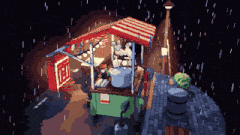</a> 
<b><a href="https://claude.ai/artifact/HCzUsvWqERjQcgJjRuUUFo">Rain-Soaked Noodle Stall 雨夜面摊的像素立体画</a></b> 
🆕 · <a href="https://x.com/CapyCola">@CapyCola</a> · ♥ 136 · <a href="https://x.com/CapyCola/status/2124115057101664380">▶ 视频</a> 
雨里的面摊、摇晃的灯笼、一锅没人看着的热汤和一只还没走的猫；能拖动旋转、从任意角度看的像素场景，用 Fable 5.2 和 Ink Studio 做的 
<a href="https://github.com/cola5939/pixel-dioramas">源码</a>
</td>
<td width="33%" valign="top">
 
<b><a href="https://claude.ai/artifact/7ge282etTXSS4edGFTFa85">3D 帆船</a></b> 
<a href="https://x.com/marcthecreatorr">@marcthecreatorr</a> · ♥ 111 · <a href="https://x.com/marcthecreatorr/status/2119890973560054072">▶ 视频</a> 
纯 Three.js，约 38 分钟 $17 
<a href="https://fablelist.000ooo.ooo/zh/prompts/?w=3d-sailing-ship&ref=gh"><b>✨ 获取提示词</b></a>
</td>
<td width="33%" valign="top">
 
<b><a href="https://tests.jazii.dev/">海盗船航行</a></b> 
<a href="https://x.com/notjazii">@notjazii</a> · ♥ 110 · <a href="https://x.com/notjazii/status/2119905661505122575">▶ 视频</a> 
一次生成，1.5 小时、约 $34 
<a href="https://fablelist.000ooo.ooo/zh/prompts/?w=pirate-ship&ref=gh"><b>✨ 获取提示词</b></a>
</td>
</tr>
<tr>
<td width="33%" valign="top">
<a href="https://coralback-ray.wasmer.app/">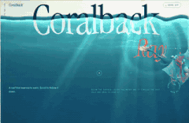</a> 
<b><a href="https://coralback-ray.wasmer.app/">Coralback Ray 珊瑚背鳐</a></b> 
<a href="https://x.com/thebuggeddev">@thebuggeddev</a> · ♥ 84 · <a href="https://x.com/thebuggeddev/status/2123021723188744248">▶ 视频</a> 
浏览器里游动的 3D 鳐鱼：只给了一个 GLB 模型，绑定、动画和整片海都由它做；没有骨骼，全在顶点着色器里驱动，游动按推力、阻力和重力算
</td>
<td width="33%" valign="top">
<a href="https://patch.gg/blendi/pixel-village">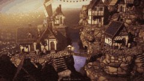</a> 
<b><a href="https://patch.gg/blendi/pixel-village">Pixel Village 海崖上的像素村庄</a></b> 
<a href="https://x.com/BlendiByl">@BlendiByl</a> · ♥ 83 · <a href="https://x.com/BlendiByl/status/2123618324823388410">▶ 视频</a> 
夕阳下海崖上的梦幻像素小村：真 3D 世界里的像素画，每个像素都由代码画出，浏览器直接跑，开源
</td>
<td width="33%" valign="top">
<a href="https://airsup.ai/lab/sr-71?mach=3.2">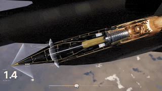</a> 
<b><a href="https://airsup.ai/lab/sr-71?mach=3.2">SR-71 发动机拆解</a></b> 
<a href="https://x.com/konstantinsaifo">@konstantinsaifo</a> · ♥ 76 · <a href="https://x.com/konstantinsaifo/status/2120518933103182193">▶ 视频</a> 
8 万英尺高空的 SR-71，剖开一台发动机；拖动速度旋钮，看进气道怎么接管推力 
<a href="https://fablelist.000ooo.ooo/zh/prompts/?w=sr-71-engine-teardown&ref=gh"><b>✨ 获取提示词</b></a>
</td>
</tr>
<tr>
<td width="33%" valign="top">
 
<b><a href="https://vancouver.webly.site">温哥华鸟瞰</a></b> 
<a href="https://x.com/tokifyi">@tokifyi</a> · ♥ 72 · <a href="https://x.com/tokifyi/status/2120020272153764172">原帖</a> 
Three.js 重建城市 
<a href="https://fablelist.000ooo.ooo/zh/prompts/?w=vancouver-from-above&ref=gh"><b>✨ 获取提示词</b></a>
</td>
<td width="33%" valign="top">
<a href="https://windblown.vercel.app">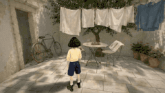</a> 
<b><a href="https://windblown.vercel.app">Windblown 带女孩穿过八个世界</a></b> 
🆕 · <a href="https://x.com/nan_in_space">@nan_in_space</a> · ♥ 64 · <a href="https://x.com/nan_in_space/status/2120212714484330999">▶ 视频</a> 
带着一个女孩走过八个世界的交互网页，用俯冲、跳跃或侧手翻穿过传送门；女孩和场景都是高斯泼溅，每个只用一张图生成
</td>
<td width="33%" valign="top">
<a href="https://fable-jerusalem.vercel.app/">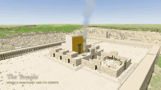</a> 
<b><a href="https://fable-jerusalem.vercel.app/">逾越节的耶路撒冷</a></b> 
<a href="https://x.com/kplikethebird">@kplikethebird</a> · ♥ 42 · <a href="https://x.com/kplikethebird/status/2119900775727902732">▶ 视频</a> 
按史料用 Blender 建的沉浸式 3D 耶路撒冷，可以在街上走 
<a href="https://x.com/kplikethebird/status/2119900775727902732">📝 作者公开的提示词（免费）</a>
</td>
</tr>
<tr>
<td width="33%" valign="top">
<a href="https://starknightt.github.io/summer-festival/">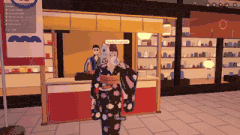</a> 
<b><a href="https://starknightt.github.io/summer-festival/">Summer Festival 海边小镇夏日祭</a></b> 
<a href="https://x.com/prasenx">@prasenx</a> · ♥ 36 · <a href="https://x.com/prasenx/status/2121961933540917658">▶ 视频</a> 
动画风的海边小镇夏日祭，可以在里面散步；three.js + WebGPU，Opus 5.5 和 Fable 5.2 一起做的 
<a href="https://github.com/StarKnightt/summer-festival">源码</a>
</td>
<td width="33%" valign="top">
 
<b><a href="https://feelthematrix.com">Matrix Vibe 黑客帝国之城</a></b> 
<a href="https://x.com/tornikegomareli">@tornikegomareli</a> · ♥ 30 · <a href="https://x.com/tornikegomareli/status/2120227696261120225">▶ 视频</a> 
雨、闪电、云层，飞进去感受氛围 
<a href="https://github.com/tornikegomareli/Matrix">源码</a> 
<a href="https://fablelist.000ooo.ooo/zh/prompts/?w=matrix-vibe&ref=gh"><b>✨ 获取提示词</b></a>
</td>
<td width="33%" valign="top">
<a href="https://loktar00.github.io/pine-hollow/">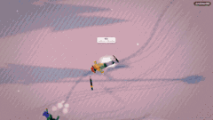</a> 
<b><a href="https://loktar00.github.io/pine-hollow/">Pine Hollow 会动的滑雪场</a></b> 
<a href="https://x.com/loktar00">@loktar00</a> · ♥ 30 · <a href="https://x.com/loktar00/status/2120432591606067359">▶ 视频</a> 
照着一个旧的 2D 版本做成 3D，并让它「加点个性」 
<a href="https://loktar00.github.io/sled-free-exact/">雪橇游戏</a> · <a href="https://loktar00.github.io/sled-free/">雪橇游戏改版</a> 
<a href="https://fablelist.000ooo.ooo/zh/prompts/?w=pine-hollow-a-living-ski-hill&ref=gh"><b>✨ 获取提示词</b></a>
</td>
</tr>
<tr>
<td width="33%" valign="top">
<a href="https://vancouver-claude.webly.site">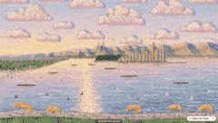</a> 
<b><a href="https://vancouver-claude.webly.site">温哥华英吉利湾黄金时刻</a></b> 
<a href="https://x.com/tokifyi">@tokifyi</a> · ♥ 30 · <a href="https://x.com/tokifyi/status/2121644293270200354">原帖</a> 
纯 JavaScript 画出的温哥华英吉利湾黄昏全景
</td>
<td width="33%" valign="top">
<a href="https://claude.ai/artifact/HGk1WNqTgrGEE8ndBkEipB">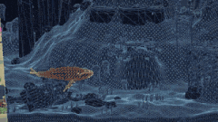</a> 
<b><a href="https://claude.ai/artifact/HGk1WNqTgrGEE8ndBkEipB">像素画变 3D 世界</a></b> 
<a href="https://x.com/dfeinition">@dfeinition</a> · ♥ 29 · <a href="https://x.com/dfeinition/status/2120933859999059970">▶ 视频</a> 
把一幅像素画做成可以走进去的 3D 世界，鲸鱼带你看它是怎么做的 
<a href="https://fablelist.000ooo.ooo/zh/prompts/?w=pixel-art-to-3d-world&ref=gh"><b>✨ 获取提示词</b></a>
</td>
<td width="33%" valign="top">
<a href="https://galaxy-dive.vercel.app">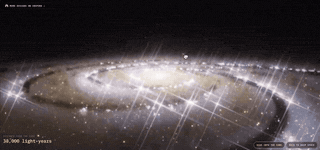</a> 
<b><a href="https://galaxy-dive.vercel.app">Galaxy Dive 飞进星系</a></b> 
<a href="https://x.com/handsher_NGU">@handsher_NGU</a> · ♥ 24 · <a href="https://x.com/handsher_NGU/status/2119910478025789655">▶ 视频</a> 
20 分钟生成 
<a href="https://fablelist.000ooo.ooo/zh/prompts/?w=galaxy-dive&ref=gh"><b>✨ 获取提示词</b></a>
</td>
</tr>
<tr>
<td width="33%" valign="top">
 
<b><a href="https://calibre-watch-snowy.vercel.app/">Calibre 5.2 机械表</a></b> 
<a href="https://x.com/Andrew_Blumson">@Andrew_Blumson</a> · ♥ 22 · <a href="https://x.com/Andrew_Blumson/status/2120097749177606559">▶ 视频</a> 
没有参考图，一条文字提示词一次生成；three.js + WebGPU 
<a href="https://fablelist.000ooo.ooo/zh/prompts/?w=calibre-5-2-watch&ref=gh"><b>✨ 获取提示词</b></a>
</td>
<td width="33%" valign="top">
 
<b><a href="https://sf-js.webly.site">旧金山黄金时刻</a></b> 
<a href="https://x.com/tokifyi">@tokifyi</a> · ♥ 22 · <a href="https://x.com/tokifyi/status/2121367097972531412">▶ 视频</a> 
一条提示词，纯 JavaScript Canvas 画出金门大桥、天际线、雾、倒影和缆车，不用图片和库
</td>
<td width="33%" valign="top">
<a href="https://claude.ai/artifact/7nmzhxeamcunJbKVK32ptz">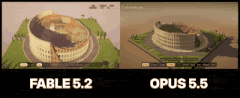</a> 
<b><a href="https://claude.ai/artifact/7nmzhxeamcunJbKVK32ptz">体素罗马斗兽场</a></b> 
<a href="https://x.com/aGim_asf">@aGim_asf</a> · ♥ 20 · <a href="https://x.com/aGim_asf/status/2119918363799376270">▶ 视频</a> 
可以走进废墟内环 
<a href="https://claude.ai/artifact/B7ZmVS7Yr3BUc99ZyGk2bX">Opus 5.5 版</a> 
<a href="https://fablelist.000ooo.ooo/zh/prompts/?w=voxel-colosseum&ref=gh"><b>✨ 获取提示词</b></a>
</td>
</tr>
<tr>
<td width="33%" valign="top">
 
<b><a href="https://claude.ai/artifact/QoBRCe2QuCU81MkNpVr4hd">Vice Corner 罪恶都市街角的像素立体画</a></b> 
🆕 · <a href="https://x.com/CapyCola">@CapyCola</a> · ♥ 16 · <a href="https://x.com/CapyCola/status/2124797996458229877">▶ 视频</a> 
GTA 6 发售这几天做的罪恶都市街角；能拖动旋转、从任意角度看的像素场景，用 Fable 5.2 和 Ink Studio 做的 
<a href="https://github.com/cola5939/pixel-dioramas">源码</a>
</td>
<td width="33%" valign="top">
<a href="https://glittery-stardust-885b97.netlify.app">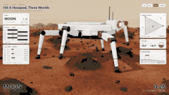</a> 
<b><a href="https://glittery-stardust-885b97.netlify.app">HX-6 六足机器人登陆三个星球</a></b> 
<a href="https://x.com/Acoramaa">@Acoramaa</a> · ♥ 11 · <a href="https://x.com/Acoramaa/status/2120839083895538093">▶ 视频</a> 
同一台 14 公斤六足机器人在火星、月球、木卫二上行走，每只脚自己找落脚点，可以自己开 
<a href="https://fablelist.000ooo.ooo/zh/prompts/?w=hx-6-hexapod-three-worlds&ref=gh"><b>✨ 获取提示词</b></a>
</td>
<td width="33%" valign="top">
<a href="https://zondark.com">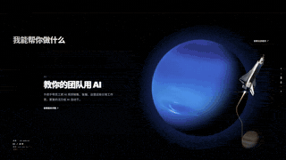</a> 
<b><a href="https://zondark.com">单程太空旅行个人站</a></b> 
<a href="https://x.com/ZondarkAI">@ZondarkAI</a> · ♥ 8 · <a href="https://x.com/ZondarkAI/status/2120106341423571097">▶ 视频</a> 
从地球滑到黑洞 
<a href="https://fablelist.000ooo.ooo/zh/prompts/?w=one-way-trip-to-a-black-hole&ref=gh"><b>✨ 获取提示词</b></a>
</td>
</tr>
<tr>
<td width="33%" valign="top">
 
<b><a href="https://madebysourasith-sudo.github.io/red-wing-jet/">Red Wing 私人飞机</a></b> 
<a href="https://x.com/titepommee">@titepommee</a> · ♥ 8 · <a href="https://x.com/titepommee/status/2121259736217911357">▶ 视频</a> 
绕着飞机走一圈，点舱门放下舷梯走进去，有休息区、卧室和洗手间
</td>
<td width="33%" valign="top">
<a href="https://davinci-mechanics.vercel.app/">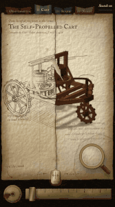</a> 
<b><a href="https://davinci-mechanics.vercel.app/">Da Vinci's Living Codex 达·芬奇活手稿</a></b> 
<a href="https://x.com/CoderRw11326">@CoderRw11326</a> · ♥ 6 · <a href="https://x.com/CoderRw11326/status/2121286814103421012">▶ 视频</a> 
翻开笔记本，羽毛笔画出达·芬奇的机械草图再变成能转动拆解的木制机械；没有模型、贴图和音频文件，全靠代码 
<a href="https://github.com/coding-nanami/davinci-mechanics">源码</a>
</td>
<td width="33%" valign="top">
<a href="https://claude.ai/artifact/FETrKoitcqxPQjbQvZd79C">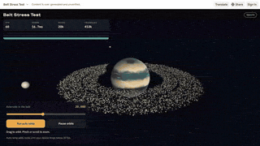</a> 
<b><a href="https://claude.ai/artifact/FETrKoitcqxPQjbQvZd79C">小行星带压力测试</a></b> 
<a href="https://x.com/fadihares95">@fadihares95</a> · ♥ 4 · <a href="https://x.com/fadihares95/status/2119885634814857500">原帖</a> 
约 2 万颗小行星环绕，不断加岩石直到设备掉到 30 帧 
<a href="https://fablelist.000ooo.ooo/zh/prompts/?w=belt-stress-test&ref=gh"><b>✨ 获取提示词</b></a>
</td>
</tr>
<tr>
<td width="33%" valign="top">
<a href="https://claude.ai/artifact/BCDCNHRTq3y9W4Px3xc4DN">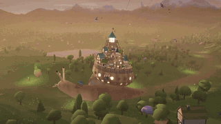</a> 
<b><a href="https://claude.ai/artifact/BCDCNHRTq3y9W4Px3xc4DN">骑巨蜗牛的村庄</a></b> 
<a href="https://x.com/L34342Lin">@L34342Lin</a> · ♥ 0 · <a href="https://x.com/L34342Lin/status/2120030246108066195">▶ 视频</a> 
手写 WebGL2，无库无素材，昼夜循环、约 5500 棵树 
<a href="https://x.com/L34342Lin/status/2120030246108066195">📝 作者公开的提示词（免费）</a>
</td>
<td width="33%" valign="top">
 
<b><a href="https://claude.ai/artifact/UqU4w7jSr6pzF2McsbyQjJ">五层木塔变身斗笠女侠</a></b> 
<a href="https://x.com/acupofai">@acupofai</a> · ♥ 0 · <a href="https://x.com/acupofai/status/2120119243043995748">▶ 视频</a> 
3357 个构件，配乐代码现算，可拖拽、点击变身 
<a href="https://fablelist.000ooo.ooo/zh/prompts/?w=wooden-pagoda-transformation&ref=gh"><b>✨ 获取提示词</b></a>
</td>
<td width="33%" valign="top">
<a href="https://cyrilremacle-byte.github.io/francis-turbine-explorer/">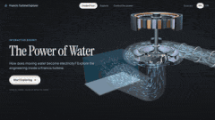</a> 
<b><a href="https://cyrilremacle-byte.github.io/francis-turbine-explorer/">Francis Turbine Explorer 混流式水轮机</a></b> 
<a href="https://x.com/cyril_remacle">@cyril_remacle</a> · ♥ 0 · <a href="https://x.com/cyril_remacle/status/2122048423528485116">原帖</a> 
可交互的 3D 混流式水轮机展台：能剖开、拆散、自己开动，带导览和实时发电量计算器，支持英文和法文
</td>
</tr>
</table>

其他分类：[🎮 游戏](games.zh-CN.md) · [🧰 网页与工具](web-and-tools.zh-CN.md) · [🎬 动画与短片（附源码）](animation.zh-CN.md) · [📺 只有视频](video-demos.zh-CN.md)

[← 回到首页](../README.zh-CN.md)
