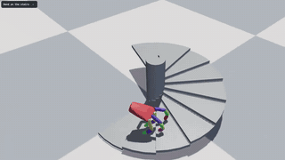

# 🎬 Animación y cine · los 19

[← Volver a la lista](../README.es.md) · [English](animation.md) · [简体中文](animation.zh-CN.md) · [繁體中文](animation.zh-TW.md) · [日本語](animation.ja.md) · [한국어](animation.ko.md) · **Español** · [Português](animation.pt-BR.md) · [Français](animation.fr.md) · [Deutsch](animation.de.md) · [Русский](animation.ru.md)

La página principal muestra como máximo las 24 entradas con más «me gusta» de cada sección (solo las de 100+); aquí están todas las de esta sección, ordenadas por «me gusta».

<table>
<tr>
<td width="33%" valign="top">
 
<b><a href="https://github.com/ChetasLua/crimson-loong">Crimson Loong</a></b> 
<a href="https://x.com/chetaslua">@chetaslua</a> · ♥ 3.8k · <a href="https://x.com/chetaslua/status/2121176151234330707">▶ Video</a> 
Una película de dragón de 90 segundos en three.js, código puro sin recursos externos. 
<a href="https://fablelist.000ooo.ooo/es/prompts/?w=crimson-loong&ref=gh"><b>✨ Consigue el prompt</b></a>
</td>
<td width="33%" valign="top">
 
<b><a href="https://github.com/BubbleBrainBB/awesome-fable-5.2/tree/main/cat-garden">Cat Garden: un jardín botánico a través de los ojos de un gato</a></b> 
<a href="https://x.com/BubbleBrain">@BubbleBrain</a> · ♥ 1.4k · <a href="https://x.com/BubbleBrain/status/2122313967473434639">▶ Video</a> 
Un corto de 110 segundos en plano secuencia de un gato que camina, olfatea y salta por un jardín botánico. La imagen sale de un path tracer escrito para ello y el sonido se sintetiza con numpy, sin ningún recurso externo.
</td>
<td width="33%" valign="top">
 
<b><a href="https://github.com/moritzkremb/robovac-pov">Robovac POV: un corto realista desde la vista de un robot aspirador</a></b> 
<a href="https://x.com/moritzkremb">@moritzkremb</a> · ♥ 463 · <a href="https://x.com/moritzkremb/status/2122702891819377117">▶ Video</a> 
Un corto de 53 segundos hecho solo con código: un mundo escrito en C++, un path tracer propio en GPU, una cámara simulada con enfoque, desenfoque de movimiento y grano, una alfombra de unas 900,000 fibras y sonido sintetizado en Python.
</td>
</tr>
<tr>
<td width="33%" valign="top">
 
<b><a href="https://github.com/amirmushichge/shred-kit">Plantilla de trituración de papel Shred Kit</a></b> 
<a href="https://x.com/AmirMushich">@AmirMushich</a> · ♥ 436 · <a href="https://x.com/AmirMushich/status/2121339167800213934">▶ Video</a> 
Un reel de 8 segundos de papel triturado hecho con Fable 5.2 y Blender, compartido como plantilla gratuita.
</td>
<td width="33%" valign="top">
 
<b><a href="https://github.com/ChetasLua/pelican-riding-a-bicycle">The Pelican, Tired of the Road</a></b> 
<a href="https://x.com/chetaslua">@chetaslua</a> · ♥ 359 · <a href="https://x.com/chetaslua/status/2120438091647218025">▶ Video</a> 
Una película de 60 segundos con aspecto de pintura a mano sobre el pelícano de la prueba SVG. Un archivo HTML; cada píxel y cada sonido es código. 
<a href="https://github.com/ChetasLua/mona-lisa-js">Mona Lisa in JS</a> 
<a href="https://fablelist.000ooo.ooo/es/prompts/?w=the-pelican-tired-of-the-road&ref=gh"><b>✨ Consigue el prompt</b></a>
</td>
<td width="33%" valign="top">
 
<b><a href="https://github.com/Leonxlnx/mechanical-moon">Mechanical Moon</a></b> 
<a href="https://x.com/LexnLin">@LexnLin</a> · ♥ 355 · <a href="https://x.com/LexnLin/status/2122823164635881853">▶ Video</a> 
Un corto procedural de Blender de 45 segundos: una luna partida con una megaestructura dorada de relojería dentro, construida solo con scripts de Python y renderizada en EEVEE.
</td>
</tr>
<tr>
<td width="33%" valign="top">
 
<b><a href="https://github.com/Leonxlnx/castle-cinematic">Castle Cinematic</a></b> 
<a href="https://x.com/LexnLin">@LexnLin</a> · ♥ 327 · <a href="https://x.com/LexnLin/status/2122112228522623459">▶ Video</a> 
Un corto de 45 segundos en 4K de un castillo gótico sobre un acantilado al atardecer. Cada fotograma sale de unas 9.000 líneas de Python en Blender, sin assets 3D ni texturas.
</td>
<td width="33%" valign="top">
 
<b><a href="https://github.com/anstapnever/one-sweep">One Sweep</a></b> 
<a href="https://x.com/anstapnever">@anstapnever</a> · ♥ 250 · <a href="https://x.com/anstapnever/status/2119772039037014524">▶ Video</a> 
Una pelea anime de 78 segundos en Three.js puro, con seis equipos de agentes en paralelo. El autor dice "Fable 5.5". 
<a href="https://x.com/anstapnever/status/2119772039037014524">📝 Prompt del creador (gratis)</a>
</td>
<td width="33%" valign="top">
 
<b><a href="https://github.com/crossps/ballpoint">Ballpoint</a></b> 
<a href="https://x.com/camperaigg">@camperaigg</a> · ♥ 243 · <a href="https://x.com/camperaigg/status/2119777467074580741">▶ Video</a> 
ASMR macro de un bolígrafo, de código abierto para demostrar que es código y no un modelo de video. 
<a href="https://fablelist.000ooo.ooo/es/prompts/?w=ballpoint&ref=gh"><b>✨ Consigue el prompt</b></a>
</td>
</tr>
<tr>
<td width="33%" valign="top">
 
<b><a href="https://github.com/ChetasLua/godzilla-nights">Godzilla Nights</a></b> 
<a href="https://x.com/chetaslua">@chetaslua</a> · ♥ 230 · <a href="https://x.com/chetaslua/status/2119981510199808368">▶ Video</a> 
Imágenes dibujadas en código puro, con animación ligera. 
<a href="https://fablelist.000ooo.ooo/es/prompts/?w=godzilla-nights&ref=gh"><b>✨ Consigue el prompt</b></a>
</td>
<td width="33%" valign="top">
 
<b><a href="https://github.com/Leonxlnx/ink-dragon">Ink Dragon: una gota de tinta se convierte en dragón</a></b> 
<a href="https://x.com/LexnLin">@LexnLin</a> · ♥ 213 · <a href="https://x.com/LexnLin/status/2122698775831671258">▶ Video</a> 
Un corto de Blender de 45 segundos en el que una gota de tinta negra cae al agua y se vuelve un dragón. La simulación de tinta, los volúmenes y el render se generan con scripts de Python.
</td>
<td width="33%" valign="top">
 
<b><a href="https://github.com/ChetasLua/the-last-good-pelican-fable-5.2">The Last Good Pelican</a></b> 
<a href="https://x.com/chetaslua">@chetaslua</a> · ♥ 144 · <a href="https://x.com/chetaslua/status/2123100140189958401">▶ Video</a> 
Un corto de 60 segundos con aspecto de dibujo a mano en un solo archivo HTML sin conexión: un día en la vida del único pelícano de benchmark que salió bien. Canvas 2D para cada dibujo, Web Audio para cada sonido.
</td>
</tr>
<tr>
<td width="33%" valign="top">
 
<b><a href="https://github.com/0xCodez/thousand-peaks">Dragon of a Thousand Peaks — el dragón de las mil cumbres</a></b> 
<a href="https://x.com/0xMovez">@0xMovez</a> · ♥ 137 · <a href="https://x.com/0xMovez/status/2121721290687983906">▶ Video</a> 
Una pelea de 90 segundos en three.js puro, sin assets ni modelos de vídeo; Fable 5.2 dirigió 8 agentes en paralelo y la música y el sonido se sintetizan con código.
</td>
<td width="33%" valign="top">
 
<b><a href="https://github.com/Leonxlnx/koi-pond-keycap">Koi Pond Keycap</a></b> 
<a href="https://x.com/LexnLin">@LexnLin</a> · ♥ 134 · <a href="https://x.com/LexnLin/status/2123174205306908806">▶ Video</a> 
Un corto de 45 segundos en Blender de una tecla de resina transparente con un estanque de kois dentro: un dedo pulsa la tecla, las ondas recorren el agua y los kois salen disparados. Python totalmente procedural, sin modelos ni texturas externos.
</td>
<td width="33%" valign="top">
 
<b><a href="https://github.com/anstapnever/blackout">Blackout</a></b> 
<a href="https://x.com/anstapnever">@anstapnever</a> · ♥ 118 · <a href="https://x.com/anstapnever/status/2119915123070644263">▶ Video</a> 
Un corto anime de 79 segundos, todo en código. 
<a href="https://x.com/anstapnever/status/2119915123070644263">📝 Prompt del creador (gratis)</a>
</td>
</tr>
<tr>
<td width="33%" valign="top">
 
<b><a href="https://github.com/skild-ai/steel-webgpu/pull/7">Mano robótica en una escalera de caracol</a></b> 
<a href="https://x.com/Luckyballa">@Luckyballa</a> · ♥ 62 · <a href="https://x.com/Luckyballa/status/2119915557663506720">▶ Video</a> 
Fable 5.2 + el motor de física Steel: una mano que camina sobre sus dedos. 
<a href="https://x.com/Luckyballa/status/2119915557663506720">📝 Prompt del creador (gratis)</a>
</td>
<td width="33%" valign="top">
 
<b><a href="https://github.com/seeconever/ryu">Ryu</a></b> 
<a href="https://x.com/seeconvm">@seeconvm</a> · ♥ 38 · <a href="https://x.com/seeconvm/status/2119777169542938662">▶ Video</a> 
Una montaña despierta como dragón. Sin modelos de imagen ni de video. El autor dice "Fable 5.5". 
<a href="https://x.com/seeconvm/status/2119777169542938662">📝 Prompt del creador (gratis)</a>
</td>
<td width="33%" valign="top">
 
<b><a href="https://github.com/Florencvv/kagami">Kagami</a></b> 
<a href="https://x.com/flxrnc">@flxrnc</a> · ♥ 35 · <a href="https://x.com/flxrnc/status/2119767052021903831">▶ Video</a> 
84 segundos de anime donde cada fotograma es código. El autor dice "Fable 5.5". 
<a href="https://x.com/flxrnc/status/2119767052021903831">📝 Prompt del creador (gratis)</a>
</td>
</tr>
<tr>
<td width="33%" valign="top">
 
<b><a href="https://usekumiko.app/">Kumiko Launch Film</a></b> 
<a href="https://x.com/sudoaptaj">@sudoaptaj</a> · ♥ 18 · <a href="https://x.com/sudoaptaj/status/2119937909373460990">▶ Video</a> 
Solo con la música y el sitio web, en un intento. Se enlaza el plugin usado. 
<a href="https://github.com/atuljha23/claude-motion-skill">Plugin</a>
</td>
</tr>
</table>

Otras secciones: [🎮 Juegos](games.es.md) · [🌍 Mundos y escenas 3D](3d-worlds.es.md) · [🧰 Páginas web y herramientas](web-and-tools.es.md) · [📺 Demos en video](video-demos.es.md)

[← Volver a la lista](../README.es.md)
