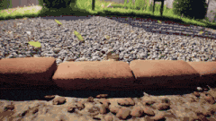
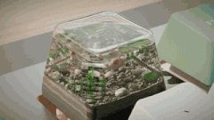
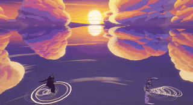

# 🎬 Animation et films · les 19

[← Retour à la liste](../README.fr.md) · [English](animation.md) · [简体中文](animation.zh-CN.md) · [繁體中文](animation.zh-TW.md) · [日本語](animation.ja.md) · [한국어](animation.ko.md) · [Español](animation.es.md) · [Português](animation.pt-BR.md) · **Français** · [Deutsch](animation.de.md) · [Русский](animation.ru.md)

La page principale affiche au plus les 24 entrées les plus aimées de chaque section (seulement celles à 100+ j'aime) ; cette page contient toutes celles de la section, triées par j'aime.

<table>
<tr>
<td width="33%" valign="top">
 
<b><a href="https://github.com/ChetasLua/crimson-loong">Crimson Loong</a></b> 
<a href="https://x.com/chetaslua">@chetaslua</a> · ♥ 3.7k · <a href="https://x.com/chetaslua/status/2121176151234330707">▶ Vidéo</a> 
Un film de dragon de 90 secondes en three.js, en pur code et sans assets externes. 
<a href="https://fablelist.000ooo.ooo/fr/prompts/?w=crimson-loong&ref=gh"><b>✨ Obtenir le prompt</b></a>
</td>
<td width="33%" valign="top">
 
<b><a href="https://github.com/BubbleBrainBB/awesome-fable-5.2/tree/main/cat-garden">Cat Garden : un jardin botanique à travers les yeux d'un chat</a></b> 
<a href="https://x.com/BubbleBrain">@BubbleBrain</a> · ♥ 1.4k · <a href="https://x.com/BubbleBrain/status/2122313967473434639">▶ Vidéo</a> 
Un film de 110 secondes en plan-séquence où un chat marche, renifle et bondit dans un jardin botanique. L'image vient d'un path tracer écrit pour l'occasion et le son est synthétisé avec numpy, sans aucun asset.
</td>
<td width="33%" valign="top">
 
<b><a href="https://github.com/moritzkremb/robovac-pov">Robovac POV : un film réaliste vu par un robot aspirateur</a></b> 
<a href="https://x.com/moritzkremb">@moritzkremb</a> · ♥ 458 · <a href="https://x.com/moritzkremb/status/2122702891819377117">▶ Vidéo</a> 
Un film de 53 secondes fait uniquement avec du code : un monde écrit en C++, un path tracer GPU maison, une caméra simulée avec mise au point, flou de mouvement et grain, un tapis d'environ 900,000 fibres et un son synthétisé en Python.
</td>
</tr>
<tr>
<td width="33%" valign="top">
 
<b><a href="https://github.com/amirmushichge/shred-kit">Shred Kit — modèle de déchiquetage de papier</a></b> 
<a href="https://x.com/AmirMushich">@AmirMushich</a> · ♥ 431 · <a href="https://x.com/AmirMushich/status/2121339167800213934">▶ Vidéo</a> 
Un reel de 8 secondes de papier déchiqueté, fait avec Fable 5.2 et Blender, partagé comme modèle gratuit.
</td>
<td width="33%" valign="top">
 
<b><a href="https://github.com/ChetasLua/pelican-riding-a-bicycle">The Pelican, Tired of the Road</a></b> 
<a href="https://x.com/chetaslua">@chetaslua</a> · ♥ 358 · <a href="https://x.com/chetaslua/status/2120438091647218025">▶ Vidéo</a> 
Un film de 60 secondes à l'aspect peint à la main sur le pélican du test SVG. Un fichier HTML ; chaque pixel et chaque son est du code. 
<a href="https://github.com/ChetasLua/mona-lisa-js">Mona Lisa in JS</a> 
<a href="https://fablelist.000ooo.ooo/fr/prompts/?w=the-pelican-tired-of-the-road&ref=gh"><b>✨ Obtenir le prompt</b></a>
</td>
<td width="33%" valign="top">
 
<b><a href="https://github.com/Leonxlnx/mechanical-moon">Mechanical Moon</a></b> 
<a href="https://x.com/LexnLin">@LexnLin</a> · ♥ 352 · <a href="https://x.com/LexnLin/status/2122823164635881853">▶ Vidéo</a> 
Un film Blender procédural de 45 secondes : une lune fendue qui renferme une mégastructure dorée d'horlogerie, construite entièrement avec des scripts Python et rendue dans EEVEE.
</td>
</tr>
<tr>
<td width="33%" valign="top">
 
<b><a href="https://github.com/Leonxlnx/castle-cinematic">Castle Cinematic</a></b> 
<a href="https://x.com/LexnLin">@LexnLin</a> · ♥ 327 · <a href="https://x.com/LexnLin/status/2122112228522623459">▶ Vidéo</a> 
Un film 4K de 45 secondes d'un château gothique au sommet d'une falaise au coucher du soleil. Chaque image vient d'environ 9 000 lignes de Python dans Blender, sans asset 3D ni texture.
</td>
<td width="33%" valign="top">
 
<b><a href="https://github.com/anstapnever/one-sweep">One Sweep</a></b> 
<a href="https://x.com/anstapnever">@anstapnever</a> · ♥ 251 · <a href="https://x.com/anstapnever/status/2119772039037014524">▶ Vidéo</a> 
Un combat d'anime de 78 secondes en Three.js pur, six équipes d'agents en parallèle. L'auteur dit « Fable 5.5 ». 
<a href="https://x.com/anstapnever/status/2119772039037014524">📝 Prompt du créateur (gratuit)</a>
</td>
<td width="33%" valign="top">
 
<b><a href="https://github.com/crossps/ballpoint">Ballpoint</a></b> 
<a href="https://x.com/camperaigg">@camperaigg</a> · ♥ 243 · <a href="https://x.com/camperaigg/status/2119777467074580741">▶ Vidéo</a> 
ASMR macro d'un stylo à bille, open source pour prouver que c'est du code et non un modèle vidéo. 
<a href="https://fablelist.000ooo.ooo/fr/prompts/?w=ballpoint&ref=gh"><b>✨ Obtenir le prompt</b></a>
</td>
</tr>
<tr>
<td width="33%" valign="top">
 
<b><a href="https://github.com/ChetasLua/godzilla-nights">Godzilla Nights</a></b> 
<a href="https://x.com/chetaslua">@chetaslua</a> · ♥ 230 · <a href="https://x.com/chetaslua/status/2119981510199808368">▶ Vidéo</a> 
Images dessinées en pur code, légèrement animées. 
<a href="https://fablelist.000ooo.ooo/fr/prompts/?w=godzilla-nights&ref=gh"><b>✨ Obtenir le prompt</b></a>
</td>
<td width="33%" valign="top">
 
<b><a href="https://github.com/Leonxlnx/ink-dragon">Ink Dragon : une goutte d'encre devient un dragon</a></b> 
<a href="https://x.com/LexnLin">@LexnLin</a> · ♥ 213 · <a href="https://x.com/LexnLin/status/2122698775831671258">▶ Vidéo</a> 
Un film Blender de 45 secondes où une goutte d'encre noire tombe dans l'eau et se change en dragon. La simulation d'encre, les volumes et le rendu sont tous générés par des scripts Python.
</td>
<td width="33%" valign="top">
 
<b><a href="https://github.com/ChetasLua/the-last-good-pelican-fable-5.2">The Last Good Pelican</a></b> 
<a href="https://x.com/chetaslua">@chetaslua</a> · ♥ 143 · <a href="https://x.com/chetaslua/status/2123100140189958401">▶ Vidéo</a> 
Un court-métrage de 60 secondes au rendu dessiné à la main, dans un seul fichier HTML hors ligne : une journée dans la vie du seul pélican de benchmark réussi. Canvas 2D pour chaque dessin, Web Audio pour chaque son.
</td>
</tr>
<tr>
<td width="33%" valign="top">
 
<b><a href="https://github.com/0xCodez/thousand-peaks">Dragon of a Thousand Peaks — le dragon aux mille sommets</a></b> 
<a href="https://x.com/0xMovez">@0xMovez</a> · ♥ 136 · <a href="https://x.com/0xMovez/status/2121721290687983906">▶ Vidéo</a> 
Un film de combat de 90 secondes en three.js pur, sans assets ni modèle vidéo ; Fable 5.2 a dirigé 8 agents en parallèle, et musique et bruitages sont synthétisés en code.
</td>
<td width="33%" valign="top">
 
<b><a href="https://github.com/Leonxlnx/koi-pond-keycap">Koi Pond Keycap</a></b> 
<a href="https://x.com/LexnLin">@LexnLin</a> · ♥ 132 · <a href="https://x.com/LexnLin/status/2123174205306908806">▶ Vidéo</a> 
Un film Blender de 45 secondes : une touche en résine transparente renferme un bassin de carpes koï ; un doigt appuie, des ondes parcourent l'eau et les koïs filent. Python entièrement procédural, sans modèles ni textures externes.
</td>
<td width="33%" valign="top">
 
<b><a href="https://github.com/anstapnever/blackout">Blackout</a></b> 
<a href="https://x.com/anstapnever">@anstapnever</a> · ♥ 119 · <a href="https://x.com/anstapnever/status/2119915123070644263">▶ Vidéo</a> 
Un court métrage d'anime de 79 secondes, tout en code. 
<a href="https://x.com/anstapnever/status/2119915123070644263">📝 Prompt du créateur (gratuit)</a>
</td>
</tr>
<tr>
<td width="33%" valign="top">
 
<b><a href="https://github.com/skild-ai/steel-webgpu/pull/7">Robot Hand on a Spiral Staircase</a></b> 
<a href="https://x.com/Luckyballa">@Luckyballa</a> · ♥ 62 · <a href="https://x.com/Luckyballa/status/2119915557663506720">▶ Vidéo</a> 
Fable 5.2 + le moteur physique Steel : une main qui marche sur ses doigts. 
<a href="https://x.com/Luckyballa/status/2119915557663506720">📝 Prompt du créateur (gratuit)</a>
</td>
<td width="33%" valign="top">
 
<b><a href="https://github.com/seeconever/ryu">Ryu</a></b> 
<a href="https://x.com/seeconvm">@seeconvm</a> · ♥ 38 · <a href="https://x.com/seeconvm/status/2119777169542938662">▶ Vidéo</a> 
Une montagne se réveille en dragon. Aucun modèle d'image ou de vidéo. L'auteur dit « Fable 5.5 ». 
<a href="https://x.com/seeconvm/status/2119777169542938662">📝 Prompt du créateur (gratuit)</a>
</td>
<td width="33%" valign="top">
 
<b><a href="https://github.com/Florencvv/kagami">Kagami</a></b> 
<a href="https://x.com/flxrnc">@flxrnc</a> · ♥ 35 · <a href="https://x.com/flxrnc/status/2119767052021903831">▶ Vidéo</a> 
84 secondes d'anime où chaque image est du code. L'auteur dit « Fable 5.5 ». 
<a href="https://x.com/flxrnc/status/2119767052021903831">📝 Prompt du créateur (gratuit)</a>
</td>
</tr>
<tr>
<td width="33%" valign="top">
 
<b><a href="https://usekumiko.app/">Kumiko Launch Film</a></b> 
<a href="https://x.com/sudoaptaj">@sudoaptaj</a> · ♥ 17 · <a href="https://x.com/sudoaptaj/status/2119937909373460990">▶ Vidéo</a> 
Avec seulement la musique et le site, en un seul essai. Le plugin utilisé est lié. 
<a href="https://github.com/atuljha23/claude-motion-skill">Plugin</a>
</td>
</tr>
</table>

Autres sections : [🎮 Jeux](games.fr.md) · [🌍 Mondes et scènes 3D](3d-worlds.fr.md) · [🧰 Pages web et outils](web-and-tools.fr.md) · [📺 Démos vidéo](video-demos.fr.md)

[← Retour à la liste](../README.fr.md)
