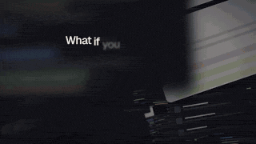

# 🎬 アニメーションと映像 · 全 17 件

[← メインリストに戻る](../README.ja.md) · [English](animation.md) · [简体中文](animation.zh-CN.md) · [繁體中文](animation.zh-TW.md) · **日本語** · [한국어](animation.ko.md) · [Español](animation.es.md) · [Português](animation.pt-BR.md) · [Français](animation.fr.md) · [Deutsch](animation.de.md) · [Русский](animation.ru.md)

トップページには各カテゴリで 100 いいね以上の上位 24 件だけを載せています。このページはこのカテゴリの全件を、いいね数順に並べたものです。

<table>
<tr>
<td width="33%" valign="top">
 
<b><a href="https://github.com/ChetasLua/crimson-loong">Crimson Loong</a></b> 
<a href="https://x.com/chetaslua">@chetaslua</a> · ♥ 3.7k · <a href="https://x.com/chetaslua/status/2121176151234330707">▶ 動画</a> 
three.js で作った 90 秒のドラゴン映像。純粋なコードで外部アセットなし。 
<a href="https://fablelist.000ooo.ooo/ja/prompts/?w=crimson-loong&ref=gh"><b>✨ プロンプトを入手</b></a>
</td>
<td width="33%" valign="top">
 
<b><a href="https://github.com/BubbleBrainBB/awesome-fable-5.2/tree/main/cat-garden">Cat Garden：猫の目で見る植物園</a></b> 
🆕 · <a href="https://x.com/BubbleBrain">@BubbleBrain</a> · ♥ 1.4k · <a href="https://x.com/BubbleBrain/status/2122313967473434639">▶ 動画</a> 
猫が植物園を歩き、匂いを嗅ぎ、飛びかかる 110 秒のワンカット映像。映像は専用に書かれたパストレーサー、音は numpy で合成、素材は一切なし。
</td>
<td width="33%" valign="top">
 
<b><a href="https://github.com/amirmushichge/shred-kit">Shred Kit ペーパーシュレッダーのテンプレート</a></b> 
<a href="https://x.com/AmirMushich">@AmirMushich</a> · ♥ 432 · <a href="https://x.com/AmirMushich/status/2121339167800213934">▶ 動画</a> 
Fable 5.2 と Blender で作った 8 秒のペーパーシュレッダーリール。無料テンプレートとして公開。
</td>
</tr>
<tr>
<td width="33%" valign="top">
 
<b><a href="https://github.com/moritzkremb/robovac-pov">Robovac POV：ロボット掃除機目線のリアルな映像</a></b> 
🆕 · <a href="https://x.com/moritzkremb">@moritzkremb</a> · ♥ 390 · <a href="https://x.com/moritzkremb/status/2122702891819377117">▶ 動画</a> 
コードだけで作った 53 秒の映像。C++ で書いた世界、自作の GPU パストレーサー、フォーカスやモーションブラー、粒状感まで再現したカメラ、約 900,000 本の繊維でできたラグ、音は Python で合成。
</td>
<td width="33%" valign="top">
 
<b><a href="https://github.com/ChetasLua/pelican-riding-a-bicycle">The Pelican, Tired of the Road</a></b> 
<a href="https://x.com/chetaslua">@chetaslua</a> · ♥ 357 · <a href="https://x.com/chetaslua/status/2120438091647218025">▶ 動画</a> 
SVG テストで有名なペリカンを描いた、手描き風の 60 秒の映像。HTML ファイル 1 つ、ピクセルも音もすべてコード。 
<a href="https://github.com/ChetasLua/mona-lisa-js">Mona Lisa in JS</a> 
<a href="https://fablelist.000ooo.ooo/ja/prompts/?w=the-pelican-tired-of-the-road&ref=gh"><b>✨ プロンプトを入手</b></a>
</td>
<td width="33%" valign="top">
 
<b><a href="https://github.com/Leonxlnx/castle-cinematic">Castle Cinematic</a></b> 
🆕 · <a href="https://x.com/LexnLin">@LexnLin</a> · ♥ 326 · <a href="https://x.com/LexnLin/status/2122112228522623459">▶ 動画</a> 
夕暮れの崖の上に建つゴシック城の 45 秒 4K 映像。全フレームが Blender 上の約 9,000 行の Python から生成され、3D 素材もテクスチャも不使用。
</td>
</tr>
<tr>
<td width="33%" valign="top">
 
<b><a href="https://github.com/Leonxlnx/mechanical-moon">Mechanical Moon</a></b> 
🆕 · <a href="https://x.com/LexnLin">@LexnLin</a> · ♥ 310 · <a href="https://x.com/LexnLin/status/2122823164635881853">▶ 動画</a> 
割れた月の内部に金色のゼンマイ仕掛けの巨大構造物がある、45 秒のプロシージャル Blender 映像。すべて Python スクリプトで作り、EEVEE でレンダリング。
</td>
<td width="33%" valign="top">
 
<b><a href="https://github.com/anstapnever/one-sweep">One Sweep</a></b> 
<a href="https://x.com/anstapnever">@anstapnever</a> · ♥ 251 · <a href="https://x.com/anstapnever/status/2119772039037014524">▶ 動画</a> 
純粋な Three.js で作った 78 秒のアニメ戦闘。6 つの Agent チームが並列で作業。作者は「Fable 5.5」と言っている。 
<a href="https://x.com/anstapnever/status/2119772039037014524">📝 作者公開のプロンプト（無料）</a>
</td>
<td width="33%" valign="top">
 
<b><a href="https://github.com/crossps/ballpoint">Ballpoint</a></b> 
<a href="https://x.com/camperaigg">@camperaigg</a> · ♥ 241 · <a href="https://x.com/camperaigg/status/2119777467074580741">▶ 動画</a> 
ボールペンのマクロ ASMR。動画モデルではなくコードだと証明するためオープンソース化。 
<a href="https://fablelist.000ooo.ooo/ja/prompts/?w=ballpoint&ref=gh"><b>✨ プロンプトを入手</b></a>
</td>
</tr>
<tr>
<td width="33%" valign="top">
 
<b><a href="https://github.com/ChetasLua/godzilla-nights">Godzilla Nights</a></b> 
<a href="https://x.com/chetaslua">@chetaslua</a> · ♥ 229 · <a href="https://x.com/chetaslua/status/2119981510199808368">▶ 動画</a> 
純粋なコードで描いた画像に、軽いアニメーションを付けたもの。 
<a href="https://fablelist.000ooo.ooo/ja/prompts/?w=godzilla-nights&ref=gh"><b>✨ プロンプトを入手</b></a>
</td>
<td width="33%" valign="top">
 
<b><a href="https://github.com/Leonxlnx/ink-dragon">Ink Dragon：一滴の墨が龍になる</a></b> 
🆕 · <a href="https://x.com/LexnLin">@LexnLin</a> · ♥ 212 · <a href="https://x.com/LexnLin/status/2122698775831671258">▶ 動画</a> 
黒い墨が一滴水に落ちて龍になる 45 秒の Blender 映像。墨のシミュレーション、ボリューム、レンダリングはすべて Python スクリプトから生成。
</td>
<td width="33%" valign="top">
 
<b><a href="https://github.com/0xCodez/thousand-peaks">Dragon of a Thousand Peaks — 千峰の龍</a></b> 
<a href="https://x.com/0xMovez">@0xMovez</a> · ♥ 133 · <a href="https://x.com/0xMovez/status/2121721290687983906">▶ 動画</a> 
素材も動画モデルも使わない、純 three.js の 90 秒バトル映像。Fable 5.2 が監督として 8 つのエージェント を並列で動かし、音楽と効果音もコードで合成。
</td>
</tr>
<tr>
<td width="33%" valign="top">
 
<b><a href="https://github.com/anstapnever/blackout">Blackout</a></b> 
<a href="https://x.com/anstapnever">@anstapnever</a> · ♥ 118 · <a href="https://x.com/anstapnever/status/2119915123070644263">▶ 動画</a> 
すべてコードで作った 79 秒のアニメ短編。 
<a href="https://x.com/anstapnever/status/2119915123070644263">📝 作者公開のプロンプト（無料）</a>
</td>
<td width="33%" valign="top">
 
<b><a href="https://github.com/skild-ai/steel-webgpu/pull/7">螺旋階段のロボットハンド</a></b> 
<a href="https://x.com/Luckyballa">@Luckyballa</a> · ♥ 62 · <a href="https://x.com/Luckyballa/status/2119915557663506720">▶ 動画</a> 
Fable 5.2 と Steel 物理エンジン：指で歩く手。 
<a href="https://x.com/Luckyballa/status/2119915557663506720">📝 作者公開のプロンプト（無料）</a>
</td>
<td width="33%" valign="top">
 
<b><a href="https://github.com/seeconever/ryu">Ryu</a></b> 
<a href="https://x.com/seeconvm">@seeconvm</a> · ♥ 38 · <a href="https://x.com/seeconvm/status/2119777169542938662">▶ 動画</a> 
山が龍として目覚める。画像・動画モデルは不使用。作者は「Fable 5.5」と言っている。 
<a href="https://x.com/seeconvm/status/2119777169542938662">📝 作者公開のプロンプト（無料）</a>
</td>
</tr>
<tr>
<td width="33%" valign="top">
 
<b><a href="https://github.com/Florencvv/kagami">Kagami</a></b> 
<a href="https://x.com/flxrnc">@flxrnc</a> · ♥ 36 · <a href="https://x.com/flxrnc/status/2119767052021903831">▶ 動画</a> 
全フレームがコードの 84 秒のアニメ。作者は「Fable 5.5」と言っている。 
<a href="https://x.com/flxrnc/status/2119767052021903831">📝 作者公開のプロンプト（無料）</a>
</td>
<td width="33%" valign="top">
 
<b><a href="https://usekumiko.app/">Kumiko ローンチフィルム</a></b> 
<a href="https://x.com/sudoaptaj">@sudoaptaj</a> · ♥ 17 · <a href="https://x.com/sudoaptaj/status/2119937909373460990">▶ 動画</a> 
音楽とウェブサイトだけを渡してワンショット。使用したプラグインのリンクも。 
<a href="https://github.com/atuljha23/claude-motion-skill">Plugin</a>
</td>
</tr>
</table>

ほかのカテゴリ：[🎮 ゲーム](games.ja.md) · [🌍 3D ワールドとシーン](3d-worlds.ja.md) · [🧰 Web ページとツール](web-and-tools.ja.md) · [📺 動画デモ](video-demos.ja.md)

[← メインリストに戻る](../README.ja.md)
