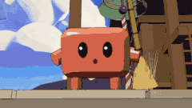

# 🎬 애니메이션과 영상 · 전체 19개

[← 메인 목록으로](../README.ko.md) · [English](animation.md) · [简体中文](animation.zh-CN.md) · [繁體中文](animation.zh-TW.md) · [日本語](animation.ja.md) · **한국어** · [Español](animation.es.md) · [Português](animation.pt-BR.md) · [Français](animation.fr.md) · [Deutsch](animation.de.md) · [Русский](animation.ru.md)

메인 페이지에는 분류마다 좋아요 100개 이상인 상위 24개만 보여 줍니다. 이 페이지에는 이 분류의 모든 항목이 좋아요 순으로 있습니다.

<table>
<tr>
<td width="33%" valign="top">
 
<b><a href="https://github.com/ChetasLua/crimson-loong">Crimson Loong</a></b> 
<a href="https://x.com/chetaslua">@chetaslua</a> · ♥ 3.7k · <a href="https://x.com/chetaslua/status/2121176151234330707">▶ 영상</a> 
three.js로 만든 90초짜리 드래곤 필름, 외부 에셋 없는 순수 코드. 
<a href="https://fablelist.000ooo.ooo/ko/prompts/?w=crimson-loong&ref=gh"><b>✨ 프롬프트 받기</b></a>
</td>
<td width="33%" valign="top">
 
<b><a href="https://github.com/BubbleBrainBB/awesome-fable-5.2/tree/main/cat-garden">Cat Garden: 고양이 눈으로 본 식물원</a></b> 
🆕 · <a href="https://x.com/BubbleBrain">@BubbleBrain</a> · ♥ 1.4k · <a href="https://x.com/BubbleBrain/status/2122313967473434639">▶ 영상</a> 
고양이가 식물원을 걷고, 냄새 맡고, 덮치는 110초 원테이크 영상. 화면은 직접 작성한 패스 트레이서로, 소리는 numpy로 합성했으며 에셋은 전혀 쓰지 않았다.
</td>
<td width="33%" valign="top">
 
<b><a href="https://github.com/moritzkremb/robovac-pov">Robovac POV: 로봇청소기 시점의 실사 같은 영상</a></b> 
🆕 · <a href="https://x.com/moritzkremb">@moritzkremb</a> · ♥ 442 · <a href="https://x.com/moritzkremb/status/2122702891819377117">▶ 영상</a> 
코드만으로 만든 53초 영상. C++로 짠 세계, 자체 GPU 패스 트레이서, 초점과 모션 블러, 그레인까지 흉내 낸 카메라, 약 900,000가닥의 섬유로 된 러그, 소리는 Python으로 합성.
</td>
</tr>
<tr>
<td width="33%" valign="top">
 
<b><a href="https://github.com/amirmushichge/shred-kit">Shred Kit 종이 파쇄 템플릿</a></b> 
<a href="https://x.com/AmirMushich">@AmirMushich</a> · ♥ 432 · <a href="https://x.com/AmirMushich/status/2121339167800213934">▶ 영상</a> 
Fable 5.2와 Blender로 만든 8초짜리 종이 파쇄 릴, 무료 템플릿으로 공유.
</td>
<td width="33%" valign="top">
 
<b><a href="https://github.com/ChetasLua/pelican-riding-a-bicycle">The Pelican, Tired of the Road</a></b> 
<a href="https://x.com/chetaslua">@chetaslua</a> · ♥ 358 · <a href="https://x.com/chetaslua/status/2120438091647218025">▶ 영상</a> 
SVG 테스트용 펠리컨을 다룬 60초짜리 손그림 느낌의 필름. HTML 파일 하나, 모든 픽셀과 소리가 코드. 
<a href="https://github.com/ChetasLua/mona-lisa-js">Mona Lisa in JS</a> 
<a href="https://fablelist.000ooo.ooo/ko/prompts/?w=the-pelican-tired-of-the-road&ref=gh"><b>✨ 프롬프트 받기</b></a>
</td>
<td width="33%" valign="top">
 
<b><a href="https://github.com/Leonxlnx/mechanical-moon">Mechanical Moon</a></b> 
🆕 · <a href="https://x.com/LexnLin">@LexnLin</a> · ♥ 352 · <a href="https://x.com/LexnLin/status/2122823164635881853">▶ 영상</a> 
갈라진 달 안에 황금빛 태엽 거대 구조물이 들어 있는 45초 프로시저럴 Blender 영상. 전부 Python 스크립트로 만들고 EEVEE로 렌더링.
</td>
</tr>
<tr>
<td width="33%" valign="top">
 
<b><a href="https://github.com/Leonxlnx/castle-cinematic">Castle Cinematic</a></b> 
<a href="https://x.com/LexnLin">@LexnLin</a> · ♥ 326 · <a href="https://x.com/LexnLin/status/2122112228522623459">▶ 영상</a> 
노을 진 절벽 위 고딕 성을 담은 45초 4K 영상. 모든 프레임이 Blender 속 약 9,000줄의 Python으로 만들어졌고 3D 에셋이나 텍스처는 쓰지 않았다.
</td>
<td width="33%" valign="top">
 
<b><a href="https://github.com/anstapnever/one-sweep">One Sweep</a></b> 
<a href="https://x.com/anstapnever">@anstapnever</a> · ♥ 251 · <a href="https://x.com/anstapnever/status/2119772039037014524">▶ 영상</a> 
순수 Three.js로 만든 78초 애니메이션 전투, 에이전트 팀 6개 병렬 작업. 작성자는 "Fable 5.5"라고 부름. 
<a href="https://x.com/anstapnever/status/2119772039037014524">📝 제작자 공개 프롬프트 (무료)</a>
</td>
<td width="33%" valign="top">
 
<b><a href="https://github.com/crossps/ballpoint">Ballpoint</a></b> 
<a href="https://x.com/camperaigg">@camperaigg</a> · ♥ 241 · <a href="https://x.com/camperaigg/status/2119777467074580741">▶ 영상</a> 
볼펜의 매크로 ASMR. 영상 모델이 아니라 코드임을 증명하려고 오픈 소스로 공개. 
<a href="https://fablelist.000ooo.ooo/ko/prompts/?w=ballpoint&ref=gh"><b>✨ 프롬프트 받기</b></a>
</td>
</tr>
<tr>
<td width="33%" valign="top">
 
<b><a href="https://github.com/ChetasLua/godzilla-nights">Godzilla Nights</a></b> 
<a href="https://x.com/chetaslua">@chetaslua</a> · ♥ 230 · <a href="https://x.com/chetaslua/status/2119981510199808368">▶ 영상</a> 
순수 코드로 그린 이미지, 가벼운 애니메이션. 
<a href="https://fablelist.000ooo.ooo/ko/prompts/?w=godzilla-nights&ref=gh"><b>✨ 프롬프트 받기</b></a>
</td>
<td width="33%" valign="top">
 
<b><a href="https://github.com/Leonxlnx/ink-dragon">Ink Dragon: 먹물 한 방울이 용이 된다</a></b> 
🆕 · <a href="https://x.com/LexnLin">@LexnLin</a> · ♥ 212 · <a href="https://x.com/LexnLin/status/2122698775831671258">▶ 영상</a> 
검은 먹물 한 방울이 물에 떨어져 용으로 변하는 45초 Blender 영상. 먹물 시뮬레이션, 볼륨, 렌더까지 모두 Python 스크립트로 생성.
</td>
<td width="33%" valign="top">
 
<b><a href="https://github.com/0xCodez/thousand-peaks">Dragon of a Thousand Peaks — 천 봉우리의 용</a></b> 
<a href="https://x.com/0xMovez">@0xMovez</a> · ♥ 135 · <a href="https://x.com/0xMovez/status/2121721290687983906">▶ 영상</a> 
에셋도 영상 모델도 없이 순수 three.js로 만든 90초 전투 영상. Fable 5.2가 감독을 맡아 8개의 에이전트를 병렬로 지휘했고, 음악과 효과음도 코드로 합성했습니다.
</td>
</tr>
<tr>
<td width="33%" valign="top">
 
<b><a href="https://github.com/ChetasLua/the-last-good-pelican-fable-5.2">The Last Good Pelican</a></b> 
🆕 · <a href="https://x.com/chetaslua">@chetaslua</a> · ♥ 134 · <a href="https://x.com/chetaslua/status/2123100140189958401">▶ 영상</a> 
오프라인 HTML 파일 하나에 담긴 60초짜리 손그림풍 단편. 벤치마크 펠리컨 중 유일하게 제대로 그려진 한 마리의 하루. 그림은 모두 Canvas 2D, 소리는 모두 Web Audio.
</td>
<td width="33%" valign="top">
 
<b><a href="https://github.com/anstapnever/blackout">Blackout</a></b> 
<a href="https://x.com/anstapnever">@anstapnever</a> · ♥ 119 · <a href="https://x.com/anstapnever/status/2119915123070644263">▶ 영상</a> 
79초 애니메이션 단편, 전부 코드. 
<a href="https://x.com/anstapnever/status/2119915123070644263">📝 제작자 공개 프롬프트 (무료)</a>
</td>
<td width="33%" valign="top">
 
<b><a href="https://github.com/Leonxlnx/koi-pond-keycap">Koi Pond Keycap</a></b> 
🆕 · <a href="https://x.com/LexnLin">@LexnLin</a> · ♥ 105 · <a href="https://x.com/LexnLin/status/2123174205306908806">▶ 영상</a> 
투명 레진 키캡 안에 잉어 연못이 담긴 45초짜리 Blender 영상. 손가락이 키를 누르면 물결이 수면을 가로지르고 잉어들이 흩어진다. 전부 Python 프로시저럴 방식이며 외부 모델이나 텍스처는 쓰지 않았다.
</td>
</tr>
<tr>
<td width="33%" valign="top">
 
<b><a href="https://github.com/skild-ai/steel-webgpu/pull/7">나선 계단 위의 로봇 손</a></b> 
<a href="https://x.com/Luckyballa">@Luckyballa</a> · ♥ 62 · <a href="https://x.com/Luckyballa/status/2119915557663506720">▶ 영상</a> 
Fable 5.2 + Steel 물리 엔진: 손가락으로 걸어 다니는 손. 
<a href="https://x.com/Luckyballa/status/2119915557663506720">📝 제작자 공개 프롬프트 (무료)</a>
</td>
<td width="33%" valign="top">
 
<b><a href="https://github.com/seeconever/ryu">Ryu</a></b> 
<a href="https://x.com/seeconvm">@seeconvm</a> · ♥ 38 · <a href="https://x.com/seeconvm/status/2119777169542938662">▶ 영상</a> 
산이 용으로 깨어납니다. 이미지·영상 모델 없음. 작성자는 "Fable 5.5"라고 부름. 
<a href="https://x.com/seeconvm/status/2119777169542938662">📝 제작자 공개 프롬프트 (무료)</a>
</td>
<td width="33%" valign="top">
 
<b><a href="https://github.com/Florencvv/kagami">Kagami</a></b> 
<a href="https://x.com/flxrnc">@flxrnc</a> · ♥ 35 · <a href="https://x.com/flxrnc/status/2119767052021903831">▶ 영상</a> 
모든 프레임이 코드인 84초 애니메이션. 작성자는 "Fable 5.5"라고 부름. 
<a href="https://x.com/flxrnc/status/2119767052021903831">📝 제작자 공개 프롬프트 (무료)</a>
</td>
</tr>
<tr>
<td width="33%" valign="top">
 
<b><a href="https://usekumiko.app/">Kumiko Launch Film</a></b> 
<a href="https://x.com/sudoaptaj">@sudoaptaj</a> · ♥ 17 · <a href="https://x.com/sudoaptaj/status/2119937909373460990">▶ 영상</a> 
음악과 웹사이트만 주고 원샷으로 제작. 사용한 플러그인 링크 포함. 
<a href="https://github.com/atuljha23/claude-motion-skill">Plugin</a>
</td>
</tr>
</table>

다른 섹션: [🎮 게임](games.ko.md) · [🌍 3D 월드와 장면](3d-worlds.ko.md) · [🧰 웹 페이지와 도구](web-and-tools.ko.md) · [📺 영상 데모](video-demos.ko.md)

[← 메인 목록으로](../README.ko.md)
