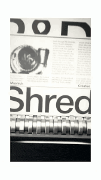
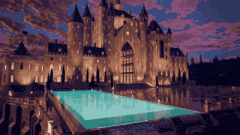

# 🎬 Animação e filmes · todos os 14

[← Voltar à lista](../README.pt-BR.md) · [English](animation.md) · [简体中文](animation.zh-CN.md) · [繁體中文](animation.zh-TW.md) · [日本語](animation.ja.md) · [한국어](animation.ko.md) · [Español](animation.es.md) · **Português** · [Français](animation.fr.md) · [Deutsch](animation.de.md) · [Русский](animation.ru.md)

A página principal mostra no máximo as 36 entradas mais curtidas de cada seção (só as com 100+ curtidas); aqui estão todas as desta seção, por curtidas.

<table>
<tr>
<td width="33%" valign="top">
 
<b><a href="https://github.com/ChetasLua/crimson-loong">Crimson Loong</a></b> 
<a href="https://x.com/chetaslua">@chetaslua</a> · ♥ 3.7k · <a href="https://x.com/chetaslua/status/2121176151234330707">▶ Vídeo</a> 
Um filme de dragão de 90 segundos em three.js, código puro e sem assets externos. 
<a href="https://fablelist.000ooo.ooo/pt/prompts/?w=crimson-loong&ref=gh"><b>✨ Pegue o prompt</b></a>
</td>
<td width="33%" valign="top">
 
<b><a href="https://github.com/BubbleBrainBB/awesome-fable-5.2/tree/main/cat-garden">Cat Garden: um jardim botânico pelos olhos de um gato</a></b> 
🆕 · <a href="https://x.com/BubbleBrain">@BubbleBrain</a> · ♥ 1.3k · <a href="https://x.com/BubbleBrain/status/2122313967473434639">▶ Vídeo</a> 
Um filme de 110 segundos em plano-sequência de um gato andando, farejando e dando botes por um jardim botânico. A imagem vem de um path tracer escrito para isso e o som é sintetizado com numpy, sem nenhum asset.
</td>
<td width="33%" valign="top">
 
<b><a href="https://github.com/amirmushichge/shred-kit">Shred Kit — template de picotar papel</a></b> 
<a href="https://x.com/AmirMushich">@AmirMushich</a> · ♥ 431 · <a href="https://x.com/AmirMushich/status/2121339167800213934">▶ Vídeo</a> 
Um reel de 8 segundos de papel sendo picotado, feito com Fable 5.2 e Blender, compartilhado como template gratuito.
</td>
</tr>
<tr>
<td width="33%" valign="top">
 
<b><a href="https://github.com/ChetasLua/pelican-riding-a-bicycle">The Pelican, Tired of the Road</a></b> 
<a href="https://x.com/chetaslua">@chetaslua</a> · ♥ 357 · <a href="https://x.com/chetaslua/status/2120438091647218025">▶ Vídeo</a> 
Um filme de 60 segundos com visual pintado à mão sobre o pelicano do teste de SVG. Um arquivo HTML; cada pixel e cada som é código. 
<a href="https://github.com/ChetasLua/mona-lisa-js">Mona Lisa in JS</a> 
<a href="https://fablelist.000ooo.ooo/pt/prompts/?w=the-pelican-tired-of-the-road&ref=gh"><b>✨ Pegue o prompt</b></a>
</td>
<td width="33%" valign="top">
 
<b><a href="https://github.com/Leonxlnx/castle-cinematic">Castle Cinematic</a></b> 
🆕 · <a href="https://x.com/LexnLin">@LexnLin</a> · ♥ 326 · <a href="https://x.com/LexnLin/status/2122112228522623459">▶ Vídeo</a> 
Um filme de 45 segundos em 4K de um castelo gótico no alto de um penhasco ao pôr do sol. Cada quadro vem de cerca de 9.000 linhas de Python no Blender, sem assets 3D nem texturas.
</td>
<td width="33%" valign="top">
 
<b><a href="https://github.com/anstapnever/one-sweep">One Sweep</a></b> 
<a href="https://x.com/anstapnever">@anstapnever</a> · ♥ 251 · <a href="https://x.com/anstapnever/status/2119772039037014524">▶ Vídeo</a> 
Uma luta de anime de 78 segundos em Three.js puro, seis equipes de agentes em paralelo. O autor diz "Fable 5.5". 
<a href="https://x.com/anstapnever/status/2119772039037014524">📝 Prompt do criador (grátis)</a>
</td>
</tr>
<tr>
<td width="33%" valign="top">
 
<b><a href="https://github.com/crossps/ballpoint">Ballpoint</a></b> 
<a href="https://x.com/camperaigg">@camperaigg</a> · ♥ 242 · <a href="https://x.com/camperaigg/status/2119777467074580741">▶ Vídeo</a> 
ASMR macro de uma caneta esferográfica, em código aberto para provar que é código e não um modelo de vídeo. 
<a href="https://fablelist.000ooo.ooo/pt/prompts/?w=ballpoint&ref=gh"><b>✨ Pegue o prompt</b></a>
</td>
<td width="33%" valign="top">
 
<b><a href="https://github.com/ChetasLua/godzilla-nights">Godzilla Nights</a></b> 
<a href="https://x.com/chetaslua">@chetaslua</a> · ♥ 229 · <a href="https://x.com/chetaslua/status/2119981510199808368">▶ Vídeo</a> 
Imagens desenhadas em código puro, levemente animadas. 
<a href="https://fablelist.000ooo.ooo/pt/prompts/?w=godzilla-nights&ref=gh"><b>✨ Pegue o prompt</b></a>
</td>
<td width="33%" valign="top">
 
<b><a href="https://github.com/0xCodez/thousand-peaks">Dragon of a Thousand Peaks — o dragão dos mil picos</a></b> 
🆕 · <a href="https://x.com/0xMovez">@0xMovez</a> · ♥ 132 · <a href="https://x.com/0xMovez/status/2121721290687983906">▶ Vídeo</a> 
Um filme de luta de 90 segundos em three.js puro, sem assets nem modelos de vídeo; o Fable 5.2 dirigiu 8 agentes em paralelo, e música e sons são sintetizados em código.
</td>
</tr>
<tr>
<td width="33%" valign="top">
 
<b><a href="https://github.com/anstapnever/blackout">Blackout</a></b> 
<a href="https://x.com/anstapnever">@anstapnever</a> · ♥ 119 · <a href="https://x.com/anstapnever/status/2119915123070644263">▶ Vídeo</a> 
Um curta de anime de 79 segundos, tudo em código. 
<a href="https://x.com/anstapnever/status/2119915123070644263">📝 Prompt do criador (grátis)</a>
</td>
<td width="33%" valign="top">
 
<b><a href="https://github.com/skild-ai/steel-webgpu/pull/7">Robot Hand on a Spiral Staircase</a></b> 
<a href="https://x.com/Luckyballa">@Luckyballa</a> · ♥ 61 · <a href="https://x.com/Luckyballa/status/2119915557663506720">▶ Vídeo</a> 
Fable 5.2 + o motor de física Steel: uma mão andando sobre os dedos. 
<a href="https://x.com/Luckyballa/status/2119915557663506720">📝 Prompt do criador (grátis)</a>
</td>
<td width="33%" valign="top">
 
<b><a href="https://github.com/seeconever/ryu">Ryu</a></b> 
<a href="https://x.com/seeconvm">@seeconvm</a> · ♥ 38 · <a href="https://x.com/seeconvm/status/2119777169542938662">▶ Vídeo</a> 
Uma montanha desperta como um dragão. Sem modelos de imagem ou vídeo. O autor diz "Fable 5.5". 
<a href="https://x.com/seeconvm/status/2119777169542938662">📝 Prompt do criador (grátis)</a>
</td>
</tr>
<tr>
<td width="33%" valign="top">
 
<b><a href="https://github.com/Florencvv/kagami">Kagami</a></b> 
<a href="https://x.com/flxrnc">@flxrnc</a> · ♥ 36 · <a href="https://x.com/flxrnc/status/2119767052021903831">▶ Vídeo</a> 
84 segundos de anime em que cada quadro é código. O autor diz "Fable 5.5". 
<a href="https://x.com/flxrnc/status/2119767052021903831">📝 Prompt do criador (grátis)</a>
</td>
<td width="33%" valign="top">
 
<b><a href="https://usekumiko.app/">Kumiko Launch Film</a></b> 
<a href="https://x.com/sudoaptaj">@sudoaptaj</a> · ♥ 17 · <a href="https://x.com/sudoaptaj/status/2119937909373460990">▶ Vídeo</a> 
Recebendo apenas a música e o site, em uma tentativa. O plugin usado está linkado. 
<a href="https://github.com/atuljha23/claude-motion-skill">Plugin</a>
</td>
</tr>
</table>

Outras seções: [🎮 Jogos](games.pt-BR.md) · [🌍 Mundos e cenas 3D](3d-worlds.pt-BR.md) · [🧰 Páginas e ferramentas](web-and-tools.pt-BR.md) · [📺 Demos em vídeo](video-demos.pt-BR.md)

[← Voltar à lista](../README.pt-BR.md)
