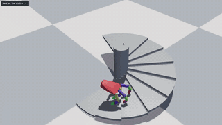
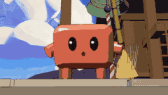
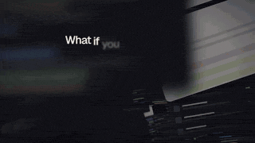

# 🎬 Анимация и фильмы · все 11

[← Назад к списку](../README.ru.md) · [English](animation.md) · [简体中文](animation.zh-CN.md) · [繁體中文](animation.zh-TW.md) · [日本語](animation.ja.md) · [한국어](animation.ko.md) · [Español](animation.es.md) · [Português](animation.pt-BR.md) · [Français](animation.fr.md) · [Deutsch](animation.de.md) · **Русский**

На главной только посты с 100+ лайками; здесь — все записи раздела, по убыванию лайков.

<table>
<tr>
<td width="33%" valign="top">
 
<b><a href="https://github.com/ChetasLua/crimson-loong">Crimson Loong</a></b> 
🆕 · <a href="https://x.com/chetaslua">@chetaslua</a> · ♥ 2.6k · <a href="https://x.com/chetaslua/status/2121176151234330707">▶ Видео</a> 
90-секундный фильм про дракона на three.js, чистый код без внешних ассетов. 
<a href="https://fablelist.000ooo.ooo/ru/prompts/?w=crimson-loong&ref=gh"><b>✨ Получить промпт</b></a>
</td>
<td width="33%" valign="top">
 
<b><a href="https://github.com/ChetasLua/pelican-riding-a-bicycle">The Pelican, Tired of the Road</a></b> 
🆕 · <a href="https://x.com/chetaslua">@chetaslua</a> · ♥ 350 · <a href="https://x.com/chetaslua/status/2120438091647218025">▶ Видео</a> 
60-секундный фильм в стиле ручной росписи про пеликана из SVG-теста. Один HTML-файл; каждый пиксель и каждый звук — код. 
<a href="https://github.com/ChetasLua/mona-lisa-js">Mona Lisa in JS</a> 
<a href="https://fablelist.000ooo.ooo/ru/prompts/?w=the-pelican-tired-of-the-road&ref=gh"><b>✨ Получить промпт</b></a>
</td>
<td width="33%" valign="top">
 
<b><a href="https://github.com/anstapnever/one-sweep">One Sweep</a></b> 
<a href="https://x.com/anstapnever">@anstapnever</a> · ♥ 250 · <a href="https://x.com/anstapnever/status/2119772039037014524">▶ Видео</a> 
78-секундная аниме-драка на чистом Three.js, шесть команд агентов параллельно. Автор говорит «Fable 5.5». 
<a href="https://x.com/anstapnever/status/2119772039037014524">📝 Промпт автора (бесплатно)</a>
</td>
</tr>
<tr>
<td width="33%" valign="top">
 
<b><a href="https://github.com/crossps/ballpoint">Ballpoint</a></b> 
<a href="https://x.com/camperaigg">@camperaigg</a> · ♥ 242 · <a href="https://x.com/camperaigg/status/2119777467074580741">▶ Видео</a> 
Макро-ASMR шариковой ручки, открытый исходный код — доказательство, что это код, а не видеомодель. 
<a href="https://fablelist.000ooo.ooo/ru/prompts/?w=ballpoint&ref=gh"><b>✨ Получить промпт</b></a>
</td>
<td width="33%" valign="top">
 
<b><a href="https://github.com/ChetasLua/godzilla-nights">Godzilla Nights</a></b> 
<a href="https://x.com/chetaslua">@chetaslua</a> · ♥ 228 · <a href="https://x.com/chetaslua/status/2119981510199808368">▶ Видео</a> 
Изображения, нарисованные чистым кодом, слегка анимированные. 
<a href="https://fablelist.000ooo.ooo/ru/prompts/?w=godzilla-nights&ref=gh"><b>✨ Получить промпт</b></a>
</td>
<td width="33%" valign="top">
 
<b><a href="https://github.com/anstapnever/blackout">Blackout</a></b> 
<a href="https://x.com/anstapnever">@anstapnever</a> · ♥ 118 · <a href="https://x.com/anstapnever/status/2119915123070644263">▶ Видео</a> 
79-секундная аниме-короткометражка, всё на коде. 
<a href="https://x.com/anstapnever/status/2119915123070644263">📝 Промпт автора (бесплатно)</a>
</td>
</tr>
<tr>
<td width="33%" valign="top">
 
<b><a href="https://github.com/amirmushichge/shred-kit">Shred Kit — шаблон бумажного шредера</a></b> 
🆕 · <a href="https://x.com/AmirMushich">@AmirMushich</a> · ♥ 117 · <a href="https://x.com/AmirMushich/status/2121339167800213934">▶ Видео</a> 
8-секундный рилс с измельчением бумаги, сделан с Fable 5.2 и Blender, опубликован как бесплатный шаблон.
</td>
<td width="33%" valign="top">
 
<b><a href="https://github.com/skild-ai/steel-webgpu/pull/7">Robot Hand on a Spiral Staircase</a></b> 
<a href="https://x.com/Luckyballa">@Luckyballa</a> · ♥ 61 · <a href="https://x.com/Luckyballa/status/2119915557663506720">▶ Видео</a> 
Fable 5.2 + физический движок Steel: рука, идущая на пальцах. 
<a href="https://x.com/Luckyballa/status/2119915557663506720">📝 Промпт автора (бесплатно)</a>
</td>
<td width="33%" valign="top">
 
<b><a href="https://github.com/seeconever/ryu">Ryu</a></b> 
<a href="https://x.com/seeconvm">@seeconvm</a> · ♥ 38 · <a href="https://x.com/seeconvm/status/2119777169542938662">▶ Видео</a> 
Гора пробуждается драконом. Без моделей изображений и видео. Автор говорит «Fable 5.5». 
<a href="https://x.com/seeconvm/status/2119777169542938662">📝 Промпт автора (бесплатно)</a>
</td>
</tr>
<tr>
<td width="33%" valign="top">
 
<b><a href="https://github.com/Florencvv/kagami">Kagami</a></b> 
<a href="https://x.com/flxrnc">@flxrnc</a> · ♥ 36 · <a href="https://x.com/flxrnc/status/2119767052021903831">▶ Видео</a> 
84 секунды аниме, где каждый кадр — код. Автор говорит «Fable 5.5». 
<a href="https://x.com/flxrnc/status/2119767052021903831">📝 Промпт автора (бесплатно)</a>
</td>
<td width="33%" valign="top">
 
<b><a href="https://usekumiko.app/">Kumiko Launch Film</a></b> 
<a href="https://x.com/sudoaptaj">@sudoaptaj</a> · ♥ 18 · <a href="https://x.com/sudoaptaj/status/2119937909373460990">▶ Видео</a> 
Только музыка и сайт на входе, один заход. Использованный плагин приложен. 
<a href="https://github.com/atuljha23/claude-motion-skill">Plugin</a>
</td>
</tr>
</table>

Другие разделы: [🎮 Игры](games.ru.md) · [🌍 3D-миры и сцены](3d-worlds.ru.md) · [🧰 Сайты и инструменты](web-and-tools.ru.md) · [📺 Видеодемо](video-demos.ru.md)

[← Назад к списку](../README.ru.md)
