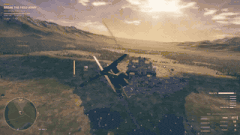
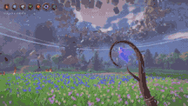
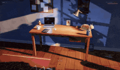
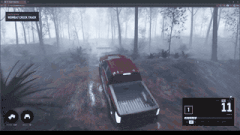
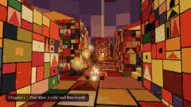

# 🎮 Spiele · alle 80

[← Zurück zur Liste](../README.de.md) · [English](games.md) · [简体中文](games.zh-CN.md) · [繁體中文](games.zh-TW.md) · [日本語](games.ja.md) · [한국어](games.ko.md) · [Español](games.es.md) · [Português](games.pt-BR.md) · [Français](games.fr.md) · **Deutsch** · [Русский](games.ru.md)

Die Hauptseite zeigt pro Bereich höchstens die 12 Einträge mit den meisten Likes (nur ab 100 Likes); hier stehen alle Einträge dieses Bereichs, nach Likes sortiert.

<table>
<tr>
<td width="33%" valign="top">
 
<b><a href="https://starrynightrider.com">Starry Nightrider</a></b> 
🆕 · <a href="https://x.com/ebbyamir">@ebbyamir</a> · ♥ 17.8k · <a href="https://x.com/ebbyamir/status/2120284261089673376">▶ Video</a> 
Van Gogh reitet durch seine Sternennacht, als Spiel. 
<a href="https://fablelist.000ooo.ooo/de/prompts/?w=starry-nightrider&ref=gh"><b>✨ Prompt holen</b></a>
</td>
<td width="33%" valign="top">
 
<b><a href="https://claude.ai/artifact/BGY1SztrAYcJQHSsnHHGmp">Saltline – Ego-Shooter</a></b> 
<a href="https://x.com/felixrieseberg">@felixrieseberg</a> · ♥ 14.7k · <a href="https://x.com/felixrieseberg/status/2119925633564463609">▶ Video</a> 
Von einem Anthropic-Entwickler. One-Shot-Prompts, kein menschliches Feedback, 8 Stunden, ca. 550 $. Modelle, Sounds und Texturen komplett per Code erzeugt. 
<a href="https://fablelist.000ooo.ooo/de/prompts/?w=saltline-first-person-shooter&ref=gh"><b>✨ Prompt holen</b></a>
</td>
<td width="33%" valign="top">
 
<b><a href="https://patch.gg/blendi/oil-paint">Oil Paint – handgemaltes Spiel</a></b> 
🆕 · <a href="https://x.com/BlendiByl">@BlendiByl</a> · ♥ 7.9k · <a href="https://x.com/BlendiByl/status/2120341251178594532">▶ Video</a> 
In unter einer Stunde gemacht. Jedes Frame besteht aus rund 1,5 Millionen Pinselstrichen und läuft mit 200 fps in einem Browser-Tab. Open Source. 
<a href="https://fablelist.000ooo.ooo/de/prompts/?w=oil-paint-hand-painted-game&ref=gh"><b>✨ Prompt holen</b></a>
</td>
</tr>
<tr>
<td width="33%" valign="top">
 
<b><a href="https://nyc.somethingbig.ai/">CROSSTOWN – Open-World-New-York (frühe Vorschau)</a></b> 
🆕 · <a href="https://x.com/mattshumer_">@mattshumer_</a> · ♥ 7.5k · <a href="https://x.com/mattshumer_/status/2120282133503820150">▶ Video</a> 
„Rockstar took 8 years. Fable 5.2 is gonna do it in 7 days.“ Bisher ist nur ein Teil der Stadt drin; drücke B, um Feedback zu senden. 
<a href="https://fablelist.000ooo.ooo/de/prompts/?w=crosstown-open-world-new-york-early-preview&ref=gh"><b>✨ Prompt holen</b></a>
</td>
<td width="33%" valign="top">
 
<b><a href="https://what-the-water-keeps.vercel.app/">What the Water Keeps</a></b> 
<a href="https://x.com/kevin_t_ngo">@kevin_t_ngo</a> · ♥ 4.2k · <a href="https://x.com/kevin_t_ngo/status/2119868968307695818">▶ Video</a> 
Eine Bootsfahrt durch 8 traumhafte Welten, im Browser spielbar. 
<a href="https://fablelist.000ooo.ooo/de/prompts/?w=what-the-water-keeps&ref=gh"><b>✨ Prompt holen</b></a>
</td>
<td width="33%" valign="top">
 
<b><a href="https://tennis.sixfingerpunch.com/">Tennis</a></b> 
🆕 · <a href="https://x.com/photonstorm">@photonstorm</a> · ♥ 3.1k · <a href="https://x.com/photonstorm/status/2120330010112434313">Post</a> 
Auf die Aufgabe „go wild“ bei einem Spiel lieferte es etwas, das wie ein Pong-Klon aussieht – bis du es spielst. 
<a href="https://fablelist.000ooo.ooo/de/prompts/?w=tennis&ref=gh"><b>✨ Prompt holen</b></a>
</td>
</tr>
<tr>
<td width="33%" valign="top">
 
<b><a href="https://www.spawn.co/@mattshumer/earth?room=local">Mirror Earth</a></b> 
<a href="https://x.com/mattshumer_">@mattshumer_</a> · ♥ 2.4k · <a href="https://x.com/mattshumer_/status/2119877065701036047">▶ Video</a> 
Der ganze Planet als zerstörbare Spielwelt, mit Wetter, das in Echtzeit der echten Erde entspricht. 
<a href="https://fablelist.000ooo.ooo/de/prompts/?w=mirror-earth&ref=gh"><b>✨ Prompt holen</b></a>
</td>
<td width="33%" valign="top">
 
<b><a href="https://portals-endless-worlds.netlify.app/">Portals: Endless Worlds</a></b> 
<a href="https://x.com/emollick">@emollick</a> · ♥ 1.9k · <a href="https://x.com/emollick/status/2119918307457577163">▶ Video</a> 
25.000 Agents haben über 450 reine Code-3D-Welten gebaut, inspiriert von Büchern, Kunst und Orten, verbunden durch Portale, durch die man hindurchtreibt. 
<a href="https://github.com/emollick/ai-portals">Quellcode</a> · <a href="https://www.oneusefulthing.org/p/fable-52-and-jagged-agi">Artikel</a> 
<a href="https://fablelist.000ooo.ooo/de/prompts/?w=portals-endless-worlds&ref=gh"><b>✨ Prompt holen</b></a>
</td>
<td width="33%" valign="top">
 
<b><a href="https://evensong-phi.vercel.app/">Evensong</a></b> 
🆕 · <a href="https://x.com/kevin_t_ngo">@kevin_t_ngo</a> · ♥ 1.8k · <a href="https://x.com/kevin_t_ngo/status/2120238844754923874">▶ Video</a> 
Ein düsterer Fantasy-Bosskampf im Souls-like-Stil, im Browser spielbar. 
<a href="https://fablelist.000ooo.ooo/de/prompts/?w=evensong&ref=gh"><b>✨ Prompt holen</b></a>
</td>
</tr>
<tr>
<td width="33%" valign="top">
 
<b><a href="https://loktar00.github.io/lanternfall/">LANTERNFALL</a></b> 
🆕 · <a href="https://x.com/loktar00">@loktar00</a> · ♥ 1.4k · <a href="https://x.com/loktar00/status/2120192761542615271">▶ Video</a> 
Das ganze Spiel – Animationen, Modelle, alles – wurde von Fable erzeugt. Achte auf den Effekt, wenn Gegner sterben. 
<a href="https://fablelist.000ooo.ooo/de/prompts/?w=lanternfall&ref=gh"><b>✨ Prompt holen</b></a>
</td>
<td width="33%" valign="top">
 
<b><a href="https://op7418.github.io/guizang-game-skill/">Mist-Locked Mountain Gate – 3D-Actionspiel</a></b> 
🆕 · <a href="https://x.com/op7418">@op7418</a> · ♥ 1.1k · <a href="https://x.com/op7418/status/2120694045299327187">▶ Video</a> 
Ein Nachmittag, 4,5 Milliarden Tokens. Modelle, Szenen und Moves komplett von Fable, verpackt in einer einzigen 30-MB-HTML-Datei. 
<a href="https://fablelist.000ooo.ooo/de/prompts/?w=mist-locked-mountain-gate-3d-action-game&ref=gh"><b>✨ Prompt holen</b></a>
</td>
<td width="33%" valign="top">
 
<b><a href="https://wavedash.com/games/rooftop-rally">Rooftop Rally – Pickleball in Unreal 5.9</a></b> 
🆕 · <a href="https://x.com/chongdashu">@chongdashu</a> · ♥ 1.1k · <a href="https://x.com/chongdashu/status/2120154573356793883">▶ Video</a> 
Fable 5.2 mit der Unreal Engine 5.9 Preview. Charaktere von Tripo; die anderen 3D-Assets und der Rest von Fable. 
<a href="https://x.com/chongdashu/status/2120310120509014219">So entstand es</a> 
<a href="https://fablelist.000ooo.ooo/de/prompts/?w=rooftop-rally-pickleball-in-unreal-5-9&ref=gh"><b>✨ Prompt holen</b></a>
</td>
</tr>
<tr>
<td width="33%" valign="top">
 
<b><a href="https://claude.ai/artifact/MXxb36zKgN261ckbGhmNin">Three Games (Saltline · The Clockmaker's Heart · Tidewright)</a></b> 
<a href="https://x.com/felixrieseberg">@felixrieseberg</a> · ♥ 809 · <a href="https://x.com/vineerpasam/status/2119955306096857145">▶ Video</a> 
Signiert von Felix Rieseberg: „Alle Spiele wurden mit Claude Fable 5.2 gemacht. Erste Entwürfe, kein menschliches Feedback.“ Der am häufigsten geteilte Link am Launch-Tag. 
<a href="https://claude.ai/artifact/6MjtQjf4ee1ZZjEpafaEpa">The Clockmaker's Heart</a> · <a href="https://claude.ai/artifact/JTgyEMn7sn1q2riWrMb7D4">Tidewright</a> 
<a href="https://fablelist.000ooo.ooo/de/prompts/?w=three-games-saltline-the-clockmaker-s-heart-tidewright&ref=gh"><b>✨ Prompt holen</b></a>
</td>
<td width="33%" valign="top">
 
<b><a href="https://patch.gg/blendi/coloured-pencil">Coloured Pencil</a></b> 
🆕 · <a href="https://x.com/BlendiByl">@BlendiByl</a> · ♥ 741 · <a href="https://x.com/BlendiByl/status/2121130385723789637">▶ Video</a> 
Ein Spielausschnitt im Buntstift-Stil; die Schattierung jeder Oberfläche und die ganze Stadt sind Code. Open Source. 
<a href="https://fablelist.000ooo.ooo/de/prompts/?w=coloured-pencil&ref=gh"><b>✨ Prompt holen</b></a>
</td>
<td width="33%" valign="top">
 
<b><a href="https://www.spawn.co/@mattshumer/voxel-engine">Voxel Engine</a></b> 
<a href="https://x.com/mattshumer_">@mattshumer_</a> · ♥ 740 · <a href="https://x.com/mattshumer_/status/2119870965106483384">▶ Video</a> 
Aus einem einzigen Prompt entstanden. Ton an. 
<a href="https://fablelist.000ooo.ooo/de/prompts/?w=voxel-engine&ref=gh"><b>✨ Prompt holen</b></a>
</td>
</tr>
<tr>
<td width="33%" valign="top">
 
<b><a href="https://patch.gg/blendi/patchwork-quilt">Patchwork Quilt</a></b> 
🆕 · <a href="https://x.com/BlendiByl">@BlendiByl</a> · ♥ 669 · <a href="https://x.com/BlendiByl/status/2120746541636047347">▶ Video</a> 
Ein Spielausschnitt im Patchwork- und Stop-Motion-Stil. Die ganze Map ist Code. Open Source. 
<a href="https://fablelist.000ooo.ooo/de/prompts/?w=patchwork-quilt&ref=gh"><b>✨ Prompt holen</b></a>
</td>
<td width="33%" valign="top">
 
<b><a href="https://bannerfall.itch.io/siege-wing">Siege Wing — ein Hubschrauber im mittelalterlichen Krieg</a></b> 
🆕 · <a href="https://x.com/builderjaydub">@builderjaydub</a> · ♥ 556 · <a href="https://x.com/builderjaydub/status/2120223731520040966">▶ Video</a> 
Flieg einen Helikopter mit Kanone, Raketen und Lenkflugkörpern, weich römischen Ballisten aus und bring die Burg zu Fall.
</td>
<td width="33%" valign="top">
 
<b><a href="https://i-would-have-gotten-away-with-it.netlify.app/">I Would Have Gotten Away With It</a></b> 
<a href="https://x.com/emollick">@emollick</a> · ♥ 509 · <a href="https://x.com/emollick/status/2119876449494540554">▶ Video</a> 
Ein umgekehrtes Scooby-Doo: Du bist der Bösewicht und vertreibst neugierige Kinder. Fable hat auch Trailer, Musik und Sound gemacht. 
<a href="https://fablelist.000ooo.ooo/de/prompts/?w=i-would-have-gotten-away-with-it&ref=gh"><b>✨ Prompt holen</b></a>
</td>
</tr>
<tr>
<td width="33%" valign="top">
 
<b><a href="https://noclipepe.pages.dev/rug/">Childhood Rug Racer</a></b> 
<a href="https://x.com/noclipepe">@noclipepe</a> · ♥ 415 · <a href="https://x.com/noclipepe/status/2119728047754547326">▶ Video</a> 
Ein Rennspiel auf dem Spielteppich aus der Kindheit, derselbe Prompt wie bei GPT-6.2 Sol. Der Autor nennt das Modell „Fable 5.5 (routing)“. 
<a href="https://fablelist.000ooo.ooo/de/prompts/?w=childhood-rug-racer&ref=gh"><b>✨ Prompt holen</b></a>
</td>
<td width="33%" valign="top">
 
<b><a href="https://finderchangchang.github.io/cloud-stunt-3d/">Cloud Stunt 3D</a></b> 
<a href="https://x.com/jev_chat">@jev_chat</a> · ♥ 329 · <a href="https://x.com/jev_chat/status/2120015641151426838">▶ Video</a> 
In 30 Minuten erzeugt; eine optimierte „goldene“ Version ist ebenfalls verlinkt. 
<a href="https://finderchangchang.github.io/cloud-stunt-3d/golden/">Optimized</a> 
<a href="https://x.com/jev_chat/status/2120015641151426838">📝 Prompt des Creators (kostenlos)</a>
</td>
<td width="33%" valign="top">
 
<b><a href="https://gilt-and-gutter.vercel.app/">Gilt & Gutter</a></b> 
🆕 · <a href="https://x.com/kevin_t_ngo">@kevin_t_ngo</a> · ♥ 326 · <a href="https://x.com/kevin_t_ngo/status/2119900487688622171">▶ Video</a> 
Ein 1v1-Ego-Shooter mit zwei spielbaren Charakteren. 
<a href="https://fablelist.000ooo.ooo/de/prompts/?w=gilt-gutter&ref=gh"><b>✨ Prompt holen</b></a>
</td>
</tr>
<tr>
<td width="33%" valign="top">
 
<b><a href="https://www.spawn.co/@mattshumer/hogwarts-royale">Hogwarts Royale</a></b> 
<a href="https://x.com/mattshumer_">@mattshumer_</a> · ♥ 311 · <a href="https://x.com/mattshumer_/status/2119872098306810226">▶ Video</a> 
„Create a mashup of Harry Potter and Fortnite“ – ein spielbares Battle Royale. 
<a href="https://x.com/mattshumer_/status/2119872098306810226">📝 Prompt des Creators (kostenlos)</a>
</td>
<td width="33%" valign="top">
 
<b><a href="https://dread-and-district.netlify.app">Dread & District</a></b> 
🆕 · <a href="https://x.com/emollick">@emollick</a> · ♥ 302 · <a href="https://x.com/emollick/status/2120248525254742318">▶ Video</a> 
Eine Fantasy-Transportsimulation „mit Herz“: ein vager Absatz, dann streiten ein paar Agents über Kunst, Lore und Witze. Gute Logistik besiegt das Böse. 
<a href="https://fablelist.000ooo.ooo/de/prompts/?w=dread-district&ref=gh"><b>✨ Prompt holen</b></a>
</td>
<td width="33%" valign="top">
 
<b><a href="https://lauramionel.github.io/cayley-flight-simulator/">Cayley-Flugsimulator</a></b> 
🆕 · <a href="https://x.com/lionel_mora">@lionel_mora</a> · ♥ 295 · <a href="https://x.com/lionel_mora/status/2120554787812860294">▶ Video</a> 
Über Nacht in einem Versuch: echte Flügelphysik, die Auftrieb und Widerstand für jeden Teil des Flügels berechnet. 
<a href="https://fablelist.000ooo.ooo/de/prompts/?w=cayley-flight-simulator&ref=gh"><b>✨ Prompt holen</b></a>
</td>
</tr>
<tr>
<td width="33%" valign="top">
 
<b><a href="https://unsung-vale.vercel.app/">Unsung Vale – Open-World-RPG</a></b> 
🆕 · <a href="https://x.com/LexnLin">@LexnLin</a> · ♥ 294 · <a href="https://x.com/LexnLin/status/2121253191748669705">▶ Video</a> 
Eine Third-Person-Open-World-RPG-Demo. Keine Assets: Alles auf dem Bildschirm ist mit Code gemacht. 
<a href="https://github.com/Leonxlnx/unsung-vale">Quellcode</a>
</td>
<td width="33%" valign="top">
 
<b><a href="https://github.com/amirmushichge/worm-rider">Worm Rider</a></b> 
<a href="https://x.com/AmirMushich">@AmirMushich</a> · ♥ 251 · <a href="https://x.com/AmirMushich/status/2119937977426338283">▶ Video</a> 
Open Source. 220 KB, 3.400 Zeilen, 10 Prompts, jedes Modell von Grund auf in Claude Code gebaut. 
<a href="https://fablelist.000ooo.ooo/de/prompts/?w=worm-rider&ref=gh"><b>✨ Prompt holen</b></a>
</td>
<td width="33%" valign="top">
 
<b><a href="https://maad-maxxing.vercel.app/">MAAD MAXXING</a></b> 
🆕 · <a href="https://x.com/Andrew_Blumson">@Andrew_Blumson</a> · ♥ 246 · <a href="https://x.com/Andrew_Blumson/status/2120599812512833557">▶ Video</a> 
100 % Code, keine Assets. Die ersten 3 Stages sind spielbar; Audio von ElevenLabs. 
<a href="https://fablelist.000ooo.ooo/de/prompts/?w=maad-maxxing&ref=gh"><b>✨ Prompt holen</b></a>
</td>
</tr>
<tr>
<td width="33%" valign="top">
 
<b><a href="https://frontier.every.to/experiments/first-crush">First Crush</a></b> 
🆕 · <a href="https://x.com/kieranklaassen">@kieranklaassen</a> · ♥ 229 · <a href="https://x.com/kieranklaassen/status/2119871673294037280">▶ Video</a> 
Ein Weinbau-Spiel: das Fass schrubben, 250 kg Früchte pressen, das Aräometer ablesen, eine Hefe wählen – und es erklärt, warum. Klicke auf der Seite auf „Try it“. 
<a href="https://fablelist.000ooo.ooo/de/prompts/?w=first-crush&ref=gh"><b>✨ Prompt holen</b></a>
</td>
<td width="33%" valign="top">
 
<b><a href="https://sanwan.ai/games/xingyun-moba/">Starfall – ein Browser-MOBA</a></b> 
🆕 · <a href="https://x.com/FuSheng_0306">@FuSheng_0306</a> · ♥ 195 · <a href="https://x.com/FuSheng_0306/status/2121237878097207583">▶ Video</a> 
Ein Prompt, etwa 20 Stunden Fable 5.2: fünf Helden, ein menschlicher Spieler und NPCs. 
<a href="https://fablelist.000ooo.ooo/de/prompts/?w=starfall-a-browser-moba&ref=gh"><b>✨ Prompt holen</b></a>
</td>
<td width="33%" valign="top">
 
<b><a href="https://cozylisbon.vercel.app">Cozy Lisbon</a></b> 
🆕 · <a href="https://x.com/goncalo_canhoto">@goncalo_canhoto</a> · ♥ 166 · <a href="https://x.com/goncalo_canhoto/status/2119932946346094690">▶ Video</a> 
Ein gemütliches Ein-Prompt-Spiel über ein kleines Flugzeug, das über Lissabon fliegt. 
<a href="https://fablelist.000ooo.ooo/de/prompts/?w=cozy-lisbon&ref=gh"><b>✨ Prompt holen</b></a>
</td>
</tr>
<tr>
<td width="33%" valign="top">
 
<b><a href="https://spawn.co/@robot/frontline-warfare-deathmatch">Frontline Warfare Deathmatch</a></b> 
<a href="https://x.com/alightinastorm">@alightinastorm</a> · ♥ 163 · <a href="https://x.com/alightinastorm/status/2120020469487440210">▶ Video</a> 
Ein Shooter im Call-of-Duty-Stil im Browser.
</td>
<td width="33%" valign="top">
 
<b><a href="https://wquguru.github.io/fable52-fps-repro/">Fable 5.2 FPS Repro</a></b> 
🆕 · <a href="https://x.com/wquguru">@wquguru</a> · ♥ 159 · <a href="https://x.com/wquguru/status/2120383332722905400">▶ Video</a> 
Vier 3D-FPS-Demos in je einer Datei: Modelle, Sound und Texturen komplett im Code. Methode und Quellcode sind offen. 
<a href="https://github.com/wquguru/fable52-fps-repro">Quellcode</a> 
<a href="https://x.com/wquguru/status/2120383332722905400">📝 Prompt des Creators (kostenlos)</a>
</td>
<td width="33%" valign="top">
 
<b><a href="https://noclipepe.pages.dev/dino">Rambo Dino</a></b> 
<a href="https://x.com/noclipepe">@noclipepe</a> · ♥ 155 · <a href="https://x.com/noclipepe/status/2119927838321328577">▶ Video</a> 
Das Chrome-T-Rex-Spiel, neu gebaut. Verglichen mit Opus 5.5, Gemini 4 Carbon und GPT-6 Astra. 
<a href="https://fablelist.000ooo.ooo/de/prompts/?w=rambo-dino&ref=gh"><b>✨ Prompt holen</b></a>
</td>
</tr>
<tr>
<td width="33%" valign="top">
 
<b><a href="https://remix.gg/g/banana-mine-rush">Banana Mine Rush</a></b> 
🆕 · <a href="https://x.com/0xChuckstock">@0xChuckstock</a> · ♥ 154 · <a href="https://x.com/0xChuckstock/status/2120125184606658728">▶ Video</a> 
Ein 3D-Kart-Rennspiel auf Remix: startet sofort im Browser ohne Konto, mit Mehrspielermodus und Bestenlisten. 
<a href="https://fablelist.000ooo.ooo/de/prompts/?w=banana-mine-rush&ref=gh"><b>✨ Prompt holen</b></a>
</td>
<td width="33%" valign="top">
 
<b><a href="https://turbo-tails.vercel.app">Turbo Tails</a></b> 
<a href="https://x.com/petergyang">@petergyang</a> · ♥ 139 · <a href="https://x.com/petergyang/status/2119901658394358005">▶ Video</a> 
3D-Kart-Rennspiel: 6 Fahrer, Driften, Rampen, Items, Einzel- und Mehrspielermodus. 
<a href="https://youtu.be/SsSKJA0EHD4">Comparison video</a> 
<a href="https://fablelist.000ooo.ooo/de/prompts/?w=turbo-tails&ref=gh"><b>✨ Prompt holen</b></a>
</td>
<td width="33%" valign="top">
 
<b><a href="https://luminazombies.com/">Lumina Zombies</a></b> 
🆕 · <a href="https://x.com/LuminaBench">@LuminaBench</a> · ♥ 124 · <a href="https://x.com/LuminaBench/status/2120660076927099048">▶ Video</a> 
Eine brandneue Map mit Easter Eggs in wenigen Prompts, dazu Upgrades, die den Hardwarebedarf und die Latenz auf den anderen beiden Maps halbiert haben. 
<a href="https://fablelist.000ooo.ooo/de/prompts/?w=lumina-zombies&ref=gh"><b>✨ Prompt holen</b></a>
</td>
</tr>
<tr>
<td width="33%" valign="top">
 
<b><a href="https://loktar00.github.io/llm-test-pages/fable52-dino-chase/">Thunder Valley dino chase</a></b> 
🆕 · <a href="https://x.com/loktar00">@loktar00</a> · ♥ 98 · <a href="https://x.com/loktar00/status/2120905457380507991">▶ Video</a> 
Vanilla JS mit eigenem WebGL-Renderer; Dinos, Bäume und Gelände sind gestapelte 2D-Pixelscheiben. 
<a href="https://fablelist.000ooo.ooo/de/prompts/?w=thunder-valley-dino-chase&ref=gh"><b>✨ Prompt holen</b></a>
</td>
<td width="33%" valign="top">
 
<b><a href="https://feed-backrooms.vercel.app">Feed the Backrooms</a></b> 
<a href="https://x.com/LexnLin">@LexnLin</a> · ♥ 95 · <a href="https://x.com/LexnLin/status/2119966127149429093">▶ Video</a> 
Die Backrooms umgekehrt: Du bist das Monster und musst Menschen fangen. 
<a href="https://fablelist.000ooo.ooo/de/prompts/?w=feed-the-backrooms&ref=gh"><b>✨ Prompt holen</b></a>
</td>
<td width="33%" valign="top">
 
<b><a href="https://rivergame-kappa.vercel.app">The Waking River</a></b> 
🆕 · <a href="https://x.com/flxrnc">@flxrnc</a> · ♥ 90 · <a href="https://x.com/flxrnc/status/2120494277528580110">▶ Video</a> 
Ein Prompt und ein paar Nachfragen: fünf schlafende Welten, die erwachen, während du hindurchsegelst, mit einem Soundtrack aus Code. 
<a href="https://x.com/flxrnc/status/2120494277528580110">📝 Prompt des Creators (kostenlos)</a>
</td>
</tr>
<tr>
<td width="33%" valign="top">
 
<b><a href="https://app.usecrayon.ai/play/992c2130-43da-416b-a577-aed9514d3057">SKYWAKE</a></b> 
🆕 · <a href="https://x.com/aniketjart">@aniketjart</a> · ♥ 79 · <a href="https://x.com/aniketjart/status/2120378493729222700">▶ Video</a> 
Ein Flug-Quest-Spiel, gemacht mit Fable 5.2, Opus 5.5, Crayon und three.js. 
<a href="https://fablelist.000ooo.ooo/de/prompts/?w=skywake&ref=gh"><b>✨ Prompt holen</b></a>
</td>
<td width="33%" valign="top">
 
<b><a href="https://app.usecrayon.ai/play/0cd7624e-1297-417e-a5be-b3c3036a496a">KUMOKIRI</a></b> 
🆕 · <a href="https://x.com/aniketjart">@aniketjart</a> · ♥ 72 · <a href="https://x.com/aniketjart/status/2121101334900617631">▶ Video</a> 
Ein Samurai-Spiel im Malstil, gemacht mit Fable 5.2, Crayon und three.js. 
<a href="https://fablelist.000ooo.ooo/de/prompts/?w=kumokiri&ref=gh"><b>✨ Prompt holen</b></a>
</td>
<td width="33%" valign="top">
 
<b><a href="https://save-the-world-fable.vercel.app/">Save the World</a></b> 
🆕 · <a href="https://x.com/global_techgirl">@global_techgirl</a> · ♥ 63 · <a href="https://x.com/global_techgirl/status/2120246750459961453">▶ Video</a> 
Es baute die Straße, fand die 3D-Modelle und Sounds und spielte das Spiel selbst, um den Trailer aufzunehmen. Am besten am Laptop. 
<a href="https://fablelist.000ooo.ooo/de/prompts/?w=save-the-world&ref=gh"><b>✨ Prompt holen</b></a>
</td>
</tr>
<tr>
<td width="33%" valign="top">
 
<b><a href="https://patch.gg/games/rehan/ringfall">Ringfall</a></b> 
🆕 · <a href="https://x.com/rehan_shei">@rehan_shei</a> · ♥ 62 · <a href="https://x.com/rehan_shei/status/2119994607291584962">▶ Video</a> 
Ein von Destiny inspirierter FPS. Open Source und remixbar. 
<a href="https://fablelist.000ooo.ooo/de/prompts/?w=ringfall&ref=gh"><b>✨ Prompt holen</b></a>
</td>
<td width="33%" valign="top">
 
<b><a href="https://www.spawn.co/@abbidabbi/pogo-riot">Pogo Riot</a></b> 
🆕 · <a href="https://x.com/Pumpnasterr">@Pumpnasterr</a> · ♥ 59 · <a href="https://x.com/Pumpnasterr/status/2121343507885682917">▶ Video</a> 
Ein Free-for-all-FPS, in dem du auf einem Pogostock hüpfst und gleichzeitig zielst.
</td>
<td width="33%" valign="top">
 
<b><a href="https://samg-coder.github.io/solstice-racing/">Kestrel Head – Solstice Racing</a></b> 
🆕 · <a href="https://x.com/SamGCoder">@SamGCoder</a> · ♥ 56 · <a href="https://x.com/SamGCoder/status/2120044542087070066">▶ Video</a> 
Gebaut auf der eigenen Rust- + WebGPU-Engine des Autors: ein in Blender modellierter Porsche 992 GT3 R und ein 3 km langer Inselkurs. Controller-Unterstützung. 
<a href="https://github.com/SamG-Coder/solstice-racing">Quellcode</a> 
<a href="https://fablelist.000ooo.ooo/de/prompts/?w=kestrel-head-solstice-racing&ref=gh"><b>✨ Prompt holen</b></a>
</td>
</tr>
<tr>
<td width="33%" valign="top">
 
<b><a href="https://shubhu121.github.io/hitdude/play/">HITOFUDE</a></b> 
🆕 · <a href="https://x.com/positronx_">@positronx_</a> · ♥ 52 · <a href="https://x.com/positronx_/status/2120374208043876422">▶ Video</a> 
Jedes Frame wurde im Code als Sumi-Tusche auf Papier gemalt. Der Boss löscht das Level; dein Schwert ist ein Pinsel. 
<a href="https://fablelist.000ooo.ooo/de/prompts/?w=hitofude&ref=gh"><b>✨ Prompt holen</b></a>
</td>
<td width="33%" valign="top">
 
<b><a href="https://patch.gg/play/blendi/small-magic">Small Magic — Zauberer-Sandbox</a></b> 
🆕 · <a href="https://x.com/BlendiByl">@BlendiByl</a> · ♥ 50 · <a href="https://x.com/BlendiByl/status/2121594536153718972">▶ Video</a> 
An einem Tag gebaut: 7 Zauber, rund 1.800 zerstörbare Physikteile, keine Modelle oder Texturen, Open Source.
</td>
<td width="33%" valign="top">
 
<b><a href="https://fowllabs.com/fable-5-2/chairmageddon/">Chairmageddon</a></b> 
🆕 · <a href="https://x.com/argofowl">@argofowl</a> · ♥ 48 · <a href="https://x.com/argofowl/status/2120568779537273263">▶ Video</a> 
Zerstöre eine friedliche Stadt aus blauen Stühlen. Ja, du kannst den Kinderwagen im Wirbel verschwinden lassen. 
<a href="https://fablelist.000ooo.ooo/de/prompts/?w=chairmageddon&ref=gh"><b>✨ Prompt holen</b></a>
</td>
</tr>
<tr>
<td width="33%" valign="top">
 
<b><a href="https://higgsfield.ai/@higgsfield.studio/blogs/fable-5-2-built-this-rpg-from-pure-code-here-s-every-step">VOWLORN</a></b> 
<a href="https://x.com/higgsfield_ai">@higgsfield_ai</a> · ♥ 46 · <a href="https://x.com/higgsfield_ai/status/2119997122896601269">▶ Video</a> 
Ein dunkles RPG, in dem sogar die Stimmen Code sind, über Higgsfield MCP veröffentlicht. Die Links führen zu den Spielseiten mit den kompletten Workflows. 
<a href="https://higgsfield.ai/@higgsfield.studio/blogs/claude-fable-5-2-built-a-dragon-riding-game-play-it-free">Dragon-riding game</a> · <a href="https://higgsfield.ai/@higgsfield.studio/blogs/one-drawing-fable-5-2-turned-it-into-a-horror-game">Drawing-to-horror game</a> 
<a href="https://fablelist.000ooo.ooo/de/prompts/?w=vowlorn&ref=gh"><b>✨ Prompt holen</b></a>
</td>
<td width="33%" valign="top">
 
<b><a href="https://claude.ai/artifact/4nPXUKJjQWNsZEHVNmXXCt">Stray Cat</a></b> 
<a href="https://x.com/aimikoda">@aimikoda</a> · ♥ 44 · <a href="https://x.com/aimikoda/status/2120120133712593118">▶ Video</a> 
Rette Kätzchen, fauche Hunde an, jaule einen alten Kater an. Jeder Sound ist synthetisiert. 
<a href="https://fablelist.000ooo.ooo/de/prompts/?w=stray-cat&ref=gh"><b>✨ Prompt holen</b></a>
</td>
<td width="33%" valign="top">
 
<b><a href="https://sael.net/demo/farewell-light/">Farewell Light</a></b> 
🆕 · <a href="https://x.com/RyanSael">@RyanSael</a> · ♥ 44 · <a href="https://x.com/RyanSael/status/2120695866684231998">▶ Video</a> 
Eine Gameplay-Demo, über Nacht entstanden. 
<a href="https://fablelist.000ooo.ooo/de/prompts/?w=farewell-light&ref=gh"><b>✨ Prompt holen</b></a>
</td>
</tr>
<tr>
<td width="33%" valign="top">
 
<b><a href="https://claude.ai/artifact/UD9pGEN4QFA8F5EadRw8eL">Midnight Pass</a></b> 
🆕 · <a href="https://x.com/andreysuperior">@andreysuperior</a> · ♥ 44 · <a href="https://x.com/andreysuperior/status/2120666660130746458">▶ Video</a> 
Eine HTML-Datei, 603 Zeilen, null Assets: echte Drift-Physik, ein generierter Berg, synthetisierte Motor- und Reifengeräusche. 
<a href="https://fablelist.000ooo.ooo/de/prompts/?w=midnight-pass&ref=gh"><b>✨ Prompt holen</b></a>
</td>
<td width="33%" valign="top">
 
<b><a href="https://loktar00.github.io/llm-test-pages/fable52-hang-glider/">Thermal</a></b> 
🆕 · <a href="https://x.com/loktar00">@loktar00</a> · ♥ 41 · <a href="https://x.com/loktar00/status/2121005021131083851">▶ Video</a> 
Ein kleines Drachenflieger-Spiel: Nutze die Thermik und erreiche das Ziel. 
<a href="https://fablelist.000ooo.ooo/de/prompts/?w=thermal&ref=gh"><b>✨ Prompt holen</b></a>
</td>
<td width="33%" valign="top">
 
<b><a href="https://remix.gg/g/survivors">Survivors</a></b> 
🆕 · <a href="https://x.com/BLACKST0CK">@BLACKST0CK</a> · ♥ 40 · <a href="https://x.com/BLACKST0CK/status/2120329788896498123">▶ Video</a> 
Vampire Survivors mit Leveln und Loot im WoW-Stil. Solo oder Koop für bis zu 4. 
<a href="https://fablelist.000ooo.ooo/de/prompts/?w=survivors&ref=gh"><b>✨ Prompt holen</b></a>
</td>
</tr>
<tr>
<td width="33%" valign="top">
 
<b><a href="https://fowllabs.com/fable-5-2/knock-it-off/">Knock It Off</a></b> 
🆕 · <a href="https://x.com/argofowl">@argofowl</a> · ♥ 40 · <a href="https://x.com/argofowl/status/2121276206683410839">▶ Video</a> 
Du bist eine Katze um 3 Uhr nachts und wirfst alles vom Schreibtisch, ohne den Menschen zu wecken. Eine einzige HTML-Datei ohne 3D-Modelle.
</td>
<td width="33%" valign="top">
 
<b><a href="https://www.aigameshare.com/games/animal-card-battle-game?play=1&mode=fullscreen">Thimble Knights</a></b> 
🆕 · <a href="https://x.com/_nilni">@_nilni</a> · ♥ 34 · <a href="https://x.com/_nilni/status/2120435983032447382">▶ Video</a> 
Ein Echtzeit-Kartenspiel mit Tierkämpfen. 
<a href="https://x.com/_nilni/status/2120435983032447382">📝 Prompt des Creators (kostenlos)</a>
</td>
<td width="33%" valign="top">
 
<b><a href="https://tetriss22.github.io/harbor-gp/">Harbor Lights Grand Prix</a></b> 
🆕 · <a href="https://x.com/Tetriss112">@Tetriss112</a> · ♥ 33 · <a href="https://x.com/Tetriss112/status/2120946576663134308">▶ Video</a> 
Eine HTML-Datei: 20 Pixel-Autos auf einem Stadtkurs mit 22 Kurven, mit einem Wettschalter vor jedem Rennen (Spielgeld). 
<a href="https://fablelist.000ooo.ooo/de/prompts/?w=harbor-lights-grand-prix&ref=gh"><b>✨ Prompt holen</b></a>
</td>
</tr>
<tr>
<td width="33%" valign="top">
 
<b><a href="https://blog.silencestar.com/posts/tilt-labyrinth/play/">Tilt Labyrinth</a></b> 
<a href="https://x.com/mylifcc">@mylifcc</a> · ♥ 32 · <a href="https://x.com/mylifcc/status/2120054646282870910">▶ Video</a> 
Ein Holzkugel-Labyrinth in 2.000 Zeilen three.js. Fable hat es von selbst von 55 ms auf 9 ms pro Frame optimiert. 
<a href="https://fablelist.000ooo.ooo/de/prompts/?w=tilt-labyrinth&ref=gh"><b>✨ Prompt holen</b></a>
</td>
<td width="33%" valign="top">
 
<b><a href="https://claude.ai/artifact/QvSjL7Hexf3nKdUP9Zerr7">Kampfspiel (läuft auf Handys)</a></b> 
🆕 · <a href="https://x.com/s_shigel">@s_shigel</a> · ♥ 32 · <a href="https://x.com/s_shigel/status/2120300080569975034">▶ Video</a> 
Ein über Nacht iteriertes Kampfspiel, im mobilen Browser spielbar. 
<a href="https://fablelist.000ooo.ooo/de/prompts/?w=fighting-game-plays-on-phones&ref=gh"><b>✨ Prompt holen</b></a>
</td>
<td width="33%" valign="top">
 
<b><a href="https://remix.gg/g/hoppy-meadow">Hoppy Meadow</a></b> 
🆕 · <a href="https://x.com/0xChuckstock">@0xChuckstock</a> · ♥ 26 · <a href="https://x.com/0xChuckstock/status/2120620907865473448">Post</a> 
Sieht aus wie ein einfaches Jump-and-run – bis du den Fahnenmast erreichst. 
<a href="https://fablelist.000ooo.ooo/de/prompts/?w=hoppy-meadow&ref=gh"><b>✨ Prompt holen</b></a>
</td>
</tr>
<tr>
<td width="33%" valign="top">
 
<b><a href="https://the-vast-horizon.vercel.app">The Vast Horizon</a></b> 
🆕 · <a href="https://x.com/OdinLovis">@OdinLovis</a> · ♥ 26 · <a href="https://x.com/OdinLovis/status/2120198469755503091">▶ Video</a> 
Ein Multiplayer-Surfspiel auf einem gemeinsamen See; tippe ein Wort und die Welt verändert sich. 
<a href="https://fablelist.000ooo.ooo/de/prompts/?w=the-vast-horizon&ref=gh"><b>✨ Prompt holen</b></a>
</td>
<td width="33%" valign="top">
 
<b><a href="https://claude.ai/artifact/FpdQ81sJs1KiV1a6JCY4jj">Open-World-Kart-Abenteuer</a></b> 
🆕 · <a href="https://x.com/realWeZZard">@realWeZZard</a> · ♥ 24 · <a href="https://x.com/realWeZZard/status/2120379500492185939">▶ Video</a> 
In drei Stunden in einem Versuch gebaut; die Hauptquest dauert etwa eine halbe Stunde. 
<a href="https://fablelist.000ooo.ooo/de/prompts/?w=open-world-kart-adventure&ref=gh"><b>✨ Prompt holen</b></a>
</td>
<td width="33%" valign="top">
 
<b><a href="https://remix.gg/g/brix-84">BRIX '84</a></b> 
🆕 · <a href="https://x.com/0xChuckstock">@0xChuckstock</a> · ♥ 24 · <a href="https://x.com/0xChuckstock/status/2120896397839126579">Post</a> 
Ein Breakout-Spiel, das nach dem zweiten Power-up wild wird. 
<a href="https://fablelist.000ooo.ooo/de/prompts/?w=brix-84&ref=gh"><b>✨ Prompt holen</b></a>
</td>
</tr>
<tr>
<td width="33%" valign="top">
 
<b><a href="https://giant-leap.vercel.app">Giant Leap</a></b> 
🆕 · <a href="https://x.com/handsher_NGU">@handsher_NGU</a> · ♥ 23 · <a href="https://x.com/handsher_NGU/status/2120287667141374212">▶ Video</a> 
Spring vom Mond zur Erde. Du springst einfach. 
<a href="https://fablelist.000ooo.ooo/de/prompts/?w=giant-leap&ref=gh"><b>✨ Prompt holen</b></a>
</td>
<td width="33%" valign="top">
 
<b><a href="https://qiaomu.t5t6.com/irondusk-yard-7/">IRONDUSK – Yard 7</a></b> 
🆕 · <a href="https://x.com/vista8">@vista8</a> · ♥ 20 · <a href="https://x.com/vista8/status/2120383046239285264">Post</a> 
Ein Prompt für ein winziges FPS-Level, das mit AAA-Grafik mithalten kann. Ein zweiter Prompt erzeugte einen 3D-Breakout mit KI- und Zweispielermodus. 
<a href="https://qiaomu.t5t6.com/3d/">3D brick breaker</a> 
<a href="https://x.com/vista8/status/2120383046239285264">📝 Prompt des Creators (kostenlos)</a>
</td>
<td width="33%" valign="top">
 
<b><a href="https://cozybakery.vercel.app">Cozy Bakery</a></b> 
🆕 · <a href="https://x.com/goncalo_canhoto">@goncalo_canhoto</a> · ♥ 18 · <a href="https://x.com/goncalo_canhoto/status/2120530199649432063">▶ Video</a> 
Ein Koop-Kochspiel im Overcooked-Stil rund um Portugal, 1 bis 4 Spieler, läuft auf dem Handy. 
<a href="https://fablelist.000ooo.ooo/de/prompts/?w=cozy-bakery&ref=gh"><b>✨ Prompt holen</b></a>
</td>
</tr>
<tr>
<td width="33%" valign="top">
 
<b><a href="https://www.nightclub-driftspeed.xyz/">NightClub: Drift & Speed</a></b> 
🆕 · <a href="https://x.com/Story91_">@Story91_</a> · ♥ 17 · <a href="https://x.com/Story91_/status/2121016763190059194">▶ Video</a> 
Ein Drift-Rennspiel im Browser mit weltweiter Bestenliste, in 72 Stunden aus einem leeren Ordner gebaut. 
<a href="https://fablelist.000ooo.ooo/de/prompts/?w=nightclub-drift-speed&ref=gh"><b>✨ Prompt holen</b></a>
</td>
<td width="33%" valign="top">
 
<b><a href="https://silicon-seduction.vercel.app/">Silicon Seduction</a></b> 
<a href="https://x.com/ZryMiller">@ZryMiller</a> · ♥ 13 · <a href="https://x.com/ZryMiller/status/2119918766691954691">▶ Video</a> 
Schaffst du es hinaus, ohne verführt zu werden? 
<a href="https://fablelist.000ooo.ooo/de/prompts/?w=silicon-seduction&ref=gh"><b>✨ Prompt holen</b></a>
</td>
<td width="33%" valign="top">
 
<b><a href="https://fighting-game-ignition.saito-931.workers.dev">IGNITION Kampfspiel</a></b> 
🆕 · <a href="https://x.com/s_shigel">@s_shigel</a> · ♥ 13 · <a href="https://x.com/s_shigel/status/2120895161890914336">▶ Video</a> 
Ein 2D-Kampfspiel mit generierten Stimmen und Sounds, Spielprotokollen und Replays. 
<a href="https://fablelist.000ooo.ooo/de/prompts/?w=ignition-fighting-game&ref=gh"><b>✨ Prompt holen</b></a>
</td>
</tr>
<tr>
<td width="33%" valign="top">
 
<b><a href="https://www.aigameshare.com/games/island-god-game?play=1&mode=fullscreen">Handful: Island God</a></b> 
🆕 · <a href="https://x.com/_nilni">@_nilni</a> · ♥ 11 · <a href="https://x.com/_nilni/status/2120639452146250153">▶ Video</a> 
Spiele einen Gott und führe die kleinen Punkte zum Licht. 
<a href="https://fablelist.000ooo.ooo/de/prompts/?w=handful-island-god&ref=gh"><b>✨ Prompt holen</b></a>
</td>
<td width="33%" valign="top">
 
<b><a href="https://wavedash.com/games/reef-dive">Reef Dive</a></b> 
🆕 · <a href="https://x.com/boona11">@boona11</a> · ♥ 11 · <a href="https://x.com/boona11/status/2120886837422195123">▶ Video</a> 
Ein three.js-Tauchspiel, das der Autor einen Tag lang Fable 5.2 übergab, damit es sich wie ein viel größeres Spiel anfühlt. 
<a href="https://fablelist.000ooo.ooo/de/prompts/?w=reef-dive&ref=gh"><b>✨ Prompt holen</b></a>
</td>
<td width="33%" valign="top">
 
<b><a href="https://rust4x4.com/">Aussie Outback 4x4</a></b> 
🆕 · <a href="https://x.com/SamGCoder">@SamGCoder</a> · ♥ 9 · <a href="https://x.com/SamGCoder/status/2121513178303811931">▶ Video</a> 
Offroad durchs australische Buschland auf der eigenen Rust- + WebGPU-Engine des Autors: Schlamm, Bachdurchfahrten, Rock Crawling, Differenzialsperren, Reifendruck und dynamisches Wetter.
</td>
</tr>
<tr>
<td width="33%" valign="top">
 
<b><a href="https://aashishgtbit.github.io/PaletteRider/">PaletteRider — mit dem Fahrrad durch berühmte Gemälde</a></b> 
🆕 · <a href="https://x.com/Aashish_Tiwari_">@Aashish_Tiwari_</a> · ♥ 9 · <a href="https://x.com/Aashish_Tiwari_/status/2120963463610880150">▶ Video</a> 
Radle durch die Städte aus Klees Burg und Sonne und van Goghs Caféterrasse am Abend; auch die Musik stammt von Fable 5.2.
</td>
<td width="33%" valign="top">
 
<b><a href="http://poke-jam.vercel.app">Poke Dodge</a></b> 
🆕 · <a href="https://x.com/crtvTeknologist">@crtvTeknologist</a> · ♥ 8 · <a href="https://x.com/crtvTeknologist/status/2121319366830809285">▶ Video</a> 
Ein 2v2-Mashup aus Pokémon und Völkerball mit NBA-Jam-Flair: Arena-Leiter, Typ-Duelle und getragene Items, auf einer Three.js-Bühne.
</td>
<td width="33%" valign="top">
 
<b><a href="https://www.aigameshare.com/games/great-wave-off-kanagawa?play=1&mode=fullscreen">Great Wave</a></b> 
🆕 · <a href="https://x.com/_nilni">@_nilni</a> · ♥ 7 · <a href="https://x.com/_nilni/status/2120797996610994355">▶ Video</a> 
Surfe in Hokusais Große Welle, rudere an den Wind- und Donnergöttern vorbei in Richtung Fuji. 
<a href="https://fablelist.000ooo.ooo/de/prompts/?w=great-wave&ref=gh"><b>✨ Prompt holen</b></a>
</td>
</tr>
<tr>
<td width="33%" valign="top">
 
<b><a href="https://claude.ai/artifact/DLnFodkTwvawCNwurDmSZK?sk=5N6PtC07f1niB7h3I6clZQ">Roost</a></b> 
<a href="https://x.com/tejas3732">@tejas3732</a> · ♥ 6 · <a href="https://x.com/tejas3732/status/2120091513657139549">▶ Video</a> 
3D-Dirtbike-Rennen in einem einzigen Chat: 5 Prompts, 15 Minuten, 3 Strecken, KI-Gegner, Nitro, Lenker-Kamera. 
<a href="https://fablelist.000ooo.ooo/de/prompts/?w=roost&ref=gh"><b>✨ Prompt holen</b></a>
</td>
<td width="33%" valign="top">
 
<b><a href="https://clockendbader.github.io/fable-builds/go-for-launch/">Go for Launch</a></b> 
🆕 · <a href="https://x.com/clockendbader">@clockendbader</a> · ♥ 5 · <a href="https://x.com/clockendbader/status/2121251400533631304">Post</a> 
Ein komplettes Cockpit-Spiel von der Erde zum Mond in einem Prompt: 1 h 18 min, etwa 30 $. Drei Schwierigkeitsstufen, Live-Anzeigen, Missionskontrolle per Funk; jeder Sound im Code erzeugt. 
<a href="https://fablelist.000ooo.ooo/de/prompts/?w=go-for-launch&ref=gh"><b>✨ Prompt holen</b></a>
</td>
<td width="33%" valign="top">
 
<b><a href="https://infall-game.vercel.app">INFALL – du bist das Schwarze Loch</a></b> 
🆕 · <a href="https://x.com/AugustCastilIo">@AugustCastilIo</a> · ♥ 5 · <a href="https://x.com/AugustCastilIo/status/2121350653037756557">▶ Video</a> 
Die einzige Anweisung war „go crazy and blow my mind“; daraus wurde in einem Versuch ein Spiel.
</td>
</tr>
<tr>
<td width="33%" valign="top">
 
<b><a href="https://claude.ai/artifact/1QGGhB68jMCjjjeeKtKNUo">Kampfspiel mit vier Charakteren</a></b> 
<a href="https://x.com/promodenstudio">@promodenstudio</a> · ♥ 4 · <a href="https://x.com/promodenstudio/status/2120085977079107788">▶ Video</a> 
Fable 5.2 + ElevenLabs MCP für 39 Sprach- und Soundclips, darunter ein selbst entworfener Ansager. Desktop + Tastatur. 
<a href="https://fablelist.000ooo.ooo/de/prompts/?w=four-character-fighting-game&ref=gh"><b>✨ Prompt holen</b></a>
</td>
<td width="33%" valign="top">
 
<b><a href="https://vippi.vercel.app/">Vippi</a></b> 
<a href="https://x.com/Shrit1401">@Shrit1401</a> · ♥ 1 · <a href="https://x.com/Shrit1401/status/2120060593763926314">▶ Video</a> 
Ein Shooter im COD-Stil. Der Gruselspiel-Benchmark des Autors ist ebenfalls verlinkt. 
<a href="https://claude.ai/artifact/HSxhHE91J2jhLsB8WiTgUc">Creepy-game test</a> 
<a href="https://fablelist.000ooo.ooo/de/prompts/?w=vippi&ref=gh"><b>✨ Prompt holen</b></a>
</td>
</tr>
</table>

Andere Abschnitte: [🌍 3D-Welten & Szenen](3d-worlds.de.md) · [🧰 Webseiten & Tools](web-and-tools.de.md) · [🎬 Animation & Film](animation.de.md) · [📺 Video-Demos](video-demos.de.md)

[← Zurück zur Liste](../README.de.md)
