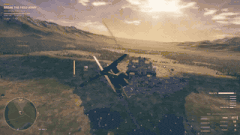
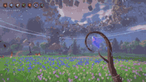
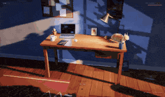
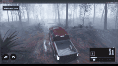
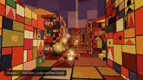

# 🎮 Jeux · les 80

[← Retour à la liste](../README.fr.md) · [English](games.md) · [简体中文](games.zh-CN.md) · [繁體中文](games.zh-TW.md) · [日本語](games.ja.md) · [한국어](games.ko.md) · [Español](games.es.md) · [Português](games.pt-BR.md) · **Français** · [Deutsch](games.de.md) · [Русский](games.ru.md)

La page principale affiche au plus les 12 entrées les plus aimées de chaque section (seulement celles à 100+ j'aime) ; cette page contient toutes celles de la section, triées par j'aime.

<table>
<tr>
<td width="33%" valign="top">
 
<b><a href="https://starrynightrider.com">Starry Nightrider</a></b> 
🆕 · <a href="https://x.com/ebbyamir">@ebbyamir</a> · ♥ 17.8k · <a href="https://x.com/ebbyamir/status/2120284261089673376">▶ Vidéo</a> 
Van Gogh chevauchant sa Nuit étoilée, en jeu. 
<a href="https://fablelist.000ooo.ooo/fr/prompts/?w=starry-nightrider&ref=gh"><b>✨ Obtenir le prompt</b></a>
</td>
<td width="33%" valign="top">
 
<b><a href="https://claude.ai/artifact/BGY1SztrAYcJQHSsnHHGmp">Saltline — jeu de tir à la première personne</a></b> 
<a href="https://x.com/felixrieseberg">@felixrieseberg</a> · ♥ 14.7k · <a href="https://x.com/felixrieseberg/status/2119925633564463609">▶ Vidéo</a> 
Par un ingénieur d'Anthropic. Prompts en un seul essai, sans retour humain, 8 heures, ~550 $. Modèles, sons et textures tous générés en code. 
<a href="https://fablelist.000ooo.ooo/fr/prompts/?w=saltline-first-person-shooter&ref=gh"><b>✨ Obtenir le prompt</b></a>
</td>
<td width="33%" valign="top">
 
<b><a href="https://patch.gg/blendi/oil-paint">Oil Paint — jeu peint à la main</a></b> 
🆕 · <a href="https://x.com/BlendiByl">@BlendiByl</a> · ♥ 7.9k · <a href="https://x.com/BlendiByl/status/2120341251178594532">▶ Vidéo</a> 
Fait en moins d'une heure. Chaque image compte environ 1,5 million de coups de pinceau, à 200 ips dans un onglet de navigateur. Open source. 
<a href="https://fablelist.000ooo.ooo/fr/prompts/?w=oil-paint-hand-painted-game&ref=gh"><b>✨ Obtenir le prompt</b></a>
</td>
</tr>
<tr>
<td width="33%" valign="top">
 
<b><a href="https://nyc.somethingbig.ai/">CROSSTOWN — New York en monde ouvert (aperçu précoce)</a></b> 
🆕 · <a href="https://x.com/mattshumer_">@mattshumer_</a> · ♥ 7.5k · <a href="https://x.com/mattshumer_/status/2120282133503820150">▶ Vidéo</a> 
« Rockstar a mis 8 ans. Fable 5.2 va le faire en 7 jours. » Seule une partie de la ville est faite pour l'instant ; appuyez sur B pour envoyer un retour. 
<a href="https://fablelist.000ooo.ooo/fr/prompts/?w=crosstown-open-world-new-york-early-preview&ref=gh"><b>✨ Obtenir le prompt</b></a>
</td>
<td width="33%" valign="top">
 
<b><a href="https://what-the-water-keeps.vercel.app/">What the Water Keeps</a></b> 
<a href="https://x.com/kevin_t_ngo">@kevin_t_ngo</a> · ♥ 4.2k · <a href="https://x.com/kevin_t_ngo/status/2119868968307695818">▶ Vidéo</a> 
Une balade en bateau à travers 8 mondes oniriques, jouable dans le navigateur. 
<a href="https://fablelist.000ooo.ooo/fr/prompts/?w=what-the-water-keeps&ref=gh"><b>✨ Obtenir le prompt</b></a>
</td>
<td width="33%" valign="top">
 
<b><a href="https://tennis.sixfingerpunch.com/">Tennis</a></b> 
🆕 · <a href="https://x.com/photonstorm">@photonstorm</a> · ♥ 3.1k · <a href="https://x.com/photonstorm/status/2120330010112434313">Publication</a> 
On lui a demandé de « se lâcher » pour faire un jeu, et il a rendu ce qui ressemble à un clone de Pong — jusqu'à ce qu'on y joue. 
<a href="https://fablelist.000ooo.ooo/fr/prompts/?w=tennis&ref=gh"><b>✨ Obtenir le prompt</b></a>
</td>
</tr>
<tr>
<td width="33%" valign="top">
 
<b><a href="https://www.spawn.co/@mattshumer/earth?room=local">Mirror Earth</a></b> 
<a href="https://x.com/mattshumer_">@mattshumer_</a> · ♥ 2.4k · <a href="https://x.com/mattshumer_/status/2119877065701036047">▶ Vidéo</a> 
Toute la planète en monde de jeu destructible, avec une météo qui suit la vraie Terre en temps réel. 
<a href="https://fablelist.000ooo.ooo/fr/prompts/?w=mirror-earth&ref=gh"><b>✨ Obtenir le prompt</b></a>
</td>
<td width="33%" valign="top">
 
<b><a href="https://portals-endless-worlds.netlify.app/">Portals: Endless Worlds</a></b> 
<a href="https://x.com/emollick">@emollick</a> · ♥ 1.9k · <a href="https://x.com/emollick/status/2119918307457577163">▶ Vidéo</a> 
25 000 agents ont construit plus de 450 mondes 3D en pur code, inspirés de livres, d'art et de lieux, reliés par des portails que l'on traverse en flottant. 
<a href="https://github.com/emollick/ai-portals">Code source</a> · <a href="https://www.oneusefulthing.org/p/fable-52-and-jagged-agi">Article</a> 
<a href="https://fablelist.000ooo.ooo/fr/prompts/?w=portals-endless-worlds&ref=gh"><b>✨ Obtenir le prompt</b></a>
</td>
<td width="33%" valign="top">
 
<b><a href="https://evensong-phi.vercel.app/">Evensong</a></b> 
🆕 · <a href="https://x.com/kevin_t_ngo">@kevin_t_ngo</a> · ♥ 1.8k · <a href="https://x.com/kevin_t_ngo/status/2120238844754923874">▶ Vidéo</a> 
Un combat de boss de dark fantasy façon souls-like, jouable dans le navigateur. 
<a href="https://fablelist.000ooo.ooo/fr/prompts/?w=evensong&ref=gh"><b>✨ Obtenir le prompt</b></a>
</td>
</tr>
<tr>
<td width="33%" valign="top">
 
<b><a href="https://loktar00.github.io/lanternfall/">LANTERNFALL</a></b> 
🆕 · <a href="https://x.com/loktar00">@loktar00</a> · ♥ 1.4k · <a href="https://x.com/loktar00/status/2120192761542615271">▶ Vidéo</a> 
Tout le jeu — animations, modèles, tout — généré par Fable. Regardez l'effet quand les ennemis meurent. 
<a href="https://fablelist.000ooo.ooo/fr/prompts/?w=lanternfall&ref=gh"><b>✨ Obtenir le prompt</b></a>
</td>
<td width="33%" valign="top">
 
<b><a href="https://op7418.github.io/guizang-game-skill/">Mist-Locked Mountain Gate — jeu d'action 3D</a></b> 
🆕 · <a href="https://x.com/op7418">@op7418</a> · ♥ 1.1k · <a href="https://x.com/op7418/status/2120694045299327187">▶ Vidéo</a> 
Un après-midi, 4,5 milliards de tokens. Modèles, scènes et mouvements tous par Fable, réunis dans un seul fichier HTML de 30 Mo. 
<a href="https://fablelist.000ooo.ooo/fr/prompts/?w=mist-locked-mountain-gate-3d-action-game&ref=gh"><b>✨ Obtenir le prompt</b></a>
</td>
<td width="33%" valign="top">
 
<b><a href="https://wavedash.com/games/rooftop-rally">Rooftop Rally — pickleball sur Unreal 5.9</a></b> 
🆕 · <a href="https://x.com/chongdashu">@chongdashu</a> · ♥ 1.1k · <a href="https://x.com/chongdashu/status/2120154573356793883">▶ Vidéo</a> 
Fable 5.2 avec la préversion d'Unreal Engine 5.9. Personnages de Tripo ; les autres assets 3D et le reste par Fable. 
<a href="https://x.com/chongdashu/status/2120310120509014219">Les coulisses</a> 
<a href="https://fablelist.000ooo.ooo/fr/prompts/?w=rooftop-rally-pickleball-in-unreal-5-9&ref=gh"><b>✨ Obtenir le prompt</b></a>
</td>
</tr>
<tr>
<td width="33%" valign="top">
 
<b><a href="https://claude.ai/artifact/MXxb36zKgN261ckbGhmNin">Three Games (Saltline · The Clockmaker's Heart · Tidewright)</a></b> 
<a href="https://x.com/felixrieseberg">@felixrieseberg</a> · ♥ 809 · <a href="https://x.com/vineerpasam/status/2119955306096857145">▶ Vidéo</a> 
Signé Felix Rieseberg : « Tous les jeux ont été faits avec Claude Fable 5.2. Premiers jets, sans retour humain. » Le lien le plus partagé du jour du lancement. 
<a href="https://claude.ai/artifact/6MjtQjf4ee1ZZjEpafaEpa">The Clockmaker's Heart</a> · <a href="https://claude.ai/artifact/JTgyEMn7sn1q2riWrMb7D4">Tidewright</a> 
<a href="https://fablelist.000ooo.ooo/fr/prompts/?w=three-games-saltline-the-clockmaker-s-heart-tidewright&ref=gh"><b>✨ Obtenir le prompt</b></a>
</td>
<td width="33%" valign="top">
 
<b><a href="https://patch.gg/blendi/coloured-pencil">Coloured Pencil</a></b> 
🆕 · <a href="https://x.com/BlendiByl">@BlendiByl</a> · ♥ 741 · <a href="https://x.com/BlendiByl/status/2121130385723789637">▶ Vidéo</a> 
Une tranche de jeu au crayon de couleur ; l'ombrage de chaque surface et toute la ville sont du code. Open source. 
<a href="https://fablelist.000ooo.ooo/fr/prompts/?w=coloured-pencil&ref=gh"><b>✨ Obtenir le prompt</b></a>
</td>
<td width="33%" valign="top">
 
<b><a href="https://www.spawn.co/@mattshumer/voxel-engine">Voxel Engine</a></b> 
<a href="https://x.com/mattshumer_">@mattshumer_</a> · ♥ 740 · <a href="https://x.com/mattshumer_/status/2119870965106483384">▶ Vidéo</a> 
Construit à partir d'un seul prompt. Son activé. 
<a href="https://fablelist.000ooo.ooo/fr/prompts/?w=voxel-engine&ref=gh"><b>✨ Obtenir le prompt</b></a>
</td>
</tr>
<tr>
<td width="33%" valign="top">
 
<b><a href="https://patch.gg/blendi/patchwork-quilt">Patchwork Quilt</a></b> 
🆕 · <a href="https://x.com/BlendiByl">@BlendiByl</a> · ♥ 669 · <a href="https://x.com/BlendiByl/status/2120746541636047347">▶ Vidéo</a> 
Une tranche de jeu en patchwork façon stop-motion. Toute la carte est du code. Open source. 
<a href="https://fablelist.000ooo.ooo/fr/prompts/?w=patchwork-quilt&ref=gh"><b>✨ Obtenir le prompt</b></a>
</td>
<td width="33%" valign="top">
 
<b><a href="https://bannerfall.itch.io/siege-wing">Siege Wing — un hélicoptère dans une guerre médiévale</a></b> 
🆕 · <a href="https://x.com/builderjaydub">@builderjaydub</a> · ♥ 556 · <a href="https://x.com/builderjaydub/status/2120223731520040966">▶ Vidéo</a> 
Pilotez un hélicoptère armé d'un canon, de roquettes et de missiles, esquivez les balistes romaines et abattez le château.
</td>
<td width="33%" valign="top">
 
<b><a href="https://i-would-have-gotten-away-with-it.netlify.app/">I Would Have Gotten Away With It</a></b> 
<a href="https://x.com/emollick">@emollick</a> · ♥ 509 · <a href="https://x.com/emollick/status/2119876449494540554">▶ Vidéo</a> 
Un Scooby-Doo à l'envers : vous êtes le méchant qui fait fuir des gamins fouineurs. Fable a aussi fait la bande-annonce, la musique et le son. 
<a href="https://fablelist.000ooo.ooo/fr/prompts/?w=i-would-have-gotten-away-with-it&ref=gh"><b>✨ Obtenir le prompt</b></a>
</td>
</tr>
<tr>
<td width="33%" valign="top">
 
<b><a href="https://noclipepe.pages.dev/rug/">Childhood Rug Racer</a></b> 
<a href="https://x.com/noclipepe">@noclipepe</a> · ♥ 415 · <a href="https://x.com/noclipepe/status/2119728047754547326">▶ Vidéo</a> 
Un jeu de course sur le tapis de jeu de votre enfance, même prompt que GPT-6.2 Sol. L'auteur appelle le modèle « Fable 5.5 (routing) ». 
<a href="https://fablelist.000ooo.ooo/fr/prompts/?w=childhood-rug-racer&ref=gh"><b>✨ Obtenir le prompt</b></a>
</td>
<td width="33%" valign="top">
 
<b><a href="https://finderchangchang.github.io/cloud-stunt-3d/">Cloud Stunt 3D</a></b> 
<a href="https://x.com/jev_chat">@jev_chat</a> · ♥ 329 · <a href="https://x.com/jev_chat/status/2120015641151426838">▶ Vidéo</a> 
Généré en 30 minutes ; une version « dorée » optimisée est aussi liée. 
<a href="https://finderchangchang.github.io/cloud-stunt-3d/golden/">Optimized</a> 
<a href="https://x.com/jev_chat/status/2120015641151426838">📝 Prompt du créateur (gratuit)</a>
</td>
<td width="33%" valign="top">
 
<b><a href="https://gilt-and-gutter.vercel.app/">Gilt & Gutter</a></b> 
🆕 · <a href="https://x.com/kevin_t_ngo">@kevin_t_ngo</a> · ♥ 326 · <a href="https://x.com/kevin_t_ngo/status/2119900487688622171">▶ Vidéo</a> 
Un jeu de tir à la première personne en 1v1 avec deux personnages jouables. 
<a href="https://fablelist.000ooo.ooo/fr/prompts/?w=gilt-gutter&ref=gh"><b>✨ Obtenir le prompt</b></a>
</td>
</tr>
<tr>
<td width="33%" valign="top">
 
<b><a href="https://www.spawn.co/@mattshumer/hogwarts-royale">Hogwarts Royale</a></b> 
<a href="https://x.com/mattshumer_">@mattshumer_</a> · ♥ 311 · <a href="https://x.com/mattshumer_/status/2119872098306810226">▶ Vidéo</a> 
« Crée un mashup de Harry Potter et Fortnite » — un battle royale jouable. 
<a href="https://x.com/mattshumer_/status/2119872098306810226">📝 Prompt du créateur (gratuit)</a>
</td>
<td width="33%" valign="top">
 
<b><a href="https://dread-and-district.netlify.app">Dread & District</a></b> 
🆕 · <a href="https://x.com/emollick">@emollick</a> · ♥ 302 · <a href="https://x.com/emollick/status/2120248525254742318">▶ Vidéo</a> 
Un jeu de gestion de transport fantasy « avec du cœur » : un paragraphe vague, puis une ribambelle d'agents qui se disputent sur l'art, le lore et les blagues. La bonne logistique triomphe du mal. 
<a href="https://fablelist.000ooo.ooo/fr/prompts/?w=dread-district&ref=gh"><b>✨ Obtenir le prompt</b></a>
</td>
<td width="33%" valign="top">
 
<b><a href="https://lauramionel.github.io/cayley-flight-simulator/">Simulateur de vol Cayley</a></b> 
🆕 · <a href="https://x.com/lionel_mora">@lionel_mora</a> · ♥ 295 · <a href="https://x.com/lionel_mora/status/2120554787812860294">▶ Vidéo</a> 
Réalisé en un essai pendant la nuit : une vraie physique d'aile qui calcule portance et traînée pour chaque partie de l'aile. 
<a href="https://fablelist.000ooo.ooo/fr/prompts/?w=cayley-flight-simulator&ref=gh"><b>✨ Obtenir le prompt</b></a>
</td>
</tr>
<tr>
<td width="33%" valign="top">
 
<b><a href="https://unsung-vale.vercel.app/">Unsung Vale — RPG en monde ouvert</a></b> 
🆕 · <a href="https://x.com/LexnLin">@LexnLin</a> · ♥ 294 · <a href="https://x.com/LexnLin/status/2121253191748669705">▶ Vidéo</a> 
Une démo de RPG en monde ouvert à la troisième personne. Aucun asset : tout ce qui est à l'écran est fait en code. 
<a href="https://github.com/Leonxlnx/unsung-vale">Code source</a>
</td>
<td width="33%" valign="top">
 
<b><a href="https://github.com/amirmushichge/worm-rider">Worm Rider</a></b> 
<a href="https://x.com/AmirMushich">@AmirMushich</a> · ♥ 251 · <a href="https://x.com/AmirMushich/status/2119937977426338283">▶ Vidéo</a> 
Open source. 220 Ko, 3 400 lignes, 10 prompts, tous les modèles construits de zéro dans Claude Code. 
<a href="https://fablelist.000ooo.ooo/fr/prompts/?w=worm-rider&ref=gh"><b>✨ Obtenir le prompt</b></a>
</td>
<td width="33%" valign="top">
 
<b><a href="https://maad-maxxing.vercel.app/">MAAD MAXXING</a></b> 
🆕 · <a href="https://x.com/Andrew_Blumson">@Andrew_Blumson</a> · ♥ 246 · <a href="https://x.com/Andrew_Blumson/status/2120599812512833557">▶ Vidéo</a> 
100 % code, aucun asset. Les 3 premiers niveaux sont jouables ; audio par ElevenLabs. 
<a href="https://fablelist.000ooo.ooo/fr/prompts/?w=maad-maxxing&ref=gh"><b>✨ Obtenir le prompt</b></a>
</td>
</tr>
<tr>
<td width="33%" valign="top">
 
<b><a href="https://frontier.every.to/experiments/first-crush">First Crush</a></b> 
🆕 · <a href="https://x.com/kieranklaassen">@kieranklaassen</a> · ♥ 229 · <a href="https://x.com/kieranklaassen/status/2119871673294037280">▶ Vidéo</a> 
Un jeu de vinification : frottez la cuve, écrasez 250 kg de raisin, lisez le densimètre, choisissez une levure — et il explique pourquoi. Cliquez sur « Try it » sur la page. 
<a href="https://fablelist.000ooo.ooo/fr/prompts/?w=first-crush&ref=gh"><b>✨ Obtenir le prompt</b></a>
</td>
<td width="33%" valign="top">
 
<b><a href="https://sanwan.ai/games/xingyun-moba/">Starfall — un MOBA dans le navigateur</a></b> 
🆕 · <a href="https://x.com/FuSheng_0306">@FuSheng_0306</a> · ♥ 195 · <a href="https://x.com/FuSheng_0306/status/2121237878097207583">▶ Vidéo</a> 
Un prompt, environ 20 heures de Fable 5.2 : cinq héros, un joueur humain et des PNJ. 
<a href="https://fablelist.000ooo.ooo/fr/prompts/?w=starfall-a-browser-moba&ref=gh"><b>✨ Obtenir le prompt</b></a>
</td>
<td width="33%" valign="top">
 
<b><a href="https://cozylisbon.vercel.app">Cozy Lisbon</a></b> 
🆕 · <a href="https://x.com/goncalo_canhoto">@goncalo_canhoto</a> · ♥ 166 · <a href="https://x.com/goncalo_canhoto/status/2119932946346094690">▶ Vidéo</a> 
Un jeu cosy en un prompt sur un petit avion survolant Lisbonne. 
<a href="https://fablelist.000ooo.ooo/fr/prompts/?w=cozy-lisbon&ref=gh"><b>✨ Obtenir le prompt</b></a>
</td>
</tr>
<tr>
<td width="33%" valign="top">
 
<b><a href="https://spawn.co/@robot/frontline-warfare-deathmatch">Frontline Warfare Deathmatch</a></b> 
<a href="https://x.com/alightinastorm">@alightinastorm</a> · ♥ 163 · <a href="https://x.com/alightinastorm/status/2120020469487440210">▶ Vidéo</a> 
Un jeu de tir façon Call of Duty dans le navigateur.
</td>
<td width="33%" valign="top">
 
<b><a href="https://wquguru.github.io/fable52-fps-repro/">Fable 5.2 FPS Repro</a></b> 
🆕 · <a href="https://x.com/wquguru">@wquguru</a> · ♥ 159 · <a href="https://x.com/wquguru/status/2120383332722905400">▶ Vidéo</a> 
Quatre démos de FPS 3D en fichier unique : modèles, son et textures tous en code. Méthode et source ouvertes. 
<a href="https://github.com/wquguru/fable52-fps-repro">Code source</a> 
<a href="https://x.com/wquguru/status/2120383332722905400">📝 Prompt du créateur (gratuit)</a>
</td>
<td width="33%" valign="top">
 
<b><a href="https://noclipepe.pages.dev/dino">Rambo Dino</a></b> 
<a href="https://x.com/noclipepe">@noclipepe</a> · ♥ 155 · <a href="https://x.com/noclipepe/status/2119927838321328577">▶ Vidéo</a> 
Le jeu du T-Rex de Chrome, refait. Comparé à Opus 5.5, Gemini 4 Carbon et GPT-6 Astra. 
<a href="https://fablelist.000ooo.ooo/fr/prompts/?w=rambo-dino&ref=gh"><b>✨ Obtenir le prompt</b></a>
</td>
</tr>
<tr>
<td width="33%" valign="top">
 
<b><a href="https://remix.gg/g/banana-mine-rush">Banana Mine Rush</a></b> 
🆕 · <a href="https://x.com/0xChuckstock">@0xChuckstock</a> · ♥ 154 · <a href="https://x.com/0xChuckstock/status/2120125184606658728">▶ Vidéo</a> 
Un jeu de kart 3D sur Remix : se lance instantanément dans le navigateur sans compte, avec multijoueur et classements. 
<a href="https://fablelist.000ooo.ooo/fr/prompts/?w=banana-mine-rush&ref=gh"><b>✨ Obtenir le prompt</b></a>
</td>
<td width="33%" valign="top">
 
<b><a href="https://turbo-tails.vercel.app">Turbo Tails</a></b> 
<a href="https://x.com/petergyang">@petergyang</a> · ♥ 139 · <a href="https://x.com/petergyang/status/2119901658394358005">▶ Vidéo</a> 
Jeu de kart 3D : 6 pilotes, dérapages, rampes, objets, solo et multijoueur. 
<a href="https://youtu.be/SsSKJA0EHD4">Comparison video</a> 
<a href="https://fablelist.000ooo.ooo/fr/prompts/?w=turbo-tails&ref=gh"><b>✨ Obtenir le prompt</b></a>
</td>
<td width="33%" valign="top">
 
<b><a href="https://luminazombies.com/">Lumina Zombies</a></b> 
🆕 · <a href="https://x.com/LuminaBench">@LuminaBench</a> · ♥ 124 · <a href="https://x.com/LuminaBench/status/2120660076927099048">▶ Vidéo</a> 
Une toute nouvelle carte avec des easter eggs en quelques prompts, plus des améliorations qui ont divisé par deux les besoins matériels et la latence sur les deux autres cartes. 
<a href="https://fablelist.000ooo.ooo/fr/prompts/?w=lumina-zombies&ref=gh"><b>✨ Obtenir le prompt</b></a>
</td>
</tr>
<tr>
<td width="33%" valign="top">
 
<b><a href="https://loktar00.github.io/llm-test-pages/fable52-dino-chase/">Thunder Valley dino chase</a></b> 
🆕 · <a href="https://x.com/loktar00">@loktar00</a> · ♥ 98 · <a href="https://x.com/loktar00/status/2120905457380507991">▶ Vidéo</a> 
JS pur avec son propre moteur de rendu WebGL ; les dinos, les arbres et le terrain sont des tranches de pixel art 2D empilées. 
<a href="https://fablelist.000ooo.ooo/fr/prompts/?w=thunder-valley-dino-chase&ref=gh"><b>✨ Obtenir le prompt</b></a>
</td>
<td width="33%" valign="top">
 
<b><a href="https://feed-backrooms.vercel.app">Feed the Backrooms</a></b> 
<a href="https://x.com/LexnLin">@LexnLin</a> · ♥ 95 · <a href="https://x.com/LexnLin/status/2119966127149429093">▶ Vidéo</a> 
Les Backrooms à l'envers : vous êtes le monstre et votre travail est d'attraper des gens. 
<a href="https://fablelist.000ooo.ooo/fr/prompts/?w=feed-the-backrooms&ref=gh"><b>✨ Obtenir le prompt</b></a>
</td>
<td width="33%" valign="top">
 
<b><a href="https://rivergame-kappa.vercel.app">The Waking River</a></b> 
🆕 · <a href="https://x.com/flxrnc">@flxrnc</a> · ♥ 90 · <a href="https://x.com/flxrnc/status/2120494277528580110">▶ Vidéo</a> 
Un prompt et quelques relances : cinq mondes endormis qui s'éveillent à mesure que vous naviguez, avec une partition faite en code. 
<a href="https://x.com/flxrnc/status/2120494277528580110">📝 Prompt du créateur (gratuit)</a>
</td>
</tr>
<tr>
<td width="33%" valign="top">
 
<b><a href="https://app.usecrayon.ai/play/992c2130-43da-416b-a577-aed9514d3057">SKYWAKE</a></b> 
🆕 · <a href="https://x.com/aniketjart">@aniketjart</a> · ♥ 79 · <a href="https://x.com/aniketjart/status/2120378493729222700">▶ Vidéo</a> 
Un jeu de quêtes en vol fait avec Fable 5.2, Opus 5.5, Crayon et three.js. 
<a href="https://fablelist.000ooo.ooo/fr/prompts/?w=skywake&ref=gh"><b>✨ Obtenir le prompt</b></a>
</td>
<td width="33%" valign="top">
 
<b><a href="https://app.usecrayon.ai/play/0cd7624e-1297-417e-a5be-b3c3036a496a">KUMOKIRI</a></b> 
🆕 · <a href="https://x.com/aniketjart">@aniketjart</a> · ♥ 72 · <a href="https://x.com/aniketjart/status/2121101334900617631">▶ Vidéo</a> 
Un jeu de samouraï à l'aspect pictural fait avec Fable 5.2, Crayon et three.js. 
<a href="https://fablelist.000ooo.ooo/fr/prompts/?w=kumokiri&ref=gh"><b>✨ Obtenir le prompt</b></a>
</td>
<td width="33%" valign="top">
 
<b><a href="https://save-the-world-fable.vercel.app/">Save the World</a></b> 
🆕 · <a href="https://x.com/global_techgirl">@global_techgirl</a> · ♥ 63 · <a href="https://x.com/global_techgirl/status/2120246750459961453">▶ Vidéo</a> 
Il a construit la rue, trouvé les modèles 3D et les sons, et joué lui-même au jeu pour enregistrer la bande-annonce. Mieux sur laptop. 
<a href="https://fablelist.000ooo.ooo/fr/prompts/?w=save-the-world&ref=gh"><b>✨ Obtenir le prompt</b></a>
</td>
</tr>
<tr>
<td width="33%" valign="top">
 
<b><a href="https://patch.gg/games/rehan/ringfall">Ringfall</a></b> 
🆕 · <a href="https://x.com/rehan_shei">@rehan_shei</a> · ♥ 62 · <a href="https://x.com/rehan_shei/status/2119994607291584962">▶ Vidéo</a> 
Un FPS inspiré de Destiny. Open source et remixable. 
<a href="https://fablelist.000ooo.ooo/fr/prompts/?w=ringfall&ref=gh"><b>✨ Obtenir le prompt</b></a>
</td>
<td width="33%" valign="top">
 
<b><a href="https://www.spawn.co/@abbidabbi/pogo-riot">Pogo Riot</a></b> 
🆕 · <a href="https://x.com/Pumpnasterr">@Pumpnasterr</a> · ♥ 59 · <a href="https://x.com/Pumpnasterr/status/2121343507885682917">▶ Vidéo</a> 
Un FPS chacun pour soi où l'on rebondit sur un bâton sauteur tout en visant.
</td>
<td width="33%" valign="top">
 
<b><a href="https://samg-coder.github.io/solstice-racing/">Kestrel Head — course Solstice</a></b> 
🆕 · <a href="https://x.com/SamGCoder">@SamGCoder</a> · ♥ 56 · <a href="https://x.com/SamGCoder/status/2120044542087070066">▶ Vidéo</a> 
Construit sur le moteur Rust + WebGPU de l'auteur : une Porsche 992 GT3 R modélisée dans Blender et un circuit insulaire de 3 km. Manette prise en charge. 
<a href="https://github.com/SamG-Coder/solstice-racing">Code source</a> 
<a href="https://fablelist.000ooo.ooo/fr/prompts/?w=kestrel-head-solstice-racing&ref=gh"><b>✨ Obtenir le prompt</b></a>
</td>
</tr>
<tr>
<td width="33%" valign="top">
 
<b><a href="https://shubhu121.github.io/hitdude/play/">HITOFUDE</a></b> 
🆕 · <a href="https://x.com/positronx_">@positronx_</a> · ♥ 52 · <a href="https://x.com/positronx_/status/2120374208043876422">▶ Vidéo</a> 
Chaque image est pinceautée en code comme de l'encre sumi sur papier. Le boss efface le niveau ; votre épée est un pinceau. 
<a href="https://fablelist.000ooo.ooo/fr/prompts/?w=hitofude&ref=gh"><b>✨ Obtenir le prompt</b></a>
</td>
<td width="33%" valign="top">
 
<b><a href="https://patch.gg/play/blendi/small-magic">Small Magic — bac à sable de sorcier</a></b> 
🆕 · <a href="https://x.com/BlendiByl">@BlendiByl</a> · ♥ 50 · <a href="https://x.com/BlendiByl/status/2121594536153718972">▶ Vidéo</a> 
Fait en une journée : 7 sorts, environ 1 800 éléments physiques destructibles, ni modèles ni textures, open source.
</td>
<td width="33%" valign="top">
 
<b><a href="https://fowllabs.com/fable-5-2/chairmageddon/">Chairmageddon</a></b> 
🆕 · <a href="https://x.com/argofowl">@argofowl</a> · ♥ 48 · <a href="https://x.com/argofowl/status/2120568779537273263">▶ Vidéo</a> 
Détruisez une paisible ville de chaises bleues. Oui, on peut envoyer la poussette dans le vortex. 
<a href="https://fablelist.000ooo.ooo/fr/prompts/?w=chairmageddon&ref=gh"><b>✨ Obtenir le prompt</b></a>
</td>
</tr>
<tr>
<td width="33%" valign="top">
 
<b><a href="https://higgsfield.ai/@higgsfield.studio/blogs/fable-5-2-built-this-rpg-from-pure-code-here-s-every-step">VOWLORN</a></b> 
<a href="https://x.com/higgsfield_ai">@higgsfield_ai</a> · ♥ 46 · <a href="https://x.com/higgsfield_ai/status/2119997122896601269">▶ Vidéo</a> 
Un RPG sombre où même les voix sont du code, déployé via Higgsfield MCP. Les liens mènent aux pages de jeu avec les workflows complets. 
<a href="https://higgsfield.ai/@higgsfield.studio/blogs/claude-fable-5-2-built-a-dragon-riding-game-play-it-free">Dragon-riding game</a> · <a href="https://higgsfield.ai/@higgsfield.studio/blogs/one-drawing-fable-5-2-turned-it-into-a-horror-game">Drawing-to-horror game</a> 
<a href="https://fablelist.000ooo.ooo/fr/prompts/?w=vowlorn&ref=gh"><b>✨ Obtenir le prompt</b></a>
</td>
<td width="33%" valign="top">
 
<b><a href="https://claude.ai/artifact/4nPXUKJjQWNsZEHVNmXXCt">Stray Cat</a></b> 
<a href="https://x.com/aimikoda">@aimikoda</a> · ♥ 44 · <a href="https://x.com/aimikoda/status/2120120133712593118">▶ Vidéo</a> 
Sauvez des chatons, soufflez sur les chiens, miaulez face à un vieux matou. Tous les sons sont synthétisés. 
<a href="https://fablelist.000ooo.ooo/fr/prompts/?w=stray-cat&ref=gh"><b>✨ Obtenir le prompt</b></a>
</td>
<td width="33%" valign="top">
 
<b><a href="https://sael.net/demo/farewell-light/">Farewell Light</a></b> 
🆕 · <a href="https://x.com/RyanSael">@RyanSael</a> · ♥ 44 · <a href="https://x.com/RyanSael/status/2120695866684231998">▶ Vidéo</a> 
Une démo de gameplay faite en une nuit. 
<a href="https://fablelist.000ooo.ooo/fr/prompts/?w=farewell-light&ref=gh"><b>✨ Obtenir le prompt</b></a>
</td>
</tr>
<tr>
<td width="33%" valign="top">
 
<b><a href="https://claude.ai/artifact/UD9pGEN4QFA8F5EadRw8eL">Midnight Pass</a></b> 
🆕 · <a href="https://x.com/andreysuperior">@andreysuperior</a> · ♥ 44 · <a href="https://x.com/andreysuperior/status/2120666660130746458">▶ Vidéo</a> 
Un fichier HTML, 603 lignes, zéro asset : vraie physique de drift, une montagne générée, moteur et pneus synthétisés. 
<a href="https://fablelist.000ooo.ooo/fr/prompts/?w=midnight-pass&ref=gh"><b>✨ Obtenir le prompt</b></a>
</td>
<td width="33%" valign="top">
 
<b><a href="https://loktar00.github.io/llm-test-pages/fable52-hang-glider/">Thermal</a></b> 
🆕 · <a href="https://x.com/loktar00">@loktar00</a> · ♥ 41 · <a href="https://x.com/loktar00/status/2121005021131083851">▶ Vidéo</a> 
Un petit jeu de deltaplane : surfez sur les thermiques et atteignez la cible. 
<a href="https://fablelist.000ooo.ooo/fr/prompts/?w=thermal&ref=gh"><b>✨ Obtenir le prompt</b></a>
</td>
<td width="33%" valign="top">
 
<b><a href="https://remix.gg/g/survivors">Survivors</a></b> 
🆕 · <a href="https://x.com/BLACKST0CK">@BLACKST0CK</a> · ♥ 40 · <a href="https://x.com/BLACKST0CK/status/2120329788896498123">▶ Vidéo</a> 
Vampire Survivors avec montée de niveau et butin façon WoW. En solo ou en coop jusqu'à 4. 
<a href="https://fablelist.000ooo.ooo/fr/prompts/?w=survivors&ref=gh"><b>✨ Obtenir le prompt</b></a>
</td>
</tr>
<tr>
<td width="33%" valign="top">
 
<b><a href="https://fowllabs.com/fable-5-2/knock-it-off/">Knock It Off</a></b> 
🆕 · <a href="https://x.com/argofowl">@argofowl</a> · ♥ 40 · <a href="https://x.com/argofowl/status/2121276206683410839">▶ Vidéo</a> 
Vous êtes un chat à 3 h du matin qui fait tomber tout ce qui traîne sur le bureau sans réveiller l'humain. Un seul fichier HTML, sans modèle 3D.
</td>
<td width="33%" valign="top">
 
<b><a href="https://www.aigameshare.com/games/animal-card-battle-game?play=1&mode=fullscreen">Thimble Knights</a></b> 
🆕 · <a href="https://x.com/_nilni">@_nilni</a> · ♥ 34 · <a href="https://x.com/_nilni/status/2120435983032447382">▶ Vidéo</a> 
Un jeu de combat de cartes d'animaux en temps réel. 
<a href="https://x.com/_nilni/status/2120435983032447382">📝 Prompt du créateur (gratuit)</a>
</td>
<td width="33%" valign="top">
 
<b><a href="https://tetriss22.github.io/harbor-gp/">Harbor Lights Grand Prix</a></b> 
🆕 · <a href="https://x.com/Tetriss112">@Tetriss112</a> · ♥ 33 · <a href="https://x.com/Tetriss112/status/2120946576663134308">▶ Vidéo</a> 
Un fichier HTML : 20 voitures pixel art sur un circuit urbain de 22 virages, avec une fenêtre de paris avant chaque course (argent fictif). 
<a href="https://fablelist.000ooo.ooo/fr/prompts/?w=harbor-lights-grand-prix&ref=gh"><b>✨ Obtenir le prompt</b></a>
</td>
</tr>
<tr>
<td width="33%" valign="top">
 
<b><a href="https://blog.silencestar.com/posts/tilt-labyrinth/play/">Tilt Labyrinth</a></b> 
<a href="https://x.com/mylifcc">@mylifcc</a> · ♥ 32 · <a href="https://x.com/mylifcc/status/2120054646282870910">▶ Vidéo</a> 
Un labyrinthe à bille en bois en 2 000 lignes de three.js. Fable l'a optimisé seul de 55 ms à 9 ms par image. 
<a href="https://fablelist.000ooo.ooo/fr/prompts/?w=tilt-labyrinth&ref=gh"><b>✨ Obtenir le prompt</b></a>
</td>
<td width="33%" valign="top">
 
<b><a href="https://claude.ai/artifact/QvSjL7Hexf3nKdUP9Zerr7">Jeu de combat (jouable sur téléphone)</a></b> 
🆕 · <a href="https://x.com/s_shigel">@s_shigel</a> · ♥ 32 · <a href="https://x.com/s_shigel/status/2120300080569975034">▶ Vidéo</a> 
Un jeu de combat itéré pendant la nuit, jouable dans un navigateur mobile. 
<a href="https://fablelist.000ooo.ooo/fr/prompts/?w=fighting-game-plays-on-phones&ref=gh"><b>✨ Obtenir le prompt</b></a>
</td>
<td width="33%" valign="top">
 
<b><a href="https://remix.gg/g/hoppy-meadow">Hoppy Meadow</a></b> 
🆕 · <a href="https://x.com/0xChuckstock">@0xChuckstock</a> · ♥ 26 · <a href="https://x.com/0xChuckstock/status/2120620907865473448">Publication</a> 
On dirait un simple jeu de plateforme, jusqu'à ce qu'on arrive au mât du drapeau. 
<a href="https://fablelist.000ooo.ooo/fr/prompts/?w=hoppy-meadow&ref=gh"><b>✨ Obtenir le prompt</b></a>
</td>
</tr>
<tr>
<td width="33%" valign="top">
 
<b><a href="https://the-vast-horizon.vercel.app">The Vast Horizon</a></b> 
🆕 · <a href="https://x.com/OdinLovis">@OdinLovis</a> · ♥ 26 · <a href="https://x.com/OdinLovis/status/2120198469755503091">▶ Vidéo</a> 
Un jeu de surf multijoueur sur un lac partagé ; tapez un mot et le monde change. 
<a href="https://fablelist.000ooo.ooo/fr/prompts/?w=the-vast-horizon&ref=gh"><b>✨ Obtenir le prompt</b></a>
</td>
<td width="33%" valign="top">
 
<b><a href="https://claude.ai/artifact/FpdQ81sJs1KiV1a6JCY4jj">Aventure de kart en monde ouvert</a></b> 
🆕 · <a href="https://x.com/realWeZZard">@realWeZZard</a> · ♥ 24 · <a href="https://x.com/realWeZZard/status/2120379500492185939">▶ Vidéo</a> 
Un seul essai en trois heures ; la quête principale dure environ une demi-heure. 
<a href="https://fablelist.000ooo.ooo/fr/prompts/?w=open-world-kart-adventure&ref=gh"><b>✨ Obtenir le prompt</b></a>
</td>
<td width="33%" valign="top">
 
<b><a href="https://remix.gg/g/brix-84">BRIX '84</a></b> 
🆕 · <a href="https://x.com/0xChuckstock">@0xChuckstock</a> · ♥ 24 · <a href="https://x.com/0xChuckstock/status/2120896397839126579">Publication</a> 
Un casse-briques qui devient fou après le deuxième bonus. 
<a href="https://fablelist.000ooo.ooo/fr/prompts/?w=brix-84&ref=gh"><b>✨ Obtenir le prompt</b></a>
</td>
</tr>
<tr>
<td width="33%" valign="top">
 
<b><a href="https://giant-leap.vercel.app">Giant Leap</a></b> 
🆕 · <a href="https://x.com/handsher_NGU">@handsher_NGU</a> · ♥ 23 · <a href="https://x.com/handsher_NGU/status/2120287667141374212">▶ Vidéo</a> 
Sautez de la Lune jusqu'à la Terre. Vous ne faites que sauter. 
<a href="https://fablelist.000ooo.ooo/fr/prompts/?w=giant-leap&ref=gh"><b>✨ Obtenir le prompt</b></a>
</td>
<td width="33%" valign="top">
 
<b><a href="https://qiaomu.t5t6.com/irondusk-yard-7/">IRONDUSK — Yard 7</a></b> 
🆕 · <a href="https://x.com/vista8">@vista8</a> · ♥ 20 · <a href="https://x.com/vista8/status/2120383046239285264">Publication</a> 
Un prompt demandant un minuscule niveau de FPS capable de rivaliser avec les visuels AAA. Un second prompt a produit un casse-briques 3D avec IA et mode deux joueurs. 
<a href="https://qiaomu.t5t6.com/3d/">3D brick breaker</a> 
<a href="https://x.com/vista8/status/2120383046239285264">📝 Prompt du créateur (gratuit)</a>
</td>
<td width="33%" valign="top">
 
<b><a href="https://cozybakery.vercel.app">Cozy Bakery</a></b> 
🆕 · <a href="https://x.com/goncalo_canhoto">@goncalo_canhoto</a> · ♥ 18 · <a href="https://x.com/goncalo_canhoto/status/2120530199649432063">▶ Vidéo</a> 
Un jeu de cuisine coopératif façon Overcooked autour du Portugal, de 1 à 4 joueurs, fonctionne sur mobile. 
<a href="https://fablelist.000ooo.ooo/fr/prompts/?w=cozy-bakery&ref=gh"><b>✨ Obtenir le prompt</b></a>
</td>
</tr>
<tr>
<td width="33%" valign="top">
 
<b><a href="https://www.nightclub-driftspeed.xyz/">NightClub: Drift & Speed</a></b> 
🆕 · <a href="https://x.com/Story91_">@Story91_</a> · ♥ 17 · <a href="https://x.com/Story91_/status/2121016763190059194">▶ Vidéo</a> 
Un jeu de course de drift dans le navigateur avec classement mondial, construit à partir d'un dossier vide en 72 heures. 
<a href="https://fablelist.000ooo.ooo/fr/prompts/?w=nightclub-drift-speed&ref=gh"><b>✨ Obtenir le prompt</b></a>
</td>
<td width="33%" valign="top">
 
<b><a href="https://silicon-seduction.vercel.app/">Silicon Seduction</a></b> 
<a href="https://x.com/ZryMiller">@ZryMiller</a> · ♥ 13 · <a href="https://x.com/ZryMiller/status/2119918766691954691">▶ Vidéo</a> 
Pouvez-vous vous en sortir sans vous laisser séduire ? 
<a href="https://fablelist.000ooo.ooo/fr/prompts/?w=silicon-seduction&ref=gh"><b>✨ Obtenir le prompt</b></a>
</td>
<td width="33%" valign="top">
 
<b><a href="https://fighting-game-ignition.saito-931.workers.dev">Jeu de combat IGNITION</a></b> 
🆕 · <a href="https://x.com/s_shigel">@s_shigel</a> · ♥ 13 · <a href="https://x.com/s_shigel/status/2120895161890914336">▶ Vidéo</a> 
Un jeu de combat 2D avec voix et sons générés, journaux de parties et replays. 
<a href="https://fablelist.000ooo.ooo/fr/prompts/?w=ignition-fighting-game&ref=gh"><b>✨ Obtenir le prompt</b></a>
</td>
</tr>
<tr>
<td width="33%" valign="top">
 
<b><a href="https://www.aigameshare.com/games/island-god-game?play=1&mode=fullscreen">Handful: Island God</a></b> 
🆕 · <a href="https://x.com/_nilni">@_nilni</a> · ♥ 11 · <a href="https://x.com/_nilni/status/2120639452146250153">▶ Vidéo</a> 
Jouez un dieu et guidez les petits points vers la lumière. 
<a href="https://fablelist.000ooo.ooo/fr/prompts/?w=handful-island-god&ref=gh"><b>✨ Obtenir le prompt</b></a>
</td>
<td width="33%" valign="top">
 
<b><a href="https://wavedash.com/games/reef-dive">Reef Dive</a></b> 
🆕 · <a href="https://x.com/boona11">@boona11</a> · ♥ 11 · <a href="https://x.com/boona11/status/2120886837422195123">▶ Vidéo</a> 
Un jeu de plongée en three.js que l'auteur a confié à Fable 5.2 pendant une journée pour qu'il ait l'air d'un jeu bien plus gros. 
<a href="https://fablelist.000ooo.ooo/fr/prompts/?w=reef-dive&ref=gh"><b>✨ Obtenir le prompt</b></a>
</td>
<td width="33%" valign="top">
 
<b><a href="https://rust4x4.com/">Aussie Outback 4x4</a></b> 
🆕 · <a href="https://x.com/SamGCoder">@SamGCoder</a> · ♥ 9 · <a href="https://x.com/SamGCoder/status/2121513178303811931">▶ Vidéo</a> 
Du tout-terrain dans le bush australien sur le moteur Rust + WebGPU de l'auteur : boue, passages de gué, franchissement de rochers, blocage de différentiel, pression des pneus et météo dynamique.
</td>
</tr>
<tr>
<td width="33%" valign="top">
 
<b><a href="https://aashishgtbit.github.io/PaletteRider/">PaletteRider — à vélo dans des tableaux célèbres</a></b> 
🆕 · <a href="https://x.com/Aashish_Tiwari_">@Aashish_Tiwari_</a> · ♥ 9 · <a href="https://x.com/Aashish_Tiwari_/status/2120963463610880150">▶ Vidéo</a> 
Roulez à vélo dans les villes de Château et soleil de Klee et de Terrasse du café le soir de Van Gogh ; la musique est aussi signée Fable 5.2.
</td>
<td width="33%" valign="top">
 
<b><a href="http://poke-jam.vercel.app">Poke Dodge</a></b> 
🆕 · <a href="https://x.com/crtvTeknologist">@crtvTeknologist</a> · ♥ 8 · <a href="https://x.com/crtvTeknologist/status/2121319366830809285">▶ Vidéo</a> 
Un mashup 2v2 de Pokémon et de balle au prisonnier avec une saveur NBA Jam : échelle d'arènes, affinités de types et objets tenus, sur une scène Three.js.
</td>
<td width="33%" valign="top">
 
<b><a href="https://www.aigameshare.com/games/great-wave-off-kanagawa?play=1&mode=fullscreen">Great Wave</a></b> 
🆕 · <a href="https://x.com/_nilni">@_nilni</a> · ♥ 7 · <a href="https://x.com/_nilni/status/2120797996610994355">▶ Vidéo</a> 
Surfez dans la Grande Vague de Hokusai, ramez au-delà des dieux du vent et du tonnerre vers le mont Fuji. 
<a href="https://fablelist.000ooo.ooo/fr/prompts/?w=great-wave&ref=gh"><b>✨ Obtenir le prompt</b></a>
</td>
</tr>
<tr>
<td width="33%" valign="top">
 
<b><a href="https://claude.ai/artifact/DLnFodkTwvawCNwurDmSZK?sk=5N6PtC07f1niB7h3I6clZQ">Roost</a></b> 
<a href="https://x.com/tejas3732">@tejas3732</a> · ♥ 6 · <a href="https://x.com/tejas3732/status/2120091513657139549">▶ Vidéo</a> 
Course de moto-cross en 3D dans un seul chat : 5 prompts, 15 minutes, 3 circuits, rivaux IA, nitro, caméra au guidon. 
<a href="https://fablelist.000ooo.ooo/fr/prompts/?w=roost&ref=gh"><b>✨ Obtenir le prompt</b></a>
</td>
<td width="33%" valign="top">
 
<b><a href="https://clockendbader.github.io/fable-builds/go-for-launch/">Go for Launch</a></b> 
🆕 · <a href="https://x.com/clockendbader">@clockendbader</a> · ♥ 5 · <a href="https://x.com/clockendbader/status/2121251400533631304">Publication</a> 
Un jeu complet de cockpit de la Terre à la Lune en un prompt : 1 h 18 min, environ 30 $. Trois niveaux de difficulté, jauges en direct, contrôle de mission à la radio ; chaque son est fait en code. 
<a href="https://fablelist.000ooo.ooo/fr/prompts/?w=go-for-launch&ref=gh"><b>✨ Obtenir le prompt</b></a>
</td>
<td width="33%" valign="top">
 
<b><a href="https://infall-game.vercel.app">INFALL — vous êtes le trou noir</a></b> 
🆕 · <a href="https://x.com/AugustCastilIo">@AugustCastilIo</a> · ♥ 5 · <a href="https://x.com/AugustCastilIo/status/2121350653037756557">▶ Vidéo</a> 
La seule consigne était « lâche-toi et épate-moi » ; il est passé de l'idée au jeu en un seul essai.
</td>
</tr>
<tr>
<td width="33%" valign="top">
 
<b><a href="https://claude.ai/artifact/1QGGhB68jMCjjjeeKtKNUo">Jeu de combat à quatre personnages</a></b> 
<a href="https://x.com/promodenstudio">@promodenstudio</a> · ♥ 4 · <a href="https://x.com/promodenstudio/status/2120085977079107788">▶ Vidéo</a> 
Fable 5.2 + ElevenLabs MCP pour 39 clips de voix et de son, dont un annonceur conçu par lui. Ordinateur + clavier. 
<a href="https://fablelist.000ooo.ooo/fr/prompts/?w=four-character-fighting-game&ref=gh"><b>✨ Obtenir le prompt</b></a>
</td>
<td width="33%" valign="top">
 
<b><a href="https://vippi.vercel.app/">Vippi</a></b> 
<a href="https://x.com/Shrit1401">@Shrit1401</a> · ♥ 1 · <a href="https://x.com/Shrit1401/status/2120060593763926314">▶ Vidéo</a> 
Un jeu de tir façon COD. Le benchmark de jeux flippants de l'auteur est aussi lié. 
<a href="https://claude.ai/artifact/HSxhHE91J2jhLsB8WiTgUc">Creepy-game test</a> 
<a href="https://fablelist.000ooo.ooo/fr/prompts/?w=vippi&ref=gh"><b>✨ Obtenir le prompt</b></a>
</td>
</tr>
</table>

Autres sections : [🌍 Mondes et scènes 3D](3d-worlds.fr.md) · [🧰 Pages web et outils](web-and-tools.fr.md) · [🎬 Animation et films](animation.fr.md) · [📺 Démos vidéo](video-demos.fr.md)

[← Retour à la liste](../README.fr.md)
