# 🎮 ゲーム · 全 119 件

[← メインリストに戻る](../README.ja.md) · [English](games.md) · [简体中文](games.zh-CN.md) · [繁體中文](games.zh-TW.md) · **日本語** · [한국어](games.ko.md) · [Español](games.es.md) · [Português](games.pt-BR.md) · [Français](games.fr.md) · [Deutsch](games.de.md) · [Русский](games.ru.md)

トップページには各カテゴリで 100 いいね以上の上位 24 件だけを載せています。このページはこのカテゴリの全件を、いいね数順に並べたものです。

<table>
<tr>
<td width="33%" valign="top">
 
<b><a href="https://starrynightrider.com">Starry Nightrider</a></b> 
<a href="https://x.com/ebbyamir">@ebbyamir</a> · ♥ 17.9k · <a href="https://x.com/ebbyamir/status/2120284261089673376">▶ 動画</a> 
ゴッホが『星月夜』の中を駆け抜けるゲーム。 
<a href="https://fablelist.000ooo.ooo/ja/prompts/?w=starry-nightrider&ref=gh"><b>✨ プロンプトを入手</b></a>
</td>
<td width="33%" valign="top">
 
<b><a href="https://claude.ai/artifact/BGY1SztrAYcJQHSsnHHGmp">Saltline — 一人称シューティング</a></b> 
<a href="https://x.com/felixrieseberg">@felixrieseberg</a> · ♥ 15.1k · <a href="https://x.com/felixrieseberg/status/2119925633564463609">▶ 動画</a> 
Anthropic のエンジニア作。ワンショットのプロンプト、人間のフィードバックなしで 8 時間、約 $550。モデル・サウンド・テクスチャはすべてコードで生成。 
<a href="https://fablelist.000ooo.ooo/ja/prompts/?w=saltline-first-person-shooter&ref=gh"><b>✨ プロンプトを入手</b></a>
</td>
<td width="33%" valign="top">
 
<b><a href="https://viktorkav.com.br/apoio/uno-com-escada/fable/">Uno com Escada：はしごを載せた Fiat Uno でサーキットを走る</a></b> 
<a href="https://x.com/ViktorKav">@ViktorKav</a> · ♥ 9.2k · <a href="https://x.com/ViktorKav/status/2122647483281015155">▶ 動画</a> 
屋根にはしごを積んだ 1996 年式 Uno Mille でサーキットを走る。603 KB の HTML ファイル 1 つで、エンジンも 3D ライブラリもテクスチャもなし。車、森、空、エンジン音まですべてコード製。 
<a href="https://github.com/viktorkav/uno-com-escada">ソースコード</a>
</td>
</tr>
<tr>
<td width="33%" valign="top">
 
<b><a href="https://patch.gg/blendi/oil-paint">Oil Paint — 手描き風ゲーム</a></b> 
<a href="https://x.com/BlendiByl">@BlendiByl</a> · ♥ 8.0k · <a href="https://x.com/BlendiByl/status/2120341251178594532">▶ 動画</a> 
1 時間足らずで制作。1 フレームあたり約 150 万のブラシストロークを、ブラウザのタブで 200 fps で動かす。オープンソース。 
<a href="https://fablelist.000ooo.ooo/ja/prompts/?w=oil-paint-hand-painted-game&ref=gh"><b>✨ プロンプトを入手</b></a>
</td>
<td width="33%" valign="top">
 
<b><a href="https://nyc.somethingbig.ai/">CROSSTOWN — オープンワールドのニューヨーク（早期プレビュー）</a></b> 
<a href="https://x.com/mattshumer_">@mattshumer_</a> · ♥ 7.5k · <a href="https://x.com/mattshumer_/status/2120282133503820150">▶ 動画</a> 
「Rockstar は 8 年かけた。Fable 5.2 は 7 日でやる。」街の一部だけ実装済み。B キーでフィードバックを送れる。 
<a href="https://fablelist.000ooo.ooo/ja/prompts/?w=crosstown-open-world-new-york-early-preview&ref=gh"><b>✨ プロンプトを入手</b></a>
</td>
<td width="33%" valign="top">
 
<b><a href="https://omw-game.kimaki.dev">omw：油絵タッチの城の谷</a></b> 
<a href="https://x.com/__morse">@__morse</a> · ♥ 4.5k · <a href="https://x.com/__morse/status/2122013410309153042">▶ 動画</a> 
@de5imulate の「omw」ピクセルアートを、ブラウザで遊べる three.js ゲームとして再現。画面は油絵のような描画。 
<a href="https://github.com/remorses/castle-valley">ソースコード</a>
</td>
</tr>
<tr>
<td width="33%" valign="top">
 
<b><a href="https://what-the-water-keeps.vercel.app/">What the Water Keeps</a></b> 
<a href="https://x.com/kevin_t_ngo">@kevin_t_ngo</a> · ♥ 4.3k · <a href="https://x.com/kevin_t_ngo/status/2119868968307695818">▶ 動画</a> 
夢のような 8 つの世界を舟で巡る、ブラウザで遊べる作品。 
<a href="https://fablelist.000ooo.ooo/ja/prompts/?w=what-the-water-keeps&ref=gh"><b>✨ プロンプトを入手</b></a>
</td>
<td width="33%" valign="top">
 
<b><a href="https://tennis.sixfingerpunch.com/">Tennis</a></b> 
<a href="https://x.com/photonstorm">@photonstorm</a> · ♥ 3.1k · <a href="https://x.com/photonstorm/status/2120330010112434313">投稿</a> 
「思い切り作って」と頼まれたゲームは Pong のクローンに見えるが——遊んでみると違う。 
<a href="https://fablelist.000ooo.ooo/ja/prompts/?w=tennis&ref=gh"><b>✨ プロンプトを入手</b></a>
</td>
<td width="33%" valign="top">
<a href="https://kevintngo.github.io/procedural-rpg/">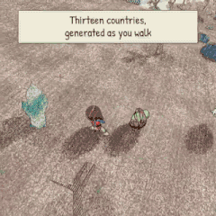</a> 
<b><a href="https://kevintngo.github.io/procedural-rpg/">Brushwild — プロシージャル生成のオープンワールドRPG</a></b> 
🆕 · <a href="https://x.com/kevin_t_ngo">@kevin_t_ngo</a> · ♥ 2.7k · <a href="https://x.com/kevin_t_ngo/status/2125321244686029289">▶ 動画</a> 
約300kBのHTMLファイル1つに収まる、プロシージャル生成のオープンワールドアクションRPG。すべてのピクセルをシェーダーがペンと色鉛筆のタッチで描く。3つのクラス、スキルツリー、戦利品、町とダンジョンがあり、PCでもスマホでも遊べる。 
<a href="https://github.com/kevintngo/procedural-rpg">ソースコード</a>
</td>
</tr>
<tr>
<td width="33%" valign="top">
 
<b><a href="https://patch.gg/play/blendi/small-magic">Small Magic — 魔法使いサンドボックス</a></b> 
<a href="https://x.com/BlendiByl">@BlendiByl</a> · ♥ 2.6k · <a href="https://x.com/BlendiByl/status/2121594536153718972">▶ 動画</a> 
1日で制作：呪文7種、壊せる物理パーツ約1,800個、モデルもテクスチャもなし、オープンソース。
</td>
<td width="33%" valign="top">
 
<b><a href="https://www.spawn.co/@mattshumer/earth?room=local">Mirror Earth</a></b> 
<a href="https://x.com/mattshumer_">@mattshumer_</a> · ♥ 2.4k · <a href="https://x.com/mattshumer_/status/2119877065701036047">▶ 動画</a> 
地球まるごとを壊せるゲーム世界にし、天候は実際の地球とリアルタイムで連動。 
<a href="https://fablelist.000ooo.ooo/ja/prompts/?w=mirror-earth&ref=gh"><b>✨ プロンプトを入手</b></a>
</td>
<td width="33%" valign="top">
 
<b><a href="https://kevintngo.github.io/cinderwatch/">Cinderwatch — HTMLファイル1つのタワーディフェンス</a></b> 
<a href="https://x.com/kevin_t_ngo">@kevin_t_ngo</a> · ♥ 2.3k · <a href="https://x.com/kevin_t_ngo/status/2125119969109418333">▶ 動画</a> 
HTMLファイル1つに収まる3Dアイソメトリックのタワーディフェンス。内蔵のAI司令官に防衛を任せることもできる。オープンソースで、ブラウザですぐ遊べる。 
<a href="https://github.com/kevintngo/cinderwatch">ソースコード</a>
</td>
</tr>
<tr>
<td width="33%" valign="top">
 
<b><a href="https://portals-endless-worlds.netlify.app/">Portals: Endless Worlds</a></b> 
<a href="https://x.com/emollick">@emollick</a> · ♥ 1.9k · <a href="https://x.com/emollick/status/2119918307457577163">▶ 動画</a> 
25,000 の Agent が、本・アート・各地にインスパイアされたコードだけの 3D ワールドを 450 以上作成。ポータルでつながり、漂うように移動できる。 
<a href="https://github.com/emollick/ai-portals">ソースコード</a> · <a href="https://www.oneusefulthing.org/p/fable-52-and-jagged-agi">記事</a> 
<a href="https://fablelist.000ooo.ooo/ja/prompts/?w=portals-endless-worlds&ref=gh"><b>✨ プロンプトを入手</b></a>
</td>
<td width="33%" valign="top">
 
<b><a href="https://evensong-phi.vercel.app/">Evensong</a></b> 
<a href="https://x.com/kevin_t_ngo">@kevin_t_ngo</a> · ♥ 1.8k · <a href="https://x.com/kevin_t_ngo/status/2120238844754923874">▶ 動画</a> 
ダークファンタジーのソウルライク風ボス戦。ブラウザで遊べる。 
<a href="https://fablelist.000ooo.ooo/ja/prompts/?w=evensong&ref=gh"><b>✨ プロンプトを入手</b></a>
</td>
<td width="33%" valign="top">
 
<b><a href="https://loktar00.github.io/lanternfall/">LANTERNFALL</a></b> 
<a href="https://x.com/loktar00">@loktar00</a> · ♥ 1.4k · <a href="https://x.com/loktar00/status/2120192761542615271">▶ 動画</a> 
アニメーションもモデルも、ゲーム全体を Fable が生成。敵が倒れるときのエフェクトに注目。 
<a href="https://fablelist.000ooo.ooo/ja/prompts/?w=lanternfall&ref=gh"><b>✨ プロンプトを入手</b></a>
</td>
</tr>
<tr>
<td width="33%" valign="top">
 
<b><a href="https://app.usecrayon.ai/play/76dbd04f-0684-4486-8cc4-eae0585295e8">悟空：フォースターロード</a></b> 
<a href="https://x.com/aniketjart">@aniketjart</a> · ♥ 1.4k · <a href="https://x.com/aniketjart/status/2121793239175119279">▶ 動画</a> 
ドラゴンボールのレッドリボン軍編をもとにした three.js 製のファンアクションゲーム。制作途中で、最初の 2 マップを遊べます。
</td>
<td width="33%" valign="top">
 
<b><a href="https://heat.pplx.app">VICE '86：ネオン輝く1986年マイアミのオープンワールドドライブ</a></b> 
<a href="https://x.com/AravSrinivas">@AravSrinivas</a> · ♥ 1.3k · <a href="https://x.com/AravSrinivas/status/2122338465648103676">▶ 動画</a> 
ブラウザで動くオープンワールドのドライブゲーム。ゲームエンジンも three.js も使わず、独自の WebGL2 レンダラーを搭載。街、車、雨、エンジン音まですべてコードで生成、JavaScript 約 63,000 行。
</td>
<td width="33%" valign="top">
 
<b><a href="https://op7418.github.io/guizang-game-skill/">Mist-Locked Mountain Gate — 3D アクションゲーム</a></b> 
<a href="https://x.com/op7418">@op7418</a> · ♥ 1.2k · <a href="https://x.com/op7418/status/2120694045299327187">▶ 動画</a> 
ある午後に 45 億トークン。モデル・シーン・アクションはすべて Fable 制作、30 MB の単一 HTML ファイルにまとめた。 
<a href="https://fablelist.000ooo.ooo/ja/prompts/?w=mist-locked-mountain-gate-3d-action-game&ref=gh"><b>✨ プロンプトを入手</b></a>
</td>
</tr>
<tr>
<td width="33%" valign="top">
 
<b><a href="https://wavedash.com/games/rooftop-rally">Rooftop Rally — Unreal 5.9 のピックルボール</a></b> 
<a href="https://x.com/chongdashu">@chongdashu</a> · ♥ 1.1k · <a href="https://x.com/chongdashu/status/2120154573356793883">▶ 動画</a> 
Fable 5.2 と Unreal Engine 5.9 プレビュー。キャラクターは Tripo、ほかの 3D アセットと残りは Fable 制作。 
<a href="https://x.com/chongdashu/status/2120310120509014219">制作過程</a> 
<a href="https://fablelist.000ooo.ooo/ja/prompts/?w=rooftop-rally-pickleball-in-unreal-5-9&ref=gh"><b>✨ プロンプトを入手</b></a>
</td>
<td width="33%" valign="top">
 
<b><a href="https://littlecity.io">Little City — 手描き風の街づくりゲーム</a></b> 
🆕 · <a href="https://x.com/sprezzyyy">@sprezzyyy</a> · ♥ 1.0k · <a href="https://x.com/sprezzyyy/status/2125321545665192054">▶ 動画</a> 
Townscaperに着想を得たサンドボックスの街づくりゲーム。ブロックをいくつか置くと手描き風の町になり、やがて町が動き出す。ブラウザで遊べる。 
<a href="https://github.com/yaoderek/littlecity.io">ソースコード</a>
</td>
<td width="33%" valign="top">
 
<b><a href="https://gtashenzhen.com">GTA Shenzhen</a></b> 
<a href="https://x.com/KinGao476942">@KinGao476942</a> · ♥ 1.0k · <a href="https://x.com/KinGao476942/status/2123967104601014521">▶ 動画</a> 
OpenStreetMap のデータから作った深圳の街まるごと。建物 83,182 棟、道路 62,088 本。空を飛び、着地して車を運転し、好きな場所を検索でき、夜には街全体のライトショーも始められます。Fable 5.2 と Tripo で 3 日で制作。
</td>
</tr>
<tr>
<td width="33%" valign="top">
 
<b><a href="https://thaxnay.com/ramayana/">Ramayana: The Sacred Fires</a></b> 
<a href="https://x.com/Thaxnay">@Thaxnay</a> · ♥ 983 · <a href="https://x.com/Thaxnay/status/2124574054296219939">▶ 動画</a> 
ラーマとなって広い谷を旅し、聖仙たちを守り、隠された秘密を探す三人称アクションアドベンチャー。PCでもスマホでもブラウザで遊べます。
</td>
<td width="33%" valign="top">
<a href="https://noclipepe.pages.dev/chase">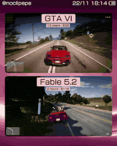</a> 
<b><a href="https://noclipepe.pages.dev/chase">Red Clay Chase — 赤土の道でのポリスチェイス</a></b> 
🆕 · <a href="https://x.com/noclipepe">@noclipepe</a> · ♥ 808 · <a href="https://x.com/noclipepe/status/2124805085393813586">▶ 動画</a> 
ブラウザで遊べるGTA風のポリスチェイス。ゲームエンジンなし、アセットもゼロ。作者によると、Fable 5.2が2.5時間、115ドルかけて作った。 
<a href="https://github.com/noclipepe/red-clay-chase">ソースコード</a>
</td>
<td width="33%" valign="top">
 
<b><a href="https://claude.ai/artifact/MXxb36zKgN261ckbGhmNin">Three Games（Saltline · The Clockmaker's Heart · Tidewright）</a></b> 
<a href="https://x.com/felixrieseberg">@felixrieseberg</a> · ♥ 803 · <a href="https://x.com/vineerpasam/status/2119955306096857145">▶ 動画</a> 
Felix Rieseberg 名義：「すべて Claude Fable 5.2 で作ったゲーム。初稿、人間のフィードバックなし。」公開初日に最も共有されたリンク。 
<a href="https://claude.ai/artifact/6MjtQjf4ee1ZZjEpafaEpa">The Clockmaker's Heart</a> · <a href="https://claude.ai/artifact/JTgyEMn7sn1q2riWrMb7D4">Tidewright</a> 
<a href="https://fablelist.000ooo.ooo/ja/prompts/?w=three-games-saltline-the-clockmaker-s-heart-tidewright&ref=gh"><b>✨ プロンプトを入手</b></a>
</td>
</tr>
<tr>
<td width="33%" valign="top">
 
<b><a href="https://patch.gg/play/blendi/solar">Solar — 自由に飛び回れる小さな太陽系</a></b> 
<a href="https://x.com/BlendiByl">@BlendiByl</a> · ♥ 798 · <a href="https://x.com/BlendiByl/status/2122673770607591855">▶ 動画</a> 
Outer Wilds にインスパイア：本物の軌道と重力、惑星間を途切れずに飛行でき、すべての世界がコードで描かれています。オープンソース。
</td>
<td width="33%" valign="top">
 
<b><a href="https://patch.gg/blendi/coloured-pencil">Coloured Pencil</a></b> 
<a href="https://x.com/BlendiByl">@BlendiByl</a> · ♥ 766 · <a href="https://x.com/BlendiByl/status/2121130385723789637">▶ 動画</a> 
色鉛筆風ゲームの一場面。すべての面の陰影も町全体もコード。オープンソース。 
<a href="https://fablelist.000ooo.ooo/ja/prompts/?w=coloured-pencil&ref=gh"><b>✨ プロンプトを入手</b></a>
</td>
<td width="33%" valign="top">
<a href="https://www.spawn.co/@mattshumer/voxel-engine">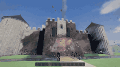</a> 
<b><a href="https://www.spawn.co/@mattshumer/voxel-engine">Voxel Engine</a></b> 
<a href="https://x.com/mattshumer_">@mattshumer_</a> · ♥ 746 · <a href="https://x.com/mattshumer_/status/2119870965106483384">▶ 動画</a> 
たった 1 つのプロンプトで構築。音を出してどうぞ。 
<a href="https://fablelist.000ooo.ooo/ja/prompts/?w=voxel-engine&ref=gh"><b>✨ プロンプトを入手</b></a>
</td>
</tr>
<tr>
<td width="33%" valign="top">
<a href="https://ebb.tesana.com">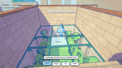</a> 
<b><a href="https://ebb.tesana.com">EBB — 姿を変える水のプラットフォーマー</a></b> 
<a href="https://x.com/Rubzem">@Rubzem</a> · ♥ 693 · <a href="https://x.com/Rubzem/status/2124142554371502140">▶ 動画</a> 
溶ける・凍る・浮かぶ水になってパズルを解く物理プラットフォーマー。すべてプロシージャル生成で 190 KB、1 時間で完成。
</td>
<td width="33%" valign="top">
 
<b><a href="https://patch.gg/blendi/patchwork-quilt">Patchwork Quilt</a></b> 
<a href="https://x.com/BlendiByl">@BlendiByl</a> · ♥ 670 · <a href="https://x.com/BlendiByl/status/2120746541636047347">▶ 動画</a> 
パッチワークでストップモーション風のゲームの一場面。マップ全体がコード。オープンソース。 
<a href="https://fablelist.000ooo.ooo/ja/prompts/?w=patchwork-quilt&ref=gh"><b>✨ プロンプトを入手</b></a>
</td>
<td width="33%" valign="top">
 
<b><a href="https://bannerfall.itch.io/siege-wing">Siege Wing — 中世の戦争にヘリで参戦</a></b> 
<a href="https://x.com/builderjaydub">@builderjaydub</a> · ♥ 576 · <a href="https://x.com/builderjaydub/status/2120223731520040966">▶ 動画</a> 
大砲・ロケット・ミサイルを積んだヘリで、ローマのバリスタをかわしつつ城を落とす。
</td>
</tr>
<tr>
<td width="33%" valign="top">
<a href="https://kevintngo.github.io/voidlight/">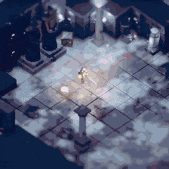</a> 
<b><a href="https://kevintngo.github.io/voidlight/">Voidlight Depths — HTMLファイル1つの宇宙ダンジョン探索</a></b> 
🆕 · <a href="https://x.com/kevin_t_ngo">@kevin_t_ngo</a> · ♥ 548 · <a href="https://x.com/kevin_t_ngo/status/2125982976483975534">▶ 動画</a> 
164 kB のHTMLファイル1つに収まる宇宙ダンジョン探索ゲーム。アセットなしで、テクスチャもモデルも音もすべてコードで生成。 
<a href="https://github.com/kevintngo/voidlight">ソースコード</a>
</td>
<td width="33%" valign="top">
 
<b><a href="https://i-would-have-gotten-away-with-it.netlify.app/">I Would Have Gotten Away With It</a></b> 
<a href="https://x.com/emollick">@emollick</a> · ♥ 520 · <a href="https://x.com/emollick/status/2119876449494540554">▶ 動画</a> 
逆スクービー・ドゥー：あなたは悪役で、おせっかいな子供たちを追い払う。トレーラー、音楽、サウンドも Fable が制作。 
<a href="https://fablelist.000ooo.ooo/ja/prompts/?w=i-would-have-gotten-away-with-it&ref=gh"><b>✨ プロンプトを入手</b></a>
</td>
<td width="33%" valign="top">
<a href="https://valsera-game.vercel.app/">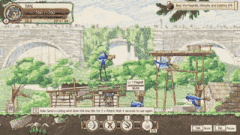</a> 
<b><a href="https://valsera-game.vercel.app/">Valsera — 横スクロール RPG</a></b> 
<a href="https://x.com/kevin_t_ngo">@kevin_t_ngo</a> · ♥ 514 · <a href="https://x.com/kevin_t_ngo/status/2121701020598415465">▶ 動画</a> 
ブラウザで遊べる横スクロール RPG。画像生成モデルや既存の素材は使わず、ビジュアルはすべてコードで描画。
</td>
</tr>
<tr>
<td width="33%" valign="top">
<a href="https://kengoworks.itch.io/dawnlings">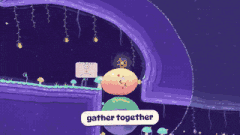</a> 
<b><a href="https://kengoworks.itch.io/dawnlings">Dawnlings — 谷を傾けて、ぷにぷにを転がす</a></b> 
<a href="https://x.com/kevin_t_ngo">@kevin_t_ngo</a> · ♥ 488 · <a href="https://x.com/kevin_t_ngo/status/2122969346935017497">▶ 動画</a> 
LocoRoco にインスパイアされたブラウザゲーム。大地を傾けて眠たげなぷにぷにを転がし、分裂・合体させながら谷を色鮮やかに目覚めさせる。効果音とコンセプトアートは fal で生成。
</td>
<td width="33%" valign="top">
<a href="https://www.spawn.co/@izkimar/the-world-of-hoodcraft">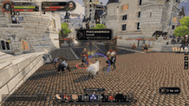</a> 
<b><a href="https://www.spawn.co/@izkimar/the-world-of-hoodcraft">The World of Hoodcraft</a></b> 
<a href="https://x.com/Izkimar">@Izkimar</a> · ♥ 470 · <a href="https://x.com/Izkimar/status/2123188582836031910">▶ 動画</a> 
World of Warcraft と GTA を混ぜたブラウザゲーム。馬車を奪い、手配度が星 5 になるとバトルメイジに羊にされる。6,000 体のネットワーク NPC、完全マルチプレイでオープン PvP。
</td>
<td width="33%" valign="top">
<a href="https://noclipepe.pages.dev/rug/">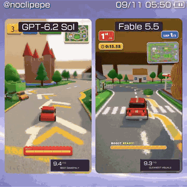</a> 
<b><a href="https://noclipepe.pages.dev/rug/">Childhood Rug Racer</a></b> 
<a href="https://x.com/noclipepe">@noclipepe</a> · ♥ 429 · <a href="https://x.com/noclipepe/status/2119728047754547326">▶ 動画</a> 
子供の頃の遊び用ラグの上を走るレースゲーム。GPT-6.2 Sol と同じプロンプト。作者はこのモデルを「Fable 5.5（ルーティング）」と呼んでいる。 
<a href="https://fablelist.000ooo.ooo/ja/prompts/?w=childhood-rug-racer&ref=gh"><b>✨ プロンプトを入手</b></a>
</td>
</tr>
<tr>
<td width="33%" valign="top">
<a href="https://ballpoint-dominion.vercel.app/">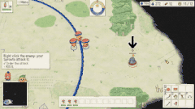</a> 
<b><a href="https://ballpoint-dominion.vercel.app/">Ballpoint Dominion</a></b> 
<a href="https://x.com/kevin_t_ngo">@kevin_t_ngo</a> · ♥ 405 · <a href="https://x.com/kevin_t_ngo/status/2124669366512001493">▶ 動画</a> 
一枚の紙の上で戦うリアルタイムストラテジー。Sunrise か Dusk の陣営を選び、インクを集めて軍隊を描き、ページを制圧します。
</td>
<td width="33%" valign="top">
<a href="https://mariana.pplx.app">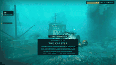</a> 
<b><a href="https://mariana.pplx.app">HADAL：マリアナ海溝へのダイブ</a></b> 
<a href="https://x.com/AravSrinivas">@AravSrinivas</a> · ♥ 364 · <a href="https://x.com/AravSrinivas/status/2122713692324384793">▶ 動画</a> 
日の差すサンゴ礁から出発し、潜水艦に乗って沈没船や鯨骨を過ぎ、チャレンジャー海淵まで潜りながら 18 の発見をスキャンする。自作の WebGPU レンダラーで、エンジンもアセットもなし。373 KB の HTML ファイル 1 つ。
</td>
<td width="33%" valign="top">
<a href="https://gilt-and-gutter.vercel.app/">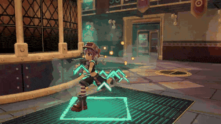</a> 
<b><a href="https://gilt-and-gutter.vercel.app/">Gilt & Gutter</a></b> 
<a href="https://x.com/kevin_t_ngo">@kevin_t_ngo</a> · ♥ 331 · <a href="https://x.com/kevin_t_ngo/status/2119900487688622171">▶ 動画</a> 
2 人のプレイアブルキャラによる 1 対 1 の一人称シューター。 
<a href="https://fablelist.000ooo.ooo/ja/prompts/?w=gilt-gutter&ref=gh"><b>✨ プロンプトを入手</b></a>
</td>
</tr>
<tr>
<td width="33%" valign="top">
 
<b><a href="https://finderchangchang.github.io/cloud-stunt-3d/">Cloud Stunt 3D</a></b> 
<a href="https://x.com/jev_chat">@jev_chat</a> · ♥ 328 · <a href="https://x.com/jev_chat/status/2120015641151426838">▶ 動画</a> 
30 分で生成。最適化した「ゴールデン」版のリンクも付属。 
<a href="https://finderchangchang.github.io/cloud-stunt-3d/golden/">Optimized</a> 
<a href="https://x.com/jev_chat/status/2120015641151426838">📝 作者公開のプロンプト（無料）</a>
</td>
<td width="33%" valign="top">
<a href="https://valle-morta.vercel.app/">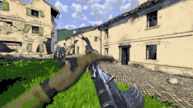</a> 
<b><a href="https://valle-morta.vercel.app/">Valle Morta</a></b> 
<a href="https://x.com/LexnLin">@LexnLin</a> · ♥ 324 · <a href="https://x.com/LexnLin/status/2121934071429468543">▶ 動画</a> 
2 日で作った一人称ゾンビサバイバルシューター。舞台は戦火のアルプスの谷。既製の 3D 素材は使わず、映像はすべてコードで生成。 
<a href="https://github.com/Leonxlnx/valle-morta">ソースコード</a>
</td>
<td width="33%" valign="top">
<a href="https://www.spawn.co/@mattshumer/hogwarts-royale">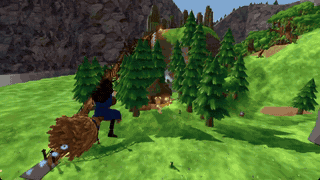</a> 
<b><a href="https://www.spawn.co/@mattshumer/hogwarts-royale">Hogwarts Royale</a></b> 
<a href="https://x.com/mattshumer_">@mattshumer_</a> · ♥ 311 · <a href="https://x.com/mattshumer_/status/2119872098306810226">▶ 動画</a> 
「ハリー・ポッターと Fortnite のマッシュアップを作って」——遊べるバトルロイヤル。 
<a href="https://x.com/mattshumer_/status/2119872098306810226">📝 作者公開のプロンプト（無料）</a>
</td>
</tr>
<tr>
<td width="33%" valign="top">
<a href="https://dread-and-district.netlify.app">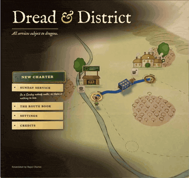</a> 
<b><a href="https://dread-and-district.netlify.app">Dread & District</a></b> 
<a href="https://x.com/emollick">@emollick</a> · ♥ 303 · <a href="https://x.com/emollick/status/2120248525254742318">▶ 動画</a> 
「心のこもった」ファンタジー輸送シム：あいまいな一段落の指示から、Agent たちがアート・世界観・ギャグを議論。優れた物流が悪に勝つ。 
<a href="https://fablelist.000ooo.ooo/ja/prompts/?w=dread-district&ref=gh"><b>✨ プロンプトを入手</b></a>
</td>
<td width="33%" valign="top">
<a href="https://unsung-vale.vercel.app/">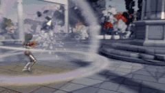</a> 
<b><a href="https://unsung-vale.vercel.app/">Unsung Vale — オープンワールド RPG</a></b> 
<a href="https://x.com/LexnLin">@LexnLin</a> · ♥ 303 · <a href="https://x.com/LexnLin/status/2121253191748669705">▶ 動画</a> 
三人称オープンワールド RPG のデモ。アセットなし：画面上のすべてがコード製。 
<a href="https://github.com/Leonxlnx/unsung-vale">ソースコード</a>
</td>
<td width="33%" valign="top">
<a href="https://lauramionel.github.io/cayley-flight-simulator/">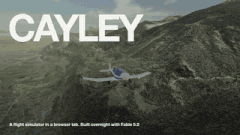</a> 
<b><a href="https://lauramionel.github.io/cayley-flight-simulator/">Cayley 飛行シミュレーター</a></b> 
<a href="https://x.com/lionel_mora">@lionel_mora</a> · ♥ 298 · <a href="https://x.com/lionel_mora/status/2120554787812860294">▶ 動画</a> 
一晩でワンショット：翼の各部分の揚力と抗力を計算する本格的な翼の物理。 
<a href="https://fablelist.000ooo.ooo/ja/prompts/?w=cayley-flight-simulator&ref=gh"><b>✨ プロンプトを入手</b></a>
</td>
</tr>
<tr>
<td width="33%" valign="top">
<a href="https://fallline-9zo.pages.dev">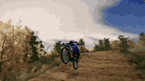</a> 
<b><a href="https://fallline-9zo.pages.dev">Fall Line：ダウンヒル MTB</a></b> 
<a href="https://x.com/BananaOfMercy">@BananaOfMercy</a> · ♥ 290 · <a href="https://x.com/BananaOfMercy/status/2123037856398733438">▶ 動画</a> 
three.js 製のダウンヒルマウンテンバイクゲーム。ブラウザでキーボードを使って遊べる。作者は 7 日間すべてのビルドを走り、違和感のあるところを Fable に伝え続けた。
</td>
<td width="33%" valign="top">
<a href="https://github.com/amirmushichge/worm-rider">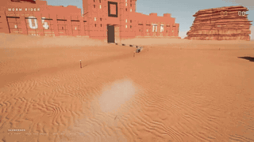</a> 
<b><a href="https://github.com/amirmushichge/worm-rider">Worm Rider</a></b> 
<a href="https://x.com/AmirMushich">@AmirMushich</a> · ♥ 255 · <a href="https://x.com/AmirMushich/status/2119937977426338283">▶ 動画</a> 
オープンソース。220 KB、3,400 行、10 プロンプト、すべてのモデルを Claude Code でゼロから構築。 
<a href="https://fablelist.000ooo.ooo/ja/prompts/?w=worm-rider&ref=gh"><b>✨ プロンプトを入手</b></a>
</td>
<td width="33%" valign="top">
<a href="https://sanwan.ai/games/xingyun-moba/">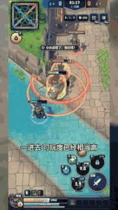</a> 
<b><a href="https://sanwan.ai/games/xingyun-moba/">Starfall — ブラウザ MOBA</a></b> 
<a href="https://x.com/FuSheng_0306">@FuSheng_0306</a> · ♥ 251 · <a href="https://x.com/FuSheng_0306/status/2121237878097207583">▶ 動画</a> 
1 つのプロンプト、約 20 時間の Fable 5.2：5 人のヒーロー、人間プレイヤー 1 人と NPC。 
<a href="https://fablelist.000ooo.ooo/ja/prompts/?w=starfall-a-browser-moba&ref=gh"><b>✨ プロンプトを入手</b></a>
</td>
</tr>
<tr>
<td width="33%" valign="top">
 
<b><a href="https://maad-maxxing.vercel.app/">MAAD MAXXING</a></b> 
<a href="https://x.com/Andrew_Blumson">@Andrew_Blumson</a> · ♥ 249 · <a href="https://x.com/Andrew_Blumson/status/2120599812512833557">▶ 動画</a> 
100% コード、アセットなし。最初の 3 ステージが遊べる。音声は ElevenLabs。 
<a href="https://fablelist.000ooo.ooo/ja/prompts/?w=maad-maxxing&ref=gh"><b>✨ プロンプトを入手</b></a>
</td>
<td width="33%" valign="top">
<a href="https://frontier.every.to/experiments/first-crush">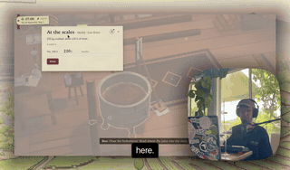</a> 
<b><a href="https://frontier.every.to/experiments/first-crush">First Crush</a></b> 
<a href="https://x.com/kieranklaassen">@kieranklaassen</a> · ♥ 229 · <a href="https://x.com/kieranklaassen/status/2119871673294037280">▶ 動画</a> 
ワイン造りゲーム：桶を洗い、250 kg の果実を潰し、比重計を読み、酵母を選ぶ——その理由も説明してくれる。ページの「Try it」をクリック。 
<a href="https://fablelist.000ooo.ooo/ja/prompts/?w=first-crush&ref=gh"><b>✨ プロンプトを入手</b></a>
</td>
<td width="33%" valign="top">
<a href="https://market-order-city.netlify.app/">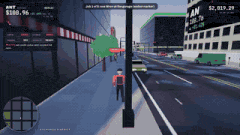</a> 
<b><a href="https://market-order-city.netlify.app/">Market Order</a></b> 
<a href="https://x.com/emollick">@emollick</a> · ♥ 220 · <a href="https://x.com/emollick/status/2123520499368263977">▶ 動画</a> 
車を盗んでミッションをこなすオープンワールドのドライブゲーム。手配度から天気まで、すべてが Anthropic の ANT 株価で決まる。
</td>
</tr>
<tr>
<td width="33%" valign="top">
<a href="https://noclipepe.pages.dev/dino">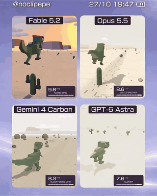</a> 
<b><a href="https://noclipepe.pages.dev/dino">Rambo Dino</a></b> 
<a href="https://x.com/noclipepe">@noclipepe</a> · ♥ 183 · <a href="https://x.com/noclipepe/status/2119927838321328577">▶ 動画</a> 
Chrome の T-Rex ゲームを作り直したもの。Opus 5.5、Gemini 4 Carbon、GPT-6 Astra と比較。 
<a href="https://fablelist.000ooo.ooo/ja/prompts/?w=rambo-dino&ref=gh"><b>✨ プロンプトを入手</b></a>
</td>
<td width="33%" valign="top">
<a href="https://cozylisbon.vercel.app">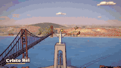</a> 
<b><a href="https://cozylisbon.vercel.app">Cozy Lisbon</a></b> 
<a href="https://x.com/goncalo_canhoto">@goncalo_canhoto</a> · ♥ 171 · <a href="https://x.com/goncalo_canhoto/status/2119932946346094690">▶ 動画</a> 
リスボンの上を小さな飛行機が飛ぶ、1 プロンプトのほのぼのゲーム。 
<a href="https://fablelist.000ooo.ooo/ja/prompts/?w=cozy-lisbon&ref=gh"><b>✨ プロンプトを入手</b></a>
</td>
<td width="33%" valign="top">
<a href="https://spawn.co/@robot/frontline-warfare-deathmatch">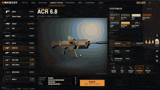</a> 
<b><a href="https://spawn.co/@robot/frontline-warfare-deathmatch">Frontline Warfare Deathmatch</a></b> 
<a href="https://x.com/alightinastorm">@alightinastorm</a> · ♥ 163 · <a href="https://x.com/alightinastorm/status/2120020469487440210">▶ 動画</a> 
ブラウザで動く Call of Duty 風シューター。
</td>
</tr>
<tr>
<td width="33%" valign="top">
<a href="https://wquguru.github.io/fable52-fps-repro/">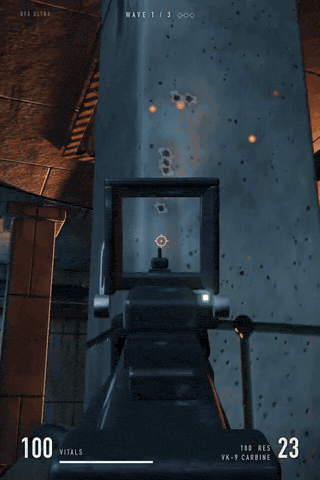</a> 
<b><a href="https://wquguru.github.io/fable52-fps-repro/">Fable 5.2 FPS Repro</a></b> 
<a href="https://x.com/wquguru">@wquguru</a> · ♥ 158 · <a href="https://x.com/wquguru/status/2120383332722905400">▶ 動画</a> 
単一ファイルの 3D FPS デモ 4 本：モデル・サウンド・テクスチャはすべてコード。手法とソースは公開。 
<a href="https://github.com/wquguru/fable52-fps-repro">ソースコード</a> 
<a href="https://x.com/wquguru/status/2120383332722905400">📝 作者公開のプロンプト（無料）</a>
</td>
<td width="33%" valign="top">
<a href="https://remix.gg/g/banana-mine-rush">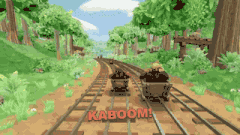</a> 
<b><a href="https://remix.gg/g/banana-mine-rush">Banana Mine Rush</a></b> 
<a href="https://x.com/0xChuckstock">@0xChuckstock</a> · ♥ 153 · <a href="https://x.com/0xChuckstock/status/2120125184606658728">▶ 動画</a> 
Remix 上の 3D カートレース：アカウント不要でブラウザですぐ遊べ、マルチプレイとリーダーボード付き。 
<a href="https://fablelist.000ooo.ooo/ja/prompts/?w=banana-mine-rush&ref=gh"><b>✨ プロンプトを入手</b></a>
</td>
<td width="33%" valign="top">
<a href="https://turbo-tails.vercel.app">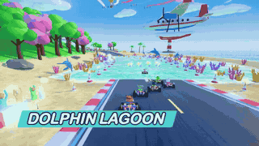</a> 
<b><a href="https://turbo-tails.vercel.app">Turbo Tails</a></b> 
<a href="https://x.com/petergyang">@petergyang</a> · ♥ 143 · <a href="https://x.com/petergyang/status/2119901658394358005">▶ 動画</a> 
3D カートレース：6 人のレーサー、ドリフト、ジャンプ台、アイテム、シングル／マルチ対応。 
<a href="https://youtu.be/SsSKJA0EHD4">Comparison video</a> 
<a href="https://fablelist.000ooo.ooo/ja/prompts/?w=turbo-tails&ref=gh"><b>✨ プロンプトを入手</b></a>
</td>
</tr>
<tr>
<td width="33%" valign="top">
<a href="https://satyam-fp.github.io/race/v1/">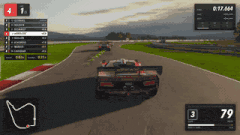</a> 
<b><a href="https://satyam-fp.github.io/race/v1/">Tachyon Sprint</a></b> 
<a href="https://x.com/_satyam_ai">@_satyam_ai</a> · ♥ 140 · <a href="https://x.com/_satyam_ai/status/2123787482747764918">▶ 動画</a> 
Chrome の WebGPU だけで動くレースゲーム。エンジンは作者がゼロから開発中。車を含むアセットの大半は Fable 5.2 と GPT-6.2 Astra 製。
</td>
<td width="33%" valign="top">
<a href="https://luminazombies.com/">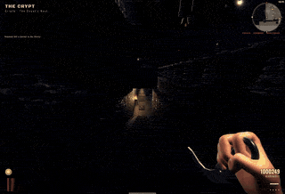</a> 
<b><a href="https://luminazombies.com/">Lumina Zombies</a></b> 
<a href="https://x.com/LuminaBench">@LuminaBench</a> · ♥ 123 · <a href="https://x.com/LuminaBench/status/2120660076927099048">▶ 動画</a> 
数プロンプトでイースターエッグ入りの新マップを追加。ほかの 2 マップでもハードウェア要件とレイテンシを半減させる改良も。 
<a href="https://fablelist.000ooo.ooo/ja/prompts/?w=lumina-zombies&ref=gh"><b>✨ プロンプトを入手</b></a>
</td>
<td width="33%" valign="top">
<a href="https://github.com/amirmushichge/fly-in-kit">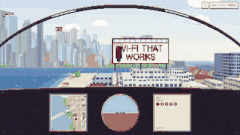</a> 
<b><a href="https://github.com/amirmushichge/fly-in-kit">Fly-In Kit：カフェのための飛行ミニゲーム</a></b> 
<a href="https://x.com/AmirMushich">@AmirMushich</a> · ♥ 113 · <a href="https://x.com/AmirMushich/status/2122421769462284615">▶ 動画</a> 
コーヒーショップ周辺の実際の街並み、7,970 棟を再現。飛んで豆を 5 つ集め、屋上に着陸すると無料コーヒーがもらえる。地図上のどんな店にも使える。
</td>
</tr>
<tr>
<td width="33%" valign="top">
<a href="https://loktar00.github.io/llm-test-pages/fable52-dino-chase/">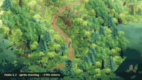</a> 
<b><a href="https://loktar00.github.io/llm-test-pages/fable52-dino-chase/">Thunder Valley 恐竜チェイス</a></b> 
<a href="https://x.com/loktar00">@loktar00</a> · ♥ 98 · <a href="https://x.com/loktar00/status/2120905457380507991">▶ 動画</a> 
独自の WebGL レンダラーを持つ素の JS。恐竜・木・地形は積み重ねた 2D ピクセルのスライス。 
<a href="https://fablelist.000ooo.ooo/ja/prompts/?w=thunder-valley-dino-chase&ref=gh"><b>✨ プロンプトを入手</b></a>
</td>
<td width="33%" valign="top">
<a href="https://feed-backrooms.vercel.app">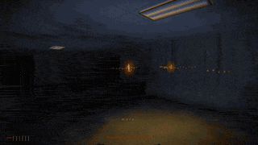</a> 
<b><a href="https://feed-backrooms.vercel.app">Feed the Backrooms</a></b> 
<a href="https://x.com/LexnLin">@LexnLin</a> · ♥ 96 · <a href="https://x.com/LexnLin/status/2119966127149429093">▶ 動画</a> 
逆バックルーム：あなたがモンスターで、人間を捕まえるのが仕事。 
<a href="https://fablelist.000ooo.ooo/ja/prompts/?w=feed-the-backrooms&ref=gh"><b>✨ プロンプトを入手</b></a>
</td>
<td width="33%" valign="top">
<a href="https://rivergame-kappa.vercel.app">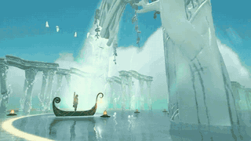</a> 
<b><a href="https://rivergame-kappa.vercel.app">The Waking River</a></b> 
<a href="https://x.com/flxrnc">@flxrnc</a> · ♥ 95 · <a href="https://x.com/flxrnc/status/2120494277528580110">▶ 動画</a> 
1 つのプロンプトと数回の追加指示：眠っていた 5 つの世界が、舟で進むにつれて目覚める。音楽はコードから生成。 
<a href="https://x.com/flxrnc/status/2120494277528580110">📝 作者公開のプロンプト（無料）</a>
</td>
</tr>
<tr>
<td width="33%" valign="top">
<a href="https://app.usecrayon.ai/play/992c2130-43da-416b-a577-aed9514d3057">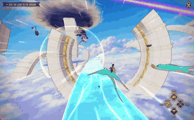</a> 
<b><a href="https://app.usecrayon.ai/play/992c2130-43da-416b-a577-aed9514d3057">SKYWAKE</a></b> 
<a href="https://x.com/aniketjart">@aniketjart</a> · ♥ 82 · <a href="https://x.com/aniketjart/status/2120378493729222700">▶ 動画</a> 
Fable 5.2、Opus 5.5、Crayon、three.js で作った飛行クエストゲーム。 
<a href="https://fablelist.000ooo.ooo/ja/prompts/?w=skywake&ref=gh"><b>✨ プロンプトを入手</b></a>
</td>
<td width="33%" valign="top">
<a href="http://drift.harma.cc/en">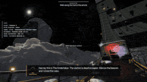</a> 
<b><a href="http://drift.harma.cc/en">DRIFT: Veresk-9</a></b> 
<a href="https://x.com/Rencrypta">@Rencrypta</a> · ♥ 76 · <a href="https://x.com/Rencrypta/status/2123527249064321465">投稿</a> 
ブラウザで遊べる一人称 3D 宇宙パズルゲーム。小惑星帯の死んだ採掘ステーションへ飛んでビーコンを止めるはずが、乗組員は避難していなかった。
</td>
<td width="33%" valign="top">
<a href="https://app.usecrayon.ai/play/0cd7624e-1297-417e-a5be-b3c3036a496a">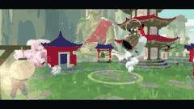</a> 
<b><a href="https://app.usecrayon.ai/play/0cd7624e-1297-417e-a5be-b3c3036a496a">KUMOKIRI</a></b> 
<a href="https://x.com/aniketjart">@aniketjart</a> · ♥ 74 · <a href="https://x.com/aniketjart/status/2121101334900617631">▶ 動画</a> 
Fable 5.2、Crayon、three.js で作った絵画調のサムライゲーム。 
<a href="https://fablelist.000ooo.ooo/ja/prompts/?w=kumokiri&ref=gh"><b>✨ プロンプトを入手</b></a>
</td>
</tr>
<tr>
<td width="33%" valign="top">
<a href="https://wavedash.com/games/ink-flight">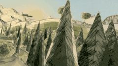</a> 
<b><a href="https://wavedash.com/games/ink-flight">Ink Flight</a></b> 
<a href="https://x.com/prasenx">@prasenx</a> · ♥ 72 · <a href="https://x.com/prasenx/status/2123467881170243808">▶ 動画</a> 
折り紙の飛行機で、すべてコードで描かれた世界を飛ぶ。画像も 3D モデルもなし、ブラウザで遊べる。 
<a href="https://github.com/StarKnightt/ink-flight">ソースコード</a>
</td>
<td width="33%" valign="top">
<a href="https://claude.ai/artifact/3o9NKKmpezAFEan5SeVaxn">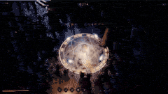</a> 
<b><a href="https://claude.ai/artifact/3o9NKKmpezAFEan5SeVaxn">ASHEN VIGIL</a></b> 
<a href="https://x.com/CapyCola">@CapyCola</a> · ♥ 71 · <a href="https://x.com/CapyCola/status/2123707546779451602">▶ 動画</a> 
たった一通のメッセージから生まれた 3D サバイバー系ゲーム。雨の修道院跡で 5 分間生き延びます。武器 5 種、強化 7 種、敵 4 種とボス 1 体。約 6,900 行のコードで、映像も音もすべてコード生成。
</td>
<td width="33%" valign="top">
<a href="https://starknightt.github.io/firefly-jar">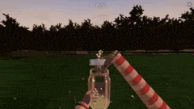</a> 
<b><a href="https://starknightt.github.io/firefly-jar">Firefly Jar — 夜になる前にホタルを捕まえる</a></b> 
🆕 · <a href="https://x.com/prasenx">@prasenx</a> · ♥ 71 · <a href="https://x.com/prasenx/status/2125980702336549056">▶ 動画</a> 
8歳だったあの夏の夕暮れ。草原を歩き、暗くなる前にホタルを20匹ガラス瓶に集めて、最後に放してあげる。ブラウザで遊べる。 
<a href="https://github.com/StarKnightt/firefly-jar">ソースコード</a>
</td>
</tr>
<tr>
<td width="33%" valign="top">
<a href="https://www.spawn.co/@abbidabbi/pogo-riot">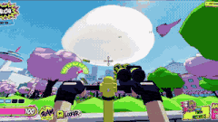</a> 
<b><a href="https://www.spawn.co/@abbidabbi/pogo-riot">Pogo Riot</a></b> 
<a href="https://x.com/Pumpnasterr">@Pumpnasterr</a> · ♥ 64 · <a href="https://x.com/Pumpnasterr/status/2121343507885682917">▶ 動画</a> 
ポゴスティックで跳ねながら同時に狙う、乱戦 FPS。
</td>
<td width="33%" valign="top">
<a href="https://patch.gg/games/rehan/ringfall">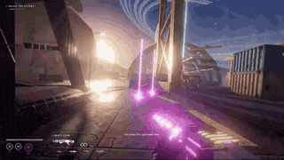</a> 
<b><a href="https://patch.gg/games/rehan/ringfall">Ringfall</a></b> 
<a href="https://x.com/rehan_shei">@rehan_shei</a> · ♥ 63 · <a href="https://x.com/rehan_shei/status/2119994607291584962">▶ 動画</a> 
Destiny にインスパイアされた FPS。オープンソースでリミックス可能。 
<a href="https://fablelist.000ooo.ooo/ja/prompts/?w=ringfall&ref=gh"><b>✨ プロンプトを入手</b></a>
</td>
<td width="33%" valign="top">
<a href="https://save-the-world-fable.vercel.app/">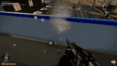</a> 
<b><a href="https://save-the-world-fable.vercel.app/">Save the World</a></b> 
<a href="https://x.com/global_techgirl">@global_techgirl</a> · ♥ 63 · <a href="https://x.com/global_techgirl/status/2120246750459961453">▶ 動画</a> 
通りを作り、3D モデルと音を探し、トレーラーを撮るために自分でゲームをプレイした。ノート PC 推奨。 
<a href="https://fablelist.000ooo.ooo/ja/prompts/?w=save-the-world&ref=gh"><b>✨ プロンプトを入手</b></a>
</td>
</tr>
<tr>
<td width="33%" valign="top">
<a href="https://nisen0808-web.github.io/xiyou-td-play/">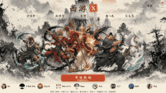</a> 
<b><a href="https://nisen0808-web.github.io/xiyou-td-play/">Xiyou X：西遊記のタワーディフェンス</a></b> 
<a href="https://x.com/PhyrexNi">@PhyrexNi</a> · ♥ 59 · <a href="https://x.com/PhyrexNi/status/2122602578978709908">投稿</a> 
8 ステージ、5 段階の難易度、特別なキャラクターカードのガチャがあるタワーディフェンスのテスト版。PC でもスマホのブラウザでも動き、横向きがおすすめ。
</td>
<td width="33%" valign="top">
<a href="https://samg-coder.github.io/solstice-racing/">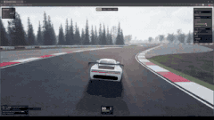</a> 
<b><a href="https://samg-coder.github.io/solstice-racing/">Kestrel Head — Solstice レーシング</a></b> 
<a href="https://x.com/SamGCoder">@SamGCoder</a> · ♥ 56 · <a href="https://x.com/SamGCoder/status/2120044542087070066">▶ 動画</a> 
作者自作の Rust + WebGPU エンジン上に構築：Blender でモデリングした Porsche 992 GT3 R と、3 km の島のサーキット。コントローラー対応。 
<a href="https://github.com/SamG-Coder/solstice-racing">ソースコード</a> 
<a href="https://fablelist.000ooo.ooo/ja/prompts/?w=kestrel-head-solstice-racing&ref=gh"><b>✨ プロンプトを入手</b></a>
</td>
<td width="33%" valign="top">
<a href="https://shubhu121.github.io/hitdude/play/">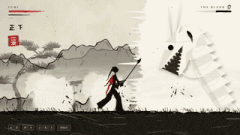</a> 
<b><a href="https://shubhu121.github.io/hitdude/play/">HITOFUDE</a></b> 
<a href="https://x.com/positronx_">@positronx_</a> · ♥ 54 · <a href="https://x.com/positronx_/status/2120374208043876422">▶ 動画</a> 
全フレームを、紙に墨で描くようにコードで筆書き。ボスはステージを消し、あなたの剣は筆。 
<a href="https://fablelist.000ooo.ooo/ja/prompts/?w=hitofude&ref=gh"><b>✨ プロンプトを入手</b></a>
</td>
</tr>
<tr>
<td width="33%" valign="top">
<a href="https://tetriss22.github.io/unwritten/">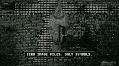</a> 
<b><a href="https://tetriss22.github.io/unwritten/">UNWRITTEN — すべて文字で描かれたオープンワールド</a></b> 
🆕 · <a href="https://x.com/Tetriss112">@Tetriss112</a> · ♥ 49 · <a href="https://x.com/Tetriss112/status/2125302656616849796">▶ 動画</a> 
ASCIIのオープンワールドアクションゲーム。何かが世界を一語ずつ消していて、あなたはそれを書き戻せる最後の書記。5つの土地、騎乗戦闘、3種類の武器、炎と雷、そして最終ボスはTHE EDITOR。画像ファイルは一切なく、コードは2,737行。 
<a href="https://github.com/Tetriss22/unwritten">ソースコード</a>
</td>
<td width="33%" valign="top">
<a href="https://higgsfield.ai/@higgsfield.studio/blogs/fable-5-2-built-this-rpg-from-pure-code-here-s-every-step">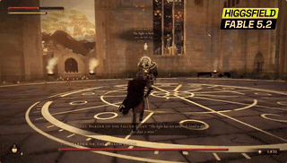</a> 
<b><a href="https://higgsfield.ai/@higgsfield.studio/blogs/fable-5-2-built-this-rpg-from-pure-code-here-s-every-step">VOWLORN</a></b> 
<a href="https://x.com/higgsfield_ai">@higgsfield_ai</a> · ♥ 48 · <a href="https://x.com/higgsfield_ai/status/2119997122896601269">▶ 動画</a> 
声までコードでできたダークな RPG。Higgsfield MCP でデプロイ。リンクは完全なワークフロー付きのプレイページへ。 
<a href="https://higgsfield.ai/@higgsfield.studio/blogs/claude-fable-5-2-built-a-dragon-riding-game-play-it-free">Dragon-riding game</a> · <a href="https://higgsfield.ai/@higgsfield.studio/blogs/one-drawing-fable-5-2-turned-it-into-a-horror-game">Drawing-to-horror game</a> 
<a href="https://fablelist.000ooo.ooo/ja/prompts/?w=vowlorn&ref=gh"><b>✨ プロンプトを入手</b></a>
</td>
<td width="33%" valign="top">
<a href="https://fowllabs.com/fable-5-2/chairmageddon/">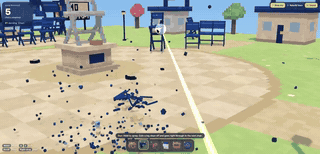</a> 
<b><a href="https://fowllabs.com/fable-5-2/chairmageddon/">Chairmageddon</a></b> 
<a href="https://x.com/argofowl">@argofowl</a> · ♥ 48 · <a href="https://x.com/argofowl/status/2120568779537273263">▶ 動画</a> 
青い椅子だらけの平和な町を破壊しよう。ベビーカーも渦に巻き込める。 
<a href="https://fablelist.000ooo.ooo/ja/prompts/?w=chairmageddon&ref=gh"><b>✨ プロンプトを入手</b></a>
</td>
</tr>
<tr>
<td width="33%" valign="top">
<a href="https://claude.ai/artifact/UD9pGEN4QFA8F5EadRw8eL">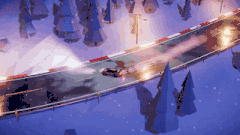</a> 
<b><a href="https://claude.ai/artifact/UD9pGEN4QFA8F5EadRw8eL">Midnight Pass</a></b> 
<a href="https://x.com/andreysuperior">@andreysuperior</a> · ♥ 48 · <a href="https://x.com/andreysuperior/status/2120666660130746458">▶ 動画</a> 
HTML ファイル 1 つ、603 行、アセットゼロ：本格的なドリフト物理、生成された山、合成されたエンジン音とタイヤ音。 
<a href="https://fablelist.000ooo.ooo/ja/prompts/?w=midnight-pass&ref=gh"><b>✨ プロンプトを入手</b></a>
</td>
<td width="33%" valign="top">
 
<b><a href="https://turbo-stack-nine.vercel.app">Turbo Stack</a></b> 
<a href="https://x.com/blueemi99">@blueemi99</a> · ♥ 48 · <a href="https://x.com/blueemi99/status/2124207899501101247">▶ 動画</a> 
スプライトスタッキングで描いたレースゲーム。ドット絵を何層も重ねることで、車をどの角度からでも見られます。
</td>
<td width="33%" valign="top">
 
<b><a href="https://claude.ai/artifact/4nPXUKJjQWNsZEHVNmXXCt">Stray Cat</a></b> 
<a href="https://x.com/aimikoda">@aimikoda</a> · ♥ 45 · <a href="https://x.com/aimikoda/status/2120120133712593118">▶ 動画</a> 
子猫を助け、犬を威嚇し、老いたオス猫に鳴き返す。すべての音は合成。 
<a href="https://fablelist.000ooo.ooo/ja/prompts/?w=stray-cat&ref=gh"><b>✨ プロンプトを入手</b></a>
</td>
</tr>
<tr>
<td width="33%" valign="top">
 
<b><a href="https://sael.net/demo/farewell-light/">Farewell Light</a></b> 
<a href="https://x.com/RyanSael">@RyanSael</a> · ♥ 44 · <a href="https://x.com/RyanSael/status/2120695866684231998">▶ 動画</a> 
一晩で作ったゲームプレイデモ。 
<a href="https://fablelist.000ooo.ooo/ja/prompts/?w=farewell-light&ref=gh"><b>✨ プロンプトを入手</b></a>
</td>
<td width="33%" valign="top">
 
<b><a href="https://fowllabs.com/fable-5-2/knock-it-off/">Knock It Off</a></b> 
<a href="https://x.com/argofowl">@argofowl</a> · ♥ 43 · <a href="https://x.com/argofowl/status/2121276206683410839">▶ 動画</a> 
深夜3時の猫になって、飼い主を起こさずに机の上の物をひとつずつ落としていく。3D モデルなしの HTML 1ファイル。
</td>
<td width="33%" valign="top">
 
<b><a href="https://remix.gg/g/survivors">Survivors</a></b> 
<a href="https://x.com/BLACKST0CK">@BLACKST0CK</a> · ♥ 40 · <a href="https://x.com/BLACKST0CK/status/2120329788896498123">▶ 動画</a> 
WoW 風のレベルアップとルートを備えた Vampire Survivors。ソロ、または最大 4 人のコープ。 
<a href="https://fablelist.000ooo.ooo/ja/prompts/?w=survivors&ref=gh"><b>✨ プロンプトを入手</b></a>
</td>
</tr>
<tr>
<td width="33%" valign="top">
 
<b><a href="https://loktar00.github.io/llm-test-pages/fable52-hang-glider/">Thermal</a></b> 
<a href="https://x.com/loktar00">@loktar00</a> · ♥ 40 · <a href="https://x.com/loktar00/status/2121005021131083851">▶ 動画</a> 
小さなハンググライダーゲーム：上昇気流に乗って目標を目指す。 
<a href="https://fablelist.000ooo.ooo/ja/prompts/?w=thermal&ref=gh"><b>✨ プロンプトを入手</b></a>
</td>
<td width="33%" valign="top">
 
<b><a href="https://www.aigameshare.com/games/animal-card-battle-game?play=1&mode=fullscreen">Thimble Knights</a></b> 
<a href="https://x.com/_nilni">@_nilni</a> · ♥ 35 · <a href="https://x.com/_nilni/status/2120435983032447382">▶ 動画</a> 
リアルタイムの動物カードバトルゲーム。 
<a href="https://x.com/_nilni/status/2120435983032447382">📝 作者公開のプロンプト（無料）</a>
</td>
<td width="33%" valign="top">
 
<b><a href="https://tetriss22.github.io/harbor-gp/">Harbor Lights Grand Prix</a></b> 
<a href="https://x.com/Tetriss112">@Tetriss112</a> · ♥ 33 · <a href="https://x.com/Tetriss112/status/2120946576663134308">▶ 動画</a> 
HTML ファイル 1 つ：22 コーナーの市街地サーキットを 20 台のピクセルカーが走り、各レース前に賭けの窓口がある（遊び用のお金）。 
<a href="https://fablelist.000ooo.ooo/ja/prompts/?w=harbor-lights-grand-prix&ref=gh"><b>✨ プロンプトを入手</b></a>
</td>
</tr>
<tr>
<td width="33%" valign="top">
 
<b><a href="https://blog.silencestar.com/posts/tilt-labyrinth/play/">Tilt Labyrinth</a></b> 
<a href="https://x.com/mylifcc">@mylifcc</a> · ♥ 32 · <a href="https://x.com/mylifcc/status/2120054646282870910">▶ 動画</a> 
three.js 2,000 行の木製ボール迷路。Fable が自らプロファイリングし、1 フレーム 55 ms から 9 ms に高速化。 
<a href="https://fablelist.000ooo.ooo/ja/prompts/?w=tilt-labyrinth&ref=gh"><b>✨ プロンプトを入手</b></a>
</td>
<td width="33%" valign="top">
 
<b><a href="https://claude.ai/artifact/QvSjL7Hexf3nKdUP9Zerr7">格闘ゲーム（スマホで遊べる）</a></b> 
<a href="https://x.com/s_shigel">@s_shigel</a> · ♥ 32 · <a href="https://x.com/s_shigel/status/2120300080569975034">▶ 動画</a> 
一晩で反復開発した格闘ゲーム。モバイルブラウザで遊べる。 
<a href="https://fablelist.000ooo.ooo/ja/prompts/?w=fighting-game-plays-on-phones&ref=gh"><b>✨ プロンプトを入手</b></a>
</td>
<td width="33%" valign="top">
 
<b><a href="https://rust4x4.com/">Aussie Outback 4x4</a></b> 
<a href="https://x.com/SamGCoder">@SamGCoder</a> · ♥ 31 · <a href="https://x.com/SamGCoder/status/2121513178303811931">▶ 動画</a> 
作者自作の Rust + WebGPU エンジンでオーストラリアの原野をオフロード走行。泥、渡河、ロッククローリング、デフロック、タイヤ空気圧、動的な天候まで。
</td>
</tr>
<tr>
<td width="33%" valign="top">
 
<b><a href="https://the-vast-horizon.vercel.app">The Vast Horizon</a></b> 
<a href="https://x.com/OdinLovis">@OdinLovis</a> · ♥ 28 · <a href="https://x.com/OdinLovis/status/2120198469755503091">▶ 動画</a> 
共有の湖で遊ぶマルチプレイのサーフィンゲーム。言葉を入力すると世界が変わる。 
<a href="https://fablelist.000ooo.ooo/ja/prompts/?w=the-vast-horizon&ref=gh"><b>✨ プロンプトを入手</b></a>
</td>
<td width="33%" valign="top">
 
<b><a href="https://mikenevermiss.github.io/midnight-grid/">Midnight Grid</a></b> 
<a href="https://x.com/mikenevermiss">@mikenevermiss</a> · ♥ 28 · <a href="https://x.com/mikenevermiss/status/2121900977959612500">▶ 動画</a> 
プロンプト1つで作ったオープンワールドのドライブゲーム。街を走り抜け、車にぶつかり、警察に追われる。車も建物もテクスチャも音も、すべてコードで生成。
</td>
<td width="33%" valign="top">
 
<b><a href="https://monstermath.ai-created.com">Monster Math</a></b> 
<a href="https://x.com/AIandDesign">@AIandDesign</a> · ♥ 28 · <a href="https://x.com/AIandDesign/status/2122108555356778615">投稿</a> 
ポケモン風の小学生（K-5）向け算数練習・学習ゲーム。MIT でオープンソース、オンラインでもローカルでも遊べる。 
<a href="https://github.com/TheMarco/monstermath">ソースコード</a>
</td>
</tr>
<tr>
<td width="33%" valign="top">
 
<b><a href="https://remix.gg/g/hoppy-meadow">Hoppy Meadow</a></b> 
<a href="https://x.com/0xChuckstock">@0xChuckstock</a> · ♥ 26 · <a href="https://x.com/0xChuckstock/status/2120620907865473448">投稿</a> 
シンプルなプラットフォーマーに見えるが、旗竿にたどり着くまでは。 
<a href="https://fablelist.000ooo.ooo/ja/prompts/?w=hoppy-meadow&ref=gh"><b>✨ プロンプトを入手</b></a>
</td>
<td width="33%" valign="top">
 
<b><a href="https://remix.gg/g/brix-84">BRIX '84</a></b> 
<a href="https://x.com/0xChuckstock">@0xChuckstock</a> · ♥ 26 · <a href="https://x.com/0xChuckstock/status/2120896397839126579">投稿</a> 
2 つ目のパワーアップ以降が暴走するブロック崩し。 
<a href="https://fablelist.000ooo.ooo/ja/prompts/?w=brix-84&ref=gh"><b>✨ プロンプトを入手</b></a>
</td>
<td width="33%" valign="top">
 
<b><a href="https://claude.ai/artifact/FpdQ81sJs1KiV1a6JCY4jj">オープンワールドのカート冒険</a></b> 
<a href="https://x.com/realWeZZard">@realWeZZard</a> · ♥ 24 · <a href="https://x.com/realWeZZard/status/2120379500492185939">▶ 動画</a> 
3 時間でワンショット。メインクエストは約 30 分。 
<a href="https://fablelist.000ooo.ooo/ja/prompts/?w=open-world-kart-adventure&ref=gh"><b>✨ プロンプトを入手</b></a>
</td>
</tr>
<tr>
<td width="33%" valign="top">
 
<b><a href="https://www.spawn.co/@abbidabbi/shark-riders">Shark Riders</a></b> 
<a href="https://x.com/Pumpnasterr">@Pumpnasterr</a> · ♥ 24 · <a href="https://x.com/Pumpnasterr/status/2124565052766216236">▶ 動画</a> 
ホホジロザメに乗って戦う一人称シューティング。背中から撃ち、噛みつき、銛で敵を仕留め、潜って身を隠せます。ブラウザで遊べます。
</td>
<td width="33%" valign="top">
 
<b><a href="https://giant-leap.vercel.app">Giant Leap</a></b> 
<a href="https://x.com/handsher_NGU">@handsher_NGU</a> · ♥ 22 · <a href="https://x.com/handsher_NGU/status/2120287667141374212">▶ 動画</a> 
月から地球へジャンプ。ただジャンプするだけ。 
<a href="https://fablelist.000ooo.ooo/ja/prompts/?w=giant-leap&ref=gh"><b>✨ プロンプトを入手</b></a>
</td>
<td width="33%" valign="top">
 
<b><a href="https://qiaomu.t5t6.com/irondusk-yard-7/">IRONDUSK — Yard 7</a></b> 
<a href="https://x.com/vista8">@vista8</a> · ♥ 20 · <a href="https://x.com/vista8/status/2120383046239285264">投稿</a> 
AAA に匹敵するビジュアルの小さな FPS ステージを、という 1 つのプロンプト。2 つ目のプロンプトで、AI 対戦と 2 人プレイ付きの 3D ブロック崩しを作成。 
<a href="https://qiaomu.t5t6.com/3d/">3D brick breaker</a> 
<a href="https://x.com/vista8/status/2120383046239285264">📝 作者公開のプロンプト（無料）</a>
</td>
</tr>
<tr>
<td width="33%" valign="top">
 
<b><a href="https://www.nightclub-driftspeed.xyz/">NightClub: Drift & Speed</a></b> 
<a href="https://x.com/Story91_">@Story91_</a> · ♥ 20 · <a href="https://x.com/Story91_/status/2121016763190059194">▶ 動画</a> 
世界ランキング付きのブラウザドリフトレースゲーム。空のフォルダから 72 時間で制作。 
<a href="https://fablelist.000ooo.ooo/ja/prompts/?w=nightclub-drift-speed&ref=gh"><b>✨ プロンプトを入手</b></a>
</td>
<td width="33%" valign="top">
 
<b><a href="https://cozybakery.vercel.app">Cozy Bakery</a></b> 
<a href="https://x.com/goncalo_canhoto">@goncalo_canhoto</a> · ♥ 19 · <a href="https://x.com/goncalo_canhoto/status/2120530199649432063">▶ 動画</a> 
ポルトガルを舞台にした Overcooked 風の協力料理ゲーム。1〜4 人、モバイル対応。 
<a href="https://fablelist.000ooo.ooo/ja/prompts/?w=cozy-bakery&ref=gh"><b>✨ プロンプトを入手</b></a>
</td>
<td width="33%" valign="top">
 
<b><a href="https://noclipepe.pages.dev/pattinson-verse/">Pattinson-Verse</a></b> 
<a href="https://x.com/noclipepe">@noclipepe</a> · ♥ 17 · <a href="https://x.com/noclipepe/status/2124204825294295250">▶ 動画</a> 
Robert Pattinson の役柄を 1 本にまとめたアーケード風ベルトスクロールアクション。James Bond、Batman、Hogwarts、Twilight、Dune。GPT-6.2 Astra と Fable 5.2 で制作。
</td>
</tr>
<tr>
<td width="33%" valign="top">
 
<b><a href="http://poke-jam.vercel.app">Poke Dodge</a></b> 
<a href="https://x.com/crtvTeknologist">@crtvTeknologist</a> · ♥ 14 · <a href="https://x.com/crtvTeknologist/status/2121319366830809285">▶ 動画</a> 
NBA Jam 風味の 2 対 2 ポケモン×ドッジボールのマッシュアップ：ジムのラダー、タイプ相性、持ち物、ステージは Three.js。
</td>
<td width="33%" valign="top">
 
<b><a href="https://fighting-game-ignition.saito-931.workers.dev">IGNITION 格闘ゲーム</a></b> 
<a href="https://x.com/s_shigel">@s_shigel</a> · ♥ 13 · <a href="https://x.com/s_shigel/status/2120895161890914336">▶ 動画</a> 
生成されたボイスとサウンド、プレイログとリプレイ付きの 2D 格闘ゲーム。 
<a href="https://fablelist.000ooo.ooo/ja/prompts/?w=ignition-fighting-game&ref=gh"><b>✨ プロンプトを入手</b></a>
</td>
<td width="33%" valign="top">
 
<b><a href="https://maple-run-fable.vercel.app">Maple Run</a></b> 
<a href="https://x.com/nan_in_space">@nan_in_space</a> · ♥ 13 · <a href="https://x.com/nan_in_space/status/2125041219244015900">▶ 動画</a> 
Subway Surfers 風のランゲームを Fable 5.2 で作り直してオープンソース化。好きなキャラクター画像をアップロードすれば、そのキャラで遊べる。キャラクターは Viggle PINOC で 1 枚の画像から生成したリグ付きガウシアンスプラット。 
<a href="https://github.com/nanha0130/maple-run-fable">ソースコード</a>
</td>
</tr>
<tr>
<td width="33%" valign="top">
 
<b><a href="https://silicon-seduction.vercel.app/">Silicon Seduction</a></b> 
<a href="https://x.com/ZryMiller">@ZryMiller</a> · ♥ 12 · <a href="https://x.com/ZryMiller/status/2119918766691954691">▶ 動画</a> 
誘惑されずに脱出できる？ 
<a href="https://fablelist.000ooo.ooo/ja/prompts/?w=silicon-seduction&ref=gh"><b>✨ プロンプトを入手</b></a>
</td>
<td width="33%" valign="top">
 
<b><a href="https://www.aigameshare.com/games/island-god-game?play=1&mode=fullscreen">Handful: Island God</a></b> 
<a href="https://x.com/_nilni">@_nilni</a> · ♥ 11 · <a href="https://x.com/_nilni/status/2120639452146250153">▶ 動画</a> 
神となって、小さな点たちを光へ導こう。 
<a href="https://fablelist.000ooo.ooo/ja/prompts/?w=handful-island-god&ref=gh"><b>✨ プロンプトを入手</b></a>
</td>
<td width="33%" valign="top">
 
<b><a href="https://wavedash.com/games/reef-dive">Reef Dive</a></b> 
<a href="https://x.com/boona11">@boona11</a> · ♥ 11 · <a href="https://x.com/boona11/status/2120886837422195123">▶ 動画</a> 
作者が three.js のダイビングゲームを Fable 5.2 に 1 日預け、はるかに大きなゲームのような手触りにしてもらった。 
<a href="https://fablelist.000ooo.ooo/ja/prompts/?w=reef-dive&ref=gh"><b>✨ プロンプトを入手</b></a>
</td>
</tr>
<tr>
<td width="33%" valign="top">
 
<b><a href="https://aashishgtbit.github.io/PaletteRider/">PaletteRider — 名画の中を自転車で走る</a></b> 
<a href="https://x.com/Aashish_Tiwari_">@Aashish_Tiwari_</a> · ♥ 10 · <a href="https://x.com/Aashish_Tiwari_/status/2120963463610880150">▶ 動画</a> 
クレー『城と太陽』やゴッホ『夜のカフェテラス』の街を自転車で駆け抜ける。音楽も Fable 5.2 が作った。
</td>
<td width="33%" valign="top">
 
<b><a href="https://napolehim.com">Napoleon x Locke</a></b> 
<a href="https://x.com/lockeorca">@lockeorca</a> · ♥ 9 · <a href="https://x.com/lockeorca/status/2123044026152890803">▶ 動画</a> 
ナポレオンの翼のある馬に乗って、エジプト、イタリア、パリ、セントヘレナ島を駆け抜ける。王冠を奪い、ロードスターを飛ばし、風船を割ろう。
</td>
<td width="33%" valign="top">
 
<b><a href="https://room13.srv1903550.hstgr.cloud">Room 13</a></b> 
<a href="https://x.com/MartinaBuilds">@MartinaBuilds</a> · ♥ 9 · <a href="https://x.com/MartinaBuilds/status/2123424275462053893">▶ 動画</a> 
ミステリーで英語を学ぶインタラクティブゲーム。単語はダブルクリックで調べられ、文は翻訳でき、最後に読解クイズに挑む。
</td>
</tr>
<tr>
<td width="33%" valign="top">
 
<b><a href="https://www.aigameshare.com/games/great-wave-off-kanagawa?play=1&mode=fullscreen">Great Wave</a></b> 
<a href="https://x.com/_nilni">@_nilni</a> · ♥ 7 · <a href="https://x.com/_nilni/status/2120797996610994355">▶ 動画</a> 
北斎の『神奈川沖浪裏』にサーフィンで飛び込み、風神・雷神の脇を漕ぎ抜けて富士山へ。 
<a href="https://fablelist.000ooo.ooo/ja/prompts/?w=great-wave&ref=gh"><b>✨ プロンプトを入手</b></a>
</td>
<td width="33%" valign="top">
 
<b><a href="https://bistroschool.app/">Bistro School</a></b> 
<a href="https://x.com/WilliamZhu3541">@WilliamZhu3541</a> · ♥ 7 · <a href="https://x.com/WilliamZhu3541/status/2123173309286158597">▶ 動画</a> 
あなたはミシュラン一つ星のフレンチビストロのオーナー。金曜の夜、スタッフが問題をひとつずつ持ち込んでくる。目指すは三つ星。3D のレストランゲーム。
</td>
<td width="33%" valign="top">
 
<b><a href="https://claude.ai/artifact/DLnFodkTwvawCNwurDmSZK?sk=5N6PtC07f1niB7h3I6clZQ">Roost</a></b> 
<a href="https://x.com/tejas3732">@tejas3732</a> · ♥ 6 · <a href="https://x.com/tejas3732/status/2120091513657139549">▶ 動画</a> 
1 回のチャットで作った 3D ダートバイクレース：5 プロンプト、15 分、3 コース、AI のライバル、ニトロ、ハンドル視点。 
<a href="https://fablelist.000ooo.ooo/ja/prompts/?w=roost&ref=gh"><b>✨ プロンプトを入手</b></a>
</td>
</tr>
<tr>
<td width="33%" valign="top">
 
<b><a href="https://jello.sixfingerpunch.com/">Hello Jello — ドラッグで遊べるゼリー物理</a></b> 
<a href="https://x.com/photonstorm">@photonstorm</a> · ♥ 6 · <a href="https://x.com/photonstorm/status/2122879821986627587">▶ 動画</a> 
かわいいゼリーの物理おもちゃ。クリックしてドラッグすると、ぷるぷるのゼリーたちを伸ばしたり投げたりできる。
</td>
<td width="33%" valign="top">
 
<b><a href="https://clockendbader.github.io/fable-builds/go-for-launch/">Go for Launch</a></b> 
<a href="https://x.com/clockendbader">@clockendbader</a> · ♥ 5 · <a href="https://x.com/clockendbader/status/2121251400533631304">投稿</a> 
地球から月までのコックピットゲームを 1 プロンプトで：1 時間 18 分、約 $30。3 段階の難易度、ライブ計器、無線の管制、すべての音はコード製。 
<a href="https://fablelist.000ooo.ooo/ja/prompts/?w=go-for-launch&ref=gh"><b>✨ プロンプトを入手</b></a>
</td>
<td width="33%" valign="top">
 
<b><a href="https://claude.ai/artifact/1QGGhB68jMCjjjeeKtKNUo">4 キャラの格闘ゲーム</a></b> 
<a href="https://x.com/promodenstudio">@promodenstudio</a> · ♥ 4 · <a href="https://x.com/promodenstudio/status/2120085977079107788">▶ 動画</a> 
Fable 5.2 と ElevenLabs MCP で、自ら設計したアナウンサーを含む 39 のボイス・効果音を制作。デスクトップ＋キーボード。 
<a href="https://fablelist.000ooo.ooo/ja/prompts/?w=four-character-fighting-game&ref=gh"><b>✨ プロンプトを入手</b></a>
</td>
</tr>
<tr>
<td width="33%" valign="top">
 
<b><a href="https://infall-game.vercel.app">INFALL — あなたがブラックホール</a></b> 
<a href="https://x.com/AugustCastilIo">@AugustCastilIo</a> · ♥ 4 · <a href="https://x.com/AugustCastilIo/status/2121350653037756557">▶ 動画</a> 
指示は「ぶっ飛んだものを作って驚かせて」だけ。アイデアからゲームまでワンショットで仕上げた。
</td>
<td width="33%" valign="top">
 
<b><a href="https://vippi.vercel.app/">Vippi</a></b> 
<a href="https://x.com/Shrit1401">@Shrit1401</a> · ♥ 2 · <a href="https://x.com/Shrit1401/status/2120060593763926314">▶ 動画</a> 
COD 風シューター。作者の不気味ゲーム用ベンチマークのリンクも付属。 
<a href="https://claude.ai/artifact/HSxhHE91J2jhLsB8WiTgUc">Creepy-game test</a> 
<a href="https://fablelist.000ooo.ooo/ja/prompts/?w=vippi&ref=gh"><b>✨ プロンプトを入手</b></a>
</td>
</tr>
</table>

ほかのカテゴリ：[🌍 3D ワールドとシーン](3d-worlds.ja.md) · [🧰 Web ページとツール](web-and-tools.ja.md) · [🎬 アニメーションと映像](animation.ja.md) · [📺 動画デモ](video-demos.ja.md)

[← メインリストに戻る](../README.ja.md)
