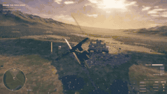
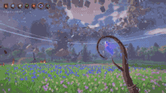
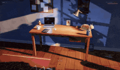
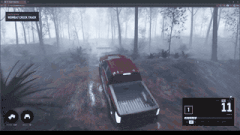
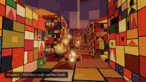

# 🎮 게임 · 전체 80개

[← 메인 목록으로](../README.ko.md) · [English](games.md) · [简体中文](games.zh-CN.md) · [繁體中文](games.zh-TW.md) · [日本語](games.ja.md) · **한국어** · [Español](games.es.md) · [Português](games.pt-BR.md) · [Français](games.fr.md) · [Deutsch](games.de.md) · [Русский](games.ru.md)

메인 페이지에는 분류마다 좋아요 100개 이상인 상위 12개만 보여 줍니다. 이 페이지에는 이 분류의 모든 항목이 좋아요 순으로 있습니다.

<table>
<tr>
<td width="33%" valign="top">
 
<b><a href="https://starrynightrider.com">Starry Nightrider</a></b> 
🆕 · <a href="https://x.com/ebbyamir">@ebbyamir</a> · ♥ 17.8k · <a href="https://x.com/ebbyamir/status/2120284261089673376">▶ 영상</a> 
고흐가 자신의 별이 빛나는 밤 속을 달리는 게임. 
<a href="https://fablelist.000ooo.ooo/ko/prompts/?w=starry-nightrider&ref=gh"><b>✨ 프롬프트 받기</b></a>
</td>
<td width="33%" valign="top">
 
<b><a href="https://claude.ai/artifact/BGY1SztrAYcJQHSsnHHGmp">Saltline — 1인칭 슈팅 게임</a></b> 
<a href="https://x.com/felixrieseberg">@felixrieseberg</a> · ♥ 14.7k · <a href="https://x.com/felixrieseberg/status/2119925633564463609">▶ 영상</a> 
Anthropic 엔지니어 작품. 원샷 프롬프트, 사람의 피드백 없이 8시간, 약 $550. 모델, 사운드, 텍스처 모두 코드로 생성. 
<a href="https://fablelist.000ooo.ooo/ko/prompts/?w=saltline-first-person-shooter&ref=gh"><b>✨ 프롬프트 받기</b></a>
</td>
<td width="33%" valign="top">
 
<b><a href="https://patch.gg/blendi/oil-paint">Oil Paint — 손으로 그린 듯한 게임</a></b> 
🆕 · <a href="https://x.com/BlendiByl">@BlendiByl</a> · ♥ 7.9k · <a href="https://x.com/BlendiByl/status/2120341251178594532">▶ 영상</a> 
1시간 이내에 제작. 모든 프레임이 약 150만 번의 붓질로 이루어져 브라우저 탭에서 200 fps로 실행. 오픈 소스. 
<a href="https://fablelist.000ooo.ooo/ko/prompts/?w=oil-paint-hand-painted-game&ref=gh"><b>✨ 프롬프트 받기</b></a>
</td>
</tr>
<tr>
<td width="33%" valign="top">
 
<b><a href="https://nyc.somethingbig.ai/">CROSSTOWN — 오픈 월드 뉴욕 (초기 프리뷰)</a></b> 
🆕 · <a href="https://x.com/mattshumer_">@mattshumer_</a> · ♥ 7.5k · <a href="https://x.com/mattshumer_/status/2120282133503820150">▶ 영상</a> 
"Rockstar는 8년 걸렸다. Fable 5.2는 7일 만에 해낸다." 아직 도시 일부만 구현됨. B를 눌러 피드백을 보내세요. 
<a href="https://fablelist.000ooo.ooo/ko/prompts/?w=crosstown-open-world-new-york-early-preview&ref=gh"><b>✨ 프롬프트 받기</b></a>
</td>
<td width="33%" valign="top">
 
<b><a href="https://what-the-water-keeps.vercel.app/">What the Water Keeps</a></b> 
<a href="https://x.com/kevin_t_ngo">@kevin_t_ngo</a> · ♥ 4.2k · <a href="https://x.com/kevin_t_ngo/status/2119868968307695818">▶ 영상</a> 
꿈결 같은 8개의 세계를 지나는 보트 여행. 브라우저에서 플레이. 
<a href="https://fablelist.000ooo.ooo/ko/prompts/?w=what-the-water-keeps&ref=gh"><b>✨ 프롬프트 받기</b></a>
</td>
<td width="33%" valign="top">
 
<b><a href="https://tennis.sixfingerpunch.com/">Tennis</a></b> 
🆕 · <a href="https://x.com/photonstorm">@photonstorm</a> · ♥ 3.1k · <a href="https://x.com/photonstorm/status/2120330010112434313">게시물</a> 
게임을 "마음껏 해봐"라고 요청했더니 퐁 복제처럼 보이는 게임이 나왔는데, 직접 해보면 달라요. 
<a href="https://fablelist.000ooo.ooo/ko/prompts/?w=tennis&ref=gh"><b>✨ 프롬프트 받기</b></a>
</td>
</tr>
<tr>
<td width="33%" valign="top">
 
<b><a href="https://www.spawn.co/@mattshumer/earth?room=local">Mirror Earth</a></b> 
<a href="https://x.com/mattshumer_">@mattshumer_</a> · ♥ 2.4k · <a href="https://x.com/mattshumer_/status/2119877065701036047">▶ 영상</a> 
행성 전체가 부술 수 있는 게임 월드. 날씨는 실제 지구와 실시간으로 일치. 
<a href="https://fablelist.000ooo.ooo/ko/prompts/?w=mirror-earth&ref=gh"><b>✨ 프롬프트 받기</b></a>
</td>
<td width="33%" valign="top">
 
<b><a href="https://portals-endless-worlds.netlify.app/">Portals: Endless Worlds</a></b> 
<a href="https://x.com/emollick">@emollick</a> · ♥ 1.9k · <a href="https://x.com/emollick/status/2119918307457577163">▶ 영상</a> 
에이전트 25,000개가 책, 예술, 장소에서 영감을 받은 코드만으로 만든 3D 월드 450개 이상을 제작. 포털을 타고 떠다니며 이동. 
<a href="https://github.com/emollick/ai-portals">소스 코드</a> · <a href="https://www.oneusefulthing.org/p/fable-52-and-jagged-agi">글</a> 
<a href="https://fablelist.000ooo.ooo/ko/prompts/?w=portals-endless-worlds&ref=gh"><b>✨ 프롬프트 받기</b></a>
</td>
<td width="33%" valign="top">
 
<b><a href="https://evensong-phi.vercel.app/">Evensong</a></b> 
🆕 · <a href="https://x.com/kevin_t_ngo">@kevin_t_ngo</a> · ♥ 1.8k · <a href="https://x.com/kevin_t_ngo/status/2120238844754923874">▶ 영상</a> 
다크 판타지 소울라이크 보스전, 브라우저에서 플레이. 
<a href="https://fablelist.000ooo.ooo/ko/prompts/?w=evensong&ref=gh"><b>✨ 프롬프트 받기</b></a>
</td>
</tr>
<tr>
<td width="33%" valign="top">
 
<b><a href="https://loktar00.github.io/lanternfall/">LANTERNFALL</a></b> 
🆕 · <a href="https://x.com/loktar00">@loktar00</a> · ♥ 1.4k · <a href="https://x.com/loktar00/status/2120192761542615271">▶ 영상</a> 
애니메이션, 모델 등 게임 전체를 Fable이 생성. 적이 죽을 때의 이펙트를 확인해 보세요. 
<a href="https://fablelist.000ooo.ooo/ko/prompts/?w=lanternfall&ref=gh"><b>✨ 프롬프트 받기</b></a>
</td>
<td width="33%" valign="top">
 
<b><a href="https://op7418.github.io/guizang-game-skill/">Mist-Locked Mountain Gate — 3D 액션 게임</a></b> 
🆕 · <a href="https://x.com/op7418">@op7418</a> · ♥ 1.1k · <a href="https://x.com/op7418/status/2120694045299327187">▶ 영상</a> 
어느 오후 하루, 토큰 45억 개. 모델, 장면, 동작 모두 Fable이 만들고 30 MB짜리 HTML 파일 하나에 담았습니다. 
<a href="https://fablelist.000ooo.ooo/ko/prompts/?w=mist-locked-mountain-gate-3d-action-game&ref=gh"><b>✨ 프롬프트 받기</b></a>
</td>
<td width="33%" valign="top">
 
<b><a href="https://wavedash.com/games/rooftop-rally">Rooftop Rally — Unreal 5.9 피클볼</a></b> 
🆕 · <a href="https://x.com/chongdashu">@chongdashu</a> · ♥ 1.1k · <a href="https://x.com/chongdashu/status/2120154573356793883">▶ 영상</a> 
Fable 5.2와 Unreal Engine 5.9 프리뷰. 캐릭터는 Tripo, 나머지 3D 에셋과 모든 것은 Fable이 제작. 
<a href="https://x.com/chongdashu/status/2120310120509014219">제작 과정</a> 
<a href="https://fablelist.000ooo.ooo/ko/prompts/?w=rooftop-rally-pickleball-in-unreal-5-9&ref=gh"><b>✨ 프롬프트 받기</b></a>
</td>
</tr>
<tr>
<td width="33%" valign="top">
 
<b><a href="https://claude.ai/artifact/MXxb36zKgN261ckbGhmNin">Three Games (Saltline · The Clockmaker's Heart · Tidewright)</a></b> 
<a href="https://x.com/felixrieseberg">@felixrieseberg</a> · ♥ 809 · <a href="https://x.com/vineerpasam/status/2119955306096857145">▶ 영상</a> 
Felix Rieseberg 서명: "모든 게임은 Claude Fable 5.2로 만들었습니다. 초안 그대로, 사람의 피드백 없음." 출시 당일 가장 많이 공유된 링크. 
<a href="https://claude.ai/artifact/6MjtQjf4ee1ZZjEpafaEpa">The Clockmaker's Heart</a> · <a href="https://claude.ai/artifact/JTgyEMn7sn1q2riWrMb7D4">Tidewright</a> 
<a href="https://fablelist.000ooo.ooo/ko/prompts/?w=three-games-saltline-the-clockmaker-s-heart-tidewright&ref=gh"><b>✨ 프롬프트 받기</b></a>
</td>
<td width="33%" valign="top">
 
<b><a href="https://patch.gg/blendi/coloured-pencil">Coloured Pencil</a></b> 
🆕 · <a href="https://x.com/BlendiByl">@BlendiByl</a> · ♥ 741 · <a href="https://x.com/BlendiByl/status/2121130385723789637">▶ 영상</a> 
색연필 느낌의 게임 한 조각. 모든 표면의 셰이딩과 마을 전체가 코드. 오픈 소스. 
<a href="https://fablelist.000ooo.ooo/ko/prompts/?w=coloured-pencil&ref=gh"><b>✨ 프롬프트 받기</b></a>
</td>
<td width="33%" valign="top">
 
<b><a href="https://www.spawn.co/@mattshumer/voxel-engine">Voxel Engine</a></b> 
<a href="https://x.com/mattshumer_">@mattshumer_</a> · ♥ 740 · <a href="https://x.com/mattshumer_/status/2119870965106483384">▶ 영상</a> 
프롬프트 한 번으로 제작. 소리를 켜세요. 
<a href="https://fablelist.000ooo.ooo/ko/prompts/?w=voxel-engine&ref=gh"><b>✨ 프롬프트 받기</b></a>
</td>
</tr>
<tr>
<td width="33%" valign="top">
 
<b><a href="https://patch.gg/blendi/patchwork-quilt">Patchwork Quilt</a></b> 
🆕 · <a href="https://x.com/BlendiByl">@BlendiByl</a> · ♥ 669 · <a href="https://x.com/BlendiByl/status/2120746541636047347">▶ 영상</a> 
패치워크, 스톱모션 스타일의 게임 한 조각. 맵 전체가 코드. 오픈 소스. 
<a href="https://fablelist.000ooo.ooo/ko/prompts/?w=patchwork-quilt&ref=gh"><b>✨ 프롬프트 받기</b></a>
</td>
<td width="33%" valign="top">
 
<b><a href="https://bannerfall.itch.io/siege-wing">Siege Wing — 중세 전쟁에 뛰어든 헬리콥터</a></b> 
🆕 · <a href="https://x.com/builderjaydub">@builderjaydub</a> · ♥ 556 · <a href="https://x.com/builderjaydub/status/2120223731520040966">▶ 영상</a> 
대포, 로켓, 미사일을 단 헬기를 몰고 로마 발리스타를 피해 성을 무너뜨리세요.
</td>
<td width="33%" valign="top">
 
<b><a href="https://i-would-have-gotten-away-with-it.netlify.app/">I Would Have Gotten Away With It</a></b> 
<a href="https://x.com/emollick">@emollick</a> · ♥ 509 · <a href="https://x.com/emollick/status/2119876449494540554">▶ 영상</a> 
거꾸로 된 스쿠비두: 참견쟁이 아이들을 겁주어 쫓아내는 악당이 되어 보세요. 트레일러, 음악, 사운드도 Fable이 제작. 
<a href="https://fablelist.000ooo.ooo/ko/prompts/?w=i-would-have-gotten-away-with-it&ref=gh"><b>✨ 프롬프트 받기</b></a>
</td>
</tr>
<tr>
<td width="33%" valign="top">
 
<b><a href="https://noclipepe.pages.dev/rug/">Childhood Rug Racer</a></b> 
<a href="https://x.com/noclipepe">@noclipepe</a> · ♥ 415 · <a href="https://x.com/noclipepe/status/2119728047754547326">▶ 영상</a> 
어릴 적 놀이 러그 위의 레이싱 게임. GPT-6.2 Sol과 같은 프롬프트. 작성자는 이 모델을 "Fable 5.5 (routing)"이라고 부름. 
<a href="https://fablelist.000ooo.ooo/ko/prompts/?w=childhood-rug-racer&ref=gh"><b>✨ 프롬프트 받기</b></a>
</td>
<td width="33%" valign="top">
 
<b><a href="https://finderchangchang.github.io/cloud-stunt-3d/">Cloud Stunt 3D</a></b> 
<a href="https://x.com/jev_chat">@jev_chat</a> · ♥ 329 · <a href="https://x.com/jev_chat/status/2120015641151426838">▶ 영상</a> 
30분 만에 생성. 최적화된 "골든" 버전 링크도 함께. 
<a href="https://finderchangchang.github.io/cloud-stunt-3d/golden/">Optimized</a> 
<a href="https://x.com/jev_chat/status/2120015641151426838">📝 제작자 공개 프롬프트 (무료)</a>
</td>
<td width="33%" valign="top">
 
<b><a href="https://gilt-and-gutter.vercel.app/">Gilt & Gutter</a></b> 
🆕 · <a href="https://x.com/kevin_t_ngo">@kevin_t_ngo</a> · ♥ 326 · <a href="https://x.com/kevin_t_ngo/status/2119900487688622171">▶ 영상</a> 
플레이 가능한 캐릭터 2명이 나오는 1대1 1인칭 슈터. 
<a href="https://fablelist.000ooo.ooo/ko/prompts/?w=gilt-gutter&ref=gh"><b>✨ 프롬프트 받기</b></a>
</td>
</tr>
<tr>
<td width="33%" valign="top">
 
<b><a href="https://www.spawn.co/@mattshumer/hogwarts-royale">Hogwarts Royale</a></b> 
<a href="https://x.com/mattshumer_">@mattshumer_</a> · ♥ 311 · <a href="https://x.com/mattshumer_/status/2119872098306810226">▶ 영상</a> 
"해리 포터와 포트나이트를 섞어줘" — 플레이 가능한 배틀로얄. 
<a href="https://x.com/mattshumer_/status/2119872098306810226">📝 제작자 공개 프롬프트 (무료)</a>
</td>
<td width="33%" valign="top">
 
<b><a href="https://dread-and-district.netlify.app">Dread & District</a></b> 
🆕 · <a href="https://x.com/emollick">@emollick</a> · ♥ 302 · <a href="https://x.com/emollick/status/2120248525254742318">▶ 영상</a> 
"마음이 담긴" 판타지 운송 시뮬레이션: 막연한 한 단락에서 시작해, 여러 에이전트가 아트, 세계관, 농담을 두고 논쟁. 좋은 물류가 악을 이깁니다. 
<a href="https://fablelist.000ooo.ooo/ko/prompts/?w=dread-district&ref=gh"><b>✨ 프롬프트 받기</b></a>
</td>
<td width="33%" valign="top">
 
<b><a href="https://lauramionel.github.io/cayley-flight-simulator/">Cayley flight simulator</a></b> 
🆕 · <a href="https://x.com/lionel_mora">@lionel_mora</a> · ♥ 295 · <a href="https://x.com/lionel_mora/status/2120554787812860294">▶ 영상</a> 
밤새 원샷으로 제작: 날개의 각 부분마다 양력과 항력을 계산하는 실제 날개 물리. 
<a href="https://fablelist.000ooo.ooo/ko/prompts/?w=cayley-flight-simulator&ref=gh"><b>✨ 프롬프트 받기</b></a>
</td>
</tr>
<tr>
<td width="33%" valign="top">
 
<b><a href="https://unsung-vale.vercel.app/">Unsung Vale — 오픈 월드 RPG</a></b> 
🆕 · <a href="https://x.com/LexnLin">@LexnLin</a> · ♥ 294 · <a href="https://x.com/LexnLin/status/2121253191748669705">▶ 영상</a> 
3인칭 오픈 월드 RPG 데모. 에셋 없음: 화면에 보이는 모든 것이 코드로 제작. 
<a href="https://github.com/Leonxlnx/unsung-vale">소스 코드</a>
</td>
<td width="33%" valign="top">
 
<b><a href="https://github.com/amirmushichge/worm-rider">Worm Rider</a></b> 
<a href="https://x.com/AmirMushich">@AmirMushich</a> · ♥ 251 · <a href="https://x.com/AmirMushich/status/2119937977426338283">▶ 영상</a> 
오픈 소스. 220 KB, 3,400줄, 프롬프트 10번, 모든 모델을 Claude Code에서 처음부터 제작. 
<a href="https://fablelist.000ooo.ooo/ko/prompts/?w=worm-rider&ref=gh"><b>✨ 프롬프트 받기</b></a>
</td>
<td width="33%" valign="top">
 
<b><a href="https://maad-maxxing.vercel.app/">MAAD MAXXING</a></b> 
🆕 · <a href="https://x.com/Andrew_Blumson">@Andrew_Blumson</a> · ♥ 246 · <a href="https://x.com/Andrew_Blumson/status/2120599812512833557">▶ 영상</a> 
100% 코드, 에셋 없음. 처음 3개 스테이지 플레이 가능. 오디오는 ElevenLabs. 
<a href="https://fablelist.000ooo.ooo/ko/prompts/?w=maad-maxxing&ref=gh"><b>✨ 프롬프트 받기</b></a>
</td>
</tr>
<tr>
<td width="33%" valign="top">
 
<b><a href="https://frontier.every.to/experiments/first-crush">First Crush</a></b> 
🆕 · <a href="https://x.com/kieranklaassen">@kieranklaassen</a> · ♥ 229 · <a href="https://x.com/kieranklaassen/status/2119871673294037280">▶ 영상</a> 
와인 양조 게임: 통을 닦고, 과일 250 kg을 으깨고, 비중계를 읽고, 효모를 고르면 그 이유까지 설명해 줍니다. 페이지의 "Try it"을 클릭하세요. 
<a href="https://fablelist.000ooo.ooo/ko/prompts/?w=first-crush&ref=gh"><b>✨ 프롬프트 받기</b></a>
</td>
<td width="33%" valign="top">
 
<b><a href="https://sanwan.ai/games/xingyun-moba/">Starfall — 브라우저 MOBA</a></b> 
🆕 · <a href="https://x.com/FuSheng_0306">@FuSheng_0306</a> · ♥ 195 · <a href="https://x.com/FuSheng_0306/status/2121237878097207583">▶ 영상</a> 
프롬프트 하나, Fable 5.2로 약 20시간: 영웅 5명, 사람 플레이어 1명, NPC. 
<a href="https://fablelist.000ooo.ooo/ko/prompts/?w=starfall-a-browser-moba&ref=gh"><b>✨ 프롬프트 받기</b></a>
</td>
<td width="33%" valign="top">
 
<b><a href="https://cozylisbon.vercel.app">Cozy Lisbon</a></b> 
🆕 · <a href="https://x.com/goncalo_canhoto">@goncalo_canhoto</a> · ♥ 166 · <a href="https://x.com/goncalo_canhoto/status/2119932946346094690">▶ 영상</a> 
리스본 위를 나는 작은 비행기를 다룬 프롬프트 하나짜리 포근한 게임. 
<a href="https://fablelist.000ooo.ooo/ko/prompts/?w=cozy-lisbon&ref=gh"><b>✨ 프롬프트 받기</b></a>
</td>
</tr>
<tr>
<td width="33%" valign="top">
 
<b><a href="https://spawn.co/@robot/frontline-warfare-deathmatch">Frontline Warfare Deathmatch</a></b> 
<a href="https://x.com/alightinastorm">@alightinastorm</a> · ♥ 163 · <a href="https://x.com/alightinastorm/status/2120020469487440210">▶ 영상</a> 
브라우저에서 즐기는 콜 오브 듀티 스타일 슈터.
</td>
<td width="33%" valign="top">
 
<b><a href="https://wquguru.github.io/fable52-fps-repro/">Fable 5.2 FPS Repro</a></b> 
🆕 · <a href="https://x.com/wquguru">@wquguru</a> · ♥ 159 · <a href="https://x.com/wquguru/status/2120383332722905400">▶ 영상</a> 
단일 파일 3D FPS 데모 4개: 모델, 사운드, 텍스처 모두 코드. 방법과 소스 공개. 
<a href="https://github.com/wquguru/fable52-fps-repro">소스 코드</a> 
<a href="https://x.com/wquguru/status/2120383332722905400">📝 제작자 공개 프롬프트 (무료)</a>
</td>
<td width="33%" valign="top">
 
<b><a href="https://noclipepe.pages.dev/dino">Rambo Dino</a></b> 
<a href="https://x.com/noclipepe">@noclipepe</a> · ♥ 155 · <a href="https://x.com/noclipepe/status/2119927838321328577">▶ 영상</a> 
크롬 공룡 게임을 다시 만들었어요. Opus 5.5, Gemini 4 Carbon, GPT-6 Astra와 비교. 
<a href="https://fablelist.000ooo.ooo/ko/prompts/?w=rambo-dino&ref=gh"><b>✨ 프롬프트 받기</b></a>
</td>
</tr>
<tr>
<td width="33%" valign="top">
 
<b><a href="https://remix.gg/g/banana-mine-rush">Banana Mine Rush</a></b> 
🆕 · <a href="https://x.com/0xChuckstock">@0xChuckstock</a> · ♥ 154 · <a href="https://x.com/0xChuckstock/status/2120125184606658728">▶ 영상</a> 
Remix의 3D 카트 레이서: 계정 없이 브라우저에서 바로 플레이, 멀티플레이와 리더보드 지원. 
<a href="https://fablelist.000ooo.ooo/ko/prompts/?w=banana-mine-rush&ref=gh"><b>✨ 프롬프트 받기</b></a>
</td>
<td width="33%" valign="top">
 
<b><a href="https://turbo-tails.vercel.app">Turbo Tails</a></b> 
<a href="https://x.com/petergyang">@petergyang</a> · ♥ 139 · <a href="https://x.com/petergyang/status/2119901658394358005">▶ 영상</a> 
3D 카트 레이싱: 레이서 6명, 드리프트, 점프대, 아이템, 싱글 및 멀티플레이. 
<a href="https://youtu.be/SsSKJA0EHD4">Comparison video</a> 
<a href="https://fablelist.000ooo.ooo/ko/prompts/?w=turbo-tails&ref=gh"><b>✨ 프롬프트 받기</b></a>
</td>
<td width="33%" valign="top">
 
<b><a href="https://luminazombies.com/">Lumina Zombies</a></b> 
🆕 · <a href="https://x.com/LuminaBench">@LuminaBench</a> · ♥ 124 · <a href="https://x.com/LuminaBench/status/2120660076927099048">▶ 영상</a> 
프롬프트 몇 번으로 이스터 에그가 있는 새 맵을 추가하고, 나머지 두 맵의 하드웨어 요구량과 지연 시간을 절반으로 줄이는 업그레이드. 
<a href="https://fablelist.000ooo.ooo/ko/prompts/?w=lumina-zombies&ref=gh"><b>✨ 프롬프트 받기</b></a>
</td>
</tr>
<tr>
<td width="33%" valign="top">
 
<b><a href="https://loktar00.github.io/llm-test-pages/fable52-dino-chase/">Thunder Valley dino chase</a></b> 
🆕 · <a href="https://x.com/loktar00">@loktar00</a> · ♥ 98 · <a href="https://x.com/loktar00/status/2120905457380507991">▶ 영상</a> 
자체 WebGL 렌더러를 쓴 바닐라 JS. 공룡, 나무, 지형은 2D 픽셀 슬라이스를 쌓아 만들었습니다. 
<a href="https://fablelist.000ooo.ooo/ko/prompts/?w=thunder-valley-dino-chase&ref=gh"><b>✨ 프롬프트 받기</b></a>
</td>
<td width="33%" valign="top">
 
<b><a href="https://feed-backrooms.vercel.app">Feed the Backrooms</a></b> 
<a href="https://x.com/LexnLin">@LexnLin</a> · ♥ 95 · <a href="https://x.com/LexnLin/status/2119966127149429093">▶ 영상</a> 
백룸을 뒤집었어요: 당신이 괴물이고, 사람을 잡는 게 임무. 
<a href="https://fablelist.000ooo.ooo/ko/prompts/?w=feed-the-backrooms&ref=gh"><b>✨ 프롬프트 받기</b></a>
</td>
<td width="33%" valign="top">
 
<b><a href="https://rivergame-kappa.vercel.app">The Waking River</a></b> 
🆕 · <a href="https://x.com/flxrnc">@flxrnc</a> · ♥ 90 · <a href="https://x.com/flxrnc/status/2120494277528580110">▶ 영상</a> 
프롬프트 하나와 몇 번의 추가 요청: 배를 타고 지나가면 깨어나는 잠든 세계 5개, 코드로 만든 음악. 
<a href="https://x.com/flxrnc/status/2120494277528580110">📝 제작자 공개 프롬프트 (무료)</a>
</td>
</tr>
<tr>
<td width="33%" valign="top">
 
<b><a href="https://app.usecrayon.ai/play/992c2130-43da-416b-a577-aed9514d3057">SKYWAKE</a></b> 
🆕 · <a href="https://x.com/aniketjart">@aniketjart</a> · ♥ 79 · <a href="https://x.com/aniketjart/status/2120378493729222700">▶ 영상</a> 
Fable 5.2, Opus 5.5, Crayon, three.js로 만든 비행 퀘스트 게임. 
<a href="https://fablelist.000ooo.ooo/ko/prompts/?w=skywake&ref=gh"><b>✨ 프롬프트 받기</b></a>
</td>
<td width="33%" valign="top">
 
<b><a href="https://app.usecrayon.ai/play/0cd7624e-1297-417e-a5be-b3c3036a496a">KUMOKIRI</a></b> 
🆕 · <a href="https://x.com/aniketjart">@aniketjart</a> · ♥ 72 · <a href="https://x.com/aniketjart/status/2121101334900617631">▶ 영상</a> 
Fable 5.2, Crayon, three.js로 만든 회화풍 사무라이 게임. 
<a href="https://fablelist.000ooo.ooo/ko/prompts/?w=kumokiri&ref=gh"><b>✨ 프롬프트 받기</b></a>
</td>
<td width="33%" valign="top">
 
<b><a href="https://save-the-world-fable.vercel.app/">Save the World</a></b> 
🆕 · <a href="https://x.com/global_techgirl">@global_techgirl</a> · ♥ 63 · <a href="https://x.com/global_techgirl/status/2120246750459961453">▶ 영상</a> 
거리를 만들고, 3D 모델과 사운드를 찾고, 트레일러를 녹화하려고 직접 게임까지 플레이했습니다. 노트북에서 가장 잘 보입니다. 
<a href="https://fablelist.000ooo.ooo/ko/prompts/?w=save-the-world&ref=gh"><b>✨ 프롬프트 받기</b></a>
</td>
</tr>
<tr>
<td width="33%" valign="top">
 
<b><a href="https://patch.gg/games/rehan/ringfall">Ringfall</a></b> 
🆕 · <a href="https://x.com/rehan_shei">@rehan_shei</a> · ♥ 62 · <a href="https://x.com/rehan_shei/status/2119994607291584962">▶ 영상</a> 
Destiny에서 영감을 받은 FPS. 오픈 소스이며 리믹스 가능. 
<a href="https://fablelist.000ooo.ooo/ko/prompts/?w=ringfall&ref=gh"><b>✨ 프롬프트 받기</b></a>
</td>
<td width="33%" valign="top">
 
<b><a href="https://www.spawn.co/@abbidabbi/pogo-riot">Pogo Riot</a></b> 
🆕 · <a href="https://x.com/Pumpnasterr">@Pumpnasterr</a> · ♥ 59 · <a href="https://x.com/Pumpnasterr/status/2121343507885682917">▶ 영상</a> 
포고 스틱을 타고 튀어 오르면서 동시에 조준하는 난투 FPS.
</td>
<td width="33%" valign="top">
 
<b><a href="https://samg-coder.github.io/solstice-racing/">Kestrel Head — Solstice racing</a></b> 
🆕 · <a href="https://x.com/SamGCoder">@SamGCoder</a> · ♥ 56 · <a href="https://x.com/SamGCoder/status/2120044542087070066">▶ 영상</a> 
작성자의 자체 Rust + WebGPU 엔진 기반: Blender로 모델링한 Porsche 992 GT3 R과 3 km 섬 서킷. 컨트롤러 지원. 
<a href="https://github.com/SamG-Coder/solstice-racing">소스 코드</a> 
<a href="https://fablelist.000ooo.ooo/ko/prompts/?w=kestrel-head-solstice-racing&ref=gh"><b>✨ 프롬프트 받기</b></a>
</td>
</tr>
<tr>
<td width="33%" valign="top">
 
<b><a href="https://shubhu121.github.io/hitdude/play/">HITOFUDE</a></b> 
🆕 · <a href="https://x.com/positronx_">@positronx_</a> · ♥ 52 · <a href="https://x.com/positronx_/status/2120374208043876422">▶ 영상</a> 
모든 프레임을 종이 위의 먹처럼 코드로 붓질했습니다. 보스는 레벨을 지우고, 당신의 검은 붓입니다. 
<a href="https://fablelist.000ooo.ooo/ko/prompts/?w=hitofude&ref=gh"><b>✨ 프롬프트 받기</b></a>
</td>
<td width="33%" valign="top">
 
<b><a href="https://patch.gg/play/blendi/small-magic">Small Magic — 마법사 샌드박스</a></b> 
🆕 · <a href="https://x.com/BlendiByl">@BlendiByl</a> · ♥ 50 · <a href="https://x.com/BlendiByl/status/2121594536153718972">▶ 영상</a> 
하루 만에 제작: 주문 7개, 부술 수 있는 물리 조각 약 1,800개, 모델·텍스처 없음, 오픈 소스.
</td>
<td width="33%" valign="top">
 
<b><a href="https://fowllabs.com/fable-5-2/chairmageddon/">Chairmageddon</a></b> 
🆕 · <a href="https://x.com/argofowl">@argofowl</a> · ♥ 48 · <a href="https://x.com/argofowl/status/2120568779537273263">▶ 영상</a> 
파란 의자로 가득한 평화로운 마을을 파괴하세요. 네, 유모차도 소용돌이로 빨아들일 수 있어요. 
<a href="https://fablelist.000ooo.ooo/ko/prompts/?w=chairmageddon&ref=gh"><b>✨ 프롬프트 받기</b></a>
</td>
</tr>
<tr>
<td width="33%" valign="top">
 
<b><a href="https://higgsfield.ai/@higgsfield.studio/blogs/fable-5-2-built-this-rpg-from-pure-code-here-s-every-step">VOWLORN</a></b> 
<a href="https://x.com/higgsfield_ai">@higgsfield_ai</a> · ♥ 46 · <a href="https://x.com/higgsfield_ai/status/2119997122896601269">▶ 영상</a> 
목소리까지 코드로 만든 다크 RPG. Higgsfield MCP로 배포. 링크는 전체 워크플로가 담긴 플레이 페이지로 연결. 
<a href="https://higgsfield.ai/@higgsfield.studio/blogs/claude-fable-5-2-built-a-dragon-riding-game-play-it-free">Dragon-riding game</a> · <a href="https://higgsfield.ai/@higgsfield.studio/blogs/one-drawing-fable-5-2-turned-it-into-a-horror-game">Drawing-to-horror game</a> 
<a href="https://fablelist.000ooo.ooo/ko/prompts/?w=vowlorn&ref=gh"><b>✨ 프롬프트 받기</b></a>
</td>
<td width="33%" valign="top">
 
<b><a href="https://claude.ai/artifact/4nPXUKJjQWNsZEHVNmXXCt">Stray Cat</a></b> 
<a href="https://x.com/aimikoda">@aimikoda</a> · ♥ 44 · <a href="https://x.com/aimikoda/status/2120120133712593118">▶ 영상</a> 
새끼 고양이를 구하고, 개에게 하악질하고, 늙은 수고양이에게 울부짖기. 모든 소리는 합성. 
<a href="https://fablelist.000ooo.ooo/ko/prompts/?w=stray-cat&ref=gh"><b>✨ 프롬프트 받기</b></a>
</td>
<td width="33%" valign="top">
 
<b><a href="https://sael.net/demo/farewell-light/">Farewell Light</a></b> 
🆕 · <a href="https://x.com/RyanSael">@RyanSael</a> · ♥ 44 · <a href="https://x.com/RyanSael/status/2120695866684231998">▶ 영상</a> 
하룻밤 만에 만든 게임플레이 데모. 
<a href="https://fablelist.000ooo.ooo/ko/prompts/?w=farewell-light&ref=gh"><b>✨ 프롬프트 받기</b></a>
</td>
</tr>
<tr>
<td width="33%" valign="top">
 
<b><a href="https://claude.ai/artifact/UD9pGEN4QFA8F5EadRw8eL">Midnight Pass</a></b> 
🆕 · <a href="https://x.com/andreysuperior">@andreysuperior</a> · ♥ 44 · <a href="https://x.com/andreysuperior/status/2120666660130746458">▶ 영상</a> 
HTML 파일 하나, 603줄, 에셋 0개: 실제 드리프트 물리, 생성된 산, 합성된 엔진음과 타이어 소리. 
<a href="https://fablelist.000ooo.ooo/ko/prompts/?w=midnight-pass&ref=gh"><b>✨ 프롬프트 받기</b></a>
</td>
<td width="33%" valign="top">
 
<b><a href="https://loktar00.github.io/llm-test-pages/fable52-hang-glider/">Thermal</a></b> 
🆕 · <a href="https://x.com/loktar00">@loktar00</a> · ♥ 41 · <a href="https://x.com/loktar00/status/2121005021131083851">▶ 영상</a> 
작은 행글라이더 게임: 상승 기류를 타고 목표 지점에 도달하세요. 
<a href="https://fablelist.000ooo.ooo/ko/prompts/?w=thermal&ref=gh"><b>✨ 프롬프트 받기</b></a>
</td>
<td width="33%" valign="top">
 
<b><a href="https://remix.gg/g/survivors">Survivors</a></b> 
🆕 · <a href="https://x.com/BLACKST0CK">@BLACKST0CK</a> · ♥ 40 · <a href="https://x.com/BLACKST0CK/status/2120329788896498123">▶ 영상</a> 
WoW 스타일의 레벨업과 전리품이 있는 뱀파이어 서바이버즈. 솔로 또는 최대 4명 협동. 
<a href="https://fablelist.000ooo.ooo/ko/prompts/?w=survivors&ref=gh"><b>✨ 프롬프트 받기</b></a>
</td>
</tr>
<tr>
<td width="33%" valign="top">
 
<b><a href="https://fowllabs.com/fable-5-2/knock-it-off/">Knock It Off</a></b> 
🆕 · <a href="https://x.com/argofowl">@argofowl</a> · ♥ 40 · <a href="https://x.com/argofowl/status/2121276206683410839">▶ 영상</a> 
새벽 3시의 고양이가 되어 주인을 깨우지 않고 책상 위 물건을 하나씩 떨어뜨리세요. 3D 모델 없는 HTML 파일 하나.
</td>
<td width="33%" valign="top">
 
<b><a href="https://www.aigameshare.com/games/animal-card-battle-game?play=1&mode=fullscreen">Thimble Knights</a></b> 
🆕 · <a href="https://x.com/_nilni">@_nilni</a> · ♥ 34 · <a href="https://x.com/_nilni/status/2120435983032447382">▶ 영상</a> 
실시간 동물 카드 배틀 게임. 
<a href="https://x.com/_nilni/status/2120435983032447382">📝 제작자 공개 프롬프트 (무료)</a>
</td>
<td width="33%" valign="top">
 
<b><a href="https://tetriss22.github.io/harbor-gp/">Harbor Lights Grand Prix</a></b> 
🆕 · <a href="https://x.com/Tetriss112">@Tetriss112</a> · ♥ 33 · <a href="https://x.com/Tetriss112/status/2120946576663134308">▶ 영상</a> 
HTML 파일 하나: 22개 코너의 시가지 서킷에서 픽셀 자동차 20대가 달리고, 매 레이스 전에 베팅 창이 열립니다(가상 머니). 
<a href="https://fablelist.000ooo.ooo/ko/prompts/?w=harbor-lights-grand-prix&ref=gh"><b>✨ 프롬프트 받기</b></a>
</td>
</tr>
<tr>
<td width="33%" valign="top">
 
<b><a href="https://blog.silencestar.com/posts/tilt-labyrinth/play/">Tilt Labyrinth</a></b> 
<a href="https://x.com/mylifcc">@mylifcc</a> · ♥ 32 · <a href="https://x.com/mylifcc/status/2120054646282870910">▶ 영상</a> 
three.js 2,000줄로 만든 나무 구슬 미로. Fable이 프레임당 55ms를 9ms로 직접 최적화. 
<a href="https://fablelist.000ooo.ooo/ko/prompts/?w=tilt-labyrinth&ref=gh"><b>✨ 프롬프트 받기</b></a>
</td>
<td width="33%" valign="top">
 
<b><a href="https://claude.ai/artifact/QvSjL7Hexf3nKdUP9Zerr7">격투 게임 (휴대폰에서 플레이)</a></b> 
🆕 · <a href="https://x.com/s_shigel">@s_shigel</a> · ♥ 32 · <a href="https://x.com/s_shigel/status/2120300080569975034">▶ 영상</a> 
하룻밤 동안 반복 개선한 격투 게임, 모바일 브라우저에서 플레이 가능. 
<a href="https://fablelist.000ooo.ooo/ko/prompts/?w=fighting-game-plays-on-phones&ref=gh"><b>✨ 프롬프트 받기</b></a>
</td>
<td width="33%" valign="top">
 
<b><a href="https://remix.gg/g/hoppy-meadow">Hoppy Meadow</a></b> 
🆕 · <a href="https://x.com/0xChuckstock">@0xChuckstock</a> · ♥ 26 · <a href="https://x.com/0xChuckstock/status/2120620907865473448">게시물</a> 
단순한 플랫폼 게임처럼 보이지만, 깃대에 도착하기 전까지만 그렇습니다. 
<a href="https://fablelist.000ooo.ooo/ko/prompts/?w=hoppy-meadow&ref=gh"><b>✨ 프롬프트 받기</b></a>
</td>
</tr>
<tr>
<td width="33%" valign="top">
 
<b><a href="https://the-vast-horizon.vercel.app">The Vast Horizon</a></b> 
🆕 · <a href="https://x.com/OdinLovis">@OdinLovis</a> · ♥ 26 · <a href="https://x.com/OdinLovis/status/2120198469755503091">▶ 영상</a> 
공유 호수에서 즐기는 멀티플레이 서핑 게임. 단어를 입력하면 세상이 바뀝니다. 
<a href="https://fablelist.000ooo.ooo/ko/prompts/?w=the-vast-horizon&ref=gh"><b>✨ 프롬프트 받기</b></a>
</td>
<td width="33%" valign="top">
 
<b><a href="https://claude.ai/artifact/FpdQ81sJs1KiV1a6JCY4jj">오픈 월드 카트 어드벤처</a></b> 
🆕 · <a href="https://x.com/realWeZZard">@realWeZZard</a> · ♥ 24 · <a href="https://x.com/realWeZZard/status/2120379500492185939">▶ 영상</a> 
3시간 만에 원샷으로 제작. 메인 퀘스트는 약 30분 소요. 
<a href="https://fablelist.000ooo.ooo/ko/prompts/?w=open-world-kart-adventure&ref=gh"><b>✨ 프롬프트 받기</b></a>
</td>
<td width="33%" valign="top">
 
<b><a href="https://remix.gg/g/brix-84">BRIX '84</a></b> 
🆕 · <a href="https://x.com/0xChuckstock">@0xChuckstock</a> · ♥ 24 · <a href="https://x.com/0xChuckstock/status/2120896397839126579">게시물</a> 
두 번째 파워업 이후부터 정신없어지는 벽돌깨기. 
<a href="https://fablelist.000ooo.ooo/ko/prompts/?w=brix-84&ref=gh"><b>✨ 프롬프트 받기</b></a>
</td>
</tr>
<tr>
<td width="33%" valign="top">
 
<b><a href="https://giant-leap.vercel.app">Giant Leap</a></b> 
🆕 · <a href="https://x.com/handsher_NGU">@handsher_NGU</a> · ♥ 23 · <a href="https://x.com/handsher_NGU/status/2120287667141374212">▶ 영상</a> 
달에서 지구로 점프하세요. 그냥 점프만 하면 됩니다. 
<a href="https://fablelist.000ooo.ooo/ko/prompts/?w=giant-leap&ref=gh"><b>✨ 프롬프트 받기</b></a>
</td>
<td width="33%" valign="top">
 
<b><a href="https://qiaomu.t5t6.com/irondusk-yard-7/">IRONDUSK — Yard 7</a></b> 
🆕 · <a href="https://x.com/vista8">@vista8</a> · ♥ 20 · <a href="https://x.com/vista8/status/2120383046239285264">게시물</a> 
AAA급 비주얼을 따라갈 수 있는 작은 FPS 레벨을 요청한 프롬프트 하나. 두 번째 프롬프트로 AI 및 2인 모드가 있는 3D 벽돌깨기를 제작. 
<a href="https://qiaomu.t5t6.com/3d/">3D brick breaker</a> 
<a href="https://x.com/vista8/status/2120383046239285264">📝 제작자 공개 프롬프트 (무료)</a>
</td>
<td width="33%" valign="top">
 
<b><a href="https://cozybakery.vercel.app">Cozy Bakery</a></b> 
🆕 · <a href="https://x.com/goncalo_canhoto">@goncalo_canhoto</a> · ♥ 18 · <a href="https://x.com/goncalo_canhoto/status/2120530199649432063">▶ 영상</a> 
포르투갈을 배경으로 한 오버쿡드 스타일 협동 요리 게임, 1~4명, 모바일에서도 작동. 
<a href="https://fablelist.000ooo.ooo/ko/prompts/?w=cozy-bakery&ref=gh"><b>✨ 프롬프트 받기</b></a>
</td>
</tr>
<tr>
<td width="33%" valign="top">
 
<b><a href="https://www.nightclub-driftspeed.xyz/">NightClub: Drift & Speed</a></b> 
🆕 · <a href="https://x.com/Story91_">@Story91_</a> · ♥ 17 · <a href="https://x.com/Story91_/status/2121016763190059194">▶ 영상</a> 
전 세계 리더보드가 있는 브라우저 드리프트 레이싱 게임, 빈 폴더에서 72시간 만에 제작. 
<a href="https://fablelist.000ooo.ooo/ko/prompts/?w=nightclub-drift-speed&ref=gh"><b>✨ 프롬프트 받기</b></a>
</td>
<td width="33%" valign="top">
 
<b><a href="https://silicon-seduction.vercel.app/">Silicon Seduction</a></b> 
<a href="https://x.com/ZryMiller">@ZryMiller</a> · ♥ 13 · <a href="https://x.com/ZryMiller/status/2119918766691954691">▶ 영상</a> 
유혹당하지 않고 빠져나갈 수 있을까요? 
<a href="https://fablelist.000ooo.ooo/ko/prompts/?w=silicon-seduction&ref=gh"><b>✨ 프롬프트 받기</b></a>
</td>
<td width="33%" valign="top">
 
<b><a href="https://fighting-game-ignition.saito-931.workers.dev">IGNITION fighting game</a></b> 
🆕 · <a href="https://x.com/s_shigel">@s_shigel</a> · ♥ 13 · <a href="https://x.com/s_shigel/status/2120895161890914336">▶ 영상</a> 
생성된 음성과 사운드, 플레이 로그, 리플레이를 갖춘 2D 격투 게임. 
<a href="https://fablelist.000ooo.ooo/ko/prompts/?w=ignition-fighting-game&ref=gh"><b>✨ 프롬프트 받기</b></a>
</td>
</tr>
<tr>
<td width="33%" valign="top">
 
<b><a href="https://www.aigameshare.com/games/island-god-game?play=1&mode=fullscreen">Handful: Island God</a></b> 
🆕 · <a href="https://x.com/_nilni">@_nilni</a> · ♥ 11 · <a href="https://x.com/_nilni/status/2120639452146250153">▶ 영상</a> 
신이 되어 작은 점들을 빛으로 이끄세요. 
<a href="https://fablelist.000ooo.ooo/ko/prompts/?w=handful-island-god&ref=gh"><b>✨ 프롬프트 받기</b></a>
</td>
<td width="33%" valign="top">
 
<b><a href="https://wavedash.com/games/reef-dive">Reef Dive</a></b> 
🆕 · <a href="https://x.com/boona11">@boona11</a> · ♥ 11 · <a href="https://x.com/boona11/status/2120886837422195123">▶ 영상</a> 
작성자가 Fable 5.2에게 하루 동안 맡겨 훨씬 큰 게임처럼 느껴지게 만든 three.js 다이빙 게임. 
<a href="https://fablelist.000ooo.ooo/ko/prompts/?w=reef-dive&ref=gh"><b>✨ 프롬프트 받기</b></a>
</td>
<td width="33%" valign="top">
 
<b><a href="https://rust4x4.com/">Aussie Outback 4x4</a></b> 
🆕 · <a href="https://x.com/SamGCoder">@SamGCoder</a> · ♥ 9 · <a href="https://x.com/SamGCoder/status/2121513178303811931">▶ 영상</a> 
작가가 직접 만든 Rust + WebGPU 엔진으로 호주 오지를 오프로드 주행. 진흙, 개울 건너기, 바위 타기, 디퍼렌셜 락, 타이어 공기압, 동적 날씨까지.
</td>
</tr>
<tr>
<td width="33%" valign="top">
 
<b><a href="https://aashishgtbit.github.io/PaletteRider/">PaletteRider — 명화 속을 자전거로 달리기</a></b> 
🆕 · <a href="https://x.com/Aashish_Tiwari_">@Aashish_Tiwari_</a> · ♥ 9 · <a href="https://x.com/Aashish_Tiwari_/status/2120963463610880150">▶ 영상</a> 
클레의 「성과 태양」, 반 고흐의 「밤의 카페 테라스」 속 도시를 자전거로 달립니다. 음악도 Fable 5.2가 만들었어요.
</td>
<td width="33%" valign="top">
 
<b><a href="http://poke-jam.vercel.app">Poke Dodge</a></b> 
🆕 · <a href="https://x.com/crtvTeknologist">@crtvTeknologist</a> · ♥ 8 · <a href="https://x.com/crtvTeknologist/status/2121319366830809285">▶ 영상</a> 
NBA Jam 감성의 2v2 포켓몬 x 피구 매시업: 체육관 사다리, 타입 상성, 지닌 도구를 Three.js 스테이지에서.
</td>
<td width="33%" valign="top">
 
<b><a href="https://www.aigameshare.com/games/great-wave-off-kanagawa?play=1&mode=fullscreen">Great Wave</a></b> 
🆕 · <a href="https://x.com/_nilni">@_nilni</a> · ♥ 7 · <a href="https://x.com/_nilni/status/2120797996610994355">▶ 영상</a> 
호쿠사이의 거대한 파도 속으로 서핑하며, 바람의 신과 천둥의 신을 지나 후지산을 향해 노를 저으세요. 
<a href="https://fablelist.000ooo.ooo/ko/prompts/?w=great-wave&ref=gh"><b>✨ 프롬프트 받기</b></a>
</td>
</tr>
<tr>
<td width="33%" valign="top">
 
<b><a href="https://claude.ai/artifact/DLnFodkTwvawCNwurDmSZK?sk=5N6PtC07f1niB7h3I6clZQ">Roost</a></b> 
<a href="https://x.com/tejas3732">@tejas3732</a> · ♥ 6 · <a href="https://x.com/tejas3732/status/2120091513657139549">▶ 영상</a> 
채팅 한 번으로 만든 3D 더트바이크 레이싱: 프롬프트 5번, 15분, 트랙 3개, AI 라이벌, 니트로, 핸들바 시점. 
<a href="https://fablelist.000ooo.ooo/ko/prompts/?w=roost&ref=gh"><b>✨ 프롬프트 받기</b></a>
</td>
<td width="33%" valign="top">
 
<b><a href="https://clockendbader.github.io/fable-builds/go-for-launch/">Go for Launch</a></b> 
🆕 · <a href="https://x.com/clockendbader">@clockendbader</a> · ♥ 5 · <a href="https://x.com/clockendbader/status/2121251400533631304">게시물</a> 
프롬프트 하나로 만든 지구에서 달까지의 완전한 조종석 게임: 1시간 18분, 약 $30. 난이도 3단계, 실시간 계기판, 무전으로 들리는 관제 센터, 모든 소리는 코드로 제작. 
<a href="https://fablelist.000ooo.ooo/ko/prompts/?w=go-for-launch&ref=gh"><b>✨ 프롬프트 받기</b></a>
</td>
<td width="33%" valign="top">
 
<b><a href="https://infall-game.vercel.app">INFALL — 당신이 블랙홀</a></b> 
🆕 · <a href="https://x.com/AugustCastilIo">@AugustCastilIo</a> · ♥ 5 · <a href="https://x.com/AugustCastilIo/status/2121350653037756557">▶ 영상</a> 
지시는 "미쳐버려, 날 놀라게 해봐" 하나뿐. 원샷으로 아이디어에서 게임까지 완성했습니다.
</td>
</tr>
<tr>
<td width="33%" valign="top">
 
<b><a href="https://claude.ai/artifact/1QGGhB68jMCjjjeeKtKNUo">캐릭터 4명의 격투 게임</a></b> 
<a href="https://x.com/promodenstudio">@promodenstudio</a> · ♥ 4 · <a href="https://x.com/promodenstudio/status/2120085977079107788">▶ 영상</a> 
Fable 5.2 + ElevenLabs MCP로 음성·효과음 39개 제작, Fable이 직접 설계한 아나운서 포함. 데스크톱 + 키보드. 
<a href="https://fablelist.000ooo.ooo/ko/prompts/?w=four-character-fighting-game&ref=gh"><b>✨ 프롬프트 받기</b></a>
</td>
<td width="33%" valign="top">
 
<b><a href="https://vippi.vercel.app/">Vippi</a></b> 
<a href="https://x.com/Shrit1401">@Shrit1401</a> · ♥ 1 · <a href="https://x.com/Shrit1401/status/2120060593763926314">▶ 영상</a> 
COD 스타일 슈터. 작성자의 소름 끼치는 게임 벤치마크 링크도 함께. 
<a href="https://claude.ai/artifact/HSxhHE91J2jhLsB8WiTgUc">Creepy-game test</a> 
<a href="https://fablelist.000ooo.ooo/ko/prompts/?w=vippi&ref=gh"><b>✨ 프롬프트 받기</b></a>
</td>
</tr>
</table>

다른 섹션: [🌍 3D 월드와 장면](3d-worlds.ko.md) · [🧰 웹 페이지와 도구](web-and-tools.ko.md) · [🎬 애니메이션과 영상](animation.ko.md) · [📺 영상 데모](video-demos.ko.md)

[← 메인 목록으로](../README.ko.md)
