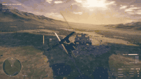
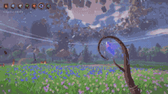
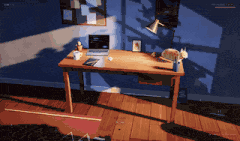
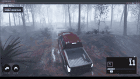
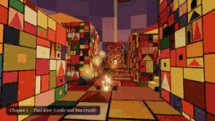

# 🎮 Games · all 80

[← Back to the main list](../README.md) · **English** · [简体中文](games.zh-CN.md) · [繁體中文](games.zh-TW.md) · [日本語](games.ja.md) · [한국어](games.ko.md) · [Español](games.es.md) · [Português](games.pt-BR.md) · [Français](games.fr.md) · [Deutsch](games.de.md) · [Русский](games.ru.md)

The main page shows at most the top 12 posts with 100+ likes; this page has every entry in this section, sorted by likes.

<table>
<tr>
<td width="33%" valign="top">
 
<b><a href="https://starrynightrider.com">Starry Nightrider</a></b> 
🆕 · <a href="https://x.com/ebbyamir">@ebbyamir</a> · ♥ 17.8k · <a href="https://x.com/ebbyamir/status/2120284261089673376">▶ Video</a> 
Van Gogh riding through his Starry Night, as a game. 
<a href="https://fablelist.000ooo.ooo/prompts/?w=starry-nightrider&ref=gh"><b>✨ Get the prompt</b></a>
</td>
<td width="33%" valign="top">
 
<b><a href="https://claude.ai/artifact/BGY1SztrAYcJQHSsnHHGmp">Saltline — first-person shooter</a></b> 
<a href="https://x.com/felixrieseberg">@felixrieseberg</a> · ♥ 14.7k · <a href="https://x.com/felixrieseberg/status/2119925633564463609">▶ Video</a> 
By an Anthropic engineer. One-shot prompts, no human feedback, 8 hours, ~$550. Models, sounds and textures all generated in code. 
<a href="https://fablelist.000ooo.ooo/prompts/?w=saltline-first-person-shooter&ref=gh"><b>✨ Get the prompt</b></a>
</td>
<td width="33%" valign="top">
 
<b><a href="https://patch.gg/blendi/oil-paint">Oil Paint — hand-painted game</a></b> 
🆕 · <a href="https://x.com/BlendiByl">@BlendiByl</a> · ♥ 7.9k · <a href="https://x.com/BlendiByl/status/2120341251178594532">▶ Video</a> 
Made in under an hour. Every frame is about 1.5 million brush strokes, running at 200 fps in a browser tab. Open source. 
<a href="https://fablelist.000ooo.ooo/prompts/?w=oil-paint-hand-painted-game&ref=gh"><b>✨ Get the prompt</b></a>
</td>
</tr>
<tr>
<td width="33%" valign="top">
 
<b><a href="https://nyc.somethingbig.ai/">CROSSTOWN — open-world New York (early preview)</a></b> 
🆕 · <a href="https://x.com/mattshumer_">@mattshumer_</a> · ♥ 7.5k · <a href="https://x.com/mattshumer_/status/2120282133503820150">▶ Video</a> 
"Rockstar took 8 years. Fable 5.2 is gonna do it in 7 days." Only part of the city is in so far; press B to send feedback. 
<a href="https://fablelist.000ooo.ooo/prompts/?w=crosstown-open-world-new-york-early-preview&ref=gh"><b>✨ Get the prompt</b></a>
</td>
<td width="33%" valign="top">
 
<b><a href="https://what-the-water-keeps.vercel.app/">What the Water Keeps</a></b> 
<a href="https://x.com/kevin_t_ngo">@kevin_t_ngo</a> · ♥ 4.2k · <a href="https://x.com/kevin_t_ngo/status/2119868968307695818">▶ Video</a> 
A boat ride through 8 dreamlike worlds, playable in the browser. 
<a href="https://fablelist.000ooo.ooo/prompts/?w=what-the-water-keeps&ref=gh"><b>✨ Get the prompt</b></a>
</td>
<td width="33%" valign="top">
 
<b><a href="https://tennis.sixfingerpunch.com/">Tennis</a></b> 
🆕 · <a href="https://x.com/photonstorm">@photonstorm</a> · ♥ 3.1k · <a href="https://x.com/photonstorm/status/2120330010112434313">Post</a> 
Asked to "go wild" making a game, it returned what looks like a Pong clone — until you play it. 
<a href="https://fablelist.000ooo.ooo/prompts/?w=tennis&ref=gh"><b>✨ Get the prompt</b></a>
</td>
</tr>
<tr>
<td width="33%" valign="top">
 
<b><a href="https://www.spawn.co/@mattshumer/earth?room=local">Mirror Earth</a></b> 
<a href="https://x.com/mattshumer_">@mattshumer_</a> · ♥ 2.4k · <a href="https://x.com/mattshumer_/status/2119877065701036047">▶ Video</a> 
The whole planet as a destructible game world, with weather that matches the real Earth in real time. 
<a href="https://fablelist.000ooo.ooo/prompts/?w=mirror-earth&ref=gh"><b>✨ Get the prompt</b></a>
</td>
<td width="33%" valign="top">
 
<b><a href="https://portals-endless-worlds.netlify.app/">Portals: Endless Worlds</a></b> 
<a href="https://x.com/emollick">@emollick</a> · ♥ 1.9k · <a href="https://x.com/emollick/status/2119918307457577163">▶ Video</a> 
25,000 agents built 450+ code-only 3D worlds inspired by books, art and places, linked by portals you drift through. 
<a href="https://github.com/emollick/ai-portals">Source</a> · <a href="https://www.oneusefulthing.org/p/fable-52-and-jagged-agi">Essay</a> 
<a href="https://fablelist.000ooo.ooo/prompts/?w=portals-endless-worlds&ref=gh"><b>✨ Get the prompt</b></a>
</td>
<td width="33%" valign="top">
 
<b><a href="https://evensong-phi.vercel.app/">Evensong</a></b> 
🆕 · <a href="https://x.com/kevin_t_ngo">@kevin_t_ngo</a> · ♥ 1.8k · <a href="https://x.com/kevin_t_ngo/status/2120238844754923874">▶ Video</a> 
A dark-fantasy souls-like boss fight, playable in the browser. 
<a href="https://fablelist.000ooo.ooo/prompts/?w=evensong&ref=gh"><b>✨ Get the prompt</b></a>
</td>
</tr>
<tr>
<td width="33%" valign="top">
 
<b><a href="https://loktar00.github.io/lanternfall/">LANTERNFALL</a></b> 
🆕 · <a href="https://x.com/loktar00">@loktar00</a> · ♥ 1.4k · <a href="https://x.com/loktar00/status/2120192761542615271">▶ Video</a> 
The whole game — animations, models, everything — generated by Fable. Watch the effect when enemies die. 
<a href="https://fablelist.000ooo.ooo/prompts/?w=lanternfall&ref=gh"><b>✨ Get the prompt</b></a>
</td>
<td width="33%" valign="top">
 
<b><a href="https://op7418.github.io/guizang-game-skill/">Mist-Locked Mountain Gate — 3D action game</a></b> 
🆕 · <a href="https://x.com/op7418">@op7418</a> · ♥ 1.1k · <a href="https://x.com/op7418/status/2120694045299327187">▶ Video</a> 
One afternoon, 4.5 billion tokens. Models, scenes and moves all by Fable, packed into a single 30 MB HTML file. 
<a href="https://fablelist.000ooo.ooo/prompts/?w=mist-locked-mountain-gate-3d-action-game&ref=gh"><b>✨ Get the prompt</b></a>
</td>
<td width="33%" valign="top">
 
<b><a href="https://wavedash.com/games/rooftop-rally">Rooftop Rally — pickleball in Unreal 5.9</a></b> 
🆕 · <a href="https://x.com/chongdashu">@chongdashu</a> · ♥ 1.1k · <a href="https://x.com/chongdashu/status/2120154573356793883">▶ Video</a> 
Fable 5.2 with the Unreal Engine 5.9 preview. Characters from Tripo; the other 3D assets and the rest by Fable. 
<a href="https://x.com/chongdashu/status/2120310120509014219">How it was built</a> 
<a href="https://fablelist.000ooo.ooo/prompts/?w=rooftop-rally-pickleball-in-unreal-5-9&ref=gh"><b>✨ Get the prompt</b></a>
</td>
</tr>
<tr>
<td width="33%" valign="top">
 
<b><a href="https://claude.ai/artifact/MXxb36zKgN261ckbGhmNin">Three Games (Saltline · The Clockmaker's Heart · Tidewright)</a></b> 
<a href="https://x.com/felixrieseberg">@felixrieseberg</a> · ♥ 809 · <a href="https://x.com/vineerpasam/status/2119955306096857145">▶ Video</a> 
Signed by Felix Rieseberg: "All games made with Claude Fable 5.2. First drafts, no human feedback." The most-shared link of launch day. 
<a href="https://claude.ai/artifact/6MjtQjf4ee1ZZjEpafaEpa">The Clockmaker's Heart</a> · <a href="https://claude.ai/artifact/JTgyEMn7sn1q2riWrMb7D4">Tidewright</a> 
<a href="https://fablelist.000ooo.ooo/prompts/?w=three-games-saltline-the-clockmaker-s-heart-tidewright&ref=gh"><b>✨ Get the prompt</b></a>
</td>
<td width="33%" valign="top">
 
<b><a href="https://patch.gg/blendi/coloured-pencil">Coloured Pencil</a></b> 
🆕 · <a href="https://x.com/BlendiByl">@BlendiByl</a> · ♥ 741 · <a href="https://x.com/BlendiByl/status/2121130385723789637">▶ Video</a> 
A colored-pencil game slice; every surface's shading and the whole town are code. Open source. 
<a href="https://fablelist.000ooo.ooo/prompts/?w=coloured-pencil&ref=gh"><b>✨ Get the prompt</b></a>
</td>
<td width="33%" valign="top">
 
<b><a href="https://www.spawn.co/@mattshumer/voxel-engine">Voxel Engine</a></b> 
<a href="https://x.com/mattshumer_">@mattshumer_</a> · ♥ 740 · <a href="https://x.com/mattshumer_/status/2119870965106483384">▶ Video</a> 
Built from a single prompt. Sound on. 
<a href="https://fablelist.000ooo.ooo/prompts/?w=voxel-engine&ref=gh"><b>✨ Get the prompt</b></a>
</td>
</tr>
<tr>
<td width="33%" valign="top">
 
<b><a href="https://patch.gg/blendi/patchwork-quilt">Patchwork Quilt</a></b> 
🆕 · <a href="https://x.com/BlendiByl">@BlendiByl</a> · ♥ 669 · <a href="https://x.com/BlendiByl/status/2120746541636047347">▶ Video</a> 
A patchwork, stop-motion style game slice. The whole map is code. Open source. 
<a href="https://fablelist.000ooo.ooo/prompts/?w=patchwork-quilt&ref=gh"><b>✨ Get the prompt</b></a>
</td>
<td width="33%" valign="top">
 
<b><a href="https://bannerfall.itch.io/siege-wing">Siege Wing — a helicopter in a medieval war</a></b> 
🆕 · <a href="https://x.com/builderjaydub">@builderjaydub</a> · ♥ 556 · <a href="https://x.com/builderjaydub/status/2120223731520040966">▶ Video</a> 
Fly a chopper with cannon, rockets and missiles, dodge Roman ballistae and bring down the castle.
</td>
<td width="33%" valign="top">
 
<b><a href="https://i-would-have-gotten-away-with-it.netlify.app/">I Would Have Gotten Away With It</a></b> 
<a href="https://x.com/emollick">@emollick</a> · ♥ 509 · <a href="https://x.com/emollick/status/2119876449494540554">▶ Video</a> 
A reverse Scooby-Doo: you are the villain scaring off meddling kids. Fable also made the trailer, music and sound. 
<a href="https://fablelist.000ooo.ooo/prompts/?w=i-would-have-gotten-away-with-it&ref=gh"><b>✨ Get the prompt</b></a>
</td>
</tr>
<tr>
<td width="33%" valign="top">
 
<b><a href="https://noclipepe.pages.dev/rug/">Childhood Rug Racer</a></b> 
<a href="https://x.com/noclipepe">@noclipepe</a> · ♥ 415 · <a href="https://x.com/noclipepe/status/2119728047754547326">▶ Video</a> 
A racing game on your childhood play rug, same prompt as GPT-6.2 Sol. The author calls the model "Fable 5.5 (routing)". 
<a href="https://fablelist.000ooo.ooo/prompts/?w=childhood-rug-racer&ref=gh"><b>✨ Get the prompt</b></a>
</td>
<td width="33%" valign="top">
 
<b><a href="https://finderchangchang.github.io/cloud-stunt-3d/">Cloud Stunt 3D</a></b> 
<a href="https://x.com/jev_chat">@jev_chat</a> · ♥ 329 · <a href="https://x.com/jev_chat/status/2120015641151426838">▶ Video</a> 
Generated in 30 minutes; an optimized "golden" version is linked too. 
<a href="https://finderchangchang.github.io/cloud-stunt-3d/golden/">Optimized</a> 
<a href="https://x.com/jev_chat/status/2120015641151426838">📝 Creator's prompt (free)</a>
</td>
<td width="33%" valign="top">
 
<b><a href="https://gilt-and-gutter.vercel.app/">Gilt & Gutter</a></b> 
🆕 · <a href="https://x.com/kevin_t_ngo">@kevin_t_ngo</a> · ♥ 326 · <a href="https://x.com/kevin_t_ngo/status/2119900487688622171">▶ Video</a> 
A 1v1 first-person shooter with two playable characters. 
<a href="https://fablelist.000ooo.ooo/prompts/?w=gilt-gutter&ref=gh"><b>✨ Get the prompt</b></a>
</td>
</tr>
<tr>
<td width="33%" valign="top">
 
<b><a href="https://www.spawn.co/@mattshumer/hogwarts-royale">Hogwarts Royale</a></b> 
<a href="https://x.com/mattshumer_">@mattshumer_</a> · ♥ 311 · <a href="https://x.com/mattshumer_/status/2119872098306810226">▶ Video</a> 
"Create a mashup of Harry Potter and Fortnite" — a playable battle royale. 
<a href="https://x.com/mattshumer_/status/2119872098306810226">📝 Creator's prompt (free)</a>
</td>
<td width="33%" valign="top">
 
<b><a href="https://dread-and-district.netlify.app">Dread & District</a></b> 
🆕 · <a href="https://x.com/emollick">@emollick</a> · ♥ 302 · <a href="https://x.com/emollick/status/2120248525254742318">▶ Video</a> 
A fantasy transport sim "with heart": one vague paragraph, then a bunch of agents arguing about art, lore and jokes. Good logistics defeats evil. 
<a href="https://fablelist.000ooo.ooo/prompts/?w=dread-district&ref=gh"><b>✨ Get the prompt</b></a>
</td>
<td width="33%" valign="top">
 
<b><a href="https://lauramionel.github.io/cayley-flight-simulator/">Cayley flight simulator</a></b> 
🆕 · <a href="https://x.com/lionel_mora">@lionel_mora</a> · ♥ 295 · <a href="https://x.com/lionel_mora/status/2120554787812860294">▶ Video</a> 
One-shot overnight: real wing physics that computes lift and drag for each part of the wing. 
<a href="https://fablelist.000ooo.ooo/prompts/?w=cayley-flight-simulator&ref=gh"><b>✨ Get the prompt</b></a>
</td>
</tr>
<tr>
<td width="33%" valign="top">
 
<b><a href="https://unsung-vale.vercel.app/">Unsung Vale — open-world RPG</a></b> 
🆕 · <a href="https://x.com/LexnLin">@LexnLin</a> · ♥ 294 · <a href="https://x.com/LexnLin/status/2121253191748669705">▶ Video</a> 
A third-person open-world RPG demo. No assets: everything on screen is made with code. 
<a href="https://github.com/Leonxlnx/unsung-vale">Source</a>
</td>
<td width="33%" valign="top">
 
<b><a href="https://github.com/amirmushichge/worm-rider">Worm Rider</a></b> 
<a href="https://x.com/AmirMushich">@AmirMushich</a> · ♥ 251 · <a href="https://x.com/AmirMushich/status/2119937977426338283">▶ Video</a> 
Open source. 220 KB, 3,400 lines, 10 prompts, every model built from scratch in Claude Code. 
<a href="https://fablelist.000ooo.ooo/prompts/?w=worm-rider&ref=gh"><b>✨ Get the prompt</b></a>
</td>
<td width="33%" valign="top">
 
<b><a href="https://maad-maxxing.vercel.app/">MAAD MAXXING</a></b> 
🆕 · <a href="https://x.com/Andrew_Blumson">@Andrew_Blumson</a> · ♥ 246 · <a href="https://x.com/Andrew_Blumson/status/2120599812512833557">▶ Video</a> 
100% code, no assets. First 3 stages playable; audio by ElevenLabs. 
<a href="https://fablelist.000ooo.ooo/prompts/?w=maad-maxxing&ref=gh"><b>✨ Get the prompt</b></a>
</td>
</tr>
<tr>
<td width="33%" valign="top">
 
<b><a href="https://frontier.every.to/experiments/first-crush">First Crush</a></b> 
🆕 · <a href="https://x.com/kieranklaassen">@kieranklaassen</a> · ♥ 229 · <a href="https://x.com/kieranklaassen/status/2119871673294037280">▶ Video</a> 
A winemaking game: scrub the vat, crush 250 kg of fruit, read the hydrometer, pick a yeast — and it explains why. Click "Try it" on the page. 
<a href="https://fablelist.000ooo.ooo/prompts/?w=first-crush&ref=gh"><b>✨ Get the prompt</b></a>
</td>
<td width="33%" valign="top">
 
<b><a href="https://sanwan.ai/games/xingyun-moba/">Starfall — a browser MOBA</a></b> 
🆕 · <a href="https://x.com/FuSheng_0306">@FuSheng_0306</a> · ♥ 195 · <a href="https://x.com/FuSheng_0306/status/2121237878097207583">▶ Video</a> 
One prompt, about 20 hours of Fable 5.2: five heroes, one human player and NPCs. 
<a href="https://fablelist.000ooo.ooo/prompts/?w=starfall-a-browser-moba&ref=gh"><b>✨ Get the prompt</b></a>
</td>
<td width="33%" valign="top">
 
<b><a href="https://cozylisbon.vercel.app">Cozy Lisbon</a></b> 
🆕 · <a href="https://x.com/goncalo_canhoto">@goncalo_canhoto</a> · ♥ 166 · <a href="https://x.com/goncalo_canhoto/status/2119932946346094690">▶ Video</a> 
A one-prompt cozy game about a little plane flying over Lisbon. 
<a href="https://fablelist.000ooo.ooo/prompts/?w=cozy-lisbon&ref=gh"><b>✨ Get the prompt</b></a>
</td>
</tr>
<tr>
<td width="33%" valign="top">
 
<b><a href="https://spawn.co/@robot/frontline-warfare-deathmatch">Frontline Warfare Deathmatch</a></b> 
<a href="https://x.com/alightinastorm">@alightinastorm</a> · ♥ 163 · <a href="https://x.com/alightinastorm/status/2120020469487440210">▶ Video</a> 
A Call of Duty-style shooter in the browser.
</td>
<td width="33%" valign="top">
 
<b><a href="https://wquguru.github.io/fable52-fps-repro/">Fable 5.2 FPS Repro</a></b> 
🆕 · <a href="https://x.com/wquguru">@wquguru</a> · ♥ 159 · <a href="https://x.com/wquguru/status/2120383332722905400">▶ Video</a> 
Four single-file 3D FPS demos: models, sound and textures all in code. Method and source are open. 
<a href="https://github.com/wquguru/fable52-fps-repro">Source</a> 
<a href="https://x.com/wquguru/status/2120383332722905400">📝 Creator's prompt (free)</a>
</td>
<td width="33%" valign="top">
 
<b><a href="https://noclipepe.pages.dev/dino">Rambo Dino</a></b> 
<a href="https://x.com/noclipepe">@noclipepe</a> · ♥ 155 · <a href="https://x.com/noclipepe/status/2119927838321328577">▶ Video</a> 
The Chrome T-Rex game, rebuilt. Compared against Opus 5.5, Gemini 4 Carbon and GPT-6 Astra. 
<a href="https://fablelist.000ooo.ooo/prompts/?w=rambo-dino&ref=gh"><b>✨ Get the prompt</b></a>
</td>
</tr>
<tr>
<td width="33%" valign="top">
 
<b><a href="https://remix.gg/g/banana-mine-rush">Banana Mine Rush</a></b> 
🆕 · <a href="https://x.com/0xChuckstock">@0xChuckstock</a> · ♥ 154 · <a href="https://x.com/0xChuckstock/status/2120125184606658728">▶ Video</a> 
A 3D kart racer on Remix: plays instantly in the browser with no account, with multiplayer and leaderboards. 
<a href="https://fablelist.000ooo.ooo/prompts/?w=banana-mine-rush&ref=gh"><b>✨ Get the prompt</b></a>
</td>
<td width="33%" valign="top">
 
<b><a href="https://turbo-tails.vercel.app">Turbo Tails</a></b> 
<a href="https://x.com/petergyang">@petergyang</a> · ♥ 139 · <a href="https://x.com/petergyang/status/2119901658394358005">▶ Video</a> 
3D kart racer: 6 racers, drifting, ramps, items, single and multiplayer. 
<a href="https://youtu.be/SsSKJA0EHD4">Comparison video</a> 
<a href="https://fablelist.000ooo.ooo/prompts/?w=turbo-tails&ref=gh"><b>✨ Get the prompt</b></a>
</td>
<td width="33%" valign="top">
 
<b><a href="https://luminazombies.com/">Lumina Zombies</a></b> 
🆕 · <a href="https://x.com/LuminaBench">@LuminaBench</a> · ♥ 124 · <a href="https://x.com/LuminaBench/status/2120660076927099048">▶ Video</a> 
A brand-new map with easter eggs in a few prompts, plus upgrades that halved hardware demand and latency on the other two maps. 
<a href="https://fablelist.000ooo.ooo/prompts/?w=lumina-zombies&ref=gh"><b>✨ Get the prompt</b></a>
</td>
</tr>
<tr>
<td width="33%" valign="top">
 
<b><a href="https://loktar00.github.io/llm-test-pages/fable52-dino-chase/">Thunder Valley dino chase</a></b> 
🆕 · <a href="https://x.com/loktar00">@loktar00</a> · ♥ 98 · <a href="https://x.com/loktar00/status/2120905457380507991">▶ Video</a> 
Vanilla JS with its own WebGL renderer; dinos, trees and terrain are stacked 2D pixel slices. 
<a href="https://fablelist.000ooo.ooo/prompts/?w=thunder-valley-dino-chase&ref=gh"><b>✨ Get the prompt</b></a>
</td>
<td width="33%" valign="top">
 
<b><a href="https://feed-backrooms.vercel.app">Feed the Backrooms</a></b> 
<a href="https://x.com/LexnLin">@LexnLin</a> · ♥ 95 · <a href="https://x.com/LexnLin/status/2119966127149429093">▶ Video</a> 
The Backrooms, reversed: you are the monster and your job is to catch people. 
<a href="https://fablelist.000ooo.ooo/prompts/?w=feed-the-backrooms&ref=gh"><b>✨ Get the prompt</b></a>
</td>
<td width="33%" valign="top">
 
<b><a href="https://rivergame-kappa.vercel.app">The Waking River</a></b> 
🆕 · <a href="https://x.com/flxrnc">@flxrnc</a> · ♥ 90 · <a href="https://x.com/flxrnc/status/2120494277528580110">▶ Video</a> 
One prompt and a few follow-ups: five sleeping worlds that wake as you sail through, with a score made from code. 
<a href="https://x.com/flxrnc/status/2120494277528580110">📝 Creator's prompt (free)</a>
</td>
</tr>
<tr>
<td width="33%" valign="top">
 
<b><a href="https://app.usecrayon.ai/play/992c2130-43da-416b-a577-aed9514d3057">SKYWAKE</a></b> 
🆕 · <a href="https://x.com/aniketjart">@aniketjart</a> · ♥ 79 · <a href="https://x.com/aniketjart/status/2120378493729222700">▶ Video</a> 
A flying quest game made with Fable 5.2, Opus 5.5, Crayon and three.js. 
<a href="https://fablelist.000ooo.ooo/prompts/?w=skywake&ref=gh"><b>✨ Get the prompt</b></a>
</td>
<td width="33%" valign="top">
 
<b><a href="https://app.usecrayon.ai/play/0cd7624e-1297-417e-a5be-b3c3036a496a">KUMOKIRI</a></b> 
🆕 · <a href="https://x.com/aniketjart">@aniketjart</a> · ♥ 72 · <a href="https://x.com/aniketjart/status/2121101334900617631">▶ Video</a> 
A painterly samurai game made with Fable 5.2, Crayon and three.js. 
<a href="https://fablelist.000ooo.ooo/prompts/?w=kumokiri&ref=gh"><b>✨ Get the prompt</b></a>
</td>
<td width="33%" valign="top">
 
<b><a href="https://save-the-world-fable.vercel.app/">Save the World</a></b> 
🆕 · <a href="https://x.com/global_techgirl">@global_techgirl</a> · ♥ 63 · <a href="https://x.com/global_techgirl/status/2120246750459961453">▶ Video</a> 
It built the street, found the 3D models and sounds, and played the game itself to record the trailer. Best on a laptop. 
<a href="https://fablelist.000ooo.ooo/prompts/?w=save-the-world&ref=gh"><b>✨ Get the prompt</b></a>
</td>
</tr>
<tr>
<td width="33%" valign="top">
 
<b><a href="https://patch.gg/games/rehan/ringfall">Ringfall</a></b> 
🆕 · <a href="https://x.com/rehan_shei">@rehan_shei</a> · ♥ 62 · <a href="https://x.com/rehan_shei/status/2119994607291584962">▶ Video</a> 
A Destiny-inspired FPS. Open source and remixable. 
<a href="https://fablelist.000ooo.ooo/prompts/?w=ringfall&ref=gh"><b>✨ Get the prompt</b></a>
</td>
<td width="33%" valign="top">
 
<b><a href="https://www.spawn.co/@abbidabbi/pogo-riot">Pogo Riot</a></b> 
🆕 · <a href="https://x.com/Pumpnasterr">@Pumpnasterr</a> · ♥ 59 · <a href="https://x.com/Pumpnasterr/status/2121343507885682917">▶ Video</a> 
A free-for-all FPS where you bounce on a pogo stick and aim at the same time.
</td>
<td width="33%" valign="top">
 
<b><a href="https://samg-coder.github.io/solstice-racing/">Kestrel Head — Solstice racing</a></b> 
🆕 · <a href="https://x.com/SamGCoder">@SamGCoder</a> · ♥ 56 · <a href="https://x.com/SamGCoder/status/2120044542087070066">▶ Video</a> 
Built on the author's own Rust + WebGPU engine: a Porsche 992 GT3 R modeled in Blender and a 3 km island circuit. Controller support. 
<a href="https://github.com/SamG-Coder/solstice-racing">Source</a> 
<a href="https://fablelist.000ooo.ooo/prompts/?w=kestrel-head-solstice-racing&ref=gh"><b>✨ Get the prompt</b></a>
</td>
</tr>
<tr>
<td width="33%" valign="top">
 
<b><a href="https://shubhu121.github.io/hitdude/play/">HITOFUDE</a></b> 
🆕 · <a href="https://x.com/positronx_">@positronx_</a> · ♥ 52 · <a href="https://x.com/positronx_/status/2120374208043876422">▶ Video</a> 
Every frame brushed in code as sumi ink on paper. The boss erases the level; your sword is a paintbrush. 
<a href="https://fablelist.000ooo.ooo/prompts/?w=hitofude&ref=gh"><b>✨ Get the prompt</b></a>
</td>
<td width="33%" valign="top">
 
<b><a href="https://patch.gg/play/blendi/small-magic">Small Magic — wizard sandbox</a></b> 
🆕 · <a href="https://x.com/BlendiByl">@BlendiByl</a> · ♥ 50 · <a href="https://x.com/BlendiByl/status/2121594536153718972">▶ Video</a> 
Built in one day: 7 spells, about 1,800 destructible physics pieces, no models or textures, open source.
</td>
<td width="33%" valign="top">
 
<b><a href="https://fowllabs.com/fable-5-2/chairmageddon/">Chairmageddon</a></b> 
🆕 · <a href="https://x.com/argofowl">@argofowl</a> · ♥ 48 · <a href="https://x.com/argofowl/status/2120568779537273263">▶ Video</a> 
Destroy a peaceful town of blue chairs. Yes, you can vortex the baby stroller. 
<a href="https://fablelist.000ooo.ooo/prompts/?w=chairmageddon&ref=gh"><b>✨ Get the prompt</b></a>
</td>
</tr>
<tr>
<td width="33%" valign="top">
 
<b><a href="https://higgsfield.ai/@higgsfield.studio/blogs/fable-5-2-built-this-rpg-from-pure-code-here-s-every-step">VOWLORN</a></b> 
<a href="https://x.com/higgsfield_ai">@higgsfield_ai</a> · ♥ 46 · <a href="https://x.com/higgsfield_ai/status/2119997122896601269">▶ Video</a> 
A dark RPG where even the voices are code, deployed through Higgsfield MCP. Links go to the play pages with full workflows. 
<a href="https://higgsfield.ai/@higgsfield.studio/blogs/claude-fable-5-2-built-a-dragon-riding-game-play-it-free">Dragon-riding game</a> · <a href="https://higgsfield.ai/@higgsfield.studio/blogs/one-drawing-fable-5-2-turned-it-into-a-horror-game">Drawing-to-horror game</a> 
<a href="https://fablelist.000ooo.ooo/prompts/?w=vowlorn&ref=gh"><b>✨ Get the prompt</b></a>
</td>
<td width="33%" valign="top">
 
<b><a href="https://claude.ai/artifact/4nPXUKJjQWNsZEHVNmXXCt">Stray Cat</a></b> 
<a href="https://x.com/aimikoda">@aimikoda</a> · ♥ 44 · <a href="https://x.com/aimikoda/status/2120120133712593118">▶ Video</a> 
Rescue kittens, hiss at dogs, yowl at an old tomcat. Every sound is synthesized. 
<a href="https://fablelist.000ooo.ooo/prompts/?w=stray-cat&ref=gh"><b>✨ Get the prompt</b></a>
</td>
<td width="33%" valign="top">
 
<b><a href="https://sael.net/demo/farewell-light/">Farewell Light</a></b> 
🆕 · <a href="https://x.com/RyanSael">@RyanSael</a> · ♥ 44 · <a href="https://x.com/RyanSael/status/2120695866684231998">▶ Video</a> 
A gameplay demo made overnight. 
<a href="https://fablelist.000ooo.ooo/prompts/?w=farewell-light&ref=gh"><b>✨ Get the prompt</b></a>
</td>
</tr>
<tr>
<td width="33%" valign="top">
 
<b><a href="https://claude.ai/artifact/UD9pGEN4QFA8F5EadRw8eL">Midnight Pass</a></b> 
🆕 · <a href="https://x.com/andreysuperior">@andreysuperior</a> · ♥ 44 · <a href="https://x.com/andreysuperior/status/2120666660130746458">▶ Video</a> 
One HTML file, 603 lines, zero assets: real drift physics, a generated mountain, synthesized engine and tyres. 
<a href="https://fablelist.000ooo.ooo/prompts/?w=midnight-pass&ref=gh"><b>✨ Get the prompt</b></a>
</td>
<td width="33%" valign="top">
 
<b><a href="https://loktar00.github.io/llm-test-pages/fable52-hang-glider/">Thermal</a></b> 
🆕 · <a href="https://x.com/loktar00">@loktar00</a> · ♥ 41 · <a href="https://x.com/loktar00/status/2121005021131083851">▶ Video</a> 
A little hang glider game: ride the thermals and reach the target. 
<a href="https://fablelist.000ooo.ooo/prompts/?w=thermal&ref=gh"><b>✨ Get the prompt</b></a>
</td>
<td width="33%" valign="top">
 
<b><a href="https://remix.gg/g/survivors">Survivors</a></b> 
🆕 · <a href="https://x.com/BLACKST0CK">@BLACKST0CK</a> · ♥ 40 · <a href="https://x.com/BLACKST0CK/status/2120329788896498123">▶ Video</a> 
Vampire Survivors with WoW-style leveling and loot. Solo or co-op for up to 4. 
<a href="https://fablelist.000ooo.ooo/prompts/?w=survivors&ref=gh"><b>✨ Get the prompt</b></a>
</td>
</tr>
<tr>
<td width="33%" valign="top">
 
<b><a href="https://fowllabs.com/fable-5-2/knock-it-off/">Knock It Off</a></b> 
🆕 · <a href="https://x.com/argofowl">@argofowl</a> · ♥ 40 · <a href="https://x.com/argofowl/status/2121276206683410839">▶ Video</a> 
You're a cat at 3am, swatting everything off the desk without waking the human. A single HTML file with no 3D models.
</td>
<td width="33%" valign="top">
 
<b><a href="https://www.aigameshare.com/games/animal-card-battle-game?play=1&mode=fullscreen">Thimble Knights</a></b> 
🆕 · <a href="https://x.com/_nilni">@_nilni</a> · ♥ 34 · <a href="https://x.com/_nilni/status/2120435983032447382">▶ Video</a> 
A real-time animal card battle game. 
<a href="https://x.com/_nilni/status/2120435983032447382">📝 Creator's prompt (free)</a>
</td>
<td width="33%" valign="top">
 
<b><a href="https://tetriss22.github.io/harbor-gp/">Harbor Lights Grand Prix</a></b> 
🆕 · <a href="https://x.com/Tetriss112">@Tetriss112</a> · ♥ 33 · <a href="https://x.com/Tetriss112/status/2120946576663134308">▶ Video</a> 
One HTML file: 20 pixel cars on a 22-corner street circuit, with a betting window before each race (play money). 
<a href="https://fablelist.000ooo.ooo/prompts/?w=harbor-lights-grand-prix&ref=gh"><b>✨ Get the prompt</b></a>
</td>
</tr>
<tr>
<td width="33%" valign="top">
 
<b><a href="https://blog.silencestar.com/posts/tilt-labyrinth/play/">Tilt Labyrinth</a></b> 
<a href="https://x.com/mylifcc">@mylifcc</a> · ♥ 32 · <a href="https://x.com/mylifcc/status/2120054646282870910">▶ Video</a> 
A wooden ball maze in 2,000 lines of three.js. Fable profiled it from 55 ms to 9 ms per frame on its own. 
<a href="https://fablelist.000ooo.ooo/prompts/?w=tilt-labyrinth&ref=gh"><b>✨ Get the prompt</b></a>
</td>
<td width="33%" valign="top">
 
<b><a href="https://claude.ai/artifact/QvSjL7Hexf3nKdUP9Zerr7">Fighting game (plays on phones)</a></b> 
🆕 · <a href="https://x.com/s_shigel">@s_shigel</a> · ♥ 32 · <a href="https://x.com/s_shigel/status/2120300080569975034">▶ Video</a> 
A fighting game iterated overnight, playable in a mobile browser. 
<a href="https://fablelist.000ooo.ooo/prompts/?w=fighting-game-plays-on-phones&ref=gh"><b>✨ Get the prompt</b></a>
</td>
<td width="33%" valign="top">
 
<b><a href="https://remix.gg/g/hoppy-meadow">Hoppy Meadow</a></b> 
🆕 · <a href="https://x.com/0xChuckstock">@0xChuckstock</a> · ♥ 26 · <a href="https://x.com/0xChuckstock/status/2120620907865473448">Post</a> 
Looks like a simple platformer until you reach the flagpole. 
<a href="https://fablelist.000ooo.ooo/prompts/?w=hoppy-meadow&ref=gh"><b>✨ Get the prompt</b></a>
</td>
</tr>
<tr>
<td width="33%" valign="top">
 
<b><a href="https://the-vast-horizon.vercel.app">The Vast Horizon</a></b> 
🆕 · <a href="https://x.com/OdinLovis">@OdinLovis</a> · ♥ 26 · <a href="https://x.com/OdinLovis/status/2120198469755503091">▶ Video</a> 
A multiplayer surf game on a shared lake; type a word and the world changes. 
<a href="https://fablelist.000ooo.ooo/prompts/?w=the-vast-horizon&ref=gh"><b>✨ Get the prompt</b></a>
</td>
<td width="33%" valign="top">
 
<b><a href="https://claude.ai/artifact/FpdQ81sJs1KiV1a6JCY4jj">Open-world kart adventure</a></b> 
🆕 · <a href="https://x.com/realWeZZard">@realWeZZard</a> · ♥ 24 · <a href="https://x.com/realWeZZard/status/2120379500492185939">▶ Video</a> 
One-shot in three hours; the main quest takes about half an hour. 
<a href="https://fablelist.000ooo.ooo/prompts/?w=open-world-kart-adventure&ref=gh"><b>✨ Get the prompt</b></a>
</td>
<td width="33%" valign="top">
 
<b><a href="https://remix.gg/g/brix-84">BRIX '84</a></b> 
🆕 · <a href="https://x.com/0xChuckstock">@0xChuckstock</a> · ♥ 24 · <a href="https://x.com/0xChuckstock/status/2120896397839126579">Post</a> 
Block breaker that gets wild after the second power-up. 
<a href="https://fablelist.000ooo.ooo/prompts/?w=brix-84&ref=gh"><b>✨ Get the prompt</b></a>
</td>
</tr>
<tr>
<td width="33%" valign="top">
 
<b><a href="https://giant-leap.vercel.app">Giant Leap</a></b> 
🆕 · <a href="https://x.com/handsher_NGU">@handsher_NGU</a> · ♥ 23 · <a href="https://x.com/handsher_NGU/status/2120287667141374212">▶ Video</a> 
Jump from the Moon to the Earth. You just jump. 
<a href="https://fablelist.000ooo.ooo/prompts/?w=giant-leap&ref=gh"><b>✨ Get the prompt</b></a>
</td>
<td width="33%" valign="top">
 
<b><a href="https://qiaomu.t5t6.com/irondusk-yard-7/">IRONDUSK — Yard 7</a></b> 
🆕 · <a href="https://x.com/vista8">@vista8</a> · ♥ 20 · <a href="https://x.com/vista8/status/2120383046239285264">Post</a> 
One prompt asking for a tiny FPS level that can keep up with AAA visuals. A second prompt made a 3D brick breaker with AI and two-player modes. 
<a href="https://qiaomu.t5t6.com/3d/">3D brick breaker</a> 
<a href="https://x.com/vista8/status/2120383046239285264">📝 Creator's prompt (free)</a>
</td>
<td width="33%" valign="top">
 
<b><a href="https://cozybakery.vercel.app">Cozy Bakery</a></b> 
🆕 · <a href="https://x.com/goncalo_canhoto">@goncalo_canhoto</a> · ♥ 18 · <a href="https://x.com/goncalo_canhoto/status/2120530199649432063">▶ Video</a> 
An Overcooked-style co-op cooking game around Portugal, 1 to 4 players, works on mobile. 
<a href="https://fablelist.000ooo.ooo/prompts/?w=cozy-bakery&ref=gh"><b>✨ Get the prompt</b></a>
</td>
</tr>
<tr>
<td width="33%" valign="top">
 
<b><a href="https://www.nightclub-driftspeed.xyz/">NightClub: Drift & Speed</a></b> 
🆕 · <a href="https://x.com/Story91_">@Story91_</a> · ♥ 17 · <a href="https://x.com/Story91_/status/2121016763190059194">▶ Video</a> 
A browser drift racing game with a worldwide leaderboard, built from an empty folder in 72 hours. 
<a href="https://fablelist.000ooo.ooo/prompts/?w=nightclub-drift-speed&ref=gh"><b>✨ Get the prompt</b></a>
</td>
<td width="33%" valign="top">
 
<b><a href="https://silicon-seduction.vercel.app/">Silicon Seduction</a></b> 
<a href="https://x.com/ZryMiller">@ZryMiller</a> · ♥ 13 · <a href="https://x.com/ZryMiller/status/2119918766691954691">▶ Video</a> 
Can you make it out without being seduced? 
<a href="https://fablelist.000ooo.ooo/prompts/?w=silicon-seduction&ref=gh"><b>✨ Get the prompt</b></a>
</td>
<td width="33%" valign="top">
 
<b><a href="https://fighting-game-ignition.saito-931.workers.dev">IGNITION fighting game</a></b> 
🆕 · <a href="https://x.com/s_shigel">@s_shigel</a> · ♥ 13 · <a href="https://x.com/s_shigel/status/2120895161890914336">▶ Video</a> 
A 2D fighting game with generated voices and sound, play logs and replays. 
<a href="https://fablelist.000ooo.ooo/prompts/?w=ignition-fighting-game&ref=gh"><b>✨ Get the prompt</b></a>
</td>
</tr>
<tr>
<td width="33%" valign="top">
 
<b><a href="https://www.aigameshare.com/games/island-god-game?play=1&mode=fullscreen">Handful: Island God</a></b> 
🆕 · <a href="https://x.com/_nilni">@_nilni</a> · ♥ 11 · <a href="https://x.com/_nilni/status/2120639452146250153">▶ Video</a> 
Play a god and guide the little dots to the light. 
<a href="https://fablelist.000ooo.ooo/prompts/?w=handful-island-god&ref=gh"><b>✨ Get the prompt</b></a>
</td>
<td width="33%" valign="top">
 
<b><a href="https://wavedash.com/games/reef-dive">Reef Dive</a></b> 
🆕 · <a href="https://x.com/boona11">@boona11</a> · ♥ 11 · <a href="https://x.com/boona11/status/2120886837422195123">▶ Video</a> 
A three.js diving game the author handed to Fable 5.2 for one day to make it feel like a much bigger game. 
<a href="https://fablelist.000ooo.ooo/prompts/?w=reef-dive&ref=gh"><b>✨ Get the prompt</b></a>
</td>
<td width="33%" valign="top">
 
<b><a href="https://rust4x4.com/">Aussie Outback 4x4</a></b> 
🆕 · <a href="https://x.com/SamGCoder">@SamGCoder</a> · ♥ 9 · <a href="https://x.com/SamGCoder/status/2121513178303811931">▶ Video</a> 
Off-roading in the Australian bush on the author's own Rust + WebGPU engine: mud, creek crossings, rock crawling, diff locks, tyre pressure and dynamic weather.
</td>
</tr>
<tr>
<td width="33%" valign="top">
 
<b><a href="https://aashishgtbit.github.io/PaletteRider/">PaletteRider — cycle through famous paintings</a></b> 
🆕 · <a href="https://x.com/Aashish_Tiwari_">@Aashish_Tiwari_</a> · ♥ 9 · <a href="https://x.com/Aashish_Tiwari_/status/2120963463610880150">▶ Video</a> 
Ride a bicycle through cities from Klee's Castle and Sun and Van Gogh's Café Terrace at Night; the music was made by Fable 5.2 too.
</td>
<td width="33%" valign="top">
 
<b><a href="http://poke-jam.vercel.app">Poke Dodge</a></b> 
🆕 · <a href="https://x.com/crtvTeknologist">@crtvTeknologist</a> · ♥ 8 · <a href="https://x.com/crtvTeknologist/status/2121319366830809285">▶ Video</a> 
A 2v2 Pokemon x dodgeball mashup with NBA Jam flavor: gym ladder, type matchups and held items, on a Three.js stage.
</td>
<td width="33%" valign="top">
 
<b><a href="https://www.aigameshare.com/games/great-wave-off-kanagawa?play=1&mode=fullscreen">Great Wave</a></b> 
🆕 · <a href="https://x.com/_nilni">@_nilni</a> · ♥ 7 · <a href="https://x.com/_nilni/status/2120797996610994355">▶ Video</a> 
Surf into Hokusai's Great Wave, row past the wind and thunder gods toward Mount Fuji. 
<a href="https://fablelist.000ooo.ooo/prompts/?w=great-wave&ref=gh"><b>✨ Get the prompt</b></a>
</td>
</tr>
<tr>
<td width="33%" valign="top">
 
<b><a href="https://claude.ai/artifact/DLnFodkTwvawCNwurDmSZK?sk=5N6PtC07f1niB7h3I6clZQ">Roost</a></b> 
<a href="https://x.com/tejas3732">@tejas3732</a> · ♥ 6 · <a href="https://x.com/tejas3732/status/2120091513657139549">▶ Video</a> 
3D dirt-bike racing in one chat: 5 prompts, 15 minutes, 3 tracks, AI rivals, nitro, handlebar cam. 
<a href="https://fablelist.000ooo.ooo/prompts/?w=roost&ref=gh"><b>✨ Get the prompt</b></a>
</td>
<td width="33%" valign="top">
 
<b><a href="https://clockendbader.github.io/fable-builds/go-for-launch/">Go for Launch</a></b> 
🆕 · <a href="https://x.com/clockendbader">@clockendbader</a> · ♥ 5 · <a href="https://x.com/clockendbader/status/2121251400533631304">Post</a> 
A full cockpit game from Earth to the Moon in one prompt: 1 h 18 min, about $30. Three difficulty levels, live gauges, mission control on the radio; every sound made in code. 
<a href="https://fablelist.000ooo.ooo/prompts/?w=go-for-launch&ref=gh"><b>✨ Get the prompt</b></a>
</td>
<td width="33%" valign="top">
 
<b><a href="https://infall-game.vercel.app">INFALL — you are the black hole</a></b> 
🆕 · <a href="https://x.com/AugustCastilIo">@AugustCastilIo</a> · ♥ 5 · <a href="https://x.com/AugustCastilIo/status/2121350653037756557">▶ Video</a> 
The only instruction was "go crazy and blow my mind"; it went from idea to game in one shot.
</td>
</tr>
<tr>
<td width="33%" valign="top">
 
<b><a href="https://claude.ai/artifact/1QGGhB68jMCjjjeeKtKNUo">Four-character fighting game</a></b> 
<a href="https://x.com/promodenstudio">@promodenstudio</a> · ♥ 4 · <a href="https://x.com/promodenstudio/status/2120085977079107788">▶ Video</a> 
Fable 5.2 + ElevenLabs MCP for 39 voice and sound clips, including an announcer it designed. Desktop + keyboard. 
<a href="https://fablelist.000ooo.ooo/prompts/?w=four-character-fighting-game&ref=gh"><b>✨ Get the prompt</b></a>
</td>
<td width="33%" valign="top">
 
<b><a href="https://vippi.vercel.app/">Vippi</a></b> 
<a href="https://x.com/Shrit1401">@Shrit1401</a> · ♥ 1 · <a href="https://x.com/Shrit1401/status/2120060593763926314">▶ Video</a> 
A COD-style shooter. The author's creepy-game benchmark is linked too. 
<a href="https://claude.ai/artifact/HSxhHE91J2jhLsB8WiTgUc">Creepy-game test</a> 
<a href="https://fablelist.000ooo.ooo/prompts/?w=vippi&ref=gh"><b>✨ Get the prompt</b></a>
</td>
</tr>
</table>

Other sections: [🌍 3D Worlds & Scenes](3d-worlds.md) · [🧰 Web Pages & Tools](web-and-tools.md) · [🎬 Animation & Film (with source)](animation.md) · [📺 Video-only Demos](video-demos.md)

[← Back to the main list](../README.md)
