# 🎮 游戏 · 全部 117 个

[← 回到首页](../README.zh-CN.md) · [English](games.md) · **简体中文** · [繁體中文](games.zh-TW.md) · [日本語](games.ja.md) · [한국어](games.ko.md) · [Español](games.es.md) · [Português](games.pt-BR.md) · [Français](games.fr.md) · [Deutsch](games.de.md) · [Русский](games.ru.md)

首页每类只放原帖点赞 ≥100 的前 24 个，这里是这一类的全部，按点赞数排序。

<table>
<tr>
<td width="33%" valign="top">
 
<b><a href="https://starrynightrider.com">Starry Nightrider 星夜骑行</a></b> 
<a href="https://x.com/ebbyamir">@ebbyamir</a> · ♥ 17.9k · <a href="https://x.com/ebbyamir/status/2120284261089673376">▶ 视频</a> 
梵高骑车穿过他的《星夜》 
<a href="https://fablelist.000ooo.ooo/zh/prompts/?w=starry-nightrider&ref=gh"><b>✨ 获取提示词</b></a>
</td>
<td width="33%" valign="top">
 
<b><a href="https://claude.ai/artifact/BGY1SztrAYcJQHSsnHHGmp">Saltline 第一人称射击</a></b> 
<a href="https://x.com/felixrieseberg">@felixrieseberg</a> · ♥ 15.1k · <a href="https://x.com/felixrieseberg/status/2119925633564463609">▶ 视频</a> 
Anthropic 工程师；一次性提示、无人工反馈跑 8 小时，约 $550；模型、音效、贴图全部代码生成 
<a href="https://fablelist.000ooo.ooo/zh/prompts/?w=saltline-first-person-shooter&ref=gh"><b>✨ 获取提示词</b></a>
</td>
<td width="33%" valign="top">
 
<b><a href="https://viktorkav.com.br/apoio/uno-com-escada/fable/">Uno com Escada 车顶绑梯子的菲亚特 Uno 赛道</a></b> 
<a href="https://x.com/ViktorKav">@ViktorKav</a> · ♥ 9.2k · <a href="https://x.com/ViktorKav/status/2122647483281015155">▶ 视频</a> 
开着车顶绑梯子的 96 款 Uno Mille 跑赛道；一个 603 KB 的 HTML，没用引擎、3D 库和贴图，车、树林、天空和 1.0 发动机的声音全由代码生成 
<a href="https://github.com/viktorkav/uno-com-escada">源码</a>
</td>
</tr>
<tr>
<td width="33%" valign="top">
 
<b><a href="https://patch.gg/blendi/oil-paint">Oil Paint 手绘油画风游戏</a></b> 
<a href="https://x.com/BlendiByl">@BlendiByl</a> · ♥ 8.0k · <a href="https://x.com/BlendiByl/status/2120341251178594532">▶ 视频</a> 
不到一小时做成；每帧约 150 万笔笔触，浏览器里跑 200 帧；开源 
<a href="https://fablelist.000ooo.ooo/zh/prompts/?w=oil-paint-hand-painted-game&ref=gh"><b>✨ 获取提示词</b></a>
</td>
<td width="33%" valign="top">
 
<b><a href="https://nyc.somethingbig.ai/">CROSSTOWN 纽约开放世界（早期试玩）</a></b> 
<a href="https://x.com/mattshumer_">@mattshumer_</a> · ♥ 7.5k · <a href="https://x.com/mattshumer_/status/2120282133503820150">▶ 视频</a> 
「Rockstar 花了 8 年，Fable 5.2 要 7 天做完」；目前只开放一部分城市，按 B 可以提反馈 
<a href="https://fablelist.000ooo.ooo/zh/prompts/?w=crosstown-open-world-new-york-early-preview&ref=gh"><b>✨ 获取提示词</b></a>
</td>
<td width="33%" valign="top">
 
<b><a href="https://omw-game.kimaki.dev">omw 油画笔触的城堡山谷</a></b> 
<a href="https://x.com/__morse">@__morse</a> · ♥ 4.5k · <a href="https://x.com/__morse/status/2122013410309153042">▶ 视频</a> 
把 @de5imulate 那张「omw」像素画做成浏览器里能玩的 three.js 游戏，整个画面像油画笔触 
<a href="https://github.com/remorses/castle-valley">源码</a>
</td>
</tr>
<tr>
<td width="33%" valign="top">
 
<b><a href="https://what-the-water-keeps.vercel.app/">What the Water Keeps 梦境划船</a></b> 
<a href="https://x.com/kevin_t_ngo">@kevin_t_ngo</a> · ♥ 4.3k · <a href="https://x.com/kevin_t_ngo/status/2119868968307695818">▶ 视频</a> 
穿过 8 个梦境世界的划船游戏；原帖没放链接，链接来自转发者 @Bhavani_00007 / @meta_pavy 
<a href="https://fablelist.000ooo.ooo/zh/prompts/?w=what-the-water-keeps&ref=gh"><b>✨ 获取提示词</b></a>
</td>
<td width="33%" valign="top">
 
<b><a href="https://tennis.sixfingerpunch.com/">Tennis：让它放开做，结果是个 Pong</a></b> 
<a href="https://x.com/photonstorm">@photonstorm</a> · ♥ 3.1k · <a href="https://x.com/photonstorm/status/2120330010112434313">原帖</a> 
让它「放开做一个游戏」，看着只是个 Pong，玩起来才知道不止于此 
<a href="https://fablelist.000ooo.ooo/zh/prompts/?w=tennis&ref=gh"><b>✨ 获取提示词</b></a>
</td>
<td width="33%" valign="top">
 
<b><a href="https://patch.gg/play/blendi/small-magic">Small Magic 巫师沙盒</a></b> 
<a href="https://x.com/BlendiByl">@BlendiByl</a> · ♥ 2.6k · <a href="https://x.com/BlendiByl/status/2121594536153718972">▶ 视频</a> 
一天做出的巫师沙盒：7 种法术、约 1800 块可破坏的物理碎片，零模型零贴图，开源
</td>
</tr>
<tr>
<td width="33%" valign="top">
 
<b><a href="https://kevintngo.github.io/procedural-rpg/">Brushwild 程序化开放世界 RPG</a></b> 
🆕 · <a href="https://x.com/kevin_t_ngo">@kevin_t_ngo</a> · ♥ 2.5k · <a href="https://x.com/kevin_t_ngo/status/2125321244686029289">▶ 视频</a> 
程序化生成的开放世界动作 RPG，整个游戏是一个约 300kB 的 HTML 文件，每个像素都由着色器画成钢笔加彩铅的手绘风；三种职业、技能树、装备、城镇和地牢，电脑和手机浏览器都能玩 
<a href="https://github.com/kevintngo/procedural-rpg">源码</a>
</td>
<td width="33%" valign="top">
 
<b><a href="https://www.spawn.co/@mattshumer/earth?room=local">Mirror Earth 镜像地球</a></b> 
<a href="https://x.com/mattshumer_">@mattshumer_</a> · ♥ 2.4k · <a href="https://x.com/mattshumer_/status/2119877065701036047">▶ 视频</a> 
整个地球可去可破坏，天气等与真实地球实时同步 
<a href="https://fablelist.000ooo.ooo/zh/prompts/?w=mirror-earth&ref=gh"><b>✨ 获取提示词</b></a>
</td>
<td width="33%" valign="top">
 
<b><a href="https://kevintngo.github.io/cinderwatch/">Cinderwatch 单文件塔防</a></b> 
🆕 · <a href="https://x.com/kevin_t_ngo">@kevin_t_ngo</a> · ♥ 2.3k · <a href="https://x.com/kevin_t_ngo/status/2125119969109418333">▶ 视频</a> 
整个游戏只有一个 HTML 文件的 3D 等距视角塔防，内置 AI 指挥官可以自动布防，浏览器打开就能玩，已开源 
<a href="https://github.com/kevintngo/cinderwatch">源码</a>
</td>
</tr>
<tr>
<td width="33%" valign="top">
 
<b><a href="https://portals-endless-worlds.netlify.app/">Portals 无尽传送门世界</a></b> 
<a href="https://x.com/emollick">@emollick</a> · ♥ 1.9k · <a href="https://x.com/emollick/status/2119918307457577163">▶ 视频</a> 
2.5 万个 Agent 做出 450 多个代码 3D 世界，传送门相连自动漫游 
<a href="https://github.com/emollick/ai-portals">源码</a> · <a href="https://www.oneusefulthing.org/p/fable-52-and-jagged-agi">文章</a> 
<a href="https://fablelist.000ooo.ooo/zh/prompts/?w=portals-endless-worlds&ref=gh"><b>✨ 获取提示词</b></a>
</td>
<td width="33%" valign="top">
 
<b><a href="https://evensong-phi.vercel.app/">Evensong 魂系 Boss 战</a></b> 
<a href="https://x.com/kevin_t_ngo">@kevin_t_ngo</a> · ♥ 1.8k · <a href="https://x.com/kevin_t_ngo/status/2120238844754923874">▶ 视频</a> 
黑暗奇幻风的魂类 Boss 战试玩 
<a href="https://fablelist.000ooo.ooo/zh/prompts/?w=evensong&ref=gh"><b>✨ 获取提示词</b></a>
</td>
<td width="33%" valign="top">
 
<b><a href="https://loktar00.github.io/lanternfall/">LANTERNFALL</a></b> 
<a href="https://x.com/loktar00">@loktar00</a> · ♥ 1.4k · <a href="https://x.com/loktar00/status/2120192761542615271">▶ 视频</a> 
整个游戏连动画、模型都由它生成，敌人死亡的特效很细 
<a href="https://fablelist.000ooo.ooo/zh/prompts/?w=lanternfall&ref=gh"><b>✨ 获取提示词</b></a>
</td>
</tr>
<tr>
<td width="33%" valign="top">
 
<b><a href="https://app.usecrayon.ai/play/76dbd04f-0684-4486-8cc4-eae0585295e8">Goku: Four-Star Road 悟空：四星之路</a></b> 
<a href="https://x.com/aniketjart">@aniketjart</a> · ♥ 1.4k · <a href="https://x.com/aniketjart/status/2121793239175119279">▶ 视频</a> 
照着龙珠红缎带军篇做的同人动作游戏，three.js 写的，目前能玩前两张地图
</td>
<td width="33%" valign="top">
 
<b><a href="https://heat.pplx.app">VICE '86 霓虹 1986 迈阿密开放世界驾驶</a></b> 
<a href="https://x.com/AravSrinivas">@AravSrinivas</a> · ♥ 1.3k · <a href="https://x.com/AravSrinivas/status/2122338465648103676">▶ 视频</a> 
浏览器里跑的开放世界驾驶游戏，没用游戏引擎和 three.js，自己写的 WebGL2 渲染器，城市、车、雨和引擎声全是代码生成，约 6.3 万行 JavaScript
</td>
<td width="33%" valign="top">
 
<b><a href="https://op7418.github.io/guizang-game-skill/">雾锁山门 3D 动作游戏</a></b> 
<a href="https://x.com/op7418">@op7418</a> · ♥ 1.2k · <a href="https://x.com/op7418/status/2120694045299327187">▶ 视频</a> 
一个下午、45 亿 token；模型、场景、动作都是它做的，全部装在一个 30MB 的 HTML 里 
<a href="https://fablelist.000ooo.ooo/zh/prompts/?w=mist-locked-mountain-gate-3d-action-game&ref=gh"><b>✨ 获取提示词</b></a>
</td>
</tr>
<tr>
<td width="33%" valign="top">
 
<b><a href="https://wavedash.com/games/rooftop-rally">Rooftop Rally 天台匹克球（Unreal 5.9）</a></b> 
<a href="https://x.com/chongdashu">@chongdashu</a> · ♥ 1.1k · <a href="https://x.com/chongdashu/status/2120154573356793883">▶ 视频</a> 
Fable 5.2 + Unreal Engine 5.9 预览版；角色用 Tripo，其余资产和关卡都是它做的 
<a href="https://x.com/chongdashu/status/2120310120509014219">制作过程</a> 
<a href="https://fablelist.000ooo.ooo/zh/prompts/?w=rooftop-rally-pickleball-in-unreal-5-9&ref=gh"><b>✨ 获取提示词</b></a>
</td>
<td width="33%" valign="top">
 
<b><a href="https://gtashenzhen.com">GTA Shenzhen GTA 版深圳全城</a></b> 
<a href="https://x.com/KinGao476942">@KinGao476942</a> · ♥ 1.0k · <a href="https://x.com/KinGao476942/status/2123967104601014521">▶ 视频</a> 
按 OSM 实景数据建出的深圳全城：8.3 万栋楼、6.2 万条路，能在天上飞、落地开车、搜地点导航，晚上还能开全城灯光秀；Fable 5.2 加 Tripo 做了三天
</td>
<td width="33%" valign="top">
 
<b><a href="https://littlecity.io">Little City 手绘小城建造</a></b> 
🆕 · <a href="https://x.com/sprezzyyy">@sprezzyyy</a> · ♥ 983 · <a href="https://x.com/sprezzyyy/status/2125321545665192054">▶ 视频</a> 
受 Townscaper 启发的沙盒造城游戏：放下几个方块，它们自己变成手绘风的小镇并活起来，浏览器打开就能玩 
<a href="https://github.com/yaoderek/littlecity.io">源码</a>
</td>
</tr>
<tr>
<td width="33%" valign="top">
 
<b><a href="https://thaxnay.com/ramayana/">Ramayana: The Sacred Fires 罗摩衍那动作冒险</a></b> 
<a href="https://x.com/Thaxnay">@Thaxnay</a> · ♥ 980 · <a href="https://x.com/Thaxnay/status/2124574054296219939">▶ 视频</a> 
扮演罗摩在开阔山谷里守护修行的仙人、找隐藏彩蛋的第三人称动作游戏，电脑和手机浏览器都能玩
</td>
<td width="33%" valign="top">
 
<b><a href="https://claude.ai/artifact/MXxb36zKgN261ckbGhmNin">Three Games 合集页（Saltline / 钟表匠之心 / Tidewright）</a></b> 
<a href="https://x.com/felixrieseberg">@felixrieseberg</a> · ♥ 802 · <a href="https://x.com/vineerpasam/status/2119955306096857145">▶ 视频</a> 
页面署名 Felix Rieseberg，写明三款都是 Fable 5.2 无人工反馈的初稿；被转发最多的链接（视频来自转发者 @vineerpasam） 
<a href="https://claude.ai/artifact/6MjtQjf4ee1ZZjEpafaEpa">钟表匠之心</a> · <a href="https://claude.ai/artifact/JTgyEMn7sn1q2riWrMb7D4">Tidewright</a> 
<a href="https://fablelist.000ooo.ooo/zh/prompts/?w=three-games-saltline-the-clockmaker-s-heart-tidewright&ref=gh"><b>✨ 获取提示词</b></a>
</td>
<td width="33%" valign="top">
<a href="https://patch.gg/play/blendi/solar">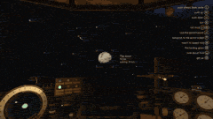</a> 
<b><a href="https://patch.gg/play/blendi/solar">Solar 可以飞来飞去的迷你太阳系</a></b> 
<a href="https://x.com/BlendiByl">@BlendiByl</a> · ♥ 800 · <a href="https://x.com/BlendiByl/status/2122673770607591855">▶ 视频</a> 
受《星际拓荒》启发：真实轨道和引力，行星之间一路连续飞行，星球全由代码画出；开源
</td>
</tr>
<tr>
<td width="33%" valign="top">
 
<b><a href="https://patch.gg/blendi/coloured-pencil">Coloured Pencil 彩铅风游戏</a></b> 
<a href="https://x.com/BlendiByl">@BlendiByl</a> · ♥ 766 · <a href="https://x.com/BlendiByl/status/2121130385723789637">▶ 视频</a> 
彩色铅笔质感的小镇游戏片段，所有着色和整个小镇都是代码；开源 
<a href="https://fablelist.000ooo.ooo/zh/prompts/?w=coloured-pencil&ref=gh"><b>✨ 获取提示词</b></a>
</td>
<td width="33%" valign="top">
 
<b><a href="https://www.spawn.co/@mattshumer/voxel-engine">体素引擎</a></b> 
<a href="https://x.com/mattshumer_">@mattshumer_</a> · ♥ 744 · <a href="https://x.com/mattshumer_/status/2119870965106483384">▶ 视频</a> 
一条提示词生成，要开声音 
<a href="https://fablelist.000ooo.ooo/zh/prompts/?w=voxel-engine&ref=gh"><b>✨ 获取提示词</b></a>
</td>
<td width="33%" valign="top">
<a href="https://noclipepe.pages.dev/chase">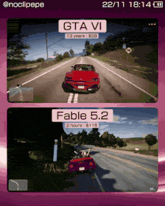</a> 
<b><a href="https://noclipepe.pages.dev/chase">Red Clay Chase 红土路上的警匪追车</a></b> 
🆕 · <a href="https://x.com/noclipepe">@noclipepe</a> · ♥ 727 · <a href="https://x.com/noclipepe/status/2124805085393813586">▶ 视频</a> 
GTA 式的浏览器警匪追车：开车在红土路上被警察追，没用游戏引擎，也没用任何素材；作者说 Fable 5.2 花了 2.5 小时、115 美元 
<a href="https://github.com/noclipepe/red-clay-chase">源码</a>
</td>
</tr>
<tr>
<td width="33%" valign="top">
<a href="https://ebb.tesana.com">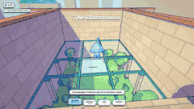</a> 
<b><a href="https://ebb.tesana.com">EBB 变形水滴物理平台解谜</a></b> 
<a href="https://x.com/Rubzem">@Rubzem</a> · ♥ 692 · <a href="https://x.com/Rubzem/status/2124142554371502140">▶ 视频</a> 
扮演一团能融化、结冰、飘起来的水去解谜的物理平台游戏；全程序化生成，只有 190 KB，一小时做完
</td>
<td width="33%" valign="top">
 
<b><a href="https://patch.gg/blendi/patchwork-quilt">Patchwork Quilt 拼布定格风</a></b> 
<a href="https://x.com/BlendiByl">@BlendiByl</a> · ♥ 670 · <a href="https://x.com/BlendiByl/status/2120746541636047347">▶ 视频</a> 
整张地图都是代码；开源 
<a href="https://fablelist.000ooo.ooo/zh/prompts/?w=patchwork-quilt&ref=gh"><b>✨ 获取提示词</b></a>
</td>
<td width="33%" valign="top">
 
<b><a href="https://bannerfall.itch.io/siege-wing">Siege Wing 直升机攻城</a></b> 
<a href="https://x.com/builderjaydub">@builderjaydub</a> · ♥ 576 · <a href="https://x.com/builderjaydub/status/2120223731520040966">▶ 视频</a> 
开直升机打中世纪战争：火炮、火箭、导弹三种武器，躲罗马弩炮、拆城堡
</td>
</tr>
<tr>
<td width="33%" valign="top">
 
<b><a href="https://i-would-have-gotten-away-with-it.netlify.app/">反向史酷比：吓跑多管闲事的孩子</a></b> 
<a href="https://x.com/emollick">@emollick</a> · ♥ 520 · <a href="https://x.com/emollick/status/2119876449494540554">▶ 视频</a> 
预告片的音乐音效也是它做的 
<a href="https://fablelist.000ooo.ooo/zh/prompts/?w=i-would-have-gotten-away-with-it&ref=gh"><b>✨ 获取提示词</b></a>
</td>
<td width="33%" valign="top">
<a href="https://valsera-game.vercel.app/">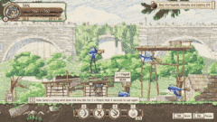</a> 
<b><a href="https://valsera-game.vercel.app/">Valsera 横版 RPG</a></b> 
<a href="https://x.com/kevin_t_ngo">@kevin_t_ngo</a> · ♥ 514 · <a href="https://x.com/kevin_t_ngo/status/2121701020598415465">▶ 视频</a> 
浏览器里能玩的横版 RPG，画面全是代码画的，没用图像模型和现成素材
</td>
<td width="33%" valign="top">
<a href="https://kengoworks.itch.io/dawnlings">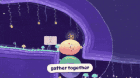</a> 
<b><a href="https://kengoworks.itch.io/dawnlings">Dawnlings 倾斜山谷滚团子</a></b> 
<a href="https://x.com/kevin_t_ngo">@kevin_t_ngo</a> · ♥ 486 · <a href="https://x.com/kevin_t_ngo/status/2122969346935017497">▶ 视频</a> 
致敬 PSP 上 LocoRoco 的浏览器游戏：不直接控制小团子，而是倾斜整个山谷让它们滚动、分裂、合体，把沉睡的世界一点点唤醒；音效和概念图用 fal 生成
</td>
</tr>
<tr>
<td width="33%" valign="top">
<a href="https://www.spawn.co/@izkimar/the-world-of-hoodcraft">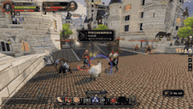</a> 
<b><a href="https://www.spawn.co/@izkimar/the-world-of-hoodcraft">The World of Hoodcraft 兜帽工艺世界</a></b> 
<a href="https://x.com/Izkimar">@Izkimar</a> · ♥ 470 · <a href="https://x.com/Izkimar/status/2123188582836031910">▶ 视频</a> 
把魔兽世界和 GTA 揉在一起的浏览器多人游戏：抢马车、通缉升到五星会被法师变成羊，6000 个联网 NPC，开放 PvP
</td>
<td width="33%" valign="top">
<a href="https://noclipepe.pages.dev/rug/">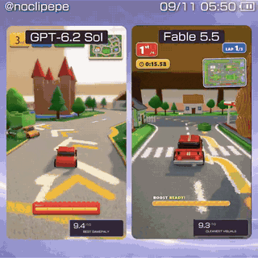</a> 
<b><a href="https://noclipepe.pages.dev/rug/">童年地毯赛车</a></b> 
<a href="https://x.com/noclipepe">@noclipepe</a> · ♥ 429 · <a href="https://x.com/noclipepe/status/2119728047754547326">▶ 视频</a> 
同题对比 GPT-6.2 Sol；作者写的是路由到的「Fable 5.5」 
<a href="https://fablelist.000ooo.ooo/zh/prompts/?w=childhood-rug-racer&ref=gh"><b>✨ 获取提示词</b></a>
</td>
<td width="33%" valign="top">
<a href="https://ballpoint-dominion.vercel.app/">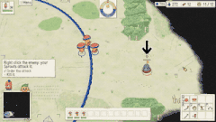</a> 
<b><a href="https://ballpoint-dominion.vercel.app/">Ballpoint Dominion 圆珠笔即时战略</a></b> 
<a href="https://x.com/kevin_t_ngo">@kevin_t_ngo</a> · ♥ 404 · <a href="https://x.com/kevin_t_ngo/status/2124669366512001493">▶ 视频</a> 
一张纸上的即时战略：选日出或黄昏阵营，采墨水画出军队和英雄，把整页纸打下来
</td>
</tr>
<tr>
<td width="33%" valign="top">
<a href="https://mariana.pplx.app">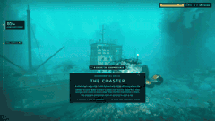</a> 
<b><a href="https://mariana.pplx.app">HADAL 下潜马里亚纳海沟</a></b> 
<a href="https://x.com/AravSrinivas">@AravSrinivas</a> · ♥ 364 · <a href="https://x.com/AravSrinivas/status/2122713692324384793">▶ 视频</a> 
从珊瑚礁出发，坐潜艇经过沉船和鲸落一路潜到挑战者深渊，沿途扫描 18 处发现；自己写的 WebGPU 渲染器，没有引擎和素材，整个游戏是一个 373 KB 的 HTML
</td>
<td width="33%" valign="top">
<a href="https://gilt-and-gutter.vercel.app/">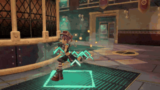</a> 
<b><a href="https://gilt-and-gutter.vercel.app/">Gilt & Gutter 1v1 第一人称射击</a></b> 
<a href="https://x.com/kevin_t_ngo">@kevin_t_ngo</a> · ♥ 332 · <a href="https://x.com/kevin_t_ngo/status/2119900487688622171">▶ 视频</a> 
两个可选角色的 1v1 对战 
<a href="https://fablelist.000ooo.ooo/zh/prompts/?w=gilt-gutter&ref=gh"><b>✨ 获取提示词</b></a>
</td>
<td width="33%" valign="top">
 
<b><a href="https://finderchangchang.github.io/cloud-stunt-3d/">云端特技 3D</a></b> 
<a href="https://x.com/jev_chat">@jev_chat</a> · ♥ 328 · <a href="https://x.com/jev_chat/status/2120015641151426838">▶ 视频</a> 
30 分钟生成 
<a href="https://finderchangchang.github.io/cloud-stunt-3d/golden/">优化版</a> 
<a href="https://x.com/jev_chat/status/2120015641151426838">📝 作者公开的提示词（免费）</a>
</td>
</tr>
<tr>
<td width="33%" valign="top">
<a href="https://valle-morta.vercel.app/">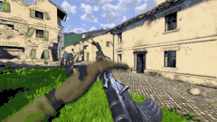</a> 
<b><a href="https://valle-morta.vercel.app/">Valle Morta 丧尸生存射击</a></b> 
<a href="https://x.com/LexnLin">@LexnLin</a> · ♥ 323 · <a href="https://x.com/LexnLin/status/2121934071429468543">▶ 视频</a> 
两天做出的第一人称丧尸生存射击，战火中的阿尔卑斯山谷，没用任何现成 3D 素材，画面全是代码生成 
<a href="https://github.com/Leonxlnx/valle-morta">源码</a>
</td>
<td width="33%" valign="top">
<a href="https://www.spawn.co/@mattshumer/hogwarts-royale">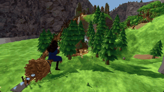</a> 
<b><a href="https://www.spawn.co/@mattshumer/hogwarts-royale">Hogwarts Royale（哈利·波特 × 堡垒之夜）</a></b> 
<a href="https://x.com/mattshumer_">@mattshumer_</a> · ♥ 311 · <a href="https://x.com/mattshumer_/status/2119872098306810226">▶ 视频</a> 
大逃杀玩法 
<a href="https://x.com/mattshumer_/status/2119872098306810226">📝 作者公开的提示词（免费）</a>
</td>
<td width="33%" valign="top">
<a href="https://dread-and-district.netlify.app">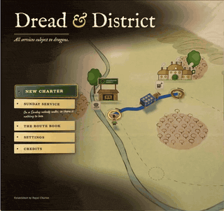</a> 
<b><a href="https://dread-and-district.netlify.app">Dread & District 奇幻运输模拟</a></b> 
<a href="https://x.com/emollick">@emollick</a> · ♥ 304 · <a href="https://x.com/emollick/status/2120248525254742318">▶ 视频</a> 
一段模糊的需求交给一群 Agent 去争论美术、设定和笑话，做出「靠物流打败邪恶」的游戏 
<a href="https://fablelist.000ooo.ooo/zh/prompts/?w=dread-district&ref=gh"><b>✨ 获取提示词</b></a>
</td>
</tr>
<tr>
<td width="33%" valign="top">
<a href="https://unsung-vale.vercel.app/">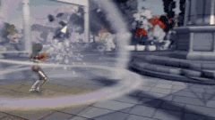</a> 
<b><a href="https://unsung-vale.vercel.app/">Unsung Vale 开放世界 RPG</a></b> 
<a href="https://x.com/LexnLin">@LexnLin</a> · ♥ 303 · <a href="https://x.com/LexnLin/status/2121253191748669705">▶ 视频</a> 
第三人称开放世界 RPG 试玩版，没用任何素材，画面全是代码生成 
<a href="https://github.com/Leonxlnx/unsung-vale">源码</a>
</td>
<td width="33%" valign="top">
<a href="https://lauramionel.github.io/cayley-flight-simulator/">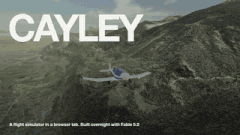</a> 
<b><a href="https://lauramionel.github.io/cayley-flight-simulator/">Cayley 浏览器飞行模拟</a></b> 
<a href="https://x.com/lionel_mora">@lionel_mora</a> · ♥ 298 · <a href="https://x.com/lionel_mora/status/2120554787812860294">▶ 视频</a> 
一夜生成，按真实空气动力学逐段计算机翼的升力和阻力 
<a href="https://fablelist.000ooo.ooo/zh/prompts/?w=cayley-flight-simulator&ref=gh"><b>✨ 获取提示词</b></a>
</td>
<td width="33%" valign="top">
<a href="https://fallline-9zo.pages.dev">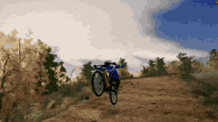</a> 
<b><a href="https://fallline-9zo.pages.dev">Fall Line 山地车速降</a></b> 
<a href="https://x.com/BananaOfMercy">@BananaOfMercy</a> · ♥ 291 · <a href="https://x.com/BananaOfMercy/status/2123037856398733438">▶ 视频</a> 
three.js 写的山地车速降游戏，浏览器里用键盘就能玩；作者花 7 天把每一版都骑一遍，告诉它哪里手感不对
</td>
</tr>
<tr>
<td width="33%" valign="top">
<a href="https://github.com/amirmushichge/worm-rider">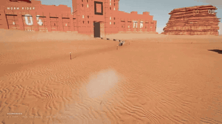</a> 
<b><a href="https://github.com/amirmushichge/worm-rider">Worm Rider 沙虫骑士</a></b> 
<a href="https://x.com/AmirMushich">@AmirMushich</a> · ♥ 255 · <a href="https://x.com/AmirMushich/status/2119937977426338283">▶ 视频</a> 
开源；220KB、3400 行、10 条提示词，模型全部代码建 
<a href="https://fablelist.000ooo.ooo/zh/prompts/?w=worm-rider&ref=gh"><b>✨ 获取提示词</b></a>
</td>
<td width="33%" valign="top">
<a href="https://sanwan.ai/games/xingyun-moba/">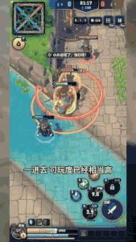</a> 
<b><a href="https://sanwan.ai/games/xingyun-moba/">星陨战纪：网页版类王者荣耀</a></b> 
<a href="https://x.com/FuSheng_0306">@FuSheng_0306</a> · ♥ 250 · <a href="https://x.com/FuSheng_0306/status/2121237878097207583">▶ 视频</a> 
一句提示词，Fable 5.2 跑了约 20 小时；5 个英雄，一个真人玩家加 NPC 
<a href="https://fablelist.000ooo.ooo/zh/prompts/?w=starfall-a-browser-moba&ref=gh"><b>✨ 获取提示词</b></a>
</td>
<td width="33%" valign="top">
 
<b><a href="https://maad-maxxing.vercel.app/">MAAD MAXXING</a></b> 
<a href="https://x.com/Andrew_Blumson">@Andrew_Blumson</a> · ♥ 249 · <a href="https://x.com/Andrew_Blumson/status/2120599812512833557">▶ 视频</a> 
纯代码、零素材；前 3 关可玩，音频用 ElevenLabs 
<a href="https://fablelist.000ooo.ooo/zh/prompts/?w=maad-maxxing&ref=gh"><b>✨ 获取提示词</b></a>
</td>
</tr>
<tr>
<td width="33%" valign="top">
<a href="https://frontier.every.to/experiments/first-crush">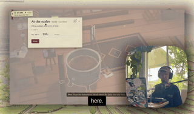</a> 
<b><a href="https://frontier.every.to/experiments/first-crush">First Crush 酿酒教学游戏</a></b> 
<a href="https://x.com/kieranklaassen">@kieranklaassen</a> · ♥ 229 · <a href="https://x.com/kieranklaassen/status/2119871673294037280">▶ 视频</a> 
从刷桶、压 250 公斤葡萄到测糖度、选酵母，边玩边讲原理；页面里点 Try it 
<a href="https://fablelist.000ooo.ooo/zh/prompts/?w=first-crush&ref=gh"><b>✨ 获取提示词</b></a>
</td>
<td width="33%" valign="top">
<a href="https://market-order-city.netlify.app/">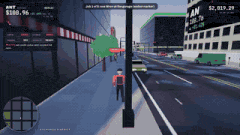</a> 
<b><a href="https://market-order-city.netlify.app/">Market Order 股价说了算的开放世界</a></b> 
<a href="https://x.com/emollick">@emollick</a> · ♥ 221 · <a href="https://x.com/emollick/status/2123520499368263977">▶ 视频</a> 
偷车、接任务的开放世界驾驶游戏：通缉等级、天气和天际线全由 Anthropic 股票 ANT 的实时行情决定
</td>
<td width="33%" valign="top">
<a href="https://noclipepe.pages.dev/dino">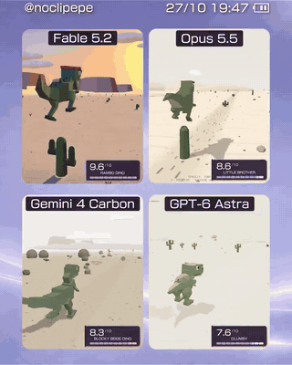</a> 
<b><a href="https://noclipepe.pages.dev/dino">Chrome 恐龙变兰博</a></b> 
<a href="https://x.com/noclipepe">@noclipepe</a> · ♥ 183 · <a href="https://x.com/noclipepe/status/2119927838321328577">▶ 视频</a> 
老 T-Rex 测试，对比 Opus / Gemini / GPT 
<a href="https://fablelist.000ooo.ooo/zh/prompts/?w=rambo-dino&ref=gh"><b>✨ 获取提示词</b></a>
</td>
</tr>
<tr>
<td width="33%" valign="top">
 
<b><a href="https://cozylisbon.vercel.app">Cozy Lisbon 飞越里斯本</a></b> 
<a href="https://x.com/goncalo_canhoto">@goncalo_canhoto</a> · ♥ 171 · <a href="https://x.com/goncalo_canhoto/status/2119932946346094690">▶ 视频</a> 
一条提示词做的小飞机游戏，在里斯本上空慢慢飞 
<a href="https://fablelist.000ooo.ooo/zh/prompts/?w=cozy-lisbon&ref=gh"><b>✨ 获取提示词</b></a>
</td>
<td width="33%" valign="top">
<a href="https://spawn.co/@robot/frontline-warfare-deathmatch">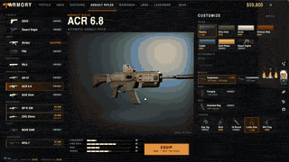</a> 
<b><a href="https://spawn.co/@robot/frontline-warfare-deathmatch">Frontline 类 COD 死斗</a></b> 
<a href="https://x.com/alightinastorm">@alightinastorm</a> · ♥ 163 · <a href="https://x.com/alightinastorm/status/2120020469487440210">▶ 视频</a> 
浏览器里的使命召唤式射击
</td>
<td width="33%" valign="top">
<a href="https://wquguru.github.io/fable52-fps-repro/">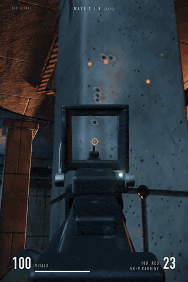</a> 
<b><a href="https://wquguru.github.io/fable52-fps-repro/">Fable 5.2 FPS 复现（4 个单文件演示）</a></b> 
<a href="https://x.com/wquguru">@wquguru</a> · ♥ 158 · <a href="https://x.com/wquguru/status/2120383332722905400">▶ 视频</a> 
模型、声音、贴图全是代码；方法和源码都开源 
<a href="https://github.com/wquguru/fable52-fps-repro">源码</a> 
<a href="https://x.com/wquguru/status/2120383332722905400">📝 作者公开的提示词（免费）</a>
</td>
</tr>
<tr>
<td width="33%" valign="top">
<a href="https://remix.gg/g/banana-mine-rush">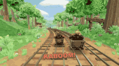</a> 
<b><a href="https://remix.gg/g/banana-mine-rush">Banana Mine Rush 矿洞卡丁车</a></b> 
<a href="https://x.com/0xChuckstock">@0xChuckstock</a> · ♥ 153 · <a href="https://x.com/0xChuckstock/status/2120125184606658728">▶ 视频</a> 
3D 卡丁车，浏览器免登录就能玩，带多人和排行榜 
<a href="https://fablelist.000ooo.ooo/zh/prompts/?w=banana-mine-rush&ref=gh"><b>✨ 获取提示词</b></a>
</td>
<td width="33%" valign="top">
<a href="https://turbo-tails.vercel.app">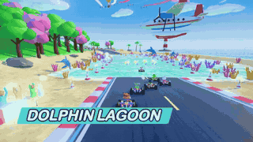</a> 
<b><a href="https://turbo-tails.vercel.app">Turbo Tails 3D 卡丁车</a></b> 
<a href="https://x.com/petergyang">@petergyang</a> · ♥ 143 · <a href="https://x.com/petergyang/status/2119901658394358005">▶ 视频</a> 
6 名车手、漂移、道具，单人和多人 
<a href="https://youtu.be/SsSKJA0EHD4">对比视频</a> 
<a href="https://fablelist.000ooo.ooo/zh/prompts/?w=turbo-tails&ref=gh"><b>✨ 获取提示词</b></a>
</td>
<td width="33%" valign="top">
<a href="https://satyam-fp.github.io/race/v1/">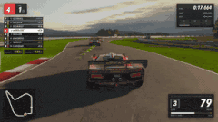</a> 
<b><a href="https://satyam-fp.github.io/race/v1/">Tachyon Sprint WebGPU 赛车</a></b> 
<a href="https://x.com/_satyam_ai">@_satyam_ai</a> · ♥ 139 · <a href="https://x.com/_satyam_ai/status/2123787482747764918">▶ 视频</a> 
完全跑在 Chrome 里的 WebGPU 赛车游戏，引擎是作者从零写的，赛车等大部分素材由 Fable 5.2 和 GPT-6.2 Astra 做；要开 GPU 加速的 Chrome
</td>
</tr>
<tr>
<td width="33%" valign="top">
<a href="https://luminazombies.com/">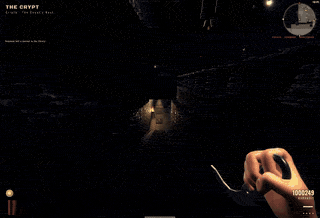</a> 
<b><a href="https://luminazombies.com/">Lumina Zombies 新地图</a></b> 
<a href="https://x.com/LuminaBench">@LuminaBench</a> · ♥ 123 · <a href="https://x.com/LuminaBench/status/2120660076927099048">▶ 视频</a> 
几条提示词做出一张带彩蛋的新地图，并把另外两张图的硬件需求和延迟减半 
<a href="https://fablelist.000ooo.ooo/zh/prompts/?w=lumina-zombies&ref=gh"><b>✨ 获取提示词</b></a>
</td>
<td width="33%" valign="top">
<a href="https://github.com/amirmushichge/fly-in-kit">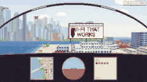</a> 
<b><a href="https://github.com/amirmushichge/fly-in-kit">Fly-In Kit 给咖啡店做的飞行小游戏</a></b> 
<a href="https://x.com/AmirMushich">@AmirMushich</a> · ♥ 113 · <a href="https://x.com/AmirMushich/status/2122421769462284615">▶ 视频</a> 
按真实街道重建咖啡店周边 7,970 栋楼，飞行收集 5 颗咖啡豆、降落屋顶换一杯免费咖啡；可换成地图上任何店铺
</td>
<td width="33%" valign="top">
<a href="https://loktar00.github.io/llm-test-pages/fable52-dino-chase/">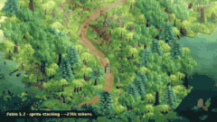</a> 
<b><a href="https://loktar00.github.io/llm-test-pages/fable52-dino-chase/">Thunder Valley 恐龙追逐</a></b> 
<a href="https://x.com/loktar00">@loktar00</a> · ♥ 98 · <a href="https://x.com/loktar00/status/2120905457380507991">▶ 视频</a> 
不用引擎和库，自己写的 WebGL 渲染器，恐龙和树都是一层层像素叠成的 3D 
<a href="https://fablelist.000ooo.ooo/zh/prompts/?w=thunder-valley-dino-chase&ref=gh"><b>✨ 获取提示词</b></a>
</td>
</tr>
<tr>
<td width="33%" valign="top">
<a href="https://feed-backrooms.vercel.app">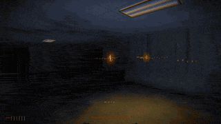</a> 
<b><a href="https://feed-backrooms.vercel.app">Feed the Backrooms：你当怪物</a></b> 
<a href="https://x.com/LexnLin">@LexnLin</a> · ♥ 96 · <a href="https://x.com/LexnLin/status/2119966127149429093">▶ 视频</a> 
后室反转玩法，你负责抓人 
<a href="https://fablelist.000ooo.ooo/zh/prompts/?w=feed-the-backrooms&ref=gh"><b>✨ 获取提示词</b></a>
</td>
<td width="33%" valign="top">
<a href="https://rivergame-kappa.vercel.app">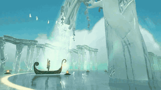</a> 
<b><a href="https://rivergame-kappa.vercel.app">The Waking River 奇幻航行</a></b> 
<a href="https://x.com/flxrnc">@flxrnc</a> · ♥ 95 · <a href="https://x.com/flxrnc/status/2120494277528580110">▶ 视频</a> 
一条提示词加几次追问；五个随航行苏醒的世界，配乐也是代码生成 
<a href="https://x.com/flxrnc/status/2120494277528580110">📝 作者公开的提示词（免费）</a>
</td>
<td width="33%" valign="top">
<a href="https://app.usecrayon.ai/play/992c2130-43da-416b-a577-aed9514d3057">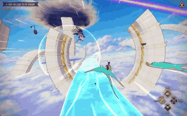</a> 
<b><a href="https://app.usecrayon.ai/play/992c2130-43da-416b-a577-aed9514d3057">SKYWAKE 飞行任务</a></b> 
<a href="https://x.com/aniketjart">@aniketjart</a> · ♥ 82 · <a href="https://x.com/aniketjart/status/2120378493729222700">▶ 视频</a> 
Fable 5.2 + Opus 5.5 + Crayon + three.js 
<a href="https://fablelist.000ooo.ooo/zh/prompts/?w=skywake&ref=gh"><b>✨ 获取提示词</b></a>
</td>
</tr>
<tr>
<td width="33%" valign="top">
<a href="http://drift.harma.cc/en">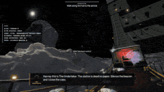</a> 
<b><a href="http://drift.harma.cc/en">DRIFT: Veresk-9 小行星带空间站解谜</a></b> 
<a href="https://x.com/Rencrypta">@Rencrypta</a> · ♥ 75 · <a href="https://x.com/Rencrypta/status/2123527249064321465">原帖</a> 
第一人称 3D 太空解谜：23 世纪小行星带，飞去一座死掉的采矿站关掉信标，却发现船员从没撤离；有聊天记录、语音日志和藏起来的秘密，桌面浏览器直接玩
</td>
<td width="33%" valign="top">
 
<b><a href="https://app.usecrayon.ai/play/0cd7624e-1297-417e-a5be-b3c3036a496a">KUMOKIRI 水墨武士</a></b> 
<a href="https://x.com/aniketjart">@aniketjart</a> · ♥ 74 · <a href="https://x.com/aniketjart/status/2121101334900617631">▶ 视频</a> 
绘画风的武士游戏，Fable 5.2 + Crayon + three.js 
<a href="https://fablelist.000ooo.ooo/zh/prompts/?w=kumokiri&ref=gh"><b>✨ 获取提示词</b></a>
</td>
<td width="33%" valign="top">
<a href="https://claude.ai/artifact/3o9NKKmpezAFEan5SeVaxn">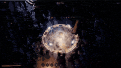</a> 
<b><a href="https://claude.ai/artifact/3o9NKKmpezAFEan5SeVaxn">ASHEN VIGIL 余烬守夜</a></b> 
<a href="https://x.com/CapyCola">@CapyCola</a> · ♥ 71 · <a href="https://x.com/CapyCola/status/2123707546779451602">▶ 视频</a> 
只发一句话做出的 3D 类吸血鬼幸存者：雨夜修道院废墟里撑过 5 分钟，5 种武器、7 种强化、4 种杂兵和一个 Boss；约 6900 行代码，画面和声音全由代码生成
</td>
</tr>
<tr>
<td width="33%" valign="top">
<a href="https://wavedash.com/games/ink-flight">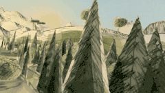</a> 
<b><a href="https://wavedash.com/games/ink-flight">Ink Flight 飞过速写本的纸飞机</a></b> 
<a href="https://x.com/prasenx">@prasenx</a> · ♥ 67 · <a href="https://x.com/prasenx/status/2123467881170243808">▶ 视频</a> 
开着一架折出来的纸飞机飞过它用代码画的世界，没用图片和 3D 模型，浏览器里直接飞 
<a href="https://github.com/StarKnightt/ink-flight">源码</a>
</td>
<td width="33%" valign="top">
<a href="https://www.spawn.co/@abbidabbi/pogo-riot">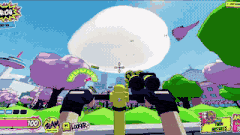</a> 
<b><a href="https://www.spawn.co/@abbidabbi/pogo-riot">Pogo Riot 弹跳杆射击</a></b> 
<a href="https://x.com/Pumpnasterr">@Pumpnasterr</a> · ♥ 64 · <a href="https://x.com/Pumpnasterr/status/2121343507885682917">▶ 视频</a> 
多人混战 FPS，踩着弹跳杆一边跳一边瞄准
</td>
<td width="33%" valign="top">
<a href="https://patch.gg/games/rehan/ringfall">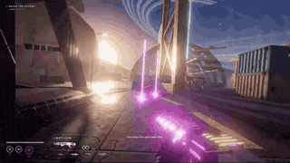</a> 
<b><a href="https://patch.gg/games/rehan/ringfall">Ringfall《命运》风格 FPS</a></b> 
<a href="https://x.com/rehan_shei">@rehan_shei</a> · ♥ 63 · <a href="https://x.com/rehan_shei/status/2119994607291584962">▶ 视频</a> 
开源，可以拿去改 
<a href="https://fablelist.000ooo.ooo/zh/prompts/?w=ringfall&ref=gh"><b>✨ 获取提示词</b></a>
</td>
</tr>
<tr>
<td width="33%" valign="top">
<a href="https://save-the-world-fable.vercel.app/">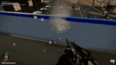</a> 
<b><a href="https://save-the-world-fable.vercel.app/">Save the World 拯救世界</a></b> 
<a href="https://x.com/global_techgirl">@global_techgirl</a> · ♥ 63 · <a href="https://x.com/global_techgirl/status/2120246750459961453">▶ 视频</a> 
街道、3D 模型和音效都是它做或找的，宣传视频也是它自己玩着录的；电脑上玩最好 
<a href="https://fablelist.000ooo.ooo/zh/prompts/?w=save-the-world&ref=gh"><b>✨ 获取提示词</b></a>
</td>
<td width="33%" valign="top">
 
<b><a href="https://nisen0808-web.github.io/xiyou-td-play/">西游X 西游题材塔防</a></b> 
<a href="https://x.com/PhyrexNi">@PhyrexNi</a> · ♥ 59 · <a href="https://x.com/PhyrexNi/status/2122602578978709908">原帖</a> 
西游题材塔防测试版：八个关卡、五种难度，可抽特殊角色卡；网页和手机浏览器都能玩，横屏体验更好
</td>
<td width="33%" valign="top">
<a href="https://samg-coder.github.io/solstice-racing/">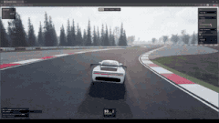</a> 
<b><a href="https://samg-coder.github.io/solstice-racing/">Kestrel Head 赛车（Solstice 引擎）</a></b> 
<a href="https://x.com/SamGCoder">@SamGCoder</a> · ♥ 56 · <a href="https://x.com/SamGCoder/status/2120044542087070066">▶ 视频</a> 
用作者自己的 Rust + WebGPU 引擎；在 Blender 里建了保时捷 992 GT3 R 和 3 公里海岛赛道，支持手柄 
<a href="https://github.com/SamG-Coder/solstice-racing">源码</a> 
<a href="https://fablelist.000ooo.ooo/zh/prompts/?w=kestrel-head-solstice-racing&ref=gh"><b>✨ 获取提示词</b></a>
</td>
</tr>
<tr>
<td width="33%" valign="top">
<a href="https://shubhu121.github.io/hitdude/play/">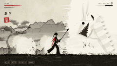</a> 
<b><a href="https://shubhu121.github.io/hitdude/play/">HITOFUDE 一筆 水墨动作游戏</a></b> 
<a href="https://x.com/positronx_">@positronx_</a> · ♥ 54 · <a href="https://x.com/positronx_/status/2120374208043876422">▶ 视频</a> 
每一帧都是代码画的墨；Boss 会擦掉关卡，你的剑是一支毛笔 
<a href="https://fablelist.000ooo.ooo/zh/prompts/?w=hitofude&ref=gh"><b>✨ 获取提示词</b></a>
</td>
<td width="33%" valign="top">
<a href="https://higgsfield.ai/@higgsfield.studio/blogs/fable-5-2-built-this-rpg-from-pure-code-here-s-every-step">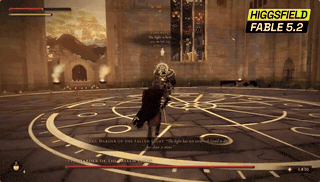</a> 
<b><a href="https://higgsfield.ai/@higgsfield.studio/blogs/fable-5-2-built-this-rpg-from-pure-code-here-s-every-step">VOWLORN 纯代码暗黑 RPG</a></b> 
<a href="https://x.com/higgsfield_ai">@higgsfield_ai</a> · ♥ 48 · <a href="https://x.com/higgsfield_ai/status/2119997122896601269">▶ 视频</a> 
配音也是代码生成，经 Higgsfield MCP 发布；链接是带试玩入口的博客页 
<a href="https://higgsfield.ai/@higgsfield.studio/blogs/claude-fable-5-2-built-a-dragon-riding-game-play-it-free">骑龙游戏</a> · <a href="https://higgsfield.ai/@higgsfield.studio/blogs/one-drawing-fable-5-2-turned-it-into-a-horror-game">手绘变恐怖游戏</a> 
<a href="https://fablelist.000ooo.ooo/zh/prompts/?w=vowlorn&ref=gh"><b>✨ 获取提示词</b></a>
</td>
<td width="33%" valign="top">
<a href="https://fowllabs.com/fable-5-2/chairmageddon/">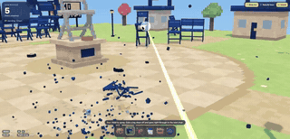</a> 
<b><a href="https://fowllabs.com/fable-5-2/chairmageddon/">Chairmageddon 椅子末日</a></b> 
<a href="https://x.com/argofowl">@argofowl</a> · ♥ 48 · <a href="https://x.com/argofowl/status/2120568779537273263">▶ 视频</a> 
摧毁一个全是蓝椅子的和平小镇 
<a href="https://fablelist.000ooo.ooo/zh/prompts/?w=chairmageddon&ref=gh"><b>✨ 获取提示词</b></a>
</td>
</tr>
<tr>
<td width="33%" valign="top">
<a href="https://claude.ai/artifact/UD9pGEN4QFA8F5EadRw8eL">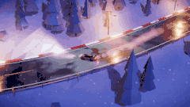</a> 
<b><a href="https://claude.ai/artifact/UD9pGEN4QFA8F5EadRw8eL">Midnight Pass 山路漂移</a></b> 
<a href="https://x.com/andreysuperior">@andreysuperior</a> · ♥ 48 · <a href="https://x.com/andreysuperior/status/2120666660130746458">▶ 视频</a> 
一个 HTML 文件、603 行、零素材；漂移物理、整座山和引擎声都是生成的 
<a href="https://fablelist.000ooo.ooo/zh/prompts/?w=midnight-pass&ref=gh"><b>✨ 获取提示词</b></a>
</td>
<td width="33%" valign="top">
<a href="https://turbo-stack-nine.vercel.app">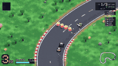</a> 
<b><a href="https://turbo-stack-nine.vercel.app">Turbo Stack 精灵堆叠赛车</a></b> 
<a href="https://x.com/blueemi99">@blueemi99</a> · ♥ 48 · <a href="https://x.com/blueemi99/status/2124207899501101247">▶ 视频</a> 
用精灵堆叠技术（把像素画一层层叠起来，转到任何角度都能看）做的赛车游戏
</td>
<td width="33%" valign="top">
<a href="https://tetriss22.github.io/unwritten/">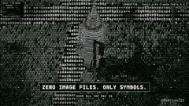</a> 
<b><a href="https://tetriss22.github.io/unwritten/">UNWRITTEN 全用文字字符画的开放世界</a></b> 
🆕 · <a href="https://x.com/Tetriss112">@Tetriss112</a> · ♥ 47 · <a href="https://x.com/Tetriss112/status/2125302656616849796">▶ 视频</a> 
ASCII 开放世界动作游戏：世界正被一个词一个词删掉，你是最后一位能把它写回来的抄写员；五片大陆、骑马作战、三种武器、火与闪电，最终 Boss 叫 THE EDITOR；没有一张图片，墙、树、马和每根草都是文字字符，共 2,737 行代码 
<a href="https://github.com/Tetriss22/unwritten">源码</a>
</td>
</tr>
<tr>
<td width="33%" valign="top">
<a href="https://claude.ai/artifact/4nPXUKJjQWNsZEHVNmXXCt">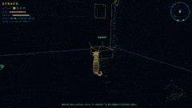</a> 
<b><a href="https://claude.ai/artifact/4nPXUKJjQWNsZEHVNmXXCt">流浪猫游戏</a></b> 
<a href="https://x.com/aimikoda">@aimikoda</a> · ♥ 44 · <a href="https://x.com/aimikoda/status/2120120133712593118">▶ 视频</a> 
救小猫、冲狗哈气、和老公猫对嚎，声音全部合成 
<a href="https://fablelist.000ooo.ooo/zh/prompts/?w=stray-cat&ref=gh"><b>✨ 获取提示词</b></a>
</td>
<td width="33%" valign="top">
<a href="https://sael.net/demo/farewell-light/">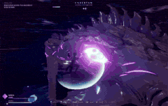</a> 
<b><a href="https://sael.net/demo/farewell-light/">Farewell Light</a></b> 
<a href="https://x.com/RyanSael">@RyanSael</a> · ♥ 44 · <a href="https://x.com/RyanSael/status/2120695866684231998">▶ 视频</a> 
一晚上做出的玩法演示 
<a href="https://fablelist.000ooo.ooo/zh/prompts/?w=farewell-light&ref=gh"><b>✨ 获取提示词</b></a>
</td>
<td width="33%" valign="top">
<a href="https://fowllabs.com/fable-5-2/knock-it-off/">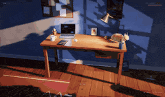</a> 
<b><a href="https://fowllabs.com/fable-5-2/knock-it-off/">Knock It Off 猫咪推东西</a></b> 
<a href="https://x.com/argofowl">@argofowl</a> · ♥ 43 · <a href="https://x.com/argofowl/status/2121276206683410839">▶ 视频</a> 
凌晨三点当一只猫，一爪一爪把桌上东西推下去还不能吵醒主人；单个 HTML，没用 3D 模型
</td>
</tr>
<tr>
<td width="33%" valign="top">
 
<b><a href="https://remix.gg/g/survivors">Survivors 吸血鬼幸存者 + 魔兽式装备</a></b> 
<a href="https://x.com/BLACKST0CK">@BLACKST0CK</a> · ♥ 40 · <a href="https://x.com/BLACKST0CK/status/2120329788896498123">▶ 视频</a> 
幸存者玩法加魔兽式升级和装备，单人或最多 4 人合作 
<a href="https://fablelist.000ooo.ooo/zh/prompts/?w=survivors&ref=gh"><b>✨ 获取提示词</b></a>
</td>
<td width="33%" valign="top">
<a href="https://loktar00.github.io/llm-test-pages/fable52-hang-glider/">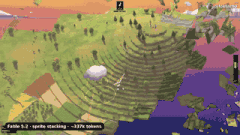</a> 
<b><a href="https://loktar00.github.io/llm-test-pages/fable52-hang-glider/">Thermal 滑翔伞</a></b> 
<a href="https://x.com/loktar00">@loktar00</a> · ♥ 40 · <a href="https://x.com/loktar00/status/2121005021131083851">▶ 视频</a> 
驾驶滑翔伞借热气流飞到终点目标 
<a href="https://fablelist.000ooo.ooo/zh/prompts/?w=thermal&ref=gh"><b>✨ 获取提示词</b></a>
</td>
<td width="33%" valign="top">
<a href="https://www.aigameshare.com/games/animal-card-battle-game?play=1&mode=fullscreen">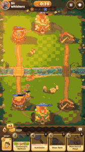</a> 
<b><a href="https://www.aigameshare.com/games/animal-card-battle-game?play=1&mode=fullscreen">Thimble Knights 动物卡牌对战</a></b> 
<a href="https://x.com/_nilni">@_nilni</a> · ♥ 35 · <a href="https://x.com/_nilni/status/2120435983032447382">▶ 视频</a> 
实时策略卡牌对战，角色是一群可爱小动物 
<a href="https://x.com/_nilni/status/2120435983032447382">📝 作者公开的提示词（免费）</a>
</td>
</tr>
<tr>
<td width="33%" valign="top">
 
<b><a href="https://tetriss22.github.io/harbor-gp/">Harbor Lights Grand Prix 港口大奖赛</a></b> 
<a href="https://x.com/Tetriss112">@Tetriss112</a> · ♥ 33 · <a href="https://x.com/Tetriss112/status/2120946576663134308">▶ 视频</a> 
一个 HTML 文件：像素小岛上 20 辆车跑 22 个弯的街道赛，赛前可以下注（虚拟筹码） 
<a href="https://fablelist.000ooo.ooo/zh/prompts/?w=harbor-lights-grand-prix&ref=gh"><b>✨ 获取提示词</b></a>
</td>
<td width="33%" valign="top">
 
<b><a href="https://blog.silencestar.com/posts/tilt-labyrinth/play/">木头滚珠迷宫</a></b> 
<a href="https://x.com/mylifcc">@mylifcc</a> · ♥ 32 · <a href="https://x.com/mylifcc/status/2120054646282870910">▶ 视频</a> 
three.js 2000 行，它自己把单帧从 55ms 优化到 9ms 
<a href="https://fablelist.000ooo.ooo/zh/prompts/?w=tilt-labyrinth&ref=gh"><b>✨ 获取提示词</b></a>
</td>
<td width="33%" valign="top">
 
<b><a href="https://claude.ai/artifact/QvSjL7Hexf3nKdUP9Zerr7">格斗游戏（手机浏览器可玩）</a></b> 
<a href="https://x.com/s_shigel">@s_shigel</a> · ♥ 32 · <a href="https://x.com/s_shigel/status/2120300080569975034">▶ 视频</a> 
一晚上迭代出来的格斗游戏 
<a href="https://fablelist.000ooo.ooo/zh/prompts/?w=fighting-game-plays-on-phones&ref=gh"><b>✨ 获取提示词</b></a>
</td>
</tr>
<tr>
<td width="33%" valign="top">
 
<b><a href="https://rust4x4.com/">Aussie Outback 4x4 澳洲越野</a></b> 
<a href="https://x.com/SamGCoder">@SamGCoder</a> · ♥ 31 · <a href="https://x.com/SamGCoder/status/2121513178303811931">▶ 视频</a> 
作者自己的 Rust + WebGPU 引擎：泥地、涉溪、攀岩、差速锁、胎压和动态天气
</td>
<td width="33%" valign="top">
 
<b><a href="https://mikenevermiss.github.io/midnight-grid/">Midnight Grid 午夜城市飙车</a></b> 
<a href="https://x.com/mikenevermiss">@mikenevermiss</a> · ♥ 28 · <a href="https://x.com/mikenevermiss/status/2121900977959612500">▶ 视频</a> 
一句提示词做出的开放世界驾驶游戏：在城市里飙车、撞车、被警察追，车辆、建筑、贴图和音效全是代码生成
</td>
<td width="33%" valign="top">
 
<b><a href="https://monstermath.ai-created.com">Monster Math 怪兽数学</a></b> 
<a href="https://x.com/AIandDesign">@AIandDesign</a> · ♥ 28 · <a href="https://x.com/AIandDesign/status/2122108555356778615">原帖</a> 
仿宝可梦的小学 K–5 数学练习和辅导游戏，MIT 开源，可以在线玩也能本地跑 
<a href="https://github.com/TheMarco/monstermath">源码</a>
</td>
</tr>
<tr>
<td width="33%" valign="top">
 
<b><a href="https://the-vast-horizon.vercel.app">The Vast Horizon 文字冲浪</a></b> 
<a href="https://x.com/OdinLovis">@OdinLovis</a> · ♥ 27 · <a href="https://x.com/OdinLovis/status/2120198469755503091">▶ 视频</a> 
多人在同一片湖上冲浪，输入一个词就会改变世界 
<a href="https://fablelist.000ooo.ooo/zh/prompts/?w=the-vast-horizon&ref=gh"><b>✨ 获取提示词</b></a>
</td>
<td width="33%" valign="top">
 
<b><a href="https://remix.gg/g/hoppy-meadow">Hoppy Meadow 跳跳草地</a></b> 
<a href="https://x.com/0xChuckstock">@0xChuckstock</a> · ♥ 26 · <a href="https://x.com/0xChuckstock/status/2120620907865473448">原帖</a> 
看起来是普通平台跳跃，到旗杆之后才有反转 
<a href="https://fablelist.000ooo.ooo/zh/prompts/?w=hoppy-meadow&ref=gh"><b>✨ 获取提示词</b></a>
</td>
<td width="33%" valign="top">
 
<b><a href="https://remix.gg/g/brix-84">BRIX '84 打砖块</a></b> 
<a href="https://x.com/0xChuckstock">@0xChuckstock</a> · ♥ 26 · <a href="https://x.com/0xChuckstock/status/2120896397839126579">原帖</a> 
看似普通打砖块，吃到第二个道具后画风突变 
<a href="https://fablelist.000ooo.ooo/zh/prompts/?w=brix-84&ref=gh"><b>✨ 获取提示词</b></a>
</td>
</tr>
<tr>
<td width="33%" valign="top">
 
<b><a href="https://claude.ai/artifact/FpdQ81sJs1KiV1a6JCY4jj">开放世界冒险卡丁车</a></b> 
<a href="https://x.com/realWeZZard">@realWeZZard</a> · ♥ 24 · <a href="https://x.com/realWeZZard/status/2120379500492185939">▶ 视频</a> 
一次生成，耗时三小时；主线半小时可以通关 
<a href="https://fablelist.000ooo.ooo/zh/prompts/?w=open-world-kart-adventure&ref=gh"><b>✨ 获取提示词</b></a>
</td>
<td width="33%" valign="top">
 
<b><a href="https://www.spawn.co/@abbidabbi/shark-riders">Shark Riders 骑鲨鱼射击</a></b> 
<a href="https://x.com/Pumpnasterr">@Pumpnasterr</a> · ♥ 24 · <a href="https://x.com/Pumpnasterr/status/2124565052766216236">▶ 视频</a> 
骑着大白鲨的第一人称射击：在鲨鱼背上开枪、撕咬、用鱼叉拖人，还能潜下水躲起来
</td>
<td width="33%" valign="top">
 
<b><a href="https://giant-leap.vercel.app">Giant Leap 从月球跳回地球</a></b> 
<a href="https://x.com/handsher_NGU">@handsher_NGU</a> · ♥ 22 · <a href="https://x.com/handsher_NGU/status/2120287667141374212">▶ 视频</a> 
只需要跳 
<a href="https://fablelist.000ooo.ooo/zh/prompts/?w=giant-leap&ref=gh"><b>✨ 获取提示词</b></a>
</td>
</tr>
<tr>
<td width="33%" valign="top">
 
<b><a href="https://qiaomu.t5t6.com/irondusk-yard-7/">IRONDUSK — Yard 7 射击关卡</a></b> 
<a href="https://x.com/vista8">@vista8</a> · ♥ 20 · <a href="https://x.com/vista8/status/2120383046239285264">原帖</a> 
一条提示词要一个 3A 画风的小关卡；另一条做了支持 AI 和双人对战的 3D 打砖块 
<a href="https://qiaomu.t5t6.com/3d/">3D打砖块</a> 
<a href="https://x.com/vista8/status/2120383046239285264">📝 作者公开的提示词（免费）</a>
</td>
<td width="33%" valign="top">
 
<b><a href="https://www.nightclub-driftspeed.xyz/">NightClub: Drift & Speed 夜店漂移</a></b> 
<a href="https://x.com/Story91_">@Story91_</a> · ♥ 20 · <a href="https://x.com/Story91_/status/2121016763190059194">▶ 视频</a> 
浏览器里的漂移赛车，带全球排行榜，72 小时从空文件夹做出来 
<a href="https://fablelist.000ooo.ooo/zh/prompts/?w=nightclub-drift-speed&ref=gh"><b>✨ 获取提示词</b></a>
</td>
<td width="33%" valign="top">
 
<b><a href="https://cozybakery.vercel.app">Cozy Bakery 葡萄牙合作厨房</a></b> 
<a href="https://x.com/goncalo_canhoto">@goncalo_canhoto</a> · ♥ 19 · <a href="https://x.com/goncalo_canhoto/status/2120530199649432063">▶ 视频</a> 
类似 Overcooked 的多人做饭游戏，做蛋挞和 francesinha，1–4 人，手机也能玩 
<a href="https://fablelist.000ooo.ooo/zh/prompts/?w=cozy-bakery&ref=gh"><b>✨ 获取提示词</b></a>
</td>
</tr>
<tr>
<td width="33%" valign="top">
 
<b><a href="https://noclipepe.pages.dev/pattinson-verse/">Pattinson-Verse 罗伯特·帕丁森全角色闯关</a></b> 
<a href="https://x.com/noclipepe">@noclipepe</a> · ♥ 17 · <a href="https://x.com/noclipepe/status/2124204825294295250">▶ 视频</a> 
把罗伯特·帕丁森演过的角色串成一个街机清版游戏：邦德、蝙蝠侠、霍格沃茨、暮光之城、沙丘；GPT-6.2 Astra 和 Fable 5.2 一起做的
</td>
<td width="33%" valign="top">
 
<b><a href="http://poke-jam.vercel.app">Poke Dodge 宝可梦躲避球</a></b> 
<a href="https://x.com/crtvTeknologist">@crtvTeknologist</a> · ♥ 14 · <a href="https://x.com/crtvTeknologist/status/2121319366830809285">▶ 视频</a> 
2v2 宝可梦 × 躲避球，带 NBA Jam 味道；有道馆天梯、属性克制和携带道具
</td>
<td width="33%" valign="top">
 
<b><a href="https://fighting-game-ignition.saito-931.workers.dev">IGNITION 零界 格斗游戏</a></b> 
<a href="https://x.com/s_shigel">@s_shigel</a> · ♥ 13 · <a href="https://x.com/s_shigel/status/2120895161890914336">▶ 视频</a> 
2D 格斗游戏，带生成的语音和音效，能存对战记录和回放 
<a href="https://fablelist.000ooo.ooo/zh/prompts/?w=ignition-fighting-game&ref=gh"><b>✨ 获取提示词</b></a>
</td>
</tr>
<tr>
<td width="33%" valign="top">
 
<b><a href="https://maple-run-fable.vercel.app">Maple Run 枫叶跑酷</a></b> 
🆕 · <a href="https://x.com/nan_in_space">@nan_in_space</a> · ♥ 13 · <a href="https://x.com/nan_in_space/status/2125041219244015900">▶ 视频</a> 
地铁跑酷式的跑酷游戏，用 Fable 5.2 重做并开源；上传任意角色图片就能用它来跑，角色是 Viggle PINOC 从单张图生成的带骨骼高斯泼溅 
<a href="https://github.com/nanha0130/maple-run-fable">源码</a>
</td>
<td width="33%" valign="top">
 
<b><a href="https://silicon-seduction.vercel.app/">Silicon Seduction</a></b> 
<a href="https://x.com/ZryMiller">@ZryMiller</a> · ♥ 12 · <a href="https://x.com/ZryMiller/status/2119918766691954691">▶ 视频</a> 
逃出去别被诱惑 
<a href="https://fablelist.000ooo.ooo/zh/prompts/?w=silicon-seduction&ref=gh"><b>✨ 获取提示词</b></a>
</td>
<td width="33%" valign="top">
 
<b><a href="https://www.aigameshare.com/games/island-god-game?play=1&mode=fullscreen">Handful 岛屿之神</a></b> 
<a href="https://x.com/_nilni">@_nilni</a> · ♥ 11 · <a href="https://x.com/_nilni/status/2120639452146250153">▶ 视频</a> 
你当神，帮小点们找到光 
<a href="https://fablelist.000ooo.ooo/zh/prompts/?w=handful-island-god&ref=gh"><b>✨ 获取提示词</b></a>
</td>
</tr>
<tr>
<td width="33%" valign="top">
 
<b><a href="https://wavedash.com/games/reef-dive">Reef Dive 珊瑚潜水</a></b> 
<a href="https://x.com/boona11">@boona11</a> · ♥ 11 · <a href="https://x.com/boona11/status/2120886837422195123">▶ 视频</a> 
作者把十月做的 three.js 潜水游戏交给 Fable 5.2 改了一天，画面大升级 
<a href="https://fablelist.000ooo.ooo/zh/prompts/?w=reef-dive&ref=gh"><b>✨ 获取提示词</b></a>
</td>
<td width="33%" valign="top">
 
<b><a href="https://aashishgtbit.github.io/PaletteRider/">PaletteRider 骑车进名画</a></b> 
<a href="https://x.com/Aashish_Tiwari_">@Aashish_Tiwari_</a> · ♥ 10 · <a href="https://x.com/Aashish_Tiwari_/status/2120963463610880150">▶ 视频</a> 
骑自行车穿过名画里的城市：克利《城堡与太阳》、梵高《夜晚露天咖啡座》，音乐也是它做的
</td>
<td width="33%" valign="top">
 
<b><a href="https://napolehim.com">Napoleon x Locke 骑飞马走完拿破仑的一生</a></b> 
<a href="https://x.com/lockeorca">@lockeorca</a> · ♥ 9 · <a href="https://x.com/lockeorca/status/2123044026152890803">▶ 视频</a> 
骑着拿破仑的飞马穿过埃及、意大利、巴黎和圣赫勒拿岛，抢皇冠、戳气球
</td>
</tr>
<tr>
<td width="33%" valign="top">
 
<b><a href="https://room13.srv1903550.hstgr.cloud">13 号教室 Room 13 读悬疑故事学英语</a></b> 
<a href="https://x.com/MartinaBuilds">@MartinaBuilds</a> · ♥ 9 · <a href="https://x.com/MartinaBuilds/status/2123424275462053893">▶ 视频</a> 
用悬疑对话小说学英语的互动游戏：不认识的词双击就查，句子能翻译，读完做阅读理解闯关
</td>
<td width="33%" valign="top">
 
<b><a href="https://www.aigameshare.com/games/great-wave-off-kanagawa?play=1&mode=fullscreen">Great Wave 神奈川冲浪</a></b> 
<a href="https://x.com/_nilni">@_nilni</a> · ♥ 7 · <a href="https://x.com/_nilni/status/2120797996610994355">▶ 视频</a> 
走进北斋《神奈川冲浪里》，划船躲过风神雷神，去富士山 
<a href="https://fablelist.000ooo.ooo/zh/prompts/?w=great-wave&ref=gh"><b>✨ 获取提示词</b></a>
</td>
<td width="33%" valign="top">
 
<b><a href="https://bistroschool.app/">Bistro School 经营法式小馆</a></b> 
<a href="https://x.com/WilliamZhu3541">@WilliamZhu3541</a> · ♥ 7 · <a href="https://x.com/WilliamZhu3541/status/2123173309286158597">▶ 视频</a> 
你有一家米其林一星的法式小馆，周五晚上员工一个接一个带着麻烦来找你，目标是升到三星；3D 餐厅经营游戏
</td>
</tr>
<tr>
<td width="33%" valign="top">
 
<b><a href="https://claude.ai/artifact/DLnFodkTwvawCNwurDmSZK?sk=5N6PtC07f1niB7h3I6clZQ">Roost 3D 越野摩托</a></b> 
<a href="https://x.com/tejas3732">@tejas3732</a> · ♥ 6 · <a href="https://x.com/tejas3732/status/2120091513657139549">▶ 视频</a> 
5 条提示词 15 分钟；3 条赛道、AI 对手、氮气 
<a href="https://fablelist.000ooo.ooo/zh/prompts/?w=roost&ref=gh"><b>✨ 获取提示词</b></a>
</td>
<td width="33%" valign="top">
 
<b><a href="https://jello.sixfingerpunch.com/">Hello Jello 可以拖着玩的果冻</a></b> 
<a href="https://x.com/photonstorm">@photonstorm</a> · ♥ 6 · <a href="https://x.com/photonstorm/status/2122879821986627587">▶ 视频</a> 
超可爱的果冻物理玩具：点住拖动就能拉扯、甩动一群软乎乎的果冻
</td>
<td width="33%" valign="top">
 
<b><a href="https://clockendbader.github.io/fable-builds/go-for-launch/">Go for Launch 从地球到月球驾驶舱</a></b> 
<a href="https://x.com/clockendbader">@clockendbader</a> · ♥ 5 · <a href="https://x.com/clockendbader/status/2121251400533631304">原帖</a> 
一条提示词，1 小时 18 分、约 $30；三档难度、实时仪表，无线电里有任务控制中心，声音全是代码生成 
<a href="https://fablelist.000ooo.ooo/zh/prompts/?w=go-for-launch&ref=gh"><b>✨ 获取提示词</b></a>
</td>
</tr>
<tr>
<td width="33%" valign="top">
 
<b><a href="https://claude.ai/artifact/1QGGhB68jMCjjjeeKtKNUo">格斗游戏（ElevenLabs 配音）</a></b> 
<a href="https://x.com/promodenstudio">@promodenstudio</a> · ♥ 4 · <a href="https://x.com/promodenstudio/status/2120085977079107788">▶ 视频</a> 
Fable 5.2 + ElevenLabs MCP，桌面键盘玩 
<a href="https://fablelist.000ooo.ooo/zh/prompts/?w=four-character-fighting-game&ref=gh"><b>✨ 获取提示词</b></a>
</td>
<td width="33%" valign="top">
 
<b><a href="https://infall-game.vercel.app">INFALL 你就是黑洞</a></b> 
<a href="https://x.com/AugustCastilIo">@AugustCastilIo</a> · ♥ 4 · <a href="https://x.com/AugustCastilIo/status/2121350653037756557">▶ 视频</a> 
只说了「放开做，让我大吃一惊」，从点子到代码一次做出
</td>
<td width="33%" valign="top">
 
<b><a href="https://vippi.vercel.app/">Vippi 类 COD 射击</a></b> 
<a href="https://x.com/Shrit1401">@Shrit1401</a> · ♥ 2 · <a href="https://x.com/Shrit1401/status/2120060593763926314">▶ 视频</a> 
 
<a href="https://claude.ai/artifact/HSxhHE91J2jhLsB8WiTgUc">恐怖游戏测试</a> 
<a href="https://fablelist.000ooo.ooo/zh/prompts/?w=vippi&ref=gh"><b>✨ 获取提示词</b></a>
</td>
</tr>
</table>

其他分类：[🌍 3D 世界与场景](3d-worlds.zh-CN.md) · [🧰 网页与工具](web-and-tools.zh-CN.md) · [🎬 动画与短片（附源码）](animation.zh-CN.md) · [📺 只有视频](video-demos.zh-CN.md)

[← 回到首页](../README.zh-CN.md)
