# 🎮 游戏 · 全部 75 个

[← 回到首页](../README.zh-CN.md) · [English](games.md) · **简体中文**

首页只放原帖点赞 ≥100 的，这里是这一类的全部，按点赞数排序。

<table>
<tr>
<td width="33%" valign="top">
 
<b><a href="https://starrynightrider.com">Starry Nightrider 星夜骑行</a></b> 
🆕 · <a href="https://x.com/ebbyamir">@ebbyamir</a> · ♥ 17.7k · <a href="https://x.com/ebbyamir/status/2120284261089673376">▶ 视频</a> 
梵高骑车穿过他的《星夜》
</td>
<td width="33%" valign="top">
 
<b><a href="https://claude.ai/artifact/BGY1SztrAYcJQHSsnHHGmp">Saltline 第一人称射击</a></b> 
<a href="https://x.com/felixrieseberg">@felixrieseberg</a> · ♥ 14.7k · <a href="https://x.com/felixrieseberg/status/2119925633564463609">▶ 视频</a> 
Anthropic 工程师；一次性提示、无人工反馈跑 8 小时，约 $550；模型、音效、贴图全部代码生成
</td>
<td width="33%" valign="top">
 
<b><a href="https://patch.gg/blendi/oil-paint">Oil Paint 手绘油画风游戏</a></b> 
🆕 · <a href="https://x.com/BlendiByl">@BlendiByl</a> · ♥ 7.9k · <a href="https://x.com/BlendiByl/status/2120341251178594532">▶ 视频</a> 
不到一小时做成；每帧约 150 万笔笔触，浏览器里跑 200 帧；开源
</td>
</tr>
<tr>
<td width="33%" valign="top">
 
<b><a href="https://nyc.somethingbig.ai/">CROSSTOWN 纽约开放世界（早期试玩）</a></b> 
🆕 · <a href="https://x.com/mattshumer_">@mattshumer_</a> · ♥ 7.5k · <a href="https://x.com/mattshumer_/status/2120282133503820150">▶ 视频</a> 
「Rockstar 花了 8 年，Fable 5.2 要 7 天做完」；目前只开放一部分城市，按 B 可以提反馈
</td>
<td width="33%" valign="top">
 
<b><a href="https://what-the-water-keeps.vercel.app/">What the Water Keeps 梦境划船</a></b> 
<a href="https://x.com/kevin_t_ngo">@kevin_t_ngo</a> · ♥ 4.2k · <a href="https://x.com/kevin_t_ngo/status/2119868968307695818">▶ 视频</a> 
穿过 8 个梦境世界的划船游戏；原帖没放链接，链接来自转发者 @Bhavani_00007 / @meta_pavy
</td>
<td width="33%" valign="top">
 
<b><a href="https://tennis.sixfingerpunch.com/">Tennis：让它放开做，结果是个 Pong</a></b> 
🆕 · <a href="https://x.com/photonstorm">@photonstorm</a> · ♥ 3.0k · <a href="https://x.com/photonstorm/status/2120330010112434313">原帖</a> 
让它「放开做一个游戏」，看着只是个 Pong，玩起来才知道不止于此
</td>
</tr>
<tr>
<td width="33%" valign="top">
 
<b><a href="https://www.spawn.co/@mattshumer/earth?room=local">Mirror Earth 镜像地球</a></b> 
<a href="https://x.com/mattshumer_">@mattshumer_</a> · ♥ 2.4k · <a href="https://x.com/mattshumer_/status/2119877065701036047">▶ 视频</a> 
整个地球可去可破坏，天气等与真实地球实时同步
</td>
<td width="33%" valign="top">
 
<b><a href="https://portals-endless-worlds.netlify.app/">Portals 无尽传送门世界</a></b> 
<a href="https://x.com/emollick">@emollick</a> · ♥ 1.9k · <a href="https://x.com/emollick/status/2119918307457577163">▶ 视频</a> 
2.5 万个 Agent 做出 450 多个代码 3D 世界，传送门相连自动漫游 
<a href="https://github.com/emollick/ai-portals">源码</a> · <a href="https://www.oneusefulthing.org/p/fable-52-and-jagged-agi">文章</a>
</td>
<td width="33%" valign="top">
 
<b><a href="https://evensong-phi.vercel.app/">Evensong 魂系 Boss 战</a></b> 
🆕 · <a href="https://x.com/kevin_t_ngo">@kevin_t_ngo</a> · ♥ 1.7k · <a href="https://x.com/kevin_t_ngo/status/2120238844754923874">▶ 视频</a> 
黑暗奇幻风的魂类 Boss 战试玩
</td>
</tr>
<tr>
<td width="33%" valign="top">
 
<b><a href="https://loktar00.github.io/lanternfall/">LANTERNFALL</a></b> 
🆕 · <a href="https://x.com/loktar00">@loktar00</a> · ♥ 1.4k · <a href="https://x.com/loktar00/status/2120192761542615271">▶ 视频</a> 
整个游戏连动画、模型都由它生成，敌人死亡的特效很细
</td>
<td width="33%" valign="top">
 
<b><a href="https://op7418.github.io/guizang-game-skill/">雾锁山门 3D 动作游戏</a></b> 
🆕 · <a href="https://x.com/op7418">@op7418</a> · ♥ 1.1k · <a href="https://x.com/op7418/status/2120694045299327187">▶ 视频</a> 
一个下午、45 亿 token；模型、场景、动作都是它做的，全部装在一个 30MB 的 HTML 里
</td>
<td width="33%" valign="top">
 
<b><a href="https://wavedash.com/games/rooftop-rally">Rooftop Rally 天台匹克球（Unreal 5.9）</a></b> 
🆕 · <a href="https://x.com/chongdashu">@chongdashu</a> · ♥ 1.1k · <a href="https://x.com/chongdashu/status/2120154573356793883">▶ 视频</a> 
Fable 5.2 + Unreal Engine 5.9 预览版；角色用 Tripo，其余资产和关卡都是它做的 
<a href="https://x.com/chongdashu/status/2120310120509014219">制作过程</a>
</td>
</tr>
<tr>
<td width="33%" valign="top">
 
<b><a href="https://claude.ai/artifact/MXxb36zKgN261ckbGhmNin">Three Games 合集页（Saltline / 钟表匠之心 / Tidewright）</a></b> 
<a href="https://x.com/felixrieseberg">@felixrieseberg</a> · ♥ 810 · <a href="https://x.com/vineerpasam/status/2119955306096857145">▶ 视频</a> 
页面署名 Felix Rieseberg，写明三款都是 Fable 5.2 无人工反馈的初稿；被转发最多的链接（视频来自转发者 @vineerpasam） 
<a href="https://claude.ai/artifact/6MjtQjf4ee1ZZjEpafaEpa">钟表匠之心</a> · <a href="https://claude.ai/artifact/JTgyEMn7sn1q2riWrMb7D4">Tidewright</a>
</td>
<td width="33%" valign="top">
 
<b><a href="https://www.spawn.co/@mattshumer/voxel-engine">体素引擎</a></b> 
<a href="https://x.com/mattshumer_">@mattshumer_</a> · ♥ 738 · <a href="https://x.com/mattshumer_/status/2119870965106483384">▶ 视频</a> 
一条提示词生成，要开声音
</td>
<td width="33%" valign="top">
 
<b><a href="https://patch.gg/blendi/coloured-pencil">Coloured Pencil 彩铅风游戏</a></b> 
🆕 · <a href="https://x.com/BlendiByl">@BlendiByl</a> · ♥ 665 · <a href="https://x.com/BlendiByl/status/2121130385723789637">▶ 视频</a> 
彩色铅笔质感的小镇游戏片段，所有着色和整个小镇都是代码；开源
</td>
</tr>
<tr>
<td width="33%" valign="top">
 
<b><a href="https://patch.gg/blendi/patchwork-quilt">Patchwork Quilt 拼布定格风</a></b> 
🆕 · <a href="https://x.com/BlendiByl">@BlendiByl</a> · ♥ 664 · <a href="https://x.com/BlendiByl/status/2120746541636047347">▶ 视频</a> 
整张地图都是代码；开源
</td>
<td width="33%" valign="top">
 
<b><a href="https://i-would-have-gotten-away-with-it.netlify.app/">反向史酷比：吓跑多管闲事的孩子</a></b> 
<a href="https://x.com/emollick">@emollick</a> · ♥ 509 · <a href="https://x.com/emollick/status/2119876449494540554">▶ 视频</a> 
预告片的音乐音效也是它做的
</td>
<td width="33%" valign="top">
 
<b><a href="https://noclipepe.pages.dev/rug/">童年地毯赛车</a></b> 
<a href="https://x.com/noclipepe">@noclipepe</a> · ♥ 415 · <a href="https://x.com/noclipepe/status/2119728047754547326">▶ 视频</a> 
同题对比 GPT-6.2 Sol；作者写的是路由到的「Fable 5.5」
</td>
</tr>
<tr>
<td width="33%" valign="top">
 
<b><a href="https://finderchangchang.github.io/cloud-stunt-3d/">云端特技 3D</a></b> 
<a href="https://x.com/jev_chat">@jev_chat</a> · ♥ 329 · <a href="https://x.com/jev_chat/status/2120015641151426838">▶ 视频</a> 
30 分钟生成 
<a href="https://finderchangchang.github.io/cloud-stunt-3d/golden/">优化版</a>
</td>
<td width="33%" valign="top">
 
<b><a href="https://gilt-and-gutter.vercel.app/">Gilt & Gutter 1v1 第一人称射击</a></b> 
🆕 · <a href="https://x.com/kevin_t_ngo">@kevin_t_ngo</a> · ♥ 326 · <a href="https://x.com/kevin_t_ngo/status/2119900487688622171">▶ 视频</a> 
两个可选角色的 1v1 对战
</td>
<td width="33%" valign="top">
 
<b><a href="https://www.spawn.co/@mattshumer/hogwarts-royale">Hogwarts Royale（哈利·波特 × 堡垒之夜）</a></b> 
<a href="https://x.com/mattshumer_">@mattshumer_</a> · ♥ 311 · <a href="https://x.com/mattshumer_/status/2119872098306810226">▶ 视频</a> 
大逃杀玩法
</td>
</tr>
<tr>
<td width="33%" valign="top">
 
<b><a href="https://dread-and-district.netlify.app">Dread & District 奇幻运输模拟</a></b> 
🆕 · <a href="https://x.com/emollick">@emollick</a> · ♥ 302 · <a href="https://x.com/emollick/status/2120248525254742318">▶ 视频</a> 
一段模糊的需求交给一群 Agent 去争论美术、设定和笑话，做出「靠物流打败邪恶」的游戏
</td>
<td width="33%" valign="top">
 
<b><a href="https://lauramionel.github.io/cayley-flight-simulator/">Cayley 浏览器飞行模拟</a></b> 
🆕 · <a href="https://x.com/lionel_mora">@lionel_mora</a> · ♥ 295 · <a href="https://x.com/lionel_mora/status/2120554787812860294">▶ 视频</a> 
一夜生成，按真实空气动力学逐段计算机翼的升力和阻力
</td>
<td width="33%" valign="top">
 
<b><a href="https://github.com/amirmushichge/worm-rider">Worm Rider 沙虫骑士</a></b> 
<a href="https://x.com/AmirMushich">@AmirMushich</a> · ♥ 251 · <a href="https://x.com/AmirMushich/status/2119937977426338283">▶ 视频</a> 
开源；220KB、3400 行、10 条提示词，模型全部代码建
</td>
</tr>
<tr>
<td width="33%" valign="top">
 
<b><a href="https://maad-maxxing.vercel.app/">MAAD MAXXING</a></b> 
🆕 · <a href="https://x.com/Andrew_Blumson">@Andrew_Blumson</a> · ♥ 245 · <a href="https://x.com/Andrew_Blumson/status/2120599812512833557">▶ 视频</a> 
纯代码、零素材；前 3 关可玩，音频用 ElevenLabs
</td>
<td width="33%" valign="top">
 
<b><a href="https://unsung-vale.vercel.app/">Unsung Vale 开放世界 RPG</a></b> 
🆕 · <a href="https://x.com/LexnLin">@LexnLin</a> · ♥ 235 · <a href="https://x.com/LexnLin/status/2121253191748669705">▶ 视频</a> 
第三人称开放世界 RPG 试玩版，没用任何素材，画面全是代码生成 
<a href="https://github.com/Leonxlnx/unsung-vale">源码</a>
</td>
<td width="33%" valign="top">
 
<b><a href="https://frontier.every.to/experiments/first-crush">First Crush 酿酒教学游戏</a></b> 
🆕 · <a href="https://x.com/kieranklaassen">@kieranklaassen</a> · ♥ 229 · <a href="https://x.com/kieranklaassen/status/2119871673294037280">▶ 视频</a> 
从刷桶、压 250 公斤葡萄到测糖度、选酵母，边玩边讲原理；页面里点 Try it
</td>
</tr>
<tr>
<td width="33%" valign="top">
 
<b><a href="https://cozylisbon.vercel.app">Cozy Lisbon 飞越里斯本</a></b> 
🆕 · <a href="https://x.com/goncalo_canhoto">@goncalo_canhoto</a> · ♥ 166 · <a href="https://x.com/goncalo_canhoto/status/2119932946346094690">▶ 视频</a> 
一条提示词做的小飞机游戏，在里斯本上空慢慢飞
</td>
<td width="33%" valign="top">
 
<b><a href="https://spawn.co/@robot/frontline-warfare-deathmatch">Frontline 类 COD 死斗</a></b> 
<a href="https://x.com/alightinastorm">@alightinastorm</a> · ♥ 163 · <a href="https://x.com/alightinastorm/status/2120020469487440210">▶ 视频</a> 
浏览器里的使命召唤式射击
</td>
<td width="33%" valign="top">
 
<b><a href="https://wquguru.github.io/fable52-fps-repro/">Fable 5.2 FPS 复现（4 个单文件演示）</a></b> 
🆕 · <a href="https://x.com/wquguru">@wquguru</a> · ♥ 157 · <a href="https://x.com/wquguru/status/2120383332722905400">▶ 视频</a> 
模型、声音、贴图全是代码；方法和源码都开源 
<a href="https://github.com/wquguru/fable52-fps-repro">源码</a>
</td>
</tr>
<tr>
<td width="33%" valign="top">
 
<b><a href="https://remix.gg/g/banana-mine-rush">Banana Mine Rush 矿洞卡丁车</a></b> 
🆕 · <a href="https://x.com/0xChuckstock">@0xChuckstock</a> · ♥ 154 · <a href="https://x.com/0xChuckstock/status/2120125184606658728">▶ 视频</a> 
3D 卡丁车，浏览器免登录就能玩，带多人和排行榜
</td>
<td width="33%" valign="top">
 
<b><a href="https://noclipepe.pages.dev/dino">Chrome 恐龙变兰博</a></b> 
<a href="https://x.com/noclipepe">@noclipepe</a> · ♥ 152 · <a href="https://x.com/noclipepe/status/2119927838321328577">▶ 视频</a> 
老 T-Rex 测试，对比 Opus / Gemini / GPT
</td>
<td width="33%" valign="top">
 
<b><a href="https://sanwan.ai/games/xingyun-moba/">星陨战纪：网页版类王者荣耀</a></b> 
🆕 · <a href="https://x.com/FuSheng_0306">@FuSheng_0306</a> · ♥ 148 · <a href="https://x.com/FuSheng_0306/status/2121237878097207583">▶ 视频</a> 
一句提示词，Fable 5.2 跑了约 20 小时；5 个英雄，一个真人玩家加 NPC
</td>
</tr>
<tr>
<td width="33%" valign="top">
 
<b><a href="https://turbo-tails.vercel.app">Turbo Tails 3D 卡丁车</a></b> 
<a href="https://x.com/petergyang">@petergyang</a> · ♥ 139 · <a href="https://x.com/petergyang/status/2119901658394358005">▶ 视频</a> 
6 名车手、漂移、道具，单人和多人 
<a href="https://youtu.be/SsSKJA0EHD4">对比视频</a>
</td>
<td width="33%" valign="top">
 
<b><a href="https://luminazombies.com/">Lumina Zombies 新地图</a></b> 
🆕 · <a href="https://x.com/LuminaBench">@LuminaBench</a> · ♥ 124 · <a href="https://x.com/LuminaBench/status/2120660076927099048">▶ 视频</a> 
几条提示词做出一张带彩蛋的新地图，并把另外两张图的硬件需求和延迟减半
</td>
<td width="33%" valign="top">
<a href="https://loktar00.github.io/llm-test-pages/fable52-dino-chase/">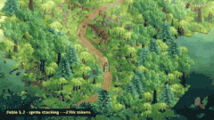</a> 
<b><a href="https://loktar00.github.io/llm-test-pages/fable52-dino-chase/">Thunder Valley 恐龙追逐</a></b> 
🆕 · <a href="https://x.com/loktar00">@loktar00</a> · ♥ 98 · <a href="https://x.com/loktar00/status/2120905457380507991">▶ 视频</a> 
不用引擎和库，自己写的 WebGL 渲染器，恐龙和树都是一层层像素叠成的 3D
</td>
</tr>
<tr>
<td width="33%" valign="top">
 
<b><a href="https://feed-backrooms.vercel.app">Feed the Backrooms：你当怪物</a></b> 
<a href="https://x.com/LexnLin">@LexnLin</a> · ♥ 95 · <a href="https://x.com/LexnLin/status/2119966127149429093">▶ 视频</a> 
后室反转玩法，你负责抓人
</td>
<td width="33%" valign="top">
 
<b><a href="https://rivergame-kappa.vercel.app">The Waking River 奇幻航行</a></b> 
🆕 · <a href="https://x.com/flxrnc">@flxrnc</a> · ♥ 88 · <a href="https://x.com/flxrnc/status/2120494277528580110">▶ 视频</a> 
一条提示词加几次追问；五个随航行苏醒的世界，配乐也是代码生成
</td>
<td width="33%" valign="top">
 
<b><a href="https://app.usecrayon.ai/play/992c2130-43da-416b-a577-aed9514d3057">SKYWAKE 飞行任务</a></b> 
🆕 · <a href="https://x.com/aniketjart">@aniketjart</a> · ♥ 78 · <a href="https://x.com/aniketjart/status/2120378493729222700">▶ 视频</a> 
Fable 5.2 + Opus 5.5 + Crayon + three.js
</td>
</tr>
<tr>
<td width="33%" valign="top">
<a href="https://app.usecrayon.ai/play/0cd7624e-1297-417e-a5be-b3c3036a496a">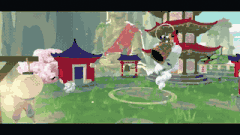</a> 
<b><a href="https://app.usecrayon.ai/play/0cd7624e-1297-417e-a5be-b3c3036a496a">KUMOKIRI 水墨武士</a></b> 
🆕 · <a href="https://x.com/aniketjart">@aniketjart</a> · ♥ 67 · <a href="https://x.com/aniketjart/status/2121101334900617631">▶ 视频</a> 
绘画风的武士游戏，Fable 5.2 + Crayon + three.js
</td>
<td width="33%" valign="top">
<a href="https://save-the-world-fable.vercel.app/">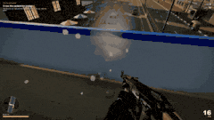</a> 
<b><a href="https://save-the-world-fable.vercel.app/">Save the World 拯救世界</a></b> 
🆕 · <a href="https://x.com/global_techgirl">@global_techgirl</a> · ♥ 63 · <a href="https://x.com/global_techgirl/status/2120246750459961453">▶ 视频</a> 
街道、3D 模型和音效都是它做或找的，宣传视频也是它自己玩着录的；电脑上玩最好
</td>
<td width="33%" valign="top">
 
<b><a href="https://patch.gg/games/rehan/ringfall">Ringfall《命运》风格 FPS</a></b> 
🆕 · <a href="https://x.com/rehan_shei">@rehan_shei</a> · ♥ 62 · <a href="https://x.com/rehan_shei/status/2119994607291584962">▶ 视频</a> 
开源，可以拿去改
</td>
</tr>
<tr>
<td width="33%" valign="top">
<a href="https://samg-coder.github.io/solstice-racing/">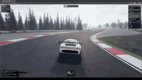</a> 
<b><a href="https://samg-coder.github.io/solstice-racing/">Kestrel Head 赛车（Solstice 引擎）</a></b> 
🆕 · <a href="https://x.com/SamGCoder">@SamGCoder</a> · ♥ 56 · <a href="https://x.com/SamGCoder/status/2120044542087070066">▶ 视频</a> 
用作者自己的 Rust + WebGPU 引擎；在 Blender 里建了保时捷 992 GT3 R 和 3 公里海岛赛道，支持手柄 
<a href="https://github.com/SamG-Coder/solstice-racing">源码</a>
</td>
<td width="33%" valign="top">
<a href="https://shubhu121.github.io/hitdude/play/">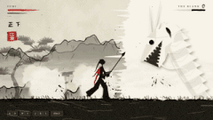</a> 
<b><a href="https://shubhu121.github.io/hitdude/play/">HITOFUDE 一筆 水墨动作游戏</a></b> 
🆕 · <a href="https://x.com/positronx_">@positronx_</a> · ♥ 52 · <a href="https://x.com/positronx_/status/2120374208043876422">▶ 视频</a> 
每一帧都是代码画的墨；Boss 会擦掉关卡，你的剑是一支毛笔
</td>
<td width="33%" valign="top">
 
<b><a href="https://fowllabs.com/fable-5-2/chairmageddon/">Chairmageddon 椅子末日</a></b> 
🆕 · <a href="https://x.com/argofowl">@argofowl</a> · ♥ 48 · <a href="https://x.com/argofowl/status/2120568779537273263">▶ 视频</a> 
摧毁一个全是蓝椅子的和平小镇
</td>
</tr>
<tr>
<td width="33%" valign="top">
 
<b><a href="https://higgsfield.ai/@higgsfield.studio/blogs/fable-5-2-built-this-rpg-from-pure-code-here-s-every-step">VOWLORN 纯代码暗黑 RPG</a></b> 
<a href="https://x.com/higgsfield_ai">@higgsfield_ai</a> · ♥ 46 · <a href="https://x.com/higgsfield_ai/status/2119997122896601269">▶ 视频</a> 
配音也是代码生成，经 Higgsfield MCP 发布；链接是带试玩入口的博客页 
<a href="https://higgsfield.ai/@higgsfield.studio/blogs/claude-fable-5-2-built-a-dragon-riding-game-play-it-free">骑龙游戏</a> · <a href="https://higgsfield.ai/@higgsfield.studio/blogs/one-drawing-fable-5-2-turned-it-into-a-horror-game">手绘变恐怖游戏</a>
</td>
<td width="33%" valign="top">
 
<b><a href="https://claude.ai/artifact/4nPXUKJjQWNsZEHVNmXXCt">流浪猫游戏</a></b> 
<a href="https://x.com/aimikoda">@aimikoda</a> · ♥ 44 · <a href="https://x.com/aimikoda/status/2120120133712593118">▶ 视频</a> 
救小猫、冲狗哈气、和老公猫对嚎，声音全部合成
</td>
<td width="33%" valign="top">
<a href="https://sael.net/demo/farewell-light/">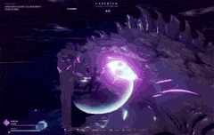</a> 
<b><a href="https://sael.net/demo/farewell-light/">Farewell Light</a></b> 
🆕 · <a href="https://x.com/RyanSael">@RyanSael</a> · ♥ 44 · <a href="https://x.com/RyanSael/status/2120695866684231998">▶ 视频</a> 
一晚上做出的玩法演示
</td>
</tr>
<tr>
<td width="33%" valign="top">
<a href="https://claude.ai/artifact/UD9pGEN4QFA8F5EadRw8eL">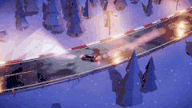</a> 
<b><a href="https://claude.ai/artifact/UD9pGEN4QFA8F5EadRw8eL">Midnight Pass 山路漂移</a></b> 
🆕 · <a href="https://x.com/andreysuperior">@andreysuperior</a> · ♥ 43 · <a href="https://x.com/andreysuperior/status/2120666660130746458">▶ 视频</a> 
一个 HTML 文件、603 行、零素材；漂移物理、整座山和引擎声都是生成的
</td>
<td width="33%" valign="top">
<a href="https://loktar00.github.io/llm-test-pages/fable52-hang-glider/">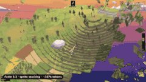</a> 
<b><a href="https://loktar00.github.io/llm-test-pages/fable52-hang-glider/">Thermal 滑翔伞</a></b> 
🆕 · <a href="https://x.com/loktar00">@loktar00</a> · ♥ 41 · <a href="https://x.com/loktar00/status/2121005021131083851">▶ 视频</a> 
驾驶滑翔伞借热气流飞到终点目标
</td>
<td width="33%" valign="top">
 
<b><a href="https://remix.gg/g/survivors">Survivors 吸血鬼幸存者 + 魔兽式装备</a></b> 
🆕 · <a href="https://x.com/BLACKST0CK">@BLACKST0CK</a> · ♥ 40 · <a href="https://x.com/BLACKST0CK/status/2120329788896498123">▶ 视频</a> 
幸存者玩法加魔兽式升级和装备，单人或最多 4 人合作
</td>
</tr>
<tr>
<td width="33%" valign="top">
<a href="https://www.aigameshare.com/games/animal-card-battle-game?play=1&mode=fullscreen">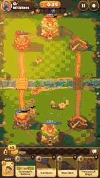</a> 
<b><a href="https://www.aigameshare.com/games/animal-card-battle-game?play=1&mode=fullscreen">Thimble Knights 动物卡牌对战</a></b> 
🆕 · <a href="https://x.com/_nilni">@_nilni</a> · ♥ 34 · <a href="https://x.com/_nilni/status/2120435983032447382">▶ 视频</a> 
实时策略卡牌对战，角色是一群可爱小动物
</td>
<td width="33%" valign="top">
 
<b><a href="https://blog.silencestar.com/posts/tilt-labyrinth/play/">木头滚珠迷宫</a></b> 
<a href="https://x.com/mylifcc">@mylifcc</a> · ♥ 32 · <a href="https://x.com/mylifcc/status/2120054646282870910">▶ 视频</a> 
three.js 2000 行，它自己把单帧从 55ms 优化到 9ms
</td>
<td width="33%" valign="top">
<a href="https://claude.ai/artifact/QvSjL7Hexf3nKdUP9Zerr7">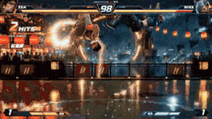</a> 
<b><a href="https://claude.ai/artifact/QvSjL7Hexf3nKdUP9Zerr7">格斗游戏（手机浏览器可玩）</a></b> 
🆕 · <a href="https://x.com/s_shigel">@s_shigel</a> · ♥ 32 · <a href="https://x.com/s_shigel/status/2120300080569975034">▶ 视频</a> 
一晚上迭代出来的格斗游戏
</td>
</tr>
<tr>
<td width="33%" valign="top">
<a href="https://tetriss22.github.io/harbor-gp/">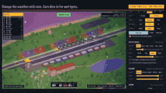</a> 
<b><a href="https://tetriss22.github.io/harbor-gp/">Harbor Lights Grand Prix 港口大奖赛</a></b> 
🆕 · <a href="https://x.com/Tetriss112">@Tetriss112</a> · ♥ 32 · <a href="https://x.com/Tetriss112/status/2120946576663134308">▶ 视频</a> 
一个 HTML 文件：像素小岛上 20 辆车跑 22 个弯的街道赛，赛前可以下注（虚拟筹码）
</td>
<td width="33%" valign="top">
<a href="https://www.spawn.co/@abbidabbi/pogo-riot">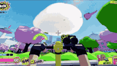</a> 
<b><a href="https://www.spawn.co/@abbidabbi/pogo-riot">Pogo Riot 弹跳杆射击</a></b> 
🆕 · <a href="https://x.com/Pumpnasterr">@Pumpnasterr</a> · ♥ 31 · <a href="https://x.com/Pumpnasterr/status/2121343507885682917">▶ 视频</a> 
多人混战 FPS，踩着弹跳杆一边跳一边瞄准
</td>
<td width="33%" valign="top">
 
<b><a href="https://remix.gg/g/hoppy-meadow">Hoppy Meadow 跳跳草地</a></b> 
🆕 · <a href="https://x.com/0xChuckstock">@0xChuckstock</a> · ♥ 26 · <a href="https://x.com/0xChuckstock/status/2120620907865473448">原帖</a> 
看起来是普通平台跳跃，到旗杆之后才有反转
</td>
</tr>
<tr>
<td width="33%" valign="top">
<a href="https://the-vast-horizon.vercel.app">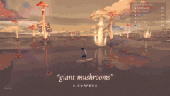</a> 
<b><a href="https://the-vast-horizon.vercel.app">The Vast Horizon 文字冲浪</a></b> 
🆕 · <a href="https://x.com/OdinLovis">@OdinLovis</a> · ♥ 26 · <a href="https://x.com/OdinLovis/status/2120198469755503091">▶ 视频</a> 
多人在同一片湖上冲浪，输入一个词就会改变世界
</td>
<td width="33%" valign="top">
<a href="https://claude.ai/artifact/FpdQ81sJs1KiV1a6JCY4jj">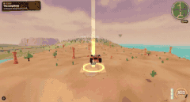</a> 
<b><a href="https://claude.ai/artifact/FpdQ81sJs1KiV1a6JCY4jj">开放世界冒险卡丁车</a></b> 
🆕 · <a href="https://x.com/realWeZZard">@realWeZZard</a> · ♥ 24 · <a href="https://x.com/realWeZZard/status/2120379500492185939">▶ 视频</a> 
一次生成，耗时三小时；主线半小时可以通关
</td>
<td width="33%" valign="top">
<a href="https://remix.gg/g/brix-84">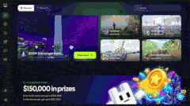</a> 
<b><a href="https://remix.gg/g/brix-84">BRIX '84 打砖块</a></b> 
🆕 · <a href="https://x.com/0xChuckstock">@0xChuckstock</a> · ♥ 24 · <a href="https://x.com/0xChuckstock/status/2120896397839126579">原帖</a> 
看似普通打砖块，吃到第二个道具后画风突变
</td>
</tr>
<tr>
<td width="33%" valign="top">
 
<b><a href="https://giant-leap.vercel.app">Giant Leap 从月球跳回地球</a></b> 
🆕 · <a href="https://x.com/handsher_NGU">@handsher_NGU</a> · ♥ 23 · <a href="https://x.com/handsher_NGU/status/2120287667141374212">▶ 视频</a> 
只需要跳
</td>
<td width="33%" valign="top">
<a href="https://qiaomu.t5t6.com/irondusk-yard-7/">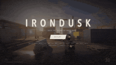</a> 
<b><a href="https://qiaomu.t5t6.com/irondusk-yard-7/">IRONDUSK — Yard 7 射击关卡</a></b> 
🆕 · <a href="https://x.com/vista8">@vista8</a> · ♥ 20 · <a href="https://x.com/vista8/status/2120383046239285264">原帖</a> 
一条提示词要一个 3A 画风的小关卡；另一条做了支持 AI 和双人对战的 3D 打砖块 
<a href="https://qiaomu.t5t6.com/3d/">3D打砖块</a>
</td>
<td width="33%" valign="top">
<a href="https://cozybakery.vercel.app">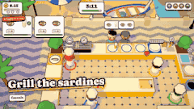</a> 
<b><a href="https://cozybakery.vercel.app">Cozy Bakery 葡萄牙合作厨房</a></b> 
🆕 · <a href="https://x.com/goncalo_canhoto">@goncalo_canhoto</a> · ♥ 18 · <a href="https://x.com/goncalo_canhoto/status/2120530199649432063">▶ 视频</a> 
类似 Overcooked 的多人做饭游戏，做蛋挞和 francesinha，1–4 人，手机也能玩
</td>
</tr>
<tr>
<td width="33%" valign="top">
 
<b><a href="https://www.nightclub-driftspeed.xyz/">NightClub: Drift & Speed 夜店漂移</a></b> 
🆕 · <a href="https://x.com/Story91_">@Story91_</a> · ♥ 17 · <a href="https://x.com/Story91_/status/2121016763190059194">▶ 视频</a> 
浏览器里的漂移赛车，带全球排行榜，72 小时从空文件夹做出来
</td>
<td width="33%" valign="top">
 
<b><a href="https://silicon-seduction.vercel.app/">Silicon Seduction</a></b> 
<a href="https://x.com/ZryMiller">@ZryMiller</a> · ♥ 13 · <a href="https://x.com/ZryMiller/status/2119918766691954691">▶ 视频</a> 
逃出去别被诱惑
</td>
<td width="33%" valign="top">
<a href="https://fighting-game-ignition.saito-931.workers.dev">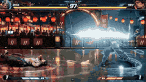</a> 
<b><a href="https://fighting-game-ignition.saito-931.workers.dev">IGNITION 零界 格斗游戏</a></b> 
🆕 · <a href="https://x.com/s_shigel">@s_shigel</a> · ♥ 12 · <a href="https://x.com/s_shigel/status/2120895161890914336">▶ 视频</a> 
2D 格斗游戏，带生成的语音和音效，能存对战记录和回放
</td>
</tr>
<tr>
<td width="33%" valign="top">
<a href="https://www.aigameshare.com/games/island-god-game?play=1&mode=fullscreen">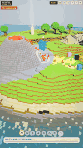</a> 
<b><a href="https://www.aigameshare.com/games/island-god-game?play=1&mode=fullscreen">Handful 岛屿之神</a></b> 
🆕 · <a href="https://x.com/_nilni">@_nilni</a> · ♥ 11 · <a href="https://x.com/_nilni/status/2120639452146250153">▶ 视频</a> 
你当神，帮小点们找到光
</td>
<td width="33%" valign="top">
 
<b><a href="https://wavedash.com/games/reef-dive">Reef Dive 珊瑚潜水</a></b> 
🆕 · <a href="https://x.com/boona11">@boona11</a> · ♥ 11 · <a href="https://x.com/boona11/status/2120886837422195123">▶ 视频</a> 
作者把十月做的 three.js 潜水游戏交给 Fable 5.2 改了一天，画面大升级
</td>
<td width="33%" valign="top">
<a href="https://www.aigameshare.com/games/great-wave-off-kanagawa?play=1&mode=fullscreen">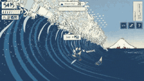</a> 
<b><a href="https://www.aigameshare.com/games/great-wave-off-kanagawa?play=1&mode=fullscreen">Great Wave 神奈川冲浪</a></b> 
🆕 · <a href="https://x.com/_nilni">@_nilni</a> · ♥ 7 · <a href="https://x.com/_nilni/status/2120797996610994355">▶ 视频</a> 
走进北斋《神奈川冲浪里》，划船躲过风神雷神，去富士山
</td>
</tr>
<tr>
<td width="33%" valign="top">
 
<b><a href="https://claude.ai/artifact/DLnFodkTwvawCNwurDmSZK?sk=5N6PtC07f1niB7h3I6clZQ">Roost 3D 越野摩托</a></b> 
<a href="https://x.com/tejas3732">@tejas3732</a> · ♥ 6 · <a href="https://x.com/tejas3732/status/2120091513657139549">▶ 视频</a> 
5 条提示词 15 分钟；3 条赛道、AI 对手、氮气
</td>
<td width="33%" valign="top">
 
<b><a href="https://clockendbader.github.io/fable-builds/go-for-launch/">Go for Launch 从地球到月球驾驶舱</a></b> 
🆕 · <a href="https://x.com/clockendbader">@clockendbader</a> · ♥ 5 · <a href="https://x.com/clockendbader/status/2121251400533631304">原帖</a> 
一条提示词，1 小时 18 分、约 $30；三档难度、实时仪表，无线电里有任务控制中心，声音全是代码生成
</td>
<td width="33%" valign="top">
<a href="http://poke-jam.vercel.app">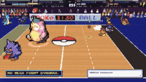</a> 
<b><a href="http://poke-jam.vercel.app">Poke Dodge 宝可梦躲避球</a></b> 
🆕 · <a href="https://x.com/crtvTeknologist">@crtvTeknologist</a> · ♥ 5 · <a href="https://x.com/crtvTeknologist/status/2121319366830809285">▶ 视频</a> 
2v2 宝可梦 × 躲避球，带 NBA Jam 味道；有道馆天梯、属性克制和携带道具
</td>
</tr>
<tr>
<td width="33%" valign="top">
<a href="https://infall-game.vercel.app">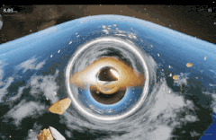</a> 
<b><a href="https://infall-game.vercel.app">INFALL 你就是黑洞</a></b> 
🆕 · <a href="https://x.com/AugustCastilIo">@AugustCastilIo</a> · ♥ 5 · <a href="https://x.com/AugustCastilIo/status/2121350653037756557">▶ 视频</a> 
只说了「放开做，让我大吃一惊」，从点子到代码一次做出
</td>
<td width="33%" valign="top">
 
<b><a href="https://claude.ai/artifact/1QGGhB68jMCjjjeeKtKNUo">格斗游戏（ElevenLabs 配音）</a></b> 
<a href="https://x.com/promodenstudio">@promodenstudio</a> · ♥ 4 · <a href="https://x.com/promodenstudio/status/2120085977079107788">▶ 视频</a> 
Fable 5.2 + ElevenLabs MCP，桌面键盘玩
</td>
<td width="33%" valign="top">
 
<b><a href="https://vippi.vercel.app/">Vippi 类 COD 射击</a></b> 
<a href="https://x.com/Shrit1401">@Shrit1401</a> · ♥ 1 · <a href="https://x.com/Shrit1401/status/2120060593763926314">▶ 视频</a> 
 
<a href="https://claude.ai/artifact/HSxhHE91J2jhLsB8WiTgUc">恐怖游戏测试</a>
</td>
</tr>
</table>

其他分类：[🌍 3D 世界与场景](3d-worlds.zh-CN.md) · [🧰 网页与工具](web-and-tools.zh-CN.md) · [🎬 动画与短片（附源码）](animation.zh-CN.md) · [📺 只有视频](video-demos.zh-CN.md)

[← 回到首页](../README.zh-CN.md)
