# 📺 Video-Demos · alle 156

[← Zurück zur Liste](../README.de.md) · [English](video-demos.md) · [简体中文](video-demos.zh-CN.md) · [繁體中文](video-demos.zh-TW.md) · [日本語](video-demos.ja.md) · [한국어](video-demos.ko.md) · [Español](video-demos.es.md) · [Português](video-demos.pt-BR.md) · [Français](video-demos.fr.md) · **Deutsch** · [Русский](video-demos.ru.md)

Die Hauptseite zeigt pro Bereich höchstens die 24 Einträge mit den meisten Likes (nur ab 100 Likes); hier stehen alle Einträge dieses Bereichs, nach Likes sortiert.

Die Creator haben ein Video, aber keinen Link geteilt. Klick auf die Vorschau für den Originalpost.

<table>
<tr>
<td width="33%" valign="top">
 
<b><a href="https://x.com/claudeai/status/2119899459761131615">Anthropic: Projekte vor dem Release</a></b> 
<a href="https://x.com/claudeai">@claudeai</a> · ♥ 43.0k · <a href="https://x.com/claudeai/status/2119899459761131615">▶ Video</a> 
Was Fable 5.2 und Mythos 5.2 in der Testphase in verschiedenen Bereichen gebaut haben. 
<a href="https://fablelist.000ooo.ooo/de/prompts/?w=anthropic-pre-release-projects&ref=gh"><b>✨ Prompt holen</b></a>
</td>
<td width="33%" valign="top">
 
<b><a href="https://x.com/anxuanng/status/2120088745139638375">Ein 3D-Film, der das Zenon-Paradoxon erklärt</a></b> 
<a href="https://x.com/anxuanng">@anxuanng</a> · ♥ 9.9k · <a href="https://x.com/anxuanng/status/2120088745139638375">▶ Video</a> 
 
<a href="https://fablelist.000ooo.ooo/de/prompts/?w=a-3d-film-explaining-zeno-s-paradox&ref=gh"><b>✨ Prompt holen</b></a>
</td>
<td width="33%" valign="top">
 
<b><a href="https://x.com/imjustnewatai/status/2120383964686729410">Eine Sinfonie in Form eines Trainingslaufs</a></b> 
<a href="https://x.com/imjustnewatai">@imjustnewatai</a> · ♥ 9.7k · <a href="https://x.com/imjustnewatai/status/2120383964686729410">▶ Video</a> 
 
<a href="https://fablelist.000ooo.ooo/de/prompts/?w=a-symphony-shaped-like-a-training-run&ref=gh"><b>✨ Prompt holen</b></a>
</td>
</tr>
<tr>
<td width="33%" valign="top">
 
<b><a href="https://x.com/everestchris6/status/2120175941616128277">2D-Grundrisse, in 3D-Rundgänge verwandelt</a></b> 
<a href="https://x.com/everestchris6">@everestchris6</a> · ♥ 7.3k · <a href="https://x.com/everestchris6/status/2120175941616128277">▶ Video</a> 
 
<a href="https://x.com/everestchris6/status/2120175941616128277">📝 Prompt des Creators (kostenlos)</a>
</td>
<td width="33%" valign="top">
 
<b><a href="https://x.com/dominikmartn/status/2120154832694858224">Es kann tatsächlich designen</a></b> 
<a href="https://x.com/dominikmartn">@dominikmartn</a> · ♥ 7.2k · <a href="https://x.com/dominikmartn/status/2120154832694858224">▶ Video</a> 
 
<a href="https://fablelist.000ooo.ooo/de/prompts/?w=it-can-actually-design&ref=gh"><b>✨ Prompt holen</b></a>
</td>
<td width="33%" valign="top">
 
<b><a href="https://x.com/suna_gaku/status/2119952985933697063">„Show me your best video“</a></b> 
<a href="https://x.com/suna_gaku">@suna_gaku</a> · ♥ 6.8k · <a href="https://x.com/suna_gaku/status/2119952985933697063">▶ Video</a> 
 
<a href="https://x.com/suna_gaku/status/2119952985933697063">📝 Prompt des Creators (kostenlos)</a>
</td>
</tr>
<tr>
<td width="33%" valign="top">
 
<b><a href="https://x.com/yohakutoink/status/2120824797215310208">Ein Gemälde im Code kopiert – „das Original hat hier einen Fleck, meins nicht“</a></b> 
<a href="https://x.com/yohakutoink">@yohakutoink</a> · ♥ 6.5k · <a href="https://x.com/yohakutoink/status/2120824797215310208">▶ Video</a> 
 
<a href="https://fablelist.000ooo.ooo/de/prompts/?w=painting-a-copy-in-code-the-original-has&ref=gh"><b>✨ Prompt holen</b></a>
</td>
<td width="33%" valign="top">
 
<b><a href="https://x.com/Dstudio_ai/status/2122569461547098595">Lobby-Bildschirm im Handyspiel-Stil mit einem Tripo-3D-Modell</a></b> 
<a href="https://x.com/Dstudio_ai">@Dstudio_ai</a> · ♥ 5.4k · <a href="https://x.com/Dstudio_ai/status/2122569461547098595">▶ Video</a> 

</td>
<td width="33%" valign="top">
 
<b><a href="https://x.com/aj_dev_smith/status/2122538394710687871">Jedes Lied mit 64 aufgenommenen Tönen einer einzigen Stimme spielen</a></b> 
<a href="https://x.com/aj_dev_smith">@aj_dev_smith</a> · ♥ 5.3k · <a href="https://x.com/aj_dev_smith/status/2122538394710687871">▶ Video</a> 

</td>
</tr>
<tr>
<td width="33%" valign="top">
 
<b><a href="https://x.com/matabee_GTO/status/2120995946372985144">Ein Prompt: Mach das unangenehmste Video, das du kannst</a></b> 
<a href="https://x.com/matabee_GTO">@matabee_GTO</a> · ♥ 5.0k · <a href="https://x.com/matabee_GTO/status/2120995946372985144">▶ Video</a> 
 
<a href="https://x.com/matabee_GTO/status/2120995946372985144">📝 Prompt des Creators (kostenlos)</a>
</td>
<td width="33%" valign="top">
 
<b><a href="https://x.com/JungleSilicon/status/2121782359901212987">Gaussian Splats im Pixel-Art-Stil</a></b> 
<a href="https://x.com/JungleSilicon">@JungleSilicon</a> · ♥ 4.9k · <a href="https://x.com/JungleSilicon/status/2121782359901212987">▶ Video</a> 

</td>
<td width="33%" valign="top">
 
<b><a href="https://x.com/MrTacticalX/status/2121082861902070130">Drei Fable-5.2-Agents bauen in 7 h 41 min einen Computer</a></b> 
<a href="https://x.com/MrTacticalX">@MrTacticalX</a> · ♥ 4.6k · <a href="https://x.com/MrTacticalX/status/2121082861902070130">▶ Video</a> 
 
<a href="https://fablelist.000ooo.ooo/de/prompts/?w=three-fable-5-2-agents-build-a-computer&ref=gh"><b>✨ Prompt holen</b></a>
</td>
</tr>
<tr>
<td width="33%" valign="top">
 
<b><a href="https://x.com/XRarchitect/status/2120947265007440052">Atlas + Fable 5.2 + three.js</a></b> 
<a href="https://x.com/XRarchitect">@XRarchitect</a> · ♥ 4.4k · <a href="https://x.com/XRarchitect/status/2120947265007440052">▶ Video</a> 
 
<a href="https://fablelist.000ooo.ooo/de/prompts/?w=atlas-fable-5-2-three-js&ref=gh"><b>✨ Prompt holen</b></a>
</td>
<td width="33%" valign="top">
 
<b><a href="https://x.com/kevin_t_ngo/status/2123980980994318416">Fable 5.2 baut sich in Python eine eigene Stimme</a></b> 
<a href="https://x.com/kevin_t_ngo">@kevin_t_ngo</a> · ♥ 4.4k · <a href="https://x.com/kevin_t_ngo/status/2123980980994318416">▶ Video</a> 

</td>
<td width="33%" valign="top">
 
<b><a href="https://x.com/Stefan_3D_AI/status/2125143321098264592">Eine Woche und Fable-5.2-Tokens für 6.528 $: ein von Grund auf in Unreal Engine 5.9 gebautes Spiel</a></b> 
🆕 · <a href="https://x.com/Stefan_3D_AI">@Stefan_3D_AI</a> · ♥ 3.9k · <a href="https://x.com/Stefan_3D_AI/status/2125143321098264592">▶ Video</a> 

</td>
</tr>
<tr>
<td width="33%" valign="top">
 
<b><a href="https://x.com/shiromamono/status/2122473903100731694">Ein Video, das dich zum Lächeln bringen soll</a></b> 
<a href="https://x.com/shiromamono">@shiromamono</a> · ♥ 3.9k · <a href="https://x.com/shiromamono/status/2122473903100731694">▶ Video</a> 

</td>
<td width="33%" valign="top">
 
<b><a href="https://x.com/iamdavidhill/status/2124986830236106897">Eine Charakter-Engine: Figur, Stil, Pose und Haltung im Handumdrehen wechseln</a></b> 
🆕 · <a href="https://x.com/iamdavidhill">@iamdavidhill</a> · ♥ 3.7k · <a href="https://x.com/iamdavidhill/status/2124986830236106897">▶ Video</a> 

</td>
<td width="33%" valign="top">
 
<b><a href="https://x.com/timhwang/status/2122011842549600506">Ein Chatbot mit 6 Mio. Parametern auf einem Game-Boy-Modul</a></b> 
<a href="https://x.com/timhwang">@timhwang</a> · ♥ 3.4k · <a href="https://x.com/timhwang/status/2122011842549600506">▶ Video</a> 

</td>
</tr>
<tr>
<td width="33%" valign="top">
 
<b><a href="https://x.com/aollivier82/status/2120260208245043663">Die Geschichte der Computergrafik, animiert</a></b> 
<a href="https://x.com/aollivier82">@aollivier82</a> · ♥ 3.2k · <a href="https://x.com/aollivier82/status/2120260208245043663">▶ Video</a> 
 
<a href="https://fablelist.000ooo.ooo/de/prompts/?w=the-history-of-computer-graphics-animated&ref=gh"><b>✨ Prompt holen</b></a>
</td>
<td width="33%" valign="top">
 
<b><a href="https://x.com/M__Houser/status/2120253236309569696">Age of Dragon, eine Open World von einem Nicht-Programmierer</a></b> 
<a href="https://x.com/M__Houser">@M__Houser</a> · ♥ 2.7k · <a href="https://x.com/M__Houser/status/2120253236309569696">▶ Video</a> 
 
<a href="https://fablelist.000ooo.ooo/de/prompts/?w=age-of-dragon-an-open-world-by-a&ref=gh"><b>✨ Prompt holen</b></a>
</td>
<td width="33%" valign="top">
 
<b><a href="https://x.com/hayashimon1/status/2121943011525624151">Ein Gang über einen alten Bahnsteig, per Blender MCP</a></b> 
<a href="https://x.com/hayashimon1">@hayashimon1</a> · ♥ 2.6k · <a href="https://x.com/hayashimon1/status/2121943011525624151">▶ Video</a> 

</td>
</tr>
<tr>
<td width="33%" valign="top">
 
<b><a href="https://x.com/aecyydesign/status/2120239401821487149">Eine mit Blender gemachte Animation</a></b> 
<a href="https://x.com/aecyydesign">@aecyydesign</a> · ♥ 2.5k · <a href="https://x.com/aecyydesign/status/2120239401821487149">▶ Video</a> 
 
<a href="https://fablelist.000ooo.ooo/de/prompts/?w=an-animation-made-with-blender&ref=gh"><b>✨ Prompt holen</b></a>
</td>
<td width="33%" valign="top">
 
<b><a href="https://x.com/alexalbert__/status/2119916954337349737">Da Vincis Notizbücher, interaktiv</a></b> 
<a href="https://x.com/alexalbert__">@alexalbert__</a> · ♥ 2.5k · <a href="https://x.com/alexalbert__/status/2119916954337349737">▶ Video</a> 
Ein 500 Jahre altes Notizbuch-PDF, verwandelt in Erfindungen zum Ausprobieren. 
<a href="https://fablelist.000ooo.ooo/de/prompts/?w=da-vinci-s-notebooks-interactive&ref=gh"><b>✨ Prompt holen</b></a>
</td>
<td width="33%" valign="top">
 
<b><a href="https://x.com/ChrisGPT/status/2119998815856218494">Eine Nachricht an Videoeditoren</a></b> 
<a href="https://x.com/ChrisGPT">@ChrisGPT</a> · ♥ 2.5k · <a href="https://x.com/ChrisGPT/status/2119998815856218494">▶ Video</a> 
 
<a href="https://fablelist.000ooo.ooo/de/prompts/?w=a-message-to-video-editors&ref=gh"><b>✨ Prompt holen</b></a>
</td>
</tr>
<tr>
<td width="33%" valign="top">
 
<b><a href="https://x.com/kotaniko98765/status/2122266561960665539">Ein Daytrading-Spiel, an einem Wochenende gebaut</a></b> 
<a href="https://x.com/kotaniko98765">@kotaniko98765</a> · ♥ 2.5k · <a href="https://x.com/kotaniko98765/status/2122266561960665539">▶ Video</a> 

</td>
<td width="33%" valign="top">
 
<b><a href="https://x.com/theo/status/2119926277801144695">Fishslop-Lauf</a></b> 
<a href="https://x.com/theo">@theo</a> · ♥ 2.3k · <a href="https://x.com/theo/status/2119926277801144695">▶ Video</a> 
76 Minuten, ca. 42 $. 
<a href="https://fablelist.000ooo.ooo/de/prompts/?w=fishslop-run&ref=gh"><b>✨ Prompt holen</b></a>
</td>
<td width="33%" valign="top">
 
<b><a href="https://x.com/GPTabby/status/2119909996645298519">Ein Rennspiel in Unreal Engine 5 aus einem Prompt</a></b> 
<a href="https://x.com/GPTabby">@GPTabby</a> · ♥ 2.2k · <a href="https://x.com/GPTabby/status/2119909996645298519">▶ Video</a> 
 
<a href="https://fablelist.000ooo.ooo/de/prompts/?w=a-racing-game-in-unreal-engine-5-from&ref=gh"><b>✨ Prompt holen</b></a>
</td>
</tr>
<tr>
<td width="33%" valign="top">
<a href="https://x.com/ryoma_nakajima/status/2120052388434473233">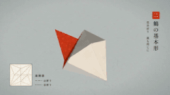</a> 
<b><a href="https://x.com/ryoma_nakajima/status/2120052388434473233">Es kann endlich Origami falten</a></b> 
<a href="https://x.com/ryoma_nakajima">@ryoma_nakajima</a> · ♥ 2.0k · <a href="https://x.com/ryoma_nakajima/status/2120052388434473233">▶ Video</a> 
 
<a href="https://x.com/ryoma_nakajima/status/2120052388434473233">📝 Prompt des Creators (kostenlos)</a>
</td>
<td width="33%" valign="top">
 
<b><a href="https://x.com/_sholtodouglas/status/2119935331499925557">Arena-FPS mit Portalen</a></b> 
<a href="https://x.com/_sholtodouglas">@_sholtodouglas</a> · ♥ 2.0k · <a href="https://x.com/_sholtodouglas/status/2119935331499925557">▶ Video</a> 
Im Büro Probe gespielt. 
<a href="https://fablelist.000ooo.ooo/de/prompts/?w=arena-fps-with-portals&ref=gh"><b>✨ Prompt holen</b></a>
</td>
<td width="33%" valign="top">
 
<b><a href="https://x.com/Ssr360535694/status/2122934850407510386">VFX-Shot, von Fable 5.2 dirigiert und von Opus 5.5 ausgeführt</a></b> 
<a href="https://x.com/Ssr360535694">@Ssr360535694</a> · ♥ 2.0k · <a href="https://x.com/Ssr360535694/status/2122934850407510386">▶ Video</a> 

</td>
</tr>
<tr>
<td width="33%" valign="top">
 
<b><a href="https://x.com/shiromamono/status/2122858333694730472">Ein Musikvideo eines Mädchens, das am Keyboard singt</a></b> 
<a href="https://x.com/shiromamono">@shiromamono</a> · ♥ 1.9k · <a href="https://x.com/shiromamono/status/2122858333694730472">▶ Video</a> 

</td>
<td width="33%" valign="top">
 
<b><a href="https://x.com/alexmichael/status/2119876626179870838">Ein ganzes Video, entstanden durch Python für Blender</a></b> 
<a href="https://x.com/alexmichael">@alexmichael</a> · ♥ 1.9k · <a href="https://x.com/alexmichael/status/2119876626179870838">▶ Video</a> 
 
<a href="https://fablelist.000ooo.ooo/de/prompts/?w=a-whole-video-made-by-writing-python-for&ref=gh"><b>✨ Prompt holen</b></a>
</td>
<td width="33%" valign="top">
 
<b><a href="https://x.com/DanielZambrini/status/2124583559256313944">Die Welt in den Augen eines Kolibris: eine fotorealistische Animation, komplett in Code entstanden</a></b> 
<a href="https://x.com/DanielZambrini">@DanielZambrini</a> · ♥ 1.9k · <a href="https://x.com/DanielZambrini/status/2124583559256313944">▶ Video</a> 

</td>
</tr>
<tr>
<td width="33%" valign="top">
 
<b><a href="https://x.com/Kashiko_AIart/status/2120640633346097400">„Show me your work“</a></b> 
<a href="https://x.com/Kashiko_AIart">@Kashiko_AIart</a> · ♥ 1.8k · <a href="https://x.com/Kashiko_AIart/status/2120640633346097400">▶ Video</a> 
 
<a href="https://fablelist.000ooo.ooo/de/prompts/?w=show-me-your-work&ref=gh"><b>✨ Prompt holen</b></a>
</td>
<td width="33%" valign="top">
 
<b><a href="https://x.com/Thaxnay/status/2123487166831734894">Das Ramayana als Character-Action-Spiel</a></b> 
<a href="https://x.com/Thaxnay">@Thaxnay</a> · ♥ 1.7k · <a href="https://x.com/Thaxnay/status/2123487166831734894">▶ Video</a> 

</td>
<td width="33%" valign="top">
 
<b><a href="https://x.com/chrisjdimarco/status/2120752985949057215">Ein Schwarm aus 1.048.576 Nanobots, der sich in eine Hand, einen Wal, eine Rakete oder eine DNA-Doppelhelix verwandelt</a></b> 
<a href="https://x.com/chrisjdimarco">@chrisjdimarco</a> · ♥ 1.7k · <a href="https://x.com/chrisjdimarco/status/2120752985949057215">▶ Video</a> 

</td>
</tr>
<tr>
<td width="33%" valign="top">
 
<b><a href="https://x.com/_MaxBlade/status/2120109725740159390">4 Stunden in Unreal Engine 5.9 per MCP</a></b> 
<a href="https://x.com/_MaxBlade">@_MaxBlade</a> · ♥ 1.7k · <a href="https://x.com/_MaxBlade/status/2120109725740159390">▶ Video</a> 
 
<a href="https://fablelist.000ooo.ooo/de/prompts/?w=4-hours-in-unreal-engine-5-9-via&ref=gh"><b>✨ Prompt holen</b></a>
</td>
<td width="33%" valign="top">
 
<b><a href="https://x.com/fe_yukichi/status/2122489950981779504">Ein faules Kaninchen, modelliert in Blender</a></b> 
<a href="https://x.com/fe_yukichi">@fe_yukichi</a> · ♥ 1.7k · <a href="https://x.com/fe_yukichi/status/2122489950981779504">▶ Video</a> 

</td>
<td width="33%" valign="top">
 
<b><a href="https://x.com/LexnLin/status/2119880654858977333">3D-Szene mit schneller Kamera</a></b> 
<a href="https://x.com/LexnLin">@LexnLin</a> · ♥ 1.6k · <a href="https://x.com/LexnLin/status/2119880654858977333">▶ Video</a> 
30 Minuten mit ein paar Opus-5.5-Subagents. 
<a href="https://fablelist.000ooo.ooo/de/prompts/?w=fast-camera-3d-scene&ref=gh"><b>✨ Prompt holen</b></a>
</td>
</tr>
<tr>
<td width="33%" valign="top">
<a href="https://x.com/JungleSilicon/status/2120452158961397975">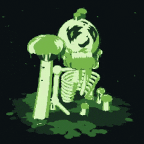</a> 
<b><a href="https://x.com/JungleSilicon/status/2120452158961397975">Pixel-Art-Gaussian-Splats</a></b> 
<a href="https://x.com/JungleSilicon">@JungleSilicon</a> · ♥ 1.6k · <a href="https://x.com/JungleSilicon/status/2120452158961397975">▶ Video</a> 
 
<a href="https://fablelist.000ooo.ooo/de/prompts/?w=pixel-art-gaussian-splats&ref=gh"><b>✨ Prompt holen</b></a>
</td>
<td width="33%" valign="top">
 
<b><a href="https://x.com/ChrisGPT/status/2122866766590173419">Ein Unterwasser-Survival-Spiel, in 4 Tagen gebaut</a></b> 
<a href="https://x.com/ChrisGPT">@ChrisGPT</a> · ♥ 1.6k · <a href="https://x.com/ChrisGPT/status/2122866766590173419">▶ Video</a> 

</td>
<td width="33%" valign="top">
<a href="https://x.com/ryanvogel/status/2122000027543617844">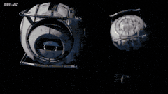</a> 
<b><a href="https://x.com/ryanvogel/status/2122000027543617844">Ein in Blender gerenderter Portal-2-Film</a></b> 
<a href="https://x.com/ryanvogel">@ryanvogel</a> · ♥ 1.5k · <a href="https://x.com/ryanvogel/status/2122000027543617844">▶ Video</a> 

</td>
</tr>
<tr>
<td width="33%" valign="top">
<a href="https://x.com/MrTacticalX/status/2119955647542542439">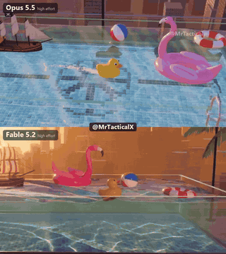</a> 
<b><a href="https://x.com/MrTacticalX/status/2119955647542542439">Glass Pool (Fable vs Opus)</a></b> 
<a href="https://x.com/MrTacticalX">@MrTacticalX</a> · ♥ 1.5k · <a href="https://x.com/MrTacticalX/status/2119955647542542439">▶ Video</a> 
 
<a href="https://fablelist.000ooo.ooo/de/prompts/?w=glass-pool-fable-vs-opus&ref=gh"><b>✨ Prompt holen</b></a>
</td>
<td width="33%" valign="top">
<a href="https://x.com/DeryaTR_/status/2120382619082727604">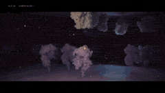</a> 
<b><a href="https://x.com/DeryaTR_/status/2120382619082727604">Das Leben einer T-Zelle, ein 8-Minuten-Film</a></b> 
<a href="https://x.com/DeryaTR_">@DeryaTR_</a> · ♥ 1.4k · <a href="https://x.com/DeryaTR_/status/2120382619082727604">▶ Video</a> 
 
<a href="https://fablelist.000ooo.ooo/de/prompts/?w=the-life-of-a-t-cell-an-8&ref=gh"><b>✨ Prompt holen</b></a>
</td>
<td width="33%" valign="top">
<a href="https://x.com/akakuma0219/status/2120030634248929556">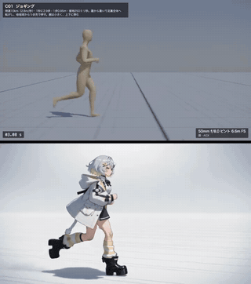</a> 
<b><a href="https://x.com/akakuma0219/status/2120030634248929556">Previz-Laufzyklen aus drei Wörtern</a></b> 
<a href="https://x.com/akakuma0219">@akakuma0219</a> · ♥ 1.4k · <a href="https://x.com/akakuma0219/status/2120030634248929556">▶ Video</a> 
 
<a href="https://fablelist.000ooo.ooo/de/prompts/?w=previz-run-cycles-from-three-words&ref=gh"><b>✨ Prompt holen</b></a>
</td>
</tr>
<tr>
<td width="33%" valign="top">
<a href="https://x.com/viktoroddy/status/2122711903877358056">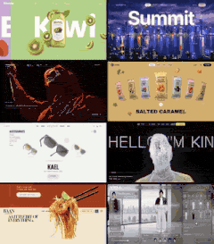</a> 
<b><a href="https://x.com/viktoroddy/status/2122711903877358056">Eine Reihe von Marken-Landingpages mit Geschmack</a></b> 
<a href="https://x.com/viktoroddy">@viktoroddy</a> · ♥ 1.4k · <a href="https://x.com/viktoroddy/status/2122711903877358056">▶ Video</a> 

</td>
<td width="33%" valign="top">
 
<b><a href="https://x.com/RezAIT00/status/2120498246426706176">Damit aufgewacht: Spielumgebung in Blender + Unreal</a></b> 
<a href="https://x.com/RezAIT00">@RezAIT00</a> · ♥ 1.4k · <a href="https://x.com/RezAIT00/status/2120498246426706176">▶ Video</a> 
 
<a href="https://fablelist.000ooo.ooo/de/prompts/?w=woke-up-to-this-game-environment-in-blender&ref=gh"><b>✨ Prompt holen</b></a>
</td>
<td width="33%" valign="top">
 
<b><a href="https://x.com/Yokohara_h/status/2121301810363465749">Charakteranimation in Blender mit einfachen Anweisungen</a></b> 
<a href="https://x.com/Yokohara_h">@Yokohara_h</a> · ♥ 1.3k · <a href="https://x.com/Yokohara_h/status/2121301810363465749">▶ Video</a> 

</td>
</tr>
<tr>
<td width="33%" valign="top">
 
<b><a href="https://x.com/xikhar/status/2119966147328299284">Bugatti Tourbillon in Blender modelliert und gerendert</a></b> 
<a href="https://x.com/xikhar">@xikhar</a> · ♥ 1.3k · <a href="https://x.com/xikhar/status/2119966147328299284">▶ Video</a> 
 
<a href="https://x.com/xikhar/status/2119966147328299284">📝 Prompt des Creators (kostenlos)</a>
</td>
<td width="33%" valign="top">
<a href="https://x.com/KHvostikk/status/2119939061049889130">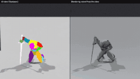</a> 
<b><a href="https://x.com/KHvostikk/status/2119939061049889130">Video zu 3D-Animation</a></b> 
<a href="https://x.com/KHvostikk">@KHvostikk</a> · ♥ 1.2k · <a href="https://x.com/KHvostikk/status/2119939061049889130">▶ Video</a> 
 
<a href="https://fablelist.000ooo.ooo/de/prompts/?w=video-to-3d-animation&ref=gh"><b>✨ Prompt holen</b></a>
</td>
<td width="33%" valign="top">
<a href="https://x.com/chetaslua/status/2119870650722763052">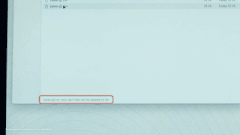</a> 
<b><a href="https://x.com/chetaslua/status/2119870650722763052">Ein Betriebssystem aus einem leeren Ordner</a></b> 
<a href="https://x.com/chetaslua">@chetaslua</a> · ♥ 1.2k · <a href="https://x.com/chetaslua/status/2119870650722763052">▶ Video</a> 
Anthropics Demo mit über 1.000 koordinierten Agents.
</td>
</tr>
<tr>
<td width="33%" valign="top">
 
<b><a href="https://x.com/hectorVFX/status/2125250192773390610">Ein brennendes Haus in Blender und Unreal Engine, per Sprache am Handy dirigiert</a></b> 
🆕 · <a href="https://x.com/hectorVFX">@hectorVFX</a> · ♥ 1.2k · <a href="https://x.com/hectorVFX/status/2125250192773390610">▶ Video</a> 

</td>
<td width="33%" valign="top">
 
<b><a href="https://x.com/pl4tinumeffects/status/2123074786415001972">Die Handy-Mechanik aus GTA VI in Roblox nachgebaut</a></b> 
<a href="https://x.com/pl4tinumeffects">@pl4tinumeffects</a> · ♥ 1.2k · <a href="https://x.com/pl4tinumeffects/status/2123074786415001972">▶ Video</a> 

</td>
<td width="33%" valign="top">
<a href="https://x.com/Stefan_3D_AI/status/2125493150517268588">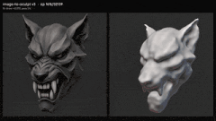</a> 
<b><a href="https://x.com/Stefan_3D_AI/status/2125493150517268588">KI-Sculpting: 32.139 echte Pinselstriche in Blender</a></b> 
🆕 · <a href="https://x.com/Stefan_3D_AI">@Stefan_3D_AI</a> · ♥ 1.1k · <a href="https://x.com/Stefan_3D_AI/status/2125493150517268588">▶ Video</a> 

</td>
</tr>
<tr>
<td width="33%" valign="top">
<a href="https://x.com/vib3coded/status/2119876781700505627">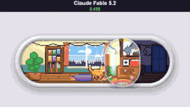</a> 
<b><a href="https://x.com/vib3coded/status/2119876781700505627">Süchtig machender Lautstärkeregler</a></b> 
<a href="https://x.com/vib3coded">@vib3coded</a> · ♥ 1.1k · <a href="https://x.com/vib3coded/status/2119876781700505627">▶ Video</a> 
10 Minuten, 8,43 $. 
<a href="https://x.com/vib3coded/status/2119876781700505627">📝 Prompt des Creators (kostenlos)</a>
</td>
<td width="33%" valign="top">
<a href="https://x.com/MengTo/status/2121896633848017145">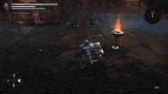</a> 
<b><a href="https://x.com/MengTo/status/2121896633848017145">Ein von Dark Souls inspiriertes Browserspiel</a></b> 
<a href="https://x.com/MengTo">@MengTo</a> · ♥ 1.1k · <a href="https://x.com/MengTo/status/2121896633848017145">▶ Video</a> 

</td>
<td width="33%" valign="top">
<a href="https://x.com/ericmaskfr/status/2119910195325481026">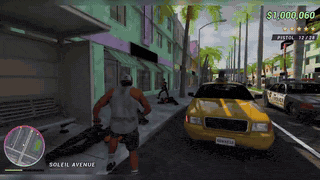</a> 
<b><a href="https://x.com/ericmaskfr/status/2119910195325481026">GTA 6 mit einem Prompt</a></b> 
<a href="https://x.com/ericmaskfr">@ericmaskfr</a> · ♥ 1.0k · <a href="https://x.com/ericmaskfr/status/2119910195325481026">▶ Video</a> 
 
<a href="https://x.com/ericmaskfr/status/2119910195325481026">📝 Prompt des Creators (kostenlos)</a>
</td>
</tr>
<tr>
<td width="33%" valign="top">
<a href="https://x.com/jakemor/status/2122551786045059205">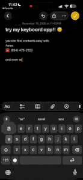</a> 
<b><a href="https://x.com/jakemor/status/2122551786045059205">Function, eine Tastatur aus 229 Builds in der Schleife</a></b> 
<a href="https://x.com/jakemor">@jakemor</a> · ♥ 946 · <a href="https://x.com/jakemor/status/2122551786045059205">▶ Video</a> 

</td>
<td width="33%" valign="top">
<a href="https://x.com/maxt3chno/status/2123157986713747468">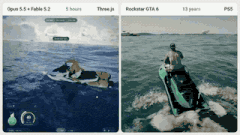</a> 
<b><a href="https://x.com/maxt3chno/status/2123157986713747468">Ein in 5 Stunden gebauter Jetski im Vergleich mit GTA 6</a></b> 
<a href="https://x.com/maxt3chno">@maxt3chno</a> · ♥ 922 · <a href="https://x.com/maxt3chno/status/2123157986713747468">▶ Video</a> 

</td>
<td width="33%" valign="top">
 
<b><a href="https://x.com/AstrablueAI/status/2121635642836918385">FABLE-OUS, ein Musikvideo in einem Durchgang</a></b> 
<a href="https://x.com/AstrablueAI">@AstrablueAI</a> · ♥ 917 · <a href="https://x.com/AstrablueAI/status/2121635642836918385">▶ Video</a> 

</td>
</tr>
<tr>
<td width="33%" valign="top">
<a href="https://x.com/oalanicolas/status/2120138473826877590">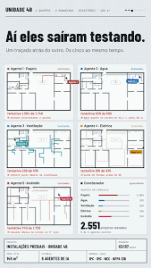</a> 
<b><a href="https://x.com/oalanicolas/status/2120138473826877590">Ein komplettes Wohnungsdesign</a></b> 
<a href="https://x.com/oalanicolas">@oalanicolas</a> · ♥ 896 · <a href="https://x.com/oalanicolas/status/2120138473826877590">▶ Video</a> 
 
<a href="https://fablelist.000ooo.ooo/de/prompts/?w=a-full-apartment-design&ref=gh"><b>✨ Prompt holen</b></a>
</td>
<td width="33%" valign="top">
<a href="https://x.com/kinderlayer/status/2120112222227648957">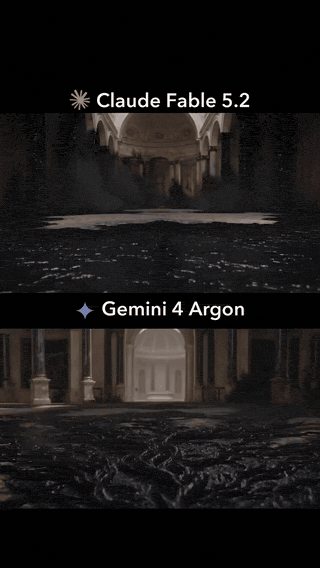</a> 
<b><a href="https://x.com/kinderlayer/status/2120112222227648957">Löwe aus einem Teppich (Fable vs Gemini)</a></b> 
<a href="https://x.com/kinderlayer">@kinderlayer</a> · ♥ 879 · <a href="https://x.com/kinderlayer/status/2120112222227648957">▶ Video</a> 
 
<a href="https://fablelist.000ooo.ooo/de/prompts/?w=lion-from-a-carpet-fable-vs-gemini&ref=gh"><b>✨ Prompt holen</b></a>
</td>
<td width="33%" valign="top">
<a href="https://x.com/nickvernij/status/2122361634190696575">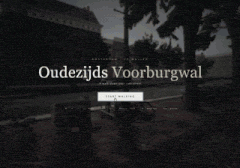</a> 
<b><a href="https://x.com/nickvernij/status/2122361634190696575">Eine Amsterdamer Straßenszene aus der Street View API</a></b> 
<a href="https://x.com/nickvernij">@nickvernij</a> · ♥ 871 · <a href="https://x.com/nickvernij/status/2122361634190696575">▶ Video</a> 

</td>
</tr>
<tr>
<td width="33%" valign="top">
<a href="https://x.com/KHvostikk/status/2120621109125202344">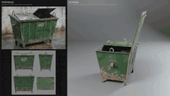</a> 
<b><a href="https://x.com/KHvostikk/status/2120621109125202344">Bild zu 3D-Modell mit PBR-Texturen</a></b> 
<a href="https://x.com/KHvostikk">@KHvostikk</a> · ♥ 862 · <a href="https://x.com/KHvostikk/status/2120621109125202344">▶ Video</a> 
 
<a href="https://fablelist.000ooo.ooo/de/prompts/?w=image-to-3d-model-with-pbr-textures&ref=gh"><b>✨ Prompt holen</b></a>
</td>
<td width="33%" valign="top">
 
<b><a href="https://x.com/tm_uchal/status/2120573380768518390">KI-Avatar-Video</a></b> 
<a href="https://x.com/tm_uchal">@tm_uchal</a> · ♥ 844 · <a href="https://x.com/tm_uchal/status/2120573380768518390">▶ Video</a> 
 
<a href="https://fablelist.000ooo.ooo/de/prompts/?w=ai-avatar-video&ref=gh"><b>✨ Prompt holen</b></a>
</td>
<td width="33%" valign="top">
 
<b><a href="https://x.com/scottstts/status/2120254108104007712">Dragon's Nest, three.js + Tripo</a></b> 
<a href="https://x.com/scottstts">@scottstts</a> · ♥ 806 · <a href="https://x.com/scottstts/status/2120254108104007712">▶ Video</a> 
 
<a href="https://fablelist.000ooo.ooo/de/prompts/?w=dragon-s-nest-three-js-tripo&ref=gh"><b>✨ Prompt holen</b></a>
</td>
</tr>
<tr>
<td width="33%" valign="top">
 
<b><a href="https://x.com/Dstudio_ai/status/2121168620760019389">Einen VRM-Avatar bauen – Augentexturen, Jiggle-Teile und Hals-Fixes, ohne Blender zu öffnen</a></b> 
<a href="https://x.com/Dstudio_ai">@Dstudio_ai</a> · ♥ 788 · <a href="https://x.com/Dstudio_ai/status/2121168620760019389">▶ Video</a> 

</td>
<td width="33%" valign="top">
<a href="https://x.com/fabianstelzer/status/2125461266999476224">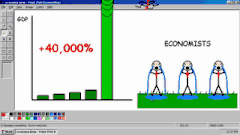</a> 
<b><a href="https://x.com/fabianstelzer/status/2125461266999476224">„Tuesday“: ein Kurzfilm über die Singularität im MS-Paint-Stil</a></b> 
🆕 · <a href="https://x.com/fabianstelzer">@fabianstelzer</a> · ♥ 786 · <a href="https://x.com/fabianstelzer/status/2125461266999476224">▶ Video</a> 

</td>
<td width="33%" valign="top">
<a href="https://x.com/jaimintf/status/2120553374286594292">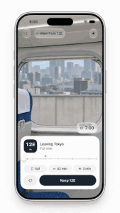</a> 
<b><a href="https://x.com/jaimintf/status/2120553374286594292">Zugsitz-Ansicht vor der Buchung</a></b> 
<a href="https://x.com/jaimintf">@jaimintf</a> · ♥ 776 · <a href="https://x.com/jaimintf/status/2120553374286594292">▶ Video</a> 
 
<a href="https://fablelist.000ooo.ooo/de/prompts/?w=train-seat-view-before-you-book&ref=gh"><b>✨ Prompt holen</b></a>
</td>
</tr>
<tr>
<td width="33%" valign="top">
<a href="https://x.com/kevin_t_ngo/status/2119972124211454139">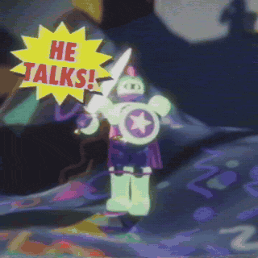</a> 
<b><a href="https://x.com/kevin_t_ngo/status/2119972124211454139">Ein Spielzeug-Werbespot aus den 90ern</a></b> 
<a href="https://x.com/kevin_t_ngo">@kevin_t_ngo</a> · ♥ 768 · <a href="https://x.com/kevin_t_ngo/status/2119972124211454139">▶ Video</a> 
 
<a href="https://fablelist.000ooo.ooo/de/prompts/?w=a-90s-toy-commercial&ref=gh"><b>✨ Prompt holen</b></a>
</td>
<td width="33%" valign="top">
 
<b><a href="https://x.com/rute1203d/status/2120077147872391540">„Show me your best video“ – mit einem Twist</a></b> 
<a href="https://x.com/rute1203d">@rute1203d</a> · ♥ 766 · <a href="https://x.com/rute1203d/status/2120077147872391540">▶ Video</a> 
 
<a href="https://fablelist.000ooo.ooo/de/prompts/?w=show-me-your-best-video-with-a-twist&ref=gh"><b>✨ Prompt holen</b></a>
</td>
<td width="33%" valign="top">
<a href="https://x.com/anikrisn/status/2119950148294119483">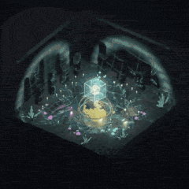</a> 
<b><a href="https://x.com/anikrisn/status/2119950148294119483">Leuchtendes isometrisches Teich-Diorama</a></b> 
<a href="https://x.com/anikrisn">@anikrisn</a> · ♥ 745 · <a href="https://x.com/anikrisn/status/2119950148294119483">▶ Video</a> 
 
<a href="https://fablelist.000ooo.ooo/de/prompts/?w=glowing-isometric-pond-diorama&ref=gh"><b>✨ Prompt holen</b></a>
</td>
</tr>
<tr>
<td width="33%" valign="top">
<a href="https://x.com/WesRoth/status/2119953913160093817">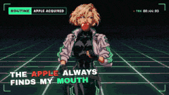</a> 
<b><a href="https://x.com/WesRoth/status/2119953913160093817">One-Shot-Reel</a></b> 
<a href="https://x.com/WesRoth">@WesRoth</a> · ♥ 743 · <a href="https://x.com/WesRoth/status/2119953913160093817">▶ Video</a> 
 
<a href="https://fablelist.000ooo.ooo/de/prompts/?w=one-shot-reel&ref=gh"><b>✨ Prompt holen</b></a>
</td>
<td width="33%" valign="top">
<a href="https://x.com/JaydenDavisNC/status/2120306434575392793">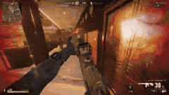</a> 
<b><a href="https://x.com/JaydenDavisNC/status/2120306434575392793">Ein Ego-Shooter in Three.js, ohne externe Assets</a></b> 
<a href="https://x.com/JaydenDavisNC">@JaydenDavisNC</a> · ♥ 738 · <a href="https://x.com/JaydenDavisNC/status/2120306434575392793">▶ Video</a> 
 
<a href="https://fablelist.000ooo.ooo/de/prompts/?w=a-first-person-shooter-in-three-js-no&ref=gh"><b>✨ Prompt holen</b></a>
</td>
<td width="33%" valign="top">
<a href="https://x.com/adamdotnew/status/2120071630139621540">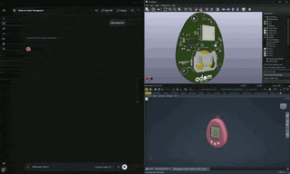</a> 
<b><a href="https://x.com/adamdotnew/status/2120071630139621540">Ein Tamagotchi: Platine, Gehäuse und Render</a></b> 
<a href="https://x.com/adamdotnew">@adamdotnew</a> · ♥ 705 · <a href="https://x.com/adamdotnew/status/2120071630139621540">▶ Video</a> 
 
<a href="https://fablelist.000ooo.ooo/de/prompts/?w=a-tamagotchi-pcb-enclosure-and-render&ref=gh"><b>✨ Prompt holen</b></a>
</td>
</tr>
<tr>
<td width="33%" valign="top">
 
<b><a href="https://x.com/alightinastorm/status/2120010936584945922">AAA-Basketball in three.js</a></b> 
<a href="https://x.com/alightinastorm">@alightinastorm</a> · ♥ 694 · <a href="https://x.com/alightinastorm/status/2120010936584945922">▶ Video</a> 
 
<a href="https://fablelist.000ooo.ooo/de/prompts/?w=aaa-three-js-basketball&ref=gh"><b>✨ Prompt holen</b></a>
</td>
<td width="33%" valign="top">
<a href="https://x.com/op7418/status/2120085300185833878">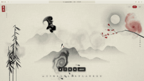</a> 
<b><a href="https://x.com/op7418/status/2120085300185833878">Tintenbuchstaben</a></b> 
<a href="https://x.com/op7418">@op7418</a> · ♥ 688 · <a href="https://x.com/op7418/status/2120085300185833878">▶ Video</a> 
Tippe ein Zeichen und es wird zu lebendiger, fließender Tinte, mit Sound. 
<a href="https://fablelist.000ooo.ooo/de/prompts/?w=ink-letters&ref=gh"><b>✨ Prompt holen</b></a>
</td>
<td width="33%" valign="top">
 
<b><a href="https://x.com/nikosolenne/status/2122497144976261202">Website-Designs von einem Modell, das man als Designer einstellen würde</a></b> 
<a href="https://x.com/nikosolenne">@nikosolenne</a> · ♥ 678 · <a href="https://x.com/nikosolenne/status/2122497144976261202">▶ Video</a> 

</td>
</tr>
<tr>
<td width="33%" valign="top">
<a href="https://x.com/kevin_t_ngo/status/2120308118127309173">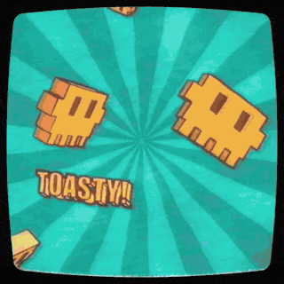</a> 
<b><a href="https://x.com/kevin_t_ngo/status/2120308118127309173">Ein Cerealien-Werbespot aus den 90ern</a></b> 
<a href="https://x.com/kevin_t_ngo">@kevin_t_ngo</a> · ♥ 676 · <a href="https://x.com/kevin_t_ngo/status/2120308118127309173">▶ Video</a> 
 
<a href="https://fablelist.000ooo.ooo/de/prompts/?w=a-90s-cereal-commercial&ref=gh"><b>✨ Prompt holen</b></a>
</td>
<td width="33%" valign="top">
 
<b><a href="https://x.com/ICO_AIvideo/status/2120311646933680355">Ein in Blender gemachter Loop-Kurzfilm</a></b> 
<a href="https://x.com/ICO_AIvideo">@ICO_AIvideo</a> · ♥ 672 · <a href="https://x.com/ICO_AIvideo/status/2120311646933680355">▶ Video</a> 
 
<a href="https://fablelist.000ooo.ooo/de/prompts/?w=a-looping-short-made-in-blender&ref=gh"><b>✨ Prompt holen</b></a>
</td>
<td width="33%" valign="top">
<a href="https://x.com/KanaWorks_AI/status/2120098607382880627">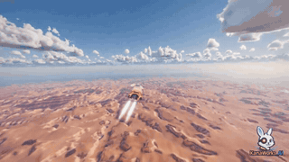</a> 
<b><a href="https://x.com/KanaWorks_AI/status/2120098607382880627">37 Sekunden ungeschnittener Flug über endloses Gelände</a></b> 
<a href="https://x.com/KanaWorks_AI">@KanaWorks_AI</a> · ♥ 665 · <a href="https://x.com/KanaWorks_AI/status/2120098607382880627">▶ Video</a> 
 
<a href="https://fablelist.000ooo.ooo/de/prompts/?w=37-second-uncut-flight-over-endless-terrain&ref=gh"><b>✨ Prompt holen</b></a>
</td>
</tr>
<tr>
<td width="33%" valign="top">
 
<b><a href="https://x.com/theo/status/2120104895646937409">Aus einem Datenpipeline-Bericht wurde ein Design</a></b> 
<a href="https://x.com/theo">@theo</a> · ♥ 638 · <a href="https://x.com/theo/status/2120104895646937409">▶ Video</a> 
 
<a href="https://fablelist.000ooo.ooo/de/prompts/?w=a-data-pipeline-write-up-that-became-a&ref=gh"><b>✨ Prompt holen</b></a>
</td>
<td width="33%" valign="top">
 
<b><a href="https://x.com/LexnLin/status/2120167637133238295">Claude-Logo-Animation</a></b> 
<a href="https://x.com/LexnLin">@LexnLin</a> · ♥ 630 · <a href="https://x.com/LexnLin/status/2120167637133238295">▶ Video</a> 
 
<a href="https://fablelist.000ooo.ooo/de/prompts/?w=claude-logo-animation&ref=gh"><b>✨ Prompt holen</b></a>
</td>
<td width="33%" valign="top">
<a href="https://x.com/lemomo_ai/status/2120118194409193682">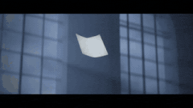</a> 
<b><a href="https://x.com/lemomo_ai/status/2120118194409193682">Eine Bibliothek um Mitternacht</a></b> 
<a href="https://x.com/lemomo_ai">@lemomo_ai</a> · ♥ 626 · <a href="https://x.com/lemomo_ai/status/2120118194409193682">▶ Video</a> 
24.000 Seiten heben ab. 
<a href="https://fablelist.000ooo.ooo/de/prompts/?w=a-library-at-midnight&ref=gh"><b>✨ Prompt holen</b></a>
</td>
</tr>
<tr>
<td width="33%" valign="top">
<a href="https://x.com/PhotoGarrido/status/2122292866894680476">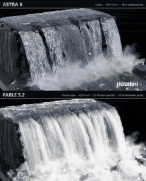</a> 
<b><a href="https://x.com/PhotoGarrido/status/2122292866894680476">Ein Houdini-Wasserfall-Benchmark</a></b> 
<a href="https://x.com/PhotoGarrido">@PhotoGarrido</a> · ♥ 620 · <a href="https://x.com/PhotoGarrido/status/2122292866894680476">▶ Video</a> 

</td>
<td width="33%" valign="top">
<a href="https://x.com/mxvdl/status/2120809570344050705">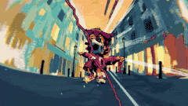</a> 
<b><a href="https://x.com/mxvdl/status/2120809570344050705">Three.js-Pinselstrich-Shader im Detail</a></b> 
<a href="https://x.com/mxvdl">@mxvdl</a> · ♥ 604 · <a href="https://x.com/mxvdl/status/2120809570344050705">▶ Video</a> 
 
<a href="https://fablelist.000ooo.ooo/de/prompts/?w=three-js-brush-stroke-shader-breakdown&ref=gh"><b>✨ Prompt holen</b></a>
</td>
<td width="33%" valign="top">
 
<b><a href="https://x.com/kevin_t_ngo/status/2120540964909711415">Ein animiertes Show-Intro</a></b> 
<a href="https://x.com/kevin_t_ngo">@kevin_t_ngo</a> · ♥ 570 · <a href="https://x.com/kevin_t_ngo/status/2120540964909711415">▶ Video</a> 
 
<a href="https://fablelist.000ooo.ooo/de/prompts/?w=an-animated-show-intro&ref=gh"><b>✨ Prompt holen</b></a>
</td>
</tr>
<tr>
<td width="33%" valign="top">
 
<b><a href="https://x.com/MrTacticalX/status/2120342453807157720">Eine mechanische Tastatur in Blender, samt Tippen</a></b> 
<a href="https://x.com/MrTacticalX">@MrTacticalX</a> · ♥ 562 · <a href="https://x.com/MrTacticalX/status/2120342453807157720">▶ Video</a> 
 
<a href="https://fablelist.000ooo.ooo/de/prompts/?w=a-mechanical-keyboard-in-blender-typing-included&ref=gh"><b>✨ Prompt holen</b></a>
</td>
<td width="33%" valign="top">
<a href="https://x.com/dom_scholz/status/2119933150025363661">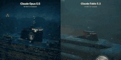</a> 
<b><a href="https://x.com/dom_scholz/status/2119933150025363661">Opus 5.5 vs Fable 5.2</a></b> 
<a href="https://x.com/dom_scholz">@dom_scholz</a> · ♥ 560 · <a href="https://x.com/dom_scholz/status/2119933150025363661">▶ Video</a> 
 
<a href="https://fablelist.000ooo.ooo/de/prompts/?w=opus-5-5-vs-fable-5-2&ref=gh"><b>✨ Prompt holen</b></a>
</td>
<td width="33%" valign="top">
<a href="https://x.com/thomaszhou_/status/2120389154970509666">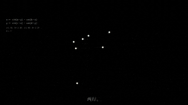</a> 
<b><a href="https://x.com/thomaszhou_/status/2120389154970509666">„Beauty“, ein Kurzfilm aus einem Satz</a></b> 
<a href="https://x.com/thomaszhou_">@thomaszhou_</a> · ♥ 544 · <a href="https://x.com/thomaszhou_/status/2120389154970509666">▶ Video</a> 
 
<a href="https://x.com/thomaszhou_/status/2120389154970509666">📝 Prompt des Creators (kostenlos)</a>
</td>
</tr>
<tr>
<td width="33%" valign="top">
<a href="https://x.com/MengTo/status/2120316203738829180">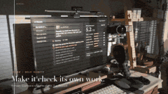</a> 
<b><a href="https://x.com/MengTo/status/2120316203738829180">Eine three.js-Wohnung in Blender nachgebaut</a></b> 
<a href="https://x.com/MengTo">@MengTo</a> · ♥ 518 · <a href="https://x.com/MengTo/status/2120316203738829180">▶ Video</a> 
 
<a href="https://fablelist.000ooo.ooo/de/prompts/?w=a-three-js-apartment-recreated-in-blender&ref=gh"><b>✨ Prompt holen</b></a>
</td>
<td width="33%" valign="top">
<a href="https://x.com/rileybrown/status/2119973951027724385">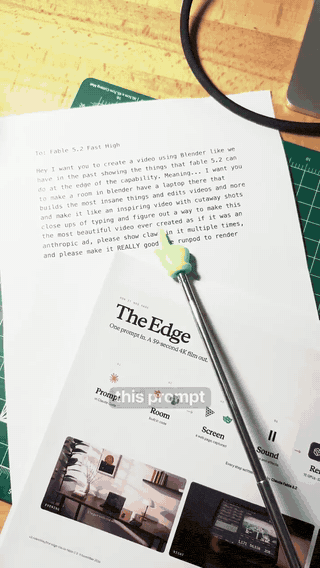</a> 
<b><a href="https://x.com/rileybrown/status/2119973951027724385">Ein von Fable geschnittenes Video über das Schneiden mit Fable</a></b> 
<a href="https://x.com/rileybrown">@rileybrown</a> · ♥ 505 · <a href="https://x.com/rileybrown/status/2119973951027724385">▶ Video</a> 

</td>
<td width="33%" valign="top">
<a href="https://x.com/oalanicolas/status/2120266468780585456">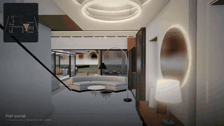</a> 
<b><a href="https://x.com/oalanicolas/status/2120266468780585456">Ein Rundgang durch ein noch nicht gebautes Haus</a></b> 
<a href="https://x.com/oalanicolas">@oalanicolas</a> · ♥ 499 · <a href="https://x.com/oalanicolas/status/2120266468780585456">▶ Video</a> 
 
<a href="https://x.com/oalanicolas/status/2120266468780585456">📝 Prompt des Creators (kostenlos)</a>
</td>
</tr>
<tr>
<td width="33%" valign="top">
 
<b><a href="https://x.com/lucian__03/status/2120197600255361025">Realistisches 3D-Farmspiel, reiner Code, 3 Prompts in 4 Stunden</a></b> 
<a href="https://x.com/lucian__03">@lucian__03</a> · ♥ 493 · <a href="https://x.com/lucian__03/status/2120197600255361025">▶ Video</a> 
 
<a href="https://fablelist.000ooo.ooo/de/prompts/?w=realistic-3d-farm-game-pure-code-3-prompts&ref=gh"><b>✨ Prompt holen</b></a>
</td>
<td width="33%" valign="top">
<a href="https://x.com/seiiiiiiiiiiru/status/2121724395354018201">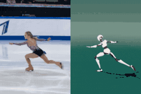</a> 
<b><a href="https://x.com/seiiiiiiiiiiru/status/2121724395354018201">Motion Capture mit Claude x Blender</a></b> 
<a href="https://x.com/seiiiiiiiiiiru">@seiiiiiiiiiiru</a> · ♥ 493 · <a href="https://x.com/seiiiiiiiiiiru/status/2121724395354018201">▶ Video</a> 

</td>
<td width="33%" valign="top">
<a href="https://x.com/MartinOesterhel/status/2120464036030517525">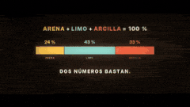</a> 
<b><a href="https://x.com/MartinOesterhel/status/2120464036030517525">Ein Trailer zum Bodenartendreieck</a></b> 
<a href="https://x.com/MartinOesterhel">@MartinOesterhel</a> · ♥ 488 · <a href="https://x.com/MartinOesterhel/status/2120464036030517525">▶ Video</a> 

</td>
</tr>
<tr>
<td width="33%" valign="top">
 
<b><a href="https://x.com/jeanalexandre_b/status/2120783430606840084">Ein Foto, neu gemalt aus 100.000 Farbtupfern, nur mit Code</a></b> 
<a href="https://x.com/jeanalexandre_b">@jeanalexandre_b</a> · ♥ 481 · <a href="https://x.com/jeanalexandre_b/status/2120783430606840084">▶ Video</a> 

</td>
<td width="33%" valign="top">
<a href="https://x.com/gavinpurcell/status/2121407421465985382">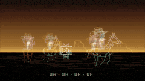</a> 
<b><a href="https://x.com/gavinpurcell/status/2121407421465985382">Kehlkopf-Spaghetti-Western, letztes Kapitel</a></b> 
<a href="https://x.com/gavinpurcell">@gavinpurcell</a> · ♥ 478 · <a href="https://x.com/gavinpurcell/status/2121407421465985382">▶ Video</a> 

</td>
<td width="33%" valign="top">
<a href="https://x.com/semichenkko/status/2119960596951236675">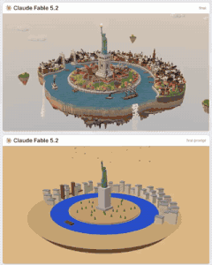</a> 
<b><a href="https://x.com/semichenkko/status/2119960596951236675">New York 1886, schwebend am Himmel</a></b> 
<a href="https://x.com/semichenkko">@semichenkko</a> · ♥ 477 · <a href="https://x.com/semichenkko/status/2119960596951236675">▶ Video</a> 
 
<a href="https://x.com/semichenkko/status/2119960596951236675">📝 Prompt des Creators (kostenlos)</a>
</td>
</tr>
<tr>
<td width="33%" valign="top">
<a href="https://x.com/Stefan_3D_AI/status/2120773803869659150">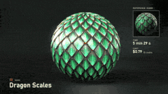</a> 
<b><a href="https://x.com/Stefan_3D_AI/status/2120773803869659150">Vom Prompt zum nahtlosen PBR-Material in 6 Minuten</a></b> 
<a href="https://x.com/Stefan_3D_AI">@Stefan_3D_AI</a> · ♥ 471 · <a href="https://x.com/Stefan_3D_AI/status/2120773803869659150">▶ Video</a> 
 
<a href="https://fablelist.000ooo.ooo/de/prompts/?w=prompt-to-seamless-pbr-material-in-6-minutes&ref=gh"><b>✨ Prompt holen</b></a>
</td>
<td width="33%" valign="top">
 
<b><a href="https://x.com/mattshumer_/status/2119900920347828670">Ein ganzer Film im Code</a></b> 
<a href="https://x.com/mattshumer_">@mattshumer_</a> · ♥ 468 · <a href="https://x.com/mattshumer_/status/2119900920347828670">▶ Video</a> 
Stimmen, Grafik, alles. 
<a href="https://fablelist.000ooo.ooo/de/prompts/?w=a-whole-movie-in-code&ref=gh"><b>✨ Prompt holen</b></a>
</td>
<td width="33%" valign="top">
 
<b><a href="https://x.com/withbassam/status/2121536898976100486">Eine Sternkarte arabischer Sternnamen</a></b> 
<a href="https://x.com/withbassam">@withbassam</a> · ♥ 459 · <a href="https://x.com/withbassam/status/2121536898976100486">▶ Video</a> 

</td>
</tr>
<tr>
<td width="33%" valign="top">
<a href="https://x.com/amrnth0/status/2120849097871810973">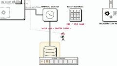</a> 
<b><a href="https://x.com/amrnth0/status/2120849097871810973">Der Railway-Hack, als Animation erklärt</a></b> 
<a href="https://x.com/amrnth0">@amrnth0</a> · ♥ 458 · <a href="https://x.com/amrnth0/status/2120849097871810973">▶ Video</a> 

</td>
<td width="33%" valign="top">
 
<b><a href="https://x.com/so_ainsight/status/2121970275353010214">Ein KI-Avatar-Video ohne Higgsfield oder HeyGen</a></b> 
<a href="https://x.com/so_ainsight">@so_ainsight</a> · ♥ 450 · <a href="https://x.com/so_ainsight/status/2121970275353010214">▶ Video</a> 

</td>
<td width="33%" valign="top">
<a href="https://x.com/gclue_akira/status/2124072507074646146">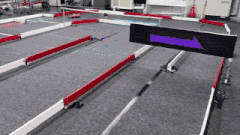</a> 
<b><a href="https://x.com/gclue_akira/status/2124072507074646146">Fable 5.2 schreibt die Gewichte eines Fahrmodells um, damit es auch links fahren kann</a></b> 
<a href="https://x.com/gclue_akira">@gclue_akira</a> · ♥ 449 · <a href="https://x.com/gclue_akira/status/2124072507074646146">▶ Video</a> 

</td>
</tr>
<tr>
<td width="33%" valign="top">
 
<b><a href="https://x.com/Vtuber7144/status/2121739961938428167">Verrauschte Vorlagen in saubere Cel-Shading-Bilder verwandeln</a></b> 
<a href="https://x.com/Vtuber7144">@Vtuber7144</a> · ♥ 448 · <a href="https://x.com/Vtuber7144/status/2121739961938428167">▶ Video</a> 

</td>
<td width="33%" valign="top">
 
<b><a href="https://x.com/solotechdev/status/2120071690482794603">SwiftUI-App für Augenfarben</a></b> 
<a href="https://x.com/solotechdev">@solotechdev</a> · ♥ 433 · <a href="https://x.com/solotechdev/status/2120071690482794603">▶ Video</a> 
 
<a href="https://fablelist.000ooo.ooo/de/prompts/?w=swiftui-eye-color-app&ref=gh"><b>✨ Prompt holen</b></a>
</td>
<td width="33%" valign="top">
<a href="https://x.com/gavinpurcell/status/2120581152054583369">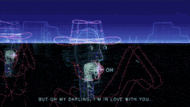</a> 
<b><a href="https://x.com/gavinpurcell/status/2120581152054583369">Kehlkopf-Spaghetti-Western, Kapitel zwei</a></b> 
<a href="https://x.com/gavinpurcell">@gavinpurcell</a> · ♥ 430 · <a href="https://x.com/gavinpurcell/status/2120581152054583369">▶ Video</a> 

</td>
</tr>
<tr>
<td width="33%" valign="top">
<a href="https://x.com/jsnnsa/status/2120161161803088061">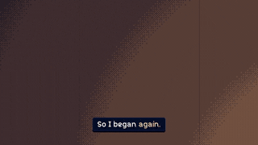</a> 
<b><a href="https://x.com/jsnnsa/status/2120161161803088061">Eine Schrift entworfen, dann eine Doku darüber</a></b> 
<a href="https://x.com/jsnnsa">@jsnnsa</a> · ♥ 428 · <a href="https://x.com/jsnnsa/status/2120161161803088061">▶ Video</a> 
 
<a href="https://fablelist.000ooo.ooo/de/prompts/?w=designed-a-font-then-a-documentary-about-it&ref=gh"><b>✨ Prompt holen</b></a>
</td>
<td width="33%" valign="top">
<a href="https://x.com/themianoo/status/2120042064666882266">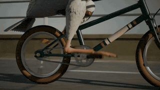</a> 
<b><a href="https://x.com/themianoo/status/2120042064666882266">Pelikan auf einem Fahrrad in Blender</a></b> 
<a href="https://x.com/themianoo">@themianoo</a> · ♥ 420 · <a href="https://x.com/themianoo/status/2120042064666882266">▶ Video</a> 
Ca. 4.800 Zeilen Python, 444 Frames. 
<a href="https://fablelist.000ooo.ooo/de/prompts/?w=pelican-riding-a-bicycle-in-blender&ref=gh"><b>✨ Prompt holen</b></a>
</td>
<td width="33%" valign="top">
 
<b><a href="https://x.com/seftsaint/status/2121931382255755691">Stadtrundgang durch das Spiel Ashira2093</a></b> 
<a href="https://x.com/seftsaint">@seftsaint</a> · ♥ 376 · <a href="https://x.com/seftsaint/status/2121931382255755691">▶ Video</a> 

</td>
</tr>
<tr>
<td width="33%" valign="top">
<a href="https://x.com/Izkimar/status/2119931740940640542">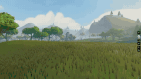</a> 
<b><a href="https://x.com/Izkimar/status/2119931740940640542">Eine stilisierte MMO-Welt an einem Tag</a></b> 
<a href="https://x.com/Izkimar">@Izkimar</a> · ♥ 369 · <a href="https://x.com/Izkimar/status/2119931740940640542">▶ Video</a> 
 
<a href="https://fablelist.000ooo.ooo/de/prompts/?w=a-stylized-mmo-world-in-a-day&ref=gh"><b>✨ Prompt holen</b></a>
</td>
<td width="33%" valign="top">
 
<b><a href="https://x.com/Formulasearch/status/2124831184358445175">Ein Stadtmodell als digitaler Zwilling, gebaut unter Anleitung von Fable und Astra</a></b> 
🆕 · <a href="https://x.com/Formulasearch">@Formulasearch</a> · ♥ 357 · <a href="https://x.com/Formulasearch/status/2124831184358445175">▶ Video</a> 

</td>
<td width="33%" valign="top">
<a href="https://x.com/Bhavani_00007/status/2119902204320780676">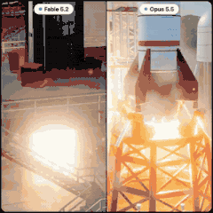</a> 
<b><a href="https://x.com/Bhavani_00007/status/2119902204320780676">Raketenstart (Fable vs Opus)</a></b> 
<a href="https://x.com/Bhavani_00007">@Bhavani_00007</a> · ♥ 332 · <a href="https://x.com/Bhavani_00007/status/2119902204320780676">▶ Video</a> 
 
<a href="https://fablelist.000ooo.ooo/de/prompts/?w=rocket-launch-fable-vs-opus&ref=gh"><b>✨ Prompt holen</b></a>
</td>
</tr>
<tr>
<td width="33%" valign="top">
 
<b><a href="https://x.com/diegocabezas01/status/2124488567628149034">Ein nächtlicher Waldbrand auf einem Bergkamm, komplett per Code erzeugt</a></b> 
🆕 · <a href="https://x.com/diegocabezas01">@diegocabezas01</a> · ♥ 314 · <a href="https://x.com/diegocabezas01/status/2124488567628149034">▶ Video</a> 

</td>
<td width="33%" valign="top">
<a href="https://x.com/RuslanKyrch/status/2119896220814762218">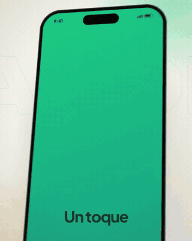</a> 
<b><a href="https://x.com/RuslanKyrch/status/2119896220814762218">App-Redesign, 5.1 vs 5.2</a></b> 
<a href="https://x.com/RuslanKyrch">@RuslanKyrch</a> · ♥ 307 · <a href="https://x.com/RuslanKyrch/status/2119896220814762218">▶ Video</a> 
 
<a href="https://fablelist.000ooo.ooo/de/prompts/?w=app-redesign-5-1-vs-5-2&ref=gh"><b>✨ Prompt holen</b></a>
</td>
<td width="33%" valign="top">
 
<b><a href="https://x.com/Stefan_3D_AI/status/2120041169719894165">Blender-Burg (Fable vs Opus)</a></b> 
<a href="https://x.com/Stefan_3D_AI">@Stefan_3D_AI</a> · ♥ 305 · <a href="https://x.com/Stefan_3D_AI/status/2120041169719894165">▶ Video</a> 
 
<a href="https://fablelist.000ooo.ooo/de/prompts/?w=blender-castle-fable-vs-opus&ref=gh"><b>✨ Prompt holen</b></a>
</td>
</tr>
<tr>
<td width="33%" valign="top">
 
<b><a href="https://x.com/ElevenCreative/status/2120025947709837525">Eine Werbung mit dem ElevenLabs MCP</a></b> 
<a href="https://x.com/ElevenCreative">@ElevenCreative</a> · ♥ 292 · <a href="https://x.com/ElevenCreative/status/2120025947709837525">▶ Video</a> 
 
<a href="https://fablelist.000ooo.ooo/de/prompts/?w=an-ad-with-the-elevenlabs-mcp&ref=gh"><b>✨ Prompt holen</b></a>
</td>
<td width="33%" valign="top">
 
<b><a href="https://x.com/EvanMilenko/status/2119969113762082931">Schwertkampf-Spiel</a></b> 
<a href="https://x.com/EvanMilenko">@EvanMilenko</a> · ♥ 285 · <a href="https://x.com/EvanMilenko/status/2119969113762082931">▶ Video</a> 
 
<a href="https://fablelist.000ooo.ooo/de/prompts/?w=sword-fighting-game&ref=gh"><b>✨ Prompt holen</b></a>
</td>
<td width="33%" valign="top">
 
<b><a href="https://x.com/DeryaTR_/status/2119974354260013293">Eine filmische 3D-Reise durch die Wissenschaftsgeschichte</a></b> 
<a href="https://x.com/DeryaTR_">@DeryaTR_</a> · ♥ 283 · <a href="https://x.com/DeryaTR_/status/2119974354260013293">▶ Video</a> 
 
<a href="https://fablelist.000ooo.ooo/de/prompts/?w=a-cinematic-3d-journey-through-the-history-of&ref=gh"><b>✨ Prompt holen</b></a>
</td>
</tr>
<tr>
<td width="33%" valign="top">
 
<b><a href="https://x.com/elvar_official/status/2121579587222016201">43 Jahre Gamepads in einer einzigen Einstellung</a></b> 
<a href="https://x.com/elvar_official">@elvar_official</a> · ♥ 282 · <a href="https://x.com/elvar_official/status/2121579587222016201">▶ Video</a> 

</td>
<td width="33%" valign="top">
 
<b><a href="https://x.com/RJasonHA/status/2120007540713099768">Eine Sinfonie</a></b> 
<a href="https://x.com/RJasonHA">@RJasonHA</a> · ♥ 264 · <a href="https://x.com/RJasonHA/status/2120007540713099768">▶ Video</a> 
 
<a href="https://fablelist.000ooo.ooo/de/prompts/?w=a-symphony&ref=gh"><b>✨ Prompt holen</b></a>
</td>
<td width="33%" valign="top">
 
<b><a href="https://x.com/_MaxBlade/status/2119992020076814436">Rasenmäh-Simulator</a></b> 
<a href="https://x.com/_MaxBlade">@_MaxBlade</a> · ♥ 261 · <a href="https://x.com/_MaxBlade/status/2119992020076814436">▶ Video</a> 
 
<a href="https://fablelist.000ooo.ooo/de/prompts/?w=lawn-mowing-simulator&ref=gh"><b>✨ Prompt holen</b></a>
</td>
</tr>
<tr>
<td width="33%" valign="top">
 
<b><a href="https://x.com/chetaslua/status/2120111159726727321">Monicas Wohnung in three.js</a></b> 
<a href="https://x.com/chetaslua">@chetaslua</a> · ♥ 241 · <a href="https://x.com/chetaslua/status/2120111159726727321">▶ Video</a> 
 
<a href="https://fablelist.000ooo.ooo/de/prompts/?w=monica-s-apartment-in-three-js&ref=gh"><b>✨ Prompt holen</b></a>
</td>
<td width="33%" valign="top">
 
<b><a href="https://x.com/AmirMushich/status/2119903338078564844">Blender + Reaper Sounddesign</a></b> 
<a href="https://x.com/AmirMushich">@AmirMushich</a> · ♥ 240 · <a href="https://x.com/AmirMushich/status/2119903338078564844">▶ Video</a> 
 
<a href="https://fablelist.000ooo.ooo/de/prompts/?w=blender-reaper-sound-design&ref=gh"><b>✨ Prompt holen</b></a>
</td>
<td width="33%" valign="top">
 
<b><a href="https://x.com/dfeinition/status/2119881243990859818">Kreidekunst wird lebendig</a></b> 
<a href="https://x.com/dfeinition">@dfeinition</a> · ♥ 230 · <a href="https://x.com/dfeinition/status/2119881243990859818">▶ Video</a> 
 
<a href="https://fablelist.000ooo.ooo/de/prompts/?w=chalk-art-comes-alive&ref=gh"><b>✨ Prompt holen</b></a>
</td>
</tr>
<tr>
<td width="33%" valign="top">
 
<b><a href="https://x.com/pleometric/status/2119973274402668852">BRYCEBALL: ein Renderer als Game Engine</a></b> 
<a href="https://x.com/pleometric">@pleometric</a> · ♥ 228 · <a href="https://x.com/pleometric/status/2119973274402668852">▶ Video</a> 
 
<a href="https://fablelist.000ooo.ooo/de/prompts/?w=bryceball-a-renderer-used-as-a-game-engine&ref=gh"><b>✨ Prompt holen</b></a>
</td>
<td width="33%" valign="top">
 
<b><a href="https://x.com/chetaslua/status/2120548065044234504">Superman fliegt durch die CG-Geschichte, reines JS</a></b> 
<a href="https://x.com/chetaslua">@chetaslua</a> · ♥ 214 · <a href="https://x.com/chetaslua/status/2120548065044234504">▶ Video</a> 
 
<a href="https://fablelist.000ooo.ooo/de/prompts/?w=superman-flies-through-cg-history-pure-js&ref=gh"><b>✨ Prompt holen</b></a>
</td>
<td width="33%" valign="top">
 
<b><a href="https://x.com/dfeinition/status/2119886262211625062">Stoff und Licht</a></b> 
<a href="https://x.com/dfeinition">@dfeinition</a> · ♥ 210 · <a href="https://x.com/dfeinition/status/2119886262211625062">▶ Video</a> 
 
<a href="https://fablelist.000ooo.ooo/de/prompts/?w=fabric-and-light&ref=gh"><b>✨ Prompt holen</b></a>
</td>
</tr>
<tr>
<td width="33%" valign="top">
 
<b><a href="https://x.com/notjazii/status/2119886035421442097">Gleicher Prompt, Fable vs Opus</a></b> 
<a href="https://x.com/notjazii">@notjazii</a> · ♥ 205 · <a href="https://x.com/notjazii/status/2119886035421442097">▶ Video</a> 
 
<a href="https://fablelist.000ooo.ooo/de/prompts/?w=same-prompt-fable-vs-opus&ref=gh"><b>✨ Prompt holen</b></a>
</td>
<td width="33%" valign="top">
 
<b><a href="https://x.com/WesRoth/status/2119911161386934330">Musikvideo</a></b> 
<a href="https://x.com/WesRoth">@WesRoth</a> · ♥ 181 · <a href="https://x.com/WesRoth/status/2119911161386934330">▶ Video</a> 
 
<a href="https://fablelist.000ooo.ooo/de/prompts/?w=music-video&ref=gh"><b>✨ Prompt holen</b></a>
</td>
<td width="33%" valign="top">
 
<b><a href="https://x.com/AlchainHust/status/2120065556003102731">Ein Foto von Bora Bora nachgebaut</a></b> 
<a href="https://x.com/AlchainHust">@AlchainHust</a> · ♥ 180 · <a href="https://x.com/AlchainHust/status/2120065556003102731">▶ Video</a> 
 
<a href="https://fablelist.000ooo.ooo/de/prompts/?w=recreating-a-bora-bora-photo&ref=gh"><b>✨ Prompt holen</b></a>
</td>
</tr>
<tr>
<td width="33%" valign="top">
 
<b><a href="https://x.com/linxiaobei888/status/2119978892861829227">Englisch-Cartoon für Kinder</a></b> 
<a href="https://x.com/linxiaobei888">@linxiaobei888</a> · ♥ 160 · <a href="https://x.com/linxiaobei888/status/2119978892861829227">▶ Video</a> 
 
<a href="https://fablelist.000ooo.ooo/de/prompts/?w=kids-english-cartoon&ref=gh"><b>✨ Prompt holen</b></a>
</td>
<td width="33%" valign="top">
 
<b><a href="https://x.com/EvanMilenko/status/2120322640048959503">Ein Drachenspiel in Three.js</a></b> 
<a href="https://x.com/EvanMilenko">@EvanMilenko</a> · ♥ 158 · <a href="https://x.com/EvanMilenko/status/2120322640048959503">▶ Video</a> 
 
<a href="https://fablelist.000ooo.ooo/de/prompts/?w=a-dragon-game-in-three-js&ref=gh"><b>✨ Prompt holen</b></a>
</td>
<td width="33%" valign="top">
 
<b><a href="https://x.com/mattshumer_/status/2119889518564147409">Ein Roboter zum Selbstbauen zu Hause</a></b> 
<a href="https://x.com/mattshumer_">@mattshumer_</a> · ♥ 151 · <a href="https://x.com/mattshumer_/status/2119889518564147409">▶ Video</a> 
 
<a href="https://fablelist.000ooo.ooo/de/prompts/?w=a-robot-you-could-build-at-home&ref=gh"><b>✨ Prompt holen</b></a>
</td>
</tr>
<tr>
<td width="33%" valign="top">
 
<b><a href="https://x.com/dfeinition/status/2119892208937517201">Knetanimation</a></b> 
<a href="https://x.com/dfeinition">@dfeinition</a> · ♥ 149 · <a href="https://x.com/dfeinition/status/2119892208937517201">▶ Video</a> 
 
<a href="https://fablelist.000ooo.ooo/de/prompts/?w=claymation&ref=gh"><b>✨ Prompt holen</b></a>
</td>
<td width="33%" valign="top">
 
<b><a href="https://x.com/petergostev/status/2120125927086600681">Gehäkeltes Korallenriff</a></b> 
<a href="https://x.com/petergostev">@petergostev</a> · ♥ 143 · <a href="https://x.com/petergostev/status/2120125927086600681">▶ Video</a> 
 
<a href="https://fablelist.000ooo.ooo/de/prompts/?w=crochet-coral-reef&ref=gh"><b>✨ Prompt holen</b></a>
</td>
<td width="33%" valign="top">
 
<b><a href="https://x.com/techartist_/status/2119946891106394518">Vier Spielautomaten-Konzepte</a></b> 
<a href="https://x.com/techartist_">@techartist_</a> · ♥ 138 · <a href="https://x.com/techartist_/status/2119946891106394518">▶ Video</a> 
VFX-, Mechanik- und Physiktests. 
<a href="https://fablelist.000ooo.ooo/de/prompts/?w=four-game-machine-concepts&ref=gh"><b>✨ Prompt holen</b></a>
</td>
</tr>
<tr>
<td width="33%" valign="top">
 
<b><a href="https://x.com/wangray/status/2120040640423850168">Ein Launch-Film aus einem Satz</a></b> 
<a href="https://x.com/wangray">@wangray</a> · ♥ 133 · <a href="https://x.com/wangray/status/2120040640423850168">▶ Video</a> 
 
<a href="https://x.com/wangray/status/2120040640423850168">📝 Prompt des Creators (kostenlos)</a>
</td>
<td width="33%" valign="top">
 
<b><a href="https://x.com/abhinavflac/status/2119884257145581980">Pelikan auf einem Fahrrad (Klassiker-Test)</a></b> 
<a href="https://x.com/abhinavflac">@abhinavflac</a> · ♥ 132 · <a href="https://x.com/abhinavflac/status/2119884257145581980">▶ Video</a> 
 
<a href="https://fablelist.000ooo.ooo/de/prompts/?w=pelican-on-a-bicycle-classic-test&ref=gh"><b>✨ Prompt holen</b></a>
</td>
<td width="33%" valign="top">
 
<b><a href="https://x.com/aug5thmusic/status/2119907891419480107">Eine Fuge im Stil von Bach</a></b> 
<a href="https://x.com/aug5thmusic">@aug5thmusic</a> · ♥ 129 · <a href="https://x.com/aug5thmusic/status/2119907891419480107">▶ Video</a> 
In LilyPond geschrieben. 
<a href="https://x.com/aug5thmusic/status/2119907891419480107">📝 Prompt des Creators (kostenlos)</a>
</td>
</tr>
<tr>
<td width="33%" valign="top">
 
<b><a href="https://x.com/guanmo_ai/status/2119989925038985382">Stück mit Ton</a></b> 
<a href="https://x.com/guanmo_ai">@guanmo_ai</a> · ♥ 123 · <a href="https://x.com/guanmo_ai/status/2119989925038985382">▶ Video</a> 
 
<a href="https://fablelist.000ooo.ooo/de/prompts/?w=sound-on-piece&ref=gh"><b>✨ Prompt holen</b></a>
</td>
<td width="33%" valign="top">
 
<b><a href="https://x.com/Lummox_eth/status/2120093679243194793">Ein Game-of-Thrones-Drache für 36 $</a></b> 
<a href="https://x.com/Lummox_eth">@Lummox_eth</a> · ♥ 116 · <a href="https://x.com/Lummox_eth/status/2120093679243194793">▶ Video</a> 
 
<a href="https://fablelist.000ooo.ooo/de/prompts/?w=a-36-game-of-thrones-dragon&ref=gh"><b>✨ Prompt holen</b></a>
</td>
<td width="33%" valign="top">
 
<b><a href="https://x.com/Stefan_3D_AI/status/2120039417981333599">Seeschlange in Blender</a></b> 
<a href="https://x.com/Stefan_3D_AI">@Stefan_3D_AI</a> · ♥ 104 · <a href="https://x.com/Stefan_3D_AI/status/2120039417981333599">▶ Video</a> 
 
<a href="https://x.com/Stefan_3D_AI/status/2120039417981333599">📝 Prompt des Creators (kostenlos)</a>
</td>
</tr>
<tr>
<td width="33%" valign="top">
 
<b><a href="https://x.com/charliejhills/status/2120105823737397644">Zauberwürfel-Roboter (Fable vs Opus)</a></b> 
<a href="https://x.com/charliejhills">@charliejhills</a> · ♥ 100 · <a href="https://x.com/charliejhills/status/2120105823737397644">▶ Video</a> 
 
<a href="https://fablelist.000ooo.ooo/de/prompts/?w=rubik-s-cube-robot-fable-vs-opus&ref=gh"><b>✨ Prompt holen</b></a>
</td>
<td width="33%" valign="top">
 
<b><a href="https://x.com/dfeinition/status/2119870838606381391">Motion Blending, erklärt von einem Roboter</a></b> 
<a href="https://x.com/dfeinition">@dfeinition</a> · ♥ 92 · <a href="https://x.com/dfeinition/status/2119870838606381391">▶ Video</a> 
 
<a href="https://fablelist.000ooo.ooo/de/prompts/?w=motion-blending-explained-by-a-robot&ref=gh"><b>✨ Prompt holen</b></a>
</td>
<td width="33%" valign="top">
 
<b><a href="https://x.com/rpnickson/status/2119969928304357507">Ein Studio, aus Fotos nachgebaut</a></b> 
<a href="https://x.com/rpnickson">@rpnickson</a> · ♥ 87 · <a href="https://x.com/rpnickson/status/2119969928304357507">▶ Video</a> 
 
<a href="https://fablelist.000ooo.ooo/de/prompts/?w=a-studio-rebuilt-from-photos&ref=gh"><b>✨ Prompt holen</b></a>
</td>
</tr>
<tr>
<td width="33%" valign="top">
 
<b><a href="https://x.com/Stefan_3D_AI/status/2120101582444597446">Tesla Roadster beim Kickflip in Blender</a></b> 
<a href="https://x.com/Stefan_3D_AI">@Stefan_3D_AI</a> · ♥ 82 · <a href="https://x.com/Stefan_3D_AI/status/2120101582444597446">▶ Video</a> 
 
<a href="https://x.com/Stefan_3D_AI/status/2120101582444597446">📝 Prompt des Creators (kostenlos)</a>
</td>
<td width="33%" valign="top">
 
<b><a href="https://x.com/leppppp1/status/2119960122713899015">Vier Modelle, ein Texteffekt</a></b> 
<a href="https://x.com/leppppp1">@leppppp1</a> · ♥ 76 · <a href="https://x.com/leppppp1/status/2119960122713899015">▶ Video</a> 
 
<a href="https://fablelist.000ooo.ooo/de/prompts/?w=four-models-one-text-effect&ref=gh"><b>✨ Prompt holen</b></a>
</td>
<td width="33%" valign="top">
 
<b><a href="https://x.com/RJasonHA/status/2120075740222005569">Chinatown im Code</a></b> 
<a href="https://x.com/RJasonHA">@RJasonHA</a> · ♥ 64 · <a href="https://x.com/RJasonHA/status/2120075740222005569">▶ Video</a> 
 
<a href="https://fablelist.000ooo.ooo/de/prompts/?w=chinatown-in-code&ref=gh"><b>✨ Prompt holen</b></a>
</td>
</tr>
<tr>
<td width="33%" valign="top">
 
<b><a href="https://x.com/ElevenCreative/status/2119963230403776554">Spiel mit und ohne ElevenLabs-Audio</a></b> 
<a href="https://x.com/ElevenCreative">@ElevenCreative</a> · ♥ 63 · <a href="https://x.com/ElevenCreative/status/2119963230403776554">▶ Video</a> 
 
<a href="https://fablelist.000ooo.ooo/de/prompts/?w=game-with-and-without-elevenlabs-audio&ref=gh"><b>✨ Prompt holen</b></a>
</td>
<td width="33%" valign="top">
 
<b><a href="https://x.com/ChrisGPT/status/2119989626568126509">Ein Mobile-Spiel, das als Artifact läuft</a></b> 
<a href="https://x.com/ChrisGPT">@ChrisGPT</a> · ♥ 58 · <a href="https://x.com/ChrisGPT/status/2119989626568126509">▶ Video</a> 
 
<a href="https://fablelist.000ooo.ooo/de/prompts/?w=a-mobile-game-running-as-an-artifact&ref=gh"><b>✨ Prompt holen</b></a>
</td>
<td width="33%" valign="top">
 
<b><a href="https://x.com/TekonBurns/status/2119871565311660260">Virus-Kapsid aus 420 Untereinheiten</a></b> 
<a href="https://x.com/TekonBurns">@TekonBurns</a> · ♥ 55 · <a href="https://x.com/TekonBurns/status/2119871565311660260">▶ Video</a> 
Ein Prompt, eine HTML-Datei. 
<a href="https://fablelist.000ooo.ooo/de/prompts/?w=virus-capsid-from-420-subunits&ref=gh"><b>✨ Prompt holen</b></a>
</td>
</tr>
<tr>
<td width="33%" valign="top">
 
<b><a href="https://x.com/flxrnc/status/2119961301791174720">Ein Film am ersten Tag (Prompt-PDF geteilt)</a></b> 
<a href="https://x.com/flxrnc">@flxrnc</a> · ♥ 43 · <a href="https://x.com/flxrnc/status/2119961301791174720">▶ Video</a> 
 
<a href="https://x.com/flxrnc/status/2119961301791174720">📝 Prompt des Creators (kostenlos)</a>
</td>
<td width="33%" valign="top">
 
<b><a href="https://x.com/ItsmeAjayKV/status/2119896772713849174">Paris auf einer schwebenden Insel</a></b> 
<a href="https://x.com/ItsmeAjayKV">@ItsmeAjayKV</a> · ♥ 38 · <a href="https://x.com/ItsmeAjayKV/status/2119896772713849174">▶ Video</a> 
 
<a href="https://fablelist.000ooo.ooo/de/prompts/?w=paris-on-a-floating-island&ref=gh"><b>✨ Prompt holen</b></a>
</td>
<td width="33%" valign="top">
 
<b><a href="https://x.com/MrTacticalX/status/2119949557664735583">Schneekugel (Fable vs Opus)</a></b> 
<a href="https://x.com/MrTacticalX">@MrTacticalX</a> · ♥ 35 · <a href="https://x.com/MrTacticalX/status/2119949557664735583">▶ Video</a> 
 
<a href="https://fablelist.000ooo.ooo/de/prompts/?w=snow-globe-fable-vs-opus&ref=gh"><b>✨ Prompt holen</b></a>
</td>
</tr>
</table>

Andere Abschnitte: [🎮 Spiele](games.de.md) · [🌍 3D-Welten & Szenen](3d-worlds.de.md) · [🧰 Webseiten & Tools](web-and-tools.de.md) · [🎬 Animation & Film](animation.de.md)

[← Zurück zur Liste](../README.de.md)
