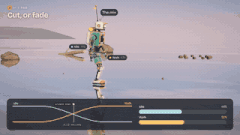
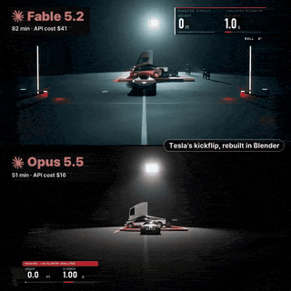
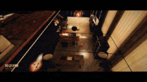
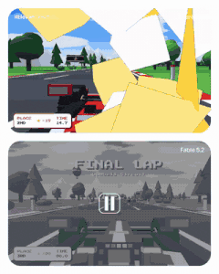
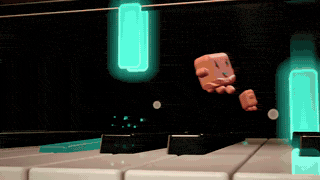
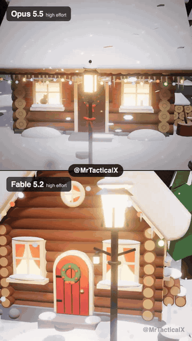

# 📺 Démos vidéo · les 112

[← Retour à la liste](../README.fr.md) · [English](video-demos.md) · [简体中文](video-demos.zh-CN.md) · [繁體中文](video-demos.zh-TW.md) · [日本語](video-demos.ja.md) · [한국어](video-demos.ko.md) · [Español](video-demos.es.md) · [Português](video-demos.pt-BR.md) · **Français** · [Deutsch](video-demos.de.md) · [Русский](video-demos.ru.md)

La page principale affiche au plus les 12 entrées les plus aimées de chaque section (seulement celles à 100+ j'aime) ; cette page contient toutes celles de la section, triées par j'aime.

Les créateurs ont publié une vidéo mais pas de lien. Cliquez sur l'aperçu pour voir la publication d'origine.

<table>
<tr>
<td width="33%" valign="top">
 
<b><a href="https://x.com/claudeai/status/2119899459761131615">Anthropic : projets avant sortie</a></b> 
<a href="https://x.com/claudeai">@claudeai</a> · ♥ 43.1k · <a href="https://x.com/claudeai/status/2119899459761131615">▶ Vidéo</a> 
Ce que Fable 5.2 et Mythos 5.2 ont construit dans divers domaines pendant les tests. 
<a href="https://fablelist.000ooo.ooo/fr/prompts/?w=anthropic-pre-release-projects&ref=gh"><b>✨ Obtenir le prompt</b></a>
</td>
<td width="33%" valign="top">
 
<b><a href="https://x.com/anxuanng/status/2120088745139638375">Un film 3D expliquant le paradoxe de Zénon</a></b> 
🆕 · <a href="https://x.com/anxuanng">@anxuanng</a> · ♥ 10.0k · <a href="https://x.com/anxuanng/status/2120088745139638375">▶ Vidéo</a> 
 
<a href="https://fablelist.000ooo.ooo/fr/prompts/?w=a-3d-film-explaining-zeno-s-paradox&ref=gh"><b>✨ Obtenir le prompt</b></a>
</td>
<td width="33%" valign="top">
 
<b><a href="https://x.com/imjustnewatai/status/2120383964686729410">Une symphonie en forme d'entraînement de modèle</a></b> 
🆕 · <a href="https://x.com/imjustnewatai">@imjustnewatai</a> · ♥ 9.6k · <a href="https://x.com/imjustnewatai/status/2120383964686729410">▶ Vidéo</a> 
 
<a href="https://fablelist.000ooo.ooo/fr/prompts/?w=a-symphony-shaped-like-a-training-run&ref=gh"><b>✨ Obtenir le prompt</b></a>
</td>
</tr>
<tr>
<td width="33%" valign="top">
 
<b><a href="https://x.com/dominikmartn/status/2120154832694858224">Il sait vraiment concevoir</a></b> 
🆕 · <a href="https://x.com/dominikmartn">@dominikmartn</a> · ♥ 7.2k · <a href="https://x.com/dominikmartn/status/2120154832694858224">▶ Vidéo</a> 
 
<a href="https://fablelist.000ooo.ooo/fr/prompts/?w=it-can-actually-design&ref=gh"><b>✨ Obtenir le prompt</b></a>
</td>
<td width="33%" valign="top">
 
<b><a href="https://x.com/everestchris6/status/2120175941616128277">Des plans 2D transformés en visites 3D</a></b> 
🆕 · <a href="https://x.com/everestchris6">@everestchris6</a> · ♥ 7.2k · <a href="https://x.com/everestchris6/status/2120175941616128277">▶ Vidéo</a> 
 
<a href="https://x.com/everestchris6/status/2120175941616128277">📝 Prompt du créateur (gratuit)</a>
</td>
<td width="33%" valign="top">
 
<b><a href="https://x.com/suna_gaku/status/2119952985933697063">« Montre-moi ta meilleure vidéo »</a></b> 
🆕 · <a href="https://x.com/suna_gaku">@suna_gaku</a> · ♥ 6.7k · <a href="https://x.com/suna_gaku/status/2119952985933697063">▶ Vidéo</a> 
 
<a href="https://x.com/suna_gaku/status/2119952985933697063">📝 Prompt du créateur (gratuit)</a>
</td>
</tr>
<tr>
<td width="33%" valign="top">
 
<b><a href="https://x.com/yohakutoink/status/2120824797215310208">Peindre une copie en code — « l'original a une tache ici, pas la mienne »</a></b> 
🆕 · <a href="https://x.com/yohakutoink">@yohakutoink</a> · ♥ 6.2k · <a href="https://x.com/yohakutoink/status/2120824797215310208">▶ Vidéo</a> 
 
<a href="https://fablelist.000ooo.ooo/fr/prompts/?w=painting-a-copy-in-code-the-original-has&ref=gh"><b>✨ Obtenir le prompt</b></a>
</td>
<td width="33%" valign="top">
 
<b><a href="https://x.com/matabee_GTO/status/2120995946372985144">Un prompt : fais la vidéo la plus dérangeante possible</a></b> 
🆕 · <a href="https://x.com/matabee_GTO">@matabee_GTO</a> · ♥ 4.6k · <a href="https://x.com/matabee_GTO/status/2120995946372985144">▶ Vidéo</a> 
 
<a href="https://x.com/matabee_GTO/status/2120995946372985144">📝 Prompt du créateur (gratuit)</a>
</td>
<td width="33%" valign="top">
 
<b><a href="https://x.com/XRarchitect/status/2120947265007440052">Atlas + Fable 5.2 + three.js</a></b> 
🆕 · <a href="https://x.com/XRarchitect">@XRarchitect</a> · ♥ 4.3k · <a href="https://x.com/XRarchitect/status/2120947265007440052">▶ Vidéo</a> 
 
<a href="https://fablelist.000ooo.ooo/fr/prompts/?w=atlas-fable-5-2-three-js&ref=gh"><b>✨ Obtenir le prompt</b></a>
</td>
</tr>
<tr>
<td width="33%" valign="top">
 
<b><a href="https://x.com/MrTacticalX/status/2121082861902070130">Trois agents Fable 5.2 construisent un ordinateur en 7 h 41</a></b> 
🆕 · <a href="https://x.com/MrTacticalX">@MrTacticalX</a> · ♥ 4.3k · <a href="https://x.com/MrTacticalX/status/2121082861902070130">▶ Vidéo</a> 
 
<a href="https://fablelist.000ooo.ooo/fr/prompts/?w=three-fable-5-2-agents-build-a-computer&ref=gh"><b>✨ Obtenir le prompt</b></a>
</td>
<td width="33%" valign="top">
 
<b><a href="https://x.com/aollivier82/status/2120260208245043663">L'histoire de l'infographie 3D, animée</a></b> 
🆕 · <a href="https://x.com/aollivier82">@aollivier82</a> · ♥ 3.2k · <a href="https://x.com/aollivier82/status/2120260208245043663">▶ Vidéo</a> 
 
<a href="https://fablelist.000ooo.ooo/fr/prompts/?w=the-history-of-computer-graphics-animated&ref=gh"><b>✨ Obtenir le prompt</b></a>
</td>
<td width="33%" valign="top">
 
<b><a href="https://x.com/M__Houser/status/2120253236309569696">Age of Dragon, un monde ouvert par un non-codeur</a></b> 
🆕 · <a href="https://x.com/M__Houser">@M__Houser</a> · ♥ 2.6k · <a href="https://x.com/M__Houser/status/2120253236309569696">▶ Vidéo</a> 
 
<a href="https://fablelist.000ooo.ooo/fr/prompts/?w=age-of-dragon-an-open-world-by-a&ref=gh"><b>✨ Obtenir le prompt</b></a>
</td>
</tr>
<tr>
<td width="33%" valign="top">
 
<b><a href="https://x.com/aecyydesign/status/2120239401821487149">Une animation faite avec Blender</a></b> 
🆕 · <a href="https://x.com/aecyydesign">@aecyydesign</a> · ♥ 2.5k · <a href="https://x.com/aecyydesign/status/2120239401821487149">▶ Vidéo</a> 
 
<a href="https://fablelist.000ooo.ooo/fr/prompts/?w=an-animation-made-with-blender&ref=gh"><b>✨ Obtenir le prompt</b></a>
</td>
<td width="33%" valign="top">
 
<b><a href="https://x.com/alexalbert__/status/2119916954337349737">Les carnets de Léonard de Vinci, interactifs</a></b> 
<a href="https://x.com/alexalbert__">@alexalbert__</a> · ♥ 2.5k · <a href="https://x.com/alexalbert__/status/2119916954337349737">▶ Vidéo</a> 
Un PDF de carnet vieux de 500 ans transformé en inventions avec lesquelles on peut jouer. 
<a href="https://fablelist.000ooo.ooo/fr/prompts/?w=da-vinci-s-notebooks-interactive&ref=gh"><b>✨ Obtenir le prompt</b></a>
</td>
<td width="33%" valign="top">
 
<b><a href="https://x.com/ChrisGPT/status/2119998815856218494">Un message aux monteurs vidéo</a></b> 
<a href="https://x.com/ChrisGPT">@ChrisGPT</a> · ♥ 2.5k · <a href="https://x.com/ChrisGPT/status/2119998815856218494">▶ Vidéo</a> 
 
<a href="https://fablelist.000ooo.ooo/fr/prompts/?w=a-message-to-video-editors&ref=gh"><b>✨ Obtenir le prompt</b></a>
</td>
</tr>
<tr>
<td width="33%" valign="top">
 
<b><a href="https://x.com/theo/status/2119926277801144695">Fishslop run</a></b> 
<a href="https://x.com/theo">@theo</a> · ♥ 2.3k · <a href="https://x.com/theo/status/2119926277801144695">▶ Vidéo</a> 
76 minutes, ~42 $. 
<a href="https://fablelist.000ooo.ooo/fr/prompts/?w=fishslop-run&ref=gh"><b>✨ Obtenir le prompt</b></a>
</td>
<td width="33%" valign="top">
 
<b><a href="https://x.com/GPTabby/status/2119909996645298519">Un jeu de course sous Unreal Engine 5 à partir d'un prompt</a></b> 
🆕 · <a href="https://x.com/GPTabby">@GPTabby</a> · ♥ 2.1k · <a href="https://x.com/GPTabby/status/2119909996645298519">▶ Vidéo</a> 
 
<a href="https://fablelist.000ooo.ooo/fr/prompts/?w=a-racing-game-in-unreal-engine-5-from&ref=gh"><b>✨ Obtenir le prompt</b></a>
</td>
<td width="33%" valign="top">
 
<b><a href="https://x.com/ryoma_nakajima/status/2120052388434473233">Il sait enfin plier des origamis</a></b> 
🆕 · <a href="https://x.com/ryoma_nakajima">@ryoma_nakajima</a> · ♥ 2.0k · <a href="https://x.com/ryoma_nakajima/status/2120052388434473233">▶ Vidéo</a> 
 
<a href="https://x.com/ryoma_nakajima/status/2120052388434473233">📝 Prompt du créateur (gratuit)</a>
</td>
</tr>
<tr>
<td width="33%" valign="top">
 
<b><a href="https://x.com/_sholtodouglas/status/2119935331499925557">FPS d'arène avec portails</a></b> 
<a href="https://x.com/_sholtodouglas">@_sholtodouglas</a> · ♥ 2.0k · <a href="https://x.com/_sholtodouglas/status/2119935331499925557">▶ Vidéo</a> 
Testé en conditions réelles au bureau. 
<a href="https://fablelist.000ooo.ooo/fr/prompts/?w=arena-fps-with-portals&ref=gh"><b>✨ Obtenir le prompt</b></a>
</td>
<td width="33%" valign="top">
 
<b><a href="https://x.com/alexmichael/status/2119876626179870838">Une vidéo entière réalisée en écrivant du Python pour Blender</a></b> 
🆕 · <a href="https://x.com/alexmichael">@alexmichael</a> · ♥ 1.9k · <a href="https://x.com/alexmichael/status/2119876626179870838">▶ Vidéo</a> 
 
<a href="https://fablelist.000ooo.ooo/fr/prompts/?w=a-whole-video-made-by-writing-python-for&ref=gh"><b>✨ Obtenir le prompt</b></a>
</td>
<td width="33%" valign="top">
 
<b><a href="https://x.com/Kashiko_AIart/status/2120640633346097400">« Montre-moi ton travail »</a></b> 
🆕 · <a href="https://x.com/Kashiko_AIart">@Kashiko_AIart</a> · ♥ 1.8k · <a href="https://x.com/Kashiko_AIart/status/2120640633346097400">▶ Vidéo</a> 
 
<a href="https://fablelist.000ooo.ooo/fr/prompts/?w=show-me-your-work&ref=gh"><b>✨ Obtenir le prompt</b></a>
</td>
</tr>
<tr>
<td width="33%" valign="top">
 
<b><a href="https://x.com/_MaxBlade/status/2120109725740159390">4 heures dans Unreal Engine 5.9 via MCP</a></b> 
<a href="https://x.com/_MaxBlade">@_MaxBlade</a> · ♥ 1.7k · <a href="https://x.com/_MaxBlade/status/2120109725740159390">▶ Vidéo</a> 
 
<a href="https://fablelist.000ooo.ooo/fr/prompts/?w=4-hours-in-unreal-engine-5-9-via&ref=gh"><b>✨ Obtenir le prompt</b></a>
</td>
<td width="33%" valign="top">
 
<b><a href="https://x.com/chrisjdimarco/status/2120752985949057215">Un essaim de 1 048 576 nanorobots qui se transforment en main, baleine, fusée ou double hélice d'ADN</a></b> 
🆕 · <a href="https://x.com/chrisjdimarco">@chrisjdimarco</a> · ♥ 1.7k · <a href="https://x.com/chrisjdimarco/status/2120752985949057215">▶ Vidéo</a> 

</td>
<td width="33%" valign="top">
 
<b><a href="https://x.com/LexnLin/status/2119880654858977333">Scène 3D à caméra rapide</a></b> 
<a href="https://x.com/LexnLin">@LexnLin</a> · ♥ 1.7k · <a href="https://x.com/LexnLin/status/2119880654858977333">▶ Vidéo</a> 
30 minutes avec quelques sous-agents Opus 5.5. 
<a href="https://fablelist.000ooo.ooo/fr/prompts/?w=fast-camera-3d-scene&ref=gh"><b>✨ Obtenir le prompt</b></a>
</td>
</tr>
<tr>
<td width="33%" valign="top">
 
<b><a href="https://x.com/JungleSilicon/status/2120452158961397975">Gaussian splats en pixel art</a></b> 
🆕 · <a href="https://x.com/JungleSilicon">@JungleSilicon</a> · ♥ 1.6k · <a href="https://x.com/JungleSilicon/status/2120452158961397975">▶ Vidéo</a> 
 
<a href="https://fablelist.000ooo.ooo/fr/prompts/?w=pixel-art-gaussian-splats&ref=gh"><b>✨ Obtenir le prompt</b></a>
</td>
<td width="33%" valign="top">
 
<b><a href="https://x.com/MrTacticalX/status/2119955647542542439">Glass Pool (Fable vs Opus)</a></b> 
<a href="https://x.com/MrTacticalX">@MrTacticalX</a> · ♥ 1.5k · <a href="https://x.com/MrTacticalX/status/2119955647542542439">▶ Vidéo</a> 
 
<a href="https://fablelist.000ooo.ooo/fr/prompts/?w=glass-pool-fable-vs-opus&ref=gh"><b>✨ Obtenir le prompt</b></a>
</td>
<td width="33%" valign="top">
 
<b><a href="https://x.com/DeryaTR_/status/2120382619082727604">La vie d'un lymphocyte T, un film de 8 minutes</a></b> 
🆕 · <a href="https://x.com/DeryaTR_">@DeryaTR_</a> · ♥ 1.4k · <a href="https://x.com/DeryaTR_/status/2120382619082727604">▶ Vidéo</a> 
 
<a href="https://fablelist.000ooo.ooo/fr/prompts/?w=the-life-of-a-t-cell-an-8&ref=gh"><b>✨ Obtenir le prompt</b></a>
</td>
</tr>
<tr>
<td width="33%" valign="top">
 
<b><a href="https://x.com/akakuma0219/status/2120030634248929556">Cycles de course de prévisualisation à partir de trois mots</a></b> 
🆕 · <a href="https://x.com/akakuma0219">@akakuma0219</a> · ♥ 1.4k · <a href="https://x.com/akakuma0219/status/2120030634248929556">▶ Vidéo</a> 
 
<a href="https://fablelist.000ooo.ooo/fr/prompts/?w=previz-run-cycles-from-three-words&ref=gh"><b>✨ Obtenir le prompt</b></a>
</td>
<td width="33%" valign="top">
 
<b><a href="https://x.com/RezAIT00/status/2120498246426706176">Réveillé avec ça : environnement de jeu dans Blender + Unreal</a></b> 
🆕 · <a href="https://x.com/RezAIT00">@RezAIT00</a> · ♥ 1.3k · <a href="https://x.com/RezAIT00/status/2120498246426706176">▶ Vidéo</a> 
 
<a href="https://fablelist.000ooo.ooo/fr/prompts/?w=woke-up-to-this-game-environment-in-blender&ref=gh"><b>✨ Obtenir le prompt</b></a>
</td>
<td width="33%" valign="top">
 
<b><a href="https://x.com/xikhar/status/2119966147328299284">Bugatti Tourbillon modélisée et rendue dans Blender</a></b> 
🆕 · <a href="https://x.com/xikhar">@xikhar</a> · ♥ 1.3k · <a href="https://x.com/xikhar/status/2119966147328299284">▶ Vidéo</a> 
 
<a href="https://x.com/xikhar/status/2119966147328299284">📝 Prompt du créateur (gratuit)</a>
</td>
</tr>
<tr>
<td width="33%" valign="top">
 
<b><a href="https://x.com/KHvostikk/status/2119939061049889130">De la vidéo à l'animation 3D</a></b> 
🆕 · <a href="https://x.com/KHvostikk">@KHvostikk</a> · ♥ 1.2k · <a href="https://x.com/KHvostikk/status/2119939061049889130">▶ Vidéo</a> 
 
<a href="https://fablelist.000ooo.ooo/fr/prompts/?w=video-to-3d-animation&ref=gh"><b>✨ Obtenir le prompt</b></a>
</td>
<td width="33%" valign="top">
 
<b><a href="https://x.com/chetaslua/status/2119870650722763052">Un système d'exploitation à partir d'un dossier vide</a></b> 
<a href="https://x.com/chetaslua">@chetaslua</a> · ♥ 1.2k · <a href="https://x.com/chetaslua/status/2119870650722763052">▶ Vidéo</a> 
Démo d'Anthropic avec plus de 1 000 agents coordonnés.
</td>
<td width="33%" valign="top">
 
<b><a href="https://x.com/vib3coded/status/2119876781700505627">Curseur de volume addictif</a></b> 
<a href="https://x.com/vib3coded">@vib3coded</a> · ♥ 1.1k · <a href="https://x.com/vib3coded/status/2119876781700505627">▶ Vidéo</a> 
10 minutes, 8,43 $. 
<a href="https://x.com/vib3coded/status/2119876781700505627">📝 Prompt du créateur (gratuit)</a>
</td>
</tr>
<tr>
<td width="33%" valign="top">
 
<b><a href="https://x.com/ericmaskfr/status/2119910195325481026">GTA 6 en un seul prompt</a></b> 
<a href="https://x.com/ericmaskfr">@ericmaskfr</a> · ♥ 1.0k · <a href="https://x.com/ericmaskfr/status/2119910195325481026">▶ Vidéo</a> 
 
<a href="https://x.com/ericmaskfr/status/2119910195325481026">📝 Prompt du créateur (gratuit)</a>
</td>
<td width="33%" valign="top">
 
<b><a href="https://x.com/oalanicolas/status/2120138473826877590">Un aménagement complet d'appartement</a></b> 
🆕 · <a href="https://x.com/oalanicolas">@oalanicolas</a> · ♥ 896 · <a href="https://x.com/oalanicolas/status/2120138473826877590">▶ Vidéo</a> 
 
<a href="https://fablelist.000ooo.ooo/fr/prompts/?w=a-full-apartment-design&ref=gh"><b>✨ Obtenir le prompt</b></a>
</td>
<td width="33%" valign="top">
 
<b><a href="https://x.com/kinderlayer/status/2120112222227648957">Lion fait d'un tapis (Fable vs Gemini)</a></b> 
<a href="https://x.com/kinderlayer">@kinderlayer</a> · ♥ 866 · <a href="https://x.com/kinderlayer/status/2120112222227648957">▶ Vidéo</a> 
 
<a href="https://fablelist.000ooo.ooo/fr/prompts/?w=lion-from-a-carpet-fable-vs-gemini&ref=gh"><b>✨ Obtenir le prompt</b></a>
</td>
</tr>
<tr>
<td width="33%" valign="top">
 
<b><a href="https://x.com/KHvostikk/status/2120621109125202344">Image vers modèle 3D avec textures PBR</a></b> 
🆕 · <a href="https://x.com/KHvostikk">@KHvostikk</a> · ♥ 859 · <a href="https://x.com/KHvostikk/status/2120621109125202344">▶ Vidéo</a> 
 
<a href="https://fablelist.000ooo.ooo/fr/prompts/?w=image-to-3d-model-with-pbr-textures&ref=gh"><b>✨ Obtenir le prompt</b></a>
</td>
<td width="33%" valign="top">
 
<b><a href="https://x.com/scottstts/status/2120254108104007712">Dragon's Nest, three.js + Tripo</a></b> 
🆕 · <a href="https://x.com/scottstts">@scottstts</a> · ♥ 792 · <a href="https://x.com/scottstts/status/2120254108104007712">▶ Vidéo</a> 
 
<a href="https://fablelist.000ooo.ooo/fr/prompts/?w=dragon-s-nest-three-js-tripo&ref=gh"><b>✨ Obtenir le prompt</b></a>
</td>
<td width="33%" valign="top">
 
<b><a href="https://x.com/tm_uchal/status/2120573380768518390">Vidéo d'avatar IA</a></b> 
🆕 · <a href="https://x.com/tm_uchal">@tm_uchal</a> · ♥ 788 · <a href="https://x.com/tm_uchal/status/2120573380768518390">▶ Vidéo</a> 
 
<a href="https://fablelist.000ooo.ooo/fr/prompts/?w=ai-avatar-video&ref=gh"><b>✨ Obtenir le prompt</b></a>
</td>
</tr>
<tr>
<td width="33%" valign="top">
 
<b><a href="https://x.com/WesRoth/status/2119953913160093817">Reel en un seul essai</a></b> 
<a href="https://x.com/WesRoth">@WesRoth</a> · ♥ 767 · <a href="https://x.com/WesRoth/status/2119953913160093817">▶ Vidéo</a> 
 
<a href="https://fablelist.000ooo.ooo/fr/prompts/?w=one-shot-reel&ref=gh"><b>✨ Obtenir le prompt</b></a>
</td>
<td width="33%" valign="top">
 
<b><a href="https://x.com/kevin_t_ngo/status/2119972124211454139">Une pub de jouet des années 90</a></b> 
🆕 · <a href="https://x.com/kevin_t_ngo">@kevin_t_ngo</a> · ♥ 762 · <a href="https://x.com/kevin_t_ngo/status/2119972124211454139">▶ Vidéo</a> 
 
<a href="https://fablelist.000ooo.ooo/fr/prompts/?w=a-90s-toy-commercial&ref=gh"><b>✨ Obtenir le prompt</b></a>
</td>
<td width="33%" valign="top">
 
<b><a href="https://x.com/jaimintf/status/2120553374286594292">Vue du siège de train avant de réserver</a></b> 
🆕 · <a href="https://x.com/jaimintf">@jaimintf</a> · ♥ 761 · <a href="https://x.com/jaimintf/status/2120553374286594292">▶ Vidéo</a> 
 
<a href="https://fablelist.000ooo.ooo/fr/prompts/?w=train-seat-view-before-you-book&ref=gh"><b>✨ Obtenir le prompt</b></a>
</td>
</tr>
<tr>
<td width="33%" valign="top">
 
<b><a href="https://x.com/rute1203d/status/2120077147872391540">« Montre-moi ta meilleure vidéo » — avec une surprise</a></b> 
🆕 · <a href="https://x.com/rute1203d">@rute1203d</a> · ♥ 738 · <a href="https://x.com/rute1203d/status/2120077147872391540">▶ Vidéo</a> 
 
<a href="https://fablelist.000ooo.ooo/fr/prompts/?w=show-me-your-best-video-with-a-twist&ref=gh"><b>✨ Obtenir le prompt</b></a>
</td>
<td width="33%" valign="top">
 
<b><a href="https://x.com/anikrisn/status/2119950148294119483">Diorama isométrique lumineux d'un étang</a></b> 
🆕 · <a href="https://x.com/anikrisn">@anikrisn</a> · ♥ 736 · <a href="https://x.com/anikrisn/status/2119950148294119483">▶ Vidéo</a> 
 
<a href="https://fablelist.000ooo.ooo/fr/prompts/?w=glowing-isometric-pond-diorama&ref=gh"><b>✨ Obtenir le prompt</b></a>
</td>
<td width="33%" valign="top">
 
<b><a href="https://x.com/JaydenDavisNC/status/2120306434575392793">Un jeu de tir à la première personne en Three.js, sans assets externes</a></b> 
🆕 · <a href="https://x.com/JaydenDavisNC">@JaydenDavisNC</a> · ♥ 724 · <a href="https://x.com/JaydenDavisNC/status/2120306434575392793">▶ Vidéo</a> 
 
<a href="https://fablelist.000ooo.ooo/fr/prompts/?w=a-first-person-shooter-in-three-js-no&ref=gh"><b>✨ Obtenir le prompt</b></a>
</td>
</tr>
<tr>
<td width="33%" valign="top">
 
<b><a href="https://x.com/Dstudio_ai/status/2121168620760019389">Construire un avatar VRM — textures des yeux, parties qui ballottent et corrections du cou, sans ouvrir Blender</a></b> 
🆕 · <a href="https://x.com/Dstudio_ai">@Dstudio_ai</a> · ♥ 720 · <a href="https://x.com/Dstudio_ai/status/2121168620760019389">▶ Vidéo</a> 

</td>
<td width="33%" valign="top">
 
<b><a href="https://x.com/adamdotnew/status/2120071630139621540">Un Tamagotchi : circuit imprimé, boîtier et rendu</a></b> 
🆕 · <a href="https://x.com/adamdotnew">@adamdotnew</a> · ♥ 703 · <a href="https://x.com/adamdotnew/status/2120071630139621540">▶ Vidéo</a> 
 
<a href="https://fablelist.000ooo.ooo/fr/prompts/?w=a-tamagotchi-pcb-enclosure-and-render&ref=gh"><b>✨ Obtenir le prompt</b></a>
</td>
<td width="33%" valign="top">
 
<b><a href="https://x.com/alightinastorm/status/2120010936584945922">Basket three.js niveau AAA</a></b> 
<a href="https://x.com/alightinastorm">@alightinastorm</a> · ♥ 694 · <a href="https://x.com/alightinastorm/status/2120010936584945922">▶ Vidéo</a> 
 
<a href="https://fablelist.000ooo.ooo/fr/prompts/?w=aaa-three-js-basketball&ref=gh"><b>✨ Obtenir le prompt</b></a>
</td>
</tr>
<tr>
<td width="33%" valign="top">
 
<b><a href="https://x.com/op7418/status/2120085300185833878">Ink letters</a></b> 
<a href="https://x.com/op7418">@op7418</a> · ♥ 687 · <a href="https://x.com/op7418/status/2120085300185833878">▶ Vidéo</a> 
Tapez un caractère et il devient de l'encre fluide en direct, avec du son. 
<a href="https://fablelist.000ooo.ooo/fr/prompts/?w=ink-letters&ref=gh"><b>✨ Obtenir le prompt</b></a>
</td>
<td width="33%" valign="top">
 
<b><a href="https://x.com/ICO_AIvideo/status/2120311646933680355">Un court métrage en boucle fait dans Blender</a></b> 
🆕 · <a href="https://x.com/ICO_AIvideo">@ICO_AIvideo</a> · ♥ 667 · <a href="https://x.com/ICO_AIvideo/status/2120311646933680355">▶ Vidéo</a> 
 
<a href="https://fablelist.000ooo.ooo/fr/prompts/?w=a-looping-short-made-in-blender&ref=gh"><b>✨ Obtenir le prompt</b></a>
</td>
<td width="33%" valign="top">
 
<b><a href="https://x.com/kevin_t_ngo/status/2120308118127309173">Une pub de céréales des années 90</a></b> 
🆕 · <a href="https://x.com/kevin_t_ngo">@kevin_t_ngo</a> · ♥ 666 · <a href="https://x.com/kevin_t_ngo/status/2120308118127309173">▶ Vidéo</a> 
 
<a href="https://fablelist.000ooo.ooo/fr/prompts/?w=a-90s-cereal-commercial&ref=gh"><b>✨ Obtenir le prompt</b></a>
</td>
</tr>
<tr>
<td width="33%" valign="top">
 
<b><a href="https://x.com/KanaWorks_AI/status/2120098607382880627">Vol sans coupure de 37 secondes au-dessus d'un terrain infini</a></b> 
🆕 · <a href="https://x.com/KanaWorks_AI">@KanaWorks_AI</a> · ♥ 649 · <a href="https://x.com/KanaWorks_AI/status/2120098607382880627">▶ Vidéo</a> 
 
<a href="https://fablelist.000ooo.ooo/fr/prompts/?w=37-second-uncut-flight-over-endless-terrain&ref=gh"><b>✨ Obtenir le prompt</b></a>
</td>
<td width="33%" valign="top">
 
<b><a href="https://x.com/theo/status/2120104895646937409">Un rapport sur un pipeline de données devenu un design</a></b> 
<a href="https://x.com/theo">@theo</a> · ♥ 639 · <a href="https://x.com/theo/status/2120104895646937409">▶ Vidéo</a> 
 
<a href="https://fablelist.000ooo.ooo/fr/prompts/?w=a-data-pipeline-write-up-that-became-a&ref=gh"><b>✨ Obtenir le prompt</b></a>
</td>
<td width="33%" valign="top">
 
<b><a href="https://x.com/LexnLin/status/2120167637133238295">Animation du logo Claude</a></b> 
🆕 · <a href="https://x.com/LexnLin">@LexnLin</a> · ♥ 629 · <a href="https://x.com/LexnLin/status/2120167637133238295">▶ Vidéo</a> 
 
<a href="https://fablelist.000ooo.ooo/fr/prompts/?w=claude-logo-animation&ref=gh"><b>✨ Obtenir le prompt</b></a>
</td>
</tr>
<tr>
<td width="33%" valign="top">
 
<b><a href="https://x.com/mxvdl/status/2120809570344050705">Décryptage d'un shader de coup de pinceau en Three.js</a></b> 
🆕 · <a href="https://x.com/mxvdl">@mxvdl</a> · ♥ 612 · <a href="https://x.com/mxvdl/status/2120809570344050705">▶ Vidéo</a> 
 
<a href="https://fablelist.000ooo.ooo/fr/prompts/?w=three-js-brush-stroke-shader-breakdown&ref=gh"><b>✨ Obtenir le prompt</b></a>
</td>
<td width="33%" valign="top">
 
<b><a href="https://x.com/lemomo_ai/status/2120118194409193682">Une bibliothèque à minuit</a></b> 
<a href="https://x.com/lemomo_ai">@lemomo_ai</a> · ♥ 601 · <a href="https://x.com/lemomo_ai/status/2120118194409193682">▶ Vidéo</a> 
24 000 pages s'envolent. 
<a href="https://fablelist.000ooo.ooo/fr/prompts/?w=a-library-at-midnight&ref=gh"><b>✨ Obtenir le prompt</b></a>
</td>
<td width="33%" valign="top">
 
<b><a href="https://x.com/MrTacticalX/status/2120342453807157720">Un clavier mécanique dans Blender, avec la frappe</a></b> 
🆕 · <a href="https://x.com/MrTacticalX">@MrTacticalX</a> · ♥ 557 · <a href="https://x.com/MrTacticalX/status/2120342453807157720">▶ Vidéo</a> 
 
<a href="https://fablelist.000ooo.ooo/fr/prompts/?w=a-mechanical-keyboard-in-blender-typing-included&ref=gh"><b>✨ Obtenir le prompt</b></a>
</td>
</tr>
<tr>
<td width="33%" valign="top">
 
<b><a href="https://x.com/dom_scholz/status/2119933150025363661">Opus 5.5 vs Fable 5.2</a></b> 
<a href="https://x.com/dom_scholz">@dom_scholz</a> · ♥ 550 · <a href="https://x.com/dom_scholz/status/2119933150025363661">▶ Vidéo</a> 
 
<a href="https://fablelist.000ooo.ooo/fr/prompts/?w=opus-5-5-vs-fable-5-2&ref=gh"><b>✨ Obtenir le prompt</b></a>
</td>
<td width="33%" valign="top">
 
<b><a href="https://x.com/kevin_t_ngo/status/2120540964909711415">Un générique de série animée</a></b> 
🆕 · <a href="https://x.com/kevin_t_ngo">@kevin_t_ngo</a> · ♥ 546 · <a href="https://x.com/kevin_t_ngo/status/2120540964909711415">▶ Vidéo</a> 
 
<a href="https://fablelist.000ooo.ooo/fr/prompts/?w=an-animated-show-intro&ref=gh"><b>✨ Obtenir le prompt</b></a>
</td>
<td width="33%" valign="top">
 
<b><a href="https://x.com/thomaszhou_/status/2120389154970509666">« Beauty », un court métrage à partir d'une phrase</a></b> 
🆕 · <a href="https://x.com/thomaszhou_">@thomaszhou_</a> · ♥ 532 · <a href="https://x.com/thomaszhou_/status/2120389154970509666">▶ Vidéo</a> 
 
<a href="https://x.com/thomaszhou_/status/2120389154970509666">📝 Prompt du créateur (gratuit)</a>
</td>
</tr>
<tr>
<td width="33%" valign="top">
 
<b><a href="https://x.com/rileybrown/status/2119973951027724385">Une vidéo montée par Fable sur le montage avec Fable</a></b> 
<a href="https://x.com/rileybrown">@rileybrown</a> · ♥ 504 · <a href="https://x.com/rileybrown/status/2119973951027724385">▶ Vidéo</a> 

</td>
<td width="33%" valign="top">
 
<b><a href="https://x.com/MengTo/status/2120316203738829180">Un appartement three.js recréé dans Blender</a></b> 
🆕 · <a href="https://x.com/MengTo">@MengTo</a> · ♥ 500 · <a href="https://x.com/MengTo/status/2120316203738829180">▶ Vidéo</a> 
 
<a href="https://fablelist.000ooo.ooo/fr/prompts/?w=a-three-js-apartment-recreated-in-blender&ref=gh"><b>✨ Obtenir le prompt</b></a>
</td>
<td width="33%" valign="top">
 
<b><a href="https://x.com/oalanicolas/status/2120266468780585456">Une visite d'une maison pas encore construite</a></b> 
🆕 · <a href="https://x.com/oalanicolas">@oalanicolas</a> · ♥ 494 · <a href="https://x.com/oalanicolas/status/2120266468780585456">▶ Vidéo</a> 
 
<a href="https://x.com/oalanicolas/status/2120266468780585456">📝 Prompt du créateur (gratuit)</a>
</td>
</tr>
<tr>
<td width="33%" valign="top">
 
<b><a href="https://x.com/lucian__03/status/2120197600255361025">Jeu de ferme 3D réaliste, pur code, 3 prompts en 4 heures</a></b> 
🆕 · <a href="https://x.com/lucian__03">@lucian__03</a> · ♥ 491 · <a href="https://x.com/lucian__03/status/2120197600255361025">▶ Vidéo</a> 
 
<a href="https://fablelist.000ooo.ooo/fr/prompts/?w=realistic-3d-farm-game-pure-code-3-prompts&ref=gh"><b>✨ Obtenir le prompt</b></a>
</td>
<td width="33%" valign="top">
 
<b><a href="https://x.com/Stefan_3D_AI/status/2120773803869659150">Du prompt à un matériau PBR sans raccord en 6 minutes</a></b> 
🆕 · <a href="https://x.com/Stefan_3D_AI">@Stefan_3D_AI</a> · ♥ 476 · <a href="https://x.com/Stefan_3D_AI/status/2120773803869659150">▶ Vidéo</a> 
 
<a href="https://fablelist.000ooo.ooo/fr/prompts/?w=prompt-to-seamless-pbr-material-in-6-minutes&ref=gh"><b>✨ Obtenir le prompt</b></a>
</td>
<td width="33%" valign="top">
 
<b><a href="https://x.com/semichenkko/status/2119960596951236675">New York en 1886 flottant dans le ciel</a></b> 
<a href="https://x.com/semichenkko">@semichenkko</a> · ♥ 474 · <a href="https://x.com/semichenkko/status/2119960596951236675">▶ Vidéo</a> 
 
<a href="https://x.com/semichenkko/status/2119960596951236675">📝 Prompt du créateur (gratuit)</a>
</td>
</tr>
<tr>
<td width="33%" valign="top">
 
<b><a href="https://x.com/mattshumer_/status/2119900920347828670">Un film entier en code</a></b> 
<a href="https://x.com/mattshumer_">@mattshumer_</a> · ♥ 471 · <a href="https://x.com/mattshumer_/status/2119900920347828670">▶ Vidéo</a> 
Voix, graphismes, tout. 
<a href="https://fablelist.000ooo.ooo/fr/prompts/?w=a-whole-movie-in-code&ref=gh"><b>✨ Obtenir le prompt</b></a>
</td>
<td width="33%" valign="top">
 
<b><a href="https://x.com/solotechdev/status/2120071690482794603">App SwiftUI de couleur des yeux</a></b> 
<a href="https://x.com/solotechdev">@solotechdev</a> · ♥ 434 · <a href="https://x.com/solotechdev/status/2120071690482794603">▶ Vidéo</a> 
 
<a href="https://fablelist.000ooo.ooo/fr/prompts/?w=swiftui-eye-color-app&ref=gh"><b>✨ Obtenir le prompt</b></a>
</td>
<td width="33%" valign="top">
 
<b><a href="https://x.com/jsnnsa/status/2120161161803088061">A conçu une police, puis un documentaire sur elle</a></b> 
🆕 · <a href="https://x.com/jsnnsa">@jsnnsa</a> · ♥ 424 · <a href="https://x.com/jsnnsa/status/2120161161803088061">▶ Vidéo</a> 
 
<a href="https://fablelist.000ooo.ooo/fr/prompts/?w=designed-a-font-then-a-documentary-about-it&ref=gh"><b>✨ Obtenir le prompt</b></a>
</td>
</tr>
<tr>
<td width="33%" valign="top">
 
<b><a href="https://x.com/themianoo/status/2120042064666882266">Pélican à vélo dans Blender</a></b> 
<a href="https://x.com/themianoo">@themianoo</a> · ♥ 420 · <a href="https://x.com/themianoo/status/2120042064666882266">▶ Vidéo</a> 
~4 800 lignes de Python, 444 images. 
<a href="https://fablelist.000ooo.ooo/fr/prompts/?w=pelican-riding-a-bicycle-in-blender&ref=gh"><b>✨ Obtenir le prompt</b></a>
</td>
<td width="33%" valign="top">
 
<b><a href="https://x.com/Izkimar/status/2119931740940640542">Un monde de MMO stylisé en une journée</a></b> 
<a href="https://x.com/Izkimar">@Izkimar</a> · ♥ 367 · <a href="https://x.com/Izkimar/status/2119931740940640542">▶ Vidéo</a> 
 
<a href="https://fablelist.000ooo.ooo/fr/prompts/?w=a-stylized-mmo-world-in-a-day&ref=gh"><b>✨ Obtenir le prompt</b></a>
</td>
<td width="33%" valign="top">
 
<b><a href="https://x.com/Bhavani_00007/status/2119902204320780676">Lancement de fusée (Fable vs Opus)</a></b> 
<a href="https://x.com/Bhavani_00007">@Bhavani_00007</a> · ♥ 333 · <a href="https://x.com/Bhavani_00007/status/2119902204320780676">▶ Vidéo</a> 
 
<a href="https://fablelist.000ooo.ooo/fr/prompts/?w=rocket-launch-fable-vs-opus&ref=gh"><b>✨ Obtenir le prompt</b></a>
</td>
</tr>
<tr>
<td width="33%" valign="top">
 
<b><a href="https://x.com/RuslanKyrch/status/2119896220814762218">Refonte d'app, 5.1 vs 5.2</a></b> 
<a href="https://x.com/RuslanKyrch">@RuslanKyrch</a> · ♥ 305 · <a href="https://x.com/RuslanKyrch/status/2119896220814762218">▶ Vidéo</a> 
 
<a href="https://fablelist.000ooo.ooo/fr/prompts/?w=app-redesign-5-1-vs-5-2&ref=gh"><b>✨ Obtenir le prompt</b></a>
</td>
<td width="33%" valign="top">
 
<b><a href="https://x.com/Stefan_3D_AI/status/2120041169719894165">Château Blender (Fable vs Opus)</a></b> 
<a href="https://x.com/Stefan_3D_AI">@Stefan_3D_AI</a> · ♥ 304 · <a href="https://x.com/Stefan_3D_AI/status/2120041169719894165">▶ Vidéo</a> 
 
<a href="https://fablelist.000ooo.ooo/fr/prompts/?w=blender-castle-fable-vs-opus&ref=gh"><b>✨ Obtenir le prompt</b></a>
</td>
<td width="33%" valign="top">
 
<b><a href="https://x.com/ElevenCreative/status/2120025947709837525">Une pub avec l'ElevenLabs MCP</a></b> 
<a href="https://x.com/ElevenCreative">@ElevenCreative</a> · ♥ 293 · <a href="https://x.com/ElevenCreative/status/2120025947709837525">▶ Vidéo</a> 
 
<a href="https://fablelist.000ooo.ooo/fr/prompts/?w=an-ad-with-the-elevenlabs-mcp&ref=gh"><b>✨ Obtenir le prompt</b></a>
</td>
</tr>
<tr>
<td width="33%" valign="top">
 
<b><a href="https://x.com/EvanMilenko/status/2119969113762082931">Jeu de combat à l'épée</a></b> 
<a href="https://x.com/EvanMilenko">@EvanMilenko</a> · ♥ 286 · <a href="https://x.com/EvanMilenko/status/2119969113762082931">▶ Vidéo</a> 
 
<a href="https://fablelist.000ooo.ooo/fr/prompts/?w=sword-fighting-game&ref=gh"><b>✨ Obtenir le prompt</b></a>
</td>
<td width="33%" valign="top">
 
<b><a href="https://x.com/DeryaTR_/status/2119974354260013293">Un voyage cinématographique 3D à travers l'histoire des sciences</a></b> 
🆕 · <a href="https://x.com/DeryaTR_">@DeryaTR_</a> · ♥ 282 · <a href="https://x.com/DeryaTR_/status/2119974354260013293">▶ Vidéo</a> 
 
<a href="https://fablelist.000ooo.ooo/fr/prompts/?w=a-cinematic-3d-journey-through-the-history-of&ref=gh"><b>✨ Obtenir le prompt</b></a>
</td>
<td width="33%" valign="top">
 
<b><a href="https://x.com/_MaxBlade/status/2119992020076814436">Simulateur de tonte de pelouse</a></b> 
<a href="https://x.com/_MaxBlade">@_MaxBlade</a> · ♥ 263 · <a href="https://x.com/_MaxBlade/status/2119992020076814436">▶ Vidéo</a> 
 
<a href="https://fablelist.000ooo.ooo/fr/prompts/?w=lawn-mowing-simulator&ref=gh"><b>✨ Obtenir le prompt</b></a>
</td>
</tr>
<tr>
<td width="33%" valign="top">
 
<b><a href="https://x.com/RJasonHA/status/2120007540713099768">Une symphonie</a></b> 
<a href="https://x.com/RJasonHA">@RJasonHA</a> · ♥ 263 · <a href="https://x.com/RJasonHA/status/2120007540713099768">▶ Vidéo</a> 
 
<a href="https://fablelist.000ooo.ooo/fr/prompts/?w=a-symphony&ref=gh"><b>✨ Obtenir le prompt</b></a>
</td>
<td width="33%" valign="top">
 
<b><a href="https://x.com/chetaslua/status/2120111159726727321">L'appartement de Monica en three.js</a></b> 
<a href="https://x.com/chetaslua">@chetaslua</a> · ♥ 240 · <a href="https://x.com/chetaslua/status/2120111159726727321">▶ Vidéo</a> 
 
<a href="https://fablelist.000ooo.ooo/fr/prompts/?w=monica-s-apartment-in-three-js&ref=gh"><b>✨ Obtenir le prompt</b></a>
</td>
<td width="33%" valign="top">
 
<b><a href="https://x.com/AmirMushich/status/2119903338078564844">Sound design avec Blender + Reaper</a></b> 
<a href="https://x.com/AmirMushich">@AmirMushich</a> · ♥ 238 · <a href="https://x.com/AmirMushich/status/2119903338078564844">▶ Vidéo</a> 
 
<a href="https://fablelist.000ooo.ooo/fr/prompts/?w=blender-reaper-sound-design&ref=gh"><b>✨ Obtenir le prompt</b></a>
</td>
</tr>
<tr>
<td width="33%" valign="top">
 
<b><a href="https://x.com/dfeinition/status/2119881243990859818">Un dessin à la craie prend vie</a></b> 
<a href="https://x.com/dfeinition">@dfeinition</a> · ♥ 228 · <a href="https://x.com/dfeinition/status/2119881243990859818">▶ Vidéo</a> 
 
<a href="https://fablelist.000ooo.ooo/fr/prompts/?w=chalk-art-comes-alive&ref=gh"><b>✨ Obtenir le prompt</b></a>
</td>
<td width="33%" valign="top">
 
<b><a href="https://x.com/pleometric/status/2119973274402668852">BRYCEBALL : un moteur de rendu utilisé comme moteur de jeu</a></b> 
🆕 · <a href="https://x.com/pleometric">@pleometric</a> · ♥ 227 · <a href="https://x.com/pleometric/status/2119973274402668852">▶ Vidéo</a> 
 
<a href="https://fablelist.000ooo.ooo/fr/prompts/?w=bryceball-a-renderer-used-as-a-game-engine&ref=gh"><b>✨ Obtenir le prompt</b></a>
</td>
<td width="33%" valign="top">
 
<b><a href="https://x.com/chetaslua/status/2120548065044234504">Superman traverse l'histoire de l'infographie, en JS pur</a></b> 
🆕 · <a href="https://x.com/chetaslua">@chetaslua</a> · ♥ 212 · <a href="https://x.com/chetaslua/status/2120548065044234504">▶ Vidéo</a> 
 
<a href="https://fablelist.000ooo.ooo/fr/prompts/?w=superman-flies-through-cg-history-pure-js&ref=gh"><b>✨ Obtenir le prompt</b></a>
</td>
</tr>
<tr>
<td width="33%" valign="top">
 
<b><a href="https://x.com/dfeinition/status/2119886262211625062">Tissu et lumière</a></b> 
<a href="https://x.com/dfeinition">@dfeinition</a> · ♥ 210 · <a href="https://x.com/dfeinition/status/2119886262211625062">▶ Vidéo</a> 
 
<a href="https://fablelist.000ooo.ooo/fr/prompts/?w=fabric-and-light&ref=gh"><b>✨ Obtenir le prompt</b></a>
</td>
<td width="33%" valign="top">
 
<b><a href="https://x.com/notjazii/status/2119886035421442097">Même prompt, Fable vs Opus</a></b> 
<a href="https://x.com/notjazii">@notjazii</a> · ♥ 205 · <a href="https://x.com/notjazii/status/2119886035421442097">▶ Vidéo</a> 
 
<a href="https://fablelist.000ooo.ooo/fr/prompts/?w=same-prompt-fable-vs-opus&ref=gh"><b>✨ Obtenir le prompt</b></a>
</td>
<td width="33%" valign="top">
 
<b><a href="https://x.com/WesRoth/status/2119911161386934330">Clip musical</a></b> 
<a href="https://x.com/WesRoth">@WesRoth</a> · ♥ 204 · <a href="https://x.com/WesRoth/status/2119911161386934330">▶ Vidéo</a> 
 
<a href="https://fablelist.000ooo.ooo/fr/prompts/?w=music-video&ref=gh"><b>✨ Obtenir le prompt</b></a>
</td>
</tr>
<tr>
<td width="33%" valign="top">
 
<b><a href="https://x.com/AlchainHust/status/2120065556003102731">Recréer une photo de Bora Bora</a></b> 
<a href="https://x.com/AlchainHust">@AlchainHust</a> · ♥ 180 · <a href="https://x.com/AlchainHust/status/2120065556003102731">▶ Vidéo</a> 
 
<a href="https://fablelist.000ooo.ooo/fr/prompts/?w=recreating-a-bora-bora-photo&ref=gh"><b>✨ Obtenir le prompt</b></a>
</td>
<td width="33%" valign="top">
 
<b><a href="https://x.com/linxiaobei888/status/2119978892861829227">Dessin animé d'anglais pour enfants</a></b> 
<a href="https://x.com/linxiaobei888">@linxiaobei888</a> · ♥ 159 · <a href="https://x.com/linxiaobei888/status/2119978892861829227">▶ Vidéo</a> 
 
<a href="https://fablelist.000ooo.ooo/fr/prompts/?w=kids-english-cartoon&ref=gh"><b>✨ Obtenir le prompt</b></a>
</td>
<td width="33%" valign="top">
 
<b><a href="https://x.com/EvanMilenko/status/2120322640048959503">Un jeu de dragon en Three.js</a></b> 
🆕 · <a href="https://x.com/EvanMilenko">@EvanMilenko</a> · ♥ 157 · <a href="https://x.com/EvanMilenko/status/2120322640048959503">▶ Vidéo</a> 
 
<a href="https://fablelist.000ooo.ooo/fr/prompts/?w=a-dragon-game-in-three-js&ref=gh"><b>✨ Obtenir le prompt</b></a>
</td>
</tr>
<tr>
<td width="33%" valign="top">
 
<b><a href="https://x.com/mattshumer_/status/2119889518564147409">Un robot que l'on pourrait construire chez soi</a></b> 
<a href="https://x.com/mattshumer_">@mattshumer_</a> · ♥ 152 · <a href="https://x.com/mattshumer_/status/2119889518564147409">▶ Vidéo</a> 
 
<a href="https://fablelist.000ooo.ooo/fr/prompts/?w=a-robot-you-could-build-at-home&ref=gh"><b>✨ Obtenir le prompt</b></a>
</td>
<td width="33%" valign="top">
 
<b><a href="https://x.com/dfeinition/status/2119892208937517201">Claymation</a></b> 
<a href="https://x.com/dfeinition">@dfeinition</a> · ♥ 149 · <a href="https://x.com/dfeinition/status/2119892208937517201">▶ Vidéo</a> 
 
<a href="https://fablelist.000ooo.ooo/fr/prompts/?w=claymation&ref=gh"><b>✨ Obtenir le prompt</b></a>
</td>
<td width="33%" valign="top">
 
<b><a href="https://x.com/petergostev/status/2120125927086600681">Récif corallien au crochet</a></b> 
🆕 · <a href="https://x.com/petergostev">@petergostev</a> · ♥ 143 · <a href="https://x.com/petergostev/status/2120125927086600681">▶ Vidéo</a> 
 
<a href="https://fablelist.000ooo.ooo/fr/prompts/?w=crochet-coral-reef&ref=gh"><b>✨ Obtenir le prompt</b></a>
</td>
</tr>
<tr>
<td width="33%" valign="top">
 
<b><a href="https://x.com/techartist_/status/2119946891106394518">Quatre concepts de consoles de jeu</a></b> 
<a href="https://x.com/techartist_">@techartist_</a> · ♥ 139 · <a href="https://x.com/techartist_/status/2119946891106394518">▶ Vidéo</a> 
Tests d'effets visuels, de mécaniques et de physique. 
<a href="https://fablelist.000ooo.ooo/fr/prompts/?w=four-game-machine-concepts&ref=gh"><b>✨ Obtenir le prompt</b></a>
</td>
<td width="33%" valign="top">
 
<b><a href="https://x.com/abhinavflac/status/2119884257145581980">Pélican à vélo (test classique)</a></b> 
<a href="https://x.com/abhinavflac">@abhinavflac</a> · ♥ 133 · <a href="https://x.com/abhinavflac/status/2119884257145581980">▶ Vidéo</a> 
 
<a href="https://fablelist.000ooo.ooo/fr/prompts/?w=pelican-on-a-bicycle-classic-test&ref=gh"><b>✨ Obtenir le prompt</b></a>
</td>
<td width="33%" valign="top">
 
<b><a href="https://x.com/wangray/status/2120040640423850168">Un film de lancement à partir d'une seule phrase</a></b> 
<a href="https://x.com/wangray">@wangray</a> · ♥ 132 · <a href="https://x.com/wangray/status/2120040640423850168">▶ Vidéo</a> 
 
<a href="https://x.com/wangray/status/2120040640423850168">📝 Prompt du créateur (gratuit)</a>
</td>
</tr>
<tr>
<td width="33%" valign="top">
 
<b><a href="https://x.com/aug5thmusic/status/2119907891419480107">Une fugue à la Bach</a></b> 
<a href="https://x.com/aug5thmusic">@aug5thmusic</a> · ♥ 128 · <a href="https://x.com/aug5thmusic/status/2119907891419480107">▶ Vidéo</a> 
Écrite en LilyPond. 
<a href="https://x.com/aug5thmusic/status/2119907891419480107">📝 Prompt du créateur (gratuit)</a>
</td>
<td width="33%" valign="top">
 
<b><a href="https://x.com/guanmo_ai/status/2119989925038985382">Une pièce à écouter avec le son</a></b> 
<a href="https://x.com/guanmo_ai">@guanmo_ai</a> · ♥ 121 · <a href="https://x.com/guanmo_ai/status/2119989925038985382">▶ Vidéo</a> 
 
<a href="https://fablelist.000ooo.ooo/fr/prompts/?w=sound-on-piece&ref=gh"><b>✨ Obtenir le prompt</b></a>
</td>
<td width="33%" valign="top">
 
<b><a href="https://x.com/Lummox_eth/status/2120093679243194793">Un dragon de Game of Thrones à 36 $</a></b> 
<a href="https://x.com/Lummox_eth">@Lummox_eth</a> · ♥ 116 · <a href="https://x.com/Lummox_eth/status/2120093679243194793">▶ Vidéo</a> 
 
<a href="https://fablelist.000ooo.ooo/fr/prompts/?w=a-36-game-of-thrones-dragon&ref=gh"><b>✨ Obtenir le prompt</b></a>
</td>
</tr>
<tr>
<td width="33%" valign="top">
 
<b><a href="https://x.com/Stefan_3D_AI/status/2120039417981333599">Serpent de mer dans Blender</a></b> 
<a href="https://x.com/Stefan_3D_AI">@Stefan_3D_AI</a> · ♥ 104 · <a href="https://x.com/Stefan_3D_AI/status/2120039417981333599">▶ Vidéo</a> 
 
<a href="https://x.com/Stefan_3D_AI/status/2120039417981333599">📝 Prompt du créateur (gratuit)</a>
</td>
<td width="33%" valign="top">
 
<b><a href="https://x.com/charliejhills/status/2120105823737397644">Robot Rubik's cube (Fable vs Opus)</a></b> 
<a href="https://x.com/charliejhills">@charliejhills</a> · ♥ 100 · <a href="https://x.com/charliejhills/status/2120105823737397644">▶ Vidéo</a> 
 
<a href="https://fablelist.000ooo.ooo/fr/prompts/?w=rubik-s-cube-robot-fable-vs-opus&ref=gh"><b>✨ Obtenir le prompt</b></a>
</td>
<td width="33%" valign="top">
 
<b><a href="https://x.com/dfeinition/status/2119870838606381391">Le motion blending, expliqué par un robot</a></b> 
<a href="https://x.com/dfeinition">@dfeinition</a> · ♥ 93 · <a href="https://x.com/dfeinition/status/2119870838606381391">▶ Vidéo</a> 
 
<a href="https://fablelist.000ooo.ooo/fr/prompts/?w=motion-blending-explained-by-a-robot&ref=gh"><b>✨ Obtenir le prompt</b></a>
</td>
</tr>
<tr>
<td width="33%" valign="top">
 
<b><a href="https://x.com/Stefan_3D_AI/status/2120101582444597446">Kickflip d'une Tesla Roadster dans Blender</a></b> 
<a href="https://x.com/Stefan_3D_AI">@Stefan_3D_AI</a> · ♥ 82 · <a href="https://x.com/Stefan_3D_AI/status/2120101582444597446">▶ Vidéo</a> 
 
<a href="https://x.com/Stefan_3D_AI/status/2120101582444597446">📝 Prompt du créateur (gratuit)</a>
</td>
<td width="33%" valign="top">
 
<b><a href="https://x.com/rpnickson/status/2119969928304357507">Un studio reconstruit à partir de photos</a></b> 
<a href="https://x.com/rpnickson">@rpnickson</a> · ♥ 81 · <a href="https://x.com/rpnickson/status/2119969928304357507">▶ Vidéo</a> 
 
<a href="https://fablelist.000ooo.ooo/fr/prompts/?w=a-studio-rebuilt-from-photos&ref=gh"><b>✨ Obtenir le prompt</b></a>
</td>
<td width="33%" valign="top">
 
<b><a href="https://x.com/leppppp1/status/2119960122713899015">Quatre modèles, un seul effet de texte</a></b> 
<a href="https://x.com/leppppp1">@leppppp1</a> · ♥ 73 · <a href="https://x.com/leppppp1/status/2119960122713899015">▶ Vidéo</a> 
 
<a href="https://fablelist.000ooo.ooo/fr/prompts/?w=four-models-one-text-effect&ref=gh"><b>✨ Obtenir le prompt</b></a>
</td>
</tr>
<tr>
<td width="33%" valign="top">
 
<b><a href="https://x.com/ElevenCreative/status/2119963230403776554">Jeu avec et sans audio ElevenLabs</a></b> 
<a href="https://x.com/ElevenCreative">@ElevenCreative</a> · ♥ 64 · <a href="https://x.com/ElevenCreative/status/2119963230403776554">▶ Vidéo</a> 
 
<a href="https://fablelist.000ooo.ooo/fr/prompts/?w=game-with-and-without-elevenlabs-audio&ref=gh"><b>✨ Obtenir le prompt</b></a>
</td>
<td width="33%" valign="top">
 
<b><a href="https://x.com/RJasonHA/status/2120075740222005569">Chinatown en code</a></b> 
<a href="https://x.com/RJasonHA">@RJasonHA</a> · ♥ 64 · <a href="https://x.com/RJasonHA/status/2120075740222005569">▶ Vidéo</a> 
 
<a href="https://fablelist.000ooo.ooo/fr/prompts/?w=chinatown-in-code&ref=gh"><b>✨ Obtenir le prompt</b></a>
</td>
<td width="33%" valign="top">
 
<b><a href="https://x.com/ChrisGPT/status/2119989626568126509">Un jeu mobile tournant comme Artifact</a></b> 
<a href="https://x.com/ChrisGPT">@ChrisGPT</a> · ♥ 59 · <a href="https://x.com/ChrisGPT/status/2119989626568126509">▶ Vidéo</a> 
 
<a href="https://fablelist.000ooo.ooo/fr/prompts/?w=a-mobile-game-running-as-an-artifact&ref=gh"><b>✨ Obtenir le prompt</b></a>
</td>
</tr>
<tr>
<td width="33%" valign="top">
 
<b><a href="https://x.com/TekonBurns/status/2119871565311660260">Capside de virus à partir de 420 sous-unités</a></b> 
<a href="https://x.com/TekonBurns">@TekonBurns</a> · ♥ 54 · <a href="https://x.com/TekonBurns/status/2119871565311660260">▶ Vidéo</a> 
Un prompt, un fichier HTML. 
<a href="https://fablelist.000ooo.ooo/fr/prompts/?w=virus-capsid-from-420-subunits&ref=gh"><b>✨ Obtenir le prompt</b></a>
</td>
<td width="33%" valign="top">
 
<b><a href="https://x.com/flxrnc/status/2119961301791174720">Un film du premier jour (PDF du prompt partagé)</a></b> 
<a href="https://x.com/flxrnc">@flxrnc</a> · ♥ 44 · <a href="https://x.com/flxrnc/status/2119961301791174720">▶ Vidéo</a> 
 
<a href="https://x.com/flxrnc/status/2119961301791174720">📝 Prompt du créateur (gratuit)</a>
</td>
<td width="33%" valign="top">
 
<b><a href="https://x.com/ItsmeAjayKV/status/2119896772713849174">Paris sur une île flottante</a></b> 
<a href="https://x.com/ItsmeAjayKV">@ItsmeAjayKV</a> · ♥ 38 · <a href="https://x.com/ItsmeAjayKV/status/2119896772713849174">▶ Vidéo</a> 
 
<a href="https://fablelist.000ooo.ooo/fr/prompts/?w=paris-on-a-floating-island&ref=gh"><b>✨ Obtenir le prompt</b></a>
</td>
</tr>
<tr>
<td width="33%" valign="top">
 
<b><a href="https://x.com/MrTacticalX/status/2119949557664735583">Snow Globe (Fable vs Opus)</a></b> 
<a href="https://x.com/MrTacticalX">@MrTacticalX</a> · ♥ 35 · <a href="https://x.com/MrTacticalX/status/2119949557664735583">▶ Vidéo</a> 
 
<a href="https://fablelist.000ooo.ooo/fr/prompts/?w=snow-globe-fable-vs-opus&ref=gh"><b>✨ Obtenir le prompt</b></a>
</td>
</tr>
</table>

Autres sections : [🎮 Jeux](games.fr.md) · [🌍 Mondes et scènes 3D](3d-worlds.fr.md) · [🧰 Pages web et outils](web-and-tools.fr.md) · [🎬 Animation et films](animation.fr.md)

[← Retour à la liste](../README.fr.md)
