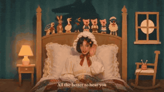
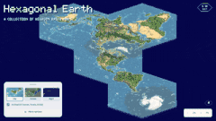
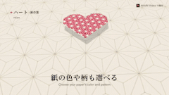
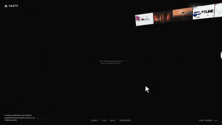
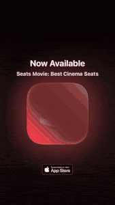
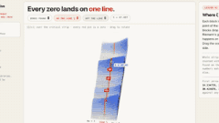
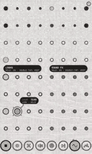
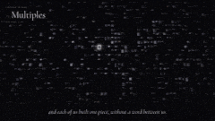
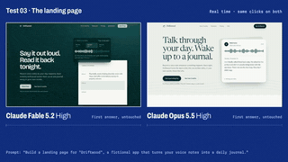

# 🧰 Webseiten & Tools · alle 56

[← Zurück zur Liste](../README.de.md) · [English](web-and-tools.md) · [简体中文](web-and-tools.zh-CN.md) · [繁體中文](web-and-tools.zh-TW.md) · [日本語](web-and-tools.ja.md) · [한국어](web-and-tools.ko.md) · [Español](web-and-tools.es.md) · [Português](web-and-tools.pt-BR.md) · [Français](web-and-tools.fr.md) · **Deutsch** · [Русский](web-and-tools.ru.md)

Die Hauptseite zeigt pro Bereich höchstens die 24 Einträge mit den meisten Likes (nur ab 100 Likes); hier stehen alle Einträge dieses Bereichs, nach Likes sortiert.

<table>
<tr>
<td width="33%" valign="top">
 
<b><a href="https://claudia.gallery">Claudia Gallery</a></b> 
<a href="https://x.com/anabology">@anabology</a> · ♥ 5.5k · <a href="https://x.com/anabology/status/2120010995309457643">▶ Video</a> 
„Make the video of your dreams“ – zwei Einstellungen, 9 Stunden. 
<a href="https://fablelist.000ooo.ooo/de/prompts/?w=claudia-gallery&ref=gh"><b>✨ Prompt holen</b></a>
</td>
<td width="33%" valign="top">
 
<b><a href="http://robotics-lab-app.vercel.app">Robotics Lab</a></b> 
<a href="https://x.com/0xMovez">@0xMovez</a> · ♥ 4.7k · <a href="https://x.com/0xMovez/status/2120239217880268919">▶ Video</a> 
Acht echte Boards (Arduino Uno, Raspberry Pi 4 …) in 3D: Chips platzieren, einlöten, echte Schaltungen verdrahten. 
<a href="http://robolabs-app.vercel.app">Humanoid edition</a> 
<a href="https://fablelist.000ooo.ooo/de/prompts/?w=robotics-lab&ref=gh"><b>✨ Prompt holen</b></a>
</td>
<td width="33%" valign="top">
 
<b><a href="https://claude.ai/artifact/N6bSgS4ZH5ifFQfg8sm4dv">House-Banger-Generator</a></b> 
<a href="https://x.com/deedydas">@deedydas</a> · ♥ 4.1k · <a href="https://x.com/deedydas/status/2120905625852936318">▶ Video</a> 
Es hat Musiktheorie gelernt, probiert pro Instrument Tausende Muster aus und arrangiert die besten zu einem House-Track mit 72 Takten. Ton an. 
<a href="https://fablelist.000ooo.ooo/de/prompts/?w=house-bangers-generator&ref=gh"><b>✨ Prompt holen</b></a>
</td>
</tr>
<tr>
<td width="33%" valign="top">
 
<b><a href="https://miaai-lab.github.io/Claude-Fable-5.2-HTML-Files/">76 HTML-Einzeldateien</a></b> 
<a href="https://x.com/MiaAI_lab">@MiaAI_lab</a> · ♥ 2.6k · <a href="https://x.com/MiaAI_lab/status/2119930229661503893">Post</a> 
Generative Kunst, Physik, Typografie und UI, jeweils mit dem ursprünglichen Prompt. 
<a href="https://fablelist.000ooo.ooo/de/prompts/?w=76-single-file-html-pieces&ref=gh"><b>✨ Prompt holen</b></a>
</td>
<td width="33%" valign="top">
 
<b><a href="https://pixel-worlds.vercel.app/keep/">Keep – Passwortstärke-Anzeige</a></b> 
<a href="https://x.com/crtvTeknologist">@crtvTeknologist</a> · ♥ 1.6k · <a href="https://x.com/crtvTeknologist/status/2119894073024606617">▶ Video</a> 
Eine Passwortstärke-Anzeige, dargestellt als lebendige Pixelwelt. 
<a href="https://github.com/finktheartist/pixel-worlds">Quellcode</a> 
<a href="https://fablelist.000ooo.ooo/de/prompts/?w=keep-password-strength-meter&ref=gh"><b>✨ Prompt holen</b></a>
</td>
<td width="33%" valign="top">
 
<b><a href="https://sakuga-vfx.vercel.app">Sakuga Set</a></b> 
<a href="https://x.com/crtvTeknologist">@crtvTeknologist</a> · ♥ 1.4k · <a href="https://x.com/crtvTeknologist/status/2122088829565698218">▶ Video</a> 
Zwölf UI-Elemente, die wie im Anime reagieren: Buttons quetschen sich und landen mit einem DON!, Schalter verwischen und spritzen, Slider wirbeln Wolken auf. Alle Effekte sind im Code gezeichnet, je eine Datei, ohne Abhängigkeiten. 
<a href="https://github.com/finktheartist/sakuga-vfx">Quellcode</a>
</td>
</tr>
<tr>
<td width="33%" valign="top">
 
<b><a href="https://hashem-al-ghaili.github.io/xray-mirror/">X-Ray Mirror</a></b> 
<a href="https://x.com/HashemGhaili">@HashemGhaili</a> · ♥ 1.4k · <a href="https://x.com/HashemGhaili/status/2120202746121085321">▶ Video</a> 
Richte eine Webcam auf dein Gesicht und sieh Schädel, Gehirn und Muskeln, live verfolgt. Öffne den Mund und der Kiefer öffnet sich; das Video verlässt nie deinen Computer. 
<a href="https://github.com/Hashem-Al-Ghaili/xray-mirror">Quellcode</a> 
<a href="https://fablelist.000ooo.ooo/de/prompts/?w=x-ray-mirror&ref=gh"><b>✨ Prompt holen</b></a>
</td>
<td width="33%" valign="top">
 
<b><a href="https://xianxie6.github.io/animals-planner-2027/">Animals at Work – 3D-Planer</a></b> 
<a href="https://x.com/Xian0063">@Xian0063</a> · ♥ 1.2k · <a href="https://x.com/Xian0063/status/2120417834694250522">▶ Video</a> 
Ein Papierplaner in 3D nachgebaut: zum Umblättern ziehen, auf ein Datum tippen zum Schreiben, 90 Sticker zum Ablösen und Aufkleben. Opus 5.5 baute das Gerüst; Fable 5.2 verfeinerte die Materialien anhand echter Aufnahmen. 
<a href="https://fablelist.000ooo.ooo/de/prompts/?w=animals-at-work-3d-planner&ref=gh"><b>✨ Prompt holen</b></a>
</td>
<td width="33%" valign="top">
 
<b><a href="https://uberdesigner.ai/t/spine-menu">Spine Menu</a></b> 
<a href="https://x.com/seanaiux">@seanaiux</a> · ♥ 1.2k · <a href="https://x.com/seanaiux/status/2120222459110789574">▶ Video</a> 
„Have you ever seen a menu that looks better?“ Die Seite enthält den Prompt. 
<a href="https://uberdesigner.ai/t/aquarium-toggle">Aquarium toggle</a> · <a href="https://uberdesigner.ai/t/glow-widgets">Glow widgets</a>
</td>
</tr>
<tr>
<td width="33%" valign="top">
 
<b><a href="https://roverkit.vercel.app">RoverKit — Roboterauto bauen und simulieren</a></b> 
<a href="https://x.com/DilumSanjaya">@DilumSanjaya</a> · ♥ 1.1k · <a href="https://x.com/DilumSanjaya/status/2121286147393651085">▶ Video</a> 
Eine Schritt-für-Schritt-Anleitung zum Bau eines Roboterautos, mit Simulator, anpassbarer Arena und visueller Code-Erklärung. Unterstützt Arduino und ESP32.
</td>
<td width="33%" valign="top">
 
<b><a href="https://github.com/AlexAtFF/pulp-daw-public">PULP – eine KI-native DAW</a></b> 
<a href="https://x.com/The_Alex">@The_Alex</a> · ♥ 946 · <a href="https://x.com/The_Alex/status/2119917226769985785">▶ Video</a> 
Eine native Windows-Digital-Audio-Workstation. Bitte Claude um Musik, und es öffnet die DAW und macht den Song. 
<a href="https://fablelist.000ooo.ooo/de/prompts/?w=pulp-an-ai-native-daw&ref=gh"><b>✨ Prompt holen</b></a>
</td>
<td width="33%" valign="top">
 
<b><a href="https://frontier.every.to/experiments/ambient-town">Ambient Town</a></b> 
<a href="https://x.com/kieranklaassen">@kieranklaassen</a> · ♥ 897 · <a href="https://x.com/kieranklaassen/status/2119868196773929160">▶ Video</a> 
Eine Ambient-DAW, in einer Woche voller Nächte von einem ehemaligen Filmkomponisten gebaut: Ableton-Push-Unterstützung, Mikrofone, Effekte, ein Synthesizer und ein Agent, der mit dir komponiert. Klicke auf der Seite auf „Try it“. 
<a href="https://fablelist.000ooo.ooo/de/prompts/?w=ambient-town&ref=gh"><b>✨ Prompt holen</b></a>
</td>
</tr>
<tr>
<td width="33%" valign="top">
 
<b><a href="https://hexagonal.earth">Hexagonal Earth</a></b> 
<a href="https://x.com/avsa">@avsa</a> · ♥ 754 · <a href="https://x.com/avsa/status/2123123638551392755">Post</a> 
Ein Diorama der ganzen Welt aus Sechsecken, gebaut aus echten Daten zu Höhe, Meerestiefe, Luftfeuchtigkeit, Wind und Flüssen. Fable 5.2 hat Hunderte kleiner 3D-Pixel-Splat-Objekte erzeugt und selbst in der Szene platziert.
</td>
<td width="33%" valign="top">
 
<b><a href="https://itspsneha.com/supplements">Which Vitamins to Buy in India</a></b> 
<a href="https://x.com/itspsneha">@itspsneha</a> · ♥ 738 · <a href="https://x.com/itspsneha/status/2120048494761451974">Post</a> 
Entstanden nach dem Lesen von Laborberichten zu 109 getesteten Chargen. 
<a href="https://fablelist.000ooo.ooo/de/prompts/?w=which-vitamins-to-buy-in-india&ref=gh"><b>✨ Prompt holen</b></a>
</td>
<td width="33%" valign="top">
 
<b><a href="https://v2.video/riley/the-history-of-writing/v1">The History of Writing</a></b> 
<a href="https://x.com/rileybrown">@rileybrown</a> · ♥ 667 · <a href="https://x.com/rileybrown/status/2119946022767980985">▶ Video</a> 
Ein interaktiver Film aus einem Prompt; Prompt und Dateien sind geteilt. 
<a href="https://x.com/rileybrown/status/2119946022767980985">📝 Prompt des Creators (kostenlos)</a>
</td>
</tr>
<tr>
<td width="33%" valign="top">
 
<b><a href="https://auden-english-135.netlify.app/">Audens verlorener Lyrikkurs von 1941, rekonstruiert</a></b> 
<a href="https://x.com/emollick">@emollick</a> · ♥ 594 · <a href="https://x.com/emollick/status/2121641417483169934">Post</a> 
Fable 5.2 rekonstruierte W. H. Audens Kurs, den „schwersten in den Geisteswissenschaften“, aus einem obskuren Buch im Internet Archive und verstreuten Notizen.
</td>
<td width="33%" valign="top">
 
<b><a href="https://omage1.xyz">omage-1: der OP-1 Field Synth im Browser</a></b> 
<a href="https://x.com/jamesmbickerton">@jamesmbickerton</a> · ♥ 572 · <a href="https://x.com/jamesmbickerton/status/2122688041219133815">▶ Video</a> 
Eine inoffizielle Hommage, die den OP-1 Field von Teenage Engineering als Browser-App nachbaut, die man sofort spielen kann.
</td>
<td width="33%" valign="top">
 
<b><a href="https://claude.ai/artifact/4P1urBdptp6gWiJo3R6Vpv">Breakcore-Video-Sampler</a></b> 
<a href="https://x.com/parhelion318">@parhelion318</a> · ♥ 543 · <a href="https://x.com/parhelion318/status/2122723067533398064">▶ Video</a> 
Ein Sampler im Browser, der Videoclips zerhackt und zu Breakcore-Rhythmen neu anordnet.
</td>
</tr>
<tr>
<td width="33%" valign="top">
 
<b><a href="https://www.bubbbly.com/christmas-cards">Christmas Cards: interaktive Weihnachtskarten</a></b> 
<a href="https://x.com/ann_nnng">@ann_nnng</a> · ♥ 477 · <a href="https://x.com/ann_nnng/status/2122283549000712249">▶ Video</a> 
Eine Reihe interaktiver Weihnachtskarten, etwa eine Katze mit rotem Schal auf der Fensterbank, die dem Schneefall zusieht.
</td>
<td width="33%" valign="top">
 
<b><a href="https://claude.ai/artifact/8yKUbL5KQgvfqcWH6UgZrq">Kastle Sim</a></b> 
<a href="https://x.com/parhelion318">@parhelion318</a> · ♥ 466 · <a href="https://x.com/parhelion318/status/2123344270732202421">▶ Video</a> 
Eine Browser-Simulation des Mini-Modularsynths Bastl Kastle: Kabel stecken, an den Reglern drehen, und er klingt.
</td>
<td width="33%" valign="top">
 
<b><a href="https://where-is-everybody-fermi.netlify.app/">Where Is Everybody?</a></b> 
<a href="https://x.com/emollick">@emollick</a> · ♥ 457 · <a href="https://x.com/emollick/status/2120359214157603139">Post</a> 
Auf die Aufgabe „solve the Fermi Paradox“ sammelt es Daten, testet Hypothesen und prüft sie gegen Kritiker. 
<a href="https://resolving-the-great-silence.netlify.app/">Gemini Carbon version</a> 
<a href="https://x.com/emollick/status/2120359214157603139">📝 Prompt des Creators (kostenlos)</a>
</td>
</tr>
<tr>
<td width="33%" valign="top">
 
<b><a href="https://gsplan.org">Galatasaray-Sitzplatzansicht</a></b> 
<a href="https://x.com/molenbeek84">@molenbeek84</a> · ♥ 428 · <a href="https://x.com/molenbeek84/status/2120847639411331097">Post</a> 
Sieh die Aussicht aufs Spielfeld von jedem Block im RAMS Park, bevor du ein Ticket kaufst. 
<a href="https://fablelist.000ooo.ooo/de/prompts/?w=galatasaray-seat-view&ref=gh"><b>✨ Prompt holen</b></a>
</td>
<td width="33%" valign="top">
 
<b><a href="https://rubber-hose-ui.vercel.app">Rubber Hose UI: Bedienelemente als Cartoonfiguren der 1930er</a></b> 
<a href="https://x.com/crtvTeknologist">@crtvTeknologist</a> · ♥ 352 · <a href="https://x.com/crtvTeknologist/status/2122433522166124616">▶ Video</a> 
Elf Web-Bedienelemente im Rubber-Hose-Stil: Der Slider ist eine Posaune, der Toast ein Toaster, und der Button bekommt bei jedem Klick ein blaues Auge. Reines JS und canvas, keine Abhängigkeiten, Open Source. 
<a href="https://github.com/finktheartist/rubber-hose-ui">Quellcode</a>
</td>
<td width="33%" valign="top">
 
<b><a href="https://bigfatfish.cc">Big Fat Fish's Tank</a></b> 
🆕 · <a href="https://x.com/dafeifish">@dafeifish</a> · ♥ 264 · <a href="https://x.com/dafeifish/status/2123395143873019950">Post</a> 
Eine persönliche Website, neu gestaltet als Scrapbook: Papierschnipsel, Klebeband, Haftnotizen und Polaroids auf einem tiefblauen Nachthimmel.
</td>
</tr>
<tr>
<td width="33%" valign="top">
 
<b><a href="https://origamihelper.com">Origami Helper</a></b> 
<a href="https://x.com/ryoma_nakajima">@ryoma_nakajima</a> · ♥ 221 · <a href="https://x.com/ryoma_nakajima/status/2120472383241011323">▶ Video</a> 
Lerne Origami-Faltungen in 3D aus jedem Winkel, mit AR. Kostenlos, ohne Anmeldung, an einem Tag gebaut. 
<a href="https://fablelist.000ooo.ooo/de/prompts/?w=origami-helper&ref=gh"><b>✨ Prompt holen</b></a>
</td>
<td width="33%" valign="top">
 
<b><a href="https://claude.ai/artifact/5ki5nJzDaayYMNhxymZBNT">Slow Plant Synth</a></b> 
🆕 · <a href="https://x.com/parhelion318">@parhelion318</a> · ♥ 206 · <a href="https://x.com/parhelion318/status/2123982460090503626">▶ Video</a> 
Eine simulierte Pflanze, die je nach Standort, Uhrzeit und simuliertem Wetter wächst und über Tage ihre eigenen Klänge erzeugt. Gebaut mit Fable 5.2 und Opus 5.5.
</td>
<td width="33%" valign="top">
 
<b><a href="https://typed.page/">Typed</a></b> 
<a href="https://x.com/clairevo">@clairevo</a> · ♥ 205 · <a href="https://x.com/clairevo/status/2119905651359142132">▶ Video</a> 
Eine voll funktionsfähige Schreibmaschine: Tasten tippen oder anklicken, Schreib-Timer, Korrekturlack, Autokorrektur. 
<a href="https://fablelist.000ooo.ooo/de/prompts/?w=typed&ref=gh"><b>✨ Prompt holen</b></a>
</td>
</tr>
<tr>
<td width="33%" valign="top">
 
<b><a href="https://clockendbader.github.io/fable-builds/heartbeat/">One Heartbeat</a></b> 
<a href="https://x.com/clockendbader">@clockendbader</a> · ♥ 153 · <a href="https://x.com/clockendbader/status/2121246903207961069">Post</a> 
Ein schlagendes 3D-Herz mit Live-EKG- und Druckkurven sowie Herztönen; vergleiche normal, Vorhofflimmern, Herzblock und Aortenstenose. Es hat auch seine eigenen Tests geschrieben. 
<a href="https://fablelist.000ooo.ooo/de/prompts/?w=one-heartbeat&ref=gh"><b>✨ Prompt holen</b></a>
</td>
<td width="33%" valign="top">
 
<b><a href="https://stormy.ai/hands">Hands: wie eine Roboterhand funktioniert</a></b> 
<a href="https://x.com/Karmedge">@Karmedge</a> · ♥ 151 · <a href="https://x.com/Karmedge/status/2122394153497842080">▶ Video</a> 
Eine interaktive Erklärseite dazu, wie die Hand eines humanoiden Roboters funktioniert, warum sie schwer zu bauen ist und was sie kostet. Mit über 1 Milliarde Tokens gebaut.
</td>
<td width="33%" valign="top">
 
<b><a href="https://motionsites.ai/?prompt=vante-ribbon-hero">Ribbon Hero</a></b> 
<a href="https://x.com/viktoroddy">@viktoroddy</a> · ♥ 141 · <a href="https://x.com/viktoroddy/status/2119985044542705916">▶ Video</a> 
Ein Hero-Bereich, gemacht mit Fable 5.2 + GPT Image 2.6.
</td>
</tr>
<tr>
<td width="33%" valign="top">
 
<b><a href="https://patch.gg/patch/anymove">anymove</a></b> 
<a href="https://x.com/rehan_shei">@rehan_shei</a> · ♥ 140 · <a href="https://x.com/rehan_shei/status/2120409150870159414">▶ Video</a> 
Überträgt die Bewegungen eines KI-Videoclips auf ein echtes 3D-Rig – ohne Mocap-Anzug, ohne Keyframes. Open Source. 
<a href="https://fablelist.000ooo.ooo/de/prompts/?w=anymove&ref=gh"><b>✨ Prompt holen</b></a>
</td>
<td width="33%" valign="top">
 
<b><a href="https://seats.movie">seats.movie</a></b> 
🆕 · <a href="https://x.com/sunithvs_">@sunithvs_</a> · ♥ 133 · <a href="https://x.com/sunithvs_/status/2123496822400532982">▶ Video</a> 
Film auswählen, und es prüft jede Vorstellung in deiner Stadt auf noch freie Plätze in der Mitte – mit 3D-Blick vom Sitz aus. Laut Autor lief Fable 5.2 dafür fünf Tage lang.
</td>
<td width="33%" valign="top">
 
<b><a href="https://nikechan.com/">nikechan.com Redesign</a></b> 
<a href="https://x.com/tegnike">@tegnike</a> · ♥ 130 · <a href="https://x.com/tegnike/status/2120110145841578173">Post</a> 
Eine persönliche Website, komplett neu gestaltet. 
<a href="https://fablelist.000ooo.ooo/de/prompts/?w=nikechan-com-redesign&ref=gh"><b>✨ Prompt holen</b></a>
</td>
</tr>
<tr>
<td width="33%" valign="top">
 
<b><a href="https://fieldnote-crm-pi.vercel.app">Fieldnote CRM-Dashboard</a></b> 
<a href="https://x.com/dejvdesign">@dejvdesign</a> · ♥ 130 · <a href="https://x.com/dejvdesign/status/2122335319634874710">▶ Video</a> 
Eine CRM-Dashboard-Oberfläche mit Live-Interaktionen, entstanden mit @madebymicrodose.
</td>
<td width="33%" valign="top">
 
<b><a href="https://github.com/kanaworksai-hue/harappa">Harappa (Blender-Add-on)</a></b> 
<a href="https://x.com/KanaWorks_AI">@KanaWorks_AI</a> · ♥ 90 · <a href="https://x.com/KanaWorks_AI/status/2121221880673972463">▶ Video</a> 
Ein kostenloses Blender-Add-on, das einen kahlen Hügel mit einem Klick in eine Anime-Wiese verwandelt, mit Gras, Blumen, Wolken, Bäumen, Jahreszeiten und Stilen. 
<a href="https://fablelist.000ooo.ooo/de/prompts/?w=harappa-blender-add-on&ref=gh"><b>✨ Prompt holen</b></a>
</td>
<td width="33%" valign="top">
 
<b><a href="https://andreysuperiorgit.github.io/v8/">V8 Four-Stroke</a></b> 
🆕 · <a href="https://x.com/andreysuperior">@andreysuperior</a> · ♥ 69 · <a href="https://x.com/andreysuperior/status/2123928682603430384">▶ Video</a> 
Ein 7,0-Liter-V8, den man im Browser-Tab hochdrehen kann: Kolben, Kurbelwelle, Nockenwelle und 16 Ventile bewegen sich nach echten Maßen, und die Krümmer glühen mit steigender Drehzahl. Eine einzige HTML-Datei mit 124 KB, 1 Prompt und 23 Nachfragen.
</td>
</tr>
<tr>
<td width="33%" valign="top">
 
<b><a href="https://sael.net/seat-arena">Best Seat in the House</a></b> 
<a href="https://x.com/RyanSael">@RyanSael</a> · ♥ 62 · <a href="https://x.com/RyanSael/status/2120544205558915329">▶ Video</a> 
Sitzpläne für Konzerte, in denen du die genaue Aussicht von jedem Platz siehst, bevor du kaufst. Voll interaktiv. 
<a href="https://fablelist.000ooo.ooo/de/prompts/?w=best-seat-in-the-house&ref=gh"><b>✨ Prompt holen</b></a>
</td>
<td width="33%" valign="top">
 
<b><a href="http://promptronic3000.com">Promptronic 3000</a></b> 
<a href="https://x.com/fabianstelzer">@fabianstelzer</a> · ♥ 54 · <a href="https://x.com/fabianstelzer/status/2123121678670520627">▶ Video</a> 
Ein agentischer Modular-Synthesizer im Web: Claude oder einen anderen Agenten per MCP anbinden, Patches oder sogar neue Module per Text bauen lassen und per URL teilen.
</td>
<td width="33%" valign="top">
 
<b><a href="https://hashem-al-ghaili.github.io/music-maker/">Music Maker — ein Instrument, das man in der Luft spielt</a></b> 
🆕 · <a href="https://x.com/HashemGhaili">@HashemGhaili</a> · ♥ 54 · <a href="https://x.com/HashemGhaili/status/2124135871293329809">▶ Video</a> 
Webcam einschalten, mit beiden Händen greifen und auseinanderziehen, um eine Saite in die Luft zu spannen, eines von 24 Instrumenten wählen und mit der Fingerspitze darüberstreichen. Beats dazunehmen, Loops schichten und das Ergebnis aufnehmen. 
<a href="https://github.com/Hashem-Al-Ghaili/music-maker">Quellcode</a>
</td>
</tr>
<tr>
<td width="33%" valign="top">
 
<b><a href="https://tetriss22.github.io/pc-build-lab/">PC Build Lab</a></b> 
<a href="https://x.com/Tetriss112">@Tetriss112</a> · ♥ 51 · <a href="https://x.com/Tetriss112/status/2120520587411935288">▶ Video</a> 
Baue in 8 Schritten einen Gaming-Rechner für 1.279 $ Teil für Teil in 3D zusammen – und ruiniere ihn absichtlich, bevor du echte Teile anfasst. 
<a href="https://fablelist.000ooo.ooo/de/prompts/?w=pc-build-lab&ref=gh"><b>✨ Prompt holen</b></a>
</td>
<td width="33%" valign="top">
 
<b><a href="https://andreysuperiorgit.github.io/riemann">Riemann Hypothesis, live</a></b> 
🆕 · <a href="https://x.com/andreysuperior">@andreysuperior</a> · ♥ 40 · <a href="https://x.com/andreysuperior/status/2124274426225008910">▶ Video</a> 
Eine Zeta-Landschaft zum Drehen. 102 Nullstellen werden live im Browser gefunden und geprüft, alle auf einer Linie, und dann aufsummiert, um die Primzahlen wieder aufzubauen. Eine einzige HTML-Datei ohne Bibliotheken.
</td>
<td width="33%" valign="top">
 
<b><a href="https://claude.ai/artifact/NVWaNUrJK5woiKXQsAQaPG">Audio-Reactive Dot Surface</a></b> 
🆕 · <a href="https://x.com/parhelion318">@parhelion318</a> · ♥ 30 · <a href="https://x.com/parhelion318/status/2123463622252994878">▶ Video</a> 
Eine Fläche aus Punkten, die sich zum Klang bewegt. Gebaut mit Fable 5.2 und Opus 5.5, geprüft von GPT-6.2 Astra.
</td>
</tr>
<tr>
<td width="33%" valign="top">
 
<b><a href="https://shiraeisenberg.com/composed-of-nows">Composed of Nows</a></b> 
🆕 · <a href="https://x.com/shiraeis">@shiraeis</a> · ♥ 24 · <a href="https://x.com/shiraeis/status/2123562764203589648">▶ Video</a> 
Neun interaktive Arbeiten darüber, wie es sich „anfühlt“, ein Sprachmodell zu sein, entstanden, nachdem es Gedichte lesen sollte. Im ersten Anlauf.
</td>
<td width="33%" valign="top">
 
<b><a href="https://piano.yoshiyukikoyanagi.com">Physical Modeling Piano F1</a></b> 
🆕 · <a href="https://x.com/moutend">@moutend</a> · ♥ 21 · <a href="https://x.com/moutend/status/2123776671501451468">▶ Video</a> 
Ein Klavier, das seinen Klang in Echtzeit im Browser berechnet. Gespielt wird über die Computertastatur, Haltepedal inklusive. 
<a href="https://github.com/moutend/physical-modeling-piano-f1">Quellcode</a>
</td>
<td width="33%" valign="top">
 
<b><a href="https://ai.itokoba.com/ichimai/">Ichimai – wie weit kann eine Seite gehen</a></b> 
<a href="https://x.com/hideki_climax">@hideki_climax</a> · ♥ 12 · <a href="https://x.com/hideki_climax/status/2120165464722809190">▶ Video</a> 
Nur eine Anweisung: „make the strongest static web page that shows what you can do now“. 
<a href="https://x.com/hideki_climax/status/2120165464722809190">📝 Prompt des Creators (kostenlos)</a>
</td>
</tr>
<tr>
<td width="33%" valign="top">
 
<b><a href="https://ember-vesper.aura.build/">Ember Vesper</a></b> 
🆕 · <a href="https://x.com/titepommee">@titepommee</a> · ♥ 12 · <a href="https://x.com/titepommee/status/2123515807250657457">▶ Video</a> 
Ein Gaming-PC als Landingpage: Beim Scrollen zerlegt er sich, wechselt sein Leuchten, schaltet auf Wärmebildkamera und schreibt deinen Bestellzettel. Eine einzige HTML-Datei.
</td>
<td width="33%" valign="top">
 
<b><a href="https://rain-1.github.io/intel4004/web/4004-lesion.html">4004 Lesion Map</a></b> 
<a href="https://x.com/slimer48484">@slimer48484</a> · ♥ 10 · <a href="https://x.com/slimer48484/status/2122231197409398920">Post</a> 
Jeder der 2,242 Transistoren des Intel 4004 wurde in einer Simulation auf Transistorebene einzeln zerstört. Fahr mit der Maus über einen Transistor auf der Chipkarte und sieh, was dann nicht mehr funktioniert. 
<a href="https://github.com/rain-1/intel4004">Quellcode</a>
</td>
<td width="33%" valign="top">
 
<b><a href="https://jwt-designs-preview.noone-697.workers.dev/">20 Landing-Page-Redesigns</a></b> 
<a href="https://x.com/Tmeister">@Tmeister</a> · ♥ 9 · <a href="https://x.com/Tmeister/status/2119983842841018482">Post</a> 
20 Alternativen zur Landing Page eines JWT-Plugins aus einem einfachen Prompt. 
<a href="https://x.com/Tmeister/status/2119983842841018482">📝 Prompt des Creators (kostenlos)</a>
</td>
</tr>
<tr>
<td width="33%" valign="top">
 
<b><a href="https://www.asumacodes.xyz/arena/driftwood">Driftwood (Fable vs Opus)</a></b> 
<a href="https://x.com/AsumaCodes">@AsumaCodes</a> · ♥ 9 · <a href="https://x.com/AsumaCodes/status/2120130668848177432">▶ Video</a> 
Derselbe Prompt, je ein Versuch, beide Seiten live. Außerdem: ein Pomodoro-Fokusraum und eine Fehlersuche. 
<a href="https://www.asumacodes.xyz/arena/focus-room">Focus room</a> · <a href="https://www.asumacodes.xyz/arena/bug-hunt">Bug hunt comparison</a> · <a href="https://www.asumacodes.xyz/arena">Series</a> 
<a href="https://x.com/AsumaCodes/status/2120130668848177432">📝 Prompt des Creators (kostenlos)</a>
</td>
<td width="33%" valign="top">
 
<b><a href="https://uberdesigner.ai/t/araneae">araneae</a></b> 
<a href="https://x.com/seanaiux">@seanaiux</a> · ♥ 8 · <a href="https://x.com/seanaiux/status/2121688869439455410">▶ Video</a> 
Der Auftrag: eine Website, die ihm Angst macht. Eine Spinne lässt sich aus dem Dunkel herab, und beim Scrollen geht es durch ihr Versteck, ihre Augen, Giftzähne und Beine, bis du die Fliege bist.
</td>
<td width="33%" valign="top">
 
<b><a href="https://claude.ai/artifact/TiymxxFXzMo7xhWUaecbzk">Entwurf für ein Wohnhaus</a></b> 
<a href="https://x.com/pnumech">@pnumech</a> · ♥ 7 · <a href="https://x.com/pnumech/status/2120117665041940807">Post</a> 
Ein Entwurf für ein freistehendes Haus (auf Koreanisch), an einem Tag entstanden. 
<a href="https://fablelist.000ooo.ooo/de/prompts/?w=house-design-proposal&ref=gh"><b>✨ Prompt holen</b></a>
</td>
</tr>
<tr>
<td width="33%" valign="top">
 
<b><a href="https://claude.ai/artifact/9yQkezie4jY3oz2YDLFDiq">Bay Drum Kit</a></b> 
<a href="https://x.com/BretKerr">@BretKerr</a> · ♥ 5 · <a href="https://x.com/BretKerr/status/2119995870854988177">▶ Video</a> 
Jeder Schlag hallt über die Bucht. 
<a href="https://fablelist.000ooo.ooo/de/prompts/?w=bay-drum-kit&ref=gh"><b>✨ Prompt holen</b></a>
</td>
<td width="33%" valign="top">
 
<b><a href="https://claude.ai/artifact/Pk6rHPyRwfShT37kiU1sT6">Dub-Techno-Track + Visualizer</a></b> 
<a href="https://x.com/bartdecrem">@bartdecrem</a> · ♥ 4 · <a href="https://x.com/bartdecrem/status/2119926997422133417">Post</a> 
Ein Versuch. 
<a href="https://fablelist.000ooo.ooo/de/prompts/?w=dub-techno-track-visualizer&ref=gh"><b>✨ Prompt holen</b></a>
</td>
<td width="33%" valign="top">
 
<b><a href="https://claude.ai/artifact/5ufHvxgvXTf5YgQeTR8TbG">Ramayana Family Tree</a></b> 
<a href="https://x.com/chhavsz">@chhavsz</a> · ♥ 2 · <a href="https://x.com/chhavsz/status/2119942973958078785">Post</a> 
Die Verbindungen des Hauptdarstellers durch Blut und Heirat zu 65 Bollywood-Stars. 
<a href="https://fablelist.000ooo.ooo/de/prompts/?w=ramayana-family-tree&ref=gh"><b>✨ Prompt holen</b></a>
</td>
</tr>
<tr>
<td width="33%" valign="top">
 
<b><a href="https://claude.ai/artifact/4aEy6FtUi7jrm9U7uYgp8K">Demoscene Demo</a></b> 
<a href="https://x.com/ndril">@ndril</a> · ♥ 1 · <a href="https://x.com/ndril/status/2119899340642894235">Post</a> 
„Make a demo in the demoscene tradition that runs in the browser.“ 
<a href="https://x.com/ndril/status/2119899340642894235">📝 Prompt des Creators (kostenlos)</a>
</td>
<td width="33%" valign="top">
 
<b><a href="https://claude.ai/artifact/H8E7AonW2KFrzdRimaLeXb">112 Forms of Meditation</a></b> 
<a href="https://x.com/RishabJ108">@RishabJ108</a> · ♥ 1 · <a href="https://x.com/RishabJ108/status/2120042407484084558">Post</a> 
Visualisiert für Techies. 
<a href="https://fablelist.000ooo.ooo/de/prompts/?w=112-forms-of-meditation&ref=gh"><b>✨ Prompt holen</b></a>
</td>
</tr>
</table>

Andere Abschnitte: [🎮 Spiele](games.de.md) · [🌍 3D-Welten & Szenen](3d-worlds.de.md) · [🎬 Animation & Film](animation.de.md) · [📺 Video-Demos](video-demos.de.md)

[← Zurück zur Liste](../README.de.md)
