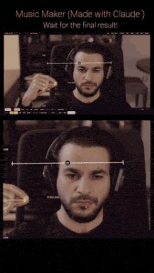
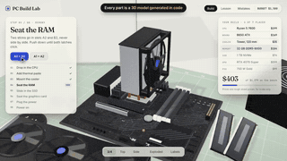
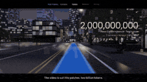
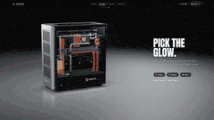
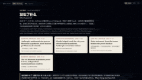

# 🧰 Páginas web y herramientas · los 57

[← Volver a la lista](../README.es.md) · [English](web-and-tools.md) · [简体中文](web-and-tools.zh-CN.md) · [繁體中文](web-and-tools.zh-TW.md) · [日本語](web-and-tools.ja.md) · [한국어](web-and-tools.ko.md) · **Español** · [Português](web-and-tools.pt-BR.md) · [Français](web-and-tools.fr.md) · [Deutsch](web-and-tools.de.md) · [Русский](web-and-tools.ru.md)

La página principal muestra como máximo las 24 entradas con más «me gusta» de cada sección (solo las de 100+); aquí están todas las de esta sección, ordenadas por «me gusta».

<table>
<tr>
<td width="33%" valign="top">
 
<b><a href="https://claudia.gallery">Claudia Gallery</a></b> 
<a href="https://x.com/anabology">@anabology</a> · ♥ 5.5k · <a href="https://x.com/anabology/status/2120010995309457643">▶ Video</a> 
"Haz el video de tus sueños" — dos tomas, 9 horas. 
<a href="https://fablelist.000ooo.ooo/es/prompts/?w=claudia-gallery&ref=gh"><b>✨ Consigue el prompt</b></a>
</td>
<td width="33%" valign="top">
 
<b><a href="http://robotics-lab-app.vercel.app">Robotics Lab</a></b> 
<a href="https://x.com/0xMovez">@0xMovez</a> · ♥ 4.7k · <a href="https://x.com/0xMovez/status/2120239217880268919">▶ Video</a> 
Ocho placas reales (Arduino Uno, Raspberry Pi 4…) en 3D: coloca chips, suéldalos y cablea circuitos reales. 
<a href="http://robolabs-app.vercel.app">Humanoid edition</a> 
<a href="https://fablelist.000ooo.ooo/es/prompts/?w=robotics-lab&ref=gh"><b>✨ Consigue el prompt</b></a>
</td>
<td width="33%" valign="top">
 
<b><a href="https://claude.ai/artifact/N6bSgS4ZH5ifFQfg8sm4dv">House Bangers generator</a></b> 
<a href="https://x.com/deedydas">@deedydas</a> · ♥ 4.1k · <a href="https://x.com/deedydas/status/2120905625852936318">▶ Video</a> 
Aprendió teoría musical, prueba miles de patrones por instrumento y organiza los mejores en un tema house de 72 compases. Con sonido. 
<a href="https://fablelist.000ooo.ooo/es/prompts/?w=house-bangers-generator&ref=gh"><b>✨ Consigue el prompt</b></a>
</td>
</tr>
<tr>
<td width="33%" valign="top">
 
<b><a href="https://miaai-lab.github.io/Claude-Fable-5.2-HTML-Files/">76 piezas HTML de un solo archivo</a></b> 
<a href="https://x.com/MiaAI_lab">@MiaAI_lab</a> · ♥ 2.6k · <a href="https://x.com/MiaAI_lab/status/2119930229661503893">Publicación</a> 
Arte generativo, física, tipografía e interfaces, cada una con su prompt original. 
<a href="https://fablelist.000ooo.ooo/es/prompts/?w=76-single-file-html-pieces&ref=gh"><b>✨ Consigue el prompt</b></a>
</td>
<td width="33%" valign="top">
 
<b><a href="https://pixel-worlds.vercel.app/keep/">Keep — medidor de seguridad de contraseñas</a></b> 
<a href="https://x.com/crtvTeknologist">@crtvTeknologist</a> · ♥ 1.6k · <a href="https://x.com/crtvTeknologist/status/2119894073024606617">▶ Video</a> 
Un indicador de seguridad de contraseñas representado como un mundo de píxeles vivo. 
<a href="https://github.com/finktheartist/pixel-worlds">Código fuente</a> 
<a href="https://fablelist.000ooo.ooo/es/prompts/?w=keep-password-strength-meter&ref=gh"><b>✨ Consigue el prompt</b></a>
</td>
<td width="33%" valign="top">
 
<b><a href="https://sakuga-vfx.vercel.app">Sakuga Set</a></b> 
<a href="https://x.com/crtvTeknologist">@crtvTeknologist</a> · ♥ 1.4k · <a href="https://x.com/crtvTeknologist/status/2122088829565698218">▶ Video</a> 
Doce controles de interfaz que reaccionan como en el anime: los botones se aplastan y aterrizan con un ¡DON!, los interruptores dejan estela y salpican, los deslizadores levantan nubes. Todos los efectos están dibujados con código, un archivo cada uno, sin dependencias. 
<a href="https://github.com/finktheartist/sakuga-vfx">Código fuente</a>
</td>
</tr>
<tr>
<td width="33%" valign="top">
 
<b><a href="https://hashem-al-ghaili.github.io/xray-mirror/">X-Ray Mirror</a></b> 
<a href="https://x.com/HashemGhaili">@HashemGhaili</a> · ♥ 1.4k · <a href="https://x.com/HashemGhaili/status/2120202746121085321">▶ Video</a> 
Apunta una webcam a tu cara y ve el cráneo, el cerebro y los músculos, rastreados en vivo. Abre la boca y la mandíbula se abre; el video nunca sale de tu computadora. 
<a href="https://github.com/Hashem-Al-Ghaili/xray-mirror">Código fuente</a> 
<a href="https://fablelist.000ooo.ooo/es/prompts/?w=x-ray-mirror&ref=gh"><b>✨ Consigue el prompt</b></a>
</td>
<td width="33%" valign="top">
 
<b><a href="https://xianxie6.github.io/animals-planner-2027/">Animals at Work — agenda 3D</a></b> 
<a href="https://x.com/Xian0063">@Xian0063</a> · ♥ 1.2k · <a href="https://x.com/Xian0063/status/2120417834694250522">▶ Video</a> 
Una agenda de papel reconstruida en 3D: arrastra para pasar páginas, toca una fecha para escribir y despega y pega 90 stickers. Opus 5.5 construyó el esqueleto; Fable 5.2 refinó los materiales a partir de material real. 
<a href="https://fablelist.000ooo.ooo/es/prompts/?w=animals-at-work-3d-planner&ref=gh"><b>✨ Consigue el prompt</b></a>
</td>
<td width="33%" valign="top">
 
<b><a href="https://uberdesigner.ai/t/spine-menu">Spine Menu</a></b> 
<a href="https://x.com/seanaiux">@seanaiux</a> · ♥ 1.2k · <a href="https://x.com/seanaiux/status/2120222459110789574">▶ Video</a> 
"¿Has visto alguna vez un menú que se vea mejor?" La página incluye el prompt. 
<a href="https://uberdesigner.ai/t/aquarium-toggle">Aquarium toggle</a> · <a href="https://uberdesigner.ai/t/glow-widgets">Glow widgets</a>
</td>
</tr>
<tr>
<td width="33%" valign="top">
 
<b><a href="https://roverkit.vercel.app">RoverKit — construye y simula un coche robot</a></b> 
<a href="https://x.com/DilumSanjaya">@DilumSanjaya</a> · ♥ 1.1k · <a href="https://x.com/DilumSanjaya/status/2121286147393651085">▶ Video</a> 
Una guía paso a paso para construir un coche robot, con simulador, arena personalizable y explicación visual del código. Compatible con Arduino y ESP32.
</td>
<td width="33%" valign="top">
 
<b><a href="https://github.com/AlexAtFF/pulp-daw-public">PULP — un DAW nativo de IA</a></b> 
<a href="https://x.com/The_Alex">@The_Alex</a> · ♥ 948 · <a href="https://x.com/The_Alex/status/2119917226769985785">▶ Video</a> 
Una estación de trabajo de audio digital nativa para Windows. Pídele música a Claude y abrirá el DAW y hará la canción. 
<a href="https://fablelist.000ooo.ooo/es/prompts/?w=pulp-an-ai-native-daw&ref=gh"><b>✨ Consigue el prompt</b></a>
</td>
<td width="33%" valign="top">
 
<b><a href="https://frontier.every.to/experiments/ambient-town">Ambient Town</a></b> 
<a href="https://x.com/kieranklaassen">@kieranklaassen</a> · ♥ 896 · <a href="https://x.com/kieranklaassen/status/2119868196773929160">▶ Video</a> 
Un DAW ambient construido en una semana de noches por un excompositor de cine: soporte para Ableton Push, micrófonos, efectos, un sintetizador y un agente que compone contigo. Haz clic en "Try it" en la página. 
<a href="https://fablelist.000ooo.ooo/es/prompts/?w=ambient-town&ref=gh"><b>✨ Consigue el prompt</b></a>
</td>
</tr>
<tr>
<td width="33%" valign="top">
 
<b><a href="https://hexagonal.earth">Hexagonal Earth</a></b> 
<a href="https://x.com/avsa">@avsa</a> · ♥ 756 · <a href="https://x.com/avsa/status/2123123638551392755">Publicación</a> 
Un diorama del mundo entero hecho de hexágonos, construido con datos reales de elevación, profundidad oceánica, humedad, viento y ríos. Fable 5.2 generó cientos de pequeños objetos 3D de splats de píxeles y los colocó en la escena por su cuenta.
</td>
<td width="33%" valign="top">
 
<b><a href="https://itspsneha.com/supplements">Qué vitaminas comprar en India</a></b> 
<a href="https://x.com/itspsneha">@itspsneha</a> · ♥ 737 · <a href="https://x.com/itspsneha/status/2120048494761451974">Publicación</a> 
Hecho tras leer los informes de laboratorio de 109 lotes analizados. 
<a href="https://fablelist.000ooo.ooo/es/prompts/?w=which-vitamins-to-buy-in-india&ref=gh"><b>✨ Consigue el prompt</b></a>
</td>
<td width="33%" valign="top">
 
<b><a href="https://v2.video/riley/the-history-of-writing/v1">The History of Writing</a></b> 
<a href="https://x.com/rileybrown">@rileybrown</a> · ♥ 667 · <a href="https://x.com/rileybrown/status/2119946022767980985">▶ Video</a> 
Una película interactiva a partir de un solo prompt; prompt y archivos compartidos. 
<a href="https://x.com/rileybrown/status/2119946022767980985">📝 Prompt del creador (gratis)</a>
</td>
</tr>
<tr>
<td width="33%" valign="top">
 
<b><a href="https://auden-english-135.netlify.app/">La clase de poesía perdida de Auden de 1941, reconstruida</a></b> 
<a href="https://x.com/emollick">@emollick</a> · ♥ 594 · <a href="https://x.com/emollick/status/2121641417483169934">Publicación</a> 
Fable 5.2 reconstruyó la clase de W. H. Auden, "la más difícil de las humanidades", a partir de un libro poco conocido del Internet Archive y notas dispersas.
</td>
<td width="33%" valign="top">
 
<b><a href="https://omage1.xyz">omage-1: el sinte OP-1 Field en el navegador</a></b> 
<a href="https://x.com/jamesmbickerton">@jamesmbickerton</a> · ♥ 572 · <a href="https://x.com/jamesmbickerton/status/2122688041219133815">▶ Video</a> 
Un homenaje no oficial que reconstruye el OP-1 Field de Teenage Engineering como una app de navegador que puedes tocar al instante.
</td>
<td width="33%" valign="top">
 
<b><a href="https://claude.ai/artifact/4P1urBdptp6gWiJo3R6Vpv">Sampler de vídeo breakcore</a></b> 
<a href="https://x.com/parhelion318">@parhelion318</a> · ♥ 544 · <a href="https://x.com/parhelion318/status/2122723067533398064">▶ Video</a> 
Un sampler para el navegador que trocea clips de vídeo y los reordena en ritmos breakcore.
</td>
</tr>
<tr>
<td width="33%" valign="top">
 
<b><a href="https://www.bubbbly.com/christmas-cards">Christmas Cards: tarjetas de Navidad interactivas</a></b> 
<a href="https://x.com/ann_nnng">@ann_nnng</a> · ♥ 481 · <a href="https://x.com/ann_nnng/status/2122283549000712249">▶ Video</a> 
Un conjunto de tarjetas de Navidad interactivas, como un gato con bufanda roja en un alféizar viendo caer la nieve.
</td>
<td width="33%" valign="top">
 
<b><a href="https://claude.ai/artifact/8yKUbL5KQgvfqcWH6UgZrq">Kastle Sim</a></b> 
<a href="https://x.com/parhelion318">@parhelion318</a> · ♥ 467 · <a href="https://x.com/parhelion318/status/2123344270732202421">▶ Video</a> 
Una simulación en el navegador del mini sintetizador modular Bastl Kastle: conecta los cables, gira los potenciómetros y suena.
</td>
<td width="33%" valign="top">
 
<b><a href="https://where-is-everybody-fermi.netlify.app/">Where Is Everybody?</a></b> 
<a href="https://x.com/emollick">@emollick</a> · ♥ 457 · <a href="https://x.com/emollick/status/2120359214157603139">Publicación</a> 
Al pedirle "resolver la paradoja de Fermi", reúne datos, pone a prueba hipótesis y las somete a la crítica de sus detractores. 
<a href="https://resolving-the-great-silence.netlify.app/">Gemini Carbon version</a> 
<a href="https://x.com/emollick/status/2120359214157603139">📝 Prompt del creador (gratis)</a>
</td>
</tr>
<tr>
<td width="33%" valign="top">
 
<b><a href="https://gsplan.org">Vista de asientos de Galatasaray</a></b> 
<a href="https://x.com/molenbeek84">@molenbeek84</a> · ♥ 429 · <a href="https://x.com/molenbeek84/status/2120847639411331097">Publicación</a> 
Mira la vista de la cancha desde cada sector del RAMS Park antes de comprar un boleto. 
<a href="https://fablelist.000ooo.ooo/es/prompts/?w=galatasaray-seat-view&ref=gh"><b>✨ Consigue el prompt</b></a>
</td>
<td width="33%" valign="top">
 
<b><a href="https://rubber-hose-ui.vercel.app">Rubber Hose UI: controles como dibujos animados de los años 30</a></b> 
<a href="https://x.com/crtvTeknologist">@crtvTeknologist</a> · ♥ 356 · <a href="https://x.com/crtvTeknologist/status/2122433522166124616">▶ Video</a> 
Once controles web dibujados al estilo rubber hose: el deslizador es un trombón, el toast es una tostadora y al botón le sale un ojo morado con cada pulsación. JS puro y canvas, sin dependencias, de código abierto. 
<a href="https://github.com/finktheartist/rubber-hose-ui">Código fuente</a>
</td>
<td width="33%" valign="top">
 
<b><a href="https://bigfatfish.cc">Big Fat Fish's Tank</a></b> 
<a href="https://x.com/dafeifish">@dafeifish</a> · ♥ 264 · <a href="https://x.com/dafeifish/status/2123395143873019950">Publicación</a> 
Un sitio personal rediseñado como un álbum de recortes: papelitos, cinta, notas adhesivas y Polaroids pegados sobre un cielo nocturno azul profundo.
</td>
</tr>
<tr>
<td width="33%" valign="top">
 
<b><a href="https://origamihelper.com">Origami Helper</a></b> 
<a href="https://x.com/ryoma_nakajima">@ryoma_nakajima</a> · ♥ 220 · <a href="https://x.com/ryoma_nakajima/status/2120472383241011323">▶ Video</a> 
Aprende pliegues de origami en 3D desde cualquier ángulo, con AR. Gratis, sin registro, hecho en un día. 
<a href="https://fablelist.000ooo.ooo/es/prompts/?w=origami-helper&ref=gh"><b>✨ Consigue el prompt</b></a>
</td>
<td width="33%" valign="top">
 
<b><a href="https://claude.ai/artifact/5ki5nJzDaayYMNhxymZBNT">Slow Plant Synth</a></b> 
<a href="https://x.com/parhelion318">@parhelion318</a> · ♥ 208 · <a href="https://x.com/parhelion318/status/2123982460090503626">▶ Video</a> 
Una planta simulada que crece según tu ubicación, la hora y un clima simulado, y que produce sus propios sonidos a lo largo de días. Hecho con Fable 5.2 y Opus 5.5.
</td>
<td width="33%" valign="top">
 
<b><a href="https://typed.page/">Typed</a></b> 
<a href="https://x.com/clairevo">@clairevo</a> · ♥ 205 · <a href="https://x.com/clairevo/status/2119905651359142132">▶ Video</a> 
Una máquina de escribir totalmente funcional: escribe o haz clic en las teclas, temporizadores de escritura, corrector líquido y autocorrección. 
<a href="https://fablelist.000ooo.ooo/es/prompts/?w=typed&ref=gh"><b>✨ Consigue el prompt</b></a>
</td>
</tr>
<tr>
<td width="33%" valign="top">
 
<b><a href="https://clockendbader.github.io/fable-builds/heartbeat/">One Heartbeat</a></b> 
<a href="https://x.com/clockendbader">@clockendbader</a> · ♥ 153 · <a href="https://x.com/clockendbader/status/2121246903207961069">Publicación</a> 
Un corazón 3D latiendo con ECG y trazas de presión en vivo y sonidos cardíacos; compara ritmo normal, fibrilación auricular, bloqueo cardíaco y estenosis aórtica. También escribió sus propias pruebas. 
<a href="https://fablelist.000ooo.ooo/es/prompts/?w=one-heartbeat&ref=gh"><b>✨ Consigue el prompt</b></a>
</td>
<td width="33%" valign="top">
 
<b><a href="https://stormy.ai/hands">Hands: cómo funciona la mano de un robot</a></b> 
<a href="https://x.com/Karmedge">@Karmedge</a> · ♥ 151 · <a href="https://x.com/Karmedge/status/2122394153497842080">▶ Video</a> 
Una explicación interactiva de cómo funciona la mano de un robot humanoide, por qué es difícil de construir y cuánto cuesta. Hecha con más de mil millones de tokens.
</td>
<td width="33%" valign="top">
 
<b><a href="https://motionsites.ai/?prompt=vante-ribbon-hero">Ribbon Hero</a></b> 
<a href="https://x.com/viktoroddy">@viktoroddy</a> · ♥ 141 · <a href="https://x.com/viktoroddy/status/2119985044542705916">▶ Video</a> 
Una sección hero hecha con Fable 5.2 + GPT Image 2.6.
</td>
</tr>
<tr>
<td width="33%" valign="top">
 
<b><a href="https://patch.gg/patch/anymove">anymove</a></b> 
<a href="https://x.com/rehan_shei">@rehan_shei</a> · ♥ 140 · <a href="https://x.com/rehan_shei/status/2120409150870159414">▶ Video</a> 
Traslada los movimientos de un clip de video de IA a un rig 3D real, sin traje de mocap ni keyframes. Código abierto. 
<a href="https://fablelist.000ooo.ooo/es/prompts/?w=anymove&ref=gh"><b>✨ Consigue el prompt</b></a>
</td>
<td width="33%" valign="top">
 
<b><a href="https://nikechan.com/">Rediseño de nikechan.com</a></b> 
<a href="https://x.com/tegnike">@tegnike</a> · ♥ 130 · <a href="https://x.com/tegnike/status/2120110145841578173">Publicación</a> 
Un sitio personal rediseñado de principio a fin. 
<a href="https://fablelist.000ooo.ooo/es/prompts/?w=nikechan-com-redesign&ref=gh"><b>✨ Consigue el prompt</b></a>
</td>
<td width="33%" valign="top">
 
<b><a href="https://fieldnote-crm-pi.vercel.app">Panel de Fieldnote CRM</a></b> 
<a href="https://x.com/dejvdesign">@dejvdesign</a> · ♥ 130 · <a href="https://x.com/dejvdesign/status/2122335319634874710">▶ Video</a> 
Una interfaz de panel CRM con interacciones en vivo, hecha con @madebymicrodose.
</td>
</tr>
<tr>
<td width="33%" valign="top">
 
<b><a href="https://github.com/kanaworksai-hue/harappa">Harappa (complemento de Blender)</a></b> 
<a href="https://x.com/KanaWorks_AI">@KanaWorks_AI</a> · ♥ 90 · <a href="https://x.com/KanaWorks_AI/status/2121221880673972463">▶ Video</a> 
Un complemento gratuito de Blender que convierte una colina pelada en un prado estilo anime con un clic, con pasto, flores, nubes, árboles, estaciones y estilos. 
<a href="https://fablelist.000ooo.ooo/es/prompts/?w=harappa-blender-add-on&ref=gh"><b>✨ Consigue el prompt</b></a>
</td>
<td width="33%" valign="top">
 
<b><a href="https://andreysuperiorgit.github.io/v8/">V8 Four-Stroke</a></b> 
<a href="https://x.com/andreysuperior">@andreysuperior</a> · ♥ 75 · <a href="https://x.com/andreysuperior/status/2123928682603430384">▶ Video</a> 
Un V8 de 7.0 litros que puedes acelerar en una pestaña del navegador: pistones, cigüeñal, árbol de levas y 16 válvulas se mueven con medidas reales y los colectores se ponen al rojo al subir de vueltas. Un solo HTML de 124 KB, 1 prompt y 23 ajustes.
</td>
<td width="33%" valign="top">
 
<b><a href="https://hashem-al-ghaili.github.io/music-maker/">Music Maker — un instrumento que se toca en el aire</a></b> 
<a href="https://x.com/HashemGhaili">@HashemGhaili</a> · ♥ 64 · <a href="https://x.com/HashemGhaili/status/2124135871293329809">▶ Video</a> 
Enciende la webcam, pellizca con las dos manos y sepáralas para tensar una cuerda en el aire, elige uno de 24 instrumentos y pasa la yema del dedo por ella para tocar. Añade ritmos, superpón bucles y graba el resultado. 
<a href="https://github.com/Hashem-Al-Ghaili/music-maker">Código fuente</a>
</td>
</tr>
<tr>
<td width="33%" valign="top">
 
<b><a href="https://sael.net/seat-arena">Best Seat in the House</a></b> 
<a href="https://x.com/RyanSael">@RyanSael</a> · ♥ 62 · <a href="https://x.com/RyanSael/status/2120544205558915329">▶ Video</a> 
Mapas de asientos de conciertos donde ves la vista exacta desde cada asiento antes de comprar. Totalmente interactivo. 
<a href="https://fablelist.000ooo.ooo/es/prompts/?w=best-seat-in-the-house&ref=gh"><b>✨ Consigue el prompt</b></a>
</td>
<td width="33%" valign="top">
 
<b><a href="http://promptronic3000.com">Promptronic 3000</a></b> 
<a href="https://x.com/fabianstelzer">@fabianstelzer</a> · ♥ 55 · <a href="https://x.com/fabianstelzer/status/2123121678670520627">▶ Video</a> 
Un sintetizador modular con agentes en la web: conecta Claude u otro agente por MCP para crear patches o incluso módulos nuevos con texto, y compártelos por URL.
</td>
<td width="33%" valign="top">
 
<b><a href="https://andreysuperiorgit.github.io/riemann">Riemann Hypothesis, live</a></b> 
<a href="https://x.com/andreysuperior">@andreysuperior</a> · ♥ 54 · <a href="https://x.com/andreysuperior/status/2124274426225008910">▶ Video</a> 
Un paisaje de la función zeta que puedes girar. 102 ceros se calculan y comprueban en vivo en tu navegador, todos sobre una misma línea, y luego se suman para reconstruir los números primos. Un solo archivo HTML sin bibliotecas.
</td>
</tr>
<tr>
<td width="33%" valign="top">
 
<b><a href="https://tetriss22.github.io/pc-build-lab/">PC Build Lab</a></b> 
<a href="https://x.com/Tetriss112">@Tetriss112</a> · ♥ 51 · <a href="https://x.com/Tetriss112/status/2120520587411935288">▶ Video</a> 
Arma una PC gamer de $1,279 pieza por pieza en 3D, en 8 pasos, y destrúyela a propósito antes de tocar piezas reales. 
<a href="https://fablelist.000ooo.ooo/es/prompts/?w=pc-build-lab&ref=gh"><b>✨ Consigue el prompt</b></a>
</td>
<td width="33%" valign="top">
 
<b><a href="https://zkevinbai.com/apps/tesla-fsd">How FSD Drives</a></b> 
🆕 · <a href="https://x.com/zkevinbai">@zkevinbai</a> · ♥ 32 · <a href="https://x.com/zkevinbai/status/2124626274367005100">▶ Video</a> 
Una simulación completa del FSD de Tesla. Mira lo que ve cada una de las siete cámaras y luego toma tú el volante.
</td>
<td width="33%" valign="top">
 
<b><a href="https://claude.ai/artifact/NVWaNUrJK5woiKXQsAQaPG">Audio-Reactive Dot Surface</a></b> 
<a href="https://x.com/parhelion318">@parhelion318</a> · ♥ 30 · <a href="https://x.com/parhelion318/status/2123463622252994878">▶ Video</a> 
Una superficie hecha de puntos que se mueve con el sonido. Creada con Fable 5.2 y Opus 5.5, revisada por GPT-6.2 Astra.
</td>
</tr>
<tr>
<td width="33%" valign="top">
 
<b><a href="https://shiraeisenberg.com/composed-of-nows">Composed of Nows</a></b> 
<a href="https://x.com/shiraeis">@shiraeis</a> · ♥ 25 · <a href="https://x.com/shiraeis/status/2123562764203589648">▶ Video</a> 
Nueve piezas interactivas sobre cómo se "siente" ser un modelo de lenguaje, hechas después de pedirle que leyera poesía. A la primera.
</td>
<td width="33%" valign="top">
 
<b><a href="https://piano.yoshiyukikoyanagi.com">Physical Modeling Piano F1</a></b> 
<a href="https://x.com/moutend">@moutend</a> · ♥ 21 · <a href="https://x.com/moutend/status/2123776671501451468">▶ Video</a> 
Un piano que calcula su sonido en tiempo real en tu navegador. Se toca con el teclado del ordenador e incluye pedal de sustain. 
<a href="https://github.com/moutend/physical-modeling-piano-f1">Código fuente</a>
</td>
<td width="33%" valign="top">
 
<b><a href="https://ember-vesper.aura.build/">Ember Vesper</a></b> 
<a href="https://x.com/titepommee">@titepommee</a> · ♥ 13 · <a href="https://x.com/titepommee/status/2123515807250657457">▶ Video</a> 
Un PC gamer convertido en landing page: al hacer scroll se desmonta, cambia su brillo, pasa a cámara térmica y escribe tu ticket de pedido. Un solo archivo HTML.
</td>
</tr>
<tr>
<td width="33%" valign="top">
 
<b><a href="https://riemann.zondark.com/course">La hipótesis de Riemann — un curso práctico de 10 minutos</a></b> 
🆕 · <a href="https://x.com/ZondarkAI">@ZondarkAI</a> · ♥ 12 · <a href="https://x.com/ZondarkAI/status/2125506885487034601">▶ Video</a> 
Un sitio educativo interactivo. Dos lecciones en las que cada paso te pide hacer algo: encuentra tú mismo el primer cero no trivial en 14,13 y mira cómo 1000 ceros se suman hasta formar la distribución de los primos. En chino e inglés, con un cortometraje.
</td>
<td width="33%" valign="top">
 
<b><a href="https://ai.itokoba.com/ichimai/">Ichimai — hasta dónde llega una sola página</a></b> 
<a href="https://x.com/hideki_climax">@hideki_climax</a> · ♥ 11 · <a href="https://x.com/hideki_climax/status/2120165464722809190">▶ Video</a> 
Una sola instrucción: "haz la página web estática más potente que muestre lo que puedes hacer ahora". 
<a href="https://x.com/hideki_climax/status/2120165464722809190">📝 Prompt del creador (gratis)</a>
</td>
<td width="33%" valign="top">
 
<b><a href="https://rain-1.github.io/intel4004/web/4004-lesion.html">4004 Lesion Map</a></b> 
<a href="https://x.com/slimer48484">@slimer48484</a> · ♥ 10 · <a href="https://x.com/slimer48484/status/2122231197409398920">Publicación</a> 
Cada uno de los 2,242 transistores del Intel 4004 se rompió, uno por uno, en una simulación a nivel de transistor. Pasa el cursor sobre cualquier transistor del mapa del chip para ver qué deja de funcionar. 
<a href="https://github.com/rain-1/intel4004">Código fuente</a>
</td>
</tr>
<tr>
<td width="33%" valign="top">
 
<b><a href="https://jwt-designs-preview.noone-697.workers.dev/">20 rediseños de landing page</a></b> 
<a href="https://x.com/Tmeister">@Tmeister</a> · ♥ 9 · <a href="https://x.com/Tmeister/status/2119983842841018482">Publicación</a> 
20 alternativas a la landing page de un plugin de JWT a partir de un prompt simple. 
<a href="https://x.com/Tmeister/status/2119983842841018482">📝 Prompt del creador (gratis)</a>
</td>
<td width="33%" valign="top">
 
<b><a href="https://www.asumacodes.xyz/arena/driftwood">Driftwood (Fable vs Opus)</a></b> 
<a href="https://x.com/AsumaCodes">@AsumaCodes</a> · ♥ 9 · <a href="https://x.com/AsumaCodes/status/2120130668848177432">▶ Video</a> 
Mismo prompt, un intento cada uno, ambas páginas en línea. También: una sala de enfoque Pomodoro y una cacería de bugs. 
<a href="https://www.asumacodes.xyz/arena/focus-room">Focus room</a> · <a href="https://www.asumacodes.xyz/arena/bug-hunt">Bug hunt comparison</a> · <a href="https://www.asumacodes.xyz/arena">Series</a> 
<a href="https://x.com/AsumaCodes/status/2120130668848177432">📝 Prompt del creador (gratis)</a>
</td>
<td width="33%" valign="top">
 
<b><a href="https://uberdesigner.ai/t/araneae">araneae</a></b> 
<a href="https://x.com/seanaiux">@seanaiux</a> · ♥ 8 · <a href="https://x.com/seanaiux/status/2121688869439455410">▶ Video</a> 
Pidió una web que le diera miedo: una araña baja desde la oscuridad y el scroll la sigue por su guarida, sus ojos, sus colmillos y sus patas hasta que tú eres la mosca.
</td>
</tr>
<tr>
<td width="33%" valign="top">
 
<b><a href="https://claude.ai/artifact/TiymxxFXzMo7xhWUaecbzk">Propuesta de diseño de casa</a></b> 
<a href="https://x.com/pnumech">@pnumech</a> · ♥ 7 · <a href="https://x.com/pnumech/status/2120117665041940807">Publicación</a> 
Una propuesta de diseño para una casa unifamiliar (en coreano), hecha en un día. 
<a href="https://fablelist.000ooo.ooo/es/prompts/?w=house-design-proposal&ref=gh"><b>✨ Consigue el prompt</b></a>
</td>
<td width="33%" valign="top">
 
<b><a href="https://claude.ai/artifact/9yQkezie4jY3oz2YDLFDiq">Bay Drum Kit</a></b> 
<a href="https://x.com/BretKerr">@BretKerr</a> · ♥ 5 · <a href="https://x.com/BretKerr/status/2119995870854988177">▶ Video</a> 
Cada golpe resuena por toda la bahía. 
<a href="https://fablelist.000ooo.ooo/es/prompts/?w=bay-drum-kit&ref=gh"><b>✨ Consigue el prompt</b></a>
</td>
<td width="33%" valign="top">
 
<b><a href="https://claude.ai/artifact/Pk6rHPyRwfShT37kiU1sT6">Dub Techno Track + Visualizer</a></b> 
<a href="https://x.com/bartdecrem">@bartdecrem</a> · ♥ 4 · <a href="https://x.com/bartdecrem/status/2119926997422133417">Publicación</a> 
Un intento. 
<a href="https://fablelist.000ooo.ooo/es/prompts/?w=dub-techno-track-visualizer&ref=gh"><b>✨ Consigue el prompt</b></a>
</td>
</tr>
<tr>
<td width="33%" valign="top">
 
<b><a href="https://claude.ai/artifact/5ufHvxgvXTf5YgQeTR8TbG">Ramayana Family Tree</a></b> 
<a href="https://x.com/chhavsz">@chhavsz</a> · ♥ 2 · <a href="https://x.com/chhavsz/status/2119942973958078785">Publicación</a> 
Los lazos de sangre y matrimonio del actor principal con 65 estrellas de Bollywood. 
<a href="https://fablelist.000ooo.ooo/es/prompts/?w=ramayana-family-tree&ref=gh"><b>✨ Consigue el prompt</b></a>
</td>
<td width="33%" valign="top">
 
<b><a href="https://claude.ai/artifact/4aEy6FtUi7jrm9U7uYgp8K">Demoscene Demo</a></b> 
<a href="https://x.com/ndril">@ndril</a> · ♥ 1 · <a href="https://x.com/ndril/status/2119899340642894235">Publicación</a> 
"Haz una demo en la tradición de la demoscene que corra en el navegador." 
<a href="https://x.com/ndril/status/2119899340642894235">📝 Prompt del creador (gratis)</a>
</td>
<td width="33%" valign="top">
 
<b><a href="https://claude.ai/artifact/H8E7AonW2KFrzdRimaLeXb">112 formas de meditación</a></b> 
<a href="https://x.com/RishabJ108">@RishabJ108</a> · ♥ 1 · <a href="https://x.com/RishabJ108/status/2120042407484084558">Publicación</a> 
Visualizadas para gente de tecnología. 
<a href="https://fablelist.000ooo.ooo/es/prompts/?w=112-forms-of-meditation&ref=gh"><b>✨ Consigue el prompt</b></a>
</td>
</tr>
</table>

Otras secciones: [🎮 Juegos](games.es.md) · [🌍 Mundos y escenas 3D](3d-worlds.es.md) · [🎬 Animación y cine](animation.es.md) · [📺 Demos en video](video-demos.es.md)

[← Volver a la lista](../README.es.md)
