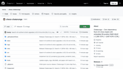
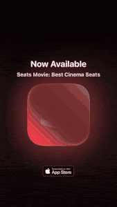
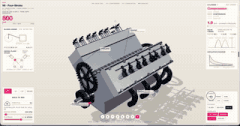
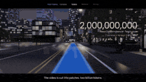
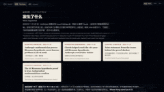
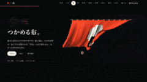
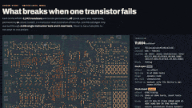
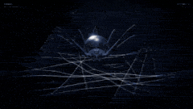
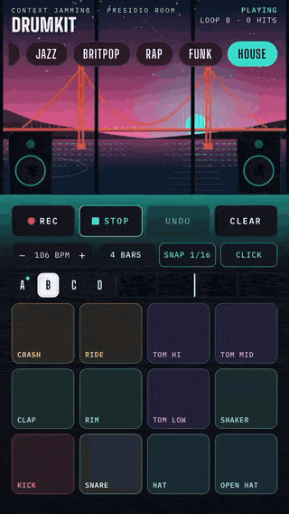

# 🧰 Web Pages & Tools · all 59

[← Back to the main list](../README.md) · **English** · [简体中文](web-and-tools.zh-CN.md) · [繁體中文](web-and-tools.zh-TW.md) · [日本語](web-and-tools.ja.md) · [한국어](web-and-tools.ko.md) · [Español](web-and-tools.es.md) · [Português](web-and-tools.pt-BR.md) · [Français](web-and-tools.fr.md) · [Deutsch](web-and-tools.de.md) · [Русский](web-and-tools.ru.md)

The main page shows at most the top 24 posts with 100+ likes; this page has every entry in this section, sorted by likes.

<table>
<tr>
<td width="33%" valign="top">
 
<b><a href="https://claudia.gallery">Claudia Gallery</a></b> 
<a href="https://x.com/anabology">@anabology</a> · ♥ 5.6k · <a href="https://x.com/anabology/status/2120010995309457643">▶ Video</a> 
"Make the video of your dreams" — two shots, 9 hours. 
<a href="https://fablelist.000ooo.ooo/prompts/?w=claudia-gallery&ref=gh"><b>✨ Get the prompt</b></a>
</td>
<td width="33%" valign="top">
 
<b><a href="http://robotics-lab-app.vercel.app">Robotics Lab</a></b> 
<a href="https://x.com/0xMovez">@0xMovez</a> · ♥ 4.7k · <a href="https://x.com/0xMovez/status/2120239217880268919">▶ Video</a> 
Eight real boards (Arduino Uno, Raspberry Pi 4…) in 3D: place chips, solder them in, wire real circuits. 
<a href="http://robolabs-app.vercel.app">Humanoid edition</a> 
<a href="https://fablelist.000ooo.ooo/prompts/?w=robotics-lab&ref=gh"><b>✨ Get the prompt</b></a>
</td>
<td width="33%" valign="top">
 
<b><a href="https://claude.ai/artifact/N6bSgS4ZH5ifFQfg8sm4dv">House Bangers generator</a></b> 
<a href="https://x.com/deedydas">@deedydas</a> · ♥ 4.1k · <a href="https://x.com/deedydas/status/2120905625852936318">▶ Video</a> 
It learned music theory, tries thousands of patterns per instrument and arranges the best into a 72-bar house track. Sound on. 
<a href="https://fablelist.000ooo.ooo/prompts/?w=house-bangers-generator&ref=gh"><b>✨ Get the prompt</b></a>
</td>
</tr>
<tr>
<td width="33%" valign="top">
 
<b><a href="https://miaai-lab.github.io/Claude-Fable-5.2-HTML-Files/">76 single-file HTML pieces</a></b> 
<a href="https://x.com/MiaAI_lab">@MiaAI_lab</a> · ♥ 2.6k · <a href="https://x.com/MiaAI_lab/status/2119930229661503893">Post</a> 
Generative art, physics, type and UI, each with its original prompt. 
<a href="https://fablelist.000ooo.ooo/prompts/?w=76-single-file-html-pieces&ref=gh"><b>✨ Get the prompt</b></a>
</td>
<td width="33%" valign="top">
 
<b><a href="https://pixel-worlds.vercel.app/keep/">Keep — password strength meter</a></b> 
<a href="https://x.com/crtvTeknologist">@crtvTeknologist</a> · ♥ 1.6k · <a href="https://x.com/crtvTeknologist/status/2119894073024606617">▶ Video</a> 
A password strength indicator rendered as a living pixel world. 
<a href="https://github.com/finktheartist/pixel-worlds">Source</a> 
<a href="https://fablelist.000ooo.ooo/prompts/?w=keep-password-strength-meter&ref=gh"><b>✨ Get the prompt</b></a>
</td>
<td width="33%" valign="top">
 
<b><a href="https://sakuga-vfx.vercel.app">Sakuga Set</a></b> 
<a href="https://x.com/crtvTeknologist">@crtvTeknologist</a> · ♥ 1.4k · <a href="https://x.com/crtvTeknologist/status/2122088829565698218">▶ Video</a> 
Twelve UI controls that react like anime: buttons squash and land with a DON!, toggles smear and splash, sliders kick up clouds. Every effect is drawn in code, one file each, no dependencies. 
<a href="https://github.com/finktheartist/sakuga-vfx">Source</a>
</td>
</tr>
<tr>
<td width="33%" valign="top">
 
<b><a href="https://hashem-al-ghaili.github.io/xray-mirror/">X-Ray Mirror</a></b> 
<a href="https://x.com/HashemGhaili">@HashemGhaili</a> · ♥ 1.4k · <a href="https://x.com/HashemGhaili/status/2120202746121085321">▶ Video</a> 
Point a webcam at your face and see the skull, brain and muscles, tracked live. Open your mouth and the jaw opens; the video never leaves your computer. 
<a href="https://github.com/Hashem-Al-Ghaili/xray-mirror">Source</a> 
<a href="https://fablelist.000ooo.ooo/prompts/?w=x-ray-mirror&ref=gh"><b>✨ Get the prompt</b></a>
</td>
<td width="33%" valign="top">
 
<b><a href="https://xianxie6.github.io/animals-planner-2027/">Animals at Work — 3D planner</a></b> 
<a href="https://x.com/Xian0063">@Xian0063</a> · ♥ 1.2k · <a href="https://x.com/Xian0063/status/2120417834694250522">▶ Video</a> 
A paper planner rebuilt in 3D: drag to turn pages, tap a date to write, 90 stickers you can peel and stick. Opus 5.5 built the skeleton; Fable 5.2 refined materials against real footage. 
<a href="https://fablelist.000ooo.ooo/prompts/?w=animals-at-work-3d-planner&ref=gh"><b>✨ Get the prompt</b></a>
</td>
<td width="33%" valign="top">
 
<b><a href="https://uberdesigner.ai/t/spine-menu">Spine Menu</a></b> 
<a href="https://x.com/seanaiux">@seanaiux</a> · ♥ 1.2k · <a href="https://x.com/seanaiux/status/2120222459110789574">▶ Video</a> 
"Have you ever seen a menu that looks better?" The page includes the prompt. 
<a href="https://uberdesigner.ai/t/aquarium-toggle">Aquarium toggle</a> · <a href="https://uberdesigner.ai/t/glow-widgets">Glow widgets</a>
</td>
</tr>
<tr>
<td width="33%" valign="top">
 
<b><a href="https://roverkit.vercel.app">RoverKit — build and simulate a robot car</a></b> 
<a href="https://x.com/DilumSanjaya">@DilumSanjaya</a> · ♥ 1.2k · <a href="https://x.com/DilumSanjaya/status/2121286147393651085">▶ Video</a> 
A step-by-step guide to building a robot car, with a simulator, a customizable arena and a visual code walkthrough. Supports Arduino and ESP32.
</td>
<td width="33%" valign="top">
 
<b><a href="https://github.com/AlexAtFF/pulp-daw-public">PULP — an AI-native DAW</a></b> 
<a href="https://x.com/The_Alex">@The_Alex</a> · ♥ 948 · <a href="https://x.com/The_Alex/status/2119917226769985785">▶ Video</a> 
A native Windows digital audio workstation. Ask Claude for music and it opens the DAW and makes the song. 
<a href="https://fablelist.000ooo.ooo/prompts/?w=pulp-an-ai-native-daw&ref=gh"><b>✨ Get the prompt</b></a>
</td>
<td width="33%" valign="top">
 
<b><a href="https://frontier.every.to/experiments/ambient-town">Ambient Town</a></b> 
<a href="https://x.com/kieranklaassen">@kieranklaassen</a> · ♥ 896 · <a href="https://x.com/kieranklaassen/status/2119868196773929160">▶ Video</a> 
An ambient DAW built over a week of nights by a former film composer: Ableton Push support, mics, effects, a synth and an agent that composes with you. Click "Try it" on the page. 
<a href="https://fablelist.000ooo.ooo/prompts/?w=ambient-town&ref=gh"><b>✨ Get the prompt</b></a>
</td>
</tr>
<tr>
<td width="33%" valign="top">
 
<b><a href="https://github.com/deedy/chess-chatarunga">Chatarunga — a zero-dependency Rust chess engine</a></b> 
🆕 · <a href="https://x.com/deedydas">@deedydas</a> · ♥ 761 · <a href="https://x.com/deedydas/status/2126140365208224057">Post</a> 
A top 50–100 chess engine written from scratch in Rust with zero dependencies, ELO 3533. It scores 37% against the #1 engine Stockfish and checkmates it in 7% of games. Fully open-sourced, built for about $50 of compute with Fable and a few other tools.
</td>
<td width="33%" valign="top">
 
<b><a href="https://hexagonal.earth">Hexagonal Earth</a></b> 
<a href="https://x.com/avsa">@avsa</a> · ♥ 756 · <a href="https://x.com/avsa/status/2123123638551392755">Post</a> 
A hexagon-based diorama of the whole world built from real elevation, ocean depth, humidity, wind and river data. Fable 5.2 generated hundreds of small 3D pixel-splat objects and placed them in the scene itself.
</td>
<td width="33%" valign="top">
 
<b><a href="https://itspsneha.com/supplements">Which Vitamins to Buy in India</a></b> 
<a href="https://x.com/itspsneha">@itspsneha</a> · ♥ 738 · <a href="https://x.com/itspsneha/status/2120048494761451974">Post</a> 
Built after reading lab reports for 109 tested batches. 
<a href="https://fablelist.000ooo.ooo/prompts/?w=which-vitamins-to-buy-in-india&ref=gh"><b>✨ Get the prompt</b></a>
</td>
</tr>
<tr>
<td width="33%" valign="top">
 
<b><a href="https://v2.video/riley/the-history-of-writing/v1">The History of Writing</a></b> 
<a href="https://x.com/rileybrown">@rileybrown</a> · ♥ 667 · <a href="https://x.com/rileybrown/status/2119946022767980985">▶ Video</a> 
An interactive film from one prompt; prompt and files shared. 
<a href="https://x.com/rileybrown/status/2119946022767980985">📝 Creator's prompt (free)</a>
</td>
<td width="33%" valign="top">
 
<b><a href="https://auden-english-135.netlify.app/">Auden's lost 1941 poetry class, reconstructed</a></b> 
<a href="https://x.com/emollick">@emollick</a> · ♥ 594 · <a href="https://x.com/emollick/status/2121641417483169934">Post</a> 
Fable 5.2 rebuilt W. H. Auden's "hardest in the humanities" class from an obscure Internet Archive book and scattered notes.
</td>
<td width="33%" valign="top">
 
<b><a href="https://omage1.xyz">omage-1: the OP-1 Field synth in a browser</a></b> 
<a href="https://x.com/jamesmbickerton">@jamesmbickerton</a> · ♥ 572 · <a href="https://x.com/jamesmbickerton/status/2122688041219133815">▶ Video</a> 
An unofficial homage that rebuilds Teenage Engineering's OP-1 Field as a browser app you can play right away.
</td>
</tr>
<tr>
<td width="33%" valign="top">
 
<b><a href="https://claude.ai/artifact/4P1urBdptp6gWiJo3R6Vpv">Breakcore video sampler</a></b> 
<a href="https://x.com/parhelion318">@parhelion318</a> · ♥ 545 · <a href="https://x.com/parhelion318/status/2122723067533398064">▶ Video</a> 
A browser sampler that chops video clips and rearranges them into breakcore rhythms.
</td>
<td width="33%" valign="top">
 
<b><a href="https://www.bubbbly.com/christmas-cards">Christmas Cards: interactive Christmas cards</a></b> 
<a href="https://x.com/ann_nnng">@ann_nnng</a> · ♥ 483 · <a href="https://x.com/ann_nnng/status/2122283549000712249">▶ Video</a> 
A set of interactive Christmas cards, such as a cat in a red scarf on a windowsill watching the snow fall.
</td>
<td width="33%" valign="top">
 
<b><a href="https://claude.ai/artifact/8yKUbL5KQgvfqcWH6UgZrq">Kastle Sim</a></b> 
<a href="https://x.com/parhelion318">@parhelion318</a> · ♥ 467 · <a href="https://x.com/parhelion318/status/2123344270732202421">▶ Video</a> 
A browser simulation of the Bastl Kastle mini modular synth: patch the cables, turn the knobs and it makes sound.
</td>
</tr>
<tr>
<td width="33%" valign="top">
 
<b><a href="https://where-is-everybody-fermi.netlify.app/">Where Is Everybody?</a></b> 
<a href="https://x.com/emollick">@emollick</a> · ♥ 457 · <a href="https://x.com/emollick/status/2120359214157603139">Post</a> 
Asked to "solve the Fermi Paradox": it marshals data, tests hypotheses and pressure-tests them against critics. 
<a href="https://resolving-the-great-silence.netlify.app/">Gemini Carbon version</a> 
<a href="https://x.com/emollick/status/2120359214157603139">📝 Creator's prompt (free)</a>
</td>
<td width="33%" valign="top">
 
<b><a href="https://gsplan.org">Galatasaray seat view</a></b> 
<a href="https://x.com/molenbeek84">@molenbeek84</a> · ♥ 429 · <a href="https://x.com/molenbeek84/status/2120847639411331097">Post</a> 
See the view of the pitch from every block at RAMS Park before you buy a ticket. 
<a href="https://fablelist.000ooo.ooo/prompts/?w=galatasaray-seat-view&ref=gh"><b>✨ Get the prompt</b></a>
</td>
<td width="33%" valign="top">
 
<b><a href="https://rubber-hose-ui.vercel.app">Rubber Hose UI: controls as 1930s cartoon characters</a></b> 
<a href="https://x.com/crtvTeknologist">@crtvTeknologist</a> · ♥ 357 · <a href="https://x.com/crtvTeknologist/status/2122433522166124616">▶ Video</a> 
Eleven web controls drawn as rubber-hose cartoons: the slider is a trombone, the toast is a toaster, and the button gets a black eye each press. Vanilla JS and canvas, no dependencies, open source. 
<a href="https://github.com/finktheartist/rubber-hose-ui">Source</a>
</td>
</tr>
<tr>
<td width="33%" valign="top">
 
<b><a href="https://bigfatfish.cc">Big Fat Fish's Tank</a></b> 
<a href="https://x.com/dafeifish">@dafeifish</a> · ♥ 264 · <a href="https://x.com/dafeifish/status/2123395143873019950">Post</a> 
A personal site redesigned as a scrapbook: paper scraps, tape, sticky notes and Polaroids pinned on a deep-blue night sky.
</td>
<td width="33%" valign="top">
 
<b><a href="https://origamihelper.com">Origami Helper</a></b> 
<a href="https://x.com/ryoma_nakajima">@ryoma_nakajima</a> · ♥ 220 · <a href="https://x.com/ryoma_nakajima/status/2120472383241011323">▶ Video</a> 
Learn origami folds in 3D from any angle, with AR. Free, no sign-up, built in one day. 
<a href="https://fablelist.000ooo.ooo/prompts/?w=origami-helper&ref=gh"><b>✨ Get the prompt</b></a>
</td>
<td width="33%" valign="top">
 
<b><a href="https://claude.ai/artifact/5ki5nJzDaayYMNhxymZBNT">Slow Plant Synth</a></b> 
<a href="https://x.com/parhelion318">@parhelion318</a> · ♥ 208 · <a href="https://x.com/parhelion318/status/2123982460090503626">▶ Video</a> 
A simulated plant that grows with your location, the time and simulated weather, and makes its own sounds over days. Made with Fable 5.2 and Opus 5.5.
</td>
</tr>
<tr>
<td width="33%" valign="top">
 
<b><a href="https://typed.page/">Typed</a></b> 
<a href="https://x.com/clairevo">@clairevo</a> · ♥ 205 · <a href="https://x.com/clairevo/status/2119905651359142132">▶ Video</a> 
A fully working typewriter: type or click keys, writing timers, whiteout, autocorrect. 
<a href="https://fablelist.000ooo.ooo/prompts/?w=typed&ref=gh"><b>✨ Get the prompt</b></a>
</td>
<td width="33%" valign="top">
 
<b><a href="https://clockendbader.github.io/fable-builds/heartbeat/">One Heartbeat</a></b> 
<a href="https://x.com/clockendbader">@clockendbader</a> · ♥ 153 · <a href="https://x.com/clockendbader/status/2121246903207961069">Post</a> 
A beating 3D heart with live ECG and pressure traces and heart sounds; compare normal, AF, heart block and aortic stenosis. It wrote its own tests too. 
<a href="https://fablelist.000ooo.ooo/prompts/?w=one-heartbeat&ref=gh"><b>✨ Get the prompt</b></a>
</td>
<td width="33%" valign="top">
 
<b><a href="https://stormy.ai/hands">Hands: how a robot hand works</a></b> 
<a href="https://x.com/Karmedge">@Karmedge</a> · ♥ 151 · <a href="https://x.com/Karmedge/status/2122394153497842080">▶ Video</a> 
An interactive explainer on how a humanoid robot's hand works, why it is hard to build and what it costs. Built with over 1 billion tokens.
</td>
</tr>
<tr>
<td width="33%" valign="top">
 
<b><a href="https://motionsites.ai/?prompt=vante-ribbon-hero">Ribbon Hero</a></b> 
<a href="https://x.com/viktoroddy">@viktoroddy</a> · ♥ 141 · <a href="https://x.com/viktoroddy/status/2119985044542705916">▶ Video</a> 
A hero section made with Fable 5.2 + GPT Image 2.6.
</td>
<td width="33%" valign="top">
 
<b><a href="https://patch.gg/patch/anymove">anymove</a></b> 
<a href="https://x.com/rehan_shei">@rehan_shei</a> · ♥ 140 · <a href="https://x.com/rehan_shei/status/2120409150870159414">▶ Video</a> 
Solves the moves in an AI video clip onto a real 3D rig — no mocap suit, no keyframes. Open source. 
<a href="https://fablelist.000ooo.ooo/prompts/?w=anymove&ref=gh"><b>✨ Get the prompt</b></a>
</td>
<td width="33%" valign="top">
 
<b><a href="https://seats.movie">seats.movie</a></b> 
<a href="https://x.com/sunithvs_">@sunithvs_</a> · ♥ 133 · <a href="https://x.com/sunithvs_/status/2123496822400532982">▶ Video</a> 
Pick a movie and it checks every show in your city for the centre seats that are still free, with a 3D view from the seat. The author says Fable 5.2 ran for five days to build it.
</td>
</tr>
<tr>
<td width="33%" valign="top">
 
<b><a href="https://nikechan.com/">nikechan.com redesign</a></b> 
<a href="https://x.com/tegnike">@tegnike</a> · ♥ 130 · <a href="https://x.com/tegnike/status/2120110145841578173">Post</a> 
A personal site redesigned end to end. 
<a href="https://fablelist.000ooo.ooo/prompts/?w=nikechan-com-redesign&ref=gh"><b>✨ Get the prompt</b></a>
</td>
<td width="33%" valign="top">
 
<b><a href="https://fieldnote-crm-pi.vercel.app">Fieldnote CRM dashboard</a></b> 
<a href="https://x.com/dejvdesign">@dejvdesign</a> · ♥ 130 · <a href="https://x.com/dejvdesign/status/2122335319634874710">▶ Video</a> 
A CRM dashboard interface with live interactions, made with @madebymicrodose.
</td>
<td width="33%" valign="top">
 
<b><a href="https://github.com/kanaworksai-hue/harappa">Harappa (Blender add-on)</a></b> 
<a href="https://x.com/KanaWorks_AI">@KanaWorks_AI</a> · ♥ 90 · <a href="https://x.com/KanaWorks_AI/status/2121221880673972463">▶ Video</a> 
A free Blender add-on that turns a bare hill into an anime-style meadow in one click, with grass, flowers, clouds, trees, seasons and styles. 
<a href="https://fablelist.000ooo.ooo/prompts/?w=harappa-blender-add-on&ref=gh"><b>✨ Get the prompt</b></a>
</td>
</tr>
<tr>
<td width="33%" valign="top">
 
<b><a href="https://andreysuperiorgit.github.io/v8/">V8 Four-Stroke</a></b> 
<a href="https://x.com/andreysuperior">@andreysuperior</a> · ♥ 75 · <a href="https://x.com/andreysuperior/status/2123928682603430384">▶ Video</a> 
A 7.0 litre V8 you can rev in a browser tab: pistons, crank, camshaft and 16 valves move from real dimensions and the headers glow as revs climb. One 124 KB HTML file, 1 prompt and 23 follow-ups.
</td>
<td width="33%" valign="top">
 
<b><a href="https://hashem-al-ghaili.github.io/music-maker/">Music Maker — an instrument you play in thin air</a></b> 
<a href="https://x.com/HashemGhaili">@HashemGhaili</a> · ♥ 68 · <a href="https://x.com/HashemGhaili/status/2124135871293329809">▶ Video</a> 
Turn on your webcam, pinch with both hands and pull apart to stretch a string in the air, pick one of 24 instruments and sweep a fingertip across it to play. Add beats, loop layers and record the result. 
<a href="https://github.com/Hashem-Al-Ghaili/music-maker">Source</a>
</td>
<td width="33%" valign="top">
 
<b><a href="https://sael.net/seat-arena">Best Seat in the House</a></b> 
<a href="https://x.com/RyanSael">@RyanSael</a> · ♥ 62 · <a href="https://x.com/RyanSael/status/2120544205558915329">▶ Video</a> 
Concert seat maps where you see the exact view from every seat before you buy. Fully interactive. 
<a href="https://fablelist.000ooo.ooo/prompts/?w=best-seat-in-the-house&ref=gh"><b>✨ Get the prompt</b></a>
</td>
</tr>
<tr>
<td width="33%" valign="top">
 
<b><a href="http://promptronic3000.com">Promptronic 3000</a></b> 
<a href="https://x.com/fabianstelzer">@fabianstelzer</a> · ♥ 55 · <a href="https://x.com/fabianstelzer/status/2123121678670520627">▶ Video</a> 
An agentic modular synthesizer on the web: connect Claude or another agent over MCP to prompt patches or even whole new modules, then share them by URL.
</td>
<td width="33%" valign="top">
 
<b><a href="https://andreysuperiorgit.github.io/riemann">Riemann Hypothesis, live</a></b> 
<a href="https://x.com/andreysuperior">@andreysuperior</a> · ♥ 54 · <a href="https://x.com/andreysuperior/status/2124274426225008910">▶ Video</a> 
A zeta landscape you can rotate. 102 zeros are found and checked live in your browser, all on one line, then added up to rebuild the primes. One HTML file with no libraries.
</td>
<td width="33%" valign="top">
 
<b><a href="https://tetriss22.github.io/pc-build-lab/">PC Build Lab</a></b> 
<a href="https://x.com/Tetriss112">@Tetriss112</a> · ♥ 51 · <a href="https://x.com/Tetriss112/status/2120520587411935288">▶ Video</a> 
Assemble a $1,279 gaming rig part by part in 3D, in 8 steps — and wreck it on purpose before touching real parts. 
<a href="https://fablelist.000ooo.ooo/prompts/?w=pc-build-lab&ref=gh"><b>✨ Get the prompt</b></a>
</td>
</tr>
<tr>
<td width="33%" valign="top">
 
<b><a href="https://zkevinbai.com/apps/tesla-fsd">How FSD Drives</a></b> 
<a href="https://x.com/zkevinbai">@zkevinbai</a> · ♥ 33 · <a href="https://x.com/zkevinbai/status/2124626274367005100">▶ Video</a> 
A full simulation of Tesla FSD. See what each of the seven cameras sees, then take the wheel yourself.
</td>
<td width="33%" valign="top">
 
<b><a href="https://claude.ai/artifact/NVWaNUrJK5woiKXQsAQaPG">Audio-Reactive Dot Surface</a></b> 
<a href="https://x.com/parhelion318">@parhelion318</a> · ♥ 30 · <a href="https://x.com/parhelion318/status/2123463622252994878">▶ Video</a> 
A surface made of dots that moves with sound. Built with Fable 5.2 and Opus 5.5, reviewed by GPT-6.2 Astra.
</td>
<td width="33%" valign="top">
 
<b><a href="https://shiraeisenberg.com/composed-of-nows">Composed of Nows</a></b> 
<a href="https://x.com/shiraeis">@shiraeis</a> · ♥ 25 · <a href="https://x.com/shiraeis/status/2123562764203589648">▶ Video</a> 
Nine interactive pieces about what it "feels" like to be a language model, made after it was asked to read poetry. One-shot.
</td>
</tr>
<tr>
<td width="33%" valign="top">
 
<b><a href="https://piano.yoshiyukikoyanagi.com">Physical Modeling Piano F1</a></b> 
<a href="https://x.com/moutend">@moutend</a> · ♥ 21 · <a href="https://x.com/moutend/status/2123776671501451468">▶ Video</a> 
A piano that computes its sound in real time in your browser. Play it from the computer keyboard, sustain pedal included. 
<a href="https://github.com/moutend/physical-modeling-piano-f1">Source</a>
</td>
<td width="33%" valign="top">
 
<b><a href="https://riemann.zondark.com/course">The Riemann Hypothesis: a 10-minute hands-on course</a></b> 
🆕 · <a href="https://x.com/ZondarkAI">@ZondarkAI</a> · ♥ 15 · <a href="https://x.com/ZondarkAI/status/2125506885487034601">▶ Video</a> 
An interactive teaching site. Two lessons where every step asks you to do something: find the first non-trivial zero at 14.13 yourself, then watch 1,000 zeros add up into the distribution of primes. In Chinese and English, with a short film.
</td>
<td width="33%" valign="top">
 
<b><a href="https://ember-vesper.aura.build/">Ember Vesper</a></b> 
<a href="https://x.com/titepommee">@titepommee</a> · ♥ 13 · <a href="https://x.com/titepommee/status/2123515807250657457">▶ Video</a> 
A gaming PC turned into a landing page: scroll and it comes apart, changes its glow, switches to a thermal camera and writes your order ticket. One HTML file.
</td>
</tr>
<tr>
<td width="33%" valign="top">
 
<b><a href="https://ai.itokoba.com/ichimai/">Ichimai — how far can one page go</a></b> 
<a href="https://x.com/hideki_climax">@hideki_climax</a> · ♥ 11 · <a href="https://x.com/hideki_climax/status/2120165464722809190">▶ Video</a> 
Just one instruction: "make the strongest static web page that shows what you can do now". 
<a href="https://x.com/hideki_climax/status/2120165464722809190">📝 Creator's prompt (free)</a>
</td>
<td width="33%" valign="top">
 
<b><a href="https://rain-1.github.io/intel4004/web/4004-lesion.html">4004 Lesion Map</a></b> 
<a href="https://x.com/slimer48484">@slimer48484</a> · ♥ 10 · <a href="https://x.com/slimer48484/status/2122231197409398920">Post</a> 
Each of the Intel 4004's 2,242 transistors was broken one at a time in a transistor-level simulation. Hover any transistor on the chip map to see what stops working. 
<a href="https://github.com/rain-1/intel4004">Source</a>
</td>
<td width="33%" valign="top">
 
<b><a href="https://jwt-designs-preview.noone-697.workers.dev/">20 Landing Page Redesigns</a></b> 
<a href="https://x.com/Tmeister">@Tmeister</a> · ♥ 9 · <a href="https://x.com/Tmeister/status/2119983842841018482">Post</a> 
20 alternatives to a JWT plugin's landing page from one simple prompt. 
<a href="https://x.com/Tmeister/status/2119983842841018482">📝 Creator's prompt (free)</a>
</td>
</tr>
<tr>
<td width="33%" valign="top">
 
<b><a href="https://www.asumacodes.xyz/arena/driftwood">Driftwood (Fable vs Opus)</a></b> 
<a href="https://x.com/AsumaCodes">@AsumaCodes</a> · ♥ 9 · <a href="https://x.com/AsumaCodes/status/2120130668848177432">▶ Video</a> 
Same prompt, one shot each, both pages live. Also: a Pomodoro focus room and a bug hunt. 
<a href="https://www.asumacodes.xyz/arena/focus-room">Focus room</a> · <a href="https://www.asumacodes.xyz/arena/bug-hunt">Bug hunt comparison</a> · <a href="https://www.asumacodes.xyz/arena">Series</a> 
<a href="https://x.com/AsumaCodes/status/2120130668848177432">📝 Creator's prompt (free)</a>
</td>
<td width="33%" valign="top">
 
<b><a href="https://uberdesigner.ai/t/araneae">araneae</a></b> 
<a href="https://x.com/seanaiux">@seanaiux</a> · ♥ 8 · <a href="https://x.com/seanaiux/status/2121688869439455410">▶ Video</a> 
Asked to build a website that would scare its maker: a spider lowers itself out of the dark, and the scroll follows it down through its lair, eyes, fangs and legs until you are the fly.
</td>
<td width="33%" valign="top">
 
<b><a href="https://claude.ai/artifact/TiymxxFXzMo7xhWUaecbzk">House Design Proposal</a></b> 
<a href="https://x.com/pnumech">@pnumech</a> · ♥ 7 · <a href="https://x.com/pnumech/status/2120117665041940807">Post</a> 
A detached-house design proposal (Korean), made in a day. 
<a href="https://fablelist.000ooo.ooo/prompts/?w=house-design-proposal&ref=gh"><b>✨ Get the prompt</b></a>
</td>
</tr>
<tr>
<td width="33%" valign="top">
 
<b><a href="https://claude.ai/artifact/9yQkezie4jY3oz2YDLFDiq">Bay Drum Kit</a></b> 
<a href="https://x.com/BretKerr">@BretKerr</a> · ♥ 5 · <a href="https://x.com/BretKerr/status/2119995870854988177">▶ Video</a> 
Every hit reverberates across the bay. 
<a href="https://fablelist.000ooo.ooo/prompts/?w=bay-drum-kit&ref=gh"><b>✨ Get the prompt</b></a>
</td>
<td width="33%" valign="top">
 
<b><a href="https://claude.ai/artifact/Pk6rHPyRwfShT37kiU1sT6">Dub Techno Track + Visualizer</a></b> 
<a href="https://x.com/bartdecrem">@bartdecrem</a> · ♥ 4 · <a href="https://x.com/bartdecrem/status/2119926997422133417">Post</a> 
One shot. 
<a href="https://fablelist.000ooo.ooo/prompts/?w=dub-techno-track-visualizer&ref=gh"><b>✨ Get the prompt</b></a>
</td>
<td width="33%" valign="top">
 
<b><a href="https://claude.ai/artifact/5ufHvxgvXTf5YgQeTR8TbG">Ramayana Family Tree</a></b> 
<a href="https://x.com/chhavsz">@chhavsz</a> · ♥ 2 · <a href="https://x.com/chhavsz/status/2119942973958078785">Post</a> 
The lead actor's ties by blood and marriage to 65 Bollywood stars. 
<a href="https://fablelist.000ooo.ooo/prompts/?w=ramayana-family-tree&ref=gh"><b>✨ Get the prompt</b></a>
</td>
</tr>
<tr>
<td width="33%" valign="top">
 
<b><a href="https://claude.ai/artifact/4aEy6FtUi7jrm9U7uYgp8K">Demoscene Demo</a></b> 
<a href="https://x.com/ndril">@ndril</a> · ♥ 1 · <a href="https://x.com/ndril/status/2119899340642894235">Post</a> 
"Make a demo in the demoscene tradition that runs in the browser." 
<a href="https://x.com/ndril/status/2119899340642894235">📝 Creator's prompt (free)</a>
</td>
<td width="33%" valign="top">
 
<b><a href="https://claude.ai/artifact/H8E7AonW2KFrzdRimaLeXb">112 Forms of Meditation</a></b> 
<a href="https://x.com/RishabJ108">@RishabJ108</a> · ♥ 1 · <a href="https://x.com/RishabJ108/status/2120042407484084558">Post</a> 
Visualized for techies. 
<a href="https://fablelist.000ooo.ooo/prompts/?w=112-forms-of-meditation&ref=gh"><b>✨ Get the prompt</b></a>
</td>
</tr>
</table>

Other sections: [🎮 Games](games.md) · [🌍 3D Worlds & Scenes](3d-worlds.md) · [🎬 Animation & Film (with source)](animation.md) · [📺 Video-only Demos](video-demos.md)

[← Back to the main list](../README.md)
