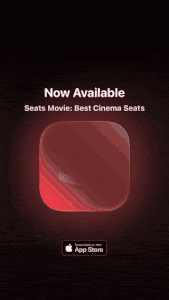
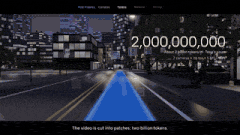
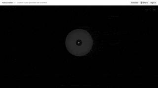
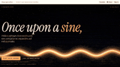

# 🧰 Páginas e ferramentas · todos os 57

[← Voltar à lista](../README.pt-BR.md) · [English](web-and-tools.md) · [简体中文](web-and-tools.zh-CN.md) · [繁體中文](web-and-tools.zh-TW.md) · [日本語](web-and-tools.ja.md) · [한국어](web-and-tools.ko.md) · [Español](web-and-tools.es.md) · **Português** · [Français](web-and-tools.fr.md) · [Deutsch](web-and-tools.de.md) · [Русский](web-and-tools.ru.md)

A página principal mostra no máximo as 24 entradas mais curtidas de cada seção (só as com 100+ curtidas); aqui estão todas as desta seção, por curtidas.

<table>
<tr>
<td width="33%" valign="top">
 
<b><a href="https://claudia.gallery">Claudia Gallery</a></b> 
<a href="https://x.com/anabology">@anabology</a> · ♥ 5.5k · <a href="https://x.com/anabology/status/2120010995309457643">▶ Vídeo</a> 
"Faça o vídeo dos seus sonhos" — duas cenas, 9 horas. 
<a href="https://fablelist.000ooo.ooo/pt/prompts/?w=claudia-gallery&ref=gh"><b>✨ Pegue o prompt</b></a>
</td>
<td width="33%" valign="top">
 
<b><a href="http://robotics-lab-app.vercel.app">Robotics Lab</a></b> 
<a href="https://x.com/0xMovez">@0xMovez</a> · ♥ 4.7k · <a href="https://x.com/0xMovez/status/2120239217880268919">▶ Vídeo</a> 
Oito placas reais (Arduino Uno, Raspberry Pi 4…) em 3D: posicione chips, solde-os, ligue circuitos de verdade. 
<a href="http://robolabs-app.vercel.app">Humanoid edition</a> 
<a href="https://fablelist.000ooo.ooo/pt/prompts/?w=robotics-lab&ref=gh"><b>✨ Pegue o prompt</b></a>
</td>
<td width="33%" valign="top">
 
<b><a href="https://claude.ai/artifact/N6bSgS4ZH5ifFQfg8sm4dv">Gerador de House Bangers</a></b> 
<a href="https://x.com/deedydas">@deedydas</a> · ♥ 4.1k · <a href="https://x.com/deedydas/status/2120905625852936318">▶ Vídeo</a> 
Aprendeu teoria musical, testa milhares de padrões por instrumento e organiza os melhores em uma faixa de house de 72 compassos. Com som. 
<a href="https://fablelist.000ooo.ooo/pt/prompts/?w=house-bangers-generator&ref=gh"><b>✨ Pegue o prompt</b></a>
</td>
</tr>
<tr>
<td width="33%" valign="top">
 
<b><a href="https://miaai-lab.github.io/Claude-Fable-5.2-HTML-Files/">76 peças em HTML de arquivo único</a></b> 
<a href="https://x.com/MiaAI_lab">@MiaAI_lab</a> · ♥ 2.6k · <a href="https://x.com/MiaAI_lab/status/2119930229661503893">Post</a> 
Arte generativa, física, tipografia e UI, cada uma com seu prompt original. 
<a href="https://fablelist.000ooo.ooo/pt/prompts/?w=76-single-file-html-pieces&ref=gh"><b>✨ Pegue o prompt</b></a>
</td>
<td width="33%" valign="top">
 
<b><a href="https://pixel-worlds.vercel.app/keep/">Keep — medidor de força de senha</a></b> 
<a href="https://x.com/crtvTeknologist">@crtvTeknologist</a> · ♥ 1.6k · <a href="https://x.com/crtvTeknologist/status/2119894073024606617">▶ Vídeo</a> 
Um indicador de força de senha renderizado como um mundo de pixels vivo. 
<a href="https://github.com/finktheartist/pixel-worlds">Código-fonte</a> 
<a href="https://fablelist.000ooo.ooo/pt/prompts/?w=keep-password-strength-meter&ref=gh"><b>✨ Pegue o prompt</b></a>
</td>
<td width="33%" valign="top">
 
<b><a href="https://sakuga-vfx.vercel.app">Sakuga Set</a></b> 
<a href="https://x.com/crtvTeknologist">@crtvTeknologist</a> · ♥ 1.4k · <a href="https://x.com/crtvTeknologist/status/2122088829565698218">▶ Vídeo</a> 
Doze controles de interface que reagem como anime: botões se achatam e aterrissam com um DON!, toggles deixam rastro e espirram, sliders levantam nuvens. Todos os efeitos são desenhados em código, um arquivo cada, sem dependências. 
<a href="https://github.com/finktheartist/sakuga-vfx">Código-fonte</a>
</td>
</tr>
<tr>
<td width="33%" valign="top">
 
<b><a href="https://hashem-al-ghaili.github.io/xray-mirror/">X-Ray Mirror</a></b> 
<a href="https://x.com/HashemGhaili">@HashemGhaili</a> · ♥ 1.4k · <a href="https://x.com/HashemGhaili/status/2120202746121085321">▶ Vídeo</a> 
Aponte a webcam para o rosto e veja crânio, cérebro e músculos rastreados ao vivo. Abra a boca e a mandíbula abre; o vídeo nunca sai do seu computador. 
<a href="https://github.com/Hashem-Al-Ghaili/xray-mirror">Código-fonte</a> 
<a href="https://fablelist.000ooo.ooo/pt/prompts/?w=x-ray-mirror&ref=gh"><b>✨ Pegue o prompt</b></a>
</td>
<td width="33%" valign="top">
 
<b><a href="https://xianxie6.github.io/animals-planner-2027/">Animals at Work — agenda 3D</a></b> 
<a href="https://x.com/Xian0063">@Xian0063</a> · ♥ 1.2k · <a href="https://x.com/Xian0063/status/2120417834694250522">▶ Vídeo</a> 
Uma agenda de papel refeita em 3D: arraste para virar páginas, toque numa data para escrever, 90 adesivos para descolar e colar. O Opus 5.5 construiu o esqueleto; o Fable 5.2 refinou os materiais com base em filmagens reais. 
<a href="https://fablelist.000ooo.ooo/pt/prompts/?w=animals-at-work-3d-planner&ref=gh"><b>✨ Pegue o prompt</b></a>
</td>
<td width="33%" valign="top">
 
<b><a href="https://uberdesigner.ai/t/spine-menu">Spine Menu</a></b> 
<a href="https://x.com/seanaiux">@seanaiux</a> · ♥ 1.2k · <a href="https://x.com/seanaiux/status/2120222459110789574">▶ Vídeo</a> 
"Você já viu um menu mais bonito?" A página inclui o prompt. 
<a href="https://uberdesigner.ai/t/aquarium-toggle">Aquarium toggle</a> · <a href="https://uberdesigner.ai/t/glow-widgets">Glow widgets</a>
</td>
</tr>
<tr>
<td width="33%" valign="top">
 
<b><a href="https://roverkit.vercel.app">RoverKit — monte e simule um carrinho robô</a></b> 
<a href="https://x.com/DilumSanjaya">@DilumSanjaya</a> · ♥ 1.1k · <a href="https://x.com/DilumSanjaya/status/2121286147393651085">▶ Vídeo</a> 
Um guia passo a passo para montar um carrinho robô, com simulador, arena personalizável e explicação visual do código. Suporta Arduino e ESP32.
</td>
<td width="33%" valign="top">
 
<b><a href="https://github.com/AlexAtFF/pulp-daw-public">PULP — uma DAW nativa de IA</a></b> 
<a href="https://x.com/The_Alex">@The_Alex</a> · ♥ 947 · <a href="https://x.com/The_Alex/status/2119917226769985785">▶ Vídeo</a> 
Uma estação de áudio digital nativa para Windows. Peça música ao Claude e ele abre a DAW e cria a canção. 
<a href="https://fablelist.000ooo.ooo/pt/prompts/?w=pulp-an-ai-native-daw&ref=gh"><b>✨ Pegue o prompt</b></a>
</td>
<td width="33%" valign="top">
 
<b><a href="https://frontier.every.to/experiments/ambient-town">Ambient Town</a></b> 
<a href="https://x.com/kieranklaassen">@kieranklaassen</a> · ♥ 895 · <a href="https://x.com/kieranklaassen/status/2119868196773929160">▶ Vídeo</a> 
Uma DAW ambient construída em uma semana de noites por um ex-compositor de cinema: suporte ao Ableton Push, microfones, efeitos, um sintetizador e um agente que compõe com você. Clique em "Try it" na página. 
<a href="https://fablelist.000ooo.ooo/pt/prompts/?w=ambient-town&ref=gh"><b>✨ Pegue o prompt</b></a>
</td>
</tr>
<tr>
<td width="33%" valign="top">
 
<b><a href="https://hexagonal.earth">Hexagonal Earth</a></b> 
<a href="https://x.com/avsa">@avsa</a> · ♥ 755 · <a href="https://x.com/avsa/status/2123123638551392755">Post</a> 
Um diorama do mundo inteiro feito de hexágonos, construído com dados reais de elevação, profundidade do oceano, umidade, vento e rios. O Fable 5.2 gerou centenas de pequenos objetos 3D de splats de pixels e os posicionou na cena por conta própria.
</td>
<td width="33%" valign="top">
 
<b><a href="https://itspsneha.com/supplements">Which Vitamins to Buy in India</a></b> 
<a href="https://x.com/itspsneha">@itspsneha</a> · ♥ 736 · <a href="https://x.com/itspsneha/status/2120048494761451974">Post</a> 
Feito após ler laudos de laboratório de 109 lotes testados. 
<a href="https://fablelist.000ooo.ooo/pt/prompts/?w=which-vitamins-to-buy-in-india&ref=gh"><b>✨ Pegue o prompt</b></a>
</td>
<td width="33%" valign="top">
 
<b><a href="https://v2.video/riley/the-history-of-writing/v1">The History of Writing</a></b> 
<a href="https://x.com/rileybrown">@rileybrown</a> · ♥ 667 · <a href="https://x.com/rileybrown/status/2119946022767980985">▶ Vídeo</a> 
Um filme interativo a partir de um prompt; prompt e arquivos compartilhados. 
<a href="https://x.com/rileybrown/status/2119946022767980985">📝 Prompt do criador (grátis)</a>
</td>
</tr>
<tr>
<td width="33%" valign="top">
 
<b><a href="https://auden-english-135.netlify.app/">A aula de poesia perdida de Auden de 1941, reconstruída</a></b> 
<a href="https://x.com/emollick">@emollick</a> · ♥ 594 · <a href="https://x.com/emollick/status/2121641417483169934">Post</a> 
O Fable 5.2 reconstruiu a aula de W. H. Auden, "a mais difícil das humanidades", a partir de um livro obscuro do Internet Archive e anotações dispersas.
</td>
<td width="33%" valign="top">
 
<b><a href="https://omage1.xyz">omage-1: o sintetizador OP-1 Field no navegador</a></b> 
<a href="https://x.com/jamesmbickerton">@jamesmbickerton</a> · ♥ 572 · <a href="https://x.com/jamesmbickerton/status/2122688041219133815">▶ Vídeo</a> 
Uma homenagem não oficial que recria o OP-1 Field da Teenage Engineering como um app de navegador para tocar na hora.
</td>
<td width="33%" valign="top">
 
<b><a href="https://claude.ai/artifact/4P1urBdptp6gWiJo3R6Vpv">Sampler de vídeo breakcore</a></b> 
<a href="https://x.com/parhelion318">@parhelion318</a> · ♥ 541 · <a href="https://x.com/parhelion318/status/2122723067533398064">▶ Vídeo</a> 
Um sampler no navegador que pica clipes de vídeo e os reorganiza em ritmos de breakcore.
</td>
</tr>
<tr>
<td width="33%" valign="top">
 
<b><a href="https://www.bubbbly.com/christmas-cards">Christmas Cards: cartões de Natal interativos</a></b> 
<a href="https://x.com/ann_nnng">@ann_nnng</a> · ♥ 481 · <a href="https://x.com/ann_nnng/status/2122283549000712249">▶ Vídeo</a> 
Um conjunto de cartões de Natal interativos, como um gato de cachecol vermelho no parapeito da janela vendo a neve cair.
</td>
<td width="33%" valign="top">
 
<b><a href="https://claude.ai/artifact/8yKUbL5KQgvfqcWH6UgZrq">Kastle Sim</a></b> 
<a href="https://x.com/parhelion318">@parhelion318</a> · ♥ 467 · <a href="https://x.com/parhelion318/status/2123344270732202421">▶ Vídeo</a> 
Uma simulação no navegador do mini sintetizador modular Bastl Kastle: conecte os cabos, gire os botões e ele faz som.
</td>
<td width="33%" valign="top">
 
<b><a href="https://where-is-everybody-fermi.netlify.app/">Where Is Everybody?</a></b> 
<a href="https://x.com/emollick">@emollick</a> · ♥ 457 · <a href="https://x.com/emollick/status/2120359214157603139">Post</a> 
Pedindo para "resolver o Paradoxo de Fermi": ele reúne dados, testa hipóteses e as submete à crítica de céticos. 
<a href="https://resolving-the-great-silence.netlify.app/">Gemini Carbon version</a> 
<a href="https://x.com/emollick/status/2120359214157603139">📝 Prompt do criador (grátis)</a>
</td>
</tr>
<tr>
<td width="33%" valign="top">
 
<b><a href="https://gsplan.org">Vista dos assentos do Galatasaray</a></b> 
<a href="https://x.com/molenbeek84">@molenbeek84</a> · ♥ 428 · <a href="https://x.com/molenbeek84/status/2120847639411331097">Post</a> 
Veja a vista do campo de cada setor do RAMS Park antes de comprar o ingresso. 
<a href="https://fablelist.000ooo.ooo/pt/prompts/?w=galatasaray-seat-view&ref=gh"><b>✨ Pegue o prompt</b></a>
</td>
<td width="33%" valign="top">
 
<b><a href="https://rubber-hose-ui.vercel.app">Rubber Hose UI: controles como personagens de desenho dos anos 1930</a></b> 
<a href="https://x.com/crtvTeknologist">@crtvTeknologist</a> · ♥ 354 · <a href="https://x.com/crtvTeknologist/status/2122433522166124616">▶ Vídeo</a> 
Onze controles web desenhados no estilo rubber hose: o slider é um trombone, o toast é uma torradeira e o botão ganha um olho roxo a cada clique. JS puro e canvas, sem dependências, código aberto. 
<a href="https://github.com/finktheartist/rubber-hose-ui">Código-fonte</a>
</td>
<td width="33%" valign="top">
 
<b><a href="https://bigfatfish.cc">Big Fat Fish's Tank</a></b> 
<a href="https://x.com/dafeifish">@dafeifish</a> · ♥ 264 · <a href="https://x.com/dafeifish/status/2123395143873019950">Post</a> 
Um site pessoal redesenhado como um scrapbook: pedaços de papel, fita, post-its e Polaroids colados sobre um céu noturno azul-escuro.
</td>
</tr>
<tr>
<td width="33%" valign="top">
 
<b><a href="https://origamihelper.com">Origami Helper</a></b> 
<a href="https://x.com/ryoma_nakajima">@ryoma_nakajima</a> · ♥ 221 · <a href="https://x.com/ryoma_nakajima/status/2120472383241011323">▶ Vídeo</a> 
Aprenda dobras de origami em 3D de qualquer ângulo, com AR. Grátis, sem cadastro, feito em um dia. 
<a href="https://fablelist.000ooo.ooo/pt/prompts/?w=origami-helper&ref=gh"><b>✨ Pegue o prompt</b></a>
</td>
<td width="33%" valign="top">
 
<b><a href="https://claude.ai/artifact/5ki5nJzDaayYMNhxymZBNT">Slow Plant Synth</a></b> 
🆕 · <a href="https://x.com/parhelion318">@parhelion318</a> · ♥ 209 · <a href="https://x.com/parhelion318/status/2123982460090503626">▶ Vídeo</a> 
Uma planta simulada que cresce conforme sua localização, a hora e um clima simulado, e produz seus próprios sons ao longo de dias. Feito com Fable 5.2 e Opus 5.5.
</td>
<td width="33%" valign="top">
 
<b><a href="https://typed.page/">Typed</a></b> 
<a href="https://x.com/clairevo">@clairevo</a> · ♥ 205 · <a href="https://x.com/clairevo/status/2119905651359142132">▶ Vídeo</a> 
Uma máquina de escrever totalmente funcional: digite ou clique nas teclas, timers de escrita, corretivo, autocorreção. 
<a href="https://fablelist.000ooo.ooo/pt/prompts/?w=typed&ref=gh"><b>✨ Pegue o prompt</b></a>
</td>
</tr>
<tr>
<td width="33%" valign="top">
 
<b><a href="https://clockendbader.github.io/fable-builds/heartbeat/">One Heartbeat</a></b> 
<a href="https://x.com/clockendbader">@clockendbader</a> · ♥ 153 · <a href="https://x.com/clockendbader/status/2121246903207961069">Post</a> 
Um coração 3D batendo com ECG e curvas de pressão ao vivo e sons cardíacos; compare normal, FA, bloqueio cardíaco e estenose aórtica. Ele também escreveu os próprios testes. 
<a href="https://fablelist.000ooo.ooo/pt/prompts/?w=one-heartbeat&ref=gh"><b>✨ Pegue o prompt</b></a>
</td>
<td width="33%" valign="top">
 
<b><a href="https://stormy.ai/hands">Hands: como funciona a mão de um robô</a></b> 
<a href="https://x.com/Karmedge">@Karmedge</a> · ♥ 151 · <a href="https://x.com/Karmedge/status/2122394153497842080">▶ Vídeo</a> 
Uma explicação interativa de como funciona a mão de um robô humanoide, por que é difícil de construir e quanto custa. Feita com mais de 1 bilhão de tokens.
</td>
<td width="33%" valign="top">
 
<b><a href="https://motionsites.ai/?prompt=vante-ribbon-hero">Ribbon Hero</a></b> 
<a href="https://x.com/viktoroddy">@viktoroddy</a> · ♥ 141 · <a href="https://x.com/viktoroddy/status/2119985044542705916">▶ Vídeo</a> 
Uma seção hero feita com Fable 5.2 + GPT Image 2.6.
</td>
</tr>
<tr>
<td width="33%" valign="top">
 
<b><a href="https://patch.gg/patch/anymove">anymove</a></b> 
<a href="https://x.com/rehan_shei">@rehan_shei</a> · ♥ 140 · <a href="https://x.com/rehan_shei/status/2120409150870159414">▶ Vídeo</a> 
Resolve os movimentos de um clipe de vídeo de IA em um rig 3D real — sem traje de mocap, sem keyframes. Código aberto. 
<a href="https://fablelist.000ooo.ooo/pt/prompts/?w=anymove&ref=gh"><b>✨ Pegue o prompt</b></a>
</td>
<td width="33%" valign="top">
 
<b><a href="https://seats.movie">seats.movie</a></b> 
<a href="https://x.com/sunithvs_">@sunithvs_</a> · ♥ 133 · <a href="https://x.com/sunithvs_/status/2123496822400532982">▶ Vídeo</a> 
Escolha um filme e ele confere todas as sessões da sua cidade para achar os assentos centrais que ainda estão livres, com visão 3D a partir da poltrona. O autor diz que o Fable 5.2 rodou por cinco dias para construir.
</td>
<td width="33%" valign="top">
 
<b><a href="https://nikechan.com/">Redesign do nikechan.com</a></b> 
<a href="https://x.com/tegnike">@tegnike</a> · ♥ 130 · <a href="https://x.com/tegnike/status/2120110145841578173">Post</a> 
Um site pessoal redesenhado de ponta a ponta. 
<a href="https://fablelist.000ooo.ooo/pt/prompts/?w=nikechan-com-redesign&ref=gh"><b>✨ Pegue o prompt</b></a>
</td>
</tr>
<tr>
<td width="33%" valign="top">
 
<b><a href="https://fieldnote-crm-pi.vercel.app">Dashboard do Fieldnote CRM</a></b> 
<a href="https://x.com/dejvdesign">@dejvdesign</a> · ♥ 130 · <a href="https://x.com/dejvdesign/status/2122335319634874710">▶ Vídeo</a> 
Uma interface de dashboard de CRM com interações ao vivo, feita com @madebymicrodose.
</td>
<td width="33%" valign="top">
 
<b><a href="https://github.com/kanaworksai-hue/harappa">Harappa (add-on do Blender)</a></b> 
<a href="https://x.com/KanaWorks_AI">@KanaWorks_AI</a> · ♥ 90 · <a href="https://x.com/KanaWorks_AI/status/2121221880673972463">▶ Vídeo</a> 
Um add-on gratuito do Blender que transforma uma colina nua em um prado estilo anime com um clique, com grama, flores, nuvens, árvores, estações e estilos. 
<a href="https://fablelist.000ooo.ooo/pt/prompts/?w=harappa-blender-add-on&ref=gh"><b>✨ Pegue o prompt</b></a>
</td>
<td width="33%" valign="top">
 
<b><a href="https://andreysuperiorgit.github.io/v8/">V8 Four-Stroke</a></b> 
<a href="https://x.com/andreysuperior">@andreysuperior</a> · ♥ 74 · <a href="https://x.com/andreysuperior/status/2123928682603430384">▶ Vídeo</a> 
Um V8 de 7.0 litros que você pode acelerar em uma aba do navegador: pistões, virabrequim, comando e 16 válvulas se movem com medidas reais e os coletores ficam em brasa conforme o giro sobe. Um único HTML de 124 KB, 1 prompt e 23 ajustes.
</td>
</tr>
<tr>
<td width="33%" valign="top">
 
<b><a href="https://hashem-al-ghaili.github.io/music-maker/">Music Maker — um instrumento que se toca no ar</a></b> 
🆕 · <a href="https://x.com/HashemGhaili">@HashemGhaili</a> · ♥ 63 · <a href="https://x.com/HashemGhaili/status/2124135871293329809">▶ Vídeo</a> 
Ligue a webcam, faça uma pinça com as duas mãos e afaste-as para esticar uma corda no ar, escolha um entre 24 instrumentos e deslize a ponta do dedo sobre ela para tocar. Adicione batidas, sobreponha loops e grave o resultado. 
<a href="https://github.com/Hashem-Al-Ghaili/music-maker">Código-fonte</a>
</td>
<td width="33%" valign="top">
 
<b><a href="https://sael.net/seat-arena">Best Seat in the House</a></b> 
<a href="https://x.com/RyanSael">@RyanSael</a> · ♥ 62 · <a href="https://x.com/RyanSael/status/2120544205558915329">▶ Vídeo</a> 
Mapas de assentos de shows em que você vê a vista exata de cada lugar antes de comprar. Totalmente interativo. 
<a href="https://fablelist.000ooo.ooo/pt/prompts/?w=best-seat-in-the-house&ref=gh"><b>✨ Pegue o prompt</b></a>
</td>
<td width="33%" valign="top">
 
<b><a href="http://promptronic3000.com">Promptronic 3000</a></b> 
<a href="https://x.com/fabianstelzer">@fabianstelzer</a> · ♥ 55 · <a href="https://x.com/fabianstelzer/status/2123121678670520627">▶ Vídeo</a> 
Um sintetizador modular com agentes na web: conecte o Claude ou outro agente via MCP para criar patches ou até módulos novos com texto, e compartilhe por URL.
</td>
</tr>
<tr>
<td width="33%" valign="top">
 
<b><a href="https://andreysuperiorgit.github.io/riemann">Riemann Hypothesis, live</a></b> 
🆕 · <a href="https://x.com/andreysuperior">@andreysuperior</a> · ♥ 53 · <a href="https://x.com/andreysuperior/status/2124274426225008910">▶ Vídeo</a> 
Uma paisagem da função zeta que você pode girar. 102 zeros são encontrados e verificados ao vivo no navegador, todos na mesma linha, e depois somados para reconstruir os números primos. Um único arquivo HTML, sem bibliotecas.
</td>
<td width="33%" valign="top">
 
<b><a href="https://tetriss22.github.io/pc-build-lab/">PC Build Lab</a></b> 
<a href="https://x.com/Tetriss112">@Tetriss112</a> · ♥ 51 · <a href="https://x.com/Tetriss112/status/2120520587411935288">▶ Vídeo</a> 
Monte um PC gamer de US$ 1.279 peça por peça em 3D, em 8 etapas — e destrua-o de propósito antes de encostar em peças reais. 
<a href="https://fablelist.000ooo.ooo/pt/prompts/?w=pc-build-lab&ref=gh"><b>✨ Pegue o prompt</b></a>
</td>
<td width="33%" valign="top">
 
<b><a href="https://zkevinbai.com/apps/tesla-fsd">How FSD Drives</a></b> 
🆕 · <a href="https://x.com/zkevinbai">@zkevinbai</a> · ♥ 31 · <a href="https://x.com/zkevinbai/status/2124626274367005100">▶ Vídeo</a> 
Uma simulação completa do FSD da Tesla. Veja o que cada uma das sete câmeras enxerga e depois assuma o volante.
</td>
</tr>
<tr>
<td width="33%" valign="top">
 
<b><a href="https://claude.ai/artifact/NVWaNUrJK5woiKXQsAQaPG">Audio-Reactive Dot Surface</a></b> 
<a href="https://x.com/parhelion318">@parhelion318</a> · ♥ 30 · <a href="https://x.com/parhelion318/status/2123463622252994878">▶ Vídeo</a> 
Uma superfície feita de pontos que se move com o som. Feita com Fable 5.2 e Opus 5.5, revisada pelo GPT-6.2 Astra.
</td>
<td width="33%" valign="top">
 
<b><a href="https://shiraeisenberg.com/composed-of-nows">Composed of Nows</a></b> 
<a href="https://x.com/shiraeis">@shiraeis</a> · ♥ 25 · <a href="https://x.com/shiraeis/status/2123562764203589648">▶ Vídeo</a> 
Nove peças interativas sobre como é a "sensação" de ser um modelo de linguagem, feitas depois de pedir que ele lesse poesia. De primeira.
</td>
<td width="33%" valign="top">
 
<b><a href="https://piano.yoshiyukikoyanagi.com">Physical Modeling Piano F1</a></b> 
<a href="https://x.com/moutend">@moutend</a> · ♥ 21 · <a href="https://x.com/moutend/status/2123776671501451468">▶ Vídeo</a> 
Um piano que calcula o próprio som em tempo real no navegador. Toque pelo teclado do computador, com pedal de sustain. 
<a href="https://github.com/moutend/physical-modeling-piano-f1">Código-fonte</a>
</td>
</tr>
<tr>
<td width="33%" valign="top">
 
<b><a href="https://ember-vesper.aura.build/">Ember Vesper</a></b> 
<a href="https://x.com/titepommee">@titepommee</a> · ♥ 13 · <a href="https://x.com/titepommee/status/2123515807250657457">▶ Vídeo</a> 
Um PC gamer transformado em landing page: role a página e ele se desmonta, muda o brilho, passa para a câmera térmica e escreve seu pedido. Um único arquivo HTML.
</td>
<td width="33%" valign="top">
 
<b><a href="https://ai.itokoba.com/ichimai/">Ichimai — até onde uma página pode ir</a></b> 
<a href="https://x.com/hideki_climax">@hideki_climax</a> · ♥ 11 · <a href="https://x.com/hideki_climax/status/2120165464722809190">▶ Vídeo</a> 
Só uma instrução: "faça a página web estática mais forte que mostre o que você sabe fazer agora". 
<a href="https://x.com/hideki_climax/status/2120165464722809190">📝 Prompt do criador (grátis)</a>
</td>
<td width="33%" valign="top">
 
<b><a href="https://rain-1.github.io/intel4004/web/4004-lesion.html">4004 Lesion Map</a></b> 
<a href="https://x.com/slimer48484">@slimer48484</a> · ♥ 10 · <a href="https://x.com/slimer48484/status/2122231197409398920">Post</a> 
Cada um dos 2,242 transistores do Intel 4004 foi quebrado, um de cada vez, numa simulação em nível de transistor. Passe o cursor sobre qualquer transistor no mapa do chip para ver o que para de funcionar. 
<a href="https://github.com/rain-1/intel4004">Código-fonte</a>
</td>
</tr>
<tr>
<td width="33%" valign="top">
 
<b><a href="https://jwt-designs-preview.noone-697.workers.dev/">20 Landing Page Redesigns</a></b> 
<a href="https://x.com/Tmeister">@Tmeister</a> · ♥ 9 · <a href="https://x.com/Tmeister/status/2119983842841018482">Post</a> 
20 alternativas à landing page de um plugin JWT a partir de um prompt simples. 
<a href="https://x.com/Tmeister/status/2119983842841018482">📝 Prompt do criador (grátis)</a>
</td>
<td width="33%" valign="top">
 
<b><a href="https://www.asumacodes.xyz/arena/driftwood">Driftwood (Fable vs Opus)</a></b> 
<a href="https://x.com/AsumaCodes">@AsumaCodes</a> · ♥ 9 · <a href="https://x.com/AsumaCodes/status/2120130668848177432">▶ Vídeo</a> 
Mesmo prompt, uma tentativa cada, as duas páginas no ar. Também: uma sala de foco Pomodoro e uma caça a bugs. 
<a href="https://www.asumacodes.xyz/arena/focus-room">Focus room</a> · <a href="https://www.asumacodes.xyz/arena/bug-hunt">Bug hunt comparison</a> · <a href="https://www.asumacodes.xyz/arena">Series</a> 
<a href="https://x.com/AsumaCodes/status/2120130668848177432">📝 Prompt do criador (grátis)</a>
</td>
<td width="33%" valign="top">
 
<b><a href="https://uberdesigner.ai/t/araneae">araneae</a></b> 
<a href="https://x.com/seanaiux">@seanaiux</a> · ♥ 8 · <a href="https://x.com/seanaiux/status/2121688869439455410">▶ Vídeo</a> 
O pedido era um site que desse medo: uma aranha desce do escuro e a rolagem a acompanha pela toca, olhos, presas e pernas até você virar a mosca.
</td>
</tr>
<tr>
<td width="33%" valign="top">
 
<b><a href="https://claude.ai/artifact/TiymxxFXzMo7xhWUaecbzk">House Design Proposal</a></b> 
<a href="https://x.com/pnumech">@pnumech</a> · ♥ 7 · <a href="https://x.com/pnumech/status/2120117665041940807">Post</a> 
Uma proposta de projeto de casa isolada (em coreano), feita em um dia. 
<a href="https://fablelist.000ooo.ooo/pt/prompts/?w=house-design-proposal&ref=gh"><b>✨ Pegue o prompt</b></a>
</td>
<td width="33%" valign="top">
 
<b><a href="https://claude.ai/artifact/9yQkezie4jY3oz2YDLFDiq">Bay Drum Kit</a></b> 
<a href="https://x.com/BretKerr">@BretKerr</a> · ♥ 5 · <a href="https://x.com/BretKerr/status/2119995870854988177">▶ Vídeo</a> 
Cada batida reverbera por toda a baía. 
<a href="https://fablelist.000ooo.ooo/pt/prompts/?w=bay-drum-kit&ref=gh"><b>✨ Pegue o prompt</b></a>
</td>
<td width="33%" valign="top">
 
<b><a href="https://claude.ai/artifact/Pk6rHPyRwfShT37kiU1sT6">Dub Techno Track + Visualizer</a></b> 
<a href="https://x.com/bartdecrem">@bartdecrem</a> · ♥ 4 · <a href="https://x.com/bartdecrem/status/2119926997422133417">Post</a> 
Uma tentativa só. 
<a href="https://fablelist.000ooo.ooo/pt/prompts/?w=dub-techno-track-visualizer&ref=gh"><b>✨ Pegue o prompt</b></a>
</td>
</tr>
<tr>
<td width="33%" valign="top">
 
<b><a href="https://claude.ai/artifact/5ufHvxgvXTf5YgQeTR8TbG">Ramayana Family Tree</a></b> 
<a href="https://x.com/chhavsz">@chhavsz</a> · ♥ 2 · <a href="https://x.com/chhavsz/status/2119942973958078785">Post</a> 
Os laços de sangue e casamento do ator principal com 65 estrelas de Bollywood. 
<a href="https://fablelist.000ooo.ooo/pt/prompts/?w=ramayana-family-tree&ref=gh"><b>✨ Pegue o prompt</b></a>
</td>
<td width="33%" valign="top">
 
<b><a href="https://claude.ai/artifact/4aEy6FtUi7jrm9U7uYgp8K">Demoscene Demo</a></b> 
<a href="https://x.com/ndril">@ndril</a> · ♥ 1 · <a href="https://x.com/ndril/status/2119899340642894235">Post</a> 
"Faça uma demo na tradição da demoscene que rode no navegador." 
<a href="https://x.com/ndril/status/2119899340642894235">📝 Prompt do criador (grátis)</a>
</td>
<td width="33%" valign="top">
 
<b><a href="https://claude.ai/artifact/H8E7AonW2KFrzdRimaLeXb">112 Forms of Meditation</a></b> 
<a href="https://x.com/RishabJ108">@RishabJ108</a> · ♥ 1 · <a href="https://x.com/RishabJ108/status/2120042407484084558">Post</a> 
Visualizadas para o pessoal de tecnologia. 
<a href="https://fablelist.000ooo.ooo/pt/prompts/?w=112-forms-of-meditation&ref=gh"><b>✨ Pegue o prompt</b></a>
</td>
</tr>
</table>

Outras seções: [🎮 Jogos](games.pt-BR.md) · [🌍 Mundos e cenas 3D](3d-worlds.pt-BR.md) · [🎬 Animação e filmes](animation.pt-BR.md) · [📺 Demos em vídeo](video-demos.pt-BR.md)

[← Voltar à lista](../README.pt-BR.md)
