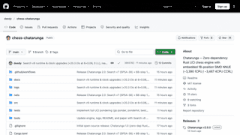
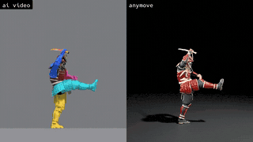
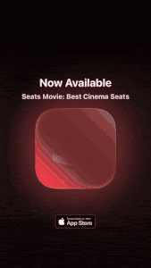
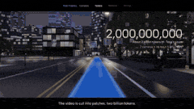
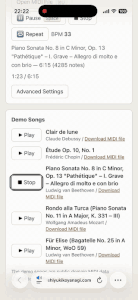
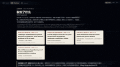
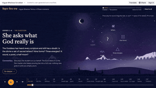

# 🧰 Сайты и инструменты · все 60

[← Назад к списку](../README.ru.md) · [English](web-and-tools.md) · [简体中文](web-and-tools.zh-CN.md) · [繁體中文](web-and-tools.zh-TW.md) · [日本語](web-and-tools.ja.md) · [한국어](web-and-tools.ko.md) · [Español](web-and-tools.es.md) · [Português](web-and-tools.pt-BR.md) · [Français](web-and-tools.fr.md) · [Deutsch](web-and-tools.de.md) · **Русский**

На главной странице в каждом разделе — не больше 24 самых популярных записей (только от 100 лайков); здесь все записи раздела, по числу лайков.

<table>
<tr>
<td width="33%" valign="top">
 
<b><a href="https://claudia.gallery">Claudia Gallery</a></b> 
<a href="https://x.com/anabology">@anabology</a> · ♥ 5.6k · <a href="https://x.com/anabology/status/2120010995309457643">▶ Видео</a> 
«Make the video of your dreams» — два кадра, 9 часов. 
<a href="https://fablelist.000ooo.ooo/ru/prompts/?w=claudia-gallery&ref=gh"><b>✨ Получить промпт</b></a>
</td>
<td width="33%" valign="top">
 
<b><a href="http://robotics-lab-app.vercel.app">Robotics Lab</a></b> 
<a href="https://x.com/0xMovez">@0xMovez</a> · ♥ 4.7k · <a href="https://x.com/0xMovez/status/2120239217880268919">▶ Видео</a> 
Восемь настоящих плат (Arduino Uno, Raspberry Pi 4…) в 3D: ставьте чипы, паяйте, собирайте настоящие схемы. 
<a href="http://robolabs-app.vercel.app">Humanoid edition</a> 
<a href="https://fablelist.000ooo.ooo/ru/prompts/?w=robotics-lab&ref=gh"><b>✨ Получить промпт</b></a>
</td>
<td width="33%" valign="top">
 
<b><a href="https://claude.ai/artifact/N6bSgS4ZH5ifFQfg8sm4dv">Генератор хаус-бэнгеров</a></b> 
<a href="https://x.com/deedydas">@deedydas</a> · ♥ 4.1k · <a href="https://x.com/deedydas/status/2120905625852936318">▶ Видео</a> 
Выучил теорию музыки, перебирает тысячи паттернов для каждого инструмента и собирает лучшие в хаус-трек на 72 такта. Со звуком. 
<a href="https://fablelist.000ooo.ooo/ru/prompts/?w=house-bangers-generator&ref=gh"><b>✨ Получить промпт</b></a>
</td>
</tr>
<tr>
<td width="33%" valign="top">
 
<b><a href="https://miaai-lab.github.io/Claude-Fable-5.2-HTML-Files/">76 одиночных HTML-файлов</a></b> 
<a href="https://x.com/MiaAI_lab">@MiaAI_lab</a> · ♥ 2.6k · <a href="https://x.com/MiaAI_lab/status/2119930229661503893">Пост</a> 
Генеративное искусство, физика, типографика и UI, у каждого свой исходный промпт. 
<a href="https://fablelist.000ooo.ooo/ru/prompts/?w=76-single-file-html-pieces&ref=gh"><b>✨ Получить промпт</b></a>
</td>
<td width="33%" valign="top">
 
<b><a href="https://pixel-worlds.vercel.app/keep/">Keep — индикатор надёжности пароля</a></b> 
<a href="https://x.com/crtvTeknologist">@crtvTeknologist</a> · ♥ 1.6k · <a href="https://x.com/crtvTeknologist/status/2119894073024606617">▶ Видео</a> 
Индикатор надёжности пароля в виде живого пиксельного мира. 
<a href="https://github.com/finktheartist/pixel-worlds">Исходный код</a> 
<a href="https://fablelist.000ooo.ooo/ru/prompts/?w=keep-password-strength-meter&ref=gh"><b>✨ Получить промпт</b></a>
</td>
<td width="33%" valign="top">
 
<b><a href="https://sakuga-vfx.vercel.app">Sakuga Set</a></b> 
<a href="https://x.com/crtvTeknologist">@crtvTeknologist</a> · ♥ 1.4k · <a href="https://x.com/crtvTeknologist/status/2122088829565698218">▶ Видео</a> 
Двенадцать элементов интерфейса, которые реагируют как в аниме: кнопки сплющиваются и приземляются с «DON!», переключатели размазываются и разлетаются брызгами, слайдеры поднимают облака. Все эффекты нарисованы кодом, по одному файлу, без зависимостей. 
<a href="https://github.com/finktheartist/sakuga-vfx">Исходный код</a>
</td>
</tr>
<tr>
<td width="33%" valign="top">
 
<b><a href="https://hashem-al-ghaili.github.io/xray-mirror/">X-Ray Mirror</a></b> 
<a href="https://x.com/HashemGhaili">@HashemGhaili</a> · ♥ 1.4k · <a href="https://x.com/HashemGhaili/status/2120202746121085321">▶ Видео</a> 
Направьте веб-камеру на своё лицо и увидите череп, мозг и мышцы с отслеживанием в реальном времени. Откройте рот — и челюсть откроется; видео не покидает ваш компьютер. 
<a href="https://github.com/Hashem-Al-Ghaili/xray-mirror">Исходный код</a> 
<a href="https://fablelist.000ooo.ooo/ru/prompts/?w=x-ray-mirror&ref=gh"><b>✨ Получить промпт</b></a>
</td>
<td width="33%" valign="top">
 
<b><a href="https://xianxie6.github.io/animals-planner-2027/">Animals at Work — 3D-планер</a></b> 
<a href="https://x.com/Xian0063">@Xian0063</a> · ♥ 1.2k · <a href="https://x.com/Xian0063/status/2120417834694250522">▶ Видео</a> 
Бумажный планер, пересобранный в 3D: тяните, чтобы перелистывать страницы, нажмите на дату, чтобы написать, 90 стикеров, которые можно отклеивать и наклеивать. Opus 5.5 построил каркас; Fable 5.2 довёл материалы по реальным съёмкам. 
<a href="https://fablelist.000ooo.ooo/ru/prompts/?w=animals-at-work-3d-planner&ref=gh"><b>✨ Получить промпт</b></a>
</td>
<td width="33%" valign="top">
 
<b><a href="https://uberdesigner.ai/t/spine-menu">Spine Menu</a></b> 
<a href="https://x.com/seanaiux">@seanaiux</a> · ♥ 1.2k · <a href="https://x.com/seanaiux/status/2120222459110789574">▶ Видео</a> 
«Have you ever seen a menu that looks better?» На странице есть промпт. 
<a href="https://uberdesigner.ai/t/aquarium-toggle">Aquarium toggle</a> · <a href="https://uberdesigner.ai/t/glow-widgets">Glow widgets</a>
</td>
</tr>
<tr>
<td width="33%" valign="top">
 
<b><a href="https://roverkit.vercel.app">RoverKit — собери и смоделируй робота-машинку</a></b> 
<a href="https://x.com/DilumSanjaya">@DilumSanjaya</a> · ♥ 1.2k · <a href="https://x.com/DilumSanjaya/status/2121286147393651085">▶ Видео</a> 
Пошаговое руководство по сборке робота-машинки с симулятором, настраиваемой ареной и наглядным разбором кода. Поддерживает Arduino и ESP32.
</td>
<td width="33%" valign="top">
 
<b><a href="https://github.com/AlexAtFF/pulp-daw-public">PULP — AI-native DAW</a></b> 
<a href="https://x.com/The_Alex">@The_Alex</a> · ♥ 948 · <a href="https://x.com/The_Alex/status/2119917226769985785">▶ Видео</a> 
Нативная цифровая звуковая рабочая станция для Windows. Попросите Claude о музыке — он откроет DAW и сделает песню. 
<a href="https://fablelist.000ooo.ooo/ru/prompts/?w=pulp-an-ai-native-daw&ref=gh"><b>✨ Получить промпт</b></a>
</td>
<td width="33%" valign="top">
 
<b><a href="https://frontier.every.to/experiments/ambient-town">Ambient Town</a></b> 
<a href="https://x.com/kieranklaassen">@kieranklaassen</a> · ♥ 896 · <a href="https://x.com/kieranklaassen/status/2119868196773929160">▶ Видео</a> 
Эмбиент-DAW, которую бывший кинокомпозитор строил неделю по ночам: поддержка Ableton Push, микрофоны, эффекты, синтезатор и агент, который сочиняет вместе с вами. Нажмите «Try it» на странице. 
<a href="https://fablelist.000ooo.ooo/ru/prompts/?w=ambient-town&ref=gh"><b>✨ Получить промпт</b></a>
</td>
</tr>
<tr>
<td width="33%" valign="top">
 
<b><a href="https://github.com/deedy/chess-chatarunga">Chatarunga — шахматный движок на Rust без зависимостей</a></b> 
🆕 · <a href="https://x.com/deedydas">@deedydas</a> · ♥ 869 · <a href="https://x.com/deedydas/status/2126140365208224057">Пост</a> 
Шахматный движок, написанный с нуля на Rust без зависимостей, с рейтингом ELO 3533, входит в топ-50–100 мира. Набирает 37% против движка номер один Stockfish и ставит ему мат в 7% партий. Полностью с открытым кодом, сделан примерно за $50 вычислений с помощью Fable и ещё нескольких инструментов.
</td>
<td width="33%" valign="top">
 
<b><a href="https://hexagonal.earth">Hexagonal Earth</a></b> 
<a href="https://x.com/avsa">@avsa</a> · ♥ 757 · <a href="https://x.com/avsa/status/2123123638551392755">Пост</a> 
Диорама всего мира из шестиугольников, построенная на реальных данных о высотах, глубинах океана, влажности, ветрах и реках. Fable 5.2 сгенерировал сотни маленьких 3D-объектов из пиксельных сплатов и сам расставил их в сцене.
</td>
<td width="33%" valign="top">
 
<b><a href="https://itspsneha.com/supplements">Which Vitamins to Buy in India</a></b> 
<a href="https://x.com/itspsneha">@itspsneha</a> · ♥ 738 · <a href="https://x.com/itspsneha/status/2120048494761451974">Пост</a> 
Сделано после изучения лабораторных отчётов по 109 протестированным партиям. 
<a href="https://fablelist.000ooo.ooo/ru/prompts/?w=which-vitamins-to-buy-in-india&ref=gh"><b>✨ Получить промпт</b></a>
</td>
</tr>
<tr>
<td width="33%" valign="top">
 
<b><a href="https://v2.video/riley/the-history-of-writing/v1">The History of Writing</a></b> 
<a href="https://x.com/rileybrown">@rileybrown</a> · ♥ 667 · <a href="https://x.com/rileybrown/status/2119946022767980985">▶ Видео</a> 
Интерактивный фильм из одного промпта; промпт и файлы опубликованы. 
<a href="https://x.com/rileybrown/status/2119946022767980985">📝 Промпт автора (бесплатно)</a>
</td>
<td width="33%" valign="top">
 
<b><a href="https://auden-english-135.netlify.app/">Утраченный курс поэзии Одена 1941 года, восстановленный</a></b> 
<a href="https://x.com/emollick">@emollick</a> · ♥ 593 · <a href="https://x.com/emollick/status/2121641417483169934">Пост</a> 
Fable 5.2 восстановил курс У. Х. Одена, «самый сложный в гуманитарных науках», по малоизвестной книге из Internet Archive и разрозненным заметкам.
</td>
<td width="33%" valign="top">
 
<b><a href="https://omage1.xyz">omage-1: синтезатор OP-1 Field в браузере</a></b> 
<a href="https://x.com/jamesmbickerton">@jamesmbickerton</a> · ♥ 572 · <a href="https://x.com/jamesmbickerton/status/2122688041219133815">▶ Видео</a> 
Неофициальный оммаж: OP-1 Field от Teenage Engineering, воссозданный как браузерное приложение, на котором можно сразу играть.
</td>
</tr>
<tr>
<td width="33%" valign="top">
 
<b><a href="https://claude.ai/artifact/4P1urBdptp6gWiJo3R6Vpv">Breakcore-видеосэмплер</a></b> 
<a href="https://x.com/parhelion318">@parhelion318</a> · ♥ 545 · <a href="https://x.com/parhelion318/status/2122723067533398064">▶ Видео</a> 
Сэмплер в браузере, который нарезает видеоклипы и пересобирает их в ритмы breakcore.
</td>
<td width="33%" valign="top">
 
<b><a href="https://www.bubbbly.com/christmas-cards">Christmas Cards: интерактивные рождественские открытки</a></b> 
<a href="https://x.com/ann_nnng">@ann_nnng</a> · ♥ 483 · <a href="https://x.com/ann_nnng/status/2122283549000712249">▶ Видео</a> 
Набор интерактивных рождественских открыток, например кот в красном шарфе на подоконнике смотрит, как падает снег.
</td>
<td width="33%" valign="top">
 
<b><a href="https://claude.ai/artifact/8yKUbL5KQgvfqcWH6UgZrq">Kastle Sim</a></b> 
<a href="https://x.com/parhelion318">@parhelion318</a> · ♥ 467 · <a href="https://x.com/parhelion318/status/2123344270732202421">▶ Видео</a> 
Симуляция мини-модульного синтезатора Bastl Kastle в браузере: соединяйте гнёзда проводами, крутите ручки — и он звучит.
</td>
</tr>
<tr>
<td width="33%" valign="top">
 
<b><a href="https://where-is-everybody-fermi.netlify.app/">Where Is Everybody?</a></b> 
<a href="https://x.com/emollick">@emollick</a> · ♥ 457 · <a href="https://x.com/emollick/status/2120359214157603139">Пост</a> 
На задачу «solve the Fermi Paradox» собирает данные, проверяет гипотезы и испытывает их на прочность перед критиками. 
<a href="https://resolving-the-great-silence.netlify.app/">Gemini Carbon version</a> 
<a href="https://x.com/emollick/status/2120359214157603139">📝 Промпт автора (бесплатно)</a>
</td>
<td width="33%" valign="top">
 
<b><a href="https://gsplan.org">Вид с мест на Галатасарае</a></b> 
<a href="https://x.com/molenbeek84">@molenbeek84</a> · ♥ 430 · <a href="https://x.com/molenbeek84/status/2120847639411331097">Пост</a> 
Посмотрите на вид на поле с каждого сектора на RAMS Park, прежде чем покупать билет. 
<a href="https://fablelist.000ooo.ooo/ru/prompts/?w=galatasaray-seat-view&ref=gh"><b>✨ Получить промпт</b></a>
</td>
<td width="33%" valign="top">
 
<b><a href="https://rubber-hose-ui.vercel.app">Rubber Hose UI: элементы управления в виде мультяшек 1930-х</a></b> 
<a href="https://x.com/crtvTeknologist">@crtvTeknologist</a> · ♥ 357 · <a href="https://x.com/crtvTeknologist/status/2122433522166124616">▶ Видео</a> 
Одиннадцать веб-контролов в стиле rubber hose: слайдер стал тромбоном, тост стал тостером, а кнопка получает синяк под глазом при каждом нажатии. Чистый JS и canvas, без зависимостей, открытый код. 
<a href="https://github.com/finktheartist/rubber-hose-ui">Исходный код</a>
</td>
</tr>
<tr>
<td width="33%" valign="top">
 
<b><a href="https://bigfatfish.cc">Big Fat Fish's Tank</a></b> 
<a href="https://x.com/dafeifish">@dafeifish</a> · ♥ 264 · <a href="https://x.com/dafeifish/status/2123395143873019950">Пост</a> 
Личный сайт, переделанный в стиле скрапбука: бумажки, скотч, стикеры и полароиды на тёмно-синем ночном небе.
</td>
<td width="33%" valign="top">
 
<b><a href="https://origamihelper.com">Origami Helper</a></b> 
<a href="https://x.com/ryoma_nakajima">@ryoma_nakajima</a> · ♥ 220 · <a href="https://x.com/ryoma_nakajima/status/2120472383241011323">▶ Видео</a> 
Учитесь складывать оригами в 3D с любого ракурса, с AR. Бесплатно, без регистрации, сделано за один день. 
<a href="https://fablelist.000ooo.ooo/ru/prompts/?w=origami-helper&ref=gh"><b>✨ Получить промпт</b></a>
</td>
<td width="33%" valign="top">
 
<b><a href="https://assetora.vercel.app">Assetora — панель активов, сделанная за два дня</a></b> 
🆕 · <a href="https://x.com/marcelkargul">@marcelkargul</a> · ♥ 215 · <a href="https://x.com/marcelkargul/status/2126119817849815490">Пост</a> 
Полноценная панель управления активами, созданная на Next.js примерно за два дня с Claude Fable 5.2 и двумя дизайнерскими скиллами. В браузере сразу открывается рабочая панель.
</td>
</tr>
<tr>
<td width="33%" valign="top">
 
<b><a href="https://claude.ai/artifact/5ki5nJzDaayYMNhxymZBNT">Slow Plant Synth</a></b> 
<a href="https://x.com/parhelion318">@parhelion318</a> · ♥ 208 · <a href="https://x.com/parhelion318/status/2123982460090503626">▶ Видео</a> 
Виртуальное растение растёт в зависимости от вашего местоположения, времени и смоделированной погоды и днями издаёт собственные звуки. Сделано с Fable 5.2 и Opus 5.5.
</td>
<td width="33%" valign="top">
 
<b><a href="https://typed.page/">Typed</a></b> 
<a href="https://x.com/clairevo">@clairevo</a> · ♥ 205 · <a href="https://x.com/clairevo/status/2119905651359142132">▶ Видео</a> 
Полностью рабочая печатная машинка: печатайте или кликайте по клавишам, таймеры письма, корректор, автозамена. 
<a href="https://fablelist.000ooo.ooo/ru/prompts/?w=typed&ref=gh"><b>✨ Получить промпт</b></a>
</td>
<td width="33%" valign="top">
 
<b><a href="https://clockendbader.github.io/fable-builds/heartbeat/">One Heartbeat</a></b> 
<a href="https://x.com/clockendbader">@clockendbader</a> · ♥ 153 · <a href="https://x.com/clockendbader/status/2121246903207961069">Пост</a> 
Бьющееся 3D-сердце с живыми кривыми ЭКГ и давления и тонами сердца; сравните норму, фибрилляцию предсердий, блокаду сердца и аортальный стеноз. Он ещё и сам написал себе тесты. 
<a href="https://fablelist.000ooo.ooo/ru/prompts/?w=one-heartbeat&ref=gh"><b>✨ Получить промпт</b></a>
</td>
</tr>
<tr>
<td width="33%" valign="top">
 
<b><a href="https://stormy.ai/hands">Hands: как устроена рука робота</a></b> 
<a href="https://x.com/Karmedge">@Karmedge</a> · ♥ 151 · <a href="https://x.com/Karmedge/status/2122394153497842080">▶ Видео</a> 
Интерактивное объяснение того, как работает рука человекоподобного робота, почему её трудно сделать и сколько она стоит. Сделано более чем за 1 миллиард токенов.
</td>
<td width="33%" valign="top">
 
<b><a href="https://motionsites.ai/?prompt=vante-ribbon-hero">Ribbon Hero</a></b> 
<a href="https://x.com/viktoroddy">@viktoroddy</a> · ♥ 141 · <a href="https://x.com/viktoroddy/status/2119985044542705916">▶ Видео</a> 
Hero-секция, сделанная с Fable 5.2 + GPT Image 2.6.
</td>
<td width="33%" valign="top">
 
<b><a href="https://patch.gg/patch/anymove">anymove</a></b> 
<a href="https://x.com/rehan_shei">@rehan_shei</a> · ♥ 140 · <a href="https://x.com/rehan_shei/status/2120409150870159414">▶ Видео</a> 
Переносит движения из ИИ-видеоклипа на настоящий 3D-риг — без мокап-костюма и без ключевых кадров. Открытый исходный код. 
<a href="https://fablelist.000ooo.ooo/ru/prompts/?w=anymove&ref=gh"><b>✨ Получить промпт</b></a>
</td>
</tr>
<tr>
<td width="33%" valign="top">
 
<b><a href="https://seats.movie">seats.movie</a></b> 
<a href="https://x.com/sunithvs_">@sunithvs_</a> · ♥ 133 · <a href="https://x.com/sunithvs_/status/2123496822400532982">▶ Видео</a> 
Выбираете фильм — и сервис проверяет все сеансы в вашем городе и находит ещё свободные места по центру, с 3D-видом с кресла. По словам автора, Fable 5.2 работал над этим пять дней.
</td>
<td width="33%" valign="top">
 
<b><a href="https://nikechan.com/">Редизайн nikechan.com</a></b> 
<a href="https://x.com/tegnike">@tegnike</a> · ♥ 130 · <a href="https://x.com/tegnike/status/2120110145841578173">Пост</a> 
Личный сайт, переделанный от начала до конца. 
<a href="https://fablelist.000ooo.ooo/ru/prompts/?w=nikechan-com-redesign&ref=gh"><b>✨ Получить промпт</b></a>
</td>
<td width="33%" valign="top">
 
<b><a href="https://fieldnote-crm-pi.vercel.app">Дашборд Fieldnote CRM</a></b> 
<a href="https://x.com/dejvdesign">@dejvdesign</a> · ♥ 130 · <a href="https://x.com/dejvdesign/status/2122335319634874710">▶ Видео</a> 
Интерфейс CRM-дашборда с живыми взаимодействиями, сделан вместе с @madebymicrodose.
</td>
</tr>
<tr>
<td width="33%" valign="top">
 
<b><a href="https://github.com/kanaworksai-hue/harappa">Harappa (аддон для Blender)</a></b> 
<a href="https://x.com/KanaWorks_AI">@KanaWorks_AI</a> · ♥ 90 · <a href="https://x.com/KanaWorks_AI/status/2121221880673972463">▶ Видео</a> 
Бесплатный аддон для Blender, который одним кликом превращает голый холм в луг в стиле аниме: трава, цветы, облака, деревья, времена года и стили. 
<a href="https://fablelist.000ooo.ooo/ru/prompts/?w=harappa-blender-add-on&ref=gh"><b>✨ Получить промпт</b></a>
</td>
<td width="33%" valign="top">
 
<b><a href="https://andreysuperiorgit.github.io/v8/">V8 Four-Stroke</a></b> 
<a href="https://x.com/andreysuperior">@andreysuperior</a> · ♥ 75 · <a href="https://x.com/andreysuperior/status/2123928682603430384">▶ Видео</a> 
7,0-литровый V8, который можно раскрутить прямо во вкладке браузера: поршни, коленвал, распредвал и 16 клапанов движутся по реальным размерам, а коллекторы раскаляются с ростом оборотов. Один HTML-файл на 124 КБ, 1 промпт и 23 уточнения.
</td>
<td width="33%" valign="top">
 
<b><a href="https://hashem-al-ghaili.github.io/music-maker/">Music Maker — инструмент, на котором играют в воздухе</a></b> 
<a href="https://x.com/HashemGhaili">@HashemGhaili</a> · ♥ 69 · <a href="https://x.com/HashemGhaili/status/2124135871293329809">▶ Видео</a> 
Включите веб-камеру, сожмите пальцы обеих рук и разведите их, чтобы натянуть струну в воздухе, выберите один из 24 инструментов и проведите по ней кончиком пальца. Добавляйте биты, накладывайте лупы и записывайте результат. 
<a href="https://github.com/Hashem-Al-Ghaili/music-maker">Исходный код</a>
</td>
</tr>
<tr>
<td width="33%" valign="top">
 
<b><a href="https://sael.net/seat-arena">Best Seat in the House</a></b> 
<a href="https://x.com/RyanSael">@RyanSael</a> · ♥ 62 · <a href="https://x.com/RyanSael/status/2120544205558915329">▶ Видео</a> 
Схемы мест на концертах, где перед покупкой видно точный вид с каждого места. Полностью интерактивно. 
<a href="https://fablelist.000ooo.ooo/ru/prompts/?w=best-seat-in-the-house&ref=gh"><b>✨ Получить промпт</b></a>
</td>
<td width="33%" valign="top">
 
<b><a href="http://promptronic3000.com">Promptronic 3000</a></b> 
<a href="https://x.com/fabianstelzer">@fabianstelzer</a> · ♥ 55 · <a href="https://x.com/fabianstelzer/status/2123121678670520627">▶ Видео</a> 
Агентный модульный синтезатор в браузере: подключите Claude или другого агента по MCP, чтобы собирать патчи и даже новые модули текстом, и делитесь ими по ссылке.
</td>
<td width="33%" valign="top">
 
<b><a href="https://andreysuperiorgit.github.io/riemann">Riemann Hypothesis, live</a></b> 
<a href="https://x.com/andreysuperior">@andreysuperior</a> · ♥ 54 · <a href="https://x.com/andreysuperior/status/2124274426225008910">▶ Видео</a> 
Ландшафт дзета-функции, который можно вращать. 102 нуля находятся и проверяются прямо в браузере, все лежат на одной прямой, а их сумма шаг за шагом восстанавливает простые числа. Один HTML-файл без библиотек.
</td>
</tr>
<tr>
<td width="33%" valign="top">
 
<b><a href="https://tetriss22.github.io/pc-build-lab/">PC Build Lab</a></b> 
<a href="https://x.com/Tetriss112">@Tetriss112</a> · ♥ 51 · <a href="https://x.com/Tetriss112/status/2120520587411935288">▶ Видео</a> 
Соберите игровой ПК за 1 279 $ деталь за деталью в 3D, за 8 шагов — и намеренно угробьте его, прежде чем трогать настоящие детали. 
<a href="https://fablelist.000ooo.ooo/ru/prompts/?w=pc-build-lab&ref=gh"><b>✨ Получить промпт</b></a>
</td>
<td width="33%" valign="top">
 
<b><a href="https://zkevinbai.com/apps/tesla-fsd">How FSD Drives</a></b> 
<a href="https://x.com/zkevinbai">@zkevinbai</a> · ♥ 33 · <a href="https://x.com/zkevinbai/status/2124626274367005100">▶ Видео</a> 
Полная симуляция Tesla FSD. Посмотрите, что видит каждая из семи камер, а потом сами возьмите руль.
</td>
<td width="33%" valign="top">
 
<b><a href="https://claude.ai/artifact/NVWaNUrJK5woiKXQsAQaPG">Audio-Reactive Dot Surface</a></b> 
<a href="https://x.com/parhelion318">@parhelion318</a> · ♥ 30 · <a href="https://x.com/parhelion318/status/2123463622252994878">▶ Видео</a> 
Поверхность из точек, которая движется в такт звуку. Сделана с Fable 5.2 и Opus 5.5, проверена GPT-6.2 Astra.
</td>
</tr>
<tr>
<td width="33%" valign="top">
 
<b><a href="https://shiraeisenberg.com/composed-of-nows">Composed of Nows</a></b> 
<a href="https://x.com/shiraeis">@shiraeis</a> · ♥ 25 · <a href="https://x.com/shiraeis/status/2123562764203589648">▶ Видео</a> 
Девять интерактивных работ о том, каково это — «чувствовать» себя языковой моделью; сделаны после того, как её попросили почитать стихи. С первой попытки.
</td>
<td width="33%" valign="top">
 
<b><a href="https://piano.yoshiyukikoyanagi.com">Physical Modeling Piano F1</a></b> 
<a href="https://x.com/moutend">@moutend</a> · ♥ 21 · <a href="https://x.com/moutend/status/2123776671501451468">▶ Видео</a> 
Пианино, которое рассчитывает свой звук в реальном времени прямо в браузере. Играть можно с клавиатуры компьютера, есть педаль сустейна. 
<a href="https://github.com/moutend/physical-modeling-piano-f1">Исходный код</a>
</td>
<td width="33%" valign="top">
 
<b><a href="https://riemann.zondark.com/course">Гипотеза Римана — 10-минутный практический курс</a></b> 
<a href="https://x.com/ZondarkAI">@ZondarkAI</a> · ♥ 16 · <a href="https://x.com/ZondarkAI/status/2125506885487034601">▶ Видео</a> 
Интерактивный обучающий сайт. Два урока, где на каждом шаге нужно что-то сделать: самому найти первый нетривиальный ноль в точке 14,13, а затем увидеть, как 1000 нулей складываются в распределение простых чисел. На китайском и английском, с коротким фильмом.
</td>
</tr>
<tr>
<td width="33%" valign="top">
 
<b><a href="https://ember-vesper.aura.build/">Ember Vesper</a></b> 
<a href="https://x.com/titepommee">@titepommee</a> · ♥ 13 · <a href="https://x.com/titepommee/status/2123515807250657457">▶ Видео</a> 
Игровой ПК, превращённый в лендинг: при прокрутке он разбирается, меняет подсветку, переключается на тепловизор и выписывает чек заказа. Один HTML-файл.
</td>
<td width="33%" valign="top">
 
<b><a href="https://ai.itokoba.com/ichimai/">Ichimai — как далеко может зайти одна страница</a></b> 
<a href="https://x.com/hideki_climax">@hideki_climax</a> · ♥ 11 · <a href="https://x.com/hideki_climax/status/2120165464722809190">▶ Видео</a> 
Всего одна инструкция: «make the strongest static web page that shows what you can do now». 
<a href="https://x.com/hideki_climax/status/2120165464722809190">📝 Промпт автора (бесплатно)</a>
</td>
<td width="33%" valign="top">
 
<b><a href="https://rain-1.github.io/intel4004/web/4004-lesion.html">4004 Lesion Map</a></b> 
<a href="https://x.com/slimer48484">@slimer48484</a> · ♥ 10 · <a href="https://x.com/slimer48484/status/2122231197409398920">Пост</a> 
Каждый из 2,242 транзисторов Intel 4004 по очереди ломали в симуляции на уровне транзисторов. Наведите курсор на любой транзистор на карте чипа и увидите, что перестаёт работать. 
<a href="https://github.com/rain-1/intel4004">Исходный код</a>
</td>
</tr>
<tr>
<td width="33%" valign="top">
 
<b><a href="https://jwt-designs-preview.noone-697.workers.dev/">20 редизайнов лендинга</a></b> 
<a href="https://x.com/Tmeister">@Tmeister</a> · ♥ 9 · <a href="https://x.com/Tmeister/status/2119983842841018482">Пост</a> 
20 альтернатив лендингу плагина для JWT из одного простого промпта. 
<a href="https://x.com/Tmeister/status/2119983842841018482">📝 Промпт автора (бесплатно)</a>
</td>
<td width="33%" valign="top">
 
<b><a href="https://www.asumacodes.xyz/arena/driftwood">Driftwood (Fable vs Opus)</a></b> 
<a href="https://x.com/AsumaCodes">@AsumaCodes</a> · ♥ 9 · <a href="https://x.com/AsumaCodes/status/2120130668848177432">▶ Видео</a> 
Один и тот же промпт, по одному заходу, обе страницы работают. Также: комната для фокуса с помодоро и поиск багов. 
<a href="https://www.asumacodes.xyz/arena/focus-room">Focus room</a> · <a href="https://www.asumacodes.xyz/arena/bug-hunt">Bug hunt comparison</a> · <a href="https://www.asumacodes.xyz/arena">Series</a> 
<a href="https://x.com/AsumaCodes/status/2120130668848177432">📝 Промпт автора (бесплатно)</a>
</td>
<td width="33%" valign="top">
 
<b><a href="https://uberdesigner.ai/t/araneae">araneae</a></b> 
<a href="https://x.com/seanaiux">@seanaiux</a> · ♥ 8 · <a href="https://x.com/seanaiux/status/2121688869439455410">▶ Видео</a> 
Задача — сайт, который его напугает: паук спускается из темноты, а прокрутка ведёт через его логово, глаза, клыки и лапы, пока мухой не становитесь вы.
</td>
</tr>
<tr>
<td width="33%" valign="top">
 
<b><a href="https://claude.ai/artifact/TiymxxFXzMo7xhWUaecbzk">Проект дома</a></b> 
<a href="https://x.com/pnumech">@pnumech</a> · ♥ 7 · <a href="https://x.com/pnumech/status/2120117665041940807">Пост</a> 
Проект отдельно стоящего дома (на корейском), сделан за день. 
<a href="https://fablelist.000ooo.ooo/ru/prompts/?w=house-design-proposal&ref=gh"><b>✨ Получить промпт</b></a>
</td>
<td width="33%" valign="top">
 
<b><a href="https://claude.ai/artifact/9yQkezie4jY3oz2YDLFDiq">Bay Drum Kit</a></b> 
<a href="https://x.com/BretKerr">@BretKerr</a> · ♥ 5 · <a href="https://x.com/BretKerr/status/2119995870854988177">▶ Видео</a> 
Каждый удар отзывается эхом над заливом. 
<a href="https://fablelist.000ooo.ooo/ru/prompts/?w=bay-drum-kit&ref=gh"><b>✨ Получить промпт</b></a>
</td>
<td width="33%" valign="top">
 
<b><a href="https://claude.ai/artifact/Pk6rHPyRwfShT37kiU1sT6">Дабтехно-трек + визуализатор</a></b> 
<a href="https://x.com/bartdecrem">@bartdecrem</a> · ♥ 4 · <a href="https://x.com/bartdecrem/status/2119926997422133417">Пост</a> 
Один заход. 
<a href="https://fablelist.000ooo.ooo/ru/prompts/?w=dub-techno-track-visualizer&ref=gh"><b>✨ Получить промпт</b></a>
</td>
</tr>
<tr>
<td width="33%" valign="top">
 
<b><a href="https://claude.ai/artifact/5ufHvxgvXTf5YgQeTR8TbG">Ramayana Family Tree</a></b> 
<a href="https://x.com/chhavsz">@chhavsz</a> · ♥ 2 · <a href="https://x.com/chhavsz/status/2119942973958078785">Пост</a> 
Связи главного актёра по крови и браку с 65 звёздами Болливуда. 
<a href="https://fablelist.000ooo.ooo/ru/prompts/?w=ramayana-family-tree&ref=gh"><b>✨ Получить промпт</b></a>
</td>
<td width="33%" valign="top">
 
<b><a href="https://claude.ai/artifact/4aEy6FtUi7jrm9U7uYgp8K">Demoscene Demo</a></b> 
<a href="https://x.com/ndril">@ndril</a> · ♥ 1 · <a href="https://x.com/ndril/status/2119899340642894235">Пост</a> 
«Make a demo in the demoscene tradition that runs in the browser». 
<a href="https://x.com/ndril/status/2119899340642894235">📝 Промпт автора (бесплатно)</a>
</td>
<td width="33%" valign="top">
 
<b><a href="https://claude.ai/artifact/H8E7AonW2KFrzdRimaLeXb">112 Forms of Meditation</a></b> 
<a href="https://x.com/RishabJ108">@RishabJ108</a> · ♥ 1 · <a href="https://x.com/RishabJ108/status/2120042407484084558">Пост</a> 
Визуализация для технарей. 
<a href="https://fablelist.000ooo.ooo/ru/prompts/?w=112-forms-of-meditation&ref=gh"><b>✨ Получить промпт</b></a>
</td>
</tr>
</table>

Другие разделы: [🎮 Игры](games.ru.md) · [🌍 3D-миры и сцены](3d-worlds.ru.md) · [🎬 Анимация и фильмы](animation.ru.md) · [📺 Видеодемо](video-demos.ru.md)

[← Назад к списку](../README.ru.md)
