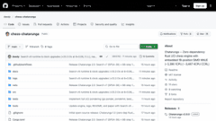
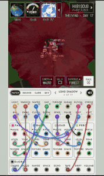
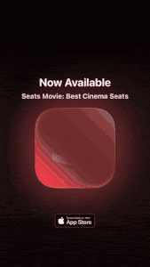
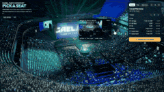
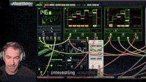
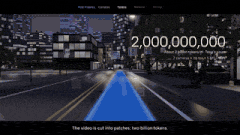
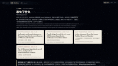
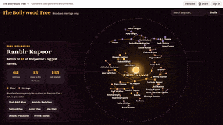

# 🧰 网页与工具 · 全部 60 个

[← 回到首页](../README.zh-CN.md) · [English](web-and-tools.md) · **简体中文** · [繁體中文](web-and-tools.zh-TW.md) · [日本語](web-and-tools.ja.md) · [한국어](web-and-tools.ko.md) · [Español](web-and-tools.es.md) · [Português](web-and-tools.pt-BR.md) · [Français](web-and-tools.fr.md) · [Deutsch](web-and-tools.de.md) · [Русский](web-and-tools.ru.md)

首页每类只放原帖点赞 ≥100 的前 24 个，这里是这一类的全部，按点赞数排序。

<table>
<tr>
<td width="33%" valign="top">
 
<b><a href="https://claudia.gallery">Claudia Gallery</a></b> 
<a href="https://x.com/anabology">@anabology</a> · ♥ 5.6k · <a href="https://x.com/anabology/status/2120010995309457643">▶ 视频</a> 
让它做「梦想中的视频」，9 小时两轮 
<a href="https://fablelist.000ooo.ooo/zh/prompts/?w=claudia-gallery&ref=gh"><b>✨ 获取提示词</b></a>
</td>
<td width="33%" valign="top">
 
<b><a href="http://robotics-lab-app.vercel.app">Robotics Lab 机器人开发板实验室</a></b> 
<a href="https://x.com/0xMovez">@0xMovez</a> · ♥ 4.7k · <a href="https://x.com/0xMovez/status/2120239217880268919">▶ 视频</a> 
8 块真实开发板的 3D 模型，逐件装芯片、焊接、接电路 
<a href="http://robolabs-app.vercel.app">人形机器人版</a> 
<a href="https://fablelist.000ooo.ooo/zh/prompts/?w=robotics-lab&ref=gh"><b>✨ 获取提示词</b></a>
</td>
<td width="33%" valign="top">
 
<b><a href="https://claude.ai/artifact/N6bSgS4ZH5ifFQfg8sm4dv">House Bangers 浩室舞曲生成器</a></b> 
<a href="https://x.com/deedydas">@deedydas</a> · ♥ 4.1k · <a href="https://x.com/deedydas/status/2120905625852936318">▶ 视频</a> 
学完乐理后每种乐器试上千种节奏挑最好的，编成 72 小节的浩室舞曲，要开声音 
<a href="https://fablelist.000ooo.ooo/zh/prompts/?w=house-bangers-generator&ref=gh"><b>✨ 获取提示词</b></a>
</td>
</tr>
<tr>
<td width="33%" valign="top">
 
<b><a href="https://miaai-lab.github.io/Claude-Fable-5.2-HTML-Files/">76 个单文件 HTML 视觉作品集</a></b> 
<a href="https://x.com/MiaAI_lab">@MiaAI_lab</a> · ♥ 2.6k · <a href="https://x.com/MiaAI_lab/status/2119930229661503893">原帖</a> 
每个都附原始提示词 
<a href="https://fablelist.000ooo.ooo/zh/prompts/?w=76-single-file-html-pieces&ref=gh"><b>✨ 获取提示词</b></a>
</td>
<td width="33%" valign="top">
 
<b><a href="https://pixel-worlds.vercel.app/keep/">Keep 像素世界密码强度条</a></b> 
<a href="https://x.com/crtvTeknologist">@crtvTeknologist</a> · ♥ 1.6k · <a href="https://x.com/crtvTeknologist/status/2119894073024606617">▶ 视频</a> 
把密码强度条做成一个活的像素世界 
<a href="https://github.com/finktheartist/pixel-worlds">源码</a> 
<a href="https://fablelist.000ooo.ooo/zh/prompts/?w=keep-password-strength-meter&ref=gh"><b>✨ 获取提示词</b></a>
</td>
<td width="33%" valign="top">
 
<b><a href="https://sakuga-vfx.vercel.app">Sakuga Set 动画感 UI 控件</a></b> 
<a href="https://x.com/crtvTeknologist">@crtvTeknologist</a> · ♥ 1.4k · <a href="https://x.com/crtvTeknologist/status/2122088829565698218">▶ 视频</a> 
12 个像日本动画一样有反应的 UI 控件：按钮压扁落地带「ドン!」，开关拖影溅开，滑块后面卷起云团；特效全是代码画的，单文件无依赖 
<a href="https://github.com/finktheartist/sakuga-vfx">源码</a>
</td>
</tr>
<tr>
<td width="33%" valign="top">
 
<b><a href="https://hashem-al-ghaili.github.io/xray-mirror/">X-Ray Mirror X 光镜子</a></b> 
<a href="https://x.com/HashemGhaili">@HashemGhaili</a> · ♥ 1.4k · <a href="https://x.com/HashemGhaili/status/2120202746121085321">▶ 视频</a> 
摄像头对着脸，实时看到头骨、大脑和肌肉；张嘴下巴跟着动，举起手能看到手骨，画面不出本机 
<a href="https://github.com/Hashem-Al-Ghaili/xray-mirror">源码</a> 
<a href="https://fablelist.000ooo.ooo/zh/prompts/?w=x-ray-mirror&ref=gh"><b>✨ 获取提示词</b></a>
</td>
<td width="33%" valign="top">
 
<b><a href="https://xianxie6.github.io/animals-planner-2027/">动物也上班 3D 电子手帐</a></b> 
<a href="https://x.com/Xian0063">@Xian0063</a> · ♥ 1.2k · <a href="https://x.com/Xian0063/status/2120417834694250522">▶ 视频</a> 
把实体手帐做成 3D：拖动翻页、点日期直接写、90 枚贴纸能撕能贴；Opus 5.5 搭骨架，Fable 5.2 对照实拍精修材质 
<a href="https://fablelist.000ooo.ooo/zh/prompts/?w=animals-at-work-3d-planner&ref=gh"><b>✨ 获取提示词</b></a>
</td>
<td width="33%" valign="top">
 
<b><a href="https://uberdesigner.ai/t/spine-menu">Spine Menu 菜单动效</a></b> 
<a href="https://x.com/seanaiux">@seanaiux</a> · ♥ 1.2k · <a href="https://x.com/seanaiux/status/2120222459110789574">▶ 视频</a> 
页面附提示词 
<a href="https://uberdesigner.ai/t/aquarium-toggle">水族箱开关</a> · <a href="https://uberdesigner.ai/t/glow-widgets">发光卡片</a>
</td>
</tr>
<tr>
<td width="33%" valign="top">
 
<b><a href="https://roverkit.vercel.app">RoverKit 机器人小车教学</a></b> 
<a href="https://x.com/DilumSanjaya">@DilumSanjaya</a> · ♥ 1.2k · <a href="https://x.com/DilumSanjaya/status/2121286147393651085">▶ 视频</a> 
一步步教你造机器人小车：带模拟器、可自定义场地和图解代码，支持 Arduino 和 ESP32
</td>
<td width="33%" valign="top">
 
<b><a href="https://github.com/AlexAtFF/pulp-daw-public">PULP AI 原生音频工作站</a></b> 
<a href="https://x.com/The_Alex">@The_Alex</a> · ♥ 948 · <a href="https://x.com/The_Alex/status/2119917226769985785">▶ 视频</a> 
Windows 原生 DAW；让 Claude 做音乐时它会自己打开这个工作站编曲 
<a href="https://fablelist.000ooo.ooo/zh/prompts/?w=pulp-an-ai-native-daw&ref=gh"><b>✨ 获取提示词</b></a>
</td>
<td width="33%" valign="top">
 
<b><a href="https://frontier.every.to/experiments/ambient-town">Ambient Town 氛围音乐工作站</a></b> 
<a href="https://x.com/kieranklaassen">@kieranklaassen</a> · ♥ 896 · <a href="https://x.com/kieranklaassen/status/2119868196773929160">▶ 视频</a> 
前电影配乐师花一周晚上做的 DAW：支持 Ableton Push、多路麦克风、效果器，还有一起作曲的 Agent；页面里点 Try it 
<a href="https://fablelist.000ooo.ooo/zh/prompts/?w=ambient-town&ref=gh"><b>✨ 获取提示词</b></a>
</td>
</tr>
<tr>
<td width="33%" valign="top">
 
<b><a href="https://github.com/deedy/chess-chatarunga">Chatarunga 零依赖 Rust 象棋引擎</a></b> 
🆕 · <a href="https://x.com/deedydas">@deedydas</a> · ♥ 869 · <a href="https://x.com/deedydas/status/2126140365208224057">原帖</a> 
从零用 Rust 写的国际象棋引擎，零依赖，ELO 3533，能排进全球前 50–100；对阵头号引擎 Stockfish 胜率 37%、7% 的对局能将死它；全部开源，约 50 美元算力由 Fable 搭配其他工具写成
</td>
<td width="33%" valign="top">
 
<b><a href="https://hexagonal.earth">Hexagonal Earth 六边形拼成的地球沙盘</a></b> 
<a href="https://x.com/avsa">@avsa</a> · ♥ 757 · <a href="https://x.com/avsa/status/2123123638551392755">原帖</a> 
用海拔、洋深、湿度、风、河流等真实数据搭出的六边形世界地图；上面几百种小物件是 Fable 5.2 一个个生成的 3D 像素点云，再由它自己摆进场景
</td>
<td width="33%" valign="top">
 
<b><a href="https://itspsneha.com/supplements">印度维生素该买哪些</a></b> 
<a href="https://x.com/itspsneha">@itspsneha</a> · ♥ 738 · <a href="https://x.com/itspsneha/status/2120048494761451974">原帖</a> 
读了 109 批检测报告做成的指南页 
<a href="https://fablelist.000ooo.ooo/zh/prompts/?w=which-vitamins-to-buy-in-india&ref=gh"><b>✨ 获取提示词</b></a>
</td>
</tr>
<tr>
<td width="33%" valign="top">
 
<b><a href="https://v2.video/riley/the-history-of-writing/v1">写作史（交互片）</a></b> 
<a href="https://x.com/rileybrown">@rileybrown</a> · ♥ 667 · <a href="https://x.com/rileybrown/status/2119946022767980985">▶ 视频</a> 
一条提示词 
<a href="https://x.com/rileybrown/status/2119946022767980985">📝 作者公开的提示词（免费）</a>
</td>
<td width="33%" valign="top">
 
<b><a href="https://auden-english-135.netlify.app/">Auden 1941 年失传诗歌课复原</a></b> 
<a href="https://x.com/emollick">@emollick</a> · ♥ 593 · <a href="https://x.com/emollick/status/2121641417483169934">原帖</a> 
让它复原诗人奥登 1941 年那门「人文学科最难」的课：从互联网档案馆的旧书和零散笔记里拼出可读的课程
</td>
<td width="33%" valign="top">
 
<b><a href="https://omage1.xyz">omage-1 浏览器里的 OP-1 Field 合成器</a></b> 
<a href="https://x.com/jamesmbickerton">@jamesmbickerton</a> · ♥ 572 · <a href="https://x.com/jamesmbickerton/status/2122688041219133815">▶ 视频</a> 
把 Teenage Engineering 的 OP-1 Field 做成浏览器应用的非官方致敬版，打开就能弹
</td>
</tr>
<tr>
<td width="33%" valign="top">
 
<b><a href="https://claude.ai/artifact/4P1urBdptp6gWiJo3R6Vpv">Breakcore 视频采样器</a></b> 
<a href="https://x.com/parhelion318">@parhelion318</a> · ♥ 545 · <a href="https://x.com/parhelion318/status/2122723067533398064">▶ 视频</a> 
在浏览器里把视频片段切碎、重排成 breakcore 节奏的采样器
</td>
<td width="33%" valign="top">
 
<b><a href="https://www.bubbbly.com/christmas-cards">Christmas Cards 互动圣诞贺卡</a></b> 
<a href="https://x.com/ann_nnng">@ann_nnng</a> · ♥ 483 · <a href="https://x.com/ann_nnng/status/2122283549000712249">▶ 视频</a> 
一组可以互动的圣诞贺卡，比如围红围巾的猫在窗台上看雪
</td>
<td width="33%" valign="top">
 
<b><a href="https://claude.ai/artifact/8yKUbL5KQgvfqcWH6UgZrq">Kastle Sim 口袋模块合成器模拟</a></b> 
<a href="https://x.com/parhelion318">@parhelion318</a> · ♥ 467 · <a href="https://x.com/parhelion318/status/2123344270732202421">▶ 视频</a> 
在浏览器里模拟 Bastl Kastle 迷你模块合成器，能接线、拧旋钮出声
</td>
</tr>
<tr>
<td width="33%" valign="top">
 
<b><a href="https://where-is-everybody-fermi.netlify.app/">Where is everybody? 费米悖论调查</a></b> 
<a href="https://x.com/emollick">@emollick</a> · ♥ 457 · <a href="https://x.com/emollick/status/2120359214157603139">原帖</a> 
让它「解决费米悖论」：整理数据、检验假说、接受批评后给出最可能的答案 
<a href="https://resolving-the-great-silence.netlify.app/">Gemini版</a> 
<a href="https://x.com/emollick/status/2120359214157603139">📝 作者公开的提示词（免费）</a>
</td>
<td width="33%" valign="top">
 
<b><a href="https://gsplan.org">加拉塔萨雷球场座位视角</a></b> 
<a href="https://x.com/molenbeek84">@molenbeek84</a> · ♥ 430 · <a href="https://x.com/molenbeek84/status/2120847639411331097">原帖</a> 
买票前看 RAMS Park 每个看台位置看到的球场 
<a href="https://fablelist.000ooo.ooo/zh/prompts/?w=galatasaray-seat-view&ref=gh"><b>✨ 获取提示词</b></a>
</td>
<td width="33%" valign="top">
 
<b><a href="https://rubber-hose-ui.vercel.app">Rubber Hose UI 1930 年代卡通风控件</a></b> 
<a href="https://x.com/crtvTeknologist">@crtvTeknologist</a> · ♥ 357 · <a href="https://x.com/crtvTeknologist/status/2122433522166124616">▶ 视频</a> 
11 个网页控件全是橡皮管卡通角色：滑块是长号，提示框是烤面包机，按钮每按一次多一只黑眼圈；原生 JS 加 canvas，无依赖，开源 
<a href="https://github.com/finktheartist/rubber-hose-ui">源码</a>
</td>
</tr>
<tr>
<td width="33%" valign="top">
 
<b><a href="https://bigfatfish.cc">大肥鱼的鱼缸 手账贴纸风个人站</a></b> 
<a href="https://x.com/dafeifish">@dafeifish</a> · ♥ 264 · <a href="https://x.com/dafeifish/status/2123395143873019950">原帖</a> 
用它重新设计的个人站：深蓝夜空上贴满小纸片、胶带、便利贴和拍立得，像翻开一本手账
</td>
<td width="33%" valign="top">
 
<b><a href="https://origamihelper.com">Origami Helper 3D 折纸教程</a></b> 
<a href="https://x.com/ryoma_nakajima">@ryoma_nakajima</a> · ♥ 220 · <a href="https://x.com/ryoma_nakajima/status/2120472383241011323">▶ 视频</a> 
3D 看折纸步骤，可以任意角度转，支持 AR，免费免注册，一天做完 
<a href="https://fablelist.000ooo.ooo/zh/prompts/?w=origami-helper&ref=gh"><b>✨ 获取提示词</b></a>
</td>
<td width="33%" valign="top">
 
<b><a href="https://assetora.vercel.app">Assetora 资产仪表盘</a></b> 
🆕 · <a href="https://x.com/marcelkargul">@marcelkargul</a> · ♥ 215 · <a href="https://x.com/marcelkargul/status/2126119817849815490">原帖</a> 
用 Fable 5.2 配合两个设计类 Skill、两天时间在 Next.js 里做出的完整资产管理仪表盘，浏览器打开就是可用的后台界面
</td>
</tr>
<tr>
<td width="33%" valign="top">
 
<b><a href="https://claude.ai/artifact/5ki5nJzDaayYMNhxymZBNT">Slow Plant Synth 会慢慢长大的植物合成器</a></b> 
<a href="https://x.com/parhelion318">@parhelion318</a> · ♥ 208 · <a href="https://x.com/parhelion318/status/2123982460090503626">▶ 视频</a> 
一株模拟植物按地点、时间和天气生长，几天里慢慢发出各不相同的声音；Fable 5.2 和 Opus 5.5 一起做的
</td>
<td width="33%" valign="top">
 
<b><a href="https://typed.page/">Typed 打字机</a></b> 
<a href="https://x.com/clairevo">@clairevo</a> · ♥ 205 · <a href="https://x.com/clairevo/status/2119905651359142132">▶ 视频</a> 
能打字、计时、涂改液、自动更正的完整打字机 
<a href="https://fablelist.000ooo.ooo/zh/prompts/?w=typed&ref=gh"><b>✨ 获取提示词</b></a>
</td>
<td width="33%" valign="top">
 
<b><a href="https://clockendbader.github.io/fable-builds/heartbeat/">One Heartbeat 跳动的 3D 心脏</a></b> 
<a href="https://x.com/clockendbader">@clockendbader</a> · ♥ 153 · <a href="https://x.com/clockendbader/status/2121246903207961069">原帖</a> 
实时心电和压力曲线、心音，可对比正常、房颤、传导阻滞和主动脉瓣狭窄；还自己写了测试 
<a href="https://fablelist.000ooo.ooo/zh/prompts/?w=one-heartbeat&ref=gh"><b>✨ 获取提示词</b></a>
</td>
</tr>
<tr>
<td width="33%" valign="top">
 
<b><a href="https://stormy.ai/hands">Hands 机器人手讲解页</a></b> 
<a href="https://x.com/Karmedge">@Karmedge</a> · ♥ 151 · <a href="https://x.com/Karmedge/status/2122394153497842080">▶ 视频</a> 
讲人形机器人的手怎么工作、为什么难做、成本多少的互动讲解页，花了 10 亿多 token
</td>
<td width="33%" valign="top">
 
<b><a href="https://motionsites.ai/?prompt=vante-ribbon-hero">Ribbon Hero 首屏</a></b> 
<a href="https://x.com/viktoroddy">@viktoroddy</a> · ♥ 141 · <a href="https://x.com/viktoroddy/status/2119985044542705916">▶ 视频</a> 
Fable 5.2 + GPT Image 2.6
</td>
<td width="33%" valign="top">
 
<b><a href="https://patch.gg/patch/anymove">anymove 视频转动作</a></b> 
<a href="https://x.com/rehan_shei">@rehan_shei</a> · ♥ 140 · <a href="https://x.com/rehan_shei/status/2120409150870159414">▶ 视频</a> 
把 AI 视频里的动作解算到 3D 武士骨架上，不用动捕服；开源 
<a href="https://fablelist.000ooo.ooo/zh/prompts/?w=anymove&ref=gh"><b>✨ 获取提示词</b></a>
</td>
</tr>
<tr>
<td width="33%" valign="top">
 
<b><a href="https://seats.movie">seats.movie 帮你挑电影院最佳座位</a></b> 
<a href="https://x.com/sunithvs_">@sunithvs_</a> · ♥ 133 · <a href="https://x.com/sunithvs_/status/2123496822400532982">▶ 视频</a> 
选一部电影，它查遍你所在城市的每一场，把还空着的正中间座位挑出来，还能看 3D 座位视角；作者说是让 Fable 5.2 连着跑了五天做的
</td>
<td width="33%" valign="top">
 
<b><a href="https://nikechan.com/">nikechan 个人站改版</a></b> 
<a href="https://x.com/tegnike">@tegnike</a> · ♥ 130 · <a href="https://x.com/tegnike/status/2120110145841578173">原帖</a> 
日本开发者让它重做整站设计 
<a href="https://fablelist.000ooo.ooo/zh/prompts/?w=nikechan-com-redesign&ref=gh"><b>✨ 获取提示词</b></a>
</td>
<td width="33%" valign="top">
 
<b><a href="https://fieldnote-crm-pi.vercel.app">Fieldnote CRM 仪表盘</a></b> 
<a href="https://x.com/dejvdesign">@dejvdesign</a> · ♥ 130 · <a href="https://x.com/dejvdesign/status/2122335319634874710">▶ 视频</a> 
带实时交互动效的 CRM 仪表盘界面，和 @madebymicrodose 合作
</td>
</tr>
<tr>
<td width="33%" valign="top">
 
<b><a href="https://github.com/kanaworksai-hue/harappa">Harappa 原野生成 Blender 插件</a></b> 
<a href="https://x.com/KanaWorks_AI">@KanaWorks_AI</a> · ♥ 90 · <a href="https://x.com/KanaWorks_AI/status/2121221880673972463">▶ 视频</a> 
免费 Blender 插件，一键把光秃的山丘变成动画背景式的原野：草、花、云、树、季节和画风都能换 
<a href="https://fablelist.000ooo.ooo/zh/prompts/?w=harappa-blender-add-on&ref=gh"><b>✨ 获取提示词</b></a>
</td>
<td width="33%" valign="top">
 
<b><a href="https://andreysuperiorgit.github.io/v8/">V8 Four-Stroke 能轰油门的 V8 发动机</a></b> 
<a href="https://x.com/andreysuperior">@andreysuperior</a> · ♥ 75 · <a href="https://x.com/andreysuperior/status/2123928682603430384">▶ 视频</a> 
浏览器里一台能轰油门的 7.0 升 V8：活塞、曲轴、凸轮轴和 16 个气门按真实尺寸运动，按 1-8-7-2-6-5-4-3 点火，排气管越转越红；一个 124 KB 的 HTML 文件，1 句提示词加 23 次追问
</td>
<td width="33%" valign="top">
 
<b><a href="https://hashem-al-ghaili.github.io/music-maker/">Music Maker 在空气里拉弦弹奏的乐器</a></b> 
<a href="https://x.com/HashemGhaili">@HashemGhaili</a> · ♥ 69 · <a href="https://x.com/HashemGhaili/status/2124135871293329809">▶ 视频</a> 
打开摄像头，双手一捏一拉就在空中拉出一根弦，24 种乐器可选，指尖划过就出声；能叠鼓点、循环录音、导出视频 
<a href="https://github.com/Hashem-Al-Ghaili/music-maker">源码</a>
</td>
</tr>
<tr>
<td width="33%" valign="top">
 
<b><a href="https://sael.net/seat-arena">Best Seat in the House 演唱会座位视角</a></b> 
<a href="https://x.com/RyanSael">@RyanSael</a> · ♥ 62 · <a href="https://x.com/RyanSael/status/2120544205558915329">▶ 视频</a> 
买票前先看每个座位看到的舞台，完全可交互 
<a href="https://fablelist.000ooo.ooo/zh/prompts/?w=best-seat-in-the-house&ref=gh"><b>✨ 获取提示词</b></a>
</td>
<td width="33%" valign="top">
 
<b><a href="http://promptronic3000.com">Promptronic 3000 Agent 模块合成器</a></b> 
<a href="https://x.com/fabianstelzer">@fabianstelzer</a> · ♥ 55 · <a href="https://x.com/fabianstelzer/status/2123121678670520627">▶ 视频</a> 
网页模块合成器：通过 MCP 接上 Claude 等 Agent，用一句话连出音色，连模块本身也能让它现写；音色和模块都能用网址分享
</td>
<td width="33%" valign="top">
 
<b><a href="https://andreysuperiorgit.github.io/riemann">Riemann Hypothesis, live 能转着看的黎曼猜想</a></b> 
<a href="https://x.com/andreysuperior">@andreysuperior</a> · ♥ 54 · <a href="https://x.com/andreysuperior/status/2124274426225008910">▶ 视频</a> 
可以旋转的 ζ 函数地形：102 个零点在浏览器里现算现验，全落在一条线上，再一步步叠出素数；单个 HTML 文件，不用任何库
</td>
</tr>
<tr>
<td width="33%" valign="top">
 
<b><a href="https://tetriss22.github.io/pc-build-lab/">PC Build Lab 装机实验室</a></b> 
<a href="https://x.com/Tetriss112">@Tetriss112</a> · ♥ 51 · <a href="https://x.com/Tetriss112/status/2120520587411935288">▶ 视频</a> 
在浏览器里把一台 $1,279 的主机一件件装起来，8 个步骤，可以故意装错 
<a href="https://fablelist.000ooo.ooo/zh/prompts/?w=pc-build-lab&ref=gh"><b>✨ 获取提示词</b></a>
</td>
<td width="33%" valign="top">
 
<b><a href="https://zkevinbai.com/apps/tesla-fsd">How FSD Drives 特斯拉自动驾驶眼里的路</a></b> 
<a href="https://x.com/zkevinbai">@zkevinbai</a> · ♥ 33 · <a href="https://x.com/zkevinbai/status/2124626274367005100">▶ 视频</a> 
一套完整的特斯拉 FSD 模拟，七个摄像头各自看到什么都能看，还可以自己接手方向盘
</td>
<td width="33%" valign="top">
 
<b><a href="https://claude.ai/artifact/NVWaNUrJK5woiKXQsAQaPG">Audio-Reactive Dot Surface 跟着声音起伏的点阵曲面</a></b> 
<a href="https://x.com/parhelion318">@parhelion318</a> · ♥ 30 · <a href="https://x.com/parhelion318/status/2123463622252994878">▶ 视频</a> 
一片由点组成的曲面跟着声音起伏；Fable 5.2 和 Opus 5.5 做，GPT-6.2 Astra 复查
</td>
</tr>
<tr>
<td width="33%" valign="top">
 
<b><a href="https://shiraeisenberg.com/composed-of-nows">Composed of Nows 语言模型的九件互动作品</a></b> 
<a href="https://x.com/shiraeis">@shiraeis</a> · ♥ 25 · <a href="https://x.com/shiraeis/status/2123562764203589648">▶ 视频</a> 
让它先读诗，再做九件互动作品讲当一个语言模型是什么“感觉”，一次做成
</td>
<td width="33%" valign="top">
 
<b><a href="https://piano.yoshiyukikoyanagi.com">Physical Modeling Piano F1 物理建模钢琴</a></b> 
<a href="https://x.com/moutend">@moutend</a> · ♥ 21 · <a href="https://x.com/moutend/status/2123776671501451468">▶ 视频</a> 
在浏览器里实时算出琴声的物理建模钢琴，用电脑键盘就能弹，带延音踏板 
<a href="https://github.com/moutend/physical-modeling-piano-f1">源码</a>
</td>
<td width="33%" valign="top">
 
<b><a href="https://riemann.zondark.com/course">黎曼猜想 10 分钟动手课</a></b> 
<a href="https://x.com/ZondarkAI">@ZondarkAI</a> · ♥ 16 · <a href="https://x.com/ZondarkAI/status/2125506885487034601">▶ 视频</a> 
交互式教学网站：两节课，每一步都要动手，亲手找到第一个非平凡零点 14.13，看 1000 个零点的波浪叠加出质数分布；中英双语，带教学短片
</td>
</tr>
<tr>
<td width="33%" valign="top">
 
<b><a href="https://ember-vesper.aura.build/">Ember Vesper 游戏主机落地页</a></b> 
<a href="https://x.com/titepommee">@titepommee</a> · ♥ 13 · <a href="https://x.com/titepommee/status/2123515807250657457">▶ 视频</a> 
把一台游戏电脑做成落地页：往下滚主机拆开、换灯光、切到热成像，最后写出订单小票；每节转场都不一样，只有一个 HTML 文件
</td>
<td width="33%" valign="top">
 
<b><a href="https://ai.itokoba.com/ichimai/">一枚：一页能做到什么程度</a></b> 
<a href="https://x.com/hideki_climax">@hideki_climax</a> · ♥ 11 · <a href="https://x.com/hideki_climax/status/2120165464722809190">▶ 视频</a> 
只说了一句「做一个展示你现在实力的最强静态网页」 
<a href="https://x.com/hideki_climax/status/2120165464722809190">📝 作者公开的提示词（免费）</a>
</td>
<td width="33%" valign="top">
 
<b><a href="https://rain-1.github.io/intel4004/web/4004-lesion.html">4004 Lesion Map 4004 芯片损伤图</a></b> 
<a href="https://x.com/slimer48484">@slimer48484</a> · ♥ 10 · <a href="https://x.com/slimer48484/status/2122231197409398920">原帖</a> 
把 Intel 4004 的 2,242 个晶体管逐个弄坏再跑测试，做成一张可以悬停查看「坏了这个会怎样」的芯片地图 
<a href="https://github.com/rain-1/intel4004">源码</a>
</td>
</tr>
<tr>
<td width="33%" valign="top">
 
<b><a href="https://jwt-designs-preview.noone-697.workers.dev/">JWT 落地页 20 种改版</a></b> 
<a href="https://x.com/Tmeister">@Tmeister</a> · ♥ 9 · <a href="https://x.com/Tmeister/status/2119983842841018482">原帖</a> 
一条简单提示词出 20 版 
<a href="https://x.com/Tmeister/status/2119983842841018482">📝 作者公开的提示词（免费）</a>
</td>
<td width="33%" valign="top">
 
<b><a href="https://www.asumacodes.xyz/arena/driftwood">Driftwood 落地页（Fable 对 Opus）</a></b> 
<a href="https://x.com/AsumaCodes">@AsumaCodes</a> · ♥ 9 · <a href="https://x.com/AsumaCodes/status/2120130668848177432">▶ 视频</a> 
同提示词一次生成，两版都在线 
<a href="https://www.asumacodes.xyz/arena/focus-room">番茄钟专注室</a> · <a href="https://www.asumacodes.xyz/arena/bug-hunt">找 Bug 对比</a> · <a href="https://www.asumacodes.xyz/arena">系列首页</a> 
<a href="https://x.com/AsumaCodes/status/2120130668848177432">📝 作者公开的提示词（免费）</a>
</td>
<td width="33%" valign="top">
 
<b><a href="https://uberdesigner.ai/t/araneae">araneae 蜘蛛长文</a></b> 
<a href="https://x.com/seanaiux">@seanaiux</a> · ♥ 8 · <a href="https://x.com/seanaiux/status/2121688869439455410">▶ 视频</a> 
让它做一个能吓到自己的网页：一只蜘蛛从黑暗里垂下，滚动页面一路看它的巢、眼睛、毒牙和腿，最后你成了那只苍蝇
</td>
</tr>
<tr>
<td width="33%" valign="top">
 
<b><a href="https://claude.ai/artifact/TiymxxFXzMo7xhWUaecbzk">独栋住宅设计提案书</a></b> 
<a href="https://x.com/pnumech">@pnumech</a> · ♥ 7 · <a href="https://x.com/pnumech/status/2120117665041940807">原帖</a> 
韩文，一天做完 
<a href="https://fablelist.000ooo.ooo/zh/prompts/?w=house-design-proposal&ref=gh"><b>✨ 获取提示词</b></a>
</td>
<td width="33%" valign="top">
 
<b><a href="https://claude.ai/artifact/9yQkezie4jY3oz2YDLFDiq">鼓组网站</a></b> 
<a href="https://x.com/BretKerr">@BretKerr</a> · ♥ 5 · <a href="https://x.com/BretKerr/status/2119995870854988177">▶ 视频</a> 
每次敲击海湾都有混响 
<a href="https://fablelist.000ooo.ooo/zh/prompts/?w=bay-drum-kit&ref=gh"><b>✨ 获取提示词</b></a>
</td>
<td width="33%" valign="top">
 
<b><a href="https://claude.ai/artifact/Pk6rHPyRwfShT37kiU1sT6">Dub Techno 曲子 + 可视化</a></b> 
<a href="https://x.com/bartdecrem">@bartdecrem</a> · ♥ 4 · <a href="https://x.com/bartdecrem/status/2119926997422133417">原帖</a> 
一次生成 
<a href="https://fablelist.000ooo.ooo/zh/prompts/?w=dub-techno-track-visualizer&ref=gh"><b>✨ 获取提示词</b></a>
</td>
</tr>
<tr>
<td width="33%" valign="top">
 
<b><a href="https://claude.ai/artifact/5ufHvxgvXTf5YgQeTR8TbG">《罗摩衍那》男主的宝莱坞家谱</a></b> 
<a href="https://x.com/chhavsz">@chhavsz</a> · ♥ 2 · <a href="https://x.com/chhavsz/status/2119942973958078785">原帖</a> 
血缘婚姻牵出 65 位明星 
<a href="https://fablelist.000ooo.ooo/zh/prompts/?w=ramayana-family-tree&ref=gh"><b>✨ 获取提示词</b></a>
</td>
<td width="33%" valign="top">
 
<b><a href="https://claude.ai/artifact/4aEy6FtUi7jrm9U7uYgp8K">Demoscene 浏览器演示</a></b> 
<a href="https://x.com/ndril">@ndril</a> · ♥ 1 · <a href="https://x.com/ndril/status/2119899340642894235">原帖</a> 
按 demoscene 传统炫技 
<a href="https://x.com/ndril/status/2119899340642894235">📝 作者公开的提示词（免费）</a>
</td>
<td width="33%" valign="top">
 
<b><a href="https://claude.ai/artifact/H8E7AonW2KFrzdRimaLeXb">112 种冥想图解</a></b> 
<a href="https://x.com/RishabJ108">@RishabJ108</a> · ♥ 1 · <a href="https://x.com/RishabJ108/status/2120042407484084558">原帖</a> 
给技术人看的可视化 
<a href="https://fablelist.000ooo.ooo/zh/prompts/?w=112-forms-of-meditation&ref=gh"><b>✨ 获取提示词</b></a>
</td>
</tr>
</table>

其他分类：[🎮 游戏](games.zh-CN.md) · [🌍 3D 世界与场景](3d-worlds.zh-CN.md) · [🎬 动画与短片（附源码）](animation.zh-CN.md) · [📺 只有视频](video-demos.zh-CN.md)

[← 回到首页](../README.zh-CN.md)
