# 🧰 网页与工具 · 全部 32 个

[← 回到首页](../README.zh-CN.md) · [English](web-and-tools.md) · **简体中文**

首页只放原帖点赞 ≥100 的，这里是这一类的全部，按点赞数排序。

<table>
<tr>
<td width="33%" valign="top">
 
<b><a href="https://claudia.gallery">Claudia Gallery</a></b> 
<a href="https://x.com/anabology">@anabology</a> · ♥ 5.1k · <a href="https://x.com/anabology/status/2120010995309457643">▶ 视频</a> 
让它做「梦想中的视频」，9 小时两轮
</td>
<td width="33%" valign="top">
<a href="http://robotics-lab-app.vercel.app">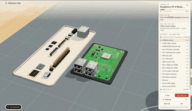</a> 
<b><a href="http://robotics-lab-app.vercel.app">Robotics Lab 机器人开发板实验室</a></b> 
🆕 · <a href="https://x.com/0xMovez">@0xMovez</a> · ♥ 4.6k · <a href="https://x.com/0xMovez/status/2120239217880268919">▶ 视频</a> 
8 块真实开发板的 3D 模型，逐件装芯片、焊接、接电路 
<a href="http://robolabs-app.vercel.app">人形机器人版</a>
</td>
<td width="33%" valign="top">
<a href="https://claude.ai/artifact/N6bSgS4ZH5ifFQfg8sm4dv">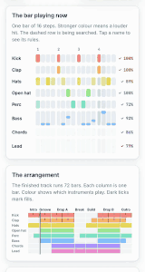</a> 
<b><a href="https://claude.ai/artifact/N6bSgS4ZH5ifFQfg8sm4dv">House Bangers 浩室舞曲生成器</a></b> 
🆕 · <a href="https://x.com/deedydas">@deedydas</a> · ♥ 2.8k · <a href="https://x.com/deedydas/status/2120905625852936318">▶ 视频</a> 
学完乐理后每种乐器试上千种节奏挑最好的，编成 72 小节的浩室舞曲，要开声音
</td>
</tr>
<tr>
<td width="33%" valign="top">
<a href="https://miaai-lab.github.io/Claude-Fable-5.2-HTML-Files/">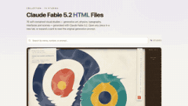</a> 
<b><a href="https://miaai-lab.github.io/Claude-Fable-5.2-HTML-Files/">76 个单文件 HTML 视觉作品集</a></b> 
<a href="https://x.com/MiaAI_lab">@MiaAI_lab</a> · ♥ 2.6k · <a href="https://x.com/MiaAI_lab/status/2119930229661503893">原帖</a> 
每个都附原始提示词
</td>
<td width="33%" valign="top">
<a href="https://pixel-worlds.vercel.app/keep/">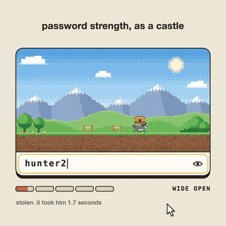</a> 
<b><a href="https://pixel-worlds.vercel.app/keep/">Keep 像素世界密码强度条</a></b> 
🆕 · <a href="https://x.com/crtvTeknologist">@crtvTeknologist</a> · ♥ 1.6k · <a href="https://x.com/crtvTeknologist/status/2119894073024606617">▶ 视频</a> 
把密码强度条做成一个活的像素世界 
<a href="https://github.com/finktheartist/pixel-worlds">源码</a>
</td>
<td width="33%" valign="top">
<a href="https://masterofvfx2070.github.io/xray-mirror/">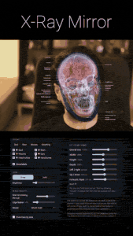</a> 
<b><a href="https://masterofvfx2070.github.io/xray-mirror/">X-Ray Mirror X 光镜子</a></b> 
🆕 · <a href="https://x.com/HashemGhaili">@HashemGhaili</a> · ♥ 1.4k · <a href="https://x.com/HashemGhaili/status/2120202746121085321">▶ 视频</a> 
摄像头对着脸，实时看到头骨、大脑和肌肉；张嘴下巴跟着动，举起手能看到手骨，画面不出本机 
<a href="https://github.com/MasterOfVFX2070/xray-mirror">源码</a>
</td>
</tr>
<tr>
<td width="33%" valign="top">
<a href="https://xianxie6.github.io/animals-planner-2027/">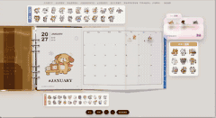</a> 
<b><a href="https://xianxie6.github.io/animals-planner-2027/">动物也上班 3D 电子手帐</a></b> 
🆕 · <a href="https://x.com/Xian0063">@Xian0063</a> · ♥ 1.2k · <a href="https://x.com/Xian0063/status/2120417834694250522">▶ 视频</a> 
把实体手帐做成 3D：拖动翻页、点日期直接写、90 枚贴纸能撕能贴；Opus 5.5 搭骨架，Fable 5.2 对照实拍精修材质
</td>
<td width="33%" valign="top">
<a href="https://uberdesigner.ai/t/spine-menu">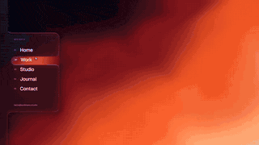</a> 
<b><a href="https://uberdesigner.ai/t/spine-menu">Spine Menu 菜单动效</a></b> 
🆕 · <a href="https://x.com/seanaiux">@seanaiux</a> · ♥ 1.2k · <a href="https://x.com/seanaiux/status/2120222459110789574">▶ 视频</a> 
页面附提示词 
<a href="https://uberdesigner.ai/t/aquarium-toggle">水族箱开关</a> · <a href="https://uberdesigner.ai/t/glow-widgets">发光卡片</a>
</td>
<td width="33%" valign="top">
<a href="https://github.com/AlexAtFF/pulp-daw-public">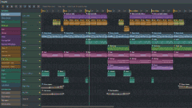</a> 
<b><a href="https://github.com/AlexAtFF/pulp-daw-public">PULP AI 原生音频工作站</a></b> 
🆕 · <a href="https://x.com/The_Alex">@The_Alex</a> · ♥ 938 · <a href="https://x.com/The_Alex/status/2119917226769985785">▶ 视频</a> 
Windows 原生 DAW；让 Claude 做音乐时它会自己打开这个工作站编曲
</td>
</tr>
<tr>
<td width="33%" valign="top">
<a href="https://frontier.every.to/experiments/ambient-town">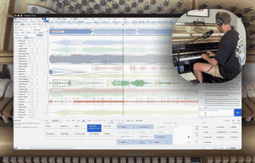</a> 
<b><a href="https://frontier.every.to/experiments/ambient-town">Ambient Town 氛围音乐工作站</a></b> 
🆕 · <a href="https://x.com/kieranklaassen">@kieranklaassen</a> · ♥ 890 · <a href="https://x.com/kieranklaassen/status/2119868196773929160">▶ 视频</a> 
前电影配乐师花一周晚上做的 DAW：支持 Ableton Push、多路麦克风、效果器，还有一起作曲的 Agent；页面里点 Try it
</td>
<td width="33%" valign="top">
 
<b><a href="https://itspsneha.com/supplements">印度维生素该买哪些</a></b> 
<a href="https://x.com/itspsneha">@itspsneha</a> · ♥ 739 · <a href="https://x.com/itspsneha/status/2120048494761451974">原帖</a> 
读了 109 批检测报告做成的指南页
</td>
<td width="33%" valign="top">
 
<b><a href="https://v2.video/riley/the-history-of-writing/v1">写作史（交互片）</a></b> 
<a href="https://x.com/rileybrown">@rileybrown</a> · ♥ 665 · <a href="https://x.com/rileybrown/status/2119946022767980985">▶ 视频</a> 
一条提示词
</td>
</tr>
<tr>
<td width="33%" valign="top">
<a href="https://where-is-everybody-fermi.netlify.app/">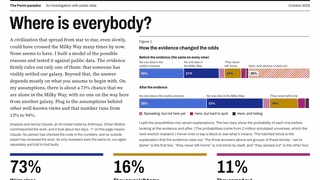</a> 
<b><a href="https://where-is-everybody-fermi.netlify.app/">Where is everybody? 费米悖论调查</a></b> 
🆕 · <a href="https://x.com/emollick">@emollick</a> · ♥ 453 · <a href="https://x.com/emollick/status/2120359214157603139">原帖</a> 
让它「解决费米悖论」：整理数据、检验假说、接受批评后给出最可能的答案 
<a href="https://resolving-the-great-silence.netlify.app/">Gemini版</a>
</td>
<td width="33%" valign="top">
 
<b><a href="https://gsplan.org">加拉塔萨雷球场座位视角</a></b> 
🆕 · <a href="https://x.com/molenbeek84">@molenbeek84</a> · ♥ 422 · <a href="https://x.com/molenbeek84/status/2120847639411331097">原帖</a> 
买票前看 RAMS Park 每个看台位置看到的球场
</td>
<td width="33%" valign="top">
<a href="https://origamihelper.com">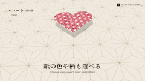</a> 
<b><a href="https://origamihelper.com">Origami Helper 3D 折纸教程</a></b> 
🆕 · <a href="https://x.com/ryoma_nakajima">@ryoma_nakajima</a> · ♥ 217 · <a href="https://x.com/ryoma_nakajima/status/2120472383241011323">▶ 视频</a> 
3D 看折纸步骤，可以任意角度转，支持 AR，免费免注册，一天做完
</td>
</tr>
<tr>
<td width="33%" valign="top">
 
<b><a href="https://typed.page/">Typed 打字机</a></b> 
<a href="https://x.com/clairevo">@clairevo</a> · ♥ 205 · <a href="https://x.com/clairevo/status/2119905651359142132">▶ 视频</a> 
能打字、计时、涂改液、自动更正的完整打字机
</td>
<td width="33%" valign="top">
<a href="https://motionsites.ai/?prompt=vante-ribbon-hero">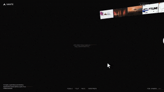</a> 
<b><a href="https://motionsites.ai/?prompt=vante-ribbon-hero">Ribbon Hero 首屏</a></b> 
<a href="https://x.com/viktoroddy">@viktoroddy</a> · ♥ 138 · <a href="https://x.com/viktoroddy/status/2119985044542705916">▶ 视频</a> 
Fable 5.2 + GPT Image 2.6
</td>
<td width="33%" valign="top">
<a href="https://patch.gg/patch/anymove">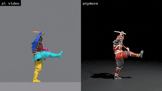</a> 
<b><a href="https://patch.gg/patch/anymove">anymove 视频转动作</a></b> 
🆕 · <a href="https://x.com/rehan_shei">@rehan_shei</a> · ♥ 137 · <a href="https://x.com/rehan_shei/status/2120409150870159414">▶ 视频</a> 
把 AI 视频里的动作解算到 3D 武士骨架上，不用动捕服；开源
</td>
</tr>
<tr>
<td width="33%" valign="top">
 
<b><a href="https://nikechan.com/">nikechan 个人站改版</a></b> 
<a href="https://x.com/tegnike">@tegnike</a> · ♥ 130 · <a href="https://x.com/tegnike/status/2120110145841578173">原帖</a> 
日本开发者让它重做整站设计
</td>
<td width="33%" valign="top">
<a href="https://tetriss22.github.io/pc-build-lab/">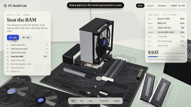</a> 
<b><a href="https://tetriss22.github.io/pc-build-lab/">PC Build Lab 装机实验室</a></b> 
🆕 · <a href="https://x.com/Tetriss112">@Tetriss112</a> · ♥ 51 · <a href="https://x.com/Tetriss112/status/2120520587411935288">▶ 视频</a> 
在浏览器里把一台 $1,279 的主机一件件装起来，8 个步骤，可以故意装错
</td>
<td width="33%" valign="top">
<a href="https://sael.net/seat-arena">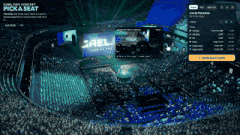</a> 
<b><a href="https://sael.net/seat-arena">Best Seat in the House 演唱会座位视角</a></b> 
🆕 · <a href="https://x.com/RyanSael">@RyanSael</a> · ♥ 38 · <a href="https://x.com/RyanSael/status/2120544205558915329">▶ 视频</a> 
买票前先看每个座位看到的舞台，完全可交互
</td>
</tr>
<tr>
<td width="33%" valign="top">
<a href="https://github.com/kanaworksai-hue/harappa">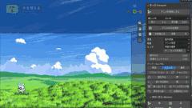</a> 
<b><a href="https://github.com/kanaworksai-hue/harappa">Harappa 原野生成 Blender 插件</a></b> 
🆕 · <a href="https://x.com/KanaWorks_AI">@KanaWorks_AI</a> · ♥ 37 · <a href="https://x.com/KanaWorks_AI/status/2121221880673972463">▶ 视频</a> 
免费 Blender 插件，一键把光秃的山丘变成动画背景式的原野：草、花、云、树、季节和画风都能换
</td>
<td width="33%" valign="top">
<a href="https://ai.itokoba.com/ichimai/">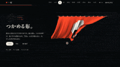</a> 
<b><a href="https://ai.itokoba.com/ichimai/">一枚：一页能做到什么程度</a></b> 
🆕 · <a href="https://x.com/hideki_climax">@hideki_climax</a> · ♥ 11 · <a href="https://x.com/hideki_climax/status/2120165464722809190">▶ 视频</a> 
只说了一句「做一个展示你现在实力的最强静态网页」
</td>
<td width="33%" valign="top">
 
<b><a href="https://jwt-designs-preview.noone-697.workers.dev/">JWT 落地页 20 种改版</a></b> 
<a href="https://x.com/Tmeister">@Tmeister</a> · ♥ 9 · <a href="https://x.com/Tmeister/status/2119983842841018482">原帖</a> 
一条简单提示词出 20 版
</td>
</tr>
<tr>
<td width="33%" valign="top">
 
<b><a href="https://www.asumacodes.xyz/arena/driftwood">Driftwood 落地页（Fable 对 Opus）</a></b> 
<a href="https://x.com/AsumaCodes">@AsumaCodes</a> · ♥ 9 · <a href="https://x.com/AsumaCodes/status/2120130668848177432">▶ 视频</a> 
同提示词一次生成，两版都在线 
<a href="https://www.asumacodes.xyz/arena/focus-room">番茄钟专注室</a> · <a href="Bug 对比 https://www.asumacodes.xyz/arena/bug-hunt">找</a> · <a href="https://www.asumacodes.xyz/arena">系列首页</a>
</td>
<td width="33%" valign="top">
 
<b><a href="https://claude.ai/artifact/TiymxxFXzMo7xhWUaecbzk">独栋住宅设计提案书</a></b> 
<a href="https://x.com/pnumech">@pnumech</a> · ♥ 8 · <a href="https://x.com/pnumech/status/2120117665041940807">原帖</a> 
韩文，一天做完
</td>
<td width="33%" valign="top">
 
<b><a href="https://claude.ai/artifact/9yQkezie4jY3oz2YDLFDiq">鼓组网站</a></b> 
<a href="https://x.com/BretKerr">@BretKerr</a> · ♥ 5 · <a href="https://x.com/BretKerr/status/2119995870854988177">▶ 视频</a> 
每次敲击海湾都有混响
</td>
</tr>
<tr>
<td width="33%" valign="top">
 
<b><a href="https://clockendbader.github.io/fable-builds/heartbeat/">One Heartbeat 跳动的 3D 心脏</a></b> 
🆕 · <a href="https://x.com/clockendbader">@clockendbader</a> · ♥ 5 · <a href="https://x.com/clockendbader/status/2121246903207961069">原帖</a> 
实时心电和压力曲线、心音，可对比正常、房颤、传导阻滞和主动脉瓣狭窄；还自己写了测试
</td>
<td width="33%" valign="top">
<a href="https://claude.ai/artifact/Pk6rHPyRwfShT37kiU1sT6">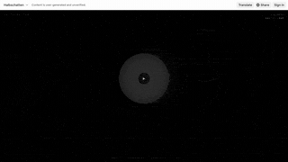</a> 
<b><a href="https://claude.ai/artifact/Pk6rHPyRwfShT37kiU1sT6">Dub Techno 曲子 + 可视化</a></b> 
<a href="https://x.com/bartdecrem">@bartdecrem</a> · ♥ 4 · <a href="https://x.com/bartdecrem/status/2119926997422133417">原帖</a> 
一次生成
</td>
<td width="33%" valign="top">
<a href="https://claude.ai/artifact/5ufHvxgvXTf5YgQeTR8TbG">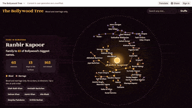</a> 
<b><a href="https://claude.ai/artifact/5ufHvxgvXTf5YgQeTR8TbG">《罗摩衍那》男主的宝莱坞家谱</a></b> 
<a href="https://x.com/chhavsz">@chhavsz</a> · ♥ 2 · <a href="https://x.com/chhavsz/status/2119942973958078785">原帖</a> 
血缘婚姻牵出 65 位明星
</td>
</tr>
<tr>
<td width="33%" valign="top">
<a href="https://claude.ai/artifact/4aEy6FtUi7jrm9U7uYgp8K">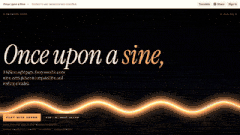</a> 
<b><a href="https://claude.ai/artifact/4aEy6FtUi7jrm9U7uYgp8K">Demoscene 浏览器演示</a></b> 
<a href="https://x.com/ndril">@ndril</a> · ♥ 1 · <a href="https://x.com/ndril/status/2119899340642894235">原帖</a> 
按 demoscene 传统炫技
</td>
<td width="33%" valign="top">
 
<b><a href="https://claude.ai/artifact/H8E7AonW2KFrzdRimaLeXb">112 种冥想图解</a></b> 
<a href="https://x.com/RishabJ108">@RishabJ108</a> · ♥ 1 · <a href="https://x.com/RishabJ108/status/2120042407484084558">原帖</a> 
给技术人看的可视化
</td>
</tr>
</table>

其他分类：[🎮 游戏](games.zh-CN.md) · [🌍 3D 世界与场景](3d-worlds.zh-CN.md) · [🎬 动画与短片（附源码）](animation.zh-CN.md) · [📺 只有视频](video-demos.zh-CN.md)

[← 回到首页](../README.zh-CN.md)
