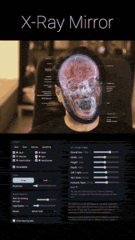
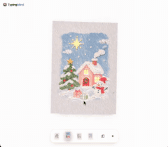
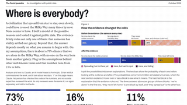
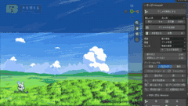

# 🧰 網頁與工具 · 全部 50 個

[← 回到首頁](../README.zh-TW.md) · [English](web-and-tools.md) · [简体中文](web-and-tools.zh-CN.md) · **繁體中文** · [日本語](web-and-tools.ja.md) · [한국어](web-and-tools.ko.md) · [Español](web-and-tools.es.md) · [Português](web-and-tools.pt-BR.md) · [Français](web-and-tools.fr.md) · [Deutsch](web-and-tools.de.md) · [Русский](web-and-tools.ru.md)

首頁每類只放原貼文按讚 ≥100 的前 24 個，這裡是這一類的全部，按按讚數排序。

<table>
<tr>
<td width="33%" valign="top">
 
<b><a href="https://claudia.gallery">Claudia Gallery</a></b> 
<a href="https://x.com/anabology">@anabology</a> · ♥ 5.5k · <a href="https://x.com/anabology/status/2120010995309457643">▶ 影片</a> 
「做出你夢想中的影片」——兩個鏡頭，9 小時。 
<a href="https://fablelist.000ooo.ooo/zh-tw/prompts/?w=claudia-gallery&ref=gh"><b>✨ 取得提示詞</b></a>
</td>
<td width="33%" valign="top">
 
<b><a href="http://robotics-lab-app.vercel.app">Robotics Lab</a></b> 
<a href="https://x.com/0xMovez">@0xMovez</a> · ♥ 4.7k · <a href="https://x.com/0xMovez/status/2120239217880268919">▶ 影片</a> 
3D 呈現八塊真實開發板（Arduino Uno、Raspberry Pi 4⋯⋯）：放置晶片、焊接、接上真實電路。 
<a href="http://robolabs-app.vercel.app">Humanoid edition</a> 
<a href="https://fablelist.000ooo.ooo/zh-tw/prompts/?w=robotics-lab&ref=gh"><b>✨ 取得提示詞</b></a>
</td>
<td width="33%" valign="top">
 
<b><a href="https://claude.ai/artifact/N6bSgS4ZH5ifFQfg8sm4dv">House Bangers 生成器</a></b> 
<a href="https://x.com/deedydas">@deedydas</a> · ♥ 4.1k · <a href="https://x.com/deedydas/status/2120905625852936318">▶ 影片</a> 
它學會了樂理，每種樂器嘗試數千種模式，再把最好的編排成 72 小節的 House 曲目。請開聲音。 
<a href="https://fablelist.000ooo.ooo/zh-tw/prompts/?w=house-bangers-generator&ref=gh"><b>✨ 取得提示詞</b></a>
</td>
</tr>
<tr>
<td width="33%" valign="top">
 
<b><a href="https://miaai-lab.github.io/Claude-Fable-5.2-HTML-Files/">76 個單檔 HTML 作品</a></b> 
<a href="https://x.com/MiaAI_lab">@MiaAI_lab</a> · ♥ 2.6k · <a href="https://x.com/MiaAI_lab/status/2119930229661503893">原文</a> 
生成藝術、物理、字體與 UI，每件都附上原始提示。 
<a href="https://fablelist.000ooo.ooo/zh-tw/prompts/?w=76-single-file-html-pieces&ref=gh"><b>✨ 取得提示詞</b></a>
</td>
<td width="33%" valign="top">
 
<b><a href="https://pixel-worlds.vercel.app/keep/">Keep — 密碼強度計</a></b> 
<a href="https://x.com/crtvTeknologist">@crtvTeknologist</a> · ♥ 1.6k · <a href="https://x.com/crtvTeknologist/status/2119894073024606617">▶ 影片</a> 
把密碼強度指示器做成活生生的像素世界。 
<a href="https://github.com/finktheartist/pixel-worlds">原始碼</a> 
<a href="https://fablelist.000ooo.ooo/zh-tw/prompts/?w=keep-password-strength-meter&ref=gh"><b>✨ 取得提示詞</b></a>
</td>
<td width="33%" valign="top">
 
<b><a href="https://sakuga-vfx.vercel.app">Sakuga Set</a></b> 
<a href="https://x.com/crtvTeknologist">@crtvTeknologist</a> · ♥ 1.4k · <a href="https://x.com/crtvTeknologist/status/2122088829565698218">▶ 影片</a> 
12 個像動畫一樣有反應的 UI 控制項：按鈕壓扁落地還帶「ドン!」，開關拖影濺開，滑桿捲起雲團。特效全用程式碼畫，每個一個檔案、零依賴。 
<a href="https://github.com/finktheartist/sakuga-vfx">原始碼</a>
</td>
</tr>
<tr>
<td width="33%" valign="top">
 
<b><a href="https://masterofvfx2070.github.io/xray-mirror/">X-Ray Mirror</a></b> 
<a href="https://x.com/HashemGhaili">@HashemGhaili</a> · ♥ 1.4k · <a href="https://x.com/HashemGhaili/status/2120202746121085321">▶ 影片</a> 
網路攝影機對著臉，即時追蹤並看到頭骨、大腦與肌肉。張嘴下顎就會打開；影像不會離開你的電腦。 
<a href="https://github.com/MasterOfVFX2070/xray-mirror">原始碼</a> 
<a href="https://fablelist.000ooo.ooo/zh-tw/prompts/?w=x-ray-mirror&ref=gh"><b>✨ 取得提示詞</b></a>
</td>
<td width="33%" valign="top">
 
<b><a href="https://xianxie6.github.io/animals-planner-2027/">Animals at Work — 3D 手帳</a></b> 
<a href="https://x.com/Xian0063">@Xian0063</a> · ♥ 1.2k · <a href="https://x.com/Xian0063/status/2120417834694250522">▶ 影片</a> 
把紙本手帳重建成 3D：拖曳翻頁、點日期書寫、90 張可撕可貼的貼紙。骨架由 Opus 5.5 搭建；Fable 5.2 對照真實影片精修材質。 
<a href="https://fablelist.000ooo.ooo/zh-tw/prompts/?w=animals-at-work-3d-planner&ref=gh"><b>✨ 取得提示詞</b></a>
</td>
<td width="33%" valign="top">
 
<b><a href="https://uberdesigner.ai/t/spine-menu">Spine Menu</a></b> 
<a href="https://x.com/seanaiux">@seanaiux</a> · ♥ 1.2k · <a href="https://x.com/seanaiux/status/2120222459110789574">▶ 影片</a> 
「你看過更好看的選單嗎？」頁面中附有提示。 
<a href="https://uberdesigner.ai/t/aquarium-toggle">Aquarium toggle</a> · <a href="https://uberdesigner.ai/t/glow-widgets">Glow widgets</a>
</td>
</tr>
<tr>
<td width="33%" valign="top">
 
<b><a href="https://roverkit.vercel.app">RoverKit — 打造並模擬機器人小車</a></b> 
<a href="https://x.com/DilumSanjaya">@DilumSanjaya</a> · ♥ 1.1k · <a href="https://x.com/DilumSanjaya/status/2121286147393651085">▶ 影片</a> 
一步步教你做機器人小車，附模擬器、可自訂場地和圖解程式碼。支援 Arduino 和 ESP32。
</td>
<td width="33%" valign="top">
 
<b><a href="https://github.com/AlexAtFF/pulp-daw-public">PULP — AI 原生 DAW</a></b> 
<a href="https://x.com/The_Alex">@The_Alex</a> · ♥ 943 · <a href="https://x.com/The_Alex/status/2119917226769985785">▶ 影片</a> 
原生 Windows 數位音訊工作站。向 Claude 要音樂，它就會打開 DAW 並做出歌曲。 
<a href="https://fablelist.000ooo.ooo/zh-tw/prompts/?w=pulp-an-ai-native-daw&ref=gh"><b>✨ 取得提示詞</b></a>
</td>
<td width="33%" valign="top">
 
<b><a href="https://frontier.every.to/experiments/ambient-town">Ambient Town</a></b> 
<a href="https://x.com/kieranklaassen">@kieranklaassen</a> · ♥ 897 · <a href="https://x.com/kieranklaassen/status/2119868196773929160">▶ 影片</a> 
一位前電影配樂家花了一週夜晚打造的氛圍音樂 DAW：支援 Ableton Push、麥克風、效果器、合成器，還有能與你一起作曲的 Agent。請點頁面上的「Try it」。 
<a href="https://fablelist.000ooo.ooo/zh-tw/prompts/?w=ambient-town&ref=gh"><b>✨ 取得提示詞</b></a>
</td>
</tr>
<tr>
<td width="33%" valign="top">
 
<b><a href="https://hexagonal.earth">Hexagonal Earth</a></b> 
🆕 · <a href="https://x.com/avsa">@avsa</a> · ♥ 746 · <a href="https://x.com/avsa/status/2123123638551392755">原文</a> 
用真實的海拔、海洋深度、濕度、風和河流資料搭出的六邊形世界微縮模型。Fable 5.2 生成了數百個小型 3D 像素點雲物件，並自己把它們擺進場景。
</td>
<td width="33%" valign="top">
 
<b><a href="https://itspsneha.com/supplements">印度該買哪種維他命</a></b> 
<a href="https://x.com/itspsneha">@itspsneha</a> · ♥ 738 · <a href="https://x.com/itspsneha/status/2120048494761451974">原文</a> 
讀完 109 個受測批次的檢驗報告後製作。 
<a href="https://fablelist.000ooo.ooo/zh-tw/prompts/?w=which-vitamins-to-buy-in-india&ref=gh"><b>✨ 取得提示詞</b></a>
</td>
<td width="33%" valign="top">
 
<b><a href="https://v2.video/riley/the-history-of-writing/v1">書寫的歷史</a></b> 
<a href="https://x.com/rileybrown">@rileybrown</a> · ♥ 666 · <a href="https://x.com/rileybrown/status/2119946022767980985">▶ 影片</a> 
一則提示生成的互動式影片；提示與檔案皆公開分享。 
<a href="https://x.com/rileybrown/status/2119946022767980985">📝 作者公開的提示詞（免費）</a>
</td>
</tr>
<tr>
<td width="33%" valign="top">
 
<b><a href="https://auden-english-135.netlify.app/">重建 Auden 失傳的 1941 年詩歌課</a></b> 
<a href="https://x.com/emollick">@emollick</a> · ♥ 594 · <a href="https://x.com/emollick/status/2121641417483169934">原文</a> 
Fable 5.2 從網際網路檔案館一本冷門書和零散筆記中，重建了 W. H. Auden 那門「人文學科最難」的課。
</td>
<td width="33%" valign="top">
 
<b><a href="https://omage1.xyz">omage-1：瀏覽器裡的 OP-1 Field 合成器</a></b> 
🆕 · <a href="https://x.com/jamesmbickerton">@jamesmbickerton</a> · ♥ 571 · <a href="https://x.com/jamesmbickerton/status/2122688041219133815">▶ 影片</a> 
非官方致敬作，把 Teenage Engineering 的 OP-1 Field 重做成瀏覽器應用程式，打開就能彈。
</td>
<td width="33%" valign="top">
 
<b><a href="https://claude.ai/artifact/4P1urBdptp6gWiJo3R6Vpv">Breakcore 影片取樣器</a></b> 
🆕 · <a href="https://x.com/parhelion318">@parhelion318</a> · ♥ 543 · <a href="https://x.com/parhelion318/status/2122723067533398064">▶ 影片</a> 
在瀏覽器裡把影片片段切碎，重排成 breakcore 節奏的取樣器。
</td>
</tr>
<tr>
<td width="33%" valign="top">
 
<b><a href="https://www.bubbbly.com/christmas-cards">Christmas Cards：互動聖誕賀卡</a></b> 
<a href="https://x.com/ann_nnng">@ann_nnng</a> · ♥ 475 · <a href="https://x.com/ann_nnng/status/2122283549000712249">▶ 影片</a> 
一組可以互動的聖誕賀卡，例如圍著紅圍巾的貓在窗台上看雪落下。
</td>
<td width="33%" valign="top">
 
<b><a href="https://where-is-everybody-fermi.netlify.app/">Where Is Everybody?</a></b> 
<a href="https://x.com/emollick">@emollick</a> · ♥ 457 · <a href="https://x.com/emollick/status/2120359214157603139">原文</a> 
被要求「解決費米悖論」：它整理資料、檢驗假說，並對著批評者做壓力測試。 
<a href="https://resolving-the-great-silence.netlify.app/">Gemini Carbon version</a> 
<a href="https://x.com/emollick/status/2120359214157603139">📝 作者公開的提示詞（免費）</a>
</td>
<td width="33%" valign="top">
 
<b><a href="https://gsplan.org">Galatasaray 座位視野</a></b> 
<a href="https://x.com/molenbeek84">@molenbeek84</a> · ♥ 428 · <a href="https://x.com/molenbeek84/status/2120847639411331097">原文</a> 
買票前就能看到 RAMS Park 每個看台區望向球場的視野。 
<a href="https://fablelist.000ooo.ooo/zh-tw/prompts/?w=galatasaray-seat-view&ref=gh"><b>✨ 取得提示詞</b></a>
</td>
</tr>
<tr>
<td width="33%" valign="top">
 
<b><a href="https://rubber-hose-ui.vercel.app">Rubber Hose UI：1930 年代卡通角色控制項</a></b> 
🆕 · <a href="https://x.com/crtvTeknologist">@crtvTeknologist</a> · ♥ 352 · <a href="https://x.com/crtvTeknologist/status/2122433522166124616">▶ 影片</a> 
11 個網頁控制項畫成橡皮管卡通：滑桿是長號，提示框是烤麵包機，按鈕每按一次就多一個黑眼圈。原生 JS 加 canvas，零依賴，開源。 
<a href="https://github.com/finktheartist/rubber-hose-ui">原始碼</a>
</td>
<td width="33%" valign="top">
 
<b><a href="https://claude.ai/artifact/8yKUbL5KQgvfqcWH6UgZrq">Kastle Sim</a></b> 
🆕 · <a href="https://x.com/parhelion318">@parhelion318</a> · ♥ 348 · <a href="https://x.com/parhelion318/status/2123344270732202421">▶ 影片</a> 
在瀏覽器裡模擬 Bastl Kastle 迷你模組合成器：接上線、轉動旋鈕就會出聲。
</td>
<td width="33%" valign="top">
 
<b><a href="https://origamihelper.com">Origami Helper</a></b> 
<a href="https://x.com/ryoma_nakajima">@ryoma_nakajima</a> · ♥ 221 · <a href="https://x.com/ryoma_nakajima/status/2120472383241011323">▶ 影片</a> 
以 AR 從任何角度用 3D 學習摺紙。免費、免註冊，一天做成。 
<a href="https://fablelist.000ooo.ooo/zh-tw/prompts/?w=origami-helper&ref=gh"><b>✨ 取得提示詞</b></a>
</td>
</tr>
<tr>
<td width="33%" valign="top">
 
<b><a href="https://bigfatfish.cc">大肥魚的魚缸</a></b> 
🆕 · <a href="https://x.com/dafeifish">@dafeifish</a> · ♥ 209 · <a href="https://x.com/dafeifish/status/2123395143873019950">原文</a> 
重新設計成手帳風的個人網站：紙片、膠帶、便利貼和拍立得貼滿深藍色夜空。
</td>
<td width="33%" valign="top">
 
<b><a href="https://typed.page/">Typed</a></b> 
<a href="https://x.com/clairevo">@clairevo</a> · ♥ 205 · <a href="https://x.com/clairevo/status/2119905651359142132">▶ 影片</a> 
功能完整的打字機：可打字或點按鍵、寫作計時、修正液、自動校正。 
<a href="https://fablelist.000ooo.ooo/zh-tw/prompts/?w=typed&ref=gh"><b>✨ 取得提示詞</b></a>
</td>
<td width="33%" valign="top">
 
<b><a href="https://clockendbader.github.io/fable-builds/heartbeat/">One Heartbeat</a></b> 
<a href="https://x.com/clockendbader">@clockendbader</a> · ♥ 153 · <a href="https://x.com/clockendbader/status/2121246903207961069">原文</a> 
跳動的 3D 心臟，有即時心電圖與壓力曲線及心音；可比較正常、心房顫動、心臟傳導阻滯與主動脈瓣狹窄。它還自己寫了測試。 
<a href="https://fablelist.000ooo.ooo/zh-tw/prompts/?w=one-heartbeat&ref=gh"><b>✨ 取得提示詞</b></a>
</td>
</tr>
<tr>
<td width="33%" valign="top">
 
<b><a href="https://stormy.ai/hands">Hands：機器人的手怎麼運作</a></b> 
<a href="https://x.com/Karmedge">@Karmedge</a> · ♥ 150 · <a href="https://x.com/Karmedge/status/2122394153497842080">▶ 影片</a> 
互動講解頁：人形機器人的手怎麼運作、為什麼難做、成本多少。用了超過 10 億 token。
</td>
<td width="33%" valign="top">
 
<b><a href="https://motionsites.ai/?prompt=vante-ribbon-hero">Ribbon Hero</a></b> 
<a href="https://x.com/viktoroddy">@viktoroddy</a> · ♥ 141 · <a href="https://x.com/viktoroddy/status/2119985044542705916">▶ 影片</a> 
以 Fable 5.2 ＋ GPT Image 2.6 製作的首屏區塊。
</td>
<td width="33%" valign="top">
 
<b><a href="https://patch.gg/patch/anymove">anymove</a></b> 
<a href="https://x.com/rehan_shei">@rehan_shei</a> · ♥ 140 · <a href="https://x.com/rehan_shei/status/2120409150870159414">▶ 影片</a> 
把 AI 影片中的動作解算到真實的 3D 骨架上——不用動捕服、不用關鍵幀。開源。 
<a href="https://fablelist.000ooo.ooo/zh-tw/prompts/?w=anymove&ref=gh"><b>✨ 取得提示詞</b></a>
</td>
</tr>
<tr>
<td width="33%" valign="top">
 
<b><a href="https://fieldnote-crm-pi.vercel.app">Fieldnote CRM 儀表板</a></b> 
<a href="https://x.com/dejvdesign">@dejvdesign</a> · ♥ 131 · <a href="https://x.com/dejvdesign/status/2122335319634874710">▶ 影片</a> 
帶即時互動效果的 CRM 儀表板介面，與 @madebymicrodose 合作。
</td>
<td width="33%" valign="top">
 
<b><a href="https://nikechan.com/">nikechan.com 改版</a></b> 
<a href="https://x.com/tegnike">@tegnike</a> · ♥ 130 · <a href="https://x.com/tegnike/status/2120110145841578173">原文</a> 
從頭到尾重新設計的個人網站。 
<a href="https://fablelist.000ooo.ooo/zh-tw/prompts/?w=nikechan-com-redesign&ref=gh"><b>✨ 取得提示詞</b></a>
</td>
<td width="33%" valign="top">
 
<b><a href="https://github.com/kanaworksai-hue/harappa">Harappa（Blender 外掛）</a></b> 
<a href="https://x.com/KanaWorks_AI">@KanaWorks_AI</a> · ♥ 90 · <a href="https://x.com/KanaWorks_AI/status/2121221880673972463">▶ 影片</a> 
免費的 Blender 外掛，一鍵把光禿禿的山丘變成動漫風草地，有草、花、雲、樹、季節與多種風格。 
<a href="https://fablelist.000ooo.ooo/zh-tw/prompts/?w=harappa-blender-add-on&ref=gh"><b>✨ 取得提示詞</b></a>
</td>
</tr>
<tr>
<td width="33%" valign="top">
 
<b><a href="https://sael.net/seat-arena">Best Seat in the House</a></b> 
<a href="https://x.com/RyanSael">@RyanSael</a> · ♥ 62 · <a href="https://x.com/RyanSael/status/2120544205558915329">▶ 影片</a> 
演唱會座位圖，買票前就能看到每個座位的實際視野。完全可互動。 
<a href="https://fablelist.000ooo.ooo/zh-tw/prompts/?w=best-seat-in-the-house&ref=gh"><b>✨ 取得提示詞</b></a>
</td>
<td width="33%" valign="top">
 
<b><a href="https://tetriss22.github.io/pc-build-lab/">PC Build Lab</a></b> 
<a href="https://x.com/Tetriss112">@Tetriss112</a> · ♥ 51 · <a href="https://x.com/Tetriss112/status/2120520587411935288">▶ 影片</a> 
在 3D 中分 8 步逐件組裝一台 $1,279 的電競主機——並在碰真零件前故意把它弄壞。 
<a href="https://fablelist.000ooo.ooo/zh-tw/prompts/?w=pc-build-lab&ref=gh"><b>✨ 取得提示詞</b></a>
</td>
<td width="33%" valign="top">
 
<b><a href="http://promptronic3000.com">Promptronic 3000 Agent 模組合成器</a></b> 
🆕 · <a href="https://x.com/fabianstelzer">@fabianstelzer</a> · ♥ 51 · <a href="https://x.com/fabianstelzer/status/2123121678670520627">▶ 影片</a> 
網頁上的 Agent 模組合成器：透過 MCP 接上 Claude 或其他 Agent，用一句話連出音色，甚至現寫新模組，再用網址分享。
</td>
</tr>
<tr>
<td width="33%" valign="top">
 
<b><a href="https://claude.ai/artifact/NVWaNUrJK5woiKXQsAQaPG">Audio-Reactive Dot Surface</a></b> 
🆕 · <a href="https://x.com/parhelion318">@parhelion318</a> · ♥ 28 · <a href="https://x.com/parhelion318/status/2123463622252994878">▶ 影片</a> 
一片由點組成、會隨聲音起伏的曲面。用 Fable 5.2 和 Opus 5.5 製作，由 GPT-6.2 Astra 複查。
</td>
<td width="33%" valign="top">
 
<b><a href="https://shiraeisenberg.com/composed-of-nows">Composed of Nows</a></b> 
🆕 · <a href="https://x.com/shiraeis">@shiraeis</a> · ♥ 16 · <a href="https://x.com/shiraeis/status/2123562764203589648">▶ 影片</a> 
先請它讀詩，再做出九件互動作品，講身為語言模型是什麼「感覺」。一次完成。
</td>
<td width="33%" valign="top">
 
<b><a href="https://ai.itokoba.com/ichimai/">Ichimai — 一頁能做到多遠</a></b> 
<a href="https://x.com/hideki_climax">@hideki_climax</a> · ♥ 12 · <a href="https://x.com/hideki_climax/status/2120165464722809190">▶ 影片</a> 
只有一句指令：「做出最強的靜態網頁，展示你現在能做到什麼。」 
<a href="https://x.com/hideki_climax/status/2120165464722809190">📝 作者公開的提示詞（免費）</a>
</td>
</tr>
<tr>
<td width="33%" valign="top">
 
<b><a href="https://rain-1.github.io/intel4004/web/4004-lesion.html">4004 Lesion Map</a></b> 
<a href="https://x.com/slimer48484">@slimer48484</a> · ♥ 10 · <a href="https://x.com/slimer48484/status/2122231197409398920">原文</a> 
在電晶體級模擬裡，把 Intel 4004 的 2,242 個電晶體逐一弄壞。把游標移到晶片地圖上任一個電晶體，就能看到什麼會失靈。 
<a href="https://github.com/rain-1/intel4004">原始碼</a>
</td>
<td width="33%" valign="top">
 
<b><a href="https://jwt-designs-preview.noone-697.workers.dev/">20 個登陸頁改版</a></b> 
<a href="https://x.com/Tmeister">@Tmeister</a> · ♥ 9 · <a href="https://x.com/Tmeister/status/2119983842841018482">原文</a> 
用一則簡單的提示，為某 JWT 外掛的登陸頁做出 20 種替代方案。 
<a href="https://x.com/Tmeister/status/2119983842841018482">📝 作者公開的提示詞（免費）</a>
</td>
<td width="33%" valign="top">
 
<b><a href="https://www.asumacodes.xyz/arena/driftwood">Driftwood（Fable vs Opus）</a></b> 
<a href="https://x.com/AsumaCodes">@AsumaCodes</a> · ♥ 9 · <a href="https://x.com/AsumaCodes/status/2120130668848177432">▶ 影片</a> 
同一則提示、各自一次生成，兩個頁面都已上線。另有番茄鐘專注室和抓 bug 的作品。 
<a href="https://www.asumacodes.xyz/arena/focus-room">Focus room</a> · <a href="https://www.asumacodes.xyz/arena/bug-hunt">Bug hunt comparison</a> · <a href="https://www.asumacodes.xyz/arena">Series</a> 
<a href="https://x.com/AsumaCodes/status/2120130668848177432">📝 作者公開的提示詞（免費）</a>
</td>
</tr>
<tr>
<td width="33%" valign="top">
 
<b><a href="https://uberdesigner.ai/t/araneae">araneae 蜘蛛長文</a></b> 
<a href="https://x.com/seanaiux">@seanaiux</a> · ♥ 8 · <a href="https://x.com/seanaiux/status/2121688869439455410">▶ 影片</a> 
讓它做一個能嚇到自己的網頁：一隻蜘蛛從黑暗中垂下，捲動頁面一路看牠的巢、眼睛、毒牙和腿，最後你成了那隻蒼蠅。
</td>
<td width="33%" valign="top">
 
<b><a href="https://claude.ai/artifact/TiymxxFXzMo7xhWUaecbzk">住宅設計提案</a></b> 
<a href="https://x.com/pnumech">@pnumech</a> · ♥ 7 · <a href="https://x.com/pnumech/status/2120117665041940807">原文</a> 
獨棟住宅的設計提案（韓文），一天內完成。 
<a href="https://fablelist.000ooo.ooo/zh-tw/prompts/?w=house-design-proposal&ref=gh"><b>✨ 取得提示詞</b></a>
</td>
<td width="33%" valign="top">
 
<b><a href="https://ember-vesper.aura.build/">Ember Vesper</a></b> 
🆕 · <a href="https://x.com/titepommee">@titepommee</a> · ♥ 7 · <a href="https://x.com/titepommee/status/2123515807250657457">▶ 影片</a> 
把一台電競主機做成到達頁：往下捲，主機拆解、換燈光、切到熱成像，最後寫出你的訂單小票。只有一個 HTML 檔。
</td>
</tr>
<tr>
<td width="33%" valign="top">
 
<b><a href="https://claude.ai/artifact/9yQkezie4jY3oz2YDLFDiq">Bay Drum Kit</a></b> 
<a href="https://x.com/BretKerr">@BretKerr</a> · ♥ 5 · <a href="https://x.com/BretKerr/status/2119995870854988177">▶ 影片</a> 
每一次敲擊都會在海灣上迴盪。 
<a href="https://fablelist.000ooo.ooo/zh-tw/prompts/?w=bay-drum-kit&ref=gh"><b>✨ 取得提示詞</b></a>
</td>
<td width="33%" valign="top">
 
<b><a href="https://claude.ai/artifact/Pk6rHPyRwfShT37kiU1sT6">Dub Techno Track + Visualizer</a></b> 
<a href="https://x.com/bartdecrem">@bartdecrem</a> · ♥ 4 · <a href="https://x.com/bartdecrem/status/2119926997422133417">原文</a> 
一次到位。 
<a href="https://fablelist.000ooo.ooo/zh-tw/prompts/?w=dub-techno-track-visualizer&ref=gh"><b>✨ 取得提示詞</b></a>
</td>
<td width="33%" valign="top">
 
<b><a href="https://claude.ai/artifact/5ufHvxgvXTf5YgQeTR8TbG">羅摩衍那家族樹</a></b> 
<a href="https://x.com/chhavsz">@chhavsz</a> · ♥ 2 · <a href="https://x.com/chhavsz/status/2119942973958078785">原文</a> 
男主角與 65 位寶萊塢明星的血緣與姻親關係。 
<a href="https://fablelist.000ooo.ooo/zh-tw/prompts/?w=ramayana-family-tree&ref=gh"><b>✨ 取得提示詞</b></a>
</td>
</tr>
<tr>
<td width="33%" valign="top">
 
<b><a href="https://claude.ai/artifact/4aEy6FtUi7jrm9U7uYgp8K">Demoscene Demo</a></b> 
<a href="https://x.com/ndril">@ndril</a> · ♥ 1 · <a href="https://x.com/ndril/status/2119899340642894235">原文</a> 
「做一個能在瀏覽器執行、符合 demoscene 傳統的 demo。」 
<a href="https://x.com/ndril/status/2119899340642894235">📝 作者公開的提示詞（免費）</a>
</td>
<td width="33%" valign="top">
 
<b><a href="https://claude.ai/artifact/H8E7AonW2KFrzdRimaLeXb">112 種冥想</a></b> 
<a href="https://x.com/RishabJ108">@RishabJ108</a> · ♥ 1 · <a href="https://x.com/RishabJ108/status/2120042407484084558">原文</a> 
為技術宅視覺化。 
<a href="https://fablelist.000ooo.ooo/zh-tw/prompts/?w=112-forms-of-meditation&ref=gh"><b>✨ 取得提示詞</b></a>
</td>
</tr>
</table>

其他分類：[🎮 遊戲](games.zh-TW.md) · [🌍 3D 世界與場景](3d-worlds.zh-TW.md) · [🎬 動畫與短片](animation.zh-TW.md) · [📺 影片展示](video-demos.zh-TW.md)

[← 回到首頁](../README.zh-TW.md)
